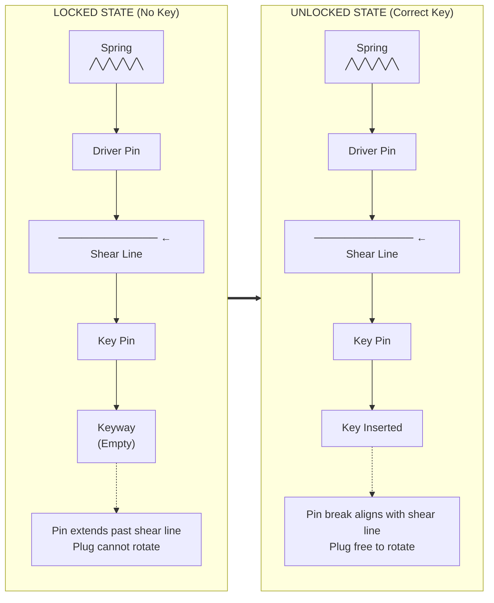

# Lesson 1: Lock Mechanisms: Pin Tumbler Theory

## 1. First-Principles Intuition & Invariants

The pin tumbler lock stands as one of the most elegant mechanical security devices ever conceived, balancing manufacturability, cost efficiency, and adequate security through a deceptively simple arrangement of spring-loaded cylinders. Invented by Linus Yale Sr. in the 1840s and refined by his son into the modern pin tumbler design we recognize today, this mechanism embodies a fundamental principle of mechanical access control: the translation of a unique linear code—the key's bitting pattern—into precise vertical displacement of multiple independent obstructions, aligning them simultaneously at a critical boundary known as the shear line.

At its core, the pin tumbler lock operates on a single invariant principle that every manipulation technique must exploit: the plug (the rotating cylindrical core containing the keyway) can only rotate freely within the shell (the stationary housing) when all pin stacks achieve perfect alignment at the shear line interface between these two components. In the locked state, spring-loaded driver pins extend from the shell cavity into the plug cavity, physically obstructing rotation through mechanical interference. The correct key lifts each pin stack to a precise height where the break point between the key pin (the lower segment that contacts the key) and the driver pin (the upper segment that interfaces with the spring) aligns exactly with the shear line plane. At this configuration, and only this configuration, no metal crosses the boundary between plug and shell, permitting the plug to rotate and actuate the cam or tailpiece that withdraws the locking bolt.

The genius of this design lies in its modularity and scalability. A lock manufacturer can create billions of unique key combinations simply by varying the lengths of key pins across typically five to seven chambers, with each pin position offering eight to ten discrete depths measured in increments of 0.015 to 0.020 inches. This quantized bitting system allows keys to be mass-produced through simple milling or stamping operations while maintaining sufficient security through combinatorial mathematics. A six-pin lock with nine possible depths per position yields 9^6 or over 530,000 theoretical key differs, though practical considerations like maximum adjacent cut specifications (MACS) reduce this space to prevent structural weakness in the key blade itself.

However, the very mechanical tolerances that make pin tumbler locks economical to manufacture also introduce the exploitable vulnerabilities that enable non-destructive manipulation. Every lock exists in the physical world of friction, material elasticity, and manufacturing variance. Pins do not sit perfectly centered in their chambers. Holes drilled in the plug and shell do not align with absolute precision. Springs compress with varying force curves. These imperfections, measured in thousandths of an inch, create the binding phenomenon that transforms lock picking from theoretical impossibility to practical skill.

## 2. Core Architecture & Mechanics

The pin tumbler lock assembly consists of four primary mechanical systems working in concert: the shell housing, the plug assembly, the pin stacks with spring retention, and the actuating mechanism. Understanding the precise geometry and tolerance relationships between these components reveals both the intended security model and its practical limitations.

The shell, typically machined from brass or zinc alloy, provides the structural foundation and houses multiple vertical pin chambers drilled perpendicular to the plug's axis of rotation. These chambers must be bored with sufficient precision that pins move freely under spring pressure without binding against the chamber walls, yet tight enough that lateral play does not permit pins to cant at severe angles. A typical chamber diameter of 0.115 inches accommodates 0.093-inch diameter pins with approximately 0.011 inches of radial clearance per side. This tolerance, while necessary for smooth operation, allows pins to shift laterally and cock at angles when external forces are applied.

The plug represents the heart of the mechanism, a cylindrical core precisely fitted to the shell bore with a diametric clearance of 0.002 to 0.004 inches total. This tight tolerance serves dual purposes: it prevents the plug from rattling during normal operation while still permitting free rotation, and it creates a well-defined shear line plane where any protruding metal produces immediate rotational interference. The keyway, milled or broached through the plug's longitudinal axis, determines what key profiles can enter and provides the primary defense against improper key insertion. Keyway geometries vary from simple open profiles suitable for tension wrench access to complex warded designs with multiple curves and protrusions that restrict both key blank availability and tool insertion angles.

Each pin stack functions as an independent mechanical gate that must be individually defeated for the lock to open. The key pin, machined to a precise length corresponding to one position in the depth code series, sits atop the key blade when inserted and transfers vertical force upward through the pin chamber. The driver pin, uniformly sized across all positions in most locks, rests atop the key pin and compresses the spring above. When no key occupies the keyway, driver pins are pushed by spring force until they bottom out against the plug, extending past the shear line and into the shell, creating the locked condition. The spring, typically a music wire compression spring with a rate of 20 to 40 grams-force per millimeter of compression, provides consistent downward pressure that maintains pin stack position and returns pins to the locked state when the key is removed.

The binding order phenomenon emerges from the compound effects of manufacturing tolerances and applied torque. When a picker applies rotational force to the plug using a tension wrench, the plug attempts to rotate within the shell but cannot complete the motion because driver pins obstruct its path. However, the small clearance between plug and shell allows the plug to rotate microscopically—typically 0.001 to 0.003 inches of arc travel at the shear line—before driver pins jam against both the plug chamber wall and the shell chamber wall. Due to unavoidable variations in hole alignment, one pin will bind first, bearing the entire load of the applied torque while other pins remain slack with minimal friction.

This binding pin creates a temporary pivot point. If a pick tool applies upward force to lift this binding pin stack until the driver pin rises above the shear line, the plug will rotate that additional microscopic increment until the next loosest pin begins to bind. Critically, when the driver pin of the first pin stack clears the shear line, it becomes trapped above the plug in the shell chamber by the rotational offset—the plug has moved forward but the driver pin cannot fall back down because it now sits partially above solid plug material rather than above the chamber opening. This is the set position, a mechanical memory state where correctly positioned pins remain elevated without continuous lifting force.

The picker proceeds through the binding order sequence, identifying each successive binding pin through tactile feedback transmitted through the pick shaft, lifting it to set, and allowing the plug to rotate another microscopic increment. When all pins achieve set positions with their break points above the shear line, the cumulative rotation from all pin sets allows the plug to complete a full revolution. This process explains why identical tension wrench pressure applied to multiple locks with the same key code will produce different binding orders—each lock's unique tolerance stack-up creates a distinct mechanical signature.

Standard pin tumblers already present formidable challenges to unskilled attackers, but security pins introduce deliberate geometric features designed to frustrate manipulation by generating false feedback. The spool pin, characterized by a narrow waist diameter machined into the driver pin body, creates a false set condition. When lifted to the correct height, the spool's wide shoulder initially catches on the plug chamber edge, mimicking the feel of a properly set pin. However, the plug cannot rotate fully because the spool's waist has not yet aligned with the shear line. If the picker releases tension to test the set, the spool may drop slightly, creating a characteristic counter-rotation of the plug that experienced pickers recognize as spool presence. Defeating spools requires maintaining precise tension while applying minute additional lifting force to drive the spool's waist through the shear line, then immediately reducing tension to let the spool settle into true set without dropping past the shear line.

Serrated pins feature multiple steps or ridges machined along the driver pin length, creating several potential false shear points. Each serration can momentarily catch at the shear line, producing a subtle click or resistance change that suggests a set pin. The picker must learn to distinguish true sets from serration catches by recognizing that serrated pins bind with noticeably higher resistance when a serration rests at the shear line, and that slightly over-lifting past a serration allows the pin to drop to the next lower serration rather than falling completely.

Mushroom pins employ a rounded or conical tip on the driver pin that, when lifted under tension, can catch on the edge of the plug chamber at an angle rather than rising cleanly. This angular binding causes the mushroom pin to cant or twist within the chamber, wedging itself against the chamber walls and creating exceptional resistance to further lifting. The plug may even appear locked despite several pins being set because the mushroom's geometry creates additional friction points. Defeating mushrooms often requires a technique called pin dancing or jiggling, where the picker applies oscillating pressure while maintaining tension, allowing the mushroom to reposition until it achieves vertical alignment and lifts cleanly.

## 3. High-Performance Optimization & Failure Modes

Mastering pin tumbler manipulation demands developing a sophisticated mental model of the lock's internal state based entirely on indirect sensory feedback transmitted through tools into the picker's hands. This process begins with tension wrench selection and placement, which governs the entire manipulation workflow. The tension wrench, inserted into the keyway before the pick, applies rotational torque to the plug and serves as both the binding order selector and the mechanical memory that retains set pins.

Tension magnitude directly controls binding order intensity and tactile feedback clarity. Insufficient tension—typically less than 50 grams-force at the wrench tip—allows pins to bind so lightly that set pins may fall back before the next pin is addressed, and the picker receives minimal feedback about binding states. Excessive tension—beyond 300 grams-force for standard locks—can cause multiple pins to bind simultaneously, crushing key pins against the bottom of their chambers and preventing them from lifting smoothly. Optimal tension creates clear, unambiguous binding on exactly one pin while allowing other pins to move freely with minimal resistance. This goldilocks zone varies between locks and must be calibrated through iterative testing at the start of each picking session.

Tension wrench geometry significantly affects tool control and keyway access. Bottom-of-keyway (BOK) tension wrenches insert into the lower keyway profile, leaving the upper region clear for pick insertion but providing limited mechanical advantage due to the short lever arm. Top-of-keyway (TOK) wrenches engage the upper keyway warding, offering superior leverage and more consistent torque application, particularly in dimple locks or keyways with restricted lower profiles. The picker must evaluate keyway geometry to determine which wrench style permits adequate pick access while maintaining stable tension throughout the manipulation sequence.

Pick selection follows tension wrench placement and depends on both lock characteristics and manipulation strategy. The hook pick, featuring a narrow tip with a pronounced upward curve, excels at individually addressing pins in standard pin tumbler locks, allowing precise control over which pin receives lifting force. The picker inserts the hook to the rear of the keyway, applies tension, and draws the hook forward while applying light upward pressure, feeling for the binding pin through the tool's shaft. When encountering resistance indicating a binding pin, the picker applies incremental lifting force until feeling the subtle click or sudden resistance drop signaling that the driver pin has cleared the shear line and set.

Rake picks, characterized by multiple bumps, waves, or peaks along the shaft, trade precision for speed by simultaneously agitating multiple pins. Raking generates rapid vertical pin movement that may cause several pins to randomly achieve set positions through kinetic energy transfer and spring rebound dynamics. While faster than single-pin picking when successful, raking proves ineffective against security pins and high-tolerance locks where precise control is mandatory. Advanced pickers use hybrid approaches: raking to quickly set easily-manipulated pins, then switching to hook picking for stubborn or security pin positions.

The single-pin picking (SPP) workflow proceeds through a methodical cycle: apply base tension, insert pick to rear, identify binding pin through resistance testing, lift binding pin to set while monitoring plug rotation, release pick pressure, verify set by testing for counter-rotation, and advance to next binding pin. This cycle repeats through the entire pin stack, with the picker continuously adjusting tension based on feedback. A correctly set pin should remain elevated when pick pressure is removed and tension is maintained. If releasing pick pressure causes the plug to counter-rotate, the just-set pin likely contained a security pin that requires additional manipulation.

Overset pins represent one of the most common failure modes, occurring when excessive lifting force drives a driver pin completely above its chamber in the shell, allowing the key pin to rise past the shear line into the shell cavity. The plug cannot rotate because the key pin now obstructs the shear line from above, mimicking the locked state. Distinguishing overset pins from unset pins requires attention to subtle feedback differences: overset pins typically exhibit high resistance throughout their range of motion because the driver pin's spring is maximally compressed, while unset pins show a clear binding point followed by easier movement. Correcting an overset requires reducing tension to allow the pin stack to drop, then re-approaching with more conservative lifting force.

Pin drift occurs when set pins drop back into the plug due to vibration, inadequate tension, or excessive time elapsed during manipulation. This failure mode frustrates beginners who successfully set several pins only to find the lock returns to a locked state as they address later positions. Pin drift emphasizes the importance of maintaining consistent tension throughout the picking session and working efficiently through the binding order. Experienced pickers develop timing awareness, recognizing when to accelerate their pace to complete the sequence before mechanical memory degrades.

False sets emerge when security pins partially bind at incorrect positions, creating the illusion that fewer pins require setting. The plug may rotate several degrees, suggesting significant progress, but then refuses further rotation. The picker must recognize false set patterns: a plug that rotates easily then suddenly locks hard suggests remaining unset pins or security pin serrations catching at intermediate positions. Escaping false sets requires releasing tension to reset the lock state, then reapplying tension with modified magnitude to alter the binding order or addressing visible security pins with specialized techniques.

Lock manufacturers continuously evolve pin tumbler designs to defeat known manipulation techniques. Tapered driver pins gradually increase in diameter from bottom to top, so that as they rise toward set positions, they bind progressively tighter in their chambers, requiring escalating force to complete the lift. This design punishes imprecise tension and feedback interpretation. Sidebar mechanisms add a secondary locking element: a spring-loaded bar in the shell that must align with gates cut into driver pins at precise rotational positions, defeating manipulation that focuses solely on vertical pin alignment. High-security cylinders incorporate trap pins that, when manipulated incorrectly, trigger mechanical locks or armored inserts that permanently jam the plug.

Counter-manipulation training requires studying these advanced features through progressive lock selection. Begin with clear acrylic practice locks that permit visual confirmation of pin positions and shear line alignment, developing the connection between tactile feedback and actual mechanical states. Advance to standard pinned locks with minimal security features to establish baseline proficiency in binding order identification and tension control. Introduce security pins one at a time, first mastering spool detection and manipulation, then serrated pins, then mushroom pins, before encountering locks with multiple security pin types simultaneously. This scaffolded progression builds pattern recognition and motor memory that enable real-world lock defeat under field conditions where visual feedback is unavailable and time pressure is significant.
