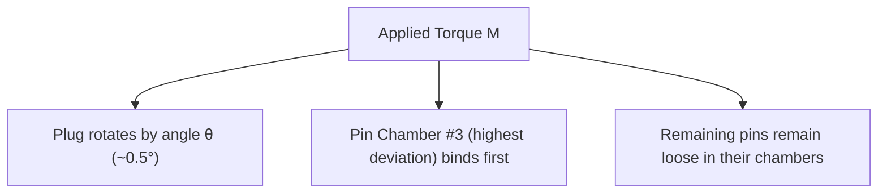
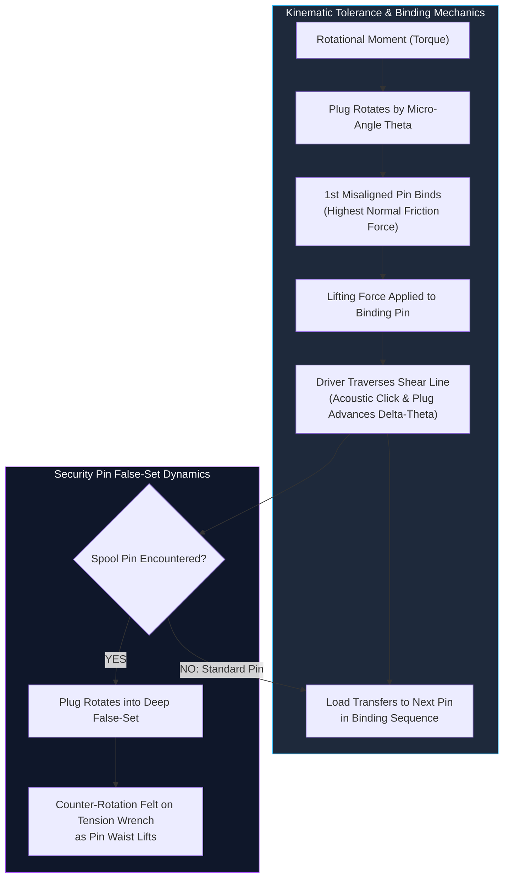
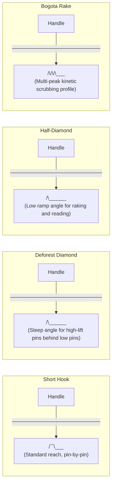
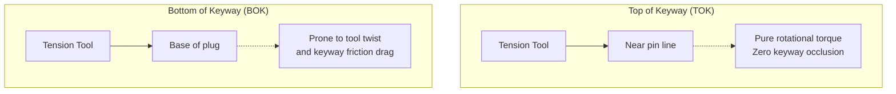

# Lesson 3: Pick Geometry, Feedback Mechanics, and Security Pin Dynamics

## 1. First-Principles Intuition & Invariants

Pin tumbler lock security is fundamentally a study in manufacturing tolerances and friction physics. In a theoretically perfect lock where every pin chamber is drilled precisely along the cylinder's true axial centerline with zero diameter variance, applying rotational torque to the plug would cause all driver pins to bear against the cylinder wall simultaneously. In such an idealized mechanism, picking would be mathematically impossible because the plug cannot rotate even a fraction of a degree without shearing all pins at once.

In physical manufacturing, however, CNC and drilling jigs exhibit inevitable positional tolerances ($\pm 0.015\text{--}0.030\text{ mm}$). When a rotational moment (torque) is applied to the plug, these microscopic variances dictate that **exactly one pin chamber will make contact with the cylinder wall first**:

The governing physical invariant of single-pin picking is **the binding order principle**:

$$\text{Binding Order} = \operatorname{argsort}_{i} \left( \vec{r}_i \times \vec{F}_{\text{shear}} \right)$$

As lifting force is applied to the binding pin, the driver pin traverses the shear line. When the parting line between key pin and driver pin aligns with the plug perimeter, the lateral rotational force causes the plug to advance by a microscopic fraction of a millimeter ($\Delta \theta \approx 0.02^\circ$). This creates a mechanical "shelf" that traps the driver pin above the shear line while the key pin falls back into the plug under gravity. The rotational load immediately transfers to the *second* most misaligned pin chamber, establishing a deterministic sequential progression.

---

## 2. Core Architecture & Kinematic Tool Geometries

### 2.1 Pick Profile Geometries & Vector Dynamics

A lock pick functions as a first-class lever transmitting tactile acoustic and frictional feedback from the pin tip to the practitioner's fingers. Pick profiles are engineered with specific tip radii and reach angles to navigate paracentric keyways without disturbing adjacent pins:

1. **Short Hook**: The primary analytical tool for single-pin picking (SPP). Features a flat or slightly concave tip that cradles the rounded bottom of a key pin, maximizing force transfer along the pin's vertical axis without slipping off laterally.
2. **Deforest / High-Reach Hook**: Features a steep $45^\circ\text{--}60^\circ$ angular offset designed to reach deep into a paracentric keyway to lift a high pin (deep cut) situated directly behind a low-hanging pin without accidentally oversetting the forward pin.
3. **Shaft Thickness & Deflection**: Precision picks are manufactured from cold-rolled stainless steel or high-carbon spring steel in standardized thicknesses:
   - $0.025\text{ in}$ ($0.635\text{ mm}$): High rigidity, standard commercial keyways (Schlage SC1, Kwikset KW1).
   - $0.018\text{--}0.020\text{ in}$ ($0.457\text{--}0.508\text{ mm}$): Intermediate thickness for tight paracentric European keyways (Yale, Cisa).
   - $0.015\text{ in}$ ($0.381\text{ mm}$): Maximum access profile for highly restrictive keyways, requiring delicate tension to prevent shaft buckling.

### 2.2 Tension Dynamics: Top of Keyway (TOK) vs. Bottom of Keyway (BOK)

Tension control represents $90\%$ of physical feedback control. The placement of the tension tool determines mechanical leverage and rotational stability:

- **Top of Keyway (TOK)**: The flat pry bar engages the top edge of the keyway directly above the pins. Because the rotational force vector is applied near the pin line, it produces pure axial rotational torque without flexing the plug against the bottom of the cylinder housing. It leaves the entire keyway open for pick articulation.
- **Bottom of Keyway (BOK)**: A standard L-wrench placed at the bottom of the keyway. While easy to position, BOK tension can wedge the lower edge of the plug into the housing body, creating parasitic friction that masks subtle counter-rotation feedback.

---

## 3. Advanced Security Pin Kinematics & Counter-Rotation

High-security cylinders employ modified pin profiles designed to actively mislead the picking process by catching in the shear line before reaching true set:

### 3.1 Spool Pins and False Sets

A spool pin features a reduced-diameter center waist bounded by full-diameter top and bottom flanges:
1. **Entering the False Set**: As the spool pin lifts, its narrow waist crosses the shear line. Because the waist is narrower than the pin chamber, the plug immediately rotates by several degrees ($\theta \approx 3^\circ\text{--}5^\circ$). This is the **false set**.
2. **Counter-Rotation**: To lift the spool pin out of the false set, the pick must push against the lower flange. Because the lower flange is wider than the waist, it cannot enter the cylinder housing until the plug is pushed *backwards* against the tension direction. This sensation of the tension wrench pushing back against the practitioner's finger is **counter-rotation**.
3. **Setting the Pin**: The practitioner must slightly relax tension finger pressure, allowing the plug to rotate backward just enough for the lower flange to clear the shear line, dropping into a true set with a distinct tactile release.

### 3.2 Serrated Pins

Serrated driver and key pins feature multiple micro-grooves along their outer diameter. As a serrated pin is lifted, each groove snaps into the shear line, producing a false "click" and slight plug movement identical to a true set. The diagnostic indicator is feedback: an overset or false-set serration feels stiff and gritty, whereas a truly set pin exhibits a slight micro-jiggle when tapped with the pick tip.

---

## 4. Summary & Verification Matrix

| Pin Type | Mechanical Behavior | Tactile Feedback Indicator | Resolution Technique |
|:---|:---|:---|:---|
| **Standard Pin** | Continuous friction until set | Solid click + plug rotation $\Delta \theta \approx 0.02^\circ$ | Progressive vertical lift along binding order |
| **Spool Pin** | Narrow waist enters shear line | Deep false set + strong counter-rotation | Controlled tension relaxation during lift |
| **Serrated Pin** | Micro-grooves catch in shear | Multiple shallow clicks + gritty resistance | Light tension; test for pin spring jiggle |
| **Mushroom Pin** | Tapered head binds at angle | Gradual counter-rotation followed by snap | Progressive feather-light tension release |
