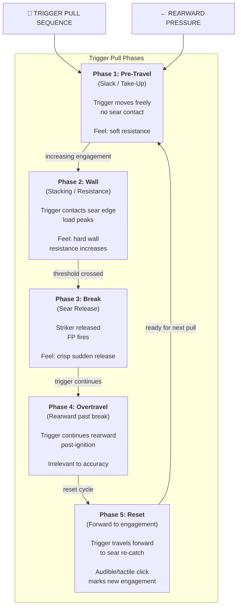
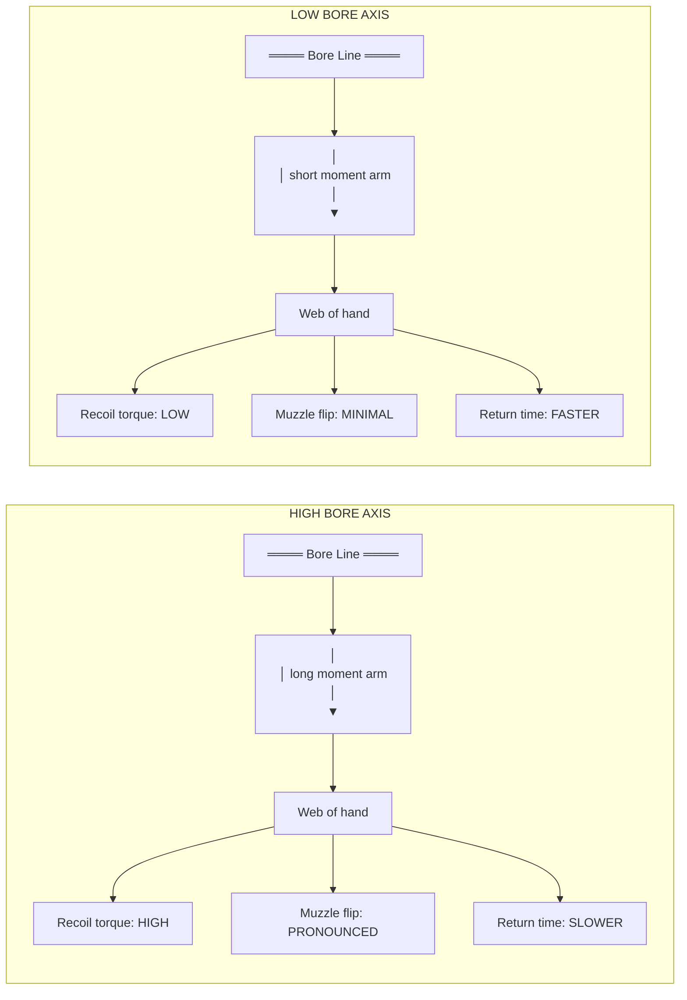
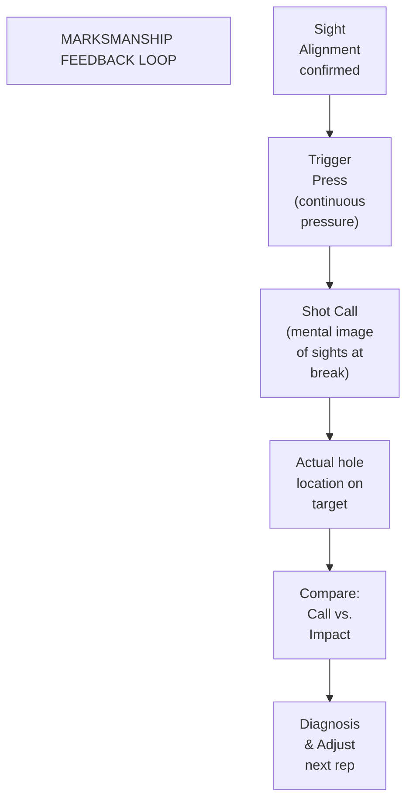

# Lesson 2: Trigger Control and Recoil Management

## 1. First-Principles Intuition & Invariants

The fundamental problem of marksmanship is deceptively simple to state and profoundly difficult to solve: at the precise moment a firing pin strikes a primer, the muzzle must be pointed exactly where the shooter intends. Everything in marksmanship training, from grip mechanics to breathing cadence to follow-through discipline, is a systematic effort to hold that moment of ignition still against the turbulent forces the human body constantly generates. Trigger control and recoil management are not two separate skills bolted together by curriculum convention. They are the forward and backward faces of a single mechanical truth: the shot break and its aftermath form one continuous event, and mastery of both phases is inseparable.

Understanding why this is hard requires honest reckoning with human neurology. The firing of a weapon is, in evolutionary terms, a threat stimulus. The concussive report, the muzzle flash, and the sharp rearward impulse are interpreted by the brainstem as signals demanding a flinch response — a protective contraction of facial and shoulder musculature that predates conscious thought by roughly 300 milliseconds. This flinch, commonly called anticipation, is the single most pervasive accuracy-destroying behavior in all of shooting. It manifests as a downward push of the muzzle fractions of a second before the cartridge actually fires, as the shooter's nervous system preemptively braces against the perceived impact. The result is a shot that breaks low and, depending on hand dominance, slightly left or right of the intended point of impact. What makes anticipation particularly treacherous is that it feels correct from the inside. The shooter who flinches hard enough to move the muzzle six inches at twenty-five yards will often report that the trigger press felt smooth and the sight picture was steady. The body lies convincingly.

The invariant that governs all effective trigger technique is the principle of **surprise break**. This does not mean firing randomly — it means that the neuromuscular chain controlling the trigger finger must be isolated from the neuromuscular chain monitoring the sight picture, so that the precise instant of sear release remains temporally unpredictable to the shooter's anticipatory reflexes. When the trigger finger applies steady, continuous rearward pressure without any rhythmic hesitation or accelerating surge, the brainstem never receives a cue precise enough to time the flinch response. The shot fires "by itself." This is not mysticism; it is applied neuroscience. By removing the temporal cue, you deny the startle-response circuit the information it needs to fire preemptively.

The second invariant is **mechanical isolation**, the ability to move the trigger finger through its full range of travel without introducing movement in any adjacent structure. The trigger finger is anatomically entangled with the middle and ring fingers through shared flexor tendon pathways. When untrained shooters press the trigger with authority, the sympathetic contraction of the other fingers tightens the grip, shifts the muzzle, and ruins the shot before the sear even releases. Training the trigger finger to operate as an independent actuator is a matter of hundreds of thousands of dry-fire repetitions building new motor programs, not a cognitive correction one can simply decide to apply under stress.

The third invariant governs the period after the shot: **recoil does not destroy accuracy; anticipation of recoil does.** A pistol cycling through its recoil impulse is well past the point of any shooter influence on that round's trajectory. The bullet leaves the barrel in roughly one millisecond. The rearward impulse felt by the shooter takes fifty to one hundred milliseconds to fully manifest. These numbers make clear that any muscular bracing performed before the shot is entirely anticipatory and entirely destructive. Recoil management, properly understood, is not about resisting recoil — it is about establishing a platform geometry that channels the recoil impulse along predictable vectors so the sights return to the same point of aim with minimum time and effort. Resistance and control are different physical strategies with radically different outcomes.

---

## 2. Core Architecture & Mechanics

### The Trigger Mechanism as a Mechanical System

To control the trigger intelligently, the shooter must understand what they are actually manipulating. All service-pistol and rifle trigger mechanisms, regardless of platform, reduce to the same functional architecture: a sear holds the striker or hammer under spring tension, and the trigger linkage progressively reduces the mechanical advantage of that sear until, at a defined travel point, the contact surfaces separate and the firing pin is released. The geometry of those sear surfaces and the spring rates involved determine every tactile quality the shooter experiences — the take-up, the wall, the break, and the reset.

The *wall* is the tactile keystone of trigger management. It is the point at which the sear geometry has reached its threshold and additional pressure in the range of grams, not kilograms, will cause the break. A trained shooter rides the wall: they apply pre-travel pressure to consume slack, feel the wall engage, then transition to a slow, steady squeeze that delivers the final increment of force with no acceleration. Accelerating through the wall — hurrying the final press — is the mechanical act that creates the involuntary flinch response, because it provides exactly the temporal cue the brainstem needs to initiate its anticipatory contraction.

### Striker-Fired vs. Single-Action vs. DA/SA Dynamics

Each trigger architecture presents distinct tactile feedback and demands a specifically adapted technique. A single-action trigger, such as that found on a 1911 or a fully cocked competition revolver, presents a short, light break with minimal pre-travel. The wall appears almost immediately and the break requires little force, often 2 to 4 pounds. This rewards fine motor control and penalizes any acceleration whatsoever. Because the mechanical advantage ratio is steep, even a small surge in finger speed at the wall produces a disproportionate muzzle disturbance.

The striker-fired trigger, exemplified by the Glock, Walther PPQ, and SIG P320 families, presents a longer pre-travel designed to serve as a passive safety buffer, followed by a moderate wall and a consistent break in the 5 to 7 pound range depending on configuration. The extended pre-travel, often dismissed by single-action shooters as "mushy," actually provides a valuable real-time biofeedback channel: the shooter can feel the trigger's progression and time their final squeeze to the moment sight alignment is confirmed. For duty and defensive contexts, this architecture has proven itself across decades of field use precisely because its longer pre-travel is forgiving of the gross motor degradation that accompanies high-stress encounters.

Double-action/single-action pistols, such as the Beretta 92 and SIG P226, demand the most adaptive technique because the first trigger pull is a heavy, long double-action stroke (typically 10 to 12 pounds, with 0.5 inches or more of travel) while subsequent rounds fire in single-action mode. The shooter must have two distinct, well-grooved motor programs available and must transition between them without breaking cadence. Failure to adapt produces dramatically different first-shot and follow-up shot placements — a diagnostic pattern immediately visible on the target.

### Grip Architecture and Recoil Vector Control

The grip is the shooter's mechanical interface with the recoil impulse. Its geometry determines whether that impulse travels directly rearward along the bore axis or generates a rotational moment about the shooter's wrist joint. The ideal grip structure on a semi-automatic pistol positions the bore axis as low as possible relative to the web of the shooter's hand. This minimizes the moment arm through which the recoil force acts. The difference between a low-bore-axis pistol like the Walther PDP and a higher-bore-axis design is tangible in rapid-fire strings: a 10 to 15 millisecond difference in return-to-target time per shot compounds significantly across a multi-round sequence.

The shooter's grip must be **maximally high** on the back strap to minimize this moment arm, and the support hand must fill every available space on the frame that the firing hand does not occupy. The firing hand provides roughly 60% of total grip pressure, concentrated through the middle, ring, and pinky fingers clamping the grip to the palm. The support hand wraps over the firing hand's fingers and applies independent, lateral crushing pressure, driving the two palms together. This creates a hydraulic clamp around the grip rather than a muscular squeeze applied in a single direction. The combined grip pressure in competition shooting contexts is typically 60 to 70% of the shooter's maximum grip strength — firm enough to control recoil impulse, loose enough to prevent the forearm tension that contaminates trigger finger independence.

Wrist position is structural, not stylistic. Both wrists should be canted slightly forward — often called "breaking the wrists down" — which tensions the extensor muscles of the forearms and pre-loads the system to resist rearward rotation. Limp wrists during the firing sequence, a condition that also causes semi-automatic malfunctions by preventing the slide from cycling against a stable frame, allow the recoil impulse to dissipate through joint rotation rather than being absorbed along the shooter's skeletal structure through the arms, into the shoulder girdle, and ultimately into the body's mass.

### The Feedback Loop: Sight Tracking and Shot Call

Shot calling is the practice of reading one's own sight picture at the precise instant of the break and predicting, before looking at the target, exactly where the shot landed. It is the closed-loop validation mechanism of marksmanship, and its absence is the clearest sign of an untrained shooter.

If the shot call matches the impact location, the shooter's read of their own technique is calibrated. If the shot lands lower than called, anticipation is driving the muzzle down before the break. If the shot lands where called but off-center, the sight picture itself was misread — a front sight focus problem or a parallax issue. The diagnostic power of this loop is that it separates errors in the fire-control system (trigger and grip mechanics) from errors in the aiming system (sight alignment and sight picture), which are entirely different root causes demanding entirely different corrections.

---

## 3. High-Performance Optimization & Failure Modes

### Eliminating Anticipation: The Diagnostic Protocols

Anticipation cannot be reasoned away. It can only be extinguished through conditioning that removes the brainstem's ability to predict when the shot will fire. The two most field-validated protocols for this are the ball-and-dummy drill and the dryfire isolation regimen.

In the ball-and-dummy drill, a training partner loads the magazine with an unpredictable mixture of live rounds and empty dummy rounds (snap caps), chambering them so the shooter has no foreknowledge of the sequence. When the striker falls on a dummy round, the shooter's muzzle behavior in the absence of recoil is revealed with brutal honesty. A shooter who flinches will drive the muzzle sharply downward on dummy rounds in a way that is completely invisible to them during live fire because the recoil masks the motion. The video evidence from a simple phone mounted at bench height behind the shooter during this drill is often genuinely confronting for practitioners who believed their technique was clean. The correction process is then straightforward: dry-fire the platform until the sight stays still through the break, then reintroduce live ammunition with continued dummy-round interruptions to verify the conditioned response has generalized.

Dry-fire practice is not merely a replication of live-fire mechanics without the expense of ammunition. It is neurologically superior for building trigger control because it eliminates the aversive stimulus entirely. Without the report and recoil to trigger anticipatory responses, the shooter can build thousands of repetitions of the pure motor program — continuous rearward pressure, surprise break, steady sights — before the startle circuit ever gets involved. The standard dry-fire block at the advanced level runs fifty to one hundred repetitions per session, minimum five sessions per week, with each repetition being deliberate and self-evaluated. Mindless repetition without active feedback produces grooved mediocrity, not mastery.

### Reset Exploitation and Split-Time Reduction

For practitioners whose work demands multiple fast hits on target, trigger reset mechanics become a primary performance variable. The reset is the minimum forward travel required to re-engage the sear after the shot breaks. By riding the trigger forward only to the reset point (confirmed by both the tactile click and the slight increase in forward resistance) rather than allowing it to travel fully forward to the pre-travel start position, the shooter reduces the total trigger travel distance on subsequent shots.

This shortened travel has a direct effect on split time — the interval between fired rounds in a rapid-fire string. At the advanced level, splits on a standard silhouette target at seven meters should approach 0.15 to 0.18 seconds for trained defensive shooters and sub-0.12 seconds for open-division competition shooters who have invested in reduced-power trigger springs and polished sear geometry. The practical ceiling for split times is set not by trigger reset mechanics alone, but by the shooter's ability to visually process and confirm an acceptable sight picture between shots. Splits achieved by shooting before the sights have been verified represent a deterioration in accuracy masking, not genuine speed improvement.

The practical reset drill is straightforward in structure and demanding in execution. From a stable two-hand hold, the shooter fires a round, allows the trigger to travel forward only until the reset click is felt and heard, then immediately applies rearward pressure again, holding the sight picture throughout. The key failure mode is resetting too far forward under time pressure: when shooters rush, they release the trigger fully out of habit, adding unnecessary travel and time to each subsequent shot. The cure is dry-fire at slow speed, building the proprioceptive map of exactly where the reset point lives for a given firearm, then gradually increasing the tempo while maintaining tactile awareness of that position.

### Platform-Specific Recoil Management: Rifles and Carbines

The recoil management principles that govern pistol work translate to long guns with significant modifications. A direct-impingement AR-15 pattern rifle distributes its recoil impulse differently than a piston-driven AK pattern, and the shooter's body position must account for these differences. The direct-impingement system returns a portion of its operating energy through the buffer tube directly into the shooter's shoulder, creating a relatively linear rearward impulse. The piston system generates an earlier, sharper impulse as the piston rod strikes the carrier key, often producing a slightly more pronounced muzzle rise.

For carbine platforms, stock placement on the shoulder is the primary recoil-management variable. The stock should be seated in the pocket formed between the deltoid and the pectoral muscle, not on the deltoid cap itself. Contact on the deltoid cap allows the rifle to rotate during recoil about a fulcrum point too far from the bore axis, increasing muzzle rise. In the pocket, with the elbow of the firing arm dropped toward natural position and the support hand gripping forward on the handguard at a point that creates approximately 45 degrees of elbow flex, the system locks into a stable triangle of support. The body lean should be aggressive and forward-biased: weight on the balls of the feet, slight knee flex, shoulders ahead of hips. This posture pre-loads the musculoskeletal system to absorb rearward impulse through the entire body mass rather than having it checked by wrist and elbow joints alone.

### Failure Mode Analysis: Reading the Target Diagnostically

An advanced practitioner reads a target the way a machinist reads a surface plate — as a measurement instrument providing objective process feedback. The spatial distribution of shots reveals the specific mechanical failure at the root of each error, and experienced shooters develop the ability to diagnose their own technique from downrange evidence without needing an observer.

Shots consistently low and to the support-hand side (low-left for right-handed shooters) indicate classic anticipatory flinch: the trigger finger surges, the support hand sympathetically tightens, and the muzzle drives down and across before the break. Shots consistently high and rearward indicate a heeling response — the shooter is pushing the heel of the hand forward against the anticipated recoil rather than flinching downward. This is a less common but equally destructive variant of the same underlying anticipation problem.

Shots consistently in the correct elevation but scattered horizontally suggest grip instability between shots: the shooter is re-gripping between rounds rather than maintaining consistent pressure throughout the string. Shots that are accurate for the first round but drift progressively off-center through a magazine suggest fatigue-induced grip degradation, which requires either conditioning work or a grip architecture modification to distribute load more efficiently across the hand. A single flier in an otherwise tight group almost always indicates trigger freeze — a momentary hesitation at the wall as the shooter waited for a perfect sight picture and then rushed the break when their patience expired. The cure is to restart the press from the beginning: come off the wall, apply fresh continuous pressure, and trust the process.

The highest-resolution diagnostic tool available to the advanced practitioner is a video camera at high frame rate, minimum 120 frames per second, positioned to capture muzzle behavior from a lateral or slightly elevated angle. Shot strings recorded at this frame rate allow frame-by-frame analysis of muzzle movement during the trigger press, isolating anticipatory dip before ignition from normal recoil displacement after it. The physiological evidence visible in this footage often resolves disagreements between what a shooter believes their technique looks like and what it actually produces — a distinction that years of feeling-based self-assessment cannot bridge. Objective measurement, not subjective confidence, is the instrument of genuine advancement.
