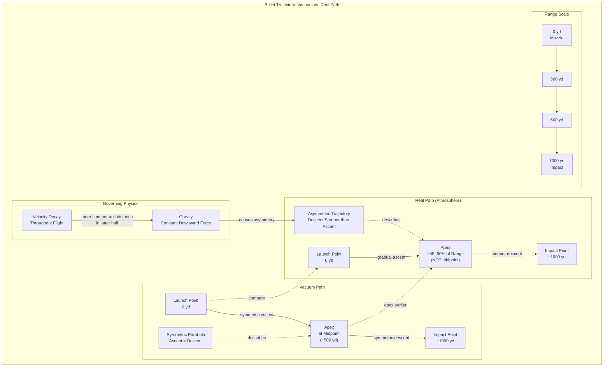
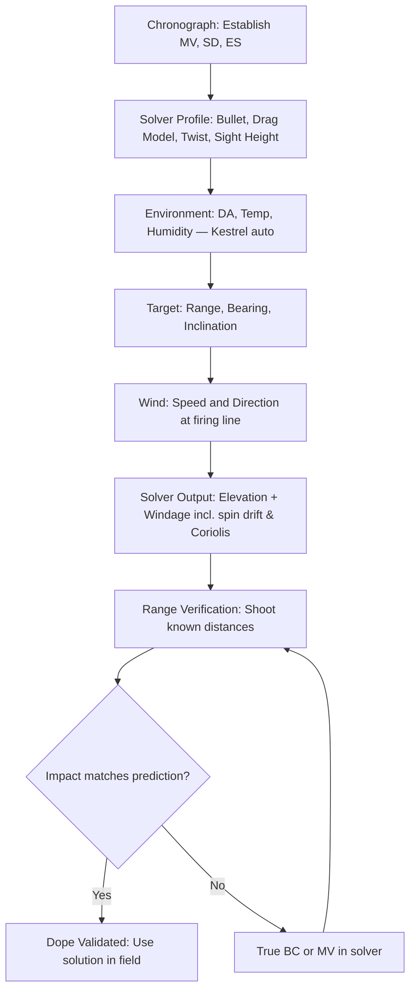

# Lesson 3: Ballistics and Environmental Factors

## 1. First-Principles Intuition & Invariants

The bullet's life divides into two phases, and the line between them is the muzzle crown. Internal ballistics — the chamber pressure curve, the engraving of the bullet into the rifling, the acceleration through the bore, and the final burst of expanding gas that releases it — ends the instant the projectile clears the muzzle. Everything that follows is external ballistics: the long, governed flight through air, where the projectile is subject to forces that the shooter can measure, model, and compensate for, but never eliminate. A marksman who understands the physics of this flight can predict where the bullet will land. One who does not is gambling with every pull of the trigger.

Three forces dominate the bullet's path from muzzle to target, and every ballistic solution is a calculation of their interaction. Gravity is the simplest and the most relentless. It accelerates the bullet downward at 32.174 feet per second squared for every instant of flight, completely indifferent to the bullet's mass, shape, or velocity. A 175-grain .308 bullet and a 300-grain .338 bullet dropped from the same height will hit the ground at the same time. This means that the only defense against gravity is to reduce the time of flight — either by launching the bullet faster, by reducing the drag that slows it, or both. When a marksman dials elevation into a scope, he is not counteracting gravity in any direct sense. He is angling the bore upward so that the bullet's arcing path passes through the target's height at the precise moment the bullet reaches the target's distance. The entire vertical correction is a time-of-flight problem expressed in angular units.

Aerodynamic drag is the second force, and it is the one that makes external ballistics a nonlinear, counterintuitive discipline rather than a simple parabola. Drag opposes the bullet's velocity vector, and its magnitude is roughly proportional to the square of the bullet's velocity. At the muzzle, where the bullet is moving at 2,600 to 3,000 feet per second, the air resistance is enormous — the bullet loses velocity at its highest rate in the first hundred yards, then progressively less as it slows. This means the trajectory is not symmetric. In a vacuum, the bullet's path would be a perfect parabola with its apex at the midpoint of the range, because the horizontal velocity would remain constant. In air, the bullet decelerates continuously, so it spends more time in the descending half of the trajectory than in the ascending half. The apex shifts to roughly 55 to 60 percent of the distance to target, and the descending portion of the curve grows progressively steeper as the bullet slows and gravity has more time to act per unit of horizontal distance traveled. This is why drop per hundred yards is not constant: a .308 Winchester 175-grain Sierra MatchKing at 2,650 fps might drop 6 additional inches between 400 and 500 yards but 18 additional inches between 900 and 1,000 yards. The curve compounds on itself.



The Magnus force, the third actor, is the smallest and most often ignored, but it becomes relevant at extended range. A spinning bullet in a crosswind experiences a lateral pressure differential between its top and bottom surfaces, producing a small vertical force. In practice, the Magnus effect's contribution to vertical deflection is negligible compared to other factors and is absorbed into the empirical truing process. It is calculated by advanced solvers like Applied Ballistics but rarely called out separately on a dope card.

The ballistic coefficient is the master variable that ties all of this together. It describes how efficiently a bullet penetrates the air, and it is the single number that most determines the shape of the trajectory after the muzzle velocity sets the baseline. The ballistic coefficient is defined as the ratio of the bullet's sectional density to its form factor: $BC = SD / i$, where sectional density is $SD = W / (7000 \times d^2)$ with $W$ the bullet weight in grains and $d$ the bullet diameter in inches, and $i$ is a dimensionless form factor derived from comparing the bullet's drag profile to a reference projectile. A higher BC means less drag per unit mass, which means the bullet retains velocity longer, reaches the target in less time, and drops less at any given range. The difference between a bullet with a BC of 0.400 and one with a BC of 0.700 at 1,000 yards can be twenty MOA of elevation or more — the difference between a manageable dial-up and running out of scope adjustment.

The critical complication is that the ballistic coefficient is not a single, fixed number. It is a ratio between the bullet's actual drag and the drag of a standardized reference projectile, and there are multiple reference standards. The G1 drag model, developed in the late nineteenth century by Francis Bashforth and later refined by M. J. Ingalls, is based on a flat-base, two-caliber-ogive projectile that looks nothing like a modern long-range bullet. Ammunition manufacturers have historically published G1 BCs because they produce large, impressive-looking numbers, and because the G1 model was the only one available for decades. A modern boat-tail, low-drag match bullet like the 175-grain Sierra MatchKing might carry a published G1 BC of approximately 0.505, but this number is an average that changes across velocity bands. The actual drag of the bullet at 2,800 fps is different from its drag at 1,400 fps, and the G1 model does not track those changes the way the bullet does.

The G7 drag model, standardized by the Aberdeen Proving Ground in the 1960s and popularized for long-range shooting by Bryan Litz, is based on a boat-tail projectile that closely matches the geometry of modern match bullets. A G7 BC for the same 175-grain Sierra MatchKing is approximately 0.260 — a smaller number, but one that remains far more stable across the velocity range the bullet actually traverses. When entered into a ballistic solver, the G7 BC produces more accurate predictions at long range because the reference projectile's drag curve matches the real bullet's drag curve more closely. This is the first and most common error shooters make in ballistic calculations: using a G1 BC with a G7 solver setting, or vice versa. The drag model and the BC must be matched. A G1 BC of 0.505 entered as a G7 value will produce catastrophic prediction errors at distance.

Several invariants govern every ballistic solution, and internalizing them eliminates most of the confusion that surrounds long-range shooting. First, gravity is constant and affects every bullet identically regardless of weight or design. The only defense is time of flight. Second, drag is proportional to the square of velocity, which means the bullet decelerates hardest at the muzzle and progressively less as it slows. Third, the ballistic coefficient scales the drag: a bullet with twice the BC experiences roughly half the drag deceleration. Fourth, muzzle velocity sets the baseline trajectory, and every environmental factor either modifies the effective muzzle velocity (powder temperature) or modifies the drag (air density, wind). Fifth, the trajectory is never a parabola in air — it is a decaying curve whose steepness increases with range. Sixth, every correction applied to the scope is an angular adjustment that compensates for a physical displacement at the target distance, and the relationship between angle and displacement is linear: 1 MIL equals 3.6 inches at 100 yards, 36 inches at 1,000 yards, and 3.6 inches times the range in hundreds of yards at any distance.

## 2. Core Architecture & Mechanics

### The Ballistic Solver's Input Model

A ballistic solver — whether it runs on a Kestrel 5700 Elite with Applied Ballistics, on a smartphone running Strelok Pro, or in Hornady's 4DOF engine — takes a defined set of inputs and computes the trajectory through numerical integration. Understanding what each input represents and how it affects the output is the difference between a solver that produces first-round hits and one that produces confident misses.

The gun profile is the solver's foundation. It consists of the bullet selection (which loads the appropriate drag model and BC), the muzzle velocity in feet per second, the twist rate in inches per turn and the twist direction (right-hand or left-hand, which determines spin drift direction), the zero distance, and the sight height — the vertical distance from the bore centerline to the scope's optical center, typically 1.5 to 2.5 inches. Sight height matters because the bore is angled upward relative to the line of sight to intersect the trajectory at the zero distance, and an incorrect sight height shifts the entire trajectory solution. The environmental inputs are barometric pressure, temperature, and humidity, which combine into density altitude. The target inputs are range, wind speed, wind direction, inclination angle, and bearing (azimuth) for Coriolis computation.

### Wind: Physics and Compensation

Wind is the factor that defeats more long-range shots than every other variable combined. The physics of wind deflection are counterintuitive in one critical respect: the wind does not blow the bullet sideways like a sail pushes a boat. Instead, the bullet builds a lateral velocity component during its flight, and the deflection is the integral of that lateral velocity over the time of flight. The commonly used approximation is $D = W \times (T - R / V_0)$, where $D$ is the deflection in feet, $W$ is the crosswind velocity in feet per second, $T$ is the actual time of flight, $R$ is the range in feet, and $V_0$ is the muzzle velocity. The term $(T - R/V_0)$ represents the difference between the actual time of flight and the time the bullet would take in a vacuum at muzzle velocity. This difference is the "lag time" — the extra seconds the bullet spends in the air because drag slowed it down — and it is during this extra time that the wind has its effect. A consequence of this formula is that wind deflection does not scale linearly with range. A 10 mph crosswind might deflect a .308 bullet 3 inches at 300 yards but 80 inches at 1,000 yards, because the lag time grows nonlinearly as the bullet slows.

A further consequence, poorly understood, is that wind near the muzzle has a greater effect than wind near the target. The bullet is moving fastest at the muzzle, so the drag is highest and the lateral force is greatest. More importantly, the lateral velocity the bullet acquires early in its flight carries through the entire remaining trajectory. A gust at 50 yards that imparts 2 fps of lateral velocity will deflect the bullet for the remaining 950 yards of a 1,000-yard shot, whereas the same gust at 950 yards only affects the last 50 yards. When a shooter faces different wind conditions along the range — a 10 mph left-to-right wind at the firing line and a 5 mph right-to-left wind at the target — the wind at the firing line must be weighted more heavily in the call.

The clock method provides a practical framework for determining the crosswind component from wind direction. Imagining the shooter at the center of a clock face with the target at 12 o'clock, the crosswind component is the wind speed multiplied by the sine of the angle from the 12 o'clock position:

| Clock Position | Angle from Target | Sine Multiplier | Value |
|---|---|---|---|
| 12 or 6 o'clock | 0° | 0.00 | No value (head/tail wind) |
| 1 or 11 o'clock | 30° | 0.50 | Half value |
| 2 or 10 o'clock | 60° | 0.87 | Three-quarter to full value |
| 3 or 9 o'clock | 90° | 1.00 | Full value |
| 4 or 8 o'clock | 60° | 0.87 | Three-quarter to full value |
| 5 or 7 o'clock | 30° | 0.50 | Half value |

A 10 mph wind from 2 o'clock is not a half-value wind, as is sometimes mistakenly taught — it is an 8.7 mph effective crosswind. The simplified "half value at 1 and 5 o'clock" approach works at shorter ranges but introduces errors at distance, where the difference between 50 percent and 87 percent of a 15 mph wind is 5.5 mph, enough to miss by several feet at 1,000 yards. The sine of the actual angle is always the correct multiplier.

### Reading Wind in the Field

The Kestrel wind meter at the shooting position tells you the wind where you are, not where the bullet is going. At distances beyond 600 yards, the wind at the target and at intermediate points along the trajectory may differ significantly from the wind at the firing line. Reading the wind along the entire path is a skill that separates competent marksmen from those who rely on luck.

Mirage is the most powerful wind-reading tool available to the long-range shooter, and it requires only a rifle scope. Heat radiating from the ground creates refractive layers in the air that are visible at high magnification as shimmering waves. To read mirage, focus the scope on the target, then back off the side focus (parallax) adjustment slightly until the mirage becomes sharp. The direction the waves are moving indicates the wind direction at the target distance. When mirage appears to boil — rising straight up — the wind is either calm or blowing directly toward or away from the shooter, with no crosswind component. When the waves lean left, the wind is moving right to left. Stronger wind flattens the mirage closer to the ground, and very strong wind suppresses it entirely, a condition experienced shooters call "no mirage, high wind."

Vegetation provides a secondary wind indicator that covers the intermediate trajectory. The Beaufort scale, adapted for shooting, gives approximate wind speeds from observable effects:

| Observation | Approximate Wind Speed |
|---|---|
| Smoke rises vertically, no leaf movement | 0–2 mph |
| Light smoke drift, leaves barely stir | 2–5 mph |
| Grass sways, light flags extend | 5–8 mph |
| Small branches move continuously | 8–12 mph |
| Large branches sway, small trees lean | 12–18 mph |
| Whole trees in motion, dust and debris lifted | 18–25 mph |

The skilled shooter integrates all available indicators: the Kestrel at the firing line, grass and brush movement across the intermediate terrain, and mirage at the target. When these disagree, the wind closest to the muzzle receives the greatest weight. When the wind is gusting, the shooter must time the shot for the conditions he called, not the conditions that exist when the trigger breaks — or hold for the average and accept the gust variability as group dispersion.

### Elevation Shooting: The Cosine Correction

Shooting at an upward or downward angle introduces a correction that, again, is counterintuitive. The common expectation is that shooting uphill requires more elevation because the bullet is climbing against gravity. This is wrong. Gravity acts perpendicular to the horizontal plane, not along the line of sight, and the bullet's drop is determined by the horizontal distance to the target, not the slant distance.

```
         Target
           /|
          / |
         /  |  Horizontal Distance = R × cos(θ)
        /   |
       /    |
      / θ   |
     /------+
    Shooter
     Slant Range (R) = laser-measured distance

  Corrected elevation = elevation for (R × cos θ)
  Apply the FULL slant-range dope for a horizontal
  distance of R × cos θ. Always dial LESS, whether
  uphill or downhill.
```

If a laser rangefinder measures 800 yards to a target positioned at a 30-degree downward angle, the horizontal distance is $800 \times \cos(30°) = 800 \times 0.866 = 693$ yards. The shooter dials the elevation for 693 yards, not 800. The time of flight is based on the slant range and the drag is slightly affected by the angle, but the dominant correction is the cosine of the angle applied to the range, and the difference is always in the direction of less elevation: "less for up, less for down." The rifleman's rule — applying the cosine correction to the range and looking up the dope for the corrected distance — is a simplification that works well to about 30 degrees. Beyond that, or at extreme range, the drag and time-of-flight differences become significant enough that a full ballistic solver running the angle as a direct input produces more accurate results.

An Angle Cosine Indicator (ACI) mounted on the rifle scope or a cosine reading from a laser rangefinder provides the multiplier directly. Common cosine values:

| Angle | Cosine | Correction (from 800 yd) |
|---|---|---|
| 5° | 0.996 | 797 yd |
| 10° | 0.985 | 788 yd |
| 15° | 0.966 | 773 yd |
| 20° | 0.940 | 752 yd |
| 25° | 0.906 | 725 yd |
| 30° | 0.866 | 693 yd |
| 35° | 0.819 | 655 yd |
| 40° | 0.766 | 613 yd |
| 45° | 0.707 | 566 yd |

### Density Altitude: The Unified Environmental Metric

Air density determines how much drag the bullet experiences. Denser air means more drag, more velocity loss, more drop, and more wind deflection. Three atmospheric variables affect air density: barometric pressure, temperature, and humidity. Rather than managing all three independently, ballistic solvers use density altitude (DA) — the altitude in the standard atmosphere that corresponds to the current air density — as a single composite metric.

Density altitude rises with temperature, falls with pressure, and rises slightly with humidity (water vapor is lighter than dry air, so humid air is less dense). A sea-level shooting range on a 90°F summer day with a low-pressure system can have a density altitude of 4,000 feet, meaning the air behaves as if the shooter were at 4,000 feet of elevation in standard conditions. The practical effect is that on hot days or at high elevations, the bullet experiences less drag, retains velocity better, and requires less elevation for any given range. A .308 Winchester load zeroed at 100 yards on a standard day (59°F, 29.92 inHg, sea level) might require 36 MOA of elevation at 1,000 yards under standard conditions but only 32 MOA on a hot day at 5,000 feet of elevation with a density altitude of 8,500 feet.

The Kestrel 5700 with Applied Ballistics measures pressure, temperature, and humidity automatically and computes density altitude in real time. When using a manual dope card or a solver without live environmental input, the shooter must build cards for multiple density altitude bands — typically a low band (0–2,000 ft DA), a medium band (2,000–5,000 ft DA), and a high band (5,000–8,000 ft DA) — and select the appropriate card for the day's conditions.

### Powder Temperature and Muzzle Velocity Shift

Air density is not the only environmental effect on trajectory. The powder burning inside the cartridge is also temperature-sensitive, and this produces a secondary effect that compounds with the air-density change. As powder temperature rises, the burn rate increases, generating higher chamber pressure and higher muzzle velocity. A typical smokeless powder load might gain 1.5 to 3 fps of muzzle velocity per degree Fahrenheit of powder temperature increase, though this varies by powder type. Varget and H4350 are relatively temperature-stable; ball powders like those used in some military ammunition can show dramatic velocity shifts, sometimes 50 fps or more across a 50-degree temperature range.

This effect goes in the same direction as the air density effect: a hot day means less drag AND higher muzzle velocity, both of which flatten the trajectory and reduce the required elevation. A cold day means more drag AND lower muzzle velocity, both of which increase the required elevation. When both effects act together, the total elevation change between a winter morning at 20°F and a summer afternoon at 95°F can exceed 5 MOA at 1,000 yards with a temperature-sensitive load. This is why a dope card built in October will produce misses in July, and why building density-altitude-banded cards is not sufficient if the powder temperature effect is not accounted for — the solver's muzzle velocity input must reflect the actual current muzzle velocity at the current powder temperature.

### Spin Drift

Spin drift, or gyroscopic drift, is a lateral deflection caused by the interaction of the bullet's spin with its trajectory. As the bullet's nose follows the descending arc of the trajectory — the nose pitches down to follow the curved path — the gyroscopic precession of the spinning bullet generates a lateral force perpendicular to the plane of the nose's movement. For a right-hand twist barrel, which is standard for virtually all rifles, this force pushes the bullet to the right. The deflection is proportional to the square of the time of flight, so it is negligible at short range and becomes significant past 600 yards. A .308 Winchester 175-grain bullet with a 1:12 twist rate typically drifts approximately 6 to 10 inches right at 1,000 yards. A faster twist rate or a longer bullet produces more drift. Modern ballistic solvers calculate spin drift automatically when the twist rate and twist direction are entered in the gun profile. When using a manual dope card, spin drift must be added to the windage call as a fixed right correction at each distance, typically noted in a dedicated column.

### Coriolis Drift

The Coriolis effect is the deflection caused by the Earth's rotation during the bullet's time of flight. It has two components. The horizontal component deflects the bullet to the right in the Northern Hemisphere and to the left in the Southern Hemisphere, regardless of the direction of fire. Its magnitude depends on the latitude (maximum at the equator, zero at the poles) and the time of flight. At 45 degrees north latitude, a 1,000-yard shot with a time of flight of 1.7 seconds will deflect approximately 2.5 inches to the right. At 2,000 yards with a .338 Lapua, the horizontal Coriolis can reach 10 inches or more. The vertical component depends on the azimuth of fire: shooting north or south produces maximum vertical deflection (the bullet strikes lower when shooting north in the Northern Hemisphere, higher when shooting south), while shooting due east or west produces zero vertical Coriolis. These effects are small at moderate ranges but become mandatory corrections past 1,000 yards for first-round hit reliability.

The Kestrel 5700 with Applied Ballistics and most smartphone solvers compute both Coriolis components automatically when the shooter enters the latitude and the target bearing (azimuth). The bearing can be read from a compass or a GPS. For manual dope cards used at known ranges with known bearings, the Coriolis correction can be pre-calculated and folded into the elevation and windage columns.

### Building a Dope Card

The dope card — Data On Previous Engagements — is the shooter's ballistic solution in physical form, a reference document that condenses the solver's output into a format the shooter can consult under time pressure. A properly constructed card contains the elevation and windage for every relevant distance, under the current density altitude, with spin drift and Coriolis included. The windage is typically expressed as the correction for a 10 mph full-value wind, with the shooter applying a proportional multiplier for the actual wind call. A representative dope card for a .308 Winchester with a 175-grain Sierra MatchKing at 2,650 fps muzzle velocity, G1 BC of 0.505, zeroed at 100 yards, at a density altitude of 3,000 feet, 1:12 right-hand twist, sight height 1.8 inches, latitude 40°N, bearing due north:

| Range (yd) | Elevation (MIL) | Elevation (MOA) | Wind 10 mph Full (MIL) | Wind 10 mph Full (MOA) | TOF (s) | Remaining Vel (fps) | Mach |
|---|---|---|---|---|---|---|---|
| 100 | 0.0 | 0.0 | 0.2 | 0.6 | 0.12 | 2,475 | 2.21 |
| 200 | 0.6 | 2.0 | 0.4 | 1.4 | 0.25 | 2,315 | 2.07 |
| 300 | 1.3 | 4.5 | 0.7 | 2.3 | 0.39 | 2,170 | 1.94 |
| 400 | 2.2 | 7.5 | 0.9 | 3.2 | 0.54 | 2,030 | 1.81 |
| 500 | 3.2 | 11.0 | 1.3 | 4.5 | 0.71 | 1,900 | 1.69 |
| 600 | 4.4 | 15.0 | 1.7 | 6.0 | 0.88 | 1,775 | 1.58 |
| 700 | 5.7 | 19.5 | 2.3 | 7.8 | 1.07 | 1,655 | 1.48 |
| 800 | 7.1 | 24.5 | 2.9 | 9.8 | 1.28 | 1,540 | 1.37 |
| 900 | 8.7 | 30.0 | 3.5 | 12.0 | 1.50 | 1,435 | 1.28 |
| 1000 | 10.6 | 36.5 | 4.2 | 14.5 | 1.74 | 1,335 | 1.19 |

The wind column in this card already includes spin drift and the horizontal Coriolis component for the specified latitude and bearing. If the shooter calls a 12 mph wind at 2 o'clock (sine 0.87, giving 10.4 mph effective crosswind), the 1,000-yard windage is $4.2 \times (10.4/10) = 4.4$ MIL. If the bearing changes, the Coriolis component shifts, and a new card or solver output is needed. This is the limitation of the manual card and the advantage of the live solver: the Kestrel 5700 AB recomputes all corrections in real time as the shooter enters the current range, wind, angle, and bearing.

### Reticle Ranging

When a laser rangefinder is unavailable or unreliable — as in conditions of heavy fog, rain, or when the target's surface does not return a reliable reflection — the reticle provides a backup ranging method. The MIL-relation formula is $R = H \times 27.78 / M$, where $R$ is range in yards, $H$ is target height in inches, and $M$ is the target's apparent height in MILs as read from the reticle. A target known to be 40 inches tall that measures 1.5 MILs in the reticle is at $40 \times 27.78 / 1.5 = 741$ yards. The MOA equivalent is $R = H \times 95.5 / M_{MOA}$. These formulas require accurate knowledge of the target's actual size and a steady hold for the reticle reading, and even small measurement errors produce significant range errors at distance: a 0.1 MIL reading error on a 1.5 MIL target produces a 7 percent range error, which at 750 yards translates to roughly 2 MOA of elevation error — enough to miss by 15 inches.

### The Kestrel 5700 AB Field Workflow

The Kestrel 5700 Elite with Applied Ballistics is the standard tool for generating real-time firing solutions in the field. The workflow proceeds as follows:

1. Create a gun profile. Enter the bullet from the Applied Ballistics library (which loads the correct custom drag curve — not a G1 or G7 BC, but a proprietary drag model derived from doppler radar data for that specific bullet). Enter the measured muzzle velocity, twist rate, twist direction, zero distance, and sight height.
2. Set the latitude in the device settings for Coriolis computation.
3. At the shooting position, allow the Kestrel to acclimate to ambient conditions for pressure, temperature, and humidity readings. The device computes density altitude automatically.
4. Enter the target range (from laser rangefinder or reticle ranging), the inclination angle (from an ACI or the rangefinder), and the target bearing (from a compass or GPS).
5. Enter the wind speed and direction. The Kestrel can measure wind at the shooter's position directly via its impeller; for winds at the target, the shooter must enter a manual call based on mirage and environmental indicators.
6. The solver outputs: elevation correction in MIL or MOA (selected in settings), windage correction (including spin drift and horizontal Coriolis), time of flight, remaining velocity, remaining Mach number, and remaining kinetic energy.
7. Apply the elevation to the scope turret. Apply the windage to the scope turret or hold it in the reticle. Execute the shot.

The entire process, with a gun profile already loaded, takes 15 to 30 seconds. With practice, the shooter can update the solution for a new target in under 10 seconds by changing only the range, angle, bearing, and wind inputs.



## 3. High-Performance Optimization & Failure Modes

### Chronograph Data Collection Protocol

Every ballistic solution begins with an accurate muzzle velocity, and the only way to obtain one is to measure it. A Magnetospeed V3 barrel-mounted chronograph or a LabRadar Doppler radar unit provides the data. The protocol:

1. Ensure the rifle and ammunition have acclimated to ambient temperature. Leave the ammunition in the shade or the sun, as appropriate, for at least 30 minutes before chronographing. Powder temperature affects velocity, and the chronograph session should reflect the conditions under which the data will be used.
2. Mount the Magnetospeed on the muzzle, ensuring the sensor bayonet is aligned with the bore and the bullet passes over the first sensor at a height of approximately half the sensor opening. Misalignment produces velocity errors or, in extreme cases, sensor strikes. For the LabRadar, set the unit beside the rifle, angled slightly forward, with the Doppler antenna aimed at the bullet's departure path.
3. Fire a minimum of 10 rounds, ideally 15 to 20, over the chronograph. Record every velocity. Do not discard outliers unless there is a known cause (a crushed neck, a seating depth error, a known pressure sign).
4. Calculate the mean (average muzzle velocity), the standard deviation (SD), and the extreme spread (ES — the difference between the highest and lowest shots). These statistics define the load's consistency.
5. Use the mean as the muzzle velocity input in the ballistic solver.

The SD and ES determine the vertical dispersion the shooter can expect from velocity variation alone. An SD of 12 fps means approximately 68 percent of shots fall within ±12 fps of the mean, and 95 percent within ±24 fps. At 1,000 yards, a 24 fps spread in muzzle velocity produces roughly 1 MOA of vertical dispersion — a 10-inch group just from velocity variation, before any shooter error, wind error, or mechanical precision factor. The practical targets for a long-range precision load:

| Metric | Acceptable | Good | Excellent |
|---|---|---|---|
| SD (fps) | Under 15 | Under 10 | Under 7 |
| ES (fps) | Under 50 | Under 30 | Under 20 |

An SD above 15 fps at 1,000 yards will produce vertical stringing that no amount of shooting skill or ballistic computation can compensate for. The shooter must tune the load — adjusting powder charge, seating depth, neck tension, or primer selection — until the chronograph data meets the standard. This is not a shooting problem; it is a handloading and load-development problem, and it must be solved at the reloading bench before it can be solved at the range.

### Trajectory Validation Protocol

A ballistic solver's prediction is only as good as its inputs, and the two inputs most likely to be wrong are the muzzle velocity and the ballistic coefficient. Published BCs are derived from laboratory measurements of bullets that may differ from the specific lot in the shooter's ammunition, and the effective BC changes with velocity, atmospheric conditions, and bullet yaw. Trajectory validation is the process of confirming the solver's prediction against real-world impacts and adjusting the inputs until the two match.

1. Chronograph the load to establish a verified muzzle velocity.
2. Build the gun profile in the solver with the chronographed MV, the published BC (using the correct drag model — G7 for modern boat-tail match bullets), the twist rate, sight height, and zero distance.
3. Confirm the zero at 100 yards with a five-shot group. The group must be centered; a zero that is 1 MOA off will propagate through the entire solution.
4. Move to a known-distance range with steel targets at 600, 800, and 1,000 yards (or the maximum available distance). The distances must be surveyed, not estimated. A laser rangefinder is acceptable if the target is large enough to return a reliable reading, but surveyed steel targets are preferred.
5. Fire three to five rounds at each distance with the solver's predicted elevation, holding the wind as precisely as possible. Record the actual point of impact relative to the point of aim — high, low, left, right, and by how many MOA or MIL.
6. If the impacts are high or low at distance, the trajectory prediction is wrong. Adjust the muzzle velocity in the solver first, because velocity errors produce the largest changes in elevation prediction at long range. If increasing the MV by 20 fps brings the 800-yard prediction into alignment but the 1,000-yard prediction is still off, the BC is wrong — adjust the BC until all distances align. This process of iteratively adjusting MV and BC until the solver matches the observed impacts is called truing.
7. If the impacts are left or right, check spin drift and Coriolis inputs. If spin drift is disabled, enable it. If the bearing is wrong, correct it. If the wind call was imperfect, re-shoot under known wind conditions using wind flags or a wind meter at the target.
8. Once the solver's predictions match the observed impacts at all validation distances, the solver is trued. Save the trued MV and BC as the gun profile, and generate the final dope card from these trued values.

A properly trued solver should produce first-round hits on IPSC-sized steel at 1,000 yards in known conditions. If it does not, the problem is either in the solver inputs (untrued MV or BC, wrong drag model, wrong sight height, wrong zero distance) or in the shooter's execution (wind call error, trigger control, position instability, scope tracking error). Diagnosing which requires systematically eliminating each variable.

### Scope Tracking Verification

A scope that does not move exactly 1 MIL or 1 MOA per click will silently corrupt every ballistic solution. A scope that tracks 1.05 MIL per click is 5 percent off, and at 1,000 yards with 10 MIL of elevation dialed, that produces a 50-inch vertical error — a clean miss with no apparent cause. Scope tracking must be verified before any trajectory validation is trusted.

1. Boresight the rifle at 100 yards. Fire a confirmation group to establish a known point of impact.
2. Place a large target board at exactly 100 yards with a measured grid or a series of horizontal lines at known intervals. The target must be large enough to catch the shifted impacts — at least 3 feet tall.
3. Aim at a reference point on the target and fire a shot. Mark the impact.
4. Dial 5 MOA (or 5 MIL) of elevation. Aim at the same reference point. Fire. Mark the impact.
5. Measure the vertical distance between the two impacts. At 100 yards, 5 MOA equals 5.24 inches; 5 MIL equals 18.0 inches. If the measured distance matches the expected value within 2 percent, the scope tracks correctly. If it does not, calculate the correction factor: actual movement / expected movement. If the scope moved 4.9 inches for a 5 MOA input, the correction factor is 4.9/5.24 = 0.935. Every scope dial-up must be multiplied by this factor, or the shooter must apply a click-value correction: if 1 click is nominally 0.25 MOA but actually moves 0.234 MOA, the shooter dials 1.07 clicks per nominal click.
6. Repeat the test for windage, and for a 10 MOA or 10 MIL adjustment to check for nonlinearity. Some scopes track accurately for small adjustments but deviate at larger ones.
7. Test the return-to-zero: dial back to the original setting and fire. The impact should return to the first group. If it does not, the scope has backlash in its erector mechanism and cannot be trusted to return to zero after a dial-up.

### Cold Bore Characterization

The first shot from a cold, clean barrel does not go to the same place as the subsequent shots from a warm, fouled barrel. The barrel's dimensions, the bore's surface condition, and the temperature differential between the first and subsequent shots all contribute to a cold bore offset that can be as large as 1 MOA — 10 inches at 1,000 yards. For a marksman who needs a first-round hit, the cold bore point of impact must be known and compensated for, not hoped away.

1. Clean the barrel to a known state — either copper-fouled and carbon-clean, or fully cleaned down to bare steel, depending on the maintenance protocol used. The key is consistency: the cold bore condition must be reproducible.
2. Let the barrel cool to ambient temperature. In cold weather, this means at least 30 minutes without firing. In hot weather, 15 minutes may suffice, but the barrel must be at the same temperature as the ambient air.
3. Fire a single shot at a known distance (typically 100 yards for zero verification, or the expected engagement distance for the actual cold bore data). Record the point of impact.
4. Fire a five-shot group from the now-warm barrel. Record the center of the group.
5. The difference between the cold bore shot and the warm bore group center is the cold bore offset. Express it in MOA or MIL, including direction: "cold bore is 0.5 MOA high and 0.3 MOA left of warm bore."
6. In the field, apply the cold bore offset to the first shot only. After the first shot, the barrel is warm, and the warm bore dope applies. If the barrel cools between engagements (more than 10 minutes in cold conditions), re-apply the cold bore correction.

The cold bore offset is not constant across temperatures. A barrel cleaned and fired at 20°F may show a different offset than the same barrel cleaned and fired at 80°F, because the thermal expansion of the steel and the combustion temperature of the powder change. The offset should be characterized at the temperature range the shooter expects to operate in.

### The Transonic Transition

The ballistic coefficient and the entire drag model are built on the assumption that the bullet is traveling at a predictable velocity. This assumption holds in the supersonic regime, where the drag models (G1, G7, or custom curves) accurately describe the bullet's aerodynamic behavior. As the bullet decelerates through the transonic range — roughly Mach 1.2 (approximately 1,330 fps at sea level) down to Mach 0.8 (approximately 890 fps) — the aerodynamic behavior changes dramatically. The center of pressure on the bullet shifts, the shock wave structure breaks down, and the bullet may experience dynamic instability: a sudden increase in yaw angle that produces unpredictable dispersion.

For most .308 Winchester loads with 175-grain match bullets at 2,650 fps, the transonic transition occurs at approximately 1,000 to 1,100 yards at sea level, which is why 1,000 yards is often cited as the effective maximum range for that cartridge. The bullet arrives at the target at approximately Mach 1.2, right at the edge of the transonic regime, and its behavior becomes less predictable. A 6.5 Creedmoor with a 140-grain bullet at 2,820 fps and a G7 BC of 0.276 pushes the transonic transition out to approximately 1,300 to 1,400 yards. A .338 Lapua Magnum with a 300-grain bullet at 2,750 fps and a G7 BC of 0.418 stays supersonic past 2,000 yards, which is why it is the cartridge of choice for extreme long-range shooting.

When the bullet enters the transonic regime, the ballistic solver's predictions become less reliable. The drag model was derived from supersonic flight data and may not accurately predict the drag in the transonic band. Some modern solvers, including Applied Ballistics and Hornady 4DOF, have incorporated transonic drag data from doppler radar measurements, which improves prediction accuracy, but the fundamental dynamic instability of the bullet in this regime means that group dispersion increases regardless of the quality of the prediction. A shooter who expects sub-MOA groups at 1,200 yards with a .308 is asking the bullet to do something it physically cannot: maintain stable, predictable flight through the transonic transition.

The practical guidance is to know the transonic distance for the specific rifle and load, and to treat impacts beyond that distance with appropriate skepticism. If the engagement requires first-round hit reliability beyond the transonic distance, the solution is a different cartridge, not a more precise dope card. The bullet's physical behavior, not the shooter's skill, is the limiting factor.

### Diagnosing the Miss

When the impact does not match the prediction, a systematic diagnosis isolates the cause. The shooter should work from the most likely and most easily verified causes to the least likely:

If the miss is vertical (high or low), check in order: the range input (was the target actually at the distance the solver was given?), the muzzle velocity input (was the chronographed MV entered correctly, and was it measured at a temperature similar to current conditions?), the drag model and BC (is the BC entered as the correct drag model — G1 BC in a G1 slot, G7 in a G7 slot?), the scope tracking (does the scope move the reticle the amount the dials indicate?), the sight height (was it measured from bore centerline to scope optical center, not to the top of the scope tube?), the zero distance (was the zero confirmed at the distance entered in the solver, and is it still valid?), and the density altitude (does the solver's environmental input match the actual conditions?).

If the miss is horizontal (left or right), check: the wind call (was the wind speed and direction at the target correctly estimated, or was the shooter reading only the wind at the firing line?), the windage direction convention (does the scope dial right when the turret is turned right, or does it follow the "right to left, left to right" convention where turning the turret left moves the impact right?), the spin drift (was it included in the solver or dope card, and was the twist direction entered correctly?), the Coriolis (was the latitude and bearing entered correctly?), the scope's horizontal tracking (verified the same way as vertical tracking), and the cant (was the scope level, or was the rifle tilted, causing the elevation correction to produce a horizontal component?).

Cant is a frequently overlooked cause of horizontal misses at long range. If the rifle is canted 5 degrees from level, the elevation correction is no longer purely vertical — it is angled 5 degrees off the vertical plane. At 1,000 yards with 36 MOA of elevation dialed, a 5-degree cant produces $36 \times \sin(5°) = 3.1$ MOA of horizontal deflection — a 31-inch miss to the side with no apparent cause, because the shooter dialed the correct elevation and the correct windage. A scope level is not an accessory; it is a mandatory component of the sighting system for any shot that requires more than a few MOA of elevation correction.

### Day-of Firing Solution Integration

The complete firing solution integrates every factor discussed in this lesson into a single set of corrections the shooter applies to the scope. The process, executed in the field under time pressure, follows a disciplined sequence:

1. Determine the range to target. Laser rangefinder if possible; reticle ranging as backup.
2. Determine the inclination angle. ACI or rangefinder.
3. Determine the target bearing. Compass or GPS, for Coriolis.
4. Read the environment. Allow the Kestrel to settle, and note the density altitude. Confirm the solver is set to the current DA, or select the appropriate DA-banded dope card.
5. Call the wind. Integrate the firing-line wind (Kestrel), intermediate wind (vegetation), and target wind (mirage). Weight the firing-line wind most heavily. Determine wind speed and direction, convert to the crosswind component using the clock method, and note any gust range.
6. Run the solver. Enter range, angle, bearing, wind speed, and wind direction. Read the elevation and windage output. If using a manual card, interpolate between the nearest two ranges and apply the wind multiplier.
7. Apply the corrections. Dial elevation and windage into the scope turrets, or hold using the reticle. Confirm the scope is level.
8. Apply the cold bore offset if this is the first shot from a cold barrel.
9. Build the shooting position, confirm natural point of aim, manage the breathing, and execute the trigger break during the natural respiratory pause.
10. Call the shot. Note where the reticle was when the trigger broke, and watch the impact through the scope or a spotting scope. If the shot misses, the direction and magnitude of the miss, combined with the shot call, tell you whether the error was in the solution (the impact was where the reticle said, but the retacle was in the wrong place — adjust the solution) or in the execution (the impact was not where the reticle was — the shooter disturbed the aim, and the solution may be correct).

The marksmanship cycle — observe, estimate range, call wind, run the solver, dial, build position, execute, observe impact, adjust — is the loop that a trained shooter runs for every engagement. At its core, long-range shooting is the discipline of reducing a complex physical problem to a set of numbers, applying those numbers to the instrument, and then executing the physical skill of releasing the shot without disturbing the aim. The ballistic solution is only as good as the physical execution that delivers it, and the best dope in the world cannot compensate for a yanked trigger or a canted scope. But without the dope — without the understanding of how gravity, drag, wind, air density, spin, and the Earth's rotation combine to move the bullet off the line of departure — no amount of shooting skill will produce a hit at distance. The physics govern everything, and the shooter who masters them is the one whose bullets arrive where they are supposed to.
