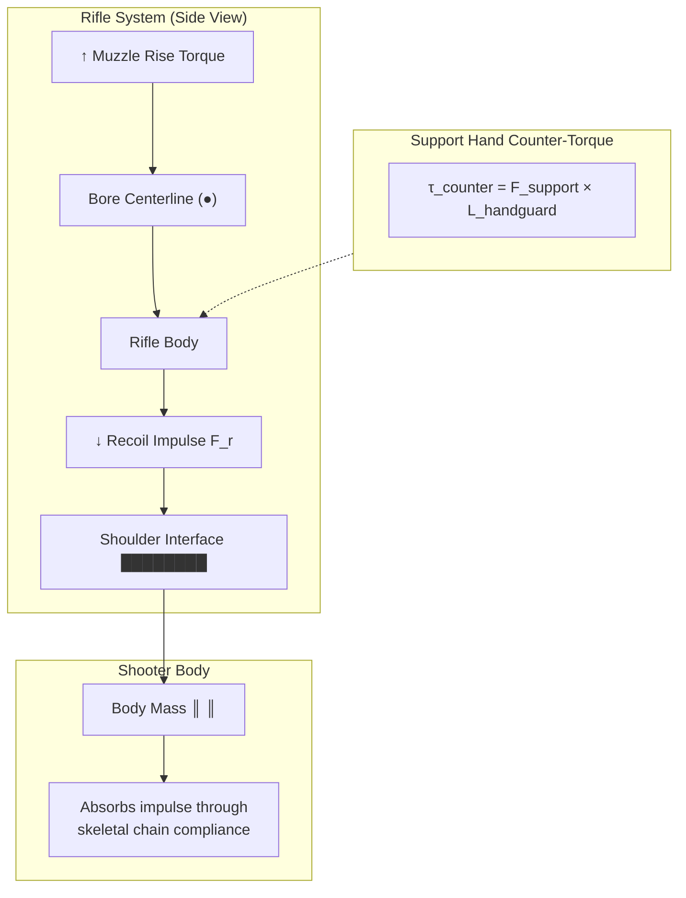

# Lesson 4: Platform Integration and Performance

## 1. First-Principles Intuition & Invariants

The rifle does not exist in isolation from the shooter, nor does technique exist independently of the weapon system. Platform integration represents the unification of biomechanical capability, weapon ergonomics, environmental context, and cognitive loading into a single coherent shooting system capable of delivering predictable, repeatable performance under stress. While marksmanship fundamentals establish the theoretical framework for accurate fire, platform integration determines whether those fundamentals can be executed when physiological arousal peaks, decision tempo accelerates, and the margin for error collapses to fractions of a second.

At its foundation, platform integration operates on three immutable physical principles. First, the human-weapon interface functions as a coupled mechanical oscillator, where the shooter's skeletal structure, muscular tension, and grip pressure interact with the weapon's mass distribution, recoil impulse, and reciprocating action to produce a dynamic equilibrium that either stabilizes or amplifies disturbances. Unlike static target shooting where the rifle rests on sandbags or a benchrest, tactical shooting demands that this coupled system maintain stability across multiple firing positions, movement vectors, and engagement angles while managing the impulse transfer of centerfire cartridges producing 10 to 30 foot-pounds of free recoil energy.

Second, weapon ergonomics directly constrain the biomechanical efficiency of shooting positions. The length of pull—measured from the trigger face to the center of the buttstock—determines whether the shooter can achieve full shoulder pocket contact while maintaining head position that aligns the eye with the optical axis of the sight without cervical strain. An M4-pattern carbine with a 13-inch length of pull accommodates plate carrier bulk and allows collapsed cheek weld on the buffer tube, while a precision rifle with 13.75-inch length of pull optimizes prone shooting comfort but creates interference with body armor in standing positions. The vertical offset between bore axis and sight centerline introduces mechanical leverage that converts recoil impulse into muzzle rise torque, with AR-pattern rifles exhibiting approximately 2.6 inches of offset that must be counteracted through grip angle and shoulder pressure.

Third, performance degrades nonlinearly under physiological stress loading. The fine motor control required for trigger press execution deteriorates rapidly once heart rate exceeds 145 beats per minute, cognitive tunneling reduces peripheral threat awareness at 175 BPM, and complex motor patterns—such as emergency reloads or malfunction clearances—begin to fail entirely above 200 BPM. Platform integration therefore prioritizes gross motor skill accessibility, intuitive control placement, and fault-tolerant system architecture that continues to function even when cognitive processing degrades to pattern recognition and conditioned responses.

The invariant that emerges from these principles is that optimal platform performance occurs when weapon configuration, body position, and shooting technique align to minimize the energy cost of maintaining the coupled oscillator in equilibrium while maximizing the shooter's capacity to execute rapid decision-action cycles. A perfectly zeroed rifle with match-grade ammunition delivers no tactical value if the shooter cannot achieve stable firing positions within the decision tempo of the engagement, and flawless shooting fundamentals collapse under load if weapon ergonomics force the body into biomechanically unstable configurations that accelerate fatigue.

## 2. Core Architecture & Mechanics

### The Human-Weapon Coupled System

The mechanical relationship between shooter and weapon can be modeled as a spring-mass-damper system where the rifle represents a rigid body with defined mass ($m_r$) and center of gravity, the shooter's body provides elastic compliance through muscular tension and skeletal articulation, and damping originates from tissue deformation and grip friction. When the firing pin strikes the primer, propellant combustion generates chamber pressure peaking between 55,000 and 62,000 PSI for 5.56×45mm NATO, accelerating a 55- to 77-grain projectile down a 16-inch barrel in approximately 0.8 milliseconds. Newton's third law dictates that an equal and opposite momentum must be imparted to the rifle, producing rearward acceleration that the shooter's body must arrest and control.

The impulse delivered to the rifle equals the integral of the pressure-time curve acting on the bolt face area, typically ranging from 4.5 to 6.0 pound-seconds for intermediate cartridges. This impulse transfers through the buffer system—where a carbine buffer and action spring convert the sharp impulse into a damped oscillation over 120 milliseconds—and into the shooter's shoulder through the buttstock interface. The shooter's body does not act as a fixed wall but rather as a complex multi-link kinematic chain with compliance at the shoulder joint, elbow, wrist, and spinal column. Optimal recoil management occurs when the shooter preloads this kinematic chain with sufficient muscular tension to create a firm interface without inducing tremor from over-gripping, typically achieved with 40% to 60% of maximum voluntary contraction in the firing hand and 20% to 30% in the support hand.

The vertical moment arm between bore centerline and shoulder contact point creates rotational torque that pitches the muzzle upward during recoil. For an AR-15 with 2.6 inches of offset and 5 pounds of rearward impulse, this generates approximately 1.1 foot-pounds of angular momentum that must be countered by downward pressure from the support hand on the handguard. The effectiveness of this counter-torque depends critically on grip geometry—a C-clamp grip with the support hand extended forward on a slim-profile handguard maximizes moment arm length, while a traditional support hand grip beneath the magazine well reduces mechanical advantage by 60% and shifts load-bearing responsibility to the firing hand.

### Firing Position Biomechanics

The stable firing position achieves three simultaneous objectives: it creates a rigid skeletal structure that supports weapon weight without muscular fatigue, it establishes predictable contact points between body and weapon that yield consistent sight alignment, and it positions the body's center of mass in equilibrium that resists external perturbations. These objectives conflict across different position types, requiring deliberate trade-offs between stability and mobility.

The prone position maximizes stability by distributing body weight across the maximum ground contact area and lowering the center of gravity to approximately 8 inches above ground level. In the classic prone configuration, the firing-side leg extends straight while the support-side leg bends at 45 degrees to rotate the hips and flatten the spine, preventing lumbar hyperextension that creates muscle fatigue. The support-side elbow plants directly beneath the rifle's center of gravity to create a vertical load path through the skeletal structure, while the firing-side elbow grounds at 30 to 45 degrees from the body centerline to brace against the rifle's rearward recoil impulse. This configuration achieves angular stability within ±0.25 milliradians (approximately 1 inch at 100 meters) for shooters with proper bone support, though it requires 15 to 20 seconds to enter from standing and severely limits observation angles to a 30-degree arc.

The standing position inverts these priorities, trading stability for 360-degree observation capability and instant mobility. The fundamental standing stance positions feet at shoulder width with toes angled 30 to 45 degrees toward the target, creating a triangulated base that resists lateral disturbances. The knees unlock slightly to lower the center of gravity and activate the body's natural postural reflexes, while the torso remains upright to maintain head position over the pelvis. The support hand drives forward on the handguard to create tension in the kinematic chain, effectively converting the arms into a structural truss that transfers weapon weight through the skeleton rather than holding it with muscular force.

Two standing stance variants address different tactical requirements. The squared or "aggressive" stance faces the target directly with equal weight distribution, minimizing the body's frontal silhouette and allowing rapid pivoting to either side—critical for close-quarters battle where threats emerge from unpredictable angles. The bladed stance rotates the body 30 to 45 degrees with 60% weight on the support-side foot, creating a more stable platform for precision fire at distance but increasing lateral profile and slowing transitions to the weak side. Neither stance is universally superior; context determines selection.

The kneeling position occupies the middle ground, reducing silhouette height to 36 to 42 inches while maintaining 180-degree observation capability. In the standard kneeling position, the firing-side knee drops to the ground with the shin and foot flat to create a stable base, while the support-side foot plants forward with the knee bent at 90 degrees. The shooter sits back onto the firing-side heel, distributing 70% of body weight through this vertical load path, and braces the support-side elbow against the support-side knee just forward of the kneecap. This elbow-knee contact point creates a skeletal lock that eliminates muscular load from the support arm, though it functions only within a narrow angular range—deviation beyond ±15 degrees breaks the contact and collapses the position's stability advantage.

### Platform-Specific Ergonomic Integration

The AR-15 platform, despite its ubiquity, presents ergonomic compromises that directly impact shooting performance. The buffer tube inline with the bore axis eliminates the traditional comb height found on sporting rifles, forcing shooters to press their cheek against the receiver extension rather than resting it on a shaped stock. This lack of consistent cheekweld geometry requires optical sights to be mounted at absolute co-witness height (1.5 inches from rail to optical centerline) or lower-third co-witness (1.4 inches), both of which force the head into forward extension that loads the cervical spine and creates fatigue during extended observation periods.

Modern solutions address this through riser mounts that elevate red dot optics to 1.93-inch or 2.26-inch height, allowing a more natural head position with reduced cervical strain. The trade-off emerges in the increased sight-over-bore offset—a 2.26-inch optical centerline creates a 2.5-inch impact shift at 10 meters when zeroed at 50 meters, demanding offset compensation for close-range precision shots. Shooters must internalize this ballistic trajectory through repetition: inside 25 meters, the bullet impacts low and requires holdover correction, while beyond 50 meters the bullet tracks the optical line of sight within ±1 inch until transonic destabilization begins at 500 to 600 meters.

The pistol grip angle on AR-pattern rifles varies between 17 and 25 degrees from vertical, directly affecting wrist position and trigger finger alignment. A steeper grip angle (closer to vertical) allows the wrist to remain in neutral position, reducing extensor tendon strain and improving trigger control, but shortens the moment arm available for muzzle control during recoil. A more swept grip angle increases mechanical leverage for recoil management but forces the wrist into extension, creating fatigue and degrading fine motor control during sustained fire. The A2 grip at 23 degrees represents a historical compromise; modern grips like the BCM Gunfighter at 17 degrees prioritize trigger control over recoil leverage.

Stock length adjustment interacts with body armor, load-bearing equipment, and firing position. A collapsed stock with 10.5 to 11.5 inches of length of pull accommodates plate carriers and allows aggressive forward body posture in close-quarters battle, but creates excessive neck flexion when shooting from prone and reduces the shoulder pocket contact area available for recoil absorption. An extended stock at 13 to 13.5 inches optimizes prone shooting comfort and provides full shoulder contact, but interferes with armor when mounting the rifle from low ready and slows transitions between firing positions. High-performance shooters maintain stock length at the shortest setting that still allows full cheekweld contact without neck strain, typically 11.5 to 12 inches when wearing armor.

Precision rifle platforms—whether bolt-action or semi-automatic—invert AR-15 ergonomic priorities by optimizing for static shooting positions rather than dynamic mobility. A chassis-based precision rifle with adjustable length of pull, comb height, and buttpad cant allows the shooter to configure the weapon for perfect fit in the prone position, creating repeatable mechanical interface that eliminates variables in sight picture and recoil management. Adjustable comb height becomes critical when mounting high-magnification optics; a scope with 56mm objective lens requires 1.4 to 1.6 inches of comb height above receiver to achieve proper eye relief, while a 34mm-tube scope with 50mm objective requires 1.2 to 1.4 inches.

The trade-off for this customization appears in weapon handling dynamics. A 12-pound precision rifle with 20-inch barrel and 3.5-inch wide chassis handles nothing like a 7.5-pound carbine—mounting from low ready requires 40% more time, transitions between positions involve deliberate controlled movements rather than rapid pivoting, and offhand shooting becomes a test of raw strength rather than technique. The shooter must accept these limitations as inherent to the platform's design objectives.

### Optic Integration and Sight Picture Architecture

The optical sight forms the final link in the human-weapon coupled system, converting the shooter's visual processing into bore alignment feedback. Red dot sights project an LED-illuminated reticle onto a curved lens coated with reflective interference layers that return light to the shooter's eye regardless of head position within a 20- to 30-degree viewing cone. This parallax-free projection means the reticle always indicates true bore direction when the dot is centered on the target, even if the shooter's eye position shifts laterally or vertically behind the optic by up to 15mm—a critical fault-tolerance feature when shooting with a helmet, gas mask, or under physiological stress that disrupts fine head position control.

The apparent simplicity of "put the dot on the target and press" conceals biomechanical requirements for consistent execution. The shooter's eye must achieve proper eye relief—the distance from the optic's ocular lens to the pupil plane, typically 2.5 to 3.5 inches for reflex sights and 3.5 to 4.0 inches for holographic sights. Too close and the viewing window vignettes, creating a tunnel effect that reduces situational awareness; too far and the reticle appears to float outside the optic housing, disrupting the subconscious fusion of dot and target required for rapid engagement. Proper eye relief emerges naturally from correct cheekweld and head position—if the shooter must crane their neck forward or tilt their head to see the dot clearly, the stock length or comb height requires adjustment.

Magnified optics introduce additional constraints through exit pupil diameter and eye box dimensions. A 1-10×24mm variable-power scope at 10× magnification produces a 2.4mm exit pupil (calculated as objective diameter divided by magnification), requiring the shooter's pupil to align within ±1.2mm of the optical centerline to achieve full field of view. Any head position deviation beyond this tolerance creates shadowing or complete blackout of the sight picture. Low-power variable optics (LPVOs) in the 1-6× or 1-8× range expand the exit pupil to 4mm at maximum magnification, providing greater head position tolerance but reducing maximum usable magnification for long-range precision work.

The shooter establishes mechanical repeatability through consistent stock weld and head position, but optical sight height directly determines whether this repeatability can be achieved across multiple firing positions. An optic mounted at 1.5 inches above the receiver rail forces the head into chin-to-chest compression in the standing position to achieve sight picture, creating neck strain that accelerates fatigue. Raising the optic to 1.93 inches or 2.26 inches allows neutral head carriage in standing and kneeling positions, but the resulting high cheekweld position becomes awkward in prone where the head must tilt backward to align with the optic. No single mounting height optimizes all positions; the shooter selects based on their primary engagement context.

### Trigger Control Under Platform Constraints

The trigger mechanism converts a controlled rearward finger movement into a precise release of the firing pin or hammer, initiating the ignition sequence. In an AR-15 platform, the trigger represents the terminal interface of a mechanical chain including disconnector, hammer, trigger spring, and sear engagement surfaces machined to 0.002-inch tolerances. A factory mil-spec trigger exhibits 5.5 to 9 pounds of pull weight with distinct first and second stage travel, where the first stage compresses the trigger spring until the sear reaches its release edge, and the second stage builds pressure against the sear engagement surface until it overcomes the angle of friction and releases the hammer.

Aftermarket triggers reduce pull weight to 3 to 4.5 pounds for precision applications, shorten trigger travel to 0.125 inches or less, and create a crisp break with minimal overtravel—the continued rearward movement after the hammer releases. A precision trigger with 3.5-pound pull weight and 0.125-inch total travel allows the shooter to execute a surprise break through smooth pressure application, where the conscious mind cannot predict the exact moment of discharge and therefore cannot induce anticipatory flinching. The trade-off emerges in reliability under contamination; a match trigger with narrow sear engagement surfaces and light springs becomes susceptible to failure when debris accumulates in the fire control group, while a heavier mil-spec trigger continues functioning even when packed with sand or mud.

Trigger finger placement directly affects the mechanical advantage available for straight-rearward pull. The optimal contact point falls at the distal joint crease—the first crease visible when the finger bends—where the finger achieves maximum strength and sensitivity. Placement too far toward the fingertip creates lateral torque that pushes the muzzle during trigger press, while placement too deep into the first joint reduces fine motor control and can bind the trigger finger against the receiver during travel. The shooter must adjust grip position on the pistol grip to achieve this placement naturally, without conscious finger repositioning before each shot.

Platform-specific constraints alter trigger control requirements. A bolt-action rifle with a two-stage trigger requires deliberate pressure application through both stages—the first stage removes slack until the trigger reaches the second stage wall, then controlled pressure through the second stage breaks the sear. Rushing this process by slapping through both stages induces muzzle disturbance; the shooter must develop the discipline to pause at the second stage wall, confirm sight picture stability, then complete the press. Semi-automatic rifles firing from a closed bolt allow trigger manipulation during recoil—the trigger can be released and reset during the 120-millisecond bolt cycle, allowing the next shot to break immediately when the bolt returns to battery and the sight picture restabilizes.

## 3. High-Performance Optimization & Failure Modes

### Position Transitions and Time Management

The transition between firing positions represents a critical vulnerability window where the weapon remains off-target, situational awareness degrades, and the shooter becomes vulnerable to counterfire. High-performance shooting minimizes this dead time through practiced movement sequences that maintain muzzle discipline, preserve ammunition retention, and prepare the platform for immediate engagement upon reaching the new position.

The prone-to-standing transition begins with the support hand driving the rifle up and forward while the firing hand maintains grip on the pistol grip, creating a one-handed low-ready position with the muzzle oriented downrange. The shooter draws the support-side knee forward and plants the foot, then drives upward through the support-side leg while the firing-side leg extends to establish the standing base. The support hand returns to the handguard during the upward drive, timing its arrival to coincide with the torso reaching vertical so the rifle enters the shooting position simultaneously with full body extension. Executed with deliberate practice, this transition requires 2.5 to 3.5 seconds and maintains muzzle awareness throughout the movement—contrast with an untrained transition where the shooter rolls to their side, posts a hand on the ground, and stands up while the rifle swings freely on its sling, consuming 6 to 8 seconds and flagging 180 degrees of lateral arc with the muzzle.

The standing-to-prone transition inverts this sequence but introduces the challenge of controlled descent while retaining a firing grip. The shooter steps forward with the support-side foot while simultaneously driving the support hand far forward on the handguard to create moment arm length, then kneels on the firing-side knee while guiding the rifle downward in a controlled arc. The support-side hand posts to the ground to arrest downward momentum, then walks backward to establish proper elbow placement while the body extends into full prone position. The critical error to avoid is dropping directly onto both knees—this creates uncontrolled impact that jars the sight picture, risks optic zero shift from shock loading, and can cause knee injury when wearing load-bearing equipment. Controlled descent through the support hand requires 3.5 to 4.5 seconds but preserves equipment and maintains readiness to engage during the movement.

Lateral position changes within the same posture category—shifting left or right while remaining prone, or sidestepping while standing—test the shooter's ability to maintain ready state during dynamic movement. In prone, the shooter keeps both elbows grounded and uses a caterpillar motion to inch laterally, dragging the body with hip rotation while the upper body remains stable behind the rifle. This glacial movement (6 to 8 inches per second) maintains firing capability but consumes time; when speed matters, the shooter must break position entirely and low-crawl to the new location. In standing, lateral movement uses shuffle steps with feet remaining parallel, never crossing the feet or bringing them together (which creates an unstable base), while the upper body remains locked in shooting posture. Effective lateral movement speed reaches 2 to 3 feet per second while maintaining 80% of static accuracy—adequate for engaging multiple targets across a wide array, insufficient for covering distance under time pressure.

### Load Carriage and Equipment Integration

The weapon system extends beyond the rifle itself to include ammunition carriage, load-bearing equipment, protective armor, and communication devices, each of which alters the biomechanics of shooting positions and introduces failure modes absent in clean training environments. A plate carrier with Level IV ceramic plates adds 18 to 22 pounds of distributed load across the torso, shifting the center of gravity forward and raising it by 2 to 3 inches compared to unarmored shooting. This load distribution affects the prone position by creating pressure points at the sternum and iliac crests that become painful after 10 to 15 minutes, forcing periodic weight shifts that disrupt sight picture and extend engagement timelines.

The standing position with armor requires increased forward lean to maintain balance over the feet—the upper body's center of gravity has shifted forward due to the plate carrier's mass, and the shooting stance must compensate by driving the hips backward and arching the lower back. This compensation loads the lumbar spine and erector spinae muscles, creating fatigue that manifests as progressive muzzle wobble after 20 to 30 minutes of continuous ready position. Shooters must train with full equipment load to develop the postural endurance required for sustained operations; marksmanship fundamentals practiced in gym shorts and a T-shirt do not transfer directly to performance in 35 pounds of kit.

Magazine pouches on the belt line or chest rig interfere with prone position body mechanics by creating ground clearance issues when the shooter attempts to flatten their profile. A traditional belt-mounted magazine pouch at the 10 o'clock position digs into the ground when the shooter rolls into prone, forcing the body to cant 10 to 15 degrees to the support side to relieve pressure. This body cant introduces asymmetric loading in the shooting platform that must be corrected through muscular compensation—the support elbow no longer aligns vertically beneath the rifle, requiring increased deltoid and trapezius activation to stabilize the position. Chest-mounted magazine pouches eliminate ground interference but shift weight high on the torso, creating a pendulum effect during rapid movement and altering the rifle's mounting ergonomics by requiring the support hand to reach across the magazines to grip the handguard.

Sling configuration determines whether the rifle can be retained during position transitions, emergency reloads, and equipment manipulation tasks. A two-point sling with adjustment at both front and rear attachment points allows the shooter to cinch the rifle tight against the body for administrative movement, then loosen it to working length for shooting. The optimal working length places the rifle at mid-chest height when hanging freely on the sling, allowing rapid mounting to the shooting position without requiring the support hand to lift excess sling material out of the way. Too short and the rifle rides high on the chest, interfering with magazine changes and forcing an excessively compressed shooting position; too long and the rifle hangs below the belt line, swinging freely during movement and requiring two hands to control when transitioning between tasks.

Single-point slings attach at the rear of the receiver and allow the rifle to hang at the shooter's centerline, maximizing freedom of movement for transitions between strong-side and weak-side shooting. The penalty appears in administrative carry—a single-point sling provides no retention when the shooter needs both hands free for climbing, breaching, or casualty evacuation. The rifle swings in a wide arc with each step, striking objects in confined spaces and creating noise discipline failures. Tactical applications typically default to two-point configurations that balance retention security against shooting flexibility.

### Ammunition Performance and Terminal Ballistics Integration

The shooter's technical skill in executing marksmanship fundamentals means nothing if the selected ammunition cannot deliver adequate terminal performance on the target. Intermediate rifle cartridges like 5.56×45mm NATO rely on projectile fragmentation and yaw-induced tumbling to create wound channels that incapacitate threats, but these mechanisms function only within specific velocity windows determined by projectile construction and impact physics.

The M855 62-grain steel-core penetrator achieves reliable fragmentation above 2,700 feet per second impact velocity, where aerodynamic forces during yaw overcome the mechanical strength of the copper jacket and lead core, breaking the projectile into 2 to 4 major fragments. From a 16-inch barrel with a muzzle velocity of 3,000 feet per second, this fragmentation threshold extends to approximately 100 meters downrange. Beyond this distance, the projectile velocity decays below fragmentation threshold and the round performs as a small-caliber icepick—creating a narrow permanent wound channel with minimal tissue disruption. The shooter must understand this performance boundary and compensate by either closing engagement distance or selecting ammunition designed for terminal effectiveness at extended range.

Modern bonded-core projectiles like the Mk262 77-grain open-tip match round maintain structural integrity at higher impact velocities through mechanical bonding of the core to the jacket, delaying fragmentation until the projectile yaws after penetration. This construction extends effective range to 300 meters while improving barrier penetration through automotive glass and light steel barriers. The trade-off emerges in cost—Mk262 ammunition runs $1.20 to $1.80 per round compared to $0.40 to $0.60 for M855, making it prohibitive for high-volume training applications.

The shooter integrates these ballistic realities into engagement decision-making by maintaining awareness of cumulative engagement distance. If the mission profile expects contact beyond 200 meters, ammunition selection shifts toward longer-range projectiles with extended fragmentation thresholds. If the environment constrains engagement distances to 50 meters or less, barrier-blind ammunition that penetrates intermediate obstacles without deflection takes priority over maximum effective range. The weapon system performs only as well as the ammunition loaded in it; no amount of shooting skill compensates for selecting the wrong cartridge for the operational context.

### Stress Inoculation and Performance Under Load

Marksmanship fundamentals practiced on a square range under ambient lighting and zero time pressure establish a baseline technical capability that collapses under physiological stress unless deliberately trained to persist. The human stress response—mediated by sympathetic nervous system activation and catecholamine release—produces tachycardia, peripheral vasoconstriction, pupil dilation, and fine motor skill degradation that directly interfere with trigger control, sight focus, and breath management. Heart rate escalates from a resting 60 to 70 BPM to 145 to 175 BPM within seconds of perceiving a lethal threat, and the accompanying surge of norepinephrine and cortisol alters cognitive processing from deliberate problem-solving to pattern-matching and conditioned responses.

Stress inoculation training recreates these physiological conditions through controlled stressors—physical exertion to elevate heart rate, time pressure to activate decision-making load, and consequence for failure to create psychological arousal. A representative stress inoculation drill requires the shooter to perform 20 burpees to drive heart rate above 150 BPM, then engage multiple targets at varied distances under a shot timer with 2.5-second splits between shots. The shooter experiences degraded trigger control as finger tremor increases, degraded sight focus as accommodation lag slows lens adjustment, and degraded decision speed as cognitive load consumes working memory capacity. These degradations are not character flaws to be corrected through willpower—they are physiological realities to be trained around through conditioned responses that function without conscious processing.

The critical insight is that performance under stress depends on task complexity relative to available cognitive capacity. A complex shooting problem requiring range estimation, wind correction, moving target lead calculation, and precision trigger control exceeds available processing capacity at 160 BPM heart rate—the shooter's cognitive system cannot execute the decision tree rapidly enough to achieve hits. Simplifying the task to point-shooting at close range with a red dot optic reduces cognitive demand to pattern recognition and gross motor skill execution, which persist at 180 BPM and higher. Platform integration therefore includes matching weapon configuration and engagement techniques to the expected stress level: red dot sights for close-range dynamic shooting where stress runs high, magnified optics for precision engagement where time and distance allow stress management through controlled breathing and deliberate body position.

The shooter develops stress resilience through progressive exposure: begin training under zero stress to establish correct motor patterns, then add time pressure to activate arousal, then add physical exertion to elevate heart rate, then add consequence (public scoring, peer evaluation, instructor assessment) to create psychological pressure. Each stressor layer builds on the previous foundation until the shooter can execute fundamentals at 175 BPM with 85% of their baseline accuracy—not perfect performance, but adequate performance when perfection is physiologically impossible.

### Failure Mode Analysis and Recovery Protocols

Every weapon system experiences malfunctions at statistically predictable rates determined by ammunition quality, maintenance state, and environmental contamination. The AR-15 platform operates through direct impingement gas operation, where propellant gas tapped from the barrel drives the bolt carrier rearward against the buffer spring, extracting and ejecting the spent case while chambering a fresh round. This mechanism fails when gas pressure falls below the threshold required to cycle the action (weak ammunition, carbon buildup restricting gas flow, or debris in the carrier group), or when extraction force exceeds the mechanical strength of the extractor claw (case head separation, chamber erosion, or swollen brass from overpressure).

Type 1 malfunctions—failures to fire—occur when the trigger is pressed and no shot results, typically caused by a dud primer or light firing pin strike. The immediate action drill is tap-rack-assess: tap the magazine baseplate to ensure full seating, rack the charging handle to extract the failed round and chamber a fresh cartridge, then assess the threat and re-engage if necessary. This sequence requires 1.5 to 2.0 seconds and restores the weapon to battery 95% of the time. The failure mode appears when the shooter racks the charging handle without first tapping the magazine—if the magazine has unseated slightly, the bolt strips a fresh round from the top but fails to feed it into the chamber, creating a double-feed malfunction that requires remedial action.

Type 2 malfunctions—stovepipes and failure-to-eject—leave a spent case wedged between the bolt face and ejection port, blocking the action from returning to battery. The correct clearance sequence is swipe-rack-assess: sweep the hand across the ejection port to knock the case free, rack the charging handle to chamber a fresh round, then assess and re-engage. This procedure requires 2.0 to 2.5 seconds and succeeds unless the extractor has broken entirely, in which case the weapon is deadlined until field repair. The common error is attempting to force the charging handle rearward against the stuck case—this bends the extractor claw and converts a simple malfunction into a parts failure requiring armorer intervention.

Type 3 malfunctions—double-feeds—occur when a chambered round fails to extract and the bolt attempts to chamber a second round behind it, creating a jam that locks the action solid. The clearance procedure is lock-strip-rack-load-assess: lock the bolt to the rear with the charging handle or bolt catch, strip the magazine from the magazine well, rack the charging handle three times to clear the chamber and ejection port, load a fresh magazine, release the bolt, then assess and engage. This sequence consumes 6 to 8 seconds and represents the worst-case malfunction short of catastrophic parts failure. Double-feeds indicate either weak extractor spring tension or ammunition problems (swollen cases, case head separation) that will recur unless the root cause is corrected.

The shooter trains malfunction clearance through dedicated repetition until the diagnostic decision tree—identify malfunction type, execute appropriate clearance, verify weapon status, re-engage—executes without conscious thought. This automaticity proves critical under stress, where cognitive tunneling collapses awareness to the target and the shooter's conscious mind may not even register that a malfunction has occurred. The finger presses the trigger, no shot results, and conditioned response must drive immediate action before the conscious mind completes threat assessment. Shooters who train malfunction clearance only during square range drills discover under stress that they freeze when the weapon stops functioning, unable to access the trained response because it was never practiced under arousal conditions.

### Iterative Performance Development and Diagnostic Feedback

Platform integration represents an ongoing optimization process rather than a fixed state achieved through initial training. The shooter's biomechanics, equipment configuration, and environmental context evolve over time—body weight and strength change, weapons receive modifications and accessory changes, operational requirements shift between close-quarters battle and precision engagement profiles. Maintaining peak performance requires systematic diagnostic assessment to identify degradation sources and targeted remediation to restore capabilities.

The diagnostic process begins with baseline establishment: the shooter records groups fired from a stable bench rest to isolate weapon and ammunition mechanical accuracy from shooting technique variables. A quality AR-15 with match ammunition produces 1.5 to 2.0 minute-of-angle groups at 100 meters (1.5 to 2.0 inches), establishing the mechanical limit of the system. Any degradation beyond this baseline indicates shooter-induced error, equipment malfunction, or environmental interference.

The shooter then fires the same ammunition from field positions—prone unsupported, kneeling, standing—and compares group sizes to the mechanical baseline. Group size increase indicates the precision cost of that firing position: prone unsupported typically adds 0.5 to 1.0 MOA (2.5 to 3.0 inch groups at 100 meters), kneeling adds 1.5 to 2.5 MOA, and standing adds 3.0 to 5.0 MOA. Shooters whose positional groups exceed these ranges have not achieved optimal body position, weapon interface, or trigger control—the platform integration has failed and requires remediation through focused positional shooting drills.

Diagnostic shooting under time pressure reveals different failure modes. A shooter who produces 2-inch groups with unlimited time but opens to 6-inch groups when engaging multiple targets on a 3-second shot timer has not internalized proper recoil management and target transition technique. The weapon's muzzle is climbing excessively during recoil, requiring the shooter to consciously reacquire the sight picture before each subsequent shot rather than allowing natural point of aim to return the sights to target automatically. Remediation requires slow-fire practice focused on recoil control—proper support hand pressure, aggressive forward body lean, and consistent shoulder pocket contact—until the technique persists under time pressure.

Failure modes discovered during live fire translate into targeted dry-fire practice that isolates the problematic component. A shooter with inconsistent trigger control practices trigger press repetitions without live fire, using a resettable trigger to groove the motor pattern without the distraction of recoil and noise. A shooter with unstable firing positions practices positional shooting with an unloaded rifle, confirming consistent sight picture and natural body alignment before adding the stress of live fire. Dry-fire practice consumes zero ammunition cost and allows 10 to 20 repetitions per minute compared to 1 to 2 repetitions per minute with live fire, accelerating skill acquisition through increased practice volume.

The integration of platform, technique, and performance measurement creates a closed feedback loop where objective data drives training focus. The shooter who records every practice session—group sizes, engagement times, malfunction rates, failure modes—accumulates longitudinal performance data that reveals trends invisible in single-session snapshots. Degrading accuracy over a 6-week period indicates equipment failure (loosening optic mount, worn barrel) or technique regression (anticipatory flinching, inconsistent cheekweld). Improving performance validates training focus and equipment modifications. The professional shooter treats every range session as a data collection opportunity, building an empirical foundation for continuous improvement rather than relying on subjective feel and anecdotal assessment.
