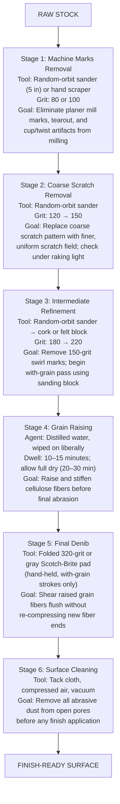

# Lesson 1: Surface Preparation Fundamentals

## 1. First-Principles Intuition & Invariants

Wood is not a material you finish. It is a material you *prepare to accept* a finish, and that distinction governs every decision you will make at the bench. A film finish applied to an inadequately prepared surface does not hide the substrate's defects — it magnifies them. Polyurethane, shellac, and oil-varnish blends all share one optical property: they increase the contrast between light and shadow at the surface, which means every scratch, mill mark, and torn fiber becomes more visible under a topcoat than it was in raw wood. Understanding why this happens, and how to work systematically against it, is the central project of surface preparation.

To build that understanding properly, you must begin with wood anatomy. A tree's trunk is an engineered pressure vessel: radially arranged rays run from the pith outward to the bark, while longitudinal tracheids and vessels carry water and dissolved minerals from root to canopy. When a sawyer converts a log into lumber, those cells are severed at various angles depending on the cut. Plain-sawn boards, cut tangentially to the growth rings, expose the widest possible face grain along the board's width and reveal cathedral patterns of early and late wood. Quartersawn stock, cut closer to radially, presents a face of end-grain-adjacent structure — tighter, more uniform, and far more dimensionally stable under humidity cycles. This anatomical exposure directly controls how finishes absorb. The large open vessels in ring-porous species like white oak (*Quercus alba*) or ash (*Fraxinus americana*) draw finish deep into their early-wood pores, while the dense, uniform late wood resists penetration. The result, without a pore-filling step, is an uneven gloss called "picture framing," where the finish pools in some regions and is starved in others.

Diffuse-porous species like hard maple (*Acer saccharum*) and cherry (*Prunus serotina*) distribute their vessels more evenly across each growth ring, producing a tighter, more uniform surface. They present their own challenge: because absorption is uniform, any surface scratch becomes a uniform channel for finish absorption, turning scratches into visible dark lines under an oil or stain. This is why maple — often treated as a beginner-friendly wood because of its workability — is actually among the most demanding species to finish cleanly.

The sanding process operates against this anatomical background, and its physics are more nuanced than most practitioners appreciate. Each abrasive grit cuts wood through a process analogous to orthogonal machining on a micro scale. Individual abrasive grains — aluminum oxide, silicon carbide, ceramic alumina, or zirconia alumina — are irregular polyhedra bonded to a backing with a resin binder. As they traverse the wood surface, they fracture and shear wood fibers rather than cleanly slice them. The critical variable is not grit number alone but the *depth of the scratch pattern*, which is proportional to the size of the abrasive grit and the downward pressure applied. Coarser grits cut deep furrows with steep walls; finer grits cut shallower furrows with gentler slopes. When a finish floods those furrows, the depth and directionality of the scratches determine whether reflected light scatters uniformly or creates a hazy, directional sheen.

The practical invariant that follows from this physics is the grit progression rule: you must never skip more than one grit increment in a sequence, and you must remove the scratches from the previous grit entirely before advancing. The conventional wisdom that you should "sand with the grain" is correct but incomplete. What you are actually doing is orienting the scratch channel parallel to the wood's natural fiber direction, so that any residual scratch pattern is hidden within the visual texture of the grain itself. Cross-grain scratches — those running perpendicular to the fiber direction — are catastrophic under finish because they interrupt the grain's visual flow and become highlighted at every grit stage.

A second anatomical invariant concerns the springwood-latewood boundary at the cellular level. The thin-walled, low-density cells of springwood compress and rebound under sanding pressure more readily than the dense latewood cells. When you apply finish to a surface that has been sanded to a consistent apparent smoothness, those springwood regions may lift microscopically as they absorb solvent from the finish carrier. This is grain raising — the nemesis of water-based finishes in particular — and managing it is not optional. It is a mandatory protocol step before any water-borne topcoat.

## 2. Core Architecture & Mechanics

The practical mechanics of surface preparation can be understood as a linear reduction pipeline: each stage reduces the dominant defect scale by a controlled amount, handing off a surface whose worst remaining defects fall within the removal capacity of the next stage. Violating the pipeline by advancing prematurely — or by under-cutting it by applying too little pressure and completing too few strokes — produces a surface that appears ready under ambient light but fails under raking light or under finish.

The grit numbers above represent a workflow for most hardwoods. For soft, open-pored species like Douglas fir, beginning at 60 or 80 makes sense because mill marks tend to be deeper and tearout more pronounced. For dense, fine-grained species like hard maple or boxwood, you may begin at 100 without sacrificing efficiency. The critical discipline is not the specific starting grit but the commitment to completing each stage fully before advancing.

Random-orbit sanders deserve a moment of mechanical scrutiny because they are frequently misused. The tool's pad moves in a compound motion: a small orbital offset superimposed on a continuous rotation. That combination is what breaks up the circular scratch pattern that a pure rotary sander would leave. However, if you move a random-orbit sander too quickly across the surface, the pad's rotational component dominates the oscillation, and you re-introduce swirl marks. The correct technique is a slow, deliberate stroke — roughly 2–3 inches per second — with moderate, consistent downward pressure. Never pause the sander on the surface with the pad spinning; that creates a localized deeper scratch crater that becomes a sanding artifact requiring you to retreat an entire grit stage.

The hand-sanding block is not a remedial backup tool for practitioners without a powered sander. It is a precision instrument that belongs in every finishing sequence, particularly at 180 grit and finer. A cork or dense-rubber block distributes pressure uniformly across its face, preventing the edge-loading that fingers alone produce. Edge-loading with bare hands concentrates sanding pressure along finger ridges, creating an uneven scratch pattern that only becomes visible under finish. For final with-grain passes at 220 and 320, a folded sheet of sandpaper wrapped around a flat cork block, stroked in long, deliberate pulls with the grain, is the correct protocol.

Defect identification before sanding begins determines your starting point and prevents you from discovering problems mid-sequence, when correction becomes exponentially more expensive. Raking light — a single bare bulb or shop light held nearly parallel to the surface — is the workhorse inspection tool. Under raking light, the shadows cast by mill marks, dents, and torn fibers become dramatically visible. Inspect every panel and board this way before touching sandpaper to wood. Dents from impact are compressed rather than torn; they respond well to a damp cloth and a clothes iron held over the spot, which steams the compressed fibers back toward their original volume. Tearout — fiber bundles sheared in the wrong direction by a planer or jointer fed against the grain — represents removed material, not compressed material, and no amount of moisture will restore it. Tearout requires either a card scraper to cut cleanly across the torn region, or a retreat to a coarser sanding grit to cut down the surrounding surface to the depth of the damage.

The card scraper occupies a unique position in this pipeline because it is not an abrasive at all — it is a cutting tool. A properly burnished scraper produces a curl of wood, not a smear of dust, and it leaves a surface that is simultaneously smoother and more dimensionally accurate than sanding alone can achieve. The mechanism is a microscopic hook of steel, the burr, raised along the scraper's edge by a burnisher. When drawn across the wood surface at a slight forward angle, that burr shears the top fibers cleanly, without the fiber-compressing, end-grain-smearing effect that abrasive grains produce. On figured maple, curly walnut, or any wood where alternating grain direction makes tearout inevitable under any sanding angle, the scraper is not optional — it is the correct tool for the final material-removal stage before the grit sequence begins.

## 3. High-Performance Optimization & Failure Modes

The gap between a competent sanding job and a master-level surface preparation lies in three areas: discipline around inspection protocols, understanding of species-specific absorption anomalies, and the ability to diagnose failures accurately before the first coat of finish is applied.

The single most important optimization in a production or studio environment is the raking-light checkpoint system. After completing each grit stage, before advancing, you must stop the sander, allow the surface dust to settle or blow it clear, and examine the entire panel under raking light from multiple angles. What you are looking for is not scratches from the current grit — those are expected and correct — but scratches from the *previous* grit that have survived. The coarser scratch pattern from two stages back will appear as a distinctly different spatial frequency: wider, deeper furrows running against or at an angle to your current sanding direction. Those are the signal that you advanced too early. The corrective action is to return to the previous grit for additional passes, then advance again. Many practitioners skip this inspection step under time pressure and discover the failure only after sealing the surface, when the coarser scratches become permanently trapped beneath a topcoat.

Blotch susceptibility is the dominant finishing failure for a subset of species, and understanding its mechanism allows you to address it at the surface preparation stage rather than trying to compensate with the finish. Cherry, pine, alder, and birch are notorious for blotchy stain absorption because their structure includes alternating regions of high and low porosity that do not correspond to visible grain features. When a stain or dye is applied to raw wood, the high-porosity regions absorb aggressively, producing dark patches, while the low-porosity regions remain lighter. The result is a mottled, uncontrolled appearance. The conventional remedy is a pre-conditioner — a diluted, penetrating oil or sanding sealer applied before stain — that partially fills the pores and equalizes their absorption rate. The surface preparation implication is that for blotch-prone species, your final sanded surface must be absolutely uniform in its scratch pattern and completely free of burnished, over-sanded spots. Any region where you have sanded past the open pore structure into a glazed surface will absorb even less than the surrounding low-porosity wood, compounding the blotch effect.

Burnishing is an underappreciated failure mode. It occurs when sanding pressure is excessive relative to grit size, or when worn-out abrasive paper is used past its useful life. As abrasive grains dull through use, they stop cutting and start smearing, compressing the wood fibers rather than shearing them. The compressed surface looks smooth and may feel smooth to the touch, but its pores are partially closed and its fiber structure is damaged at a scale visible under magnification. When finish is applied over a burnished surface, adhesion is poor, and the finish may peel or crack under flexion. The diagnostic is simple: a burnished surface appears slightly shiny or waxy under raking light, with a visual quality different from the matte, open texture of a correctly cut surface. The fix is to discard the worn abrasive immediately and re-sand with fresh paper, using lighter pressure.

For water-based finishes specifically, the grain-raising protocol demands precision that most practitioners under-specify. Applying distilled rather than tap water matters: the minerals in hard tap water can react with tannins in species like oak and walnut to produce gray or green surface staining that does not sand out cleanly. After the water application and complete dry cycle, the raised grain must be cut with a folded 320-grit sheet or a gray Scotch-Brite pad using strictly parallel, with-grain strokes. Circular or cross-grain strokes at this stage introduce new abrasive scratches into an otherwise finish-ready surface. The pass should be light — the goal is to shear the raised fibers flush, not to remove material from the base surface. After this denib step, run a bare hand across the panel: the surface should feel glassy-smooth with no detectable grain ridges. Any remaining texture will telegraph through every subsequent coat.

Cleaning protocol is the final technical invariant, and its importance is proportional to the finish's viscosity. Low-viscosity finishes like wiping varnishes and diluted shellac will carry surface dust down into the pores as they penetrate, locking particles into the substrate permanently. Begin cleaning with compressed air blown at a low angle across the surface, driving dust out of the pores rather than packing it deeper. Follow with a shop vacuum using a soft brush attachment, working with the grain to pull liberated particles away from the surface. The tack cloth closes the sequence: a lightly resin-impregnated cheesecloth that picks up residual fine particles through adhesion rather than mechanical action. The critical error with tack cloths is using too much pressure, which transfers resin from the cloth to the wood surface, contaminating it for water-based finishes. A tack cloth pass should be a feather-light, single-direction stroke. For water-based topcoats, substitute a clean, lint-free rag dampened very lightly with clean water in place of the resin-based tack cloth to avoid adhesion failures.

Understanding wood anatomy, respecting the grit progression as a signal-processing problem, managing grain raising as a mandatory protocol rather than an optional refinement, and reading defect signatures accurately under raking light — these are not supplementary refinements to surface preparation. They are its architecture. Every finishing failure that occurs under a cured topcoat can be traced backward to a decision, or a skipped step, that happened before the first drop of finish touched the wood.
