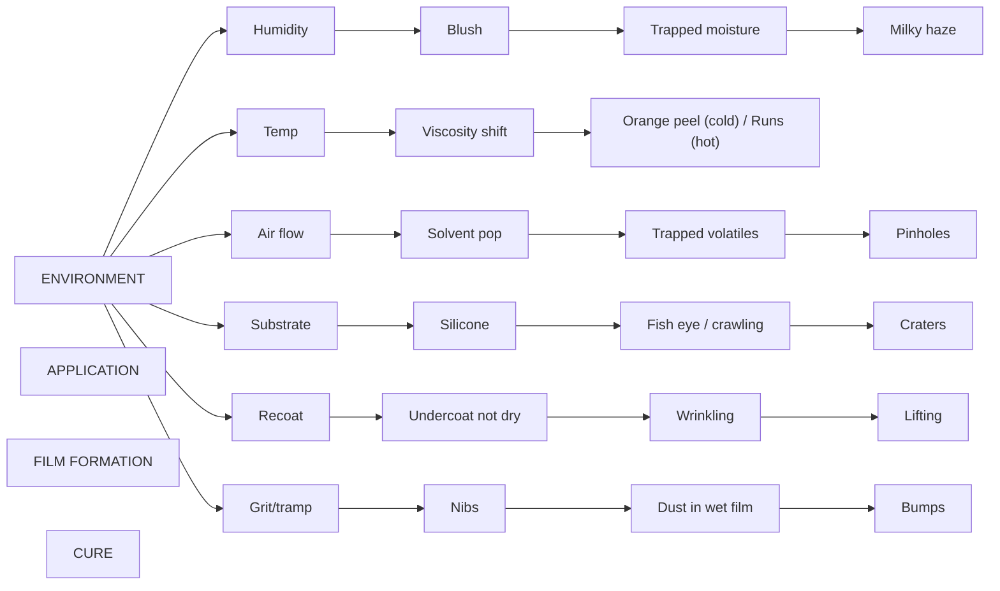

# Lesson 4: Protection, Repair, Maintenance

## 1. First-Principles Intuition & Invariants

Every wood finish exists at the intersection of three hostile forces: ultraviolet radiation, moisture vapor pressure, and mechanical abrasion. A coating that excels against one often compromises against another, and the master finisher's craft lies in selecting and layering materials so that the composite system resists all three over the service life of the object. Understanding why finishes fail requires tracing each degradation pathway to its molecular origin, because every repair strategy, every refinishing decision, and every maintenance protocol ultimately flows from the physics and chemistry of how coatings interact with light, water, and friction.

Ultraviolet degradation operates through two distinct mechanisms that the finisher must understand separately. The first is direct photodegradation of the coating polymer itself, where UV photons in the 290 to 400 nanometer range carry sufficient energy to cleave carbon–carbon, carbon–oxygen, and carbon–nitrogen bonds in the polymer backbone. This bond scission breaks the cross-linked network that gives a film its hardness and adhesion, producing a chalky, brittle surface that progressively loses gloss and cohesion. The second mechanism is far more insidious: UV penetrates through translucent or transparent finishes and attacks the lignin in the wood substrate beneath. Lignin, the aromatic polymer that binds cellulose fibers together, undergoes photo-oxidative degradation when exposed to UV-A and UV-B radiation, breaking down into chromophoric quinone structures that produce the familiar yellow-to-brown-to-gray color shift seen on weathered wood. This substrate degradation occurs beneath an intact film, meaning a finish can look sound while the wood beneath it is quietly destroying the mechanical bond that holds the coating in place.

The finisher counters UV through two classes of additives. Ultraviolet absorbers, typically benzotriazole or benzophenone compounds, function as molecular sacrificial targets that absorb UV energy and dissipate it as low-grade thermal energy before it reaches either the polymer backbone or the lignin below. Hindered amine light stabilizers, or HALS, operate by a different mechanism entirely: they are radical scavengers that interrupt the free-radical chain reactions that propagate photodegradation. HALS do not absorb UV directly but instead neutralize the reactive species that UV generates, breaking the autocatalytic cycle. The most durable exterior systems combine both: benzotriazole absorbers to block incoming radiation and HALS to scavenge whatever radicals slip through. In practical terms, this is why marine spar varnishes—formulated with high loadings of both additive classes—can protect exterior teak for two to three seasons, while an interior polyurethane with no UV package will begin to chalk and yellow within months on a sunny windowsill.

Moisture barrier performance is governed by water vapor transmission rate, measured in grams per square meter per day at specified temperature and humidity differentials. No common wood finish is truly waterproof; all are vapor-permeable to some degree, and the critical engineering question is not whether a finish blocks water but how slowly it allows water vapor to pass through. Film-forming finishes—polyurethanes, conversion varnishes, epoxies, and lacquers—create a continuous polymer membrane that resists liquid water but permits slow vapor diffusion through the microscopic free volume between polymer chains. Penetrating oils—tung oil, linseed oil, and oil-varnish blends—do not form a continuous film at all; they saturate wood fibers and polymerize in situ, providing essentially no vapor barrier but excellent water repellency by hydrophobing the cellulose surface.

The invariants that govern moisture protection are straightforward but frequently misunderstood. The finish with the lowest permeability is epoxy, with a WVTR near 2–4 g/m²/day at standard conditions, followed by conversion varnish at approximately 8–15, polyurethane at 15–25, shellac at 25–40, lacquer at 30–50, and drying oils effectively offering no measurable barrier. For exterior or high-humidity applications, the finisher must also account for the hygroscopic expansion of the wood substrate. Wood at 6 percent equilibrium moisture content is dimensionally stable; wood that migrates to 12 percent will swell tangentially by approximately 6 percent of its width in most species. A rigid, low-permeability film that adheres to wood undergoing this dimensional change will be stressed in tension and shear until it cracks or delaminates. This is why the most successful exterior systems are either flexible—spar varnishes formulated with long-oil alkyd resins that elongate with the wood—or permeable enough to allow vapor to escape without trapping it, as penetrating oils do. The worst possible system is a rigid, low-permeability coating over wood that will see large moisture swings, because trapped vapor will build hydrostatic pressure beneath the film and blister it from the substrate.

Wear resistance is quantified through standardized testing, and the finisher who understands the ratings can make informed specifications rather than guessing. The most relevant standard for architectural and furniture finishes is ASTM D4062, the Taber abrasion test, which measures weight loss in milligrams after a calibrated abrasive wheel rotates a specified number of cycles over the film. The pencil hardness test, ASTM D3363, measures scratch resistance on a scale from 6B (softest) through 9H (hardest), and the crosshatch adhesion test, ASTM D3359, rates film adhesion on a 0B to 5B scale where 5B represents no coating removal. For comparative orientation, a typical nitrocellulose lacquer falls around 2H pencil hardness with a Taber loss of 40–60 mg per 1,000 cycles, a two-component catalyzed conversion varnish reaches 3H to 4H with losses of 15–25 mg, and a high-quality two-component polyurethane can achieve 4H to 6H with Taber losses below 10 mg. These numbers are not abstractions: they directly predict how a tabletop will survive coasters, sliding plates, and the grit that accumulates on cleaning cloths over years of service.

A fundamental invariant across all finishing systems is that hardness and flexibility exist on a trade-off continuum. The hardest finishes—catalyzed conversion varnishes and two-component epoxies—are also the least tolerant of substrate movement and the most difficult to repair, because their cross-linked thermoset structure cannot be reactivated or dissolved once cured. The most repairable finishes—shellac and nitrocellulose lacquer—are thermoplastic, meaning they can be re-dissolved with their own solvents, allowing a fresh coat to fuse seamlessly into an existing film. This repairability is a direct consequence of their non-cross-linked molecular structure, where solvent application swells the existing polymer and allows new polymer chains to interleave with the old. The finisher must weigh this trade-off deliberately: a kitchen table that will see daily abuse and moisture wants the hardness and water resistance of a catalyzed varnish, but an antique that will need periodic repair and refinishing is better served by traditional shellac or lacquer.

## 2. Core Architecture & Mechanics

The compatibility of finishing materials is governed by two factors: solvent polarity and the thermodynamic interaction between polymer resins. A finish system is a stack of layers, each applied over a partially or fully cured predecessor, and each layer's solvent must be chosen so that it softens and bonds to the layer beneath without lifting, wrinkling, or rejecting it. The compatibility matrix below captures the practical relationships between the major finish families, where "Compatible" means the overcoat can be applied directly over a fully cured undercoat, "Barrier Required" means a transition layer—almost always de-waxed shellac—is needed, and "Incompatible" means the overcoat will lift, wrinkle, or fail to adhere.

| Overcoat → / Undercoat ↓ | Oil/Varnish | Shellac | Lacquer | Polyurethane (1K) | Conversion Varnish (2K) | Epoxy |
|---|---|---|---|---|---|---|
| **Oil/Varnish** | Compatible (extended dry) | Compatible | Compatible | Compatible | Incompatible | Incompatible |
| **Shellac** | Compatible | Compatible | Compatible | Compatible | Compatible | Compatible |
| **Lacquer** | Incompatible | Compatible | Compatible | Incompatible | Incompatible | Incompatible |
| **Polyurethane (1K)** | Incompatible | Compatible | Compatible | Compatible | Incompatible | Incompatible |
| **Conversion Varnish (2K)** | Incompatible | Compatible | Incompatible | Incompatible | Compatible (same system) | Incompatible |
| **Epoxy** | Incompatible | Compatible | Incompatible | Compatible (epoxy-specific) | Incompatible | Compatible |

Shellac occupies the universal barrier position because it is soluble in ethanol and alcohol, a solvent mild enough that it does not aggressively attack most cured finishes, yet the shellac film itself is insoluble in the mineral spirits, xylenes, toluene, and ketones used in most subsequent overcoats. A thin wash coat of two-pound-cut de-waxed shellac creates a isolation barrier that locks oil residues, prevents lacquer solvents from lifting oil-based undercoats, and provides adhesion for virtually any topcoat. The one critical caveat is that the shellac must be de-waxed; natural shellac contains up to 5 percent lac wax, which will interfere with adhesion of water-based and catalyzed topcoats. Dewaxed grades such as SeedLac Button or Kusmi Superior should be specified when shellac serves as a barrier coat, not as a standalone finish.

The internal architecture of a multi-layer film can be modeled as a gradient structure with distinct functional zones:

```
┌─────────────────────────────────────────────────┐
│           UV PROTECTION LAYER (Topcoat)          │
│  • UV absorbers (benzotriazoles) + HALS           │
│  • Highest cross-link density, hardest surface    │
│  • Sacrificial: designed for periodic renewal     │
├─────────────────────────────────────────────────┤
│          BULK FILM / WEAR LAYER                   │
│  • Primary mechanical protection (abrasion)       │
│  • Flexibility tuned to substrate movement        │
│  • Thickness: 2–5 mil dry film (0.05–0.13 mm)     │
├─────────────────────────────────────────────────┤
│          ADHESION / SEALER LAYER                  │
│  • Bridges wood fiber to bulk film                │
│  • Shellac, vinyl sealer, or catalyzed sealer     │
│  • Prevents finish bleed-back in open grain       │
├─────────────────────────────────────────────────┤
│              WOOD SUBSTRATE                        │
│  • Moisture content: 6–8% (interior)               │
│  • Pore filling (paste wood filler if required)    │
│  • Sanded to 180–220 grit before sealing           │
└─────────────────────────────────────────────────┘
```

Each zone must be engineered for its function. The UV protection layer is always the topmost because UV absorbers must intercept photons before they penetrate to deeper layers or the substrate. This is the zone that requires periodic renewal: on an exterior door finished with a marine spar varnish, the topcoat will chalk and lose gloss over 18 to 24 months while the bulk film beneath remains intact. The maintenance protocol is to scuff-sand the degraded surface with 320-grit silicon carbide paper to establish a mechanical key, then apply a fresh thinned coat of the same spar varnish. The solvents in the new coat will partially dissolve the softened long-oil alkyd beneath the chalky surface, creating a chemical bond in addition to the mechanical tooth provided by sanding. This is why spar varnishes are formulated with long-oil resins—linseed or soya-modified alkyds that remain thermoplastic enough to be reactivated by their own solvent—whereas short-oil catalyzed varnishes cross-link irreversibly and cannot be recoated without full removal.

The bulk film's flexibility must be matched to the substrate's expected dimensional movement. For a wide tabletop in a climate-controlled interior, the tangential expansion between winter and summer humidity will be approximately 0.5 to 1.5 percent depending on species and RH swing, translating to a dimensional change of 3 to 9 mm across a 600 mm board. A rigid catalyzed varnish with a tensile elongation of 2 percent will survive this, but the same coating applied to an exterior door that experiences moisture swings from 8 to 14 percent will face tangential movement exceeding 4 percent and will crack at stress concentrations. The finisher selects flexibility through resin chemistry: long-oil alkyds for exterior work, medium-oil polyurethanes for high-wear interior surfaces, and short-oil catalyzed systems only where dimensional stability is guaranteed.

Defect formation can be understood as a signal-path problem where each stage of finish application presents specific failure modes:



Blush, one of the most common and most misunderstood defects, forms when fast-evaporating solvents—typically acetone, methyl ethyl ketone, or the light fractions of a lacquer thinner—chill the wet film surface below the dew point of the surrounding air. Moisture from the atmosphere condenses into the film, becoming trapped as micro-droplets that scatter light and produce a white, milky haze. The mechanism is identical to the condensation on a cold glass of water: evaporative cooling drops the surface temperature below the dew point, and water condenses. The correction depends on severity. Light blush can often be dissipated by applying a mist coat of lacquer retarder—a slow-evaporating glycol ether such as butyl cellosolve (ethylene glycol monobutyl ether) at approximately 5 to 10 percent of the thinner volume—which re-dissolves the surface of the film and allows trapped moisture to escape before the film sets. Severe blush requires sanding the affected area with 320-grit paper to remove the hazy layer, then reapplying a coat of finish with retarder added to slow the evaporation rate and keep the film surface above the dew point throughout solvent release. Prevention is straightforward: do not spray lacquer when relative humidity exceeds 70 percent, and in borderline conditions, add 5 percent retarder to the first coat as insurance.

Orange peel forms when the atomized droplets of finish do not flow out into a continuous film before the solvents evaporate and the viscosity rises beyond the point where surface tension can level the texture. The result is a surface that resembles the peel of an orange, with uniform micro-texture across the entire sprayed area. The causes are multiple and must be diagnosed by examining the texture pattern. A uniform, fine orange peel across the entire surface indicates that the material is too viscous or the reducer is too fast for the ambient temperature; the droplets arrive at the surface and dry before they can flow. A coarse, uneven orange peel with heavier texture in some areas indicates inconsistent spray technique—either the gun is too far from the surface, causing solvent evaporation in transit, or the air pressure is too high, producing over-atomization that dries the droplets before they land. Correction requires sanding the cured film level—starting at 400-grit wet for light texture, or 320-grit for heavy texture—then progressing through 600, 800, and 1200 grit wet papers before compounding with a fine abrasive polish. Prevention is achieved by reducing the material to the correct viscosity for the ambient temperature (typically 18 to 22 seconds in a Ford #4 cup at the manufacturer's specified reducer ratio), setting the spray gun to the correct parameters for the material, and maintaining a consistent 15 to 20 cm distance with a 50 percent overlap pattern between passes.

Runs and sags occur when the wet film is applied too thickly or the material is too thin, causing gravity to pull the film downward before it has gelled sufficiently to hold its position. A run is a localized accumulation where excess material has flowed to the lowest point of the coated surface; a sag is a broader, curtain-like deformation where the entire film has shifted. The cure window is critical: a run discovered while the film is still wet can be brushed out with a clean, dry brush dipped in the appropriate reducer, redistributing the material evenly. A run discovered after the film has gelled but not fully cured can be drawn down by touching the excess with the corner of a razor blade at a low angle, drawing the accumulated material off the surface. A run discovered after full cure must be shaved flush with a sharp card scraper held at 80 to 85 degrees, then sanded progressively from 320 through the grit sequence until the area blends with the surrounding film, and reflowed with a mist coat of finish to restore surface continuity.

## 3. High-Performance Optimization & Failure Modes

The highest-performing finishing workflows are built on a principle that sounds obvious but is routinely violated: every coat should be applied at the minimum thickness that achieves its function, and the system should be designed so that each layer's purpose is distinct and non-redundant. A finisher who applies three heavy coats of polyurethane to a tabletop is not building three times the protection; they are building one coat's worth of protection at three times the thickness, with three times the drying time, three times the risk of trapped solvent, and three times the probability of a visible defect. The optimized approach uses a wash coat of sealer at 0.5 mil dry film to lock the wood fiber and establish adhesion, two build coats at 1.5 to 2 mil each for wear resistance, and a single topcoat at 1 mil tuned for the final sheen. This architecture reaches the same 4 to 5 mil total dry film thickness that provides long-term protection, but each coat serves its purpose, flash-off times are respected, and the risk of solvent entrapment is minimized.

Solvent entrapment, or solvent pop, is the failure mode that most often results from excessive film thickness. When a thick coat of any film-forming finish is applied, the surface skins over as the fast-evaporating solvents escape, trapping the slower solvents beneath the partially cured film. As the trapped solvents eventually attempt to escape, they generate vapor pressure that forces micro-channels through the film, producing pinholes, or blisters the surface, producing small bubbles that rupture and leave craters. The mechanism is purely physical: the vapor pressure of the trapped solvent exceeds the tensile strength of the partially cured film. Correction requires sanding back to a sound layer—typically removing the entire defective coat—and reapplying at reduced thickness. Prevention means respecting the manufacturer's recommended wet film thickness per coat, which is calculated to ensure that all solvent can escape before the surface skins. For a typical polyurethane, this is 3 to 4 mil wet, yielding approximately 1.5 mil dry after 50 percent solids evaporation. Exceeding 6 mil wet in a single coat virtually guarantees solvent pop on anything but the most porous substrates.

Refinishing strategy begins with identifying the existing finish, because every subsequent decision—whether to strip, scuff and recoat, or apply a barrier coat—depends on knowing what is currently on the wood. The identification protocol proceeds through a sequence of solvent tests performed in an inconspicuous area. Denatured alcohol applied with a cotton swab will dissolve shellac within seconds, producing a tacky, visible residue on the swab. If alcohol does nothing, lacquer thinner (a blend of toluene, xylene, and ketones) is applied; if the surface softens and transfers to the swab, the finish is nitrocellulose lacquer or a catalyzed lacquer (the latter may soften slowly rather than dissolve completely). If neither solvent affects the surface, the finish is likely a polyurethane, conversion varnish, or epoxy, all of which are resistant to these solvents once fully cured. A final test with xylene or mineral spirits distinguishes oil-based finishes—the surface may slightly soften or become glossy under the solvent, indicating an oil or varnish that can be refreshed by applying a fresh coat of the same.

Once the existing finish is identified, the refinishing path branches. If the existing finish is shellac or lacquer and is in sound condition with good adhesion, the optimal strategy is to clean the surface with naphtha to remove oils and contamination, scuff-sand uniformly with 320-grit to break the gloss and provide mechanical adhesion, remove all dust with a tack cloth, and apply fresh coats of the same material. The solvents in the new lacquer or the alcohol in the new shellac will bite into the existing film, creating a chemical weld that is indistinguishable from a single continuous film. This is the fastest and most reliable refinishing path, and it is the one that preserves the character and patina of the piece.

If the existing finish is polyurethane or conversion varnish and is sound, the same scuff-and-recoat protocol works, but only with a compatible overcoat. Polyurethane over polyurethane bonds well because the new coat's solvents soften the surface of the old, allowing interdiffusion of polymer chains. Conversion varnish over conversion varnish requires the same catalyzed system and must be applied within the manufacturer's recoat window—typically 8 to 24 hours—before the first coat's cross-linking advances to the point where the new coat cannot bond. If the recoat window has passed, the surface must be sanded with 220 to 320 grit to provide a mechanical key, and the new coat will rely on mechanical rather than chemical adhesion, which is adequate for most interior applications but inferior for surfaces subject to thermal cycling or moisture.

If the existing finish is incompatible with the desired topcoat—for example, an oil-stained surface that the finisher wants to topcoat with water-based polyurethane—the barrier coat protocol applies. The surface is cleaned, scuff-sanded, and coated with a thin wash of two-pound-cut de-waxed shellac. Once the shellac is dry—typically 2 to 4 hours under normal conditions—it is scuff-sanded lightly with 320-grit, dusted, and the desired topcoat is applied. The shellac isolates the oil-based undercoat from the water-based overcoat, preventing the surfactants and coalescing solvents in the water-based finish from lifting or rejecting the oil-based stain. This protocol also works when the existing finish is unknown or when the finisher suspects silicone contamination—silicone from furniture polishes is a notorious cause of fish-eye, and a shellac barrier coat will encapsulate the silicone and prevent it from causing craters in the new finish.

The complete defect correction matrix below provides the diagnostic pathway and hands-on remedy for the defects most likely to be encountered in production finishing:

| Defect | Visual Signature | Root Cause | Correction Protocol |
|---|---|---|---|
| **Blush** | Milky white haze in lacquer film | High humidity condenses moisture in film via solvent evaporative cooling | Mist coat with 5–10% glycol ether retarder; severe cases: sand 320, recoat with retarder |
| **Orange peel** | Uniform micro-texture, dimpled surface | Material too viscous, reducer too fast, gun distance/pressure wrong | Sand 400 wet → 600 → 800 → 1200, compound with fine polishing paste |
| **Runs/sags** | Localized thick accumulation or curtain | Excessive film thickness, material too thin, gun too close/slow | Wet: brush out with dry brush + reducer. Cured: shave with card scraper, sand 320→1200, mist coat |
| **Fish eye** | Circular craters with exposed center | Silicone or oil contamination on substrate | Sand affected area, apply shellac barrier coat, recoat; add fish-eye eliminator to finish |
| **Solvent pop** | Pinholes or bubbles in cured film | Excessive thickness traps solvent, surface skins before volatiles escape | Sand to sound film, recoat at reduced thickness, respect flash-off time |
| **Wrinkling** | Shriveled, raisin-like surface | Recoat before undercoat fully flashed; incompatible solvent lifts undercoat | Strip to sound film with chemical remover, recoat with compatible system |
| **Nibs/dust** | Raised bumps in film surface | Airborne dust in wet film, dirty spray environment | Cure fully, sand nib level with 600 wet on block, compound and polish |
| **Blistering** | Bubbles in film, often months after application | Trapped moisture in substrate or vapor drive from below | Strip finish, allow substrate to equilibrate to 6–8% MC, reseal and refinish |
| **Adhesion failure** | Finish peels or flakes from substrate | Contaminated surface, incompatible system, inadequate mechanical tooth | Strip to bare wood, clean with naphtha, sand 180–220, apply compatible sealer |
| **Cracking/crazing** | Fine network of fissures in film | UV degradation, excessive film thickness over moving substrate, aged finish | Strip to bare wood, select flexible system appropriate to substrate movement |

The correction of nibs and dust deserves specific attention because it is the most common minor defect and the one that finishers are most tempted to address while the film is still wet. This is almost always a mistake. Touching a wet film to remove a dust particle will create a visible disturbance—fingerprints, smearing, or a depression that will telegraph through subsequent coats—that is worse than the original nib. The correct protocol is to let the film cure fully, then place a drop of mineral oil or water on the nib as a lubricant, and lightly sand just the raised area with 600-grit wet paper on a small hard block. The lubricant prevents the abrasive from loading and allows precise removal of the raised fiber without abrading the surrounding film. Once the nib is flush, the area is compounded with a 1200-grit polishing compound to restore gloss. If the nib has left a visible depression after removal, a mist coat of finish applied to the area will fill and level it.

The maintenance of finished surfaces over their service life follows a protocol that is simpler than most finishers assume, because the overwhelming majority of damage to interior finishes comes not from the finish failing but from the accumulation of abrasive grit on the surface that acts as a lapping compound under cleaning cloths and objects. A polyurethane tabletop that is dusted weekly with a clean microfiber cloth and wiped monthly with a damp (not wet) cloth will retain its appearance for decades, because the film's hardness is more than adequate to resist the loads it encounters. The same tabletop dusted with a dry cotton rag that has been used and washed repeatedly, carrying trapped grit particles, will develop a network of micro-scratches that diffuse light and dull the surface within a year. The defense is not a harder finish but a cleaner maintenance protocol: remove abrasive grit before it can be worked against the surface, and never apply furniture polish containing silicone, which will contaminate the surface and cause fish-eye in any future recoat.

For exterior finishes, the maintenance cycle is dictated by UV exposure rather than mechanical wear. A south-facing spar varnish coating on a door or window sash will lose its UV absorbers and begin to chalk within 18 to 24 months. The maintenance protocol is to inspect annually at the end of summer, when UV exposure has been maximal, looking for the first signs of gloss loss and surface chalk. At the first sign of chalk—not after the film has cracked or peeled—the surface is washed with a mild detergent solution, rinsed, dried, scuff-sanded with 320-grit to remove the chalky layer and establish tooth, and a single maintenance coat of the same spar varnish is applied, thinned 10 percent with mineral spirits to improve flow and penetration. This annual or biennial maintenance coat replaces the sacrificial UV protection layer and extends the service life of the bulk film indefinitely. A finisher who waits for cracking or peeling before recoating has already lost this option and must strip to bare wood, because a cracked or peeling film will not accept a maintenance coat—the new varnish will bridge the cracks and telegraph them, and adhesion to a degraded surface will be poor.

The sharpest distinction between a finish that lasts five years and one that lasts fifty is not the material chosen but the discipline with which the finisher respects the physics of each layer. Surfaces must be clean before sealing, sealers must be compatible with topcoats, coats must be thin enough for solvent to escape, UV protection must be specified where light will reach the surface, and maintenance must begin before damage is visible. Every defect corrected in the shop and every maintenance coat applied in the field is an act of managing the same set of invariants: UV photons break bonds, water vapor migrates through all films, and friction abrades every surface. The finisher's mastery is in choosing materials and protocols that slow each of these processes to a rate the object can outlive.
