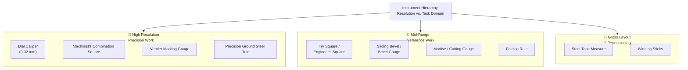
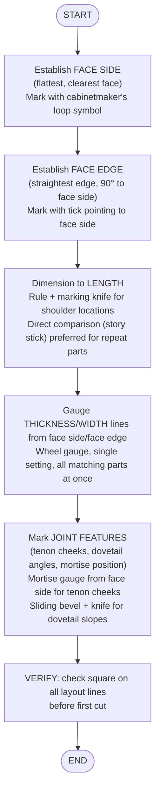

# Lesson 1: Measuring, Marking, Layout Tools

## 1. First-Principles Intuition & Invariants

Precision in woodworking is not a property of a single cut or a single measurement. It is a cumulative property of a system, the relationship between a reference surface, the instruments that read from it, and the marks those instruments leave in wood. Every experienced hand-tool practitioner knows this intuitively, but most intermediate workers never articulate it clearly enough to act on it consistently. The result is a kind of chronic, low-grade inaccuracy: joints that close on three faces but gap on the fourth, drawers that fit in summer but bind in winter, frames that square up under clamp pressure and spring back the moment the clamps come off. These failures are almost never caused by a single bad measurement. They are caused by a misunderstanding of how errors accumulate, amplify, and compound across a layout sequence.

The foundational invariant is this: **every measurement is a comparison**. A steel rule does not contain an objective truth about millimeters or inches. It contains a series of divisions whose accuracy is only as reliable as the standard to which the rule was calibrated and the conditions under which you are reading it. When you transfer a measurement from that rule to a piece of wood using a pencil, you introduce a second comparison with its own error budget. When you saw to that line, you introduce a third. By the time a tenon meets a mortise, as many as a dozen such comparisons may have contributed to whether the joint is tight or loose. Understanding this error propagation, and designing your layout workflow to cancel errors rather than accumulate them, is what separates a craftsman who consistently produces tight work from one who relies on sneaking up with a shoulder plane.

The first invariant of precision layout is the primacy of the reference surface. Every subsequent measurement, every gauged line, every sawn face must trace its ancestry back to a single flat, straight, true surface: the face side of the board. Classical hand-tool joinery teaches the student to establish this face side first, then the face edge, and to mark both with the traditional cabinetmaker's loop-and-tick symbols before touching a gauge or a square. This is not ceremony. It is a topological discipline. If you consistently register every tool against the face side and face edge, dimensional errors that do exist in your stock — a slight hollow, a mild cup — are constrained to surfaces you have explicitly decided not to care about. The error is quarantined.

The second invariant concerns the knife wall. A marking knife, ground to a single bevel and registered against the vertical face of a square or the shoulder of a router plane, produces a line that is not merely visible — it is a physical feature of the wood surface. The knife severs the surface fibers cleanly on the waste side of the line, creating a small triangular trench whose near wall is exactly perpendicular to the face. When you pare a chisel into this wall, or ride a saw plate against it, you are not aiming at a visual target that shifts with the viewing angle. You are locating against a mechanical datum. The difference in positional repeatability between a pencil line and a knife wall can exceed 0.5 mm on a typical workshop drawing pencil, which is comfortably more than the tolerance required for a well-fitted hand-cut dovetail.

The third invariant is that **direct measurement is always more accurate than derived measurement**. When you need two rails to be identical in length, the correct method is not to measure both from a rule, but to cut one rail, then use it as a direct story-stick template for the second. No measurement is taken; a comparison is made. The rule's calibration error drops out of the calculation entirely. This same principle governs the story pole — a length of straight-grained pine or MDF on which all the critical dimensions of a carcass, a window surround, or a set of cabinet doors are marked directly from the job site rather than transcribed through a tape measure and a notepad. The story pole was the production standard of every serious cabinet shop before digital measurement, and it remains superior to digital measurement for any workflow that must hold sub-millimeter register across multiple components.

Understanding these three invariants — reference surface primacy, the knife wall as a mechanical datum, and the superiority of direct over derived measurement — gives you the theoretical skeleton on which the rest of this lesson hangs.

---

## 2. Core Architecture & Mechanics

### The Instrument Hierarchy

The instruments of layout form a logical hierarchy ordered by the measurement resolution they provide and the type of geometric relationship they communicate. At the base of the hierarchy sit tape measures and long straightedges, whose function is establishing gross dimensionality: board length, sheet width, nominal position. Above them sit precision steel rules and sliding bevel gauges, which communicate length and angle to roughly 0.5 mm resolution in shop conditions. Above those sit marking gauges and mortise gauges, which do not measure at all in the conventional sense but instead propagate a fixed offset from a reference face across an entire workpiece with high repeatability. At the apex of the hierarchy for linear work sits the dial or digital caliper, and for angular work, the machinist's combination square — both of which, used properly, work at a resolution of 0.02 mm or better.

The critical insight about this hierarchy is that instruments at different levels are not interchangeable. Using a tape measure to mark tenon shoulders wastes the tape's range and exceeds its useful precision for that application. Using a caliper to lay out rough crosscut lengths wastes the caliper's precision on a task where 1 mm error is irrelevant and wastes your time. Matching instrument to task is itself a form of error control.

### The Steel Rule: Calibration, Parallax, and Hook Error

A good machinist-grade steel rule — the Starrett 300mm No. C604ME is the shop-floor benchmark — is ground flat, engraved (not printed) with divisions, and hardened to resist wear on the ends. The end-hook design of a tape measure introduces a systematic error of 0.5 to 1 mm in its zeroth datum: the hook shifts slightly on its rivets to compensate for inside versus outside measurements, and this mechanical play accumulates into real error when you are scribing tenon shoulders. For work at this precision level, a steel rule with a dead-square ground end is always preferable. You hook nothing; you align the end or the first major graduation against the reference edge, and you mark from there.

Parallax deserves more serious attention than it typically receives. When you read a graduation mark on a rule that sits 1.5 mm above the wood surface, your eye at a 45-degree angle to the rule introduces a lateral displacement of approximately 1.5 mm × tan(45°) = 1.5 mm at the wood surface. This is not a theoretical concern: it is reproducible and larger than the tolerance for fitted joinery. The correct technique is to tip the rule onto its edge so the graduation marks contact the wood directly, then read perpendicular to the rule's face. Many craftsmen know this but do not do it consistently, and this is precisely where chronic low-grade inaccuracy begins.

### The Square: Geometry, Testing, and Error Amplification

A try square communicates squareness — the 90-degree relationship between its beam and its stock — with an accuracy that depends on its quality and your method of use. A precision machinist's combination square (Starrett No. 11 or equivalent) has a blade ground to within 0.001 inches per foot of true 90 degrees. A cheap stamped-metal try square from a home improvement store may have errors of 0.01 inches per inch, which at 6 inches of blade length produces a gap of 0.6 mm at the far end of a scribed line. That gap represents a full degree of angular error. If you are cutting a bridle joint with that square, one shoulder will be raked and the joint will never close cleanly.

Testing your square is mandatory. The classical method requires nothing more than a known-flat surface (a piece of MDF or a surface plate works equally well) and a sharp pencil. Hold the stock against the flat surface, scribe a vertical line, then flip the square left-to-right and scribe a second line from the same starting point. If the lines coincide, the square is true. If they diverge, the half-angle between them is the actual square's error. For engineer's squares and combination squares, you can use the same two-line test against a known straight reference edge. A square that fails this test by more than 0.1 mm over 150 mm of blade length should be adjusted (combination squares permit this via the blade-retention nut) or replaced. Working with a bad square is worse than working without one, because it systematically biases every layout decision you make from it.

The amplification property of squares is worth dwelling on. Consider marking a dovetail baseline across a 70 mm-wide board. If your square has 0.5 degrees of error, the baseline at the far corner is displaced by 70 × tan(0.5°) = 0.61 mm from true square. When you chop to that baseline on both halves of the joint, the cumulative error on the assembled joint is 1.22 mm — nearly a full millimeter and a half of racking. The amplification factor is the board width divided by the measurement span of the error, and it grows with wider stock.

### Marking Gauges: Wheel, Cutting, and Mortise Variants

The marking gauge is architecturally simple: a wooden or metal fence (the stock) rides against the face side or face edge of the workpiece, and a fixed cutter or pin at a set distance from that fence scribes a line parallel to the reference face. The simplicity conceals considerable mechanical nuance. The original wooden pin gauge, with its tapered square pin, produces a line that is partly a scratch and partly a tear, and its quality varies dramatically with grain direction. Working with the grain, a pin gauge is acceptable; working across it on quartersawn stock, it can skate sideways in the grain and produce a wandering line.

The wheel gauge — exemplified by the Veritas Wheel Marking Gauge, whose cutter wheel is ground to a sharp V-profile and mounted on a bearing — solves this problem by applying a slicing action rather than a raking action against the fibers. The wheel always cuts perpendicular to the direction of travel, regardless of grain direction, and its conical geometry creates the same triangular knife wall that a bench knife creates. The practical consequence is a referencing surface that holds a chisel or saw plate reliably, without the tool wandering into softer earlywood.

The mortise gauge carries two cutters — typically two pins or a pin-and-wheel combination — set to the exact width of the mortise chisel you will use. This is the definitive application of direct measurement: you set the gauge to the chisel width by holding the chisel between the two cutters and tightening the knurled adjuster until there is zero play. The chisel width is transferred directly to the gauge without passing through any graduated scale. When you scribe both cheeks of the mortise simultaneously from the same stock setting, the mortise is centered (or offset, if you deliberately position the stock asymmetrically) with absolute internal consistency. No rule was read; no number was interpreted.

The stem-lock mechanism of a gauge is as important as the cutter quality. A gauge whose stem slips under the pressure of scribing will introduce a progressive error that is almost impossible to detect mid-operation. Quality gauges use a cam-lever lock (Veritas, Bridge City) or a precisely fitted thumbscrew mortise in a dense hardwood stock (vintage Stanley No. 92, Record 044). Before beginning any critical layout, test your gauge by scribing a line, then pushing deliberately hard against the stock. If the stem moves even fractionally, it will move during work.

### The Marking Knife: Bevel Geometry and Registration

The choice of marking knife geometry has direct mechanical consequences. A knife ground to a symmetrical double bevel — like a chip carving knife or a craft knife — splits fibers symmetrically to both sides of the blade, producing a wider kerf with an ambiguous near wall. When you register a chisel into this kerf, it can seat on either wall, and the choice is inconsistent. A knife ground to a single bevel, with the flat back facing the layout line and the bevel facing the waste, cuts fibers with the flat side riding precisely against the guiding square or rule. The resulting wall on the keeper side is geometrically vertical because the flat back of the blade defines it. This is not a stylistic preference; it is a mechanical requirement for the knife-wall technique to function correctly.

Knife-wall registration against a square follows a specific sequence. Set the square against the face edge, slide it to the layout position, hold it with moderate thumb pressure, and place the flat back of the marking knife against the square's beam at approximately 70 degrees of blade inclination toward the waste side. Draw the knife toward you in a single, moderate-pressure stroke. Do not attempt to deepen the line in multiple passes during this first registration; instead, make one clean pass, remove the square, and deepen the knife wall by hooking the tip of the knife into the existing groove and drawing it again along the original path. The first pass locates the wall; subsequent passes deepen it without relocating it.

### Layout Sequence Architecture

The sequence above encodes two error-management principles simultaneously. First, every downstream mark derives from an upstream reference that has already been established and verified, so errors cannot accumulate laterally across the layout. Second, all parts that must match dimensionally are gauged in a single session with a single gauge setting, eliminating between-session drift entirely.

---

## 3. High-Performance Optimization & Failure Modes

### Error Propagation in Multi-Component Assemblies

For a single joint — one tenon meeting one mortise — the error budget is relatively forgiving. A skilled practitioner can fit a joint to within 0.1 mm across both cheeks with good tools and careful technique. The challenge multiplies when you are building a carcass with multiple panels, frames-and-panel doors, or a set of drawers. Consider a bookcase with five shelves, each housed in a dado. If each dado position is measured independently from a tape measure, the cumulative positional error from tape hook play, parallax, and pencil width can reach 1 to 1.5 mm per shelf. Five shelves means up to 7.5 mm of total positional drift along the carcass height — easily visible and structurally meaningful if the shelf pins are pre-bored at a fixed pitch.

The correct approach is to lay out all five shelf positions on a story stick from a single end-datum, then use the story stick to transfer all five positions to both side panels simultaneously, with both panels clamped face-to-face in the vise so that the layout on both sides is taken from one stroke of the knife. This eliminates the inter-panel positional error entirely: both panels receive the same marks from the same story stick in the same operation. The only remaining error is the accuracy of the story stick itself relative to the design intent, which is a single-source error rather than a compounded one.

### Gauge Drift and Temperature-Moisture Effects

Wooden gauge stocks expand and contract with seasonal humidity changes, and in a shop environment, the change between a cool, dry winter morning and a humid summer afternoon can displace a wooden stock setting by 0.1 to 0.2 mm on a standard 25 mm stem diameter. For rough work, this is irrelevant. For work at the accuracy level of fitted sliding-fit drawers (target cheek-to-groove clearance of 0.15 mm), it is not. The mitigation is straightforward: check and re-verify your gauge setting against a reference block at the start of each session, particularly if conditions have changed overnight or if the shop has been unheated. Metal-bodied gauges (Veritas, Tite-Mark) with aluminum or brass stocks are dimensionally stable to within 0.01 mm across the shop humidity range and are preferable for precision work on this basis alone.

### Square Inaccuracy: Systematic vs. Random Error

A key diagnostic distinction for the advanced practitioner is the difference between systematic square error and random operator error. Systematic square error appears as a consistent pattern: joints that are always raked the same direction, frames that always go out of square the same way. Random operator error produces a scattered pattern of inconsistency. If your work shows a consistent pattern, your square is bad or your registration technique is flawed in a consistent direction (for example, always holding the stock with a slight gap at the heel). Test the square, then test your technique independently by marking a line from the square and checking it with a machinist's combination square used in a different hand position. Separating these two error sources is essential because the corrective actions are entirely different.

### Knife Wall Failure Modes

The knife wall technique fails in three reproducible ways. First, working against the grain on difficult figure (curly maple, bird's-eye, interlocked mahogany), the knife can ride a reversing grain line for several millimeters before you notice, leaving a wall that is locally displaced from its intended position. The fix is to make a very light first pass, inspect the resulting groove under a raking light before committing to full depth, and in extreme cases to score the layout line with a chisel bevel before applying the marking knife. Second, if the knife's flat back is not truly flat — a cheap knife may have a hollow ground or convex back — the knife registers against the square at an angle and the resulting wall leans into the keeper side. Flatten the back of the knife on a 1000-grit waterstone (the same process as flattening a chisel back) before trusting it for precision work. Third, in softwoods with very pronounced earlywood-latewood contrast (Sitka spruce, Douglas fir), the knife tends to track along the soft earlywood zone rather than crossing it cleanly. Using a slightly more oblique knife angle — closer to 60 degrees from horizontal rather than 70 — reduces the tendency to track and increases the cross-fiber cutting action.

### Reading Verniers and Calipers Under Shop Conditions

A dial or digital caliper is the most precise instrument that most woodworkers own, yet it is frequently misused in ways that produce readings worse than a good steel rule. The two most common failure modes are jaw-rocking and thermal expansion error. Jaw-rocking occurs when you close the calipers on a workpiece at a slight angle to the measurement axis, which inflates the reading by the cosine error: for a 10-degree misalignment, the error is 1 - cos(10°) = 1.5% of the reading, or 0.3 mm on a 20 mm measurement. Close the calipers parallel to the face being measured and use moderate, consistent closing pressure — not finger-pinch pressure, which varies by a factor of three between operators.

Thermal expansion error matters when you are checking a freshly machined or sanded surface against a cold caliper. Steel expands at approximately 11.7 μm per meter per degree Celsius. A 150 mm caliper jaw measured against a workpiece that is 10°C warmer than the caliper will read approximately 0.017 mm high — below the threshold of concern for most woodwork, but relevant if you are fitting a precision wood-and-metal assembly. Allow the workpiece to reach ambient shop temperature before making a critical measurement, and avoid handling the caliper excessively with your bare hands immediately before use, as hand heat is sufficient to expand the beam measurably.

### Optimizing Layout Workflow for Production and Repetition

When making multiple identical components, the single most impactful workflow change is to cut all parts to rough length simultaneously, then establish face sides and face edges on all parts in one pass, then gauge all parts with one gauge setting without moving the gauge between parts. This not only eliminates inter-part gauge-setting error but reduces total layout time by a factor of two to three compared to laying out each part individually. The parts are then, in the language of manufacturing metrology, interchangeable within the tolerance of the gauge setting — any tenon will fit any mortise made from the same gauge setting, regardless of which specific piece of wood each came from.

For angled layout — sliding dovetail slopes, pitched haunches, compound miters — the sliding bevel is set once against a known template or a protractor and locked. The locking mechanism of the bevel is critical: a bevel with a blade that slips under scribing pressure is worse than useless because it is misleading. The Starrett No. 24 bevel uses a machined blade slot with a captured nut that prevents any blade rotation under scribing load. Test any bevel by setting the blade, locking it, and then applying firm lateral pressure to the blade tip. It should not move. Bevels that use simple wing-nut mechanisms without a captured blade tend to allow blade creep and should be treated with appropriate skepticism in precision work.

The mark of a practitioner who has fully internalized these principles is not speed, though speed does come. It is the specific character of their verification habit: they check the reference surface before trusting the gauge, check the square before trusting the line, check the gauge setting against a reference block before beginning a fresh session. Each check takes three to five seconds. Collectively, they eliminate the class of errors that cause an entire morning's work to be scrapped at assembly time, and they build, over years, the kind of intuition that allows you to feel when something is wrong before the measurement confirms it.
