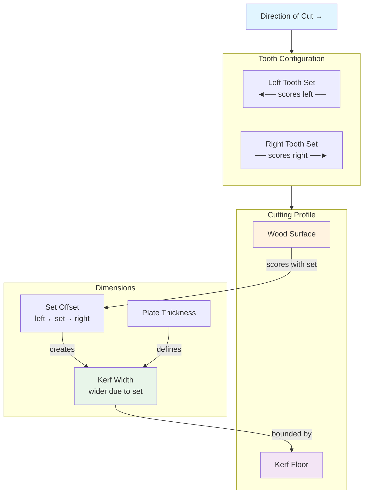

# Lesson 2: Saws, Cutting Mechanics

## 1. First-Principles Intuition & Invariants

Wood is not a homogeneous material. It is a bundle of hollow cellulose tubes, lignin-bound and oriented in one direction, with the grain running lengthwise along the tree's annual growth rings. Every cut a saw makes is an act of violence against that structure, and the success or failure of that cut is determined almost entirely by how well the tool's geometry is matched to the direction and nature of that disruption. This is the central invariant of hand-saw mechanics: the wood's fiber orientation is a constant, and everything about tooth shape, set, file angle, and cutting posture must be chosen relative to it.

Before the first tooth touches the wood, consider what a saw actually does at the microscopic level. A saw does not slice in the way a plane iron slices. It scratches, then fractures. Each tooth is a miniature chisel that scores, displaces, and ejects a chip. The kerf — the slot left in the wood — is not material that disappears; it is material converted into sawdust by sequential tooth engagement. The width of that kerf is set by the *set* of the teeth: the deliberate lateral displacement of alternating teeth to either side of the plate, creating a channel slightly wider than the saw's body so that the plate does not bind. Remove the set, and the saw jams within two strokes. Increase it too aggressively, and the saw cuts a wide, ragged kerf that wastes material and demands excessive thrust.

The historical development of western hand saws reflects this grain-direction constraint directly. European craftsmen working in hardwoods recognized early that cutting along the grain — ripping — and cutting across it — crosscutting — were fundamentally different mechanical problems requiring different tooth geometries. The rip saw evolved a tooth with a nearly vertical leading face (rake angle approaching 90°), which acts like a succession of chisels paring along the fiber bundles. The crosscut saw evolved a more complex tooth that first scores the wood fibers with a knife-like slicing action before scooping the chip, preventing the fibers from tearing past the cut line. Japanese craftsmen arrived at a parallel insight but applied it in the opposite cutting direction: pull-stroke saws place the blade under tension rather than compression, which allows a thinner, harder plate, finer teeth, and consequently a narrower, cleaner kerf. The choice between western push-cut and Japanese pull-cut is not primarily an aesthetic or cultural preference; it is a structural engineering decision about how thin a plate can be reliably held in its cut line.

The fundamental invariants of hand-saw mechanics reduce to four principles that every advanced practitioner should be able to invoke without hesitation. First, tooth geometry must match the grain orientation of the cut. Second, kerf width must exceed plate thickness by a controlled margin set by tooth set. Third, the saw plate must remain perfectly in the same plane throughout the stroke — any twist or camber introduces binding and deflects the cut. Fourth, the cut must be initiated cleanly and deliberately, because the first three to five strokes establish a channel that the subsequent cut will follow almost without choice.

---

## 2. Core Architecture & Mechanics

### Tooth Geometry: The Rip Profile

A rip tooth in its canonical western form has a rake angle — the angle of the tooth's leading face relative to a vertical line perpendicular to the saw's cutting edge — of approximately 8° to 12° from vertical. This near-vertical face presents the edge of the tooth to the wood fiber like a chisel edge traveling parallel to grain. The gullet (the curved valley between teeth) must be deep enough to hold the chip during the stroke and release it at the end. Rip teeth are typically filed straight across with a mill bastard file held at 90° to the saw plate, creating a symmetrical tooth with no fleam (the cross-filed angle that creates a knife edge on a crosscut tooth). The absence of fleam is not a deficiency; it is correct for the task. When you are splitting fibers longitudinally rather than severing them transversely, a chisel edge outperforms a knife edge.

Tooth pitch — typically measured in teeth per inch (TPI) or points per inch (PPI, which equals TPI + 1) — is a critical variable that scales inversely with aggressiveness and directly with surface quality. A 4 TPI rip saw will remove material rapidly but leave a surface that requires significant cleanup. A 7 TPI rip saw cuts more slowly but leaves a face that may need only a single pass with a hand plane. For structural rip cuts in rough stock, 4–5 TPI is appropriate. For furniture-grade ripping in hardwood where the rip face will be a glue surface, 7–8 TPI is the correct choice.

### Tooth Geometry: The Crosscut Profile

The crosscut tooth is geometrically more sophisticated. It introduces two angular variables that the rip tooth does not use. The first is *fleam*, the angle at which the file is tilted in the horizontal plane relative to the saw plate. A fleam angle of 15° to 25° (depending on hardness of species and desired aggressiveness) creates a knife-point on the front face of each tooth. These knife-points do not remove material in the same stroke — alternating teeth are filed from opposite sides, so the left-side teeth score the left wall of the kerf and the right-side teeth score the right wall. Between them, they define a strip of fiber that is severed at both boundaries before being scooped out. This is what prevents the crosscut saw from tearing grain ahead of the line.

The second variable is *rake*, which for crosscut saws is typically negative — that is, the leading face of the tooth leans back from the direction of travel, in some designs as far as 5° to 15° back from vertical. This negative rake reduces the aggressiveness of each tooth's bite, which is exactly what you want when cutting across fibers: too aggressive a bite causes the tooth to skip and chatter rather than slice cleanly.

The following table summarizes the canonical geometry for the four saw types that form the core of an advanced woodworker's hand-saw arsenal.

| Saw Type | TPI | Rake | Fleam | Set | Primary Use |
|---|---|---|---|---|---|
| Rip panel saw | 4–7 | 8–12° positive | 0° | Medium | Ripping boards to width, full-length stock |
| Crosscut panel saw | 8–12 | 5–15° negative | 15–25° | Medium | Crosscutting to length, dimensioning |
| Carcass saw (back saw) | 12–16 | 10–14° negative | 15–20° | Fine | Carcass joinery, shoulder cuts in tenons |
| Dovetail saw (back saw) | 18–22 | 10–12° positive (rip filed) | 0° | Very fine | Dovetail cheeks and pins, fine joinery |

The dovetail saw deserves particular attention because its tooth geometry often surprises practitioners who expect it to be crosscut-filed given its small scale. Because dovetail cuts travel primarily along the grain — the cheek of a tail or pin is a rip cut, regardless of the angle the saw travels through space relative to the face of the board — the correct filing geometry is rip, not crosscut. Applying fleam to a dovetail saw does not improve the cut; it blunts the tooth's effectiveness along the fiber direction. If a practitioner finds their dovetail saw tearing rather than cutting cleanly, the most common cause is not dullness but incorrect tooth geometry for the application.

The back saw — which encompasses both carcass and dovetail saws — achieves its rigidity through a folded brass or steel spine clamped over the top edge of the plate. This spine prevents the plate from buckling under push loading and constrains it to a single plane. The tradeoff is depth of cut: the spine limits how far the saw can be driven into the work, which is not a limitation in joinery work but becomes one if the saw is misused for deeper cuts. The spine also adds mass that dampens vibration, which contributes to the smooth, almost silent cut of a good back saw in hardwood.

### Kerf Mechanics and Plate Dynamics

The kerf is not simply a slot. It is a dynamic channel whose geometry changes throughout the stroke as chips accumulate, wood compresses slightly under the plate, and lateral forces act on the tooth tips. The set of the teeth must exceed the plate thickness by enough to provide clearance but not so much that lateral wobble is introduced. For a typical carcass saw with a 0.6 mm plate, the kerf should measure approximately 0.9 to 1.0 mm — a clearance of roughly 0.15 to 0.2 mm per side. A kerf measurably wider than this indicates excessive set, which produces a rougher cut and demands more lateral force to keep the saw tracking. A kerf only marginally wider than the plate indicates insufficient set, which will cause the saw to bind and generate heat from friction, which in turn swells the wood and tightens the bind further.

The ASCII diagram below models a crosscut tooth pair in cross-section relative to the kerf walls.

Each tooth's set puts it in contact with one wall of the kerf only. The plate itself contacts neither wall during a correctly set saw. This geometry means the saw steers like a boat with two outriggers: tiny lateral imbalances in the cut are corrected by increasing engagement on one wall. When you feel a saw "want to drift," it is communicating that one side of the kerf is offering more resistance than the other, and you should respond with posture correction rather than force.

### Cut Initiation: The Most Critical Five Strokes

The first stroke of a saw is mechanically unlike every stroke that follows it. There is no kerf to guide the plate, no channel to constrain the tooth tips, and the probability of the saw skipping across the layout line and marring the work is at its maximum. The conventional wisdom of using the thumb as a guide is correct but incomplete as a technique description. The thumbnail placed against the flat of the saw plate must be positioned so that the saw's teeth are on the *waste side* of the line, with the kerf entirely consuming material that will be discarded. A single tooth engaging the layout line itself will produce a burr that destroys the knife-wall, which is the single most important reference surface in layout-to-cut precision woodworking.

Pull strokes on the first three to five strokes are superior to push strokes for cut initiation even on western push-cut saws, because a pull stroke places the plate under tension and minimizes the tendency for the saw to skip. Once the kerf is established to a depth of two to three millimeters, the saw plate is captured on three sides (both walls and the kerf floor) and will resist lateral deflection much more strongly. At this point, full-length strokes can begin.

The angle of the saw relative to the work surface during cut initiation also matters for a different reason than it does during the main cut. A steep attack angle concentrates contact on fewer teeth and allows faster kerf establishment, but it makes the saw harder to control laterally. A shallow angle engages more teeth simultaneously, distributing force and improving lateral stability. For panel saw work, beginning at approximately 45° and flattening to 30° once the kerf is established is a sound workflow. For back saws on bench-hook work, beginning nearly horizontal and tilting progressively as the cut deepens gives the best control over kerf alignment.

---

## 3. High-Performance Optimization & Failure Modes

### Tracking and Drift: Diagnosis and Correction

A saw that drifts from its intended cut line despite correct posture is almost always communicating a tooth set imbalance. When the aggregate set is heavier on one side of the plate, that side engages the kerf wall more aggressively and steers the saw away from it. The correct diagnostic is to run a feeler gauge or a folded piece of paper along each wall of the kerf and compare the engagement. The wall opposite to the drift direction will show tighter engagement — the saw is running away from the over-set side.

Correcting set imbalance requires a saw jointer (a small file guide that runs along the flat of the plate) and a side-set file. Rather than re-setting the entire saw, identify which teeth are overlong on the heavy side by running the jointer lightly along the tooth tips: overlong teeth will show a bright flat on their tip, confirming they are the cause. A single pass with the side-set file on those specific teeth is sufficient. This surgical correction is preferable to re-setting the whole saw because it maintains the minimum effective set that produces a clean, narrow kerf.

Drift caused by a bent or kinked plate is a different and more serious failure. A panel saw plate that has been stored leaning against a wall for months may develop a permanent curl. Hold the saw by the handle and sight down the plate from the toe toward the handle with the teeth pointed away; the plate should appear as a straight line. Any visible bow, twist, or kink will cause the saw to cut in a curve regardless of technique. Minor bends in a panel saw plate can be corrected by gripping the plate on a padded vise and applying carefully controlled bending force in the opposite direction. This is skilled work: overshoot by a millimeter and you have a bend in the opposite direction. A back saw with a kinked plate almost always requires professional saw dressing, as the spine prevents easy access and the thinner plate is more prone to plastic deformation.

### Tooth Dullness: Recognition Before It Becomes a Problem

A sharp saw requires almost no downward pressure. The teeth self-feed into the wood, and the practitioner's role is primarily guidance, not force. The moment you notice yourself applying downward pressure to maintain cutting progress, the saw is dull — the question is only by how much. A saw that reflects light from the tooth tips when held at a raking angle has flat, polished lands on those tips, which means the knife-edge is gone and the tooth is riding on a flat rather than cutting with an edge. This is the stage at which a saw becomes genuinely dangerous, not because it cuts too aggressively but because it demands force that tends to cause it to skip, buckle, or escape the kerf.

For the advanced practitioner who sharpens their own saws — which is the correct posture if you use them seriously — the workflow for a crosscut saw is as follows. Begin by jointing the teeth to establish a common height: run a mill file in the jointer along the full length of the plate with one or two light strokes, raising a small bright flat on the tip of every tooth. These flats are your reference. Set the saw in the saw vise at a comfortable working height, tooth tips at approximately chin level. Using a triangular needle file (for saws under 16 TPI) or a slim taper file (for panel saws), file the teeth that point away from you at the correct fleam angle — typically 15° for hardwood, 20° for softwood — tilting the file handle down at approximately 10° to address the rake angle simultaneously. File each tooth until the bright flat from jointing is exactly half consumed. Then flip the saw in the vise and file the remaining teeth from the other side until their flats are also consumed. If you have done this correctly, all flats will have disappeared and the tooth tips will be uniformly sharp, with knife-points you can verify by running a fingertip lightly across the top of the teeth — sharp crosscut teeth feel grabby.

For a rip saw or dovetail saw, the procedure is the same except the file is held at exactly 90° to the plate (zero fleam) and the rake angle is addressed by tilting the file handle back slightly to match the designed rake geometry. Because both faces of a rip tooth are symmetric, the saw does not need to be flipped; file every tooth from the same side.

After sharpening, re-setting is only required if the original set was insufficient or if jointing removed so much tooth height that the set is effectively zero at the tip. For most touch-up sharpening jobs — restoring an edge without removing significant tooth height — no re-setting is needed.

### Grain Interaction at the Exit Face

One of the most common failures in crosscutting — tearing on the underside of a board — is not a saw problem. It is a support problem combined with a geometry problem. At the exit face of a crosscut, the last wood fibers are bent and broken away by the final tooth engagement rather than cleanly severed, because there is no longer backing material to support the fiber against the tooth's downward component of force. The two correct mitigations are independent and should be applied together.

First, support the offcut with your free hand or with a bench hook extension so that it cannot drop away under its own weight before the last few strokes complete the cut. A piece of wood that drops before the cut is finished will lever the remaining fibers in a direction that guarantees tearout. Second, slow the stroke rate and reduce stroke length in the final five to ten strokes, so that each tooth is removing a thinner chip with less downward force component. Some practitioners also score a knife line on the underside of the board directly opposite the top cut line and register the saw in that knife wall, which creates a clean release line for the fibers to snap to rather than tearing arbitrarily.

Rip sawing presents a different grain challenge at the end of a full-length cut: spelching at the toe of the board, where the final fibers split ahead of the teeth due to the leveraging effect of the offcut's weight. The correct posture is to shift the saw to a nearly horizontal angle for the last 50 mm of cut, which distributes the exit forces over a greater number of teeth simultaneously and reduces the tendency of any single tooth to initiate a split. Alternatively, flipping the board and completing the cut from the opposite end ensures the exit occurs at an already-established point of controlled departure.

### Saw Selection as a Workflow Optimization Decision

The practitioner who owns four saws and uses each appropriately will consistently outperform one who owns twelve saws used interchangeably. The rip panel saw (4–6 TPI) is the correct tool for initial stock breakdown: ripping wide boards to rough width from 8/4 or thicker stock. The crosscut panel saw (8–10 TPI) handles all crosscutting to rough and finish length. The carcass saw governs all tenon shoulders, housing dados, and any joinery where a relatively wide back saw with moderate TPI provides the balance of speed and precision the work needs. The dovetail saw, with its rip-filed fine teeth, exists for one purpose: the precision cheek and baseline cuts in dovetail and box joint work, where the kerf must be narrow, perfectly oriented to grain, and controlled to within a quarter of a millimeter.

Where practitioners create problems for themselves is in attempting to crosscut with a rip saw because it is the saw already in hand, or attempting to rip with a crosscut saw because the carcass saw is "close enough." The rip saw on a crosscut produces violent tearout. The crosscut saw on a rip cut requires dramatically more force, as its negative rake geometry resists the chisel action needed to split fibers longitudinally. These are not minor inconveniences; they are the difference between a ten-second cut and a ninety-second one, with correspondingly worse results. Saw selection is not about preference. It is about matching the tool's mechanical function to the material's mechanical reality — which is the same decision a machinist makes when choosing between a finishing endmill and a roughing endmill, applied to wood, hand held, and entirely dependent on the practitioner's judgment.
