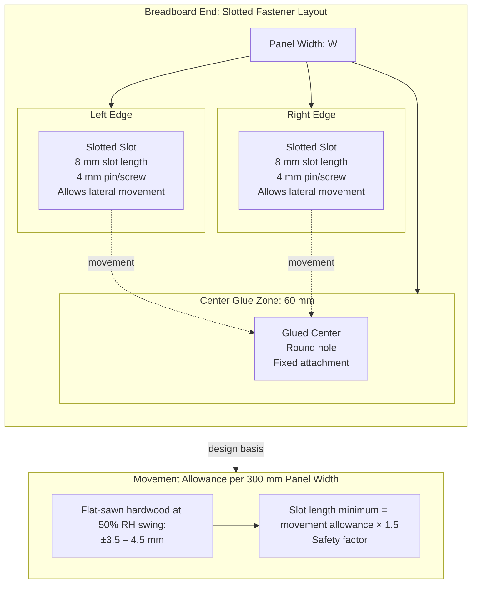

# Lesson 3: Edge Joinery, Frame Construction, Lamination Protocols

## 1. First-Principles Intuition & Invariants

Wood is not a material so much as a record of biological history. Every board carries within its grain a detailed log of the tree's growth: the differential density of earlywood and latewood laid down in annual rings, the radial arrangement of ray cells crossing those rings, and the lignin-bound cellulose microfibrils that give each tracheid and vessel element its anisotropic stiffness. When a woodworker bridges two boards at their edges, or glues up a laminated blank, they are not merely fastening surfaces together. They are negotiating between competing anisotropic systems, each with its own axis of expansion, contraction, and failure. Understanding edge joinery and lamination at a first-principles level means understanding wood movement before it means understanding glue.

Tangential shrinkage—the dimensional change that runs parallel to the growth rings—is roughly twice the radial shrinkage, which runs perpendicular to the rings toward the pith. For a typical hardwood like hard maple, tangential shrinkage across the full range from green to oven-dry runs about 9.5%, while radial shrinkage runs closer to 4.8%. These numbers matter practically because two adjacent boards in a glued panel will almost always present different ring orientations relative to the face, and those orientations determine how they attempt to move as seasonal humidity cycles. A flat-sawn board cupped against a quarter-sawn board, joined at their edges, is a system in permanent internal tension.

This is the central invariant of edge joinery: the glue line is not the weak point. A properly executed long-grain-to-long-grain glue joint, with surfaces prepared correctly and clamping pressure applied within the working time of the adhesive, will routinely fail in the wood before it fails in the glue. The joint itself can achieve close to 100% wood shear strength. What destroys edge-glued panels is not adhesive failure at the joint but wood movement working against a glue line that cannot flex. This is why sophisticated panel construction pairs edge bonding with grain orientation strategy rather than treating them as separate concerns.

The same logic governs mortise-and-tenon frames and their relatives. A frame built from solid wood must accommodate the wood's seasonal movement in the panel it contains, or the assembly will rack, split, or blow apart under the stresses of a single winter heating season. Traditional frame-and-panel construction solves this by floating the panel in a groove, allowing it to move while the frame holds its geometry. But the frame itself is a joinery problem of a different kind: each corner is a site where cross-grain members meet, and the mechanical design of that corner determines how the frame resists racking loads, compressive loads along its stiles and rails, and the continuous low-amplitude stress of seasonal cycling.

The invariant for frame construction is that every corner joint must resist both tension and shear simultaneously. A simple butt joint glued at a corner has reasonable compressive strength along the axis of the joint, poor shear resistance across it, and near-zero tension resistance pulling the joint apart. Every upgrade in joint complexity—haunched tenons, draw-bored pinning, wedged through-tenons, knockdown connectors—addresses one or more of those failure modes in exchange for increased fabrication time. Knowing which failure mode governs your specific application is what allows an advanced practitioner to choose the minimum-sufficient joint rather than over-engineering every corner.

Lamination adds a third dimension to these concerns. When you glue up a curved lamination, a torsion box, or a thick blank from multiple thinner pieces, you are creating an engineered composite in which the mechanical behavior of the whole is determined by the arrangement, orientation, and thickness of the constituent layers. A laminated curved form built from book-matched thin strips can be made far stiffer and more dimensionally stable than any equivalent solid blank, because the alternating grain orientations in adjacent plies cause each layer's movement impulse to be partially canceled by its neighbor. This is the same principle underlying plywood and cross-laminated timber at industrial scale. At the hand-tool and small-shop scale, it is the principle underlying bent laminations for chair backs, curved aprons, and sculptural forms that solid wood simply cannot produce.

The invariant for lamination is that layer count and ply thickness control the balance between formability and stiffness. Thin plies conform easily to tight radii without springback but require many layers to reach structural thickness, introducing more glue lines and more opportunity for voids. Thick plies build up quickly but resist bending, requiring more clamping pressure and producing more springback when released from the form. The practitioner's task is to find the ply thickness that permits forming without cracking or unacceptable springback for the specific species, moisture content, and radius of curvature involved.

---

## 2. Core Architecture & Mechanics

### Edge Bonding Mechanics and Surface Preparation

The tensile strength of a long-grain glue joint depends on two interlocking conditions: surface intimacy and adhesive transfer. Surface intimacy means that the two mating faces are flat enough, over their full length and width, that clamping pressure closes any gaps entirely and distributes stress uniformly across the joint. Adhesive transfer means that the glue penetrates into the open wood cells at both faces to a depth of three to five cell diameters before it gels, creating a mechanical interlock rather than a surface-to-surface adhesion. Both conditions can be undermined by the same mistake: over-sanding.

A hand-planed or machine-jointed edge presents open, clean wood cells at the surface with no smeared or burnished material clogging their lumens. A belt-sanded or random-orbital-sanded edge presents a partially glazed surface where cell walls have been partially crushed and smeared with dust-laden wood fibers. The sanded surface will bond, but with statistically lower shear strength and higher sensitivity to clamping time and pressure. For structural edge joints, the reference surface preparation is a freshly tuned jointer or a sharp hand plane (#7 or #8 jointer plane) set for a gossamer shaving. If you can read newsprint through the shaving, the blade is sharp enough and the depth correct.

For a glued edge joint in a typical shop setting with PVA (polyvinyl acetate) adhesive, the working sequence runs as follows. Mill your stock to rough thickness and rip your boards to rough width, leaving 3–5 mm on each dimension for final processing. Joint the mating edges within two hours of glue-up to prevent oxidation of the fresh surface. Apply glue to both faces using a notched spreader or a chip brush, targeting a coverage rate of approximately 150–180 g/m², which produces a continuous wet film without puddles or dry patches. Align the boards so the faces are coplanar, assemble parallel bar clamps at 200–250 mm intervals along the joint, and apply pressure until glue squeezes out uniformly along the full length of the joint. Clamp pressure for typical hardwoods with PVA is in the range of 0.7–1.0 MPa (100–150 psi) on the joint face. Excess pressure beyond this range starves the joint by squeezing out too much adhesive before it can gel, producing a "starved joint" that is weaker than one clamped at moderate pressure.

```text
Edge Joint Glue-Up: Clamping Pressure & Open Time Reference

Species Class     | Optimal Joint Pressure | PVA Open Time (70°F, 50% RH)
------------------|------------------------|------------------------------
Soft hardwoods    | 0.55 – 0.70 MPa        | 5 – 8 minutes
(poplar, alder)   |                        |
                  |                        |
Medium hardwoods  | 0.70 – 0.90 MPa        | 4 – 7 minutes
(cherry, walnut)  |                        |
                  |                        |
Hard hardwoods    | 0.90 – 1.10 MPa        | 3 – 6 minutes
(maple, oak)      |                        |
                  |                        |
Dense exotics     | 1.10 – 1.40 MPa        | 3 – 5 minutes
(ebony, cocobolo) | (surface prep critical)|
```

Dense oily species such as rosewood, cocobolo, and teak present a special problem: extractives deposited on the freshly cut surface chemically interfere with PVA and urea-formaldehyde adhesives, dramatically reducing bond strength. The standard remediation is to wipe the joint surfaces with acetone or naphtha immediately before glue application, allowing the solvent to fully flash off (approximately 2–3 minutes) before proceeding. Some practitioners use slow-cure epoxy on oily exotics rather than PVA, accepting the longer clamp time in exchange for more reliable penetration through the extractive layer.

### Grain Orientation Strategy in Panel Glue-Ups

For a wide panel glued from multiple boards, grain orientation is a decision with long-term structural consequences. The classical advice to alternate the ring curvature (crown up, crown down, crown up) across adjacent boards exists to distribute cupping forces so that no single board dominates the panel's movement. This strategy limits the amplitude of any single warp wave but does not eliminate tension at the glue lines. A more sophisticated approach considers the radial and tangential planes together.

Quarter-sawn boards—those cut so that the growth rings run approximately perpendicular to the face—exhibit the smallest difference between radial and tangential shrinkage because the width of the board lies primarily along the radial axis. A panel glued exclusively from quarter-sawn stock in the same species will be dramatically more stable than one built from flat-sawn boards, because each board shrinks and expands by a smaller and more consistent amount. The tradeoff is yield: quarter-sawing a log produces narrower boards and significantly more waste than flat-sawing, which is why quarter-sawn material commands a price premium.

For a practitioner building a dining table top from 150 mm-wide flat-sawn hardwood boards, the practical optimization is to select boards from the same log or the same tight stack at the lumber yard, so that moisture content, density, and growth ring spacing are as consistent as possible across the panel. Matching the ring spacing visually at the ends of the boards before gluing up gives a reasonable approximation of matching the shrinkage coefficient. Boards with tight, uniform rings (slow-grown wood) are more stable and more predictable than boards with widely variable ring spacing (fast-grown wood), which is why workshop-grade lumber from the center of a large tree is inferior to the denser outer material for joinery panels.

### Frame-and-Panel Architecture

The frame-and-panel system deserves examination as a mechanical architecture rather than simply a visual style. Its geometry can be understood through the following diagram:

```text
Frame-and-Panel: Force Distribution Model

  ┌─────────────────────────────────────────────────────────┐
  │  STILE (vertical)   │  RAIL (horizontal)                │
  │                     │                                   │
  │   Long grain        │   Long grain                      │
  │   runs vertically   │   runs horizontally               │
  │        │            │          │                        │
  │        │            │          │                        │
  │        └─── MORTISE ┤  TENON ──┘                        │
  │                     │                                   │
  │   Shoulder-to-      │   Tenon cheek carries             │
  │   shoulder length   │   shear load                      │
  │   carries           │                                   │
  │   compressive load  │                                   │
  └─────────────────────────────────────────────────────────┘

  RACKING LOAD PATH:
  Applied corner load → Tenon shear face → Mortise wall → Stile long grain
                                                           (highest resistance)

  PANEL FLOAT:
  Panel sits in groove, NOT glued, allowing:
  ├── Tangential expansion: ±3–4 mm per 300 mm width (flat-sawn)
  └── Panel never restrains frame geometry
```

The mortise-and-tenon joint transmits load through three distinct mechanisms. First, the shoulders of the tenon bear against the face of the mortised member under compressive loading, distributing that load across the full shoulder area. Second, the cheeks of the tenon transfer shear stress into the mortise walls when the frame is loaded in a direction that tends to rotate the joint. Third, the mechanical interlocking of the tenon within the mortise resists any tendency of the rail to rotate out of the plane of the frame, which would otherwise peel the joint apart under racking loads. These three mechanisms are largely independent, which is why modifying one tenon dimension—say, reducing the tenon thickness for a thicker-walled mortise—affects the cheek shear area without altering the shoulder compressive area.

The standard proportioning rule for a structural mortise-and-tenon is that tenon thickness should be one-third of the total stock thickness, tenon length should be at least three times the tenon thickness, and the shoulder offset on the face side should equal or exceed the tenon length to maintain the mortise wall at adequate strength. For a 20 mm-thick rail, this gives a tenon nominally 6–7 mm thick, with a length of 20–25 mm for cabinet doors or 30–40 mm for chair frames subject to dynamic loading.

The haunch is a refinement that serves two purposes simultaneously. It fills the groove left by the panel channel in the stile, preventing the groove from providing a stress concentration site at the corner, and it lengthens the effective glue surface at the base of the mortise without increasing the mortise depth. For doors and windows where the groove runs the full length of both stiles and rails, the haunched tenon is not optional engineering—it is required geometry.

### Bent Lamination Mechanics

Bent lamination works because thin strips of wood can be deformed elastically to a radius that would cause thick stock to fracture, and the adhesive fixes the deformation permanently by restraining the internal stresses that would cause springback. When a strip of wood is bent, the outer face is stretched in tension along its length while the inner face is compressed. The neutral axis—the line of zero strain—lies at the mid-thickness of the strip. For a given radius of curvature, the maximum strain at the outer face equals half the strip thickness divided by the bend radius. As long as this strain remains below the modulus of rupture (MOR) of the species in bending, the strip will conform to the form without fracturing.

```text
Springback & Ply Thickness Reference for Common Bent-Lamination Species
(Target bend radius: 150 mm, 12-ply construction)

Species         | Max Ply Thickness | Expected Springback | Notes
                | (no fracture)     | (from form radius)  |
----------------|-------------------|---------------------|---------------------------
White ash       | 3.2 mm            | 8 – 12%             | Steam assists below 2 mm
Hard maple      | 2.5 mm            | 10 – 15%            | High stiffness; overbend form
White oak       | 3.0 mm            | 9 – 13%             | Tannic acid can stain PVA
Black walnut    | 3.5 mm            | 6 – 10%             | Cooperative, low springback
Cherry          | 3.2 mm            | 7 – 11%             | Moderate; ideal lamination wood
```

Springback is the elastic recovery that occurs when the lamination is removed from the form. It is not a defect—it is a predictable consequence of the elastic component of bending strain that the adhesive cannot fully restrain. The practitioner compensates by building the form to a tighter radius than the finished curve requires. If a chair back requires a radius of 400 mm and a 12-ply walnut lamination in 3 mm strips produces 8% springback, the form should be built to approximately 370 mm radius so that the finished lamination recovers to the target curve. This requires knowing the springback percentage for the specific species, strip thickness, and ply count, which is best determined by a test lamination using scrap strips before cutting final material.

Urea-formaldehyde (UF) adhesives produce stiffer glue lines than PVA and are preferred for bent laminations where stiffness in the finished part is critical. Slow-cure epoxy is the choice for laminations involving dense, oily, or exotic species. PVA type II (cross-linking) is acceptable for most bent lamination work in domestic hardwoods and has the advantage of a longer open time at room temperature, which is valuable when positioning many thin strips on a complex form before clamps are applied.

---

## 3. High-Performance Optimization & Failure Modes

### Optimizing Long Edge Joints for Dimensional Stability

The highest-performance edge-glued panel construction begins at the lumber yard, not the jointer. Select boards from the same board-foot bundle when possible, as lumber dried in the same kiln run will have similar final moisture content and shrinkage history. Before machining, stack the rough boards in your shop for a minimum of two weeks—longer in winter when indoor heating drops relative humidity sharply—so that all boards equalize to the same EMC (equilibrium moisture content). Attempting to glue up boards that differ by more than 2% in moisture content will produce a panel whose internal stresses after equalization exceed the shear strength of the glue line in some species.

After jointing, perform the "rub joint" test before applying any adhesive. Hold two jointed edges together and rub them longitudinally under moderate hand pressure. If the surfaces close entirely with no visible light gap along the length, the joint is ready. If you see a gap at the center and both ends close (a convex joint, the classic error of a machine jointer whose outfeed table is set fractionally high), the gap will starve the center of the joint under clamping pressure, creating a structurally weak zone in the middle of the panel. Correct by taking a single pass with a sharp, flat-soled hand plane (#7 jointer plane) with the throat set fine.

For panels wider than 600 mm or longer than 1200 mm, the differential movement along the length of the glue line produces a progressive peeling stress as one end of the panel sees slightly different humidity than the other. Reinforcing the glue line with loose tenons (Domino or biscuit cutters) adds mechanical shear resistance without altering the fundamental bonding chemistry. Biscuits, used correctly, serve primarily as alignment aids during clamp-up rather than structural reinforcement; their compressed beech cross-section swells slightly in the PVA moisture to fill the slot, providing modest shear resistance but negligible tension resistance. Domino-style loose tenons in a larger slot geometry provide genuine mechanical shear reinforcement and are worth using in panels that will see heavy service loads.

### Frame Assembly Under Racking Stress

A rectangular frame loaded at a corner—as happens every time someone pushes sideways against a cabinet door or pulls a drawer open unevenly—experiences a racking force that attempts to collapse the frame from a rectangle into a parallelogram. The mortise-and-tenon corners resist this through tenon shear, but beyond the elastic limit of the joint, the only additional resistance comes from glue adhesion at the shoulder and any mechanical pinning present.

Draw-boring is the traditional method of mechanically locking a mortise-and-tenon without wedging or hardware. The procedure is as follows. Cut and fit the joint dry, then mark the tenon through the mortise hole before assembly. Disassemble and shift the mark approximately 1–1.5 mm toward the shoulder on the tenon. Bore through the mortise walls on the marks, then bore through the tenon on the offset mark. When a tapered hardwood peg is driven through the assembled joint, it encounters the offset tenon hole and deflects the tenon toward the shoulder, compressing it into the mortise and placing the shoulder under continuous compressive preload. This mechanical preload dramatically improves the joint's resistance to both racking and pullout because it converts what would otherwise be a tension failure at the glue line into a friction-clamped contact.

The optimal peg diameter for draw-boring is typically one-third of the tenon thickness, using dry, straight-grained hardwood (white oak, ash, or hickory are traditional because their long fibers resist splitting along the grain). Pegs that are too large relative to the tenon weaken the tenon at the bore point; too small and they deflect rather than draw the joint tight.

For assembled frames, the sequence of operations during glue-up critically affects the final geometry. The standard sequence is: dry-fit the entire frame, check for square using diagonal measurements (opposing diagonals equal = square), then disassemble and glue one rail at a time rather than all joints simultaneously. Apply glue to both mortise walls and both tenon cheeks, assemble, and clamp with bar clamps or sash clamps aligned parallel to the rails. Apply a single clamp diagonally across the longer diagonal if the frame pulls out of square under clamping pressure. Measure diagonals again before the adhesive gels, while correction is still possible.

### Lamination Failure Modes and Mitigations

The primary failure mode in bent laminations is delamination at a glue line, which typically initiates at a void or dry spot and propagates under cyclic loading or seasonal movement. Voids arise from three sources: insufficient adhesive coverage, an overly long assembly time before clamping that allows the adhesive to skin over before the strips are positioned, or a gap between strips caused by residual twist or cup in a thin strip that the clamp pressure cannot close over the full form surface.

The mitigation for coverage voids is consistent adhesive application to both faces of each glue line and confirmation that squeeze-out appears uniformly along the full length before the clamp pressure is released. The mitigation for skinned adhesive is to work within the established open time, using slower-cure adhesive in hot or dry conditions. The mitigation for strip geometry gaps is to joint every strip flat before resawing if working from narrow stock, or to pass each resaw strip through a drum sander to bring it to a consistent, flat thickness before glue-up. Strips with more than 0.1 mm of thickness variation along their length will produce laminations with internal voids even under aggressive clamping pressure.

The second failure mode specific to panels with breadboard ends is seasonal fracture through the panel width. A breadboard end is a cross-grain member attached perpendicular to the long grain of a panel to prevent cupping. The fundamental problem is that the long-grain panel will expand and contract across its width with seasonal humidity change while the breadboard end, running cross-grain, resists that movement. If the breadboard end is glued across its full length, the panel will split within a few seasons. The correct construction allows the panel to move beneath the breadboard by elongating the fastener holes (typically slot-cut mortises for drawbore pins or slotted screw holes for wood screws) so that the breadboard is glued only at its center—approximately 50–75 mm at the midpoint—and mechanically fastened with no glue at the outer zones. The center glue point fixes the reference position of the panel relative to the breadboard; the slotted fastenings at the ends allow the panel to move in both directions from that midpoint without stressing the cross-grain connection.



Structural edging—solid wood banding applied to the edge of a veneered or plywood substrate—presents a related movement problem. Solid wood edging glued to plywood along the long grain dimension is stable because the edging and the plywood face veneers share approximately the same expansion axis. However, mitered solid wood edging at corners, where end grain meets long grain at the substrate corner, is susceptible to telegraphing as the edging thickness changes seasonally. The mitigation is to use species with low coefficient of movement for edging (quarter-sawn stock, again, is ideal), to keep edging thickness below 6 mm on dimensionally sensitive applications, or to use a splined miter joint at corners that provides a continuous long-grain-to-long-grain bond at the miter rather than relying on end-grain adhesion alone.

### Adhesive Selection as a Performance Variable

The working woodworker typically reaches for PVA without deliberate consideration of whether it is the correct adhesive for the structural context. For edge joints in cabinet panels operating in a climate-controlled interior, PVA type I or II is appropriate. For structural joints in outdoor furniture or in assemblies that will experience moisture cycling (a kitchen table in a humid climate, a workbench in an unheated shop), urea-formaldehyde or resorcinol adhesives are superior because they form a cross-linked thermoset glue line that does not creep under sustained load and does not soften with moisture the way PVA does. PVA is a thermoplastic in its cured state: it softens above approximately 50°C and creeps measurably under sustained long-term load at room temperature, which is why a chair rung that sees continuous tensile stress in service should be assembled with UF or epoxy rather than PVA if longevity is required.

Epoxy's advantage in bent laminations and dense-species joints is its gap-filling ability: it maintains full bond strength in gaps up to approximately 0.25 mm, whereas PVA requires near-perfect surface contact to achieve rated strength. Its disadvantage is cost, pot life management, and the fact that cured epoxy glue lines are significantly harder than the surrounding wood, making flush-planing of a glued panel work-intensive and hard on hand plane irons.

The synthesis of edge joinery, frame construction, and lamination as a unified practice is fundamentally a problem of managing anisotropic material behavior across multiple scales simultaneously. At the scale of a single glue line, the problem is surface preparation and adhesive chemistry. At the scale of a panel, it is grain orientation and movement allowance. At the scale of a frame, it is joint geometry, proportioning, and assembly sequence. At the scale of a laminated form, it is ply thickness, springback prediction, and adhesive selection. Each scale has its own set of failure modes, and mastery consists of holding all of them in mind while making decisions that seem, to the untrained observer, merely routine cuts and clamps.
