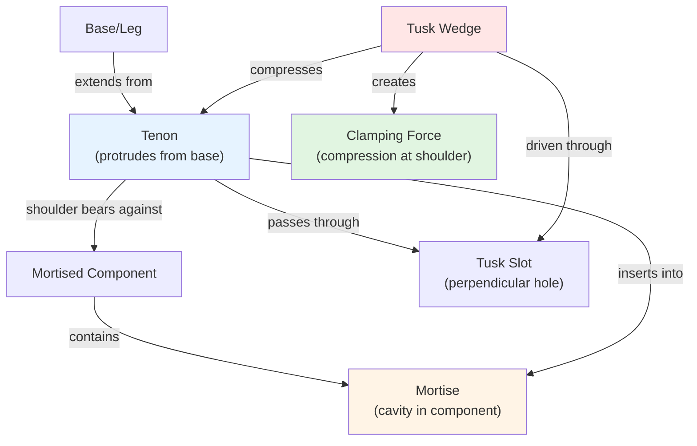

# Lesson 4: Specialized Joinery, Knockdown Systems, Contemporary Hybrid Methods

## 1. First-Principles Intuition & Invariants

The evolution of joinery reflects a perpetual negotiation between structural necessity, manufacturing efficiency, and aesthetic ambition. Where traditional mortise-and-tenon and dovetail joints emerged from an era when adhesives were unreliable and mechanical fasteners expensive, contemporary woodworking operates within a radically expanded material and method landscape. Modern adhesive chemistry delivers bond strengths that exceed the tensile failure threshold of the wood fibers themselves, permitting joint geometries that would have been structurally untenable a century ago. Simultaneously, the democratization of precision tooling—router tables with micron-adjustment fences, domino loose-tenon mortisers, and CNC gantries—has enabled joint forms that balance speed, repeatability, and structural integrity in ways that hand-cut joinery cannot match at scale.

Yet the fundamental physics governing wood movement remain immutable. Cellular structure dictates that dimensional change across the grain vastly exceeds longitudinal expansion, typically by a factor of ten to thirty depending on species and grain orientation. A flat-sawn red oak panel eighteen inches wide may expand or contract by three-eighths of an inch seasonally, while its length remains nearly constant. This anisotropic behavior demands that every joint accommodate differential movement, or the assembly will self-destruct through internal stress accumulation. The principle extends beyond simple frame-and-panel construction into drawer joinery, where seasonal racking forces must be absorbed without binding, and into knockdown systems, where mechanical fasteners must permit cyclic assembly without stripping threads or crushing fibers.

Specialized joinery for drawers, curved work, and case construction represents the application of these invariants to specific functional contexts. A drawer box must withstand longitudinal racking as it slides in and out thousands of times while accommodating the vertical expansion of its bottom panel. Curved work introduces compound grain orientation, where radial and tangential movement vectors interact unpredictably, demanding joinery that distributes stress across broader glue surfaces or employs mechanical locking geometries that do not rely solely on adhesive bonds. Case construction for cabinets and bookcases must manage the dimensional instability of large panels—backs, sides, and shelves—while maintaining structural rigidity under load and permitting disassembly for transport or repair.

The contemporary craftsman operates at the intersection of traditional hand-tool joinery, production-oriented biscuit and domino systems, and hybrid methods that integrate modern materials such as Baltic birch plywood, epoxy adhesives, and threaded brass inserts. Selecting the appropriate joint for a given application requires balancing mechanical performance, manufacturability, material cost, and aesthetic visibility. A through-dovetail drawer front announces craftsmanship and delivers exceptional pull-out resistance, but requires fifteen minutes per corner even for a proficient hand-tool worker. A machine-cut half-blind dovetail executed on a router jig compresses that time to ninety seconds while sacrificing the subtle irregularity that signals hand work. A domino loose-tenon joint completes in thirty seconds and provides more than adequate mechanical strength for most drawer applications, but lacks the visual romance of interlocking pins and tails.

The invariants that govern joinery selection distill to three core principles. First, **grain orientation compatibility**: joints must either accommodate cross-grain movement through slotted holes, sliding dovetails with clearance, or panel-floating geometries, or they must align grain directions to eliminate differential expansion. Second, **load vector alignment**: mechanical forces—tensile, compressive, shear, and torsional—must map cleanly onto joint geometries that resist those specific stresses. A drawer front experiences tensile pull-out forces that dovetails resist through their mechanical interlock, while a table apron undergoes racking shear that mortise-and-tenon joints counter through their lateral surface area. Third, **adhesive surface area and stress concentration**: modern glues eliminate the need for complex mechanical interlocks in many applications, but only when bond surfaces are sufficiently large and stress is distributed to avoid point-load failures that exceed localized wood fiber strength.

Understanding these principles transforms joinery selection from a prescriptive recipe book into a decision tree rooted in material physics and structural mechanics. The craftsman asks not "What joint does tradition prescribe?" but rather "What forces will this assembly experience, how will the wood move, and what manufacturing constraints govern my timeline and tooling?" The answers guide selection among traditional, contemporary, and hybrid methods, each with distinct performance envelopes and execution workflows.

## 2. Core Architecture & Mechanics

### Drawer Box Joinery: Through-Dovetails, Half-Blinds, and Lock Miters

The drawer box represents a paradigmatic case study in joinery selection because it experiences a well-defined mechanical load profile: repeated tensile forces along the pull axis, vertical compression from contents, and seasonal wood movement in the bottom panel. Traditional cabinetmaking prescribed through-dovetails for drawer backs and half-blind dovetails for drawer fronts, a distinction rooted in both mechanical performance and aesthetic visibility. Through-dovetails, with their fully interlocking geometry, resist pull-out forces through mechanical wedging rather than adhesive bond strength. The angled walls of the tails and pins create a geometry where tensile force component vectors resolve partially into compressive forces perpendicular to the joint faces, distributing stress across the entire mating surface rather than concentrating it at glue lines.

The performance of a dovetail joint under tensile loading can be understood through a simplified force decomposition. Consider a tail angled at the canonical 1:8 ratio—approximately 7.1 degrees from vertical. When a tensile force **F** is applied along the drawer's longitudinal axis, attempting to separate the front from the sides, the angled tail geometry converts a portion of that force into a compressive component normal to the tail face. The normal force **F_n** scales as **F** multiplied by the cosine of the tail angle, while the shear component **F_s** along the glue line scales as **F** multiplied by the sine of the angle. For a 1:8 ratio, this yields approximately **F_n = 0.992F** and **F_s = 0.125F**. The joint fails only when the shear stress exceeds the glue bond strength or when the compressive stress crushes the wood fibers. Because typical PVA glue shear strengths exceed 2000 psi and wood fiber compressive strength perpendicular to grain ranges from 500 to 1000 psi for hardwoods, the joint's capacity far exceeds the forces generated by drawer use.

Half-blind dovetails conceal the tail ends within the drawer front, presenting a continuous surface interrupted only by the narrow pin sockets visible from above. This geometry reduces the effective glue surface area compared to through-dovetails, because the tails do not penetrate the full thickness of the front, but the mechanical interlock remains robust for typical drawer depths up to four inches. The critical dimension is the tail depth—the distance from the drawer front's outer face to the tail's blind end—which must provide sufficient wood fiber behind the tail to resist the compressive forces without crushing. A minimum tail depth of half the board thickness is standard, though three-eighths inch absolute minimum suffices for drawer fronts less than five-eighths inch thick.

Lock miter joints, executed on a router table with a specialized lock miter bit, provide an alternative that balances speed and strength. The joint profile interweaves a 45-degree miter face with interlocking rabbets and tongues, creating mechanical resistance to both tensile pull-out and perpendicular separation. The setup requires exacting fence and bit height adjustment—errors of even 0.010 inch result in misaligned faces—but once dialed in, the joint cuts rapidly and delivers consistent results across production runs. The interlocking geometry distributes glue surface area across multiple faces, and the 45-degree mitered outer corner presents a clean aesthetic when drawer fronts will be left exposed. However, lock miters lack the pull-out resistance of dovetails because the mechanical interlock relies on small tongues that can shear under sustained tensile stress, and the joint is intolerant of wood movement perpendicular to the drawer axis.

```text
Through-Dovetail Force Distribution:

       Tail (side piece)
            /|
           / |
          /  | F_n (compressive, into face)
         /   |
        /    |
    F →/_____|
       \     |
        \    | F_s (shear, along glue line)
         \   |
          \  |
           \ |
            \|
       Pin (front piece)

F_n = F × cos(θ)    θ = arctan(1/8) ≈ 7.1°
F_s = F × sin(θ)    F_n >> F_s, favoring compressive loading
```

### Drawer Bottom Attachment and Seasonal Movement

The drawer bottom panel floats within grooves cut into the drawer sides and front, a configuration that permits the panel to expand and contract radially without exerting stress on the drawer box. The groove depth must be sufficient to retain the panel even at its minimum seasonal width—typically three-eighths inch deep for panels up to twelve inches wide—while the panel's width at construction must leave expansion clearance within the groove. For a red oak panel twelve inches wide, allowing three-eighths inch total expansion clearance (three-sixteenths inch per side) ensures the panel will not bind during humid summer months. The back edge of the panel is secured to the drawer back with screws driven through slotted holes, permitting longitudinal movement while preventing the panel from rattling or sagging under load.

Solid wood drawer bottoms require grain orientation parallel to the drawer front, so that expansion occurs from side to side rather than front to back. This orientation minimizes the risk of the panel pushing out the drawer back as it swells. Plywood drawer bottoms eliminate seasonal movement concerns but require thicker material—half-inch Baltic birch plywood versus quarter-inch solid wood—to achieve equivalent stiffness, because plywood's cross-laminated structure trades off bending rigidity for dimensional stability.

### Case Construction: Rabbet-Dado, Sliding Dovetails, and Adjustable Shelf Systems

Case construction for cabinets, bookcases, and credenzas presents a distinct challenge: joining large panels—often eighteen to thirty-six inches wide—into rigid rectilinear boxes while accommodating wood movement and permitting efficient assembly. The rabbet-dado joint, cut with a router or table saw, provides a straightforward solution. The dado—a groove cut across the grain of the case side—receives the edge of a shelf or divider, which sits within the groove like a tongue in a slot. A rabbet cut along the shelf's edge increases glue surface area and creates a shoulder that resists racking forces. The joint assembles quickly, requires only basic tooling, and distributes compressive loads from shelf contents across the full depth of the dado.

The critical dimension in rabbet-dado design is the dado depth relative to the case side thickness. A dado deeper than one-third the panel thickness weakens the panel structurally, reducing its resistance to bending and creating a stress concentration that can lead to splitting. For three-quarter-inch case sides, a quarter-inch dado depth provides adequate shelf support without compromising panel integrity. The dado width must match the shelf thickness precisely—a loose fit reduces glue surface area and permits shelf rocking, while an overly tight fit risks splitting the case side during assembly. A target clearance of 0.005 to 0.010 inch, achievable with a router and straight bit, ensures a snug fit that draws tight under clamp pressure.

Sliding dovetail joints escalate the mechanical interlock by replacing the rectangular dado profile with a trapezoidal dovetail groove. The shelf or divider incorporates a matching dovetail tenon along its edge, which slides into the groove from the case's open end. The angled walls of the dovetail resist both vertical and horizontal forces, preventing the shelf from pulling away from the case side even without glue. This geometry proves invaluable for through-tenon sliding dovetails, where the tenon emerges from the opposite case side and can be wedged or pinned, creating a permanent mechanical lock. The joint's primary limitation is assembly complexity: the dovetail tenon must slide the full length of the groove, requiring extremely precise dimensioning to avoid binding, and any error in angle or width renders the joint unusable.

Adjustable shelf systems abandon the rigidity of fixed dado joints in favor of flexibility, employing brass shelf pins inserted into arrays of holes drilled at regular vertical intervals along the case interior. Each shelf rests on four pins, which bear compressive loads through point contact with the shelf's underside. The system's simplicity and versatility make it ubiquitous in contemporary cabinetmaking, but the point-load concentration demands shelves thick enough to resist local crushing and bending. Three-quarter-inch solid wood or Baltic birch plywood suffices for spans up to thirty-six inches with moderate loading, while longer spans or heavy loads require thicker material or a central support pin array.

The hole arrays must be laid out with precision to ensure shelves sit level and do not rock. A shop-made drilling jig—a hardboard or plywood template with holes spaced at one-inch or two-inch vertical intervals—ensures consistent hole placement across multiple case sides. The jig registers against the case's top or bottom edge, and a stop collar on the drill bit controls hole depth to half the case side thickness, preventing breakthrough. Drilling from the interior face minimizes visible tearout, and a backer board clamped behind the workpiece eliminates exit-side splintering.

### Curved Work: Kerf Bending, Coopering, and Steam Bending Joint Integration

Curved woodwork introduces grain orientation challenges that straight joinery does not encounter. A curved panel created through kerf bending—sawing a series of parallel kerfs across the interior face to relieve bending stress—retains straight grain on the exterior surface, but the kerfs sever structural continuity, reducing tensile and compressive strength perpendicular to the bend. Reinforcing the interior with a flexible backing material such as canvas impregnated with epoxy or a laminated veneer layer restores some rigidity, but the assembly remains fundamentally weaker than solid wood. Joining kerf-bent panels to straight components demands joinery that does not rely on the curved section's structural integrity. Stub tenons—short tenons that engage only the uncut wood at the panel's edge—provide adequate registration and glue surface area while avoiding the kerfs. Alternatively, mechanical fasteners such as threaded inserts and machine screws bypass the compromised wood entirely, transferring loads through metal-to-metal contact.

Coopering, the technique of edge-gluing narrow staves at slight angles to form a continuously curved panel, distributes structural integrity evenly across the curve because each stave retains full grain continuity. The challenge lies in edge preparation: each stave's long-grain edge must be beveled at the precise angle required to yield the target radius when assembled. For a curve with radius **R** composed of **N** staves each of width **W**, the bevel angle **α** per edge equals half the included angle subtended by each stave, calculated as **α = (180° / N) / 2**. A twelve-stave coopering for a cylinder or arc thus requires 7.5-degree bevels on each edge. The bevels can be cut on a table saw with the blade tilted to the calculated angle, or on a jointer with an angled fence. Glue-up requires a specialized clamp or a band clamp that applies uniform radial pressure across all staves simultaneously, preventing the assembly from collapsing into an irregular polygon.

Steam-bent components—curved through exposure to steam heat that temporarily plasticizes lignin, allowing the wood to deform—require joinery that accommodates the residual internal stresses locked into the curve. Even after drying, steam-bent parts retain a tendency to spring back toward their original straight form, exerting forces on any joints that constrain them. Mortise-and-tenon joints joining a steam-bent stretcher to chair legs must incorporate mechanical reinforcement such as wedges or pins, because adhesive bonds alone may fail under the sustained tension. The mortise depth should be generous—one and a half times the tenon width—to maximize mechanical interlock, and the tenon shoulders must be carefully fitted to transfer the bending forces into the leg structure rather than concentrating stress at the glue line.

### Knockdown and Demountable Systems: Threaded Inserts, Cam Locks, and Tusk Tenons

Knockdown furniture systems address the practical realities of modern living: limited doorways and stairwells, frequent relocation, and the need for flat-pack shipping in commercial production. Traditional glued and pinned joinery offers no disassembly path short of destructive cutting, whereas knockdown systems employ reversible mechanical fasteners that permit repeated assembly and disassembly without cumulative damage. The design challenge lies in achieving rigidity comparable to permanent joinery while accommodating the tolerances and wear patterns introduced by metal-to-wood and metal-to-metal interfaces.

Threaded brass or steel inserts, driven or heat-set into pilot holes drilled perpendicular to grain, create durable internal threads in wood that resist stripping far better than screws driven directly into end grain. The insert's external surface incorporates knurling or helical threads that bite into the surrounding wood fibers, locking the insert in place. Machine screws or bolts threaded into the inserts provide clamping force across joint interfaces. The system's performance depends critically on pilot hole diameter, which must be sized to compress the wood fibers around the insert without splitting. For a 10-32 threaded insert in hardwood, a 5/16-inch pilot hole provides adequate compression, while softwoods require a slightly smaller 9/32-inch hole to ensure secure grip.

Heat-set inserts, installed with a soldering iron tip heated to 700–800°F, melt their way into the wood, displacing fibers rather than compressing them. This technique reduces splitting risk and creates a more uniform interface, because the molten wood lignin flows into the insert's external threads and re-solidifies upon cooling. The installation requires a temperature-controlled soldering station and a custom tip machined or ground to fit snugly inside the insert's bore, ensuring heat transfers efficiently without charring surrounding wood. The insert must be driven perpendicular to the surface and to its full depth in a single motion, because partial seating followed by reheating can carbonize the wood and weaken the hold.

Cam lock systems, ubiquitous in flat-pack furniture, consist of a cylindrical cam housing inserted into one component and a dowel or machine screw anchored in the mating component. Rotating the cam 90 or 180 degrees draws the dowel into the cam's eccentric channel, pulling the two components together. The system assembles and disassembles with a screwdriver or hex key, requires no clamps, and tolerates moderate misalignment because the cam's eccentric profile compensates for small errors in hole placement. However, the single-point connection lacks the racking resistance of traditional joinery, necessitating multiple cam locks per joint and supplemental bracing to prevent lateral deflection. A typical case corner employs two cam locks spaced vertically along the joint line, with a third cam or a confirmat screw added at the midpoint for panels taller than eighteen inches.

Tusk tenons, a traditional knockdown method, extend the mortise-and-tenon principle into demountable form. The tenon passes completely through the mortise and projects beyond, and a separate wedge—the tusk—is driven through a slot cut perpendicular to the tenon near its end. The tusk bears against the outer face of the mortised component, drawing the tenon shoulder tight against the mortise face. The geometry is self-tightening under load: weight or racking forces on the assembly increase the compressive stress on the tusk, which in turn clamps the joint more firmly. The system requires no metal fasteners, permits disassembly by tapping out the tusk, and announces its joinery method as a visible design element. The tusk slot must be positioned far enough from the tenon's end to leave adequate wood behind the slot—typically one to one and a half times the slot width—to prevent splitting when the tusk is driven.



### Biscuit Joinery: Mechanical Principles, Glue-Surface Geometry, and Alignment Tolerances

Biscuit joinery, introduced in the 1950s and popularized through the development of dedicated biscuit joiners or plate joiners, employs compressed beechwood wafers—biscuits—that fit into semi-circular slots cut by a 4-inch carbide blade. The biscuits swell upon contact with water-based glue, filling the slots and creating mechanical resistance to shear forces along the joint line. The system's appeal lies in its speed, simplicity, and forgiving alignment: the biscuit's football shape tolerates lateral misalignment along the slot's length while maintaining registration perpendicular to the joint face.

The mechanical performance of a biscuit joint derives from two sources: the increased glue surface area created by the slot walls, and the swelling pressure exerted by the biscuit as it absorbs moisture. A standard size-20 biscuit slot adds approximately 3.5 square inches of glue surface per biscuit compared to a simple butt joint, distributed across the slot's perimeter. The biscuit itself, compressed during manufacturing to approximately two-thirds its final thickness, expands by 15 to 20 percent within minutes of glue application, pressing outward against the slot walls and generating clamping forces of 50 to 100 pounds per biscuit. This expansion compensates for minor gaps in slot-to-biscuit fit and helps align joint faces during clamp-up.

However, biscuit joints are not structural in the sense of resisting significant tensile or bending loads. The thin wafer, typically 0.15 inch thick before swelling, provides minimal cross-sectional area to resist forces perpendicular to the joint plane. A biscuit-joined edge-to-edge panel will fail under bending loads at substantially lower stresses than a spline-reinforced or doweled panel, because the biscuit's thickness represents only 20 percent of the panel's thickness, whereas a spline or domino tenon can extend to 40 or 50 percent. The appropriate use case for biscuits is alignment and glue-surface enhancement in joints where the primary load path lies along the joint face—panel edge glue-ups, face frame assemblies, and carcase miters—rather than across it.

Slot placement requires attention to grain orientation and edge distance. Slots cut too close to a panel's face—less than three-eighths inch from the surface—risk breakthrough as the blade's circular path approaches the surface tangentially. The biscuit joiner's fence controls depth precisely, but the operator must verify that the fence setting corresponds to the actual panel thickness, accounting for any surface planing or sanding that may have reduced dimensions since initial milling. Slots spaced at six to eight inches along an edge provide adequate alignment and glue surface for typical case and panel work, with denser spacing employed for long-grain miters subjected to racking forces.

### Domino Loose-Tenon Systems: Geometric Precision and Load Transfer

The Festool Domino system, and its growing cohort of competitors, modernizes traditional mortise-and-tenon joinery by substituting a machined loose tenon for the integral tenon cut from one of the mating components. The dedicated tool plunges a hollow-chisel mortiser into both workpieces, creating rectangular mortises with rounded ends. A separate beech tenon, milled with serrations to enhance glue adhesion, spans the joint and transfers loads across its full cross-section. The system combines the speed of biscuit joinery with the structural integrity of traditional mortise-and-tenon work, because the tenon's rectangular geometry and substantial thickness—up to half-inch for the largest tenon sizes—provide true load-bearing capacity.

The domino tenon's structural advantage over biscuits becomes apparent when calculating shear and bending resistance. Consider a size 10×50 domino tenon, 10 mm thick and 50 mm long, compared to a size-20 biscuit. The domino's cross-sectional area perpendicular to the joint face is approximately 500 square millimeters, versus 150 square millimeters for the biscuit. Under a tensile load attempting to separate the joint, the domino can resist forces three times greater before the tenon itself fails in tension. Similarly, the domino's rectangular profile, which mates with closely fitted rectangular mortise walls, resists rotation and racking far more effectively than the biscuit's oval shape within its semi-circular slot.

Mortise placement and alignment demand precision equipment or careful jig work. The Domino tool employs a spring-loaded fence and alignment pins to register against workpiece edges and previously cut mortises, enabling repeatable placement within 0.5 mm. For angled joinery—mitered case corners or angled leg-to-apron joints—the tool's tiltable fence adjusts to match the workpiece angle, ensuring the mortise enters perpendicular to the joint face. This perpendicularity is critical: a mortise cut at an angle to the intended joint face reduces the effective tenon depth and creates uneven glue distribution, weakening the joint.

The domino system's primary limitation is economic and ergonomic. The dedicated tool costs substantially more than a biscuit joiner, and the proprietary tenons, while precisely manufactured, represent an ongoing consumable expense. For production shops or serious hobbyists building furniture regularly, the investment amortizes across hundreds of joints. For occasional users, traditional router-based mortising or dowel joinery offers comparable performance at lower capital cost, albeit with longer setup times per joint.

## 3. High-Performance Optimization & Failure Modes

### Adhesive Selection and Surface Preparation

Modern adhesives have transformed joint design by providing bond strengths that exceed wood's internal fiber cohesion, but this performance materializes only when surfaces are prepared correctly and adhesive chemistries match the application. PVA glues—polyvinyl acetate, the ubiquitous yellow and white woodworking glues—achieve shear strengths exceeding 2500 psi on freshly machined surfaces, but this value degrades precipitously on surfaces contaminated with silicone, wax, or oxidized lignin. A surface machined and then left exposed to air for more than 48 hours develops a thin oxidation layer that reduces bond strength by 20 to 30 percent. The solution is simple: remill or scrape joint surfaces immediately before glue application, removing the oxidized layer and exposing fresh wood fibers.

Polyurethane glues, which cure through reaction with atmospheric moisture, excel in applications where water-based glues would cause excessive grain raise or where gap-filling properties are required. The cured polyurethane foams slightly, expanding into voids and rough surfaces, but this expansion exerts pressure that can distort thin stock or push joints apart if insufficient clamping pressure is applied. A minimum clamping pressure of 100 psi across the joint face ensures the foam remains compressed within the joint line. The glue's water resistance and higher working temperature tolerance—up to 200°F versus 120°F for PVA—make it preferable for outdoor furniture or components exposed to heat, such as cutting boards that will see dishwasher cycles.

Epoxy adhesives offer the highest gap-filling capacity and the broadest material compatibility, bonding wood to metal, glass, and composites without the substrate selectivity that limits PVA and polyurethane. The two-part chemistry permits extended working times—from five minutes for rapid-cure formulations to several hours for slow-cure variants—but requires precise mixing ratios and generates no visual cues that assembly time is expiring. Epoxy's brittleness after cure makes it less suitable for joints subjected to impact or vibration, because the adhesive will fracture rather than deforming plastically to absorb energy. The optimal use case is bonding dissimilar materials or filling voids where mechanical interlocks cannot be achieved.

### Clamping Pressure Distribution and Wood Crushing Thresholds

Clamps apply localized pressure to joint faces, and uneven pressure distribution leads to starved glue joints where insufficient adhesive remains at the interface, or to crushed fibers where excessive pressure compresses the wood beyond its elastic limit. The crushing threshold for hardwoods perpendicular to grain ranges from 800 to 1500 psi depending on species and moisture content, while softwoods crush at 300 to 600 psi. A clamp tightened until the workpiece visibly compresses under the clamp jaw applies localized pressure approaching these thresholds, squeezing out the glue film entirely and creating a weak joint.

Clamping cauls—stiff battens placed between clamps and workpieces—distribute pressure over a broader area, reducing peak stress concentrations. A three-quarter-inch-thick hardwood caul spanning the width of a panel edge-glue-up distributes the clamp's force across the caul's full length, reducing localized crushing while maintaining pressure sufficient to close gaps. The caul's stiffness is critical: a flexible caul bends under clamp pressure, concentrating force at the clamp locations rather than distributing it. Hardwoods such as maple or ash, milled slightly thicker than the workpiece, provide adequate stiffness for typical panel glue-ups up to forty-eight inches wide.

The glue-up sequence for complex assemblies—dovetailed drawer boxes, face frames with multiple intersecting joints—determines whether the assembly pulls square under clamp pressure or racks out of alignment. Dry-fitting every joint before glue application reveals interference points, tight fits that require mallet persuasion, and loose fits that will gap under clamping. For drawer boxes, gluing the front-to-side joints first, allowing that subassembly to cure, and then gluing the back and bottom permits clamp pressure to be applied along a single axis without inducing twist. For face frames, gluing intersecting joints simultaneously while monitoring diagonal measurements ensures the frame remains square as clamps tighten.

### Wood Movement Mitigation in Hybrid Assemblies

Integrating solid wood with dimensionally stable materials—plywood, MDF, or non-wood components such as metal or acrylic—demands joinery that isolates each material's movement characteristics. A solid wood top attached rigidly to a plywood carcase will either split the top as it expands or delaminate the plywood as the top contracts, because the two materials move at different rates. Slotted screw holes in table apron brackets, figure-eight fasteners, and expansion clips all permit the top to move while maintaining vertical alignment and resisting lateral shift.

Slotted screw holes orient the slot parallel to the wood grain, allowing the screw to slide within the slot as the wood expands or contracts perpendicular to grain. The slot length must accommodate the maximum expected movement—for an eighteen-inch-wide red oak tabletop experiencing a 20 percent moisture content swing between winter and summer, total movement approaches three-eighths inch, requiring slots at least half an inch long to avoid binding. The screw should not be fully tightened; leaving the screw just snug enough to resist gravity allows the top to slide freely without rattling.

Figure-eight fasteners, small metal plates with holes at opposite ends of an ovoid body, install partially into a shallow mortise cut into the underside of the tabletop and partially into the top edge of the apron or carcase. The fastener pivots within the mortise as the top moves, maintaining attachment without exerting stress. The mortise depth must equal exactly half the fastener's thickness, so that the fastener sits flush within the mortise while its opposite end bears against the apron. Mortises cut too deep allow the fastener to rattle, while shallow mortises prevent the fastener from pivoting freely.

### Knockdown System Wear and Tolerance Accumulation

Knockdown joints subjected to repeated assembly and disassembly accumulate wear through thread galling, cam lock detent erosion, and wood fiber crushing around fastener pilot holes. Threaded inserts experience load reversal with each assembly cycle, alternately compressing and tensioning the surrounding wood fibers, which gradually enlarge the pilot hole and reduce the insert's holding torque. After ten to twenty assembly cycles, inserts in softwoods may require replacement or relocation to fresh wood. Hardwoods tolerate fifty or more cycles before degradation becomes noticeable.

Designing for longevity in knockdown systems requires overbuilding the fastener count and distributing loads across multiple attachment points. A bookcase side-to-shelf joint that would adequately resist vertical loads with a single threaded insert and machine screw benefits from a second fastener spaced horizontally along the joint line, which resists racking and halves the load experienced by each insert. For joints subjected to frequent disassembly, captive nut plates—threaded inserts housed within metal or plastic plates that distribute load over a larger wood surface area—extend service life by reducing localized stress.

Cam lock systems wear primarily at the cam's eccentric channel, where rotational forces during tightening erode the metal-to-metal contact surface. Lubricating the cam and dowel interface with a dry graphite powder or PTFE spray reduces friction and wear, extending the mechanism's life. Overtightening the cam—rotating beyond the detent that indicates full engagement—stresses the cam housing's retention lips and can cause the cam to pop out of its mortise during disassembly. Training users or providing tactile and visual indicators of correct cam orientation prevents this failure mode in commercial furniture.

### Curved Work: Lamination versus Solid Bending Structural Divergence

Curved components created through lamination—gluing thin veneers or laminations of one-sixteenth to one-eighth inch thickness around a form—exhibit radically different mechanical properties than solid wood bent through steaming or kerfing. Laminated curves distribute internal stresses uniformly across the laminations, with no residual spring-back force after the glue cures, because each lamination undergoes minimal strain relative to its elastic limit. The result is a stable, rigid curve that behaves structurally like solid wood in the tangential direction along the curve, but with enhanced resistance to splitting because the glue lines interrupt grain continuity.

Steam-bent solid wood, by contrast, retains locked-in stresses that exert a continuous force attempting to return the wood to its original shape. These stresses persist indefinitely, constrained only by the lignin's plasticization and the wood's creep resistance. Joints connecting steam-bent components must either accommodate this residual force through mechanical locking geometries or overpower it through robust adhesive bonds and substantial glue surface area. A steam-bent chair back rail tenoned into rear legs benefits from wedges driven through the tenon ends, which mechanically lock the tenon in place and resist the rail's tendency to straighten.

Kerf-bent components occupy a middle ground: the kerfs relieve bending stress, eliminating spring-back, but also sever structural continuity, rendering the component weak in tension and compression perpendicular to the bend. The kerfs themselves create stress concentrations at their roots, where the remaining wood thickness transitions abruptly from full to reduced. These stress risers can initiate cracks under impact or cyclic loading, propagating along the grain and ultimately causing catastrophic failure. Reinforcing the kerf side with a laminated veneer layer or fiberglass cloth impregnated with epoxy distributes loads around the kerfs and prevents crack propagation, at the cost of added weight and manufacturing complexity.

### Biscuit and Domino Joint Spacing Optimization

The structural contribution of biscuits and dominos to a joint scales with the number of fasteners and their spacing, but beyond a certain density, additional fasteners provide diminishing returns and risk weakening the surrounding wood through overlapping stress fields. For edge-to-edge panel glue-ups, where the primary load is bending stress perpendicular to the joint plane, biscuits serve primarily as alignment aids rather than structural reinforcement. Spacing at eight to twelve inches provides adequate alignment without over-engineering the joint, because the long-grain glue bond itself carries the majority of the bending load.

For miter joints—picture frames, case miters, and face frames—where the joint face is end grain or angled across the grain, biscuits and dominos provide critical reinforcement. End grain glue bonds, with effective strengths only 10 to 25 percent of long-grain bonds, fail under modest tensile or shear loads without mechanical reinforcement. A single size-20 biscuit in a mitered picture frame corner increases joint strength by a factor of three to four compared to glue alone, and two biscuits spaced vertically along a face frame stile-to-rail miter can match the strength of a traditional mortise-and-tenon joint for frame sizes up to four inches wide.

Domino spacing in structural applications—table aprons to legs, bed rail to headboard—should target one domino per four to six inches of joint length, with a minimum of two dominos per joint to resist rotation. A table apron eighteen inches long joining a leg thus requires three dominos spaced at six-inch intervals, or four at four-and-a-half-inch intervals for heavy tables supporting substantial loads. The end dominos should be positioned at least two inches from the workpiece ends to avoid splitting the wood as glue swells the tenon, and the middle dominos should be staggered in depth if possible, offsetting their mortises slightly to avoid creating a continuous plane of weakness through the leg.

### Failure Mode Mapping and Joint Forensics

When a joint fails in service, the failure pattern reveals the root cause and guides corrective redesign. A dovetail joint that fails through pin shear—pins fracturing at their narrowest cross-section—indicates inadequate pin width relative to the applied tensile force, suggesting either denser pin spacing or a shift to a lock miter or through-tenon joint. A dovetail that fails through glue line separation, with the pins and tails intact but adhesive bond broken, points to contaminated surfaces, insufficient clamp pressure, or adhesive chemistry mismatch.

Mortise-and-tenon joints that fail through tenon shoulder crushing—the shoulder compressing into the mortised component's face—experience loads perpendicular to the grain that exceed the wood's compressive strength. This failure mode appears in chair construction where side loads on the seat compress the tenon shoulders against the seat's face grain. The solution is to increase the shoulder bearing area by widening the tenon or to reinforce the mortised component with cross-grain bracing that distributes the load internally.

Knockdown joints that fail through fastener pull-out—threaded inserts ripping free, cam lock dowels shearing, or tusks splitting through their slots—indicate insufficient wood fiber engagement or load concentration. Relocating the fastener to denser wood, increasing the pilot hole depth for inserts, or doubling the number of fasteners distributes the load and prevents recurrence. Metal fatigue in machine screws or cam mechanisms, evidenced by necking or fracture surfaces with characteristic crystalline grain structure, requires substitution with higher-strength fasteners or redesign to reduce the cyclic load amplitude.

By mapping failure modes to their structural and material causes, the craftsman transforms joint failures from frustrations into design feedback loops. Each failed joint teaches a lesson in material limits, load paths, and manufacturing tolerances that cannot be learned from drawings or calculations alone. The practitioner who dissects failures methodically—preserving the fractured components, photographing the failure surfaces, and testing alternative designs under controlled loading—builds an empirical knowledge base that complements theoretical understanding and accelerates expertise development.
