# Lesson 1: Electric Motor Principles in Power Tools

## 1. First-Principles Intuition & Invariants

The electric motor stands as the beating heart of every power tool in the modern woodworking shop, yet its behavior remains opaque to most practitioners who simply plug in a circular saw or router and expect performance. Understanding motor architecture transforms the craftsman from passive tool user to informed selector and operator, capable of predicting how a drill will behave under load, why a particular router struggles with deep mortising passes, and when a tool's limitations stem from fundamental electrical physics rather than technique or blade sharpness.

At the most fundamental level, all electric motors convert electrical energy into rotational mechanical work through electromagnetic induction. A current-carrying conductor placed in a magnetic field experiences a force perpendicular to both the field and current direction—the Lorentz force principle that Michael Faraday formalized in 1821. In practical motors, this manifests as rotating armatures within stator field coils, with commutation systems switching current direction to sustain continuous rotation. The elegance lies in the reciprocal relationship: not only does current in a magnetic field produce motion, but motion through a magnetic field induces a back-electromotive force (back-EMF) that opposes the applied voltage, creating a self-regulating system whose equilibrium point determines operating speed and torque.

The torque-speed relationship forms the invariant characteristic that defines motor behavior across all architectures. Torque represents the rotational force available at the motor shaft, measured in Newton-meters or inch-pounds, while speed (typically expressed in revolutions per minute, or RPM) describes the angular velocity. These two quantities exist in inverse relationship bounded by power, which remains approximately constant for a given motor design operating at rated voltage. Power equals torque multiplied by angular velocity, so $P = \tau \cdot \omega$, where angular velocity $\omega$ in radians per second relates to RPM through $\omega = \frac{2\pi \cdot \text{RPM}}{60}$. This fundamental constraint means a motor producing high torque at low speed must necessarily sacrifice speed, while high-RPM motors deliver less torque—a tradeoff that determines whether a tool excels at aggressive material removal or precision control.

Current draw under load provides the observable signature of this internal physics. An unloaded motor spins rapidly with minimal current consumption because back-EMF nearly equals applied voltage, leaving little net voltage to drive current through the winding resistance. When mechanical load increases—a drill bit biting into hardwood, a circular saw blade entering oak—the shaft slows, back-EMF decreases, net voltage across the windings rises, and current increases proportionally. This current surge delivers additional torque to match the load, up to the motor's thermal and magnetic saturation limits. The linear region of this response, where torque increases proportionally with current and speed decreases linearly with load, defines the motor's useful operating range. Beyond this region lies stall, where excessive load halts rotation entirely, back-EMF collapses to zero, and current surges to values limited only by winding resistance—often five to eight times the rated running current—generating destructive heat that can melt insulation and demagnetize permanent magnets within seconds.

The electrical supply type—alternating current from wall outlets versus direct current from batteries—fundamentally shapes motor architecture and behavior. Alternating current reverses direction periodically, sixty times per second in North American mains power, while direct current flows unidirectionally with constant polarity. This distinction appears trivial but cascades through every aspect of motor design, from commutation mechanisms to speed control implementations, ultimately determining the torque curves, controllability, and maintenance requirements that define tool capability.

## 2. Core Architecture & Mechanics

Universal motors dominate corded woodworking tools—circular saws, routers, angle grinders, orbital sanders—because they deliver exceptional power density and high no-load speeds from single-phase AC mains power. The term "universal" reflects their ability to operate on both AC and DC supplies, a consequence of their series-wound architecture where field coils and armature windings connect in series rather than parallel. In this configuration, both field and armature currents reverse simultaneously when AC polarity alternates, maintaining consistent torque direction because the product of two negative quantities yields a positive result. The rotating armature comprises a laminated iron core wound with copper coils, with current delivered through a mechanical commutator—a segmented copper cylinder that rotates with the shaft—contacted by spring-loaded carbon brushes that maintain electrical connection despite rotation.

The series winding topology produces a distinctive torque-speed characteristic that proves ideal for handheld tools requiring high starting torque and speed proportional to load. At startup, when back-EMF equals zero, full line voltage appears across the windings and current surges to maximum, limited primarily by winding resistance and inductance. This high inrush current flows through both field and armature in series, generating strong magnetic fields and peak torque—often two to three times the rated running torque—that accelerates the rotor rapidly and powers through initial material engagement. As speed increases, back-EMF rises and effective voltage across the windings decreases, reducing current and allowing the motor to settle into an equilibrium where electromagnetic torque exactly balances mechanical load. Under light load, universal motors spin exceptionally fast—often 20,000 to 30,000 RPM unloaded—because only minimal torque (and therefore minimal current) is required to overcome bearing friction and air resistance, resulting in high back-EMF that chokes current to low values.

This speed-load relationship follows an approximately hyperbolic curve: $\text{Speed} \approx \frac{K_v \cdot (V - I \cdot R)}{\Phi}$, where $K_v$ represents a motor constant, $V$ the applied voltage, $I$ the armature current, $R$ the total winding resistance, and $\Phi$ the magnetic flux. In series motors, flux itself increases with current because field strength depends on armature current, creating a nonlinear feedback loop that produces dramatic speed variation under changing load. A router spinning at 22,000 RPM in air may slow to 18,000 RPM when cutting a deep mortise, while a heavily loaded circular saw may drop from 5,800 RPM no-load to 4,200 RPM mid-cut. This speed droop under load, while sometimes perceived as a weakness, actually provides valuable tactile feedback—the audible and vibrational change signals the operator to reduce feed rate before thermal overload occurs.

The mechanical commutator introduces both capabilities and constraints that shape tool maintenance requirements and operational boundaries. Each copper segment connects to specific armature coils, and as the commutator rotates, brushes sequentially contact different segments, switching current direction through the coils at precisely the moment when each coil passes the magnetic neutral axis. This switching generates the rotating magnetic field that sustains torque production, but it also creates momentary arcing at the brush-commutator interface as inductive energy stored in the coil discharges. Over thousands of hours, this arcing erodes both brushes and commutator surface, creating the characteristic carbon dust that accumulates inside tool housings and eventually necessitates brush replacement—typically after 50 to 200 hours of operation depending on duty cycle and load conditions. The commutator surface develops a patina of copper oxide and embedded carbon that actually improves conductivity when properly maintained, but deep grooving or heat discoloration indicates excessive arcing from worn brushes, misaligned brush holders, or contamination from sawdust infiltration.

Speed control in universal motors exploits phase-angle control using triacs or silicon-controlled rectifiers (SCRs) that chop the AC waveform, delivering only a portion of each half-cycle to the motor. By delaying the firing angle—the point in each AC cycle when the semiconductor switches on—the controller reduces the effective RMS voltage presented to the motor. Early triggering delivers nearly full voltage and maximum speed, while late triggering (near the zero-crossing point) delivers minimal voltage and low speed. This approach provides smooth, infinitely variable speed control through a simple potentiometer that adjusts the trigger timing circuit, explaining why router speed dials and drill triggers offer continuous rather than stepped adjustment. However, phase-angle control introduces harmonic distortion and pulsating torque that becomes increasingly pronounced at low speeds, manifesting as roughness and reduced low-speed torque—a router set to 8,000 RPM for delicate edge work delivers noticeably less authority than the same motor at full 22,000 RPM speed.

Brushless DC motors have revolutionized cordless tools over the past decade, delivering 20-40% greater efficiency and eliminating brush wear entirely through electronic commutation. Rather than mechanical brushes switching current through armature coils, a brushless motor employs a permanent magnet rotor and stationary stator windings, with an electronic controller (ESC or electronic speed controller) sequentially energizing stator phases based on rotor position feedback from Hall-effect sensors or back-EMF zero-crossing detection. This inversion—permanent magnets on the rotor, electromagnets on the stator—eliminates sliding electrical contacts and the associated friction, arcing losses, and maintenance burden.

The three-phase winding configuration typical in brushless motors creates a rotating magnetic field that pulls the permanent magnet rotor along, with phase commutation occurring six times per electrical revolution. Hall sensors, positioned 120 degrees apart around the stator, detect magnetic field polarity changes as rotor magnets pass, providing position feedback that allows the controller to energize the correct phase sequence. In sensorless implementations, the controller instead monitors back-EMF induced in the unpowered phase winding—when a rotor magnet passes a coil, it induces a voltage that reaches maximum at the moment the magnet aligns with the coil centerline, providing a position reference for commutation timing. Sensorless control requires the motor to be spinning to generate detectable back-EMF, necessitating open-loop startup sequences that gently energize phases in rotation until sufficient speed develops for closed-loop operation—you may notice a cordless drill "stumble" momentarily when starting under heavy load before the controller locks onto position feedback.

The efficiency advantage of brushless motors stems from multiple factors beyond eliminated brush friction. Electronic commutation allows precise phase timing optimization, energizing windings slightly ahead of rotor alignment to maximize torque production rather than relying on fixed brush position geometry. Permanent magnet rotors eliminate resistive losses in rotor windings (no current flows through the rotor at all), while stationary stator windings enable better thermal management since heat-generating copper coils remain fixed relative to the tool housing and can be directly cooled. The cumulative effect manifests as reduced current draw for equivalent mechanical output—a brushless impact driver may deliver 180 Newton-meters of torque while drawing 40 amperes from an 18-volt battery, whereas a brushed equivalent would require 55-60 amperes for similar performance, directly translating to extended battery runtime.

Torque characteristics differ markedly between brushless and universal motor implementations, with implications for tool behavior and application suitability. Brushless motors produce relatively flat torque curves across their speed range, maintaining consistent torque from zero RPM through rated speed, bounded primarily by current limits and thermal constraints. This contrasts sharply with the hyperbolic speed-torque relationship of universal motors, where torque availability increases dramatically at low speeds. A brushless drill delivers strong, consistent torque throughout its speed range, providing excellent low-speed control for precise fastener driving and sustained high-speed torque for aggressive drilling. However, the same characteristic means brushless motors lack the extreme overload capacity of universal motors—a brushed router can momentarily deliver 3-4 times rated torque during surge loading, while a brushless equivalent typically maxes out at 1.5-2 times rated torque before current limiting intervenes.

The control system architecture reveals itself through operational behavior. Brushless tool controllers implement closed-loop speed regulation by monitoring motor speed (via commutation frequency) and adjusting voltage through pulse-width modulation (PWM) to maintain the setpoint despite load variations. The rapid switching—typically 10-20 kilohertz, above human hearing range—delivers average voltage proportional to duty cycle: 50% duty cycle yields half voltage, 80% yields four-fifths voltage. Under constant load, this regulation maintains speed within 2-5% of the setpoint; as load increases, the controller increases PWM duty cycle to compensate, up to 100% duty cycle where full battery voltage is continuously applied. Beyond this point, speed must decrease as torque demand increases, but the initial regulation range provides noticeably more consistent performance than unregulated universal motors.

```mermaid
flowchart TD
    subgraph universal ["Universal Motor (Series-Wound) Architecture"]
        A["AC/DC Supply"]
        B["Brush Assembly"]
        C["Commutator<br/>(rotating)"]
        D["Field Coils"]
        E["Armature Coils"]
        F["Mechanical Shaft"]
        G["Phase-Angle<br/>Speed Control"]
        H["Series Connection"]
        I["Back-EMF Generation"]
        J["Speed ∝ (V - I·R) / Φ<br/>Torque ∝ Φ · I ≈ I²<br/>(High starting torque,<br/>speed droops under load)"]
        
        A --> B
        B --> C
        B --> D
        C --> E
        D --> E
        E --> F
        D -.-> H
        E -.-> H
        E -.-> I
        G -.-> B
        H -.-> J
        I -.-> J
    end
    
    subgraph brushless ["Brushless DC Motor Architecture"]
        K["DC Battery Supply"]
        L["Electronic Speed Controller"]
        M["6-FET Inverter Bridge"]
        N["Phase-A"]
        O["Phase-B"]
        P["Phase-C"]
        Q["3-Phase Stator Windings<br/>(stationary)"]
        R["Rotating Magnetic Field"]
        S["Permanent Magnet Rotor"]
        T["Mechanical Shaft"]
        U["Hall Sensors"]
        V["Back-EMF generation,<br/>position feedback"]
        W["Speed Regulation: PWM duty cycle<br/>adjusted to maintain setpoint<br/>Torque: Flat across speed range,<br/>current-limited"]
        
        K --> L
        L --> M
        M --> N
        M --> O
        M --> P
        N --> Q
        O --> Q
        P --> Q
        Q --> R
        R --> S
        S --> T
        S -.-> V
        V -.-> U
        U -.-> L
        S -.-> W
    end
```

Induction motors, the workhorses of industrial machinery, appear in stationary woodworking equipment—table saws, jointers, planers, dust collectors—where durability and minimal maintenance justify their larger size and lower power density. Unlike universal and brushless motors that require rotor electrical connections (brushes or permanent magnets), induction motors transfer energy entirely through electromagnetic induction across an air gap. The stator contains polyphase windings (typically three-phase in industrial settings, split-phase or capacitor-start in single-phase implementations) that generate a rotating magnetic field when energized with AC power. This rotating field sweeps past conductive bars embedded in the rotor (the "squirrel cage" assembly, named for its resemblance to exercise wheels), inducing currents through electromagnetic induction—exactly the principle by which a transformer couples primary to secondary windings, except the "secondary" rotates.

The induced rotor currents create their own magnetic field that interacts with the stator field to produce torque, but here lies the critical distinction: the rotor must rotate slower than the synchronous speed of the stator's rotating field to maintain relative motion and sustain induction. If the rotor matched synchronous speed, no relative motion would exist, no flux lines would be cut, no current would be induced, and torque would collapse to zero. This speed difference, called "slip," typically ranges from 2-10% at rated load—a four-pole induction motor on 60-Hz power has a synchronous speed of 1,800 RPM but operates at 1,750 RPM under load, representing roughly 3% slip. As mechanical load increases, slip increases proportionally to induce greater rotor current and generate additional torque, creating a stiff speed-torque characteristic that maintains nearly constant speed across a wide load range.

Single-phase induction motors require auxiliary circuitry to establish the rotating field, since a single-phase AC winding produces a pulsating rather than rotating field. The split-phase configuration common in fractional-horsepower tools employs a secondary "start" winding offset 90 electrical degrees from the main winding, with higher resistance creating a phase shift that approximates a two-phase supply during startup. Once the motor reaches roughly 75% of synchronous speed, a centrifugal switch disconnects the start winding, and the motor continues running on the main winding alone—the characteristic double-click heard when starting a table saw corresponds to the motor contactor engaging followed by the centrifugal switch opening. Capacitor-start motors substitute a series capacitor for the resistive start winding, creating a more pronounced phase shift and delivering 200-300% greater starting torque, essential for heavy table saw or jointer startups with large blade inertia.

The speed-torque curve of an induction motor exhibits a distinctive shape with critical operating regions. At standstill (zero speed), starting torque typically reaches 150-200% of rated torque for split-phase designs, sufficient to accelerate the rotor from rest. As speed increases, torque rises to a peak "breakdown torque" at roughly 80% of synchronous speed—often 250-300% of rated torque—representing the maximum load the motor can sustain before stalling. Beyond this point, in the normal operating region between breakdown torque and synchronous speed, torque decreases linearly with increasing speed. The motor naturally settles into an equilibrium on this descending slope where electromagnetic torque balances mechanical load, with slip providing automatic load compensation—increased load causes slight speed decrease, increased slip, greater induced current, and increased torque to match the new load point.

This self-regulating behavior explains why a properly sized table saw maintains consistent blade speed whether crosscutting pine or ripping dense maple—the motor automatically draws additional current (via increased slip) to supply the required torque, with speed drooping only 1-2% despite a threefold torque increase. However, if load exceeds breakdown torque, the motor enters the unstable region where increased load actually decreases torque, causing rapid deceleration and stall. The characteristic groan and ammeter spike when forcing a dull blade through thick stock signals operation near breakdown torque, warning that stall is imminent.

## 3. High-Performance Optimization & Failure Modes

Motor selection forms the foundational decision that determines tool capability boundaries no amount of technique can overcome. A router intended for heavy mortising work requires not just high power but specifically high torque at moderate speeds, suggesting either a universal motor with appropriate gearing or a brushless motor with current capacity to sustain 2+ horsepower equivalent in the 12,000-18,000 RPM range. The speed-torque curve must be examined: peak torque should occur within the planned operating speed range, with sufficient margin that typical load increases remain within the linear operating region rather than approaching stall or breakdown conditions. A 1.5-horsepower router operating at 18,000 RPM delivers approximately 0.58 Newton-meters of torque (since power equals torque times angular velocity), but this assumes 100% efficiency—real-world torque availability is 70-85% of this theoretical value depending on motor efficiency.

Undersized motors reveal themselves through characteristic failure modes that progressive in severity. Initial symptoms include speed droop exceeding 10-15% under normal load—a circular saw that slows audibly when cutting—indicating operation near the motor's thermal continuous rating. Continued operation forces the motor into a thermal overload cycle where internal temperatures rise, winding resistance increases (copper exhibits a positive temperature coefficient), current draw increases to maintain torque, and heating accelerates. Modern tools incorporate thermal cutoffs that interrupt power when internal temperatures exceed safe thresholds, typically 150-180°C for Class H insulation systems, manifesting as abrupt power loss after sustained heavy cutting. Manual reset thermal protectors require cooling before restoration, while automatic types re-close when temperature drops below the reset threshold, explaining why an overheated tool may spontaneously restart after a rest period—a dangerous behavior if left plugged in and unattended.

Chronic thermal stress degrades insulation systems through cumulative chemical and mechanical damage. Polyester and polyimide varnishes undergo thermal decomposition above their rated temperatures, becoming brittle and losing dielectric strength. Mechanical vibration then cracks the degraded insulation, allowing winding-to-winding or winding-to-frame shorts that produce catastrophic failure—the acrid smoke and sudden cessation that marks motor death. Preventing thermal damage requires matching duty cycle to motor thermal time constant, the characteristic time required for internal temperatures to reach equilibrium under constant load. Small handheld tools may have thermal time constants of 5-15 minutes, meaning continuous operation at rated load for 15 minutes brings internal temperatures to steady state. Intermittent operation with adequate cooling periods—30 seconds cutting followed by 60 seconds idle—allows heat dissipation and enables sustained work without thermal overload.

Brush maintenance determines universal motor longevity and performance consistency. New carbon brushes measure 12-18 millimeters in length depending on motor frame size, and replacement becomes necessary when worn to 5-6 millimeters—conveniently, most brushes incorporate wear indicators (a groove or line) marking the minimum acceptable length. Worn brushes deliver inadequate spring pressure against the commutator, increasing contact resistance, generating excessive heat and arcing, and accelerating commutator erosion. Inspection reveals healthy commutator surfaces as smooth copper with a chocolate-brown patina, while problematic commutators show deep grooving (indicating brush material mismatch or contamination), black sooty deposits (excessive arcing from worn brushes or vibration), or blue heat discoloration (severe overload or cooling airflow blockage).

Commutator resurfacing on a lathe using fine emery cloth (320-600 grit) restores badly grooved surfaces, followed by undercutting the mica insulation between segments to 0.5-0.8 millimeters depth using a specialized undercutting tool or ground-down hacksaw blade. The undercutting prevents mica, which wears more slowly than copper, from protruding above the copper segments and lifting brushes, causing arcing and accelerated wear. After resurfacing, thorough cleaning with compressed air removes all abrasive and copper particles that would otherwise embed in brushes and damage the fresh surface. New brushes require a bedding-in period of 10-20 minutes at light load to wear the brush face to match the commutator radius, establishing full contact area that minimizes current density and arcing.

Brushless motor failures typically originate in the electronic controller rather than the motor itself, since the motor contains no wearing parts beyond bearings. FET failures in the six-transistor inverter bridge manifest as open circuits (motor fails to run), short circuits (immediate battery drain and potential fire hazard), or intermittent operation (motor stutters or loses power under load). Open FET failures often result from inductive voltage spikes during commutation—when current through a stator winding is rapidly interrupted, the winding's inductance generates a high-voltage spike that can exceed the FET's voltage rating if not adequately clamped by snubber circuits or TVS diodes. This failure mode increases in likelihood when operating near voltage limits, as with a 20-volt tool run on a fully charged 21-volt battery under heavy load producing maximum current switching transients.

Thermal management of brushless controllers demands attention to ventilation pathways and copper heat dissipation. The controller PCB mounts directly to the motor housing or a dedicated heatsink, relying on thermal conduction followed by convective cooling from ambient air or forced cooling via the motor's own cooling fan. Sawdust accumulation blocks cooling passages and insulates the controller, raising junction temperatures that accelerate FET degradation and trigger thermal shutdown. Disassembly and compressed air cleaning every 50-100 hours of operation maintains thermal performance, particularly for tools used in dusty environments. Conformal coating on the PCB provides moisture and contamination resistance but should not be compromised—scratched coatings allow conductive sawdust to bridge traces, creating shorts or leakage paths.

Induction motor failures in stationary equipment cluster around starting circuit components and bearing degradation. Capacitor-start motors depend on electrolytic capacitors that exhibit finite service life, typically 3,000-5,000 hours at rated temperature. Capacitor failure prevents starting or reduces starting torque dramatically—the motor hums and draws locked-rotor current but fails to accelerate, tripping the thermal overload within seconds. Testing with a capacitance meter confirms suspected capacitor failure; replacement requires matching both capacitance (measured in microfarads) and voltage rating, typically 250-330 VAC for motor starting capacitors. The centrifugal switch, a mechanical assembly with contact points that disconnect the start winding, wears over time and accumulates contact pitting from arcing. Failed switches either remain open (preventing starting) or remain closed (leaving the start winding energized continuously, causing rapid overheating and winding failure). Switch service involves cleaning contact points with fine emery cloth, verifying spring tension, and ensuring the centrifugal mechanism operates freely without binding at the 75% speed threshold.

Bearing noise—grinding, squealing, or rumbling sounds—indicates lubrication degradation or race damage that will progress to catastrophic failure if unaddressed. Induction motors commonly use sealed ball bearings pre-packed with grease, rated for 10,000-20,000 hours depending on speed and load. Re-greasing open-type bearings requires appropriate high-temperature grease (lithium complex or polyurea base) applied until excess purges from the seal, with excess wiped away to prevent churning losses. Bearing replacement necessitates proper installation tools—bearing pullers for removal and bearing drivers or press fixtures for installation—since hammering directly on bearings damages races and causes premature failure. The shaft and bearing bore must be scrupulously clean; even a thin film of sawdust prevents proper seating and creates misalignment that accelerates wear.

Load matching determines whether a motor operates within its thermal and mechanical design envelope. Continuous duty motors tolerate rated load indefinitely without overheating, appropriate for table saws and jointers seeing sustained operation. Intermittent duty motors, rated for specific duty cycles like "20 minutes on, 10 minutes off," serve handheld tools with inherently intermittent usage patterns. Applying intermittent-duty tools to continuous tasks invites thermal failure, while oversizing a continuous-duty motor for light intermittent work wastes cost and weight but causes no harm. The nameplate duty cycle specification must govern usage patterns, particularly for contractor-grade portable tools marketed toward intermittent professional use that fail rapidly under production shop conditions.

Speed control quality dramatically affects both motor longevity and cut quality. Cheap phase-angle controllers introduce harmonic distortion that increases motor heating and acoustic noise, while also creating torque pulsations that degrade surface finish in routing and turning applications. Quality routers incorporate waveform-optimized controllers that maintain sinusoidal current delivery even at reduced speeds, minimizing losses and vibration. The difference manifests as cooler motor operation (5-15°C lower winding temperature under equivalent load), quieter operation, and smoother low-speed torque delivery. For critical applications requiring variable speed, brushless tools with closed-loop speed regulation outperform phase-angle-controlled universal motors, maintaining speed within 2-3% despite load variations where universal motors exhibit 10-15% droop.

Electromagnetic interference (EMI) from motor controllers can disrupt nearby electronic equipment, a consideration in shops equipped with digital readouts, electronic miter saw fences, or computer-controlled dust collection systems. Universal motors with brush commutation generate broadband RF noise from arcing, while brushless controllers radiate harmonics of the PWM switching frequency. Quality tools incorporate EMI filtering—inductors and capacitors that attenuate conducted noise on the power cord and shielding that contains radiated emissions. Symptoms of inadequate filtering include digital device resets, static in radio or audio systems, or erratic behavior of nearby electronic controls when the tool operates. Retrofit solutions involve installing ferrite cores on power cords or dedicated EMI filters at the electrical panel serving the shop circuit, though fundamentally, purchasing quality tools with integral EMI compliance (look for FCC Part 15 or CE marking) proves more reliable.

The practitioner armed with motor architecture knowledge approaches tool selection and operation with precision unavailable to those viewing the motor as an inscrutable black box. Recognizing that a brushless drill's flat torque curve provides superior low-speed control informs technique adjustments when using a brushed drill, where full-trigger operation followed by careful feed rate control substitutes for refined speed modulation. Understanding that an induction motor table saw maintains speed through automatic slip adjustment justifies investment in a quality induction saw over a direct-drive universal motor alternative for production work requiring consistent blade speed under varying load. Diagnosing a router's speed droop as thermal overload versus worn brushes versus inadequate power supply capacity becomes a systematic evaluation of current draw, thermal state, and brush condition rather than speculative part replacement. The motor transforms from mysterious component to comprehensible machine, with predictable behavior, diagnosable failures, and optimization opportunities accessible through informed analysis and deliberate practice at the workbench.
