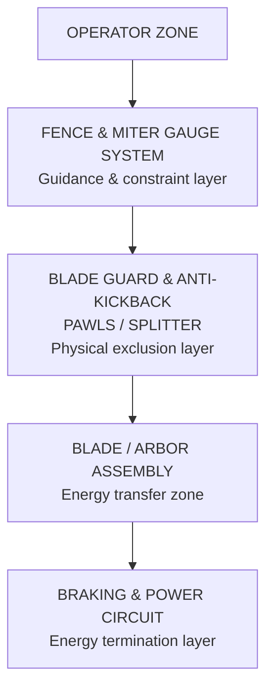

# Lesson 3: Safety Systems, Precision Control, and Stability Mechanisms

## 1. First-Principles Intuition & Invariants

There is a peculiar tension at the heart of power tool woodworking: the same rotational energy that makes a table saw capable of parting a twelve-inch hardwood slab in four seconds can remove a finger in roughly two milliseconds. That asymmetry, between the utility of stored kinetic energy and its indifference to whatever material enters the blade's path, is not merely a cautionary footnote. It is the central engineering problem around which every safety system, precision fence, and vibration-damping mechanism has been designed over the past century of shop tool development.

Understanding these systems at a practitioner level requires abandoning the common mental model of a power tool as a simple motor-and-blade assembly. Every professional-grade machine is better understood as a closed-loop mechanical system that must simultaneously manage energy input, workpiece guidance, reaction forces, and human proximity. Each of those four concerns has its own failure mode taxonomy, and competent operators maintain an active mental model of all four at once. The woodworker who treats the fence purely as a positioning aid and ignores its role in preventing kickback has only a partial understanding of the tool. The craftsman who knows the full mechanical story operates with qualitatively different situational awareness.

The invariants that govern this domain are worth stating plainly before any mechanism is examined in detail. First, rotating blade tools store kinetic energy in proportion to the square of angular velocity, which means that a 10-inch table saw blade spinning at 4,500 RPM carries roughly four times the kinetic energy of the same blade at 2,250 RPM. Braking systems must absorb or redirect that energy without introducing secondary hazards. Second, workpiece accuracy is a function of constraint geometry, not operator attention: a fence that deflects 0.003 inches under lateral load will produce a bowed cut regardless of how carefully the operator feeds the board. Precision is designed into the system, not achieved through vigilance. Third, dust and chip accumulation is not a housekeeping problem; it is a fire hazard, a respiratory hazard, and a precision hazard, because particulate buildup between a workpiece and fence face introduces the same error as mechanical deflection. Fourth, vibration couples through every structural element of a machine, and unchecked resonance degrades both surface finish quality and measurement repeatability at the tenth-of-a-millimeter scale that fine joinery demands.

These four invariants, energy management, constraint geometry, particulate control, and vibration isolation, map directly onto the four subsystem families covered in this lesson. They are not independent. A fence that is not properly locked transfers vibration energy into lateral workpiece movement. A dust collection port that creates negative pressure on the wrong side of a blade guard can alter the aerodynamics of the chip stream and introduce turbulence that affects the final cut surface. The practitioner who optimizes these systems in isolation will always leave performance on the table compared to one who understands how they interact.

The historical arc of these developments is instructive. Early twentieth-century cast-iron table saws relied almost entirely on operator technique for safety. The introduction of the splitter, a thin steel plate positioned immediately behind the blade to prevent the kerf from closing and pinching, was the first systematic engineering response to kickback mechanics. The riving knife, the modern descendant of the splitter, is mounted directly to the arbor carriage so that it rises and falls with the blade and maintains a constant geometric relationship regardless of depth-of-cut adjustment. This seemingly small refinement, eliminating the gap that opened between the splitter and blade when cutting depth was reduced, took decades to become standard on American machines despite having been common on European saws since the 1960s. The lesson is that precision safety engineering is frequently a problem of maintaining invariant geometric relationships across the full range of a machine's operating conditions.

## 2. Core Architecture & Mechanics

### Braking Systems: Electrical, Electronic, and Active Mechanical

The simplest and most common braking mechanism on portable power tools is dynamic braking through the drive motor itself. When the trigger is released on a worm-drive circular saw or a router, the control circuit momentarily reverses the polarity of the field windings on a universal motor, turning the motor into a generator that dumps regenerative current across a resistive load. The result is a stopping time reduced from roughly eight to twelve seconds of free coasting down to one to three seconds. The energy balance is worth visualizing: a 15-amp router at full load stores several thousand joules of rotational kinetic energy in its bit and collet assembly. Dynamic braking converts that kinetic energy into resistive heat in the braking resistor rather than allowing the blade or bit to continue spinning against an operator who may already be moving on to the next step.

Sliding miter saws introduce additional complexity because the blade must decelerate not only the arbor and blade but also the momentum of the entire saw head moving along the rail. High-end machines such as the Festool Kapex KS 120 and the Makita LS1019L achieve repeatable stop times under two seconds by integrating electronic brake circuits tuned to the specific mass and inertia profile of the head assembly. This matters for precision as well as safety: a blade that continues rotating for seven seconds after the cut is finished will score the workpiece if the operator lowers the head before the rotation fully stops.

SawStop represents a qualitatively different category of active braking, one based on continuous electrical signature monitoring rather than passive motor reversal. The underlying principle is that wood and synthetic materials are electrical insulators, while human skin presents a resistive-capacitive circuit with a characteristic impedance signature. The blade carries a low-voltage, high-frequency electrical signal. When the capacitive coupling signature changes by more than a threshold value within a detection window of roughly one millisecond, the system fires an aluminum brake cartridge into the spinning blade. The blade stops within approximately 3 milliseconds, and the arbor drops below the table surface simultaneously. The physics of this action are non-trivial: the aluminum cartridge deforms and locks against the blade's teeth while the spring-loaded drop mechanism releases. Kinetic energy is absorbed through the plastic deformation of the aluminum, which is why the cartridge and blade must both be replaced after an activation. For the practitioner, the operational implication is that any electrically conductive or high-moisture workpiece, wet lumber, green wood, pressure-treated lumber with wet preservative, or some exotic species with high resin conductivity, can trip the system inadvertently. The correct response is to switch the SawStop into bypass mode using the key override, which disables the detection circuit while keeping all other safety systems active.

The mechanical architecture of a standard table saw's safety envelope can be visualized as a set of concentric zones, each managed by a different subsystem:

Each layer must maintain its integrity independently of the others because real-world accidents frequently involve the simultaneous compromise of multiple layers. The operator who removes the blade guard to cut a dado also loses the anti-kickback pawls in the same assembly, which is precisely why dado cuts demand the greatest attentiveness to riving knife height, fence-to-blade parallelism, and feed direction.

### Riving Knives, Splitters, and Anti-Kickback Geometry

Kickback is a momentum transfer event, not a blade contact event, and understanding the distinction changes how you configure your machine. When a kerf closes around the back of a rotating blade, the upward-rotating rear teeth catch the workpiece and launch it toward the operator at velocities that have been measured above 100 MPH in test conditions. The riving knife prevents kerf closure by maintaining a physical wedge in the cut that keeps the two sawn faces separated as the workpiece passes beyond the blade. The correct riving knife geometry specifies that it must be thinner than the blade's kerf width, thicker than the blade plate, positioned so its top surface is no higher than the blade's top tooth at maximum height, and set within 3–8 mm of the blade's rear circumference.

That 3–8 mm gap specification is critical and frequently violated when operators use an improperly fitted riving knife for a given blade diameter. The gap exists to allow the workpiece to move forward past the knife without dragging. If the gap is too large, the kerf has space to close before the riving knife engages. If the gap is nonexistent, the workpiece pinches against the knife, stalling the cut or requiring excessive feed force that destabilizes the workpiece against the fence. On European-style saws with tool-free riving knife adjusters, verify this gap with a feeler gauge every time you change blades, because blade diameter variation directly translates to gap variation.

Anti-kickback pawls function as a one-way ratchet in the direction of feed. Their serrated teeth dig into the wood surface when the workpiece attempts to move rearward, anchoring it against the table. The pawls must be free to pivot independently and must exert enough spring tension to bite into the workpiece surface under the full kickback force impulse, which can exceed several hundred Newtons in a fraction of a second. A common maintenance failure is allowing the pivot pin to become stiff with sawdust and resin accumulation, which prevents the pawls from seating firmly against the workpiece. Clean the pivot mechanism with mineral spirits and re-lubricate with a dry PTFE lubricant every forty hours of machine use.

### Fences: Parallelism, Locking Mechanics, and Measurement Systems

A rip fence's accuracy is a product of two independently verifiable properties: its parallelism to the blade, and its resistance to deflection under lateral load. These are separate problems requiring separate measurement approaches, and conflating them is a common source of persistent cutting errors.

Parallelism is verified with a dial test indicator mounted on a magnetic base attached to the miter slot. Zero the indicator against the face of a reference tooth on the front of the blade, rotate the blade by hand to bring that same tooth to the rear position, and read the deviation. The industry standard tolerance for a production table saw is 0.003 inches of toe-out (the rear of the blade very slightly farther from the fence than the front), which prevents the rear teeth from re-scoring the cut face and generating heat. Zero parallelism or any toe-in condition creates friction between the workpiece and blade that escalates toward kickback. Adjust by loosening the trunnion bolts and tapping the front or rear of the table in the appropriate direction, then re-verify.

Lateral deflection under load is measured differently. Lock the fence at a nominal 6-inch setting and apply 15–20 pounds of lateral force to the fence face at the point farthest from the locking mechanism. Read the dial indicator positioned against the fence face. A quality fence such as the Biesemeyer T-square system should show no more than 0.002 inches of deflection under this test load. Inferior fence systems with single-point clamping at the front rail will show deflection of 0.010 inches or more, which translates directly into a bowed or tapered cut even on a perfectly parallelized saw. The Biesemeyer geometry achieves its rigidity by bearing against both a front rail and a rear support simultaneously, distributing the clamping force across two points of contact separated by the full depth of the saw table.

The scale itself is an independent source of error that practitioners frequently overlook after initial setup. The cursor on most factory fence scales reads to 1/16 inch or 1 mm, but the scale's zero calibration drifts when the front rail is ever impacted, when the rail mounting bolts are loosened for adjustment, or when thermal expansion shifts the rail relative to the blade during extended summer or winter shop use. Verify the scale calibration monthly by locking the fence, measuring with a precision rule directly from the blade's outside face to the fence face, and adjusting the cursor's mounting screws to match. Never trust the scale for joinery work without this confirmation; use the direct measurement every time the dimensional tolerance matters at the 0.5 mm level or below.

### Depth Stops: Mechanical and Cam-Based Architectures

Depth stop mechanisms appear on routers, plunge saws, drill presses, and mortising machines, and while their implementations vary, they all solve the same problem: establishing a hard mechanical limit that the cutting head cannot pass, regardless of how much downward force the operator applies. The architectural difference between a simple threaded rod stop and a multi-position turret stop is not merely convenience; it determines the repeatability standard the tool can achieve.

A threaded rod depth stop, as found on most plunge routers, uses a steel post with a lock nut that contacts a fixed reference surface on the base. The resolution of adjustment is a function of the thread pitch: a standard M6×1.0 thread advances one millimeter per full revolution, allowing adjustment in 1/8 mm increments with a quarter-turn. The failure mode is not in the threading itself but in the lock nut. If the lock nut is tightened without fully seating the threaded rod against its reference position first, the locked assembly is floating slightly above the intended depth, introducing an error that equals the gap between the rod tip and the reference surface. The correct procedure is to lower the plunge mechanism to its intended depth stop, hold it there under light downward pressure, thread the rod down until it contacts the reference surface, and then lock the nut while maintaining that contact. Measuring the depth with a router depth gauge before and after locking confirms that the locking action itself did not shift the setting.

Multi-position turret stops, as found on the Festool OF 1400 and OF 2200 routers and on most quality drill presses, use a rotating drum with three to six independently adjustable threaded posts at different heights. The operator can preset multiple depth values, then advance through them by rotating the turret without resetting the router or picking up a measuring instrument. This is not merely a convenience feature for multi-pass dadoing; it is an accuracy mechanism. The alternative to a turret stop, resetting the depth rod between passes, introduces cumulative positioning error because each setup operation has its own small error budget. The turret stop reduces multi-pass error from the sum of N independent positioning errors to the variance of a single positioning operation performed cold, before any cutting begins.

On the drill press, the depth stop is a split-collar assembly that engages a stop nut on the quill travel rod. The critical invariant here is that the drill must be at zero quill travel (fully retracted) when the depth collar is set, and the measurement of remaining quill travel must account for any drill bit runout that places the actual cutting tip lower than a concentrically mounted bit would indicate. For through-mortise drilling with a Forstner bit, always verify the actual cutting depth by drilling a test hole in scrap and measuring with a depth rod before committing to the finished workpiece.

### Vibration Damping: Sources, Propagation Paths, and Mitigation

Vibration in power tools originates from three distinct sources that require different mitigation strategies. The first is rotating mass imbalance in the blade, bit, or cutter head assembly. The second is cutting force harmonics generated by the cyclic impact of each tooth engaging the workpiece. The third is structural resonance excited by either of the first two sources in the machine's castings, table, and mounting surfaces.

Rotating mass imbalance is addressed at source through blade balancing. A quality carbide-tipped saw blade from manufacturers such as Freud, Forrest, or Leitz is dynamically balanced to tolerances specified in ISO 1940-1 at the factory. The mass distribution of carbide tips, braze joints, and laser-cut expansion slots all contribute to the final balance figure. When a carbide tip chips, is sharpened unevenly, or when the plate is bent, the balance is disturbed. The practical test at the bench level is to mount the blade on a shop-made arbor and suspend it between V-blocks or a dedicated blade balancer. Any heavy spot will cause the blade to rotate until that spot rests at the bottom. Mark the light side and either add a small strip of lead tape (available from balancing supply houses) or send the blade for professional resharpening that corrects the asymmetric carbide wear.

Cutting force harmonics are a function of tooth count, feed rate, and chip load. A 60-tooth finish blade taking a 1/32-inch-per-tooth chip load through hard maple generates a tooth engagement frequency of 60 × (4500/60) = 4,500 tooth impacts per second, or 4.5 kHz. If that frequency coincides with a resonant mode of the saw table or the fence extrusion, the system will amplify the vibration rather than absorb it. The practical mitigation on cabinet saws is mass: the several-hundred-pound cast iron table has such high rotational inertia relative to the cutting forces that it essentially cannot be excited to resonance by normal woodworking operations. On benchtop contractor saws with stamped steel tables, this mass argument fails, which is why these machines exhibit significantly more vibration and why their fence systems are proportionally less accurate than their cabinet-saw equivalents. Adding mass through a router extension wing of cast iron or through aftermarket isolation feet (rubber-bushed mounting pads) addresses both harmonic and imbalance-sourced vibration simultaneously.

Anti-vibration handles on circular saws and jigsaws decouple the grip from the motor housing through a rubber-isolated sub-frame. The Bosch Professional GST 18V-85 BC jigsaw, for instance, uses a two-mass system where the motor and orbital mechanism are suspended on damping elements within an outer housing. The practical result is that the operator's hands feel a smooth, low-amplitude vibration rather than the full-frequency-spectrum impulse coming off the blade. This matters for precision not because the vibration affects the blade's position directly, which it does not at jigsaw cutting speeds, but because vibration transmitted into the operator's hands degrades grip pressure control and therefore tracking accuracy over the length of a cut.

## 3. High-Performance Optimization & Failure Modes

### Setting Up the Full Precision System: An Integrated Workflow

The difference between a table saw that produces cuts accurate to 0.5 mm and one that consistently holds 0.1 mm is almost never the saw itself; it is the state of calibration across the complete subsystem stack. Practitioners who reach the highest tier of dimensional accuracy establish a hierarchical calibration workflow that addresses each subsystem in dependency order, because an error at a lower level corrupts every measurement made above it.

Begin with blade flatness and set. A blade with more than 0.004 inches of lateral wobble measured at the rim with a dial indicator will produce a cut whose width varies along its length regardless of how accurately the fence is set. This wobble may come from the blade plate itself (which can be tensioned by a blade smith) or from arbor runout (a bearing problem requiring arbor replacement). Measure arbor runout before attributing wobble to the blade: mount the indicator against the arbor flange, not the blade, and rotate by hand. More than 0.002 inches of arbor flange runout condemns every cut you make on that machine.

With the arbor verified, set blade-to-miter-slot parallelism as described in Section 2. Then verify fence parallelism relative to the blade, not to the miter slot, because a bent or worn miter slot introduces its own error that the fence calibration should not inherit. Lock the fence at six inches, measure at front and rear with the dial indicator against a tooth, and adjust until you achieve 0.001–0.003 inches of toe-out. At this point the foundational geometry is correct.

The depth stop system should be calibrated with the actual cutter installed, not with a bare arbor or chuck, because the collet tightening sequence and the cutter's own axial runout both contribute to the final cutting depth in ways that cannot be corrected after the fact by adjusting the stop. On a router table, set the bit height with a router height gauge calibrated against a known standard (a machinist's precision ground parallel works well for this purpose), verify by routing a test pass in scrap and measuring with a depth micrometer, and only then lock the stop.

### Dust Collection Integration and Its Effect on Precision

Dust collection is introduced at this point in the workflow because it is the last subsystem that must be active before any calibration cuts are made in finished material, and because its integration has mechanical implications that most practitioners do not fully appreciate.

The fundamental dust collection architecture on a table saw involves two separate extraction points: above-blade extraction through the blade guard shroud and below-blade extraction through the cabinet port. These two streams must be balanced to avoid creating a pressure differential across the blade that influences chip trajectory and blade cooling. An overbalanced above-blade extraction pulls chips upward faster than they are generated, which in practice means less residue on the workpiece fence face. An overbalanced below-blade extraction can create a slight vacuum above the saw table that actually improves workpiece hold-down on rip cuts, but it also means that fine particulate bypasses the blade guard and enters the operator's breathing zone. The correct configuration for most cabinet saws is a 4-inch collection hose at the cabinet port running to a minimum 650 CFM dust collector, with a secondary 2.5-inch hose connected to the blade guard's extraction port and routed through a Y-fitting into the same collector or a separate ambient air filtration unit.

Hose routing is a precision concern because a 4-inch flexhose pulled tight against the cabinet creates a tensile force on the cabinet housing. On contractor saws with lighter sheet-metal cabinets, this tension can be enough to shift the trunnion-to-table relationship by several thousandths of an inch, invalidating a blade parallelism calibration that was performed without the hose in place. Always attach the dust collection hose before performing final calibration, and design the hose routing to include a service loop that removes tensile load from the machine connection point.

The dust collection system's effect on respiratory safety is governed by the relationship between particle size and health risk in a way that counterintuitively penalizes sanding operations more than sawing operations. Saw teeth produce chips in the 100–1000 micron range that fall quickly under gravity and are captured efficiently by conventional dust collectors. Sanders producing 220-grit and finer surface finish generate particles in the 1–10 micron range that remain suspended in shop air for hours and pass through 5-micron bag filters. Hardwood species including walnut, teak, western red cedar, and all tropical rosewood-family species (Dalbergia spp.) are classified as human carcinogens by the IARC, and their dust mandates P100 respirator use and ambient filtration below 1 micron. A shop that runs a dust collector rated at 1 micron capture efficiency during sanding operations and treats all fine woodworking as a lung-safe environment has not done the analysis. Install an ambient air filtration unit with a true HEPA final filter above the work area and verify it cycles the shop air volume at a minimum of six times per hour.

### Failure Mode Analysis and Diagnostic Procedures

The failure modes that cause the greatest harm to practitioners are frequently not the dramatic ones. Blade contact injuries typically result from a momentary lapse of attention during setup or workpiece retrieval, not during the cut itself. The mechanical preconditions, a fence set parallel to blade, an anti-kickback pawl in proper contact with the workpiece, a riving knife at correct clearance, reduce the probability of those lapses escalating into contact events. Systematic pre-operation checks are therefore an accuracy and safety investment simultaneously.

Fence drift during a cut presents as a rip piece that is thicker at one end than the other, with the thicker dimension always at the trailing end. The root cause is almost always insufficient clamping force at the fence's locking mechanism rather than fence rail wear, because wear produces a consistent undersized dimension rather than a tapered one. The diagnostic is to place a dial indicator against the fence face, lock the fence normally, and then apply 25 pounds of lateral hand pressure. If the indicator moves more than 0.003 inches, the locking cam or lever mechanism is not generating enough clamping force. On Biesemeyer-style fences, the fix is usually adjustment of the cam engagement set screw on the locking lever; on t-slot profile fences, it is ensuring the t-slot contact faces are clean and the locking handle torque is consistent.

Router bit climb cutting, the tendency to draw the router aggressively in the climb direction under certain conditions, is a catastrophic failure mode that is frequently triggered by incorrect depth of cut combined with a loose collet. The underlying mechanics are that climb cutting reverses the torque vector on the router from the operator's perspective: instead of the bit's rotation pulling the router in the conventional feed direction, it pulls in the opposite direction with a force proportional to chip load. A loose collet exacerbates this because it allows the bit to deflect radially before the collet friction can resist the radial cutting force, creating a momentary increase in chip load that amplifies the climb force. The preventive protocol is to tighten the collet with the manufacturer's specified torque wrench value, limit conventional roughing passes to no more than half the bit diameter in depth, and never use a climb cut for more than a light finish pass of 0.015 inches or less on the final profile.

Jigsaw blade wander, the drift of the cut line away from the marked layout, is distinct from operator error in that it can occur even when the operator is tracking the layout line accurately if the blade is bent, the shoe is not perpendicular to the blade, or the orbital setting is too aggressive for the material thickness. A blade that is bent even slightly in the plane of the cut will track toward the bent side under the asymmetric cutting forces. Verify blade perpendicularity using a small engineer's square against the shoe before cutting; correct orbital setting is zero or one for hardwoods under 25 mm, escalating to two or three only for softwood and sheet goods above 50 mm where kerf straightness is less critical than cutting speed.

Planer snipe, the deeper cut taken at the leading and trailing few inches of a board, results from the workpiece pivoting slightly on the infeed and outfeed rollers as it enters and exits the cutterhead. The rollers support the board's center; at entry and exit, one end is unsupported and the cutterhead is effectively taking a slightly deeper pass on that end because the board has dipped. The engineering fix on quality machines is a chip breaker and feed roller arrangement that minimizes this dip through geometric constraint. The practical fix on any planer is to run the board through on carrier sleds long enough to maintain table contact throughout entry and exit, or to joint a slight compensating angle onto both ends of the stock before planing, cutting that angle off after the planing operation.

Properly understood, the safety and precision systems of power tools are a unified architecture in which accuracy and accident prevention reinforce one another. The shop that is calibrated to the standard described in this lesson is not merely producing better joinery. It is operating at a lower overall risk level because the mechanical conditions that produce precision are largely identical to the mechanical conditions that make the tool's behavior predictable, and predictable behavior is the foundation of safe operation.
