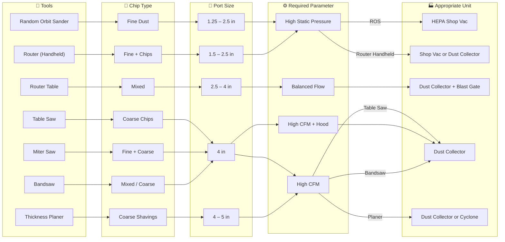
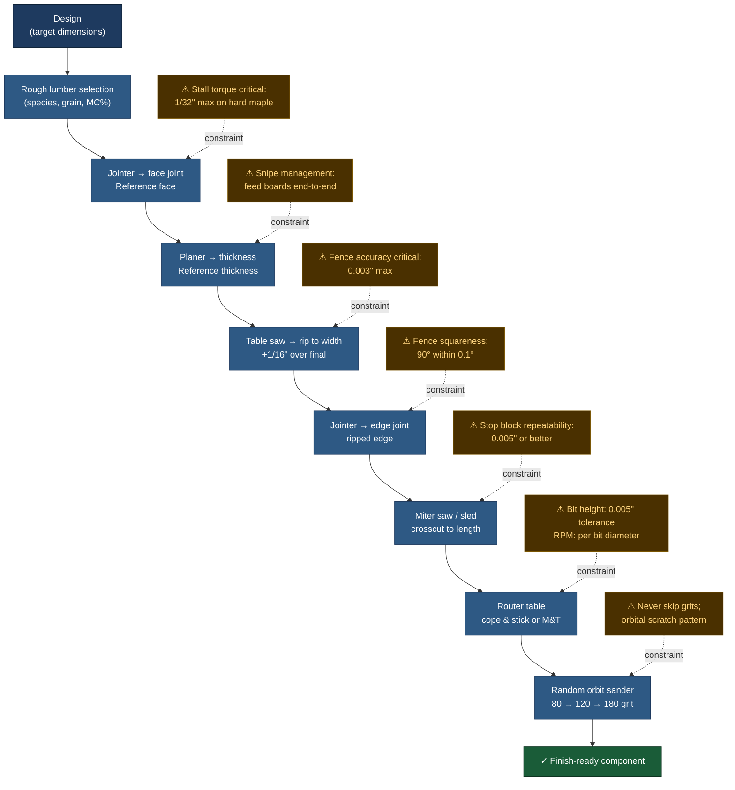

# Lesson 4: Tool Selection Strategy and Workflow Integration

## 1. First-Principles Intuition & Invariants

Every experienced woodworker eventually internalizes a truth that takes beginners years to discover: the tool you reach for first shapes every decision that follows. Tool selection is not a matter of preference or habit — it is an engineering decision rooted in material properties, dimensional tolerances, production sequence, and the physical constraints of your shop. When you choose a track saw over a table saw for breaking down full sheets of plywood, you are not making a convenience choice; you are making a geometry decision, a dust management decision, and a workflow sequencing decision simultaneously. Understanding why that is true requires thinking from first principles about what a cutting, shaping, or joining tool actually does to wood fiber, and what residue — in the form of tearout, kerf loss, vibration stress, or airborne particulate — it leaves behind.

Wood as a material punishes poor tool selection in ways that metal or plastic do not. Its cellular structure is anisotropic: properties along the grain axis differ dramatically from those across it, and even the distinction between earlywood and latewood within a single annual ring changes how a cutter engages the surface. A router bit taking a heavy climb-cut pass across the face grain of hard maple will lift and fracture cells ahead of the cutter rather than shearing them cleanly, leaving a surface that no amount of sanding will fully redeem. The correct response is not to slow down and try again — it is to understand that router bit geometry, rotation direction, feed direction, and depth of cut are all coupled variables that must be resolved together before the spindle ever turns. This is the first invariant of tool selection strategy: **tool geometry and material behavior are inseparable**, and the matrix of choices you face when picking up a power tool collapses significantly once you treat the workpiece's grain orientation, density, and moisture content as fixed constraints rather than incidental details.

The second invariant concerns power ratings and their relationship to cut quality rather than raw capability. A 15-amp table saw with a 10-inch blade does not simply "cut more" than a 13-amp saw — it maintains blade speed under load. When a blade slows under heavy feed pressure, the chip load per tooth increases, heat builds in the gullet, and the saw begins to push rather than cut, compressing wood fibers against the fence instead of removing them cleanly. This manifests as burning on dense hardwoods like cherry or hard maple, and as rough, tearout-prone surfaces on figured grain. Understanding motor amperage as a proxy for stall torque resistance — not for blade diameter or fence travel — reframes how you evaluate a tool against a task. For ripping 8/4 hard maple into drawer components, a 15-amp contractor saw is marginal. For crosscutting 3/4-inch cherry to finished length, it is entirely adequate. The question is never "is this tool powerful enough in absolute terms?" It is "does this tool maintain cutting velocity and blade geometry under the specific feed force this operation requires?"

The third invariant is sequence dependency. Woodworking operations do not exist in isolation; each step in a project creates the reference surface or dimension that the next step depends upon. Milling lumber follows a strict logical order — face joint before thickness plane, face plane before rip, rip before crosscut to finished length — because each operation requires a previously established true reference. Violating this sequence with power tools does not just produce inferior results; it compounds error. If you rip a board on the table saw before jointing the face, the fence bears against a curved or twisted edge, translating that geometry directly into a taper cut. The finished board is neither square nor parallel, and no downstream operation on the router table, shaper, or joiner can fully recover it without removing additional material, often past your target dimension. Sequence is not a workflow nicety — it is a dimensional error propagation problem, and the tool selection matrix must respect it explicitly.

Dust and chip management forms the fourth and perhaps most underappreciated invariant. Advanced practitioners know that dust control affects cut quality, not just workshop air quality. On a track saw with a connected dust extractor running at appropriate static pressure, the blade channel stays clear, the track maintains full contact with the workpiece, and the anti-splinter strip functions as designed. Disconnect the extractor and work dry, and chips pack the kerf, the track lifts fractionally on debris, and you lose the accuracy that made you choose a track saw over a circular saw in the first place. The same logic applies to router tables — a chip-laden collet zone traps heat, and accumulated debris on the table surface introduces workpiece tilt that translates directly into profile inconsistency. Dust extraction is not a housekeeping function; it is a machining tolerance control function.

---

## 2. Core Architecture & Mechanics

### The Decision Matrix: Mapping Operations to Tool Classes

The practical framework for tool selection in an end-to-end woodworking project can be visualized as a directed workflow where each operation stage has a defined set of tool candidates, filtered by four criteria: **material removal rate requirements, dimensional precision requirements, surface quality requirements, and dust/chip management requirements**. These four axes do not always point in the same direction, and resolving their tensions is where real expertise lives.

The rough milling stage is power-limited. A 13-inch drum planer taking 1/16-inch passes through 8-inch-wide quartersawn white oak is demanding roughly 12 to 14 amps from its motor. If the machine's rated amperage is 15A, there is very little thermal headroom, and feeding at the maximum roller speed will cause the motor to heat, slow the cutterhead, and produce snipe — the characteristic deeper cut at board entry and exit — as the cutterhead speed fluctuates. The correct response is to reduce infeed to 1/32 inch per pass on wide, dense stock, or accept that a 15-amp benchtop planer is the wrong tool for production milling of 8/4 hardwoods and that a 20-amp cabinet planer is what the task requires. This is a power-rating selection decision driven directly by material density and stock width.

At the dimensioning stage, precision requirements dominate. The table saw's value is not raw horsepower but fence accuracy, blade-to-miter-slot parallelism, and arbor runout. A fence with 0.003 inches of play produces boards that are not parallel-sided over their length, which creates glue-line gaps in edge-joined panels that no amount of clamping force will close without telegraph-through deformation. Before selecting a table saw as the primary dimensioning tool, the practitioner must verify these geometric invariants: blade parallel to miter slot within 0.002 inches, fence parallel to blade within 0.003 inches along its full travel range, and blade perpendicular to table at 90-degree stop within 0.1 degrees. These are not setup suggestions — they are the tolerance stack that determines whether your finished panels are dimensionally repeatable.

The router table occupies a unique position in this architecture because it bridges dimensioning and joinery. As a joinery tool, it must hold bit height to within 0.005 inches for consistent tenon shoulders and profile matching across multiple workpieces. As a dimensioning tool (edge profiling, rabbeting, panel raising), it must maintain consistent fence-to-bit registration under lateral workpiece pressure. The key mechanical variables are collet concentricity, table insert flatness, and fence face squareness. A collet with 0.002 inches of runout at the collet nose translates to measurably different runout at a bit's outer cutting radius — at a 1-inch radius, even 0.001 inches of collet tilt produces 0.002 inches of diameter variation per revolution, enough to create visible witness marks on a raised panel profile that will show through a finish. This is why router table selection cannot be separated from router selection: the table is only as good as the router mounted in it.

### Dust Extraction Architecture

Understanding how dust extraction integrates with power tools requires thinking about two distinct physical parameters: **static pressure (suction)** and **airflow volume (CFM)**. These are not interchangeable. A shop vacuum generates high static pressure — typically 80 to 100 inches of water column — but relatively low CFM (around 100 to 150 CFM). A dust collector generates lower static pressure (5 to 7 inches of water column for a single-stage collector) but high CFM (400 to 800 CFM for a 1.5 HP unit). The distinction matters for tool selection because different tools shed chips in fundamentally different ways.

A router produces fine dust and small chips in a tightly localized zone around the bit. The shroud around a router's base port is small-diameter, meaning high static pressure is needed to draw chips through it against the air resistance of the small port area. A shop vacuum connected here is mechanically correct. A table saw, by contrast, produces a high volume of chips that fall into a large cabinet — a geometry that demands high airflow volume to sweep chips out of the enclosed space, not high suction. Connecting a shop vacuum to a table saw's 4-inch dust port starves the machine of airflow; the vacuum's CFM is insufficient to sweep the cabinet clean, chips pack around the splitter and blade guard, and blade cooling is compromised. A single-stage dust collector with a 4-inch hose is the appropriate pairing here.

The practical implication is that a shop running multiple large tools simultaneously needs a ducted central dust collection system with blast gates, sized such that the main trunk line supports the CFM demand of the largest simultaneously operated tool pair. The trunk line velocity must stay above 3,500 FPM (feet per minute) to keep chips in suspension rather than dropping and packing in the duct — which means trunk diameter must match airflow: a 1,200 CFM collector needs a 6-inch main trunk to maintain that velocity, calculated from the basic relationship $V = Q / A$ where $Q$ is volumetric flow and $A$ is duct cross-section.

### Signal Path: From Design Intent to Finished Component

The workflow architecture for a typical cabinet door, treated as an end-to-end case study, illustrates how tool decisions cascade:

Each arrow in this chain represents a handoff where the upstream tool's output becomes the downstream tool's reference condition. The jointer's face does not merely need to be "flat enough" — it needs to be flat to within the planer's acceptable registration tolerance, which for a machine with a solid rubber infeed roller pressing against an uneven face is roughly 0.010 inches across the board width. Beyond that, the board rocks on the planer table and exits with a convex face. This tight coupling between tool tolerances is what makes tool selection a systems problem rather than a per-operation problem.

---

## 3. High-Performance Optimization & Failure Modes

### Optimizing the Milling Sequence for Dimensional Stability

Advanced practitioners treat wood moisture content as a primary scheduling variable, not an afterthought. Lumber acclimated to a shop environment at 7% EMC (equilibrium moisture content) will move predictably in service when finished furniture reaches 6–9% EMC in a conditioned interior. The failure mode that haunts shops with inadequate acclimation protocols is not visible in the milled component — it appears six weeks later when a table apron pulls free of its mortise or a drawer front warps against its opening because moisture content changed after machining. The mitigation is to rough-mill to 1/4 inch oversize in thickness and 1/8 inch in width, then stack and sticker the lumber in shop conditions for a minimum of one week per inch of thickness before final dimensioning. This is not conservative practice — it is recognition that the jointer and planer cannot create dimensional stability that the material does not possess at the time of cutting.

When working with highly figured or reversing-grain material — quilted maple, crotch walnut, bird's-eye maple — the standard jointer-then-planer sequence can fail catastrophically. A jointer with standard straight knives will tear large chips from reversing grain no matter how sharp the knives or how light the pass, because the grain direction reverses mid-board and the cutter simultaneously climbs and opposes grain within a few inches. The mitigation is a helical cutterhead on both the jointer and planer. Helical heads use multiple small carbide inserts arranged in a helical pattern, each engaging the wood at a slight skew angle. The skew shear reduces the effective cutting angle against reversing grain, and because each insert takes a narrow slice rather than a full-width cut, the chip load per insert is dramatically lower. The surface quality improvement on figured material is not incremental — it is the difference between a usable surface and stock that must be entirely hand-scraped to remove tearout.

Feed rate optimization on the thickness planer is a function of cutterhead RPM, number of knives (or inserts), and desired surface quality measured in cuts per inch (CPI). A three-knife cutterhead at 5,000 RPM produces 15,000 cuts per minute. At a feed rate of 20 FPM (feet per minute), that is $15{,}000 / (20 \times 12) = 62.5$ cuts per inch — a surface that is smooth but will show slight ridging under a raking light. At 10 FPM feed, the same cutterhead produces 125 CPI, essentially indistinguishable from a hand-planed surface. The practical implication is that final thickness passes on furniture-grade material should use the slowest available feed rate. The difference in production time per board is roughly 20 seconds. The difference in sanding time to achieve a finish-ready surface is several minutes per board, heavily weighted in favor of the slow final pass.

### Critical Failure Modes and Their Mechanical Roots

**Kickback on the table saw** is the most consequential failure mode in power woodworking, and its mechanical cause is frequently misunderstood. Kickback occurs not simply because the blade catches the wood, but because the wood closes on the blade behind the cut — pinching the rear teeth, which are rising from the table, and launching the workpiece rearward at blade velocity. The root cause is almost always one of three conditions: a fence not parallel to the blade (taper cut creates a pinch at the rear), wet or case-hardened lumber with internal stress that closes the kerf after the cut begins, or the absence of a riving knife maintaining kerf width behind the blade. A riving knife — not a splitter, which is fixed and does not rise with the blade — maintains a gap behind the blade that is 85 to 90% of the blade's plate thickness. This is the correct mitigation for stress-related kickback, and it must be in place for every through-rip operation regardless of operator experience level.

**Chatter and deflection at the router table** is a failure mode rooted in the relationship between bit unsupported length, cutting force, and collet grip. A large-diameter panel raising bit at maximum extension from the collet nose creates a substantial moment arm. The lateral cutting forces on a tall raised panel profile can reach several pounds at the outer cutting edge. If the bit shank is 1/2 inch and extends 1.5 inches from the collet nose rather than the ideal maximum of 3/4 inch, the moment arm is doubled, deflection at the cutting edge increases by roughly a factor of eight (since deflection scales with the cube of the unsupported length), and the bit chatters visibly in figured hardwood. The mitigation protocol is explicit: use the shortest bit extension that clears the fence and workpiece, always use a 1/2-inch shank over a 1/4-inch shank for bits larger than 1-inch diameter, and take panel-raising profiles in a minimum of three progressive passes, with the final pass removing no more than 1/32 inch.

**Snipe on the thickness planer** has two distinct mechanical sources that require different mitigations. Outfeed snipe — the deeper cut at the trailing end of a board — occurs when the board tips down slightly as it exits the infeed roller, changing the effective cut depth. Infeed snipe, at the leading end, occurs when the board drops onto the cutterhead bed before the outfeed roller engages. The standard mitigation is to support both ends of the board at table height using an infeed and outfeed roller stand, and to feed boards sequentially end-to-end so the outfeed roller is always engaged by the leading board when the trailing board exits. For production milling of multiple boards to the same thickness, this end-to-end feeding technique eliminates snipe entirely and maintains consistent thickness across the entire batch.

**Dust extraction failure at the random orbit sander** manifests not as poor air quality but as swirl marks in the finish. When a sander's dust bag or port becomes blocked, the pad runs in a cloud of its own abrasive debris, which acts as loose abrasive between the pad and the workpiece and scratches the surface with an irregular, non-orbital pattern. The finish then magnifies these scratches under its surface, appearing as a haze that is maddeningly difficult to trace back to the sanding stage. The mitigation is to use a sander connected to a shop vacuum at all times through the sander's through-port, verify the connection is clear before each session, and change sanding discs the moment loading is visible — a loaded disc with clogged abrasive is mechanically equivalent to a worn-down pad running against grit with excessive pressure, cutting both slower and more aggressively in terms of scratch depth.

### Coordinating Multiple Tools Across a Complex Project

The highest-level skill in power tool workflow integration is not mastery of any individual tool — it is the management of tolerance stacks and sequencing dependencies across an entire build. Consider a set of face-frame cabinet doors: eight doors, each with two stiles and two rails, cope-and-stick joinery, 1/4-inch raised panel floating in a groove. That is 48 individual components, each requiring jointing, planing, ripping, crosscutting, and profiling before assembly. Any dimensional inconsistency that is not caught and corrected propagates through every subsequent operation for that component, and 48-component tolerance accumulation can easily produce doors that are 1/32 inch out of square across their diagonal — visible and unacceptable at installation.

The correct workflow strategy is to process all components of the same type simultaneously through each operation before moving to the next. All stiles get face-jointed together, then all rails, before the planer is used. All stiles get ripped to identical width with the same fence setting before that setting is changed. All cope cuts are made on all rail ends before the router table height is changed for the stick profile. This batch-processing discipline does the same thing that statistical process control does in manufacturing: it converts per-part random error into a systematic offset that can be measured and corrected at each stage rather than accumulating invisibly across the full run. When the stile rip fence setting is verified with a test piece and found to be 0.004 inches narrow, all 32 stiles benefit from that single correction. If stiles were ripped individually across multiple sessions with fence changes between them, that correction opportunity does not exist.

The integration of dust extraction into this batch discipline is worth making explicit: every tool changeover is also a dust system changeover. When moving from the table saw to the router table, the blast gate at the table saw closes and the blast gate at the router table opens. This is not optional procedure — an open table saw blast gate while running the router table reduces static pressure across the whole system, and a router table with inadequate dust extraction builds a chip mound around the bit that gradually lifts the workpiece off the fence face. A well-designed shop lays out blast gates at arm's reach from each machine's operating position, and experienced practitioners reach for the blast gate with the same automatic motion they use to adjust a fence. After enough hours in the shop, dust management is not a separate discipline from woodworking. It is embedded in every operational movement, as natural as checking a fence with a tape before ripping.
