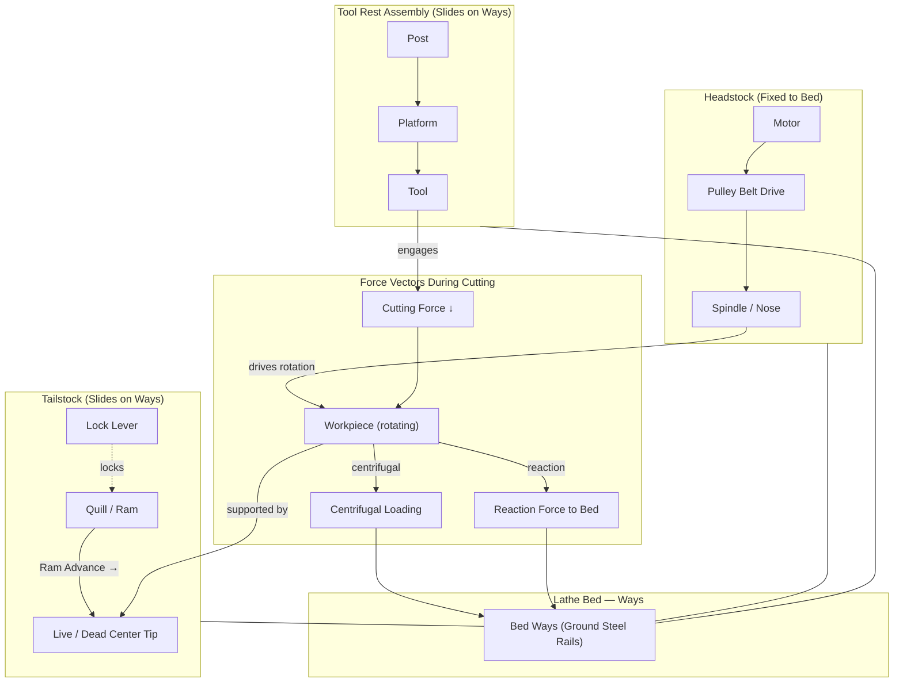

# Lesson 1: Lathe Mechanics, Safety Fundamentals, Wood Properties

## 1. First-Principles Intuition & Invariants

The wood lathe occupies a unique position in the spectrum of woodworking machinery because it transforms wood not through linear cutting motions but through rotational force dynamics that expose the turner to fundamentally different mechanical behaviors than those encountered at the table saw or router table. Where conventional woodworking machines hold the workpiece stationary and move the cutter, the lathe inverts this relationship: the wood spins at hundreds or thousands of revolutions per minute while the cutting tool remains relatively stationary in the turner's hands. This inversion creates a system where centrifugal force, rotational imbalance, and the anisotropic grain structure of wood intersect to produce both extraordinary creative possibilities and distinctive hazard profiles.

At its core, the lathe is a precision rotational platform that holds wood between two aligned centers—or cantilevered from a single point—and spins it about a longitudinal axis while the turner presents edged tools to the rotating surface. The mechanical principle governing all turning operations is the continuous removal of material through controlled shearing as the sharp edge intersects fibers moving tangentially past the tool. Unlike planing or sawing, where grain direction relative to the cutter changes only at the boundaries of a cut, turning presents the tool with constantly changing grain orientation throughout each revolution. A single rotation of a square blank transitions the cutter through end grain, side grain, opposing side grain, and end grain again, creating a cyclic loading pattern that demands both tool geometry optimized for interrupted cuts and a kinesthetic understanding of how different grain presentations respond to edge contact.

The fundamental invariant in turning is that rotational velocity at the workpiece surface—not spindle RPM alone—determines cutting behavior. A four-inch diameter spindle blank rotating at 1200 RPM presents a surface speed of approximately 1260 feet per minute, while a twelve-inch bowl blank at the same spindle speed moves at 3770 feet per minute at its rim. This relationship, expressed as surface feet per minute (SFPM) where SFPM = (π × diameter in inches × RPM) / 12, means that optimal cutting speed requires continuous adjustment of spindle RPM as diameter changes during the turning process. Failure to recognize this invariant leads to one of two failure modes: running small-diameter work too slowly, causing the tool to catch and chatter rather than shear cleanly, or running large-diameter work too fast, generating excessive centrifugal force that can disintegrate structurally compromised wood or tear poorly secured blanks from their mounting.

Wood's cellular structure introduces a second critical invariant: the mechanical properties of wood under rotational stress are not isotropic but vary dramatically with grain orientation, moisture content, and the presence of defects. Unlike metals or synthetic polymers that exhibit relatively uniform strength in all directions, wood is a composite of hollow cellulose fibers aligned primarily along the trunk axis, bound together by lignin. When mounted on the lathe, this grain orientation determines both how the wood will respond to cutting forces and how it will behave under the centrifugal acceleration of rotation. A blank mounted with grain running parallel to the lathe axis (spindle turning) presents long, continuous fibers that provide excellent longitudinal tensile strength and allow aggressive cutting across the grain. The same species mounted with grain running perpendicular to the axis (faceplate turning) exposes short grain at the mounting points, creating shear planes vulnerable to catastrophic failure if the blank contains cracks, splits, or is subjected to excessive rotational force before being turned round.

The moisture content of wood at the time of turning fundamentally alters its mechanical behavior through several interconnected mechanisms. Green wood—freshly cut with moisture content between 50% and 200% of its dry weight—turns with a silky, almost cheese-like consistency. The water-saturated cell walls plasticize the lignin matrix, reducing cutting resistance and producing long, flexible shavings that peel away cleanly. As wood dries below the fiber saturation point of approximately 28% moisture content, water begins to leave the cell walls themselves, causing the wood to shrink, harden, and become more brittle. Kiln-dried wood at 6-8% moisture content cuts with significantly more resistance, produces shorter, more brittle chips, and generates more heat at the tool-workpiece interface. This transition has profound implications: techniques that work beautifully on green wood—such as aggressive shear scraping or power sanding while the piece rotates—can cause grain tearout, burning, or surface checking on dry wood. Conversely, the dimensional stability of dry wood allows precise tolerances and fitted joinery that would be impossible with green stock that will shrink unpredictably as it equilibrates with ambient humidity.

The lathe's mechanical architecture must satisfy several competing requirements simultaneously: it must provide rigid, vibration-free support for the rotating workpiece; allow quick and precise repositioning of the tool rest to maintain proper cutting geometry as the work diameter changes; permit secure mounting of workpieces ranging from slender spindles to massive bowl blanks weighing dozens of pounds; and deliver variable rotational speeds across a range sufficient to maintain appropriate SFPM for both small and large diameter work. These requirements have driven lathe design toward a characteristic architecture that has remained conceptually stable since the development of iron machine tools in the 18th century, even as materials, bearings, and drive systems have evolved.

## 2. Core Architecture & Mechanics

The lathe bed forms the structural foundation of the entire system and establishes the critical datum from which all other components align. Traditionally cast from gray iron for its excellent vibration damping properties and resistance to wear, modern lathe beds may also be fabricated from steel tubing or extruded aluminum, though these materials require careful attention to torsional rigidity. The bed's most critical function is maintaining precise alignment between the headstock spindle axis and the tailstock center, typically specified to within 0.001 inches over the bed length. This alignment—called the lathe's "ways"—ensures that cylindrical work turned between centers will be truly concentric rather than tapered.

The bed's cross-section determines how components mount and slide. Most modern lathes use either flat ways with dovetailed slides or tubular beds with indexed positions. Flat ways, ground to precise flatness and parallelism, allow infinite positioning of the tailstock and tool rest assembly but require periodic maintenance to compensate for wear. Tubular beds sacrifice infinite positioning for simplified manufacturing and excellent torsional stiffness, with components clamping around the tubes at any desired location. The choice between architectures creates a fundamental tradeoff: flat ways provide better support for heavy faceplate work that generates significant lateral forces, while tubular beds offer superior convenience for production work requiring frequent repositioning.

The headstock houses the spindle, bearings, and drive system that provide the rotational power for all turning operations. The spindle itself is a precision shaft, typically 1.25 to 2 inches in diameter, supported by heavy-duty ball bearings or tapered roller bearings that must withstand both radial loads from unbalanced workpieces and thrust loads from tailstock pressure during spindle turning. The spindle's nose features standardized threads and tapers—such as 1-8 TPI threads with a #2 Morse taper, or metric M33×3.5—that allow rapid mounting of faceplates, chucks, and drive centers. The through-hole running along the spindle's central axis serves two purposes: it allows mounting of long stock that extends behind the headstock for spindle work, and provides clearance for driving out Morse taper tooling when the headstock is used as a hollow arbor.

Modern lathes employ electronic variable-frequency drives (VFDs) or mechanical step pulley systems to vary spindle speed. VFD systems offer infinite speed adjustment across their range, typically 200 to 4000 RPM for mid-size lathes, with electronic torque compensation that maintains consistent power through the speed range. Step pulley systems require manual belt repositioning to change ranges but often provide better low-speed torque for heavy roughing cuts on unbalanced blanks. The critical specification is not peak RPM but rather the combination of torque and speed control that allows maintaining appropriate SFPM as work diameter changes. A 1.5 HP motor generating 150 lb-ft of torque at 500 RPM provides substantially more useful power for bowl turning than a 2 HP motor delivering high power only at elevated RPM.

The tailstock provides adjustable support for the free end of spindle work and applies axial pressure to secure blanks between centers. Its central component is the quill—a hollow ram that slides within the tailstock body on a precision fit, advanced by a handwheel driving an acme or ball screw. The quill's interior features a Morse taper (typically #2 or #3) to accept live centers, dead centers, or drill chucks. Live centers incorporate ball bearings that allow the center to rotate with the work, eliminating frictional heating and the need for lubrication. Dead centers remain stationary and require either lubrication or intermittent withdrawal to prevent center seizure from frictional heat. The tailstock body slides along the ways and locks via a cam lever, allowing positioning anywhere along the bed length while maintaining alignment with the headstock spindle axis through precise machining of its base or adjustable set screws that permit tramming.

The tool rest assembly consists of a vertical post that mounts to a banjo or T-rest base sliding along the ways, supporting a horizontal platform positioned just below spindle centerline height. The rest's function is to provide a fulcrum point that allows the turner to control tool presentation while absorbing the reaction forces generated as the cutting edge contacts the rotating work. Unlike milling or lathe metalworking where rigid tool mounting is paramount, woodturning deliberately positions the tool rest 1/8 to 1/4 inch away from the work, with the tool cantilevered across this gap. This arrangement allows the turner to control cutting depth through subtle wrist movements and to rapidly withdraw the tool if it begins to catch.

The geometry of this relationship determines cutting behavior. The tool rest height positions the tool's edge relative to the spindle centerline; for most operations, the rest is set so the tool tip contacts slightly above center when the tool handle is level. This geometry ensures that cutting forces drive the tool downward against the rest rather than attempting to lift it. The horizontal distance between rest and work determines leverage: closer positioning provides better control but limits access to interior surfaces, while greater distance increases tool vibration and the risk of catches but improves visibility and access. Advanced turners continuously reposition the rest throughout the turning process, maintaining optimal geometry as the work profile changes.

Rotational force dynamics during turning create loading patterns quite different from those in metalworking lathes. An unbalanced blank—whether a natural-edge bowl with varying wall thickness or a square spindle blank before it is turned round—generates significant vibration through its eccentric center of mass. At each revolution, centrifugal force pulls the heavy side outward, creating a radial load on the bearings that varies sinusoidally. The magnitude of this force increases with the square of rotational velocity and linearly with the mass offset distance. A 5-pound bowl blank with its center of mass offset 2 inches from the rotation axis generates approximately 125 pounds of radial force at 1000 RPM, rising to 500 pounds at 2000 RPM. This explains why roughing cuts on unbalanced work must begin at conservative speeds: the bearings, bed, and mounting system must contain these dynamic loads without allowing destructive vibration or, in extreme cases, ejecting the workpiece.

As the blank is turned toward round, the center of mass migrates toward the rotation axis and vibration diminishes. Skilled turners use this feedback—the transition from rumbling vibration to smooth rotation—as a kinesthetic indicator that the blank is approaching cylindrical. Once round, the primary loads become the steady cutting forces: the tangential force of the tool resisting the work's rotation (absorbed by the headstock bearings and motor torque), the radial force pushing the tool away from the work (transmitted through the tool and turner's body to ground), and the axial forces along the spindle axis (contained by thrust bearings and, in spindle work, the tailstock).

## 3. High-Performance Optimization & Failure Modes

Optimizing lathe operations begins with understanding the relationship between work diameter, spindle speed, and surface feet per minute. The target SFPM varies by wood species, moisture content, and operation type, but typical ranges provide actionable starting points. For roughing cuts that remove significant material and generate substantial vibration on out-of-round blanks, 800-1200 SFPM allows aggressive cutting without excessive centrifugal force. Finishing cuts benefit from 2000-3000 SFPM, where the increased cutting speed produces cleaner surface shearing and reduces tearout in figured grain. Sanding operations perform best at 1200-1800 SFPM: fast enough to prevent loading of abrasive grains but slow enough to avoid frictional heating that can scorch or burnish the surface.

Translating SFPM targets to spindle RPM requires simple calculation but demands continuous adjustment as diameter changes. Roughing a 12-inch bowl blank to 1000 SFPM requires 318 RPM. As the wall is refined and exterior diameter decreases to 11 inches, maintaining 1000 SFPM requires increasing speed to 347 RPM. Interior hollowing at 8-inch depth with a 4-inch diameter cutting arc needs 955 RPM to achieve the same SFPM. Turners working large, heavy blanks establish a practical workflow: begin at conservative speed for initial roughing, increase RPM as the blank becomes round and balanced, then adjust continuously throughout hollowing to maintain consistent cutting behavior. Modern VFD-equipped lathes allow this adjustment without stopping the machine; older belt-drive lathes require more planning to minimize speed-change interruptions.

Tool rest positioning directly impacts control, surface quality, and safety. The rest must be positioned close enough to the work that the tool has minimal unsupported span, typically 1/8 to 1/4 inch from the surface. Greater distances amplify vibration transmitted through the tool and increase the moment arm that can lever the tool upward if it catches. As turning progresses and the work diameter decreases, the rest-to-work gap increases unless repositioned. Discipline in frequently advancing the rest maintains optimal geometry: after each roughing pass that removes 1/2 inch of radius, reposition the rest inward. For spindle work, this means sliding the tool rest base along the ways. For faceplate work, it may require repositioning the rest along its horizontal axis or rotating it to follow curved profiles.

Rest height optimization follows a geometric principle: the cutting edge should contact the work slightly above spindle centerline when the tool handle is level or slightly elevated. This geometry ensures that cutting forces vector downward and backward, pressing the tool against the rest rather than lifting it over the rest edge. Setting the rest too low forces the turner to raise the handle excessively, reducing control and creating unstable leverage. Setting it too high causes the edge to contact below center, generating upward forces that can flip the tool. The optimal height changes with tool type: bowl gouges with their swept-back wings work best with the rest set lower, while spindle gouges and skews perform optimally with the rest closer to centerline.

Workpiece mounting represents the critical safety interface where failures have immediate catastrophic consequences. Spindle work mounted between centers relies on friction at the drive center (typically a 4-prong spur drive pressed into the endgrain) and compression at the tailstock. The failure mode occurs when torque demand exceeds the available friction coefficient multiplied by the tailstock thrust force. Hard, dense woods like maple or fruitwoods provide better friction than soft, compressive species like pine. Excessive cutting force—from too aggressive an approach or a catch—can overcome this friction, causing the work to stop rotating while the spur drive spins within it, burning the endgrain and losing all mechanical advantage. Preventing this failure requires appropriate tailstock pressure (firm hand-tight without over-compression) and feeding tools with controlled force rather than forcing cuts.

Faceplate and chuck mounting for bowl blanks introduces different failure mechanisms. Faceplates attach via wood screws driven into the endgrain of the blank's base, relying on the withdrawal resistance of threads in wood. The number and length of screws determine holding force: a 6-inch faceplate with 8 screws 1.25 inches long into sound hardwood provides adequate security for moderate-sized bowls, while large or heavy blanks require either a larger faceplate with more screws or supplementary tailstock support during roughing. The failure mode is progressive thread pullout under centrifugal loading, often accompanied by audible cracking as fibers fail. Prevention requires using adequate screw length (minimum 3/4 inch penetration, 1.5 inches preferred), ensuring screws engage sound wood free of cracks or spalting, and avoiding excessive speed on unbalanced blanks.

Scroll chuck mounting achieves higher holding force through mechanical compression of jaws gripping either a tenon turned on the blank's base or expanding into a recess. The tenon diameter, length, and wood strength determine pullout resistance. A guideline for critical dimensions: tenon diameter should be at least 1/3 the blank diameter, tenon length should equal or exceed diameter, and wall thickness behind the tenon should be at least 3/8 inch in sound wood. Failure modes include tenon shear (the entire tenon breaks off at its base), tenon compression (jaw pressure crushes the wood fibers, losing grip), and cross-grain splitting if the tenon incorporates short grain at the transition to the blank body. Particularly dangerous is the delayed failure where initial roughing appears secure but subsequent thinning of the bowl wall reduces the mechanical connection between tenon and bowl until sudden failure occurs during finishing cuts.

Moisture content profoundly affects both safety and technique. Green wood's ductility allows aggressive roughing cuts but introduces dimensional instability: bowls rough-turned green will distort into ovals as they dry, requiring either acceptance of the organic form or return to the lathe for re-truing after partial drying. The practical workflow for green turning involves roughing to uniform wall thickness (typically 10% of diameter), sealing endgrain with wax or diluted wood glue to slow drying and minimize checking, then allowing weeks to months for moisture equilibration before finish turning. Wet wood also reduces friction at mounting interfaces; green blanks require 20-30% higher tailstock pressure and lower operating speeds than their dry counterparts to prevent spinning in the drive.

Dry wood presents opposite challenges: increased cutting resistance generates more heat at the tool edge, requiring sharper tools and lighter cuts to prevent burning. The brittleness of dry fibers makes tearout more likely in areas of reversing grain or figure, demanding attention to cutting direction and tool sharpness. However, dry wood's dimensional stability permits precision joinery, threaded lids, and close-tolerance fitted components impossible in green stock. The hybrid approach—rough turning green, drying to equilibrium moisture content, then finish turning dry—combines the efficiency of working soft green wood with the precision and stability of dry finishing.

Safety protocols in turning differ from other woodworking operations because failure modes involve rotational energy and projectile hazards rather than linear cutting injuries. The primary hazards are workpiece ejection from failed mounting, tool catches that wrench the tool from the turner's grip or violate the tool rest, and entanglement of loose clothing, hair, or jewelry in rotating components. A systematic pre-start inspection protocol mitigates these risks: verify that the workpiece mounting is secure by hand-rotating the work through several revolutions while observing for movement at mounting points; check that the tool rest is locked firmly and positioned with appropriate clearance; confirm that no wrenches, chuck keys, or other objects remain on the lathe; verify that the work will clear the tool rest throughout its rotation by manually rotating it; and ensure that speed is set appropriately low for the blank size and degree of imbalance.

Personal protective equipment for turning balances protection against specific hazards without creating new risks. Face shields (not safety glasses alone) provide essential protection against chips and fragments thrown from the work at tangential velocities. Full face coverage also guards against the catastrophic but rare failure mode of large blanks disintegrating under centrifugal force. Dust collection or respiratory protection addresses the fine particulate generated by sanding and certain toxic or allergenic species like cocobolo or spalted woods containing fungal spores. However, gloves represent a hazard rather than protection: the rough texture that provides grip on stationary objects can catch on rotating surfaces, pulling the hand into dangerous contact. Similarly, long sleeves must be snug at the wrists, and any jewelry that could catch must be removed.

The kinesthetic relationship between turner and tool distinguishes woodturning from other machine operations. The tool rests on the platform but remains mobile in the turner's hands, its position and pressure controlled through body posture and subtle weight shifts rather than mechanical clamps. This direct feedback loop allows instantaneous response to changing cutting conditions but also means that loss of control can escalate rapidly. Proper stance positions the body sideways to the lathe with feet spread for stability, dominant hand near the tool handle end for leverage, and supporting hand gripping the tool near the rest for fine control. The tool pivots on the rest as a fulcrum, with cutting depth controlled by raising or lowering the handle. This geometry ensures that any unexpected force—whether from a catch or workpiece imbalance—drives the tool downward against the rest rather than upward where it could be ejected or cause loss of control.

Understanding wood grain behavior under rotational cutting illuminates why identical tools and techniques produce radically different results depending on grain orientation and workpiece mounting. In spindle turning with grain parallel to the axis, cutting occurs primarily across the grain regardless of tool position along the workpiece. The long fibers provide structural support that resists tearout, allowing aggressive cuts and smooth surfaces even in moderately figured wood. The grain runs continuously from headstock to tailstock, so structural integrity remains high throughout turning.

Faceplate turning inverts this relationship: grain runs tangentially around the bowl, alternating between ideal cutting geometry and problematic configurations four times per revolution. At the "side grain" positions (3 o'clock and 9 o'clock relative to the turner's perspective), the tool cuts cleanly across endgrain with excellent surface quality. At the "end grain" positions (6 o'clock and 12 o'clock), the tool encounters fibers oriented parallel to the cutting direction, promoting tearout and fuzzy surfaces. This explains why bowls often exhibit alternating bands of crisp and fuzzy surface: the turner's technique remains constant, but grain presentation changes with position.

More critically, faceplate mounting creates short grain at specific locations. A bowl blank mounted with bark side facing the faceplate and heartwood exposed will have extremely short grain at the rim where the growth rings curve away from the mounting plane. At these positions, perhaps only 1/4 inch of fiber length runs from the surface toward the mounting, providing minimal structural integrity. Excessive cutting force, catches, or simply the centrifugal loading of high-speed rotation can cause catastrophic failure along these short-grain planes. The mitigation strategy involves mounting blanks with optimal grain orientation when possible (heartwood against faceplate for deeper bowls), maintaining conservative speeds until significant material removal strengthens the form, and using lighter cuts in vulnerable areas.

The intersection of grain orientation, moisture content, and rotational dynamics creates a complex optimization problem that advanced turners solve through accumulated experience rather than calculation. Green wood with 80% moisture content spinning at 800 RPM allows aggressive cutting across side grain but demands caution with endgrain sections prone to compression ahead of the tool. The same blank kiln-dried to 8% moisture content requires sharper tools, lighter cuts, and potentially higher speeds to achieve comparable surface quality. These adjustments become intuitive only through systematic practice that builds kinesthetic models of how wood responds across the parameter space of species, moisture, grain orientation, and cutting geometry.
