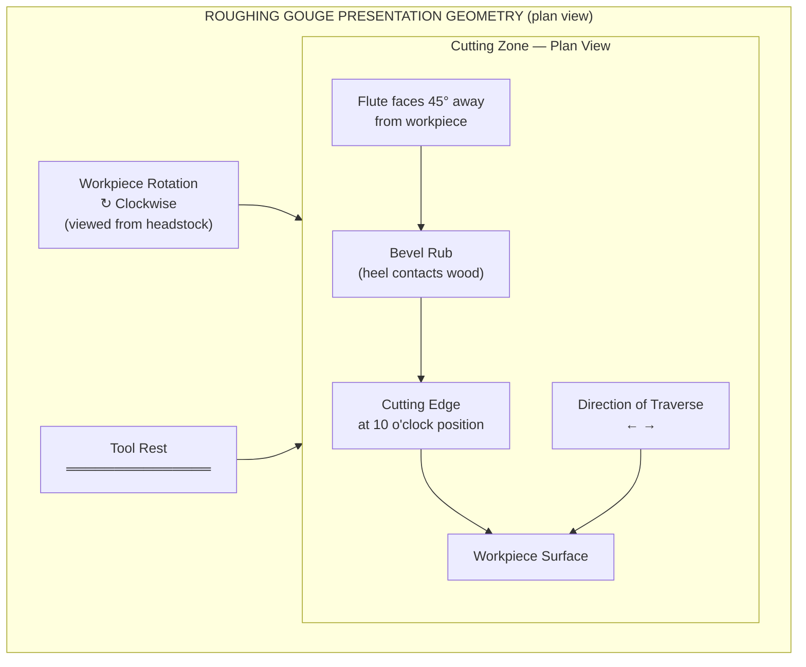
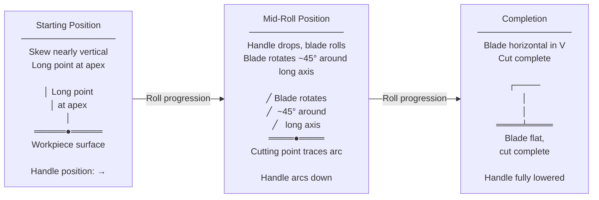

# Lesson 3: Spindle Turning Techniques, Grain Orientation, Form Development

## 1. First-Principles Intuition & Invariants

Spindle turning represents the most mechanically pure expression of the lathe's fundamental operation: the rotation of wood fibers perpendicular to their longitudinal axis, enabling the turner to generate forms of perfect rotational symmetry while navigating the anisotropic structure of lignified cellulose. Unlike faceplate work, where grain orientation shifts continuously across the workpiece diameter, spindle turning presents grain running parallel to the axis of rotation—a configuration that produces predictable cutting geometries, superior surface finish potential, and structural integrity that exploits wood's tensile strength along the fiber direction.

The essence of spindle work lies in understanding that you are not carving wood in the sculptural sense but rather shearing cellulose bundles in a controlled, iterative fashion. Each revolution of the workpiece presents the tool edge with a fresh helical path through the material, and the quality of the resulting surface depends entirely on the geometric relationship between tool bevel angle, cutting edge presentation, fiber orientation, and rotational velocity. The lathe does not remove material by percussion or abrasion but by precise shearing action, where a keen edge supported by mass and leverage severs wood fibers cleanly at their weakest plane—across the grain direction.

The invariant principle governing all spindle turning is that cutting forces must be resolved through the tool rest and into the tool's long axis, never cantilevered perpendicular to the bevel. When a gouge or chisel is presented at the correct angle, the bevel rubs the freshly cut surface immediately behind the cutting edge, providing both geometric reference and vibrational damping. This rubbing bevel principle is non-negotiable: attempting to cut without bevel support creates chatter, catches, and catastrophic tool deflection. The bevel angle itself—typically ranging from 35 to 45 degrees for spindle gouges and 20 to 30 degrees for skew chisels—represents a compromise between edge durability and cutting efficiency. Steeper bevels produce stronger edges that resist dulling in dense or abrasive woods but require higher cutting forces; shallower bevels slice more effortlessly but surrender edge retention and are prone to microchipping in figured grain.

Grain orientation dictates cutting strategy with absolute authority. When the tool moves from larger diameter toward smaller diameter in the direction of grain flow—essentially cutting downhill along the fibers—the shearing action produces clean, glossy surfaces with minimal tearout. Reversing this direction forces the edge to lift and splinter fibers, producing fuzzy, torn surfaces that defy sanding remediation. This directionality becomes critically important when turning complex profiles involving beads, coves, and tapers where grain direction reverses at diameter transitions. The skilled turner develops an intuitive map of grain flow across every profile, adjusting tool approach angle and cutting direction continuously to maintain downhill shearing.

The between-centers mounting strategy establishes the mechanical foundation for all spindle work. A spur drive center penetrates the headstock end of the blank, typically positioned at the pith or within one growth ring to balance tangential shrinkage forces. The tailstock live center—a bearing-supported conical point—provides axial compression that prevents whip and transmits rotational torque from the spur drive through frictional engagement with the wood fibers. This compression must be monitored and adjusted throughout turning, as heat generation from friction and compression set causes measurable shortening of the blank. Insufficient tailstock pressure allows the blank to stall or vibrate; excessive pressure generates heat sufficient to scorch the tailstock end and induce case hardening of surface fibers, complicating final passes.

Dimensional accuracy in spindle work derives not from indexed measurement systems as in metalworking but from continuous comparison against template profiles, calipers, and the turner's kinesthetic memory of form. The skilled practitioner develops propriomal awareness of how tool position, depth of cut, and traverse rate integrate to produce predictable material removal rates. Unlike CNC operations where dimensional precision is programmed, manual spindle turning achieves accuracy through iterative refinement: rough profiling establishes approximate form at 80–90 percent of final dimension, followed by progressively lighter finishing cuts that converge asymptotically toward target geometry. This iterative approach respects the reality that wood is not dimensionally stable during turning—heat, moisture loss, and stress relief all contribute to dynamic dimensional changes measurable in hundredths of millimeters.

## 2. Core Architecture & Mechanics

The mechanics of spindle roughing begin with the spindle roughing gouge, a tool whose architecture reflects its singular purpose: the rapid conversion of square or polygonal stock into cylindrical form. The roughing gouge distinguishes itself through a deep U-shaped flute ground into high-carbon or high-speed steel bar stock, typically 19 to 32 millimeters in width. This flute geometry provides both chip clearance and structural rigidity in the long axis, while the wide cutting edge allows aggressive material removal without the catastrophic catches associated with narrower tools. The bevel angle sits between 40 and 45 degrees, favoring durability over surgical precision since roughing operations prioritize material removal rate over surface finish.

The physical setup for roughing demands that the tool rest be positioned approximately 3 to 6 millimeters below center height and sufficiently close to the workpiece that no more than 50 millimeters of tool length extends beyond the rest. This geometry ensures that cutting forces drive the tool downward onto the rest rather than lifting it, which would induce vibration and loss of control. The turner grips the handle in the trailing hand with the forearm extended in a natural arc that allows hip and torso rotation to power the traverse, while the leading hand rests atop the blade near the ferrule, applying downward pressure and fine directional control. This two-point grip system creates a kinematic chain where large muscle groups provide power and stability while fine motor control adjusts presentation angle.

The cutting action itself proceeds through a presentation where the flute faces approximately 45 degrees away from the direction of travel, with the bevel rubbing and the cutting edge engaging at the 10 o'clock or 2 o'clock position relative to the flute center. This offset presentation ensures that only a small portion of the edge engages the wood at any instant, producing a controlled shearing action rather than a scraping impact. The traverse proceeds in smooth, continuous passes from left to right or right to left, with each pass removing 1 to 3 millimeters of material across the full length of the cylinder. Attempting to remove excessive material in a single pass overloads the edge, generates excessive heat, and risks catching the edge on the far corner of square stock.

Transitioning from roughing to detail work requires abandoning the roughing gouge in favor of tools designed for profile generation: the spindle gouge for coves and flowing curves, the skew chisel for beads, V-grooves, and planing cuts, and the parting tool for diameter establishment and separation cuts. The spindle gouge—also termed a detail gouge or fingernail gouge—features a shallower flute, typically 10 to 13 millimeters wide, ground with a swept-back fingernail profile that allows the tool to roll through curves without the wings catching. The grind extends 45 to 50 millimeters back from the tip, creating a continuous curve from center point to wing edges. This geometry allows the turner to present the tool at continuously varying angles while maintaining bevel contact throughout a flowing cut.

Cove cutting with the spindle gouge exploits the tool's ability to arc through space while maintaining controlled depth. The cut initiates at the upper rim of the intended cove, with the flute facing away from the direction of travel and the tool handle low. As the cut progresses into the concave depression, the turner simultaneously lifts the handle, rotates the tool around its long axis to keep the bevel rubbing, and arcs the handle through space following the desired curve. This three-axis motion—traverse, rotation, and handle arc—must be executed as a single fluid gesture. Any hesitation or segmentation of the motion produces facets, steps, or tool marks that destroy the visual continuity of the curve.

The skew chisel represents the most geometrically pure cutting tool in the turner's arsenal and simultaneously the most unforgiving. Ground from rectangular bar stock with a single bevel angle between 20 and 30 degrees and a skew angle of 60 to 75 degrees, the skew concentrates cutting action at a single point—the long point or toe—while the short point serves primarily for V-groove definition. The skew's mechanical advantage emerges from its ability to produce true planing cuts where the cutting edge meets the wood at an acute angle, shearing fibers cleanly with minimal end-grain crushing. This slicing action, analogous to a guillotine rather than a cleaver, produces surface finishes superior to any sanding operation when executed correctly.

Planing with the skew demands that the tool rest at or slightly above center height, with the flat face of the chisel presented nearly vertical and the bevel rubbing at approximately 45 degrees to the workpiece axis. Only the central third of the cutting edge should engage the wood, with the long point leading. The traverse proceeds with the tool tilted slightly in the direction of travel, ensuring that the toe does not dig in while the heel remains clear of the surface. Cutting forces resolve downward through the blade into the tool rest, producing a stable, vibration-free cut that leaves a surface exhibiting the glossy cellular sheen characteristic of cleanly severed wood fibers.

Bead formation with the skew exploits the tool's ability to make rolling cuts where the cutting point travels through an arc while the bevel maintains continuous contact. The sequence begins with a V-groove scored on either side of the bead's center line using the toe of the skew, establishing the bead's boundaries and preventing fiber migration. The rolling cut initiates at the bead's apex with the skew on edge—nearly perpendicular to the workpiece axis—and the long point positioned at the centerline. As the cut proceeds toward the V-groove, the handle arcs downward and away while the blade rolls around its long axis, maintaining bevel contact throughout. The cutting point scribes a precise arc from the apex to the V-groove floor, creating one hemisphere of the bead. The opposite side receives identical treatment, and when executed symmetrically, the two cuts converge to produce a bead of perfect circular cross-section.

Taper generation represents the most fundamental dimensional control exercise in spindle work, establishing the linear proportions that underpin leg, column, and handle designs. The process begins with caliper-marked layout lines indicating finished diameters at key stations along the blank's length. After roughing to cylinder, the turner selects either the skew in planing mode or the spindle gouge in pull-cut configuration. The taper emerges through progressive passes that remove slightly more material at the large end than the small end, with each pass traversing the full taper length. Visual alignment guides this process: the turner positions their eye line parallel to the intended taper axis and adjusts the tool's angle of attack to maintain this sight line as the traverse proceeds. Frequent caliper checks verify dimensional progress, and the final passes lighten to remove less than 0.5 millimeter per revolution, allowing the bevel friction and cutting dynamics to settle into a steady state that produces consistent surface finish.

The parting tool serves the dual function of dimensional reference establishment and workpiece separation. Ground as a narrow blade with parallel edges and a bevel on both faces creating a centered cutting edge, the parting tool plunges radially into the rotating workpiece to establish precise diameters at discrete stations. The turner advances the tool with the handle horizontal, ensuring the bevels contact the emerging walls of the groove symmetrically. Calipers are held in the off-hand, encircling the workpiece at the parting cut, and advancement ceases when the calipers slip over the reduced diameter with light drag. This technique establishes diameter benchmarks that guide subsequent profiling work, ensuring consistent wall thickness in hollow forms and accurate tenon sizing for joinery applications.

## 3. High-Performance Optimization & Failure Modes

Optimizing spindle turning performance requires understanding the relationship between rotational velocity, cutting depth, traverse rate, and surface finish. The target surface velocity for most spindle work falls between 10 and 15 meters per second, a range that allows clean fiber shearing without excessive friction heating or edge dulling. For a 50-millimeter diameter blank, this velocity corresponds to approximately 3800 to 5700 revolutions per minute; for a 100-millimeter diameter, the range drops to 1900 to 2800 RPM. Operating below these velocities produces torn, fuzzy surfaces because the cutting edge dwells too long between fiber severance events, allowing elastic recovery and fiber pullout. Excessive velocities generate friction heat that softens resinous woods, clogging the edge with sticky deposits, and amplify any imbalance or eccentricity into dangerous vibration.

Tool sharpness stands as the non-negotiable prerequisite for all successful spindle work. A properly sharpened edge exhibits a microscopic radius at the apex of less than 2 micrometers, achieved through progression from 80-grit aluminum oxide wheels for primary bevel establishment through 600-grit wheels or leather honing wheels charged with chromium oxide compound for final edge refinement. The grind must be symmetrical about the tool's centerline—asymmetric bevels produce tools that pull toward one side, making controlled presentation impossible. The transition from bevel face to flute must be smooth and continuous, free of the steps and undercuts that occur when grinding wheel angles shift mid-pass. These geometric defects act as stress concentrators that initiate edge chipping and catastrophic failure under cutting loads.

Catch prevention represents the primary safety and quality concern in spindle turning. A catch occurs when the cutting edge engages the workpiece at an improper angle, causing the tool to be violently levered upward off the tool rest or driven laterally into the work. The most common failure mode involves presenting a gouge with the flute facing toward the direction of travel—a configuration where the far wing of the tool contacts the wood before the bevel establishes support. The rotational forces instantly grab the wing and lever the tool into the work, producing a spiral gouge that can eject the workpiece from the lathe if sufficiently severe. Prevention relies on habitual bevel-first presentation: the bevel must contact the work and establish a rubbing pivot before the edge engages. This sequence is reinforced through practice exercises where the turner deliberately rubs the bevel without cutting, developing muscle memory for the correct approach angle.

Grain tearout at transition points—the valleys of coves and the bases of beads—occurs when cutting direction opposes fiber orientation. The solution involves recognizing that grain effectively reverses direction at any diameter minimum or maximum. When cutting a cove, the initial entry cut proceeds downhill from the rim toward the valley floor, but the valley floor itself represents a grain reversal point. The skilled turner anticipates this by executing the cove as two opposing cuts meeting at the valley floor, each cut proceeding downhill with respect to its local grain direction. Similarly, a convex bead requires the cutting direction to reverse at its apex, with each hemisphere cut proceeding from apex toward base. This technique demands continuous awareness of grain flow topology across three-dimensional profiles, a skill developed through deliberate practice and ruthless self-critique of surface quality.

Dimensional drift during extended turning sessions results from cumulative heating of the workpiece and moisture loss from exposed end grain. A blank that measures precisely 50.0 millimeters in diameter immediately after cutting may measure 49.7 millimeters after cooling for 30 minutes, and shrink an additional 0.2 millimeters over 24 hours as equilibrium moisture content stabilizes. This phenomenon demands that finishing cuts be taken in multiple light passes with cooling intervals, allowing thermal expansion to dissipate before final measurement. For precision work requiring tolerances tighter than ±0.2 millimeters, the blank should be rough-turned to within 2 millimeters of final dimension, allowed to stabilize for 24 to 48 hours in the shop environment, then remounted and finished to final dimension. This two-stage process accommodates both thermal and hygroscopic dimensional changes, producing components that remain stable in service.

Vibration and chatter represent failure modes where the mechanical system—workpiece, mounting, and tooling—enters resonant oscillation. Slender spindles with length-to-diameter ratios exceeding 10:1 are particularly susceptible, as their low rigidity allows cutting forces to deflect the workpiece away from the tool, creating a periodic loading condition that amplifies with each revolution. Mitigation strategies include reducing overhang by advancing the tailstock as far as practical, employing steady rests at intermediate positions along slender sections, reducing cutting depth and traverse rate to minimize excitation forces, and increasing rotational velocity to shift the forcing frequency away from the workpiece's natural resonance. In extreme cases, proprietary damping techniques such as filling hollow sections with dry sand or applying polymer-based vibration damping wraps may be required.

The failure mode of spiraling—where a cut initiates correctly but progressively deepens as it traverses the workpiece—results from inadequate tool rest positioning or inconsistent tool presentation angle. As the workpiece diameter decreases during turning, the tool rest that began at optimal height gradually rises relative to the centerline, altering the geometric relationship between bevel, edge, and fiber direction. The solution involves frequent tool rest repositioning throughout the turning process, maintaining the rest at optimal height for the current workpiece diameter. Similarly, allowing the tool handle to drift during traverse changes the effective bevel angle and cutting depth, producing tapered grooves or stepped surfaces. Consistent handle height and presentation angle demand active proprioceptive feedback, where the turner continuously monitors shoulder position, elbow angle, and grip pressure to maintain geometric stability throughout each cut.

Surface finish optimization transcends mere sanding to encompass cutting strategies that minimize the need for abrasive refinement. The theoretical surface finish achievable through pure cutting is limited by tool edge geometry, feed per revolution, and fiber deflection during shearing. A skew chisel with a 0.2-millimeter nose radius cutting at 2000 RPM with a traverse rate of 50 millimeters per minute produces a theoretical cusp height of approximately 1.5 micrometers—well below visual detection threshold. Achieving this finish in practice requires that every prerequisite be satisfied: flawless sharpness, precise bevel angle, optimal presentation, appropriate surface velocity, and downhill cutting relative to grain direction. When these conditions align, the resulting surface exhibits cellular-level sheen requiring no sanding whatsoever, a standard that separates masterwork from merely competent turning.
