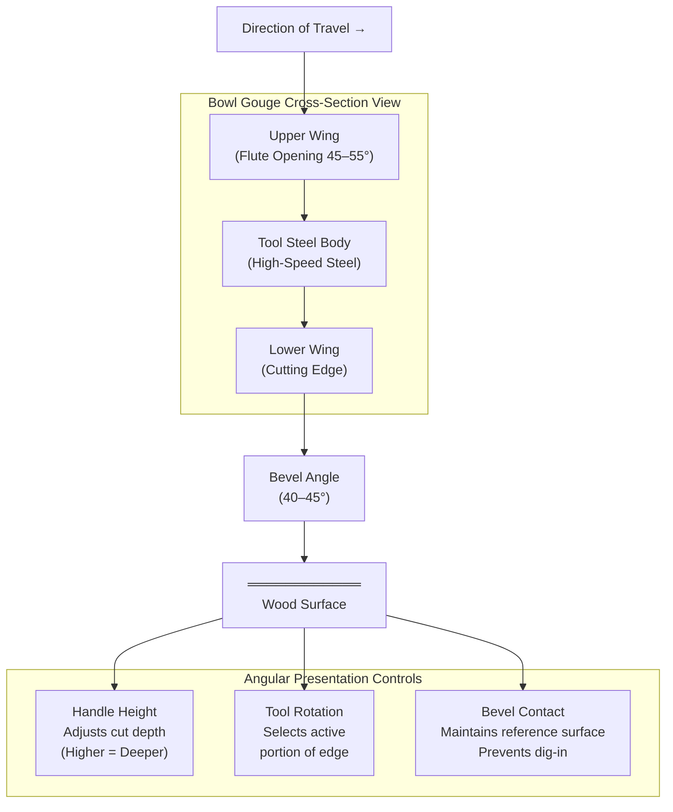

# Lesson 4: Faceplate Turning, Bowl Mechanics, Surface Finishing Theory

## 1. First-Principles Intuition & Invariants

Faceplate turning represents a fundamental departure from the spindle-turning paradigm explored in previous lessons. Where spindle work constrains the turner to address wood fibers running parallel to the axis of rotation, faceplate turning confronts the practitioner with end-grain cutting dynamics across the entire surface of the workpiece. This shift demands a recalibration of tool presentation angles, cutting forces, and structural mounting strategies. The bowl—perhaps the most iconic form in the faceplate repertoire—exposes the turner to continuously varying grain orientations as the tool sweeps from rim to base, creating zones of favorable cutting and regions prone to catastrophic tear-out within a single revolution.

The mechanical invariants governing faceplate work derive from the relationship between centrifugal force, eccentric mass distribution, and the cantilevered nature of the mounting system. Unlike spindle turning, where the workpiece is supported between centers or held in a chuck with tailstock backup, faceplate-mounted blanks project outward from a single attachment point, creating a moment arm that amplifies any imbalance. As the lathe accelerates a green bowl blank from rest to 600 RPM, the eccentric mass generates radial forces that can exceed several hundred pounds at the rim. These forces manifest as vibration harmonics that propagate through the headstock bearings, degrading surface finish and accelerating tool wear. The practitioner must therefore establish secure mechanical coupling between blank and faceplate while simultaneously managing the dynamic balance of the rotating assembly throughout the turning process.

End-grain cutting mechanics introduce complexity absent from spindle work. When the gouge enters wood perpendicular to the fiber direction, the cutting edge severs cellular structures across their weakest axis, producing friable chips rather than continuous shavings. This fiber orientation creates four distinct cutting zones around the bowl's circumference: two regions where fibers are supported by underlying material (favorable cutting), and two zones where fibers extend unsupported beyond the cut surface (tear-out prone). The transition between these zones occurs at the 90-degree and 270-degree positions relative to the grain direction, creating visible ridges and torn fibers if tool presentation is not adjusted to accommodate the changing support conditions.

The bowl gouge itself—distinguished from spindle gouges by its deeper flute, thicker cross-section, and swept-back grind profile—evolved specifically to address these end-grain challenges. The traditional 40-degree bevel angle and fingernail grind geometry allow the tool to present a slicing cut rather than a scraping action, with the cutting edge engaging the wood at an acute angle that shears fibers cleanly rather than crushing them. The deep flute channels chips away from the cutting zone while providing structural rigidity to resist the lateral forces generated by intermittent cutting. Modern bowl gouge grinds—including the Ellsworth, Liam O'Neill, and Jamieson variations—extend this principle further by modifying wing profiles and bevel angles to optimize specific cutting operations, from aggressive roughing to delicate finishing passes inside deep vessels.

Wall thickness management emerges as the critical constraint in hollow-form turning. The structural integrity of a bowl depends on maintaining sufficient cross-sectional material to resist the combined loads of cutting forces, rotational acceleration, and internal stresses from moisture loss during drying. A green bowl blank turned to final thickness will crack catastrophically as moisture gradients drive differential shrinkage between inner and outer surfaces. The practitioner must therefore navigate a three-dimensional optimization problem: removing material efficiently to reduce weight and drying time while preserving enough thickness to prevent failure during turning and sufficient mass to accommodate distortion during the drying phase. Experienced turners develop haptic sensitivity to wall flex by applying thumb pressure to the exterior surface while cutting the interior, detecting resonances that indicate approaching the critical thickness threshold.

Surface preparation on curved end-grain presents finishing challenges qualitatively different from flat or spindle work. The continuously varying grain orientation means that sanding scratches cut deeper in some zones than others, creating visible witness lines that persist through finish application. Power sanding with flexible-backed abrasive discs introduces additional complications: the disc's rotation can either reinforce or oppose the lathe's direction depending on contact point, generating heat that burnishes rather than cuts when speed differential is insufficient. The theoretical foundation for effective sanding derives from understanding abrasive particle geometry, cutting depth per grit size, and the mechanical removal rate required to eliminate tool marks without introducing new surface artifacts.

## 2. Core Architecture & Mechanics

The faceplate mounting system establishes the primary load path between workpiece and lathe spindle. Traditional faceplates consist of a machined steel disc with a central boss threaded to match the spindle nose and an array of mounting holes arranged in concentric circles. The blank attaches via wood screws driven through these holes into the base of the workpiece, creating a friction joint that resists rotational torque and axial separation. The mechanical coupling strength depends on screw thread engagement depth, hole pattern radius, and the shear strength of the wood fiber parallel to grain. A 10-inch bowl blank rotating at 800 RPM with 2 pounds of eccentric mass offset generates approximately 285 pounds of radial force; this load distributes across typically six to eight mounting screws, each experiencing both shear and withdrawal forces that vary sinusoidally through each rotation.

Modern scroll chuck systems replace the faceplate for work requiring access to the base. The scroll chuck mechanism consists of four jaws driven simultaneously by a spiral scroll gear activated through a key-operated pinion. As the key rotates, the scroll translates rotational motion into radial displacement, driving the jaws inward or outward with mechanical advantage ranging from 3:1 to 6:1 depending on scroll pitch. The chuck jaws grip a tenon or recess turned into the workpiece base, establishing both radial compression and axial retention. Tenon geometry follows specific dimensional relationships: for hardwoods, tenon diameter should be 40-50% of blank diameter, with height equal to tenon diameter divided by 2, creating a 2:1 aspect ratio that balances grip strength against material removal. Dovetail tenons—where the gripping surface angles outward at 5-7 degrees—provide superior axial retention by converting rotational torque into radial compression through the mechanical advantage of the angled interface.

Bowl gouge presentation mechanics operate through a three-axis control system integrating rotation, translation, and angular orientation. The fundamental cutting geometry positions the tool with its flute oriented toward the direction of travel, presenting the lower wing of the fingernail grind to the wood surface. The bevel rubs behind the cutting edge, establishing a reference surface that guides the tool and prevents dig-ins. The practitioner controls cut depth by adjusting the angle between tool shaft and work surface: lifting the handle pivots the cutting edge deeper into the wood, while lowering the handle reduces engagement. This angular control operates continuously throughout each pass, with the turner making micro-adjustments in response to changing grain conditions and cut resistance.

The cutting sequence for bowl interiors follows a systematic progression from rim to base, with tool presentation adapting to grain orientation changes. Beginning at the rim, the gouge enters with the flute at 45 degrees to the blank face, cutting across the end grain with the lower wing. As the tool arcs toward the center, the turner rotates the tool handle around the longitudinal axis, progressively opening the flute until it faces nearly perpendicular to the lathe axis at the bowl's nadir. This rotation keeps the cutting edge slicing rather than scraping, maintaining the favorable shear angle as grain direction transitions from perpendicular to parallel relative to the cut surface. The tool path describes a smooth arc from entry to exit, with the bevel maintaining constant contact throughout. Deviation from this arc—particularly straightening the curve—causes the bevel to lift off the work surface, eliminating the reference that prevents catch and allowing the cutting edge to dig uncontrollably into the wood.

Wall thickness assessment during turning employs both direct measurement and comparative techniques. Double-ended calipers with curved jaws reach into the vessel interior while spanning the exterior surface, providing absolute thickness readings at specific points. More practically, turners develop sensitivity to wall flex by applying pressure with fingers or thumb to the exterior while cutting the interior, feeling the resonance and displacement that indicate thickness approaching critical limits. For production work, a simple comparison gauge consisting of two parallel dowels separated by the target wall thickness allows rapid go/no-go verification: when inserted through the vessel opening, the dowels should not simultaneously contact opposite walls. The optimal thickness varies with species, moisture content, and vessel geometry, but generally falls between 3/8 inch for small hardwood bowls and 3/4 inch for large green softwood vessels destined for controlled drying.

Grain tear-out prevention strategies exploit the directional cutting preference inherent in end-grain work. The four quadrants around a bowl's circumference exhibit distinct cutting behaviors: at 0 and 180 degrees (aligned with grain direction), fibers run tangent to the cut surface; at 90 and 270 degrees, fibers run perpendicular, creating the transition zones where tear-out initiates. Clean cutting in these transition zones requires reducing cut depth to 0.010-0.015 inches per pass while increasing tool speed through the zone and ensuring the bevel maintains full contact. An alternative approach rotates the blank orientation so the most visible bowl surface—typically the rim area—falls in the favorable cutting zones, accepting some tear-out on less visible interior surfaces that will be addressed during sanding. For highly figured woods prone to tear-out regardless of orientation, a final shearing cut with a freshly honed negative-rake scraper removes the torn fibers without introducing new damage, though at the cost of a burnished surface requiring more aggressive initial sanding.

The sanding progression theory for turned end-grain derives from the relationship between abrasive particle size, cut depth, and scratch visibility under finish. Each grit removes material to a depth approximately equal to the average particle diameter, with particle size decreasing by 30-40% between successive grits in the CAMI (Coated Abrasive Manufacturers Institute) system. Starting grit selection depends on tool finish quality: a properly sharpened gouge leaves a surface requiring 150 or 180 grit initial sanding, while torn grain or heavy tool marks demand starting at 80 or 100 grit. The progression follows the sequence 80 → 100 → 120 → 150 → 180 → 220 → 320, with each grit removing the scratches from the previous step. Skipping grits creates witness lines that persist through finer grits because the depth differential exceeds the removal capacity of the finer abrasive.

Power sanding mechanics on the lathe introduce variables absent from hand sanding. A 5-inch random orbital sander rotating at 10,000 RPM applied to a bowl surface moving at 800 RPM (approximately 2,100 feet per minute at a 10-inch diameter) creates complex relative motion patterns depending on contact geometry and rotation direction. When sander rotation reinforces lathe rotation, the combined speed generates excessive heat, burnishing the wood surface rather than cutting. Optimal technique positions the sander off-axis so relative motion includes both tangential and radial components, preventing the formation of directional scratch patterns. Pressure control remains critical: excessive force collapses the foam backing pad, reducing the random orbital action to simple rotation and creating circular scratches. Light pressure—approximately 2-3 pounds—maintains pad articulation while allowing abrasive particles to cut rather than burnish.

## 3. High-Performance Optimization & Failure Modes

Speed optimization for faceplate turning requires balancing surface speed requirements against dynamic forces and practical safety limits. The ideal surface speed for cutting hardwoods falls between 1,800 and 2,500 feet per minute at the tool contact point, providing sufficient velocity for clean cutting without excessive heat generation. For a 10-inch diameter bowl rim, this translates to 690-960 RPM, while the same bowl's 2-inch diameter base requires 3,440-4,775 RPM to maintain equivalent surface speed. The practical constraint emerges from the fact that lathe speed affects the entire blank, not just the cutting zone: running a rough, imbalanced 10-inch blank at 3,000 RPM to optimize cutting at the center generates 15g of acceleration at the rim, creating destructive vibration and risk of blank separation. Experienced turners therefore begin roughing at conservative speeds (300-400 RPM for blanks over 12 inches), accelerating progressively as the blank approaches round and balance improves, reaching optimal speeds only for final finishing cuts on balanced forms.

Catch dynamics in bowl turning follow predictable mechanical pathways. The most common failure mode—a rim catch during interior cutting—occurs when the tool's bevel lifts off the work surface while the cutting edge remains engaged. Without bevel support, the edge digs into the wood under the radial force component of the cut, causing the tool to rotate violently around the toolrest fulcrum. This rotation drives the edge deeper, creating a positive feedback loop that terminates only when the tool exits the wood or the catch force exceeds the operator's grip strength. The physics of the event involve torque calculation: a 1/4-inch deep dig-in at 10 inches from the toolrest pivot generates approximately 2.5 foot-pounds of torque, sufficient to wrench the tool from an unprepared grip. Prevention strategies include maintaining conscious bevel contact, using a pull-cutting technique where possible (cutting from center toward rim rather than rim toward center), and positioning the toolrest to minimize the moment arm between tool contact and rest.

Mounting failure modes manifest through several distinct mechanisms. Screw-mounted faceplates fail when wood fibers shear parallel to grain under withdrawal load, a failure typically initiated by micro-cracks from excessive speed vibration that propagate under cyclic loading. The failure is sudden and catastrophic, with the blank separating from the faceplate while rotating at full speed. Chuck-mounted work fails through either jaw slip—where insufficient clamping force allows the tenon to rotate within the jaws—or tenon shear, where the material between the chuck grip point and the bowl interior walls fails under combined bending and torsional stress. Tenon shear is particularly insidious because it often initiates with a small crack that propagates over multiple turning sessions, failing without warning during what appears to be light finishing work.

Moisture content management during green turning presents a multivariable optimization problem. Green wood (35-60% moisture content by weight) turns easily because the water-saturated cells compress rather than fracture under tool pressure, producing a shearing cut that requires less force and generates less heat than dry wood cutting. However, the bowl must survive the drying process after turning. Turning green wood to final thickness triggers differential drying: the exposed interior surface loses moisture faster than the still-sealed exterior, creating a moisture gradient that induces compressive stress in the interior and tensile stress in the exterior. As these stresses exceed the wood's elastic limit, the bowl distorts from circular to oval, typically elongating along the grain direction by 5-10%. The optimization strategy recognizes this inevitable distortion and embraces it through asymmetric rough turning: leaving the wall thickness at 10-12% of bowl diameter provides sufficient mass to accommodate distortion during controlled drying (paper bag method, 8-12 months), after which the dried, distorted bowl is remounted and finish-turned to final thickness and true circular form.

Wall thickness uniformity across the bowl profile affects both structural integrity and drying behavior. A bowl with constant thickness throughout develops uniform stress during drying, distorting predictably but maintaining proportional geometry. Variable thickness—particularly the common error of leaving the rim thick while thinning the sidewalls excessively—creates localized stress concentrations that can initiate cracks. The optimal thickness profile varies slightly from base to rim: starting at 12% of diameter at the base (where material must support the sidewall weight and cutting forces during interior turning), tapering to 10% at mid-wall, and returning to 11% at the rim (which experiences maximum centrifugal stress during turning and benefits from slightly increased mass). This profile balances structural requirements against aesthetic considerations, as excessively thick rims appear heavy and unrefined while thin rims suggest fragility despite adequate strength.

Sanding heat management becomes critical during power sanding operations on thin-walled vessels. The energy dissipated through friction between abrasive and wood converts directly to heat, raising surface temperature sufficiently to mobilize lignin and other wood polymers, which then flow and resolidify as a burnished layer. This layer appears glossy immediately after sanding but blocks absorption of water-based finishes and interferes with oil penetration. Detection requires attention to smell (hot wood produces a distinct toasted odor) and visual inspection under raking light (burnished areas reflect light specularly rather than diffusely). Prevention involves limiting sanding duration at each position to 3-4 second intervals, allowing heat to dissipate through conduction into the bulk wood mass between sanding passes. For very thin walls (under 1/4 inch), hand sanding with foam-backed abrasive sheets provides better thermal management than power methods, albeit at significantly increased labor cost.

The finish application sequence for turned bowls must account for end-grain absorption characteristics and the access constraints imposed by the hollow form. End grain absorbs finish at 3-5 times the rate of face grain due to the capillary action of exposed cellular structures. A single coat of oil finish applied to a bowl interior produces visible variation between the end-grain base (which appears dry and thirsty) and the side grain walls (which appear adequately saturated). Compensation requires either applying additional coats selectively to end-grain zones or flooding the entire surface with finish and allowing the end grain to absorb what it requires while wiping excess from the walls. For film-forming finishes like lacquer or polyurethane, the end-grain zones require a sanding sealer coat to prevent excessive absorption of the first topcoat, which would otherwise sink into the wood, leaving insufficient material on the surface to form a protective film.

Inside-outside finish consistency presents both aesthetic and practical challenges. A bowl finished bright on the exterior but left unfinished on the interior will develop finish cracks as the two surfaces exchange moisture at different rates. The unfinished interior responds to ambient humidity changes immediately while the finished exterior provides a vapor barrier that slows equilibration, creating transient moisture gradients that drive dimensional mismatch and stress. Best practice therefore finishes both surfaces to similar levels, either leaving both raw (appropriate for utilitarian food-safe bowls finished with mineral oil) or applying compatible film finishes to both surfaces. Access limitations for interior finishing require either spraying (which provides atomized finish that reaches all surfaces without brushing) or application while the bowl remains mounted on the lathe, rotating slowly while a cloth charged with finish makes contact, distributing the material through continuous wiping rather than brushing.

The ultimate optimization recognizes that bowl turning operates at the intersection of craft technique, material science, and structural mechanics. Mastery emerges not from following rigid procedures but from developing the perceptual sensitivity to read the continuous feedback the wood provides through sound, vibration, cutting resistance, and visual appearance, adjusting technique dynamically in response to the specific blank's behavior. The theoretical frameworks presented here provide the foundation for this adaptive response, but the integration of knowledge into skillful practice requires the sustained deliberate practice that transforms conscious procedure into unconscious competence.
