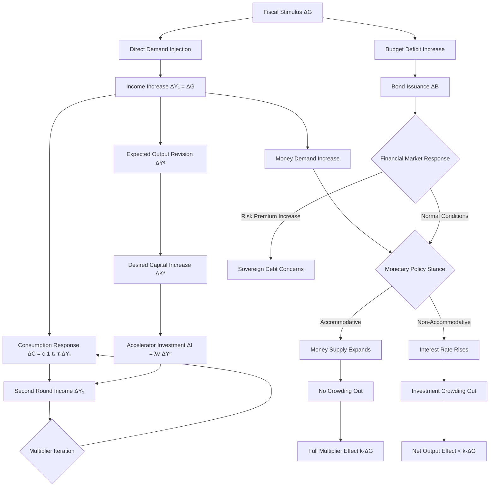

# Lesson 3: Fiscal Stabilization Policy Architecture

## 1. First-Principles Intuition & Invariants

The Keynesian revolution fundamentally rewrote the relationship between government fiscal operations and aggregate economic performance by rejecting Say's Law—the classical assertion that supply creates its own demand—and replacing it with a demand-side framework where aggregate expenditure determines output and employment. At the core of Keynesian stabilization policy lies a deceptively simple yet profound insight: when private sector spending collapses during recessions, government fiscal intervention can substitute for missing demand, preventing the economy from spiraling into deflationary depressions characterized by mass unemployment and idle productive capacity.

The theoretical foundation rests on the income-expenditure identity, where aggregate output $Y$ must equal aggregate demand $C + I + G + (X - M)$, comprising consumption, investment, government spending, and net exports. Keynes observed that during downturns, both consumption and investment contract simultaneously—consumption falls as households face income losses and precautionary savings motives intensify, while investment collapses as firms confront declining expected returns and heightened uncertainty about future demand. This dual contraction creates a self-reinforcing negative spiral: lower spending reduces incomes, which further depresses spending, perpetuating the cycle through what Keynes termed the multiplier effect.

The multiplier mechanism operates through successive rounds of spending and re-spending. When the government injects an initial fiscal stimulus $\Delta G$, recipients of that spending—whether construction workers building infrastructure or unemployed workers receiving transfer payments—consume a fraction of their new income determined by the marginal propensity to consume $c$. This consumption becomes income for other agents, who in turn spend a fraction $c$ of their new income, propagating through the economy in diminishing waves. The total impact on output is given by the multiplier $k = \frac{1}{1 - c(1 - t) + m}$, where $t$ represents the marginal tax rate and $m$ captures the marginal propensity to import. In closed economies with low tax rates and high consumption propensities, multipliers can exceed two, meaning each dollar of government spending generates more than two dollars of total output expansion.

Keynesian stabilization policy divides into two distinct operational categories: automatic stabilizers and discretionary fiscal interventions. Automatic stabilizers are built-in features of the tax and transfer system that respond mechanically to cyclical fluctuations without requiring explicit legislative action. Progressive income tax systems automatically reduce tax collections during recessions as incomes fall, while unemployment insurance systems automatically increase transfer payments to displaced workers. These mechanisms inject purchasing power into the economy precisely when private demand weakens, cushioning the downturn without implementation lags. The cyclically-adjusted budget balance—which strips out automatic stabilizer effects—reveals the underlying structural fiscal stance independent of business cycle position.

Discretionary fiscal policy, by contrast, requires deliberate government action to alter tax rates or spending programs in response to perceived macroeconomic conditions. This includes traditional Keynesian stimulus packages combining infrastructure investment, temporary tax cuts, and expanded social transfers designed to boost aggregate demand during recessions. The effectiveness of discretionary interventions depends critically on timing: fiscal policy suffers from recognition lags (time to identify the problem), decision lags (legislative deliberation), and implementation lags (actual disbursement of funds). By the time discretionary stimulus reaches the economy, the recession may have already ended, potentially injecting demand into an economy already recovering and risking inflationary overheating.

The composition of fiscal stimulus profoundly affects its macroeconomic impact through differential multiplier effects across spending categories. Infrastructure investment in bridges, roads, and public transit systems typically generates high multipliers because it directly employs workers in construction sectors with high marginal propensities to consume, while simultaneously creating durable productive assets that enhance long-run supply capacity. Transfer payments to liquidity-constrained households—those unable to borrow against future income—also produce large multipliers because recipients immediately spend the funds on necessities. Tax cuts distributed broadly across the income distribution tend to generate smaller multipliers, particularly when targeted at higher-income households with low marginal propensities to consume who save rather than spend the additional disposable income.

A critical Keynesian insight concerns the paradox of thrift: individually rational saving behavior becomes collectively irrational during demand-deficient recessions. When all households simultaneously attempt to increase precautionary savings, aggregate consumption falls, reducing incomes and making it impossible for the economy as a whole to increase saving. This coordination failure justifies government intervention to maintain aggregate demand. The paradox operates most powerfully when the economy operates below potential output with unemployed resources. In such conditions, government spending does not merely redistribute existing output but rather calls forth additional production from idle capacity, validating the Keynesian claim that demand creates its own supply when resources sit underutilized.

The liquidity trap represents the most extreme scenario demanding fiscal intervention. When nominal interest rates approach zero, conventional monetary policy loses traction because central banks cannot push rates further into negative territory without triggering currency hoarding. In this environment, the economy can become stuck in a low-output equilibrium where deflationary expectations raise real interest rates, further depressing investment and consumption. Quantitative easing—central bank purchases of long-term bonds to lower term premia—provides some relief, but Keynesians argue that fiscal stimulus becomes the primary stabilization tool when monetary transmission mechanisms break down. Japan's lost decades from the 1990s onward and the post-2008 global financial crisis both exemplified liquidity trap dynamics where aggressive monetary expansion failed to restore full employment without substantial fiscal support.

The crowding out debate forms the central battleground between Keynesian and classical perspectives on fiscal policy effectiveness. Classical economists argue that government borrowing to finance deficit spending raises interest rates by competing with private borrowers for limited savings, causing private investment to contract and offsetting the stimulus effect. In the most extreme version—Ricardian equivalence—forward-looking households anticipate future tax increases needed to service government debt and increase current saving by exactly the amount of the deficit, leaving aggregate demand unchanged. Keynesians counter that crowding out operates weakly or not at all during recessions when excess saving seeks investment opportunities. With unemployed resources and depressed investment demand, government borrowing absorbs idle savings without raising interest rates, while the income expansion from fiscal stimulus can actually crowd in private investment by raising expected returns as demand recovers.

Empirical evidence suggests the strength of crowding out varies dramatically with cyclical conditions and monetary policy stance. During normal times with the economy near full employment, fiscal expansion does tend to raise interest rates and crowd out private spending, validating classical concerns. However, during deep recessions with monetary policy constrained by the zero lower bound, fiscal multipliers exceed one and crowding out essentially vanishes. The key distinction lies in whether the economy operates on the vertical portion of the aggregate supply curve (full employment) or the horizontal Keynesian range where output responds to demand without price pressure. Modern Dynamic Stochastic General Equilibrium models incorporating Keynesian features confirm that fiscal multipliers are state-dependent, reaching maximum values precisely when monetary policy cannot respond by raising rates.

The open economy dimension introduces additional complexity through international capital flows and exchange rate adjustments. Under flexible exchange rates, fiscal expansion tends to appreciate the domestic currency as higher interest rates attract foreign capital inflows, reducing net exports and partially offsetting the stimulus. This channel represents another form of crowding out operating through the external sector rather than domestic interest rates. Conversely, countries operating within currency unions or fixed exchange rate regimes experience larger fiscal multipliers because the exchange rate adjustment mechanism is disabled. This explains why fiscal stimulus proved more effective in U.S. states (which share a currency) than in sovereign European nations during the eurozone crisis—interstate transfers and labor mobility provided automatic stabilization without currency risk.

Investment stimulation through fiscal policy operates along multiple channels beyond simple demand expansion. Accelerator effects amplify initial spending impacts when firms perceive increased demand as permanent and expand capacity to meet it, triggering investment waves that multiply the original stimulus. Public infrastructure investment can complement private capital, raising the marginal product of private investment and crowding in rather than crowding out private spending. However, the composition and quality of public investment matters enormously—productive infrastructure enhances long-run growth potential, while politically-motivated spending on wasteful projects generates temporary demand without lasting supply-side benefits. The challenge for policymakers lies in designing stimulus packages that simultaneously stabilize short-run demand and enhance long-run productive capacity.

Fiscal sustainability constraints ultimately bound the scope for countercyclical intervention. While Keynesians emphasize short-run stabilization, explosive debt dynamics can trigger sovereign debt crises that force procyclical austerity precisely when stimulus is most needed. The key distinction lies between cyclical deficits that naturally reverse during expansions and structural deficits reflecting permanent imbalances between spending commitments and revenue capacity. Countries with credible fiscal frameworks—including automatic stabilizers, medium-term consolidation rules, and independent fiscal councils—can sustain larger countercyclical interventions without triggering market panic. The debt-to-GDP ratio provides the critical sustainability metric: as long as the nominal growth rate exceeds the nominal interest rate, moderate deficits stabilize rather than explode the debt ratio through denominator growth.

## 2. Core Architecture & Mechanics

The operational architecture of Keynesian fiscal stabilization rests on three interconnected transmission mechanisms: the automatic stabilizer channel, the discretionary spending channel, and the monetary-fiscal coordination interface. Understanding how these mechanisms interact requires dissecting the flow of funds through the government budget constraint, the income determination process, and the financial market equilibrium conditions that govern interest rate formation.

Begin with the government budget identity, which states that government spending $G$ plus transfer payments $TR$ minus tax revenues $T$ equals the deficit $DEF$, which must be financed through bond issuance $\Delta B$ or money creation $\Delta M$:

$$G + TR - T = DEF = \Delta B + \Delta M$$

This accounting identity maps directly to aggregate demand through the national income accounts. Total output $Y$ must equal the sum of private consumption $C$, private investment $I$, government purchases $G$, and net exports $NX$:

$$Y = C(Y - T + TR) + I(r, Y^e) + G + NX(Y, Y^*, \epsilon)$$

where consumption depends on disposable income $(Y - T + TR)$, investment responds to the real interest rate $r$ and expected future output $Y^e$, and net exports vary with domestic income $Y$, foreign income $Y^*$, and the real exchange rate $\epsilon$.

The automatic stabilizer mechanism operates through the endogenous response of taxes and transfers to income fluctuations. Express the tax function as $T = t_0 + t_1 Y$, where $t_0$ represents autonomous taxes and $t_1$ captures the marginal tax rate. Transfer payments follow $TR = TR_0 - \tau Y$, where $\tau$ reflects the income-sensitivity of transfers such as unemployment insurance. Substituting these into the consumption function yields:

$$C = c_0 + c(Y - t_0 - t_1 Y + TR_0 - \tau Y) = c_0 + c(TR_0 - t_0) + c(1 - t_1 - \tau)Y$$

The effective marginal propensity to consume out of total income becomes $c(1 - t_1 - \tau)$, which is smaller than the underlying marginal propensity to consume $c$ because taxes and transfers leak purchasing power out of the circular flow. This leakage stabilizes the economy by reducing the multiplier. To see this, derive the equilibrium output level by solving the income-expenditure identity:

$$Y = c_0 + c(TR_0 - t_0) + c(1 - t_1 - \tau)Y + I_0 + G + NX_0$$

Collecting terms and solving for $Y$ yields:

$$Y = \frac{c_0 + c(TR_0 - t_0) + I_0 + G + NX_0}{1 - c(1 - t_1 - \tau)}$$

The denominator $1 - c(1 - t_1 - \tau)$ represents the multiplier's inverse. Without automatic stabilizers (setting $t_1 = \tau = 0$), the multiplier equals $\frac{1}{1 - c}$, which grows large as $c$ approaches unity. With stabilizers, the effective multiplier shrinks to $\frac{1}{1 - c(1 - t_1 - \tau)}$, damping cyclical volatility. When income falls by one dollar, consumption falls by only $c(1 - t_1 - \tau)$ dollars rather than $c$ dollars, attenuating the downward spiral.

The cyclically-adjusted budget balance $CAB$ isolates structural fiscal policy from automatic stabilizer effects by calculating what the deficit would be if output equaled potential:

$$CAB = G + TR_0 - t_0 - t_1 Y^* - \tau Y^*$$

where $Y^*$ denotes potential output. The actual deficit $DEF$ equals:

$$DEF = G + TR_0 - \tau Y - t_0 - t_1 Y$$

The cyclical component of the deficit is the difference:

$$DEF - CAB = -t_1(Y - Y^*) - \tau(Y - Y^*)= (t_1 + \tau)(Y^* - Y)$$

This expression reveals that when output falls below potential (recession), the cyclical deficit automatically widens by an amount proportional to the output gap scaled by the marginal tax and transfer rates. Larger stabilizer parameters $(t_1, \tau)$ generate bigger automatic deficits during downturns, providing more countercyclical support without requiring discretionary action.

Discretionary fiscal policy interventions alter the autonomous components of spending and taxes: $G$, $TR_0$, or $t_0$. Consider a discretionary increase in government purchases by $\Delta G$. The immediate impact raises aggregate demand by the full amount $\Delta G$. This spending becomes income for construction firms, government contractors, and public sector workers, who consume a fraction $c(1 - t_1 - \tau)$ of their new income. This second-round consumption becomes income for other agents, who in turn consume a fraction $c(1 - t_1 - \tau)$ of that, propagating through successive rounds:

$$\Delta Y = \Delta G + c(1 - t_1 - \tau)\Delta G + [c(1 - t_1 - \tau)]^2 \Delta G + \cdots$$

This infinite geometric series sums to:

$$\Delta Y = \frac{1}{1 - c(1 - t_1 - \tau)} \Delta G$$

confirming the multiplier formula derived earlier. The multiplier magnitude depends critically on the leakage rates. In a closed economy with $t_1 = 0.25$ (25% marginal tax rate), $\tau = 0.05$ (unemployment insurance leakage), and $c = 0.8$ (marginal propensity to consume), the multiplier equals:

$$k = \frac{1}{1 - 0.8(1 - 0.25 - 0.05)} = \frac{1}{1 - 0.56} = \frac{1}{0.44} \approx 2.27$$

Each dollar of government spending generates $2.27 of total output expansion. However, incorporating the marginal propensity to import $m$ reduces the multiplier to:

$$k = \frac{1}{1 - c(1 - t_1 - \tau) + m}$$

For a small open economy with $m = 0.3$ (high import propensity), the multiplier falls to:

$$k = \frac{1}{1 - 0.56 + 0.3} = \frac{1}{0.74} \approx 1.35$$

demonstrating how trade openness diminishes fiscal policy effectiveness through import leakage.

The crowding out mechanism operates through the financial market equilibrium condition. Money demand $M^d$ depends positively on nominal income $PY$ (transaction motive) and negatively on the nominal interest rate $i$ (opportunity cost of holding money):

$$M^d = P \cdot L(Y, i)$$

where $L(Y, i)$ represents the real money demand function. Equilibrium requires money supply $M^s$ to equal money demand:

$$\frac{M^s}{P} = L(Y, i)$$

Holding the money supply constant (no monetary accommodation), an increase in government spending raises output $Y$, increasing money demand for transactions. To restore equilibrium, the interest rate must rise to choke off speculative money demand, a process captured by the LM curve:

$$i = i(Y; M^s/P)$$

with $\frac{\partial i}{\partial Y} > 0$ (higher output raises interest rates) and $\frac{\partial i}{\partial (M^s/P)} < 0$ (higher real money supply lowers rates).

Investment demand responds negatively to the interest rate:

$$I = I(r) = I(i - \pi^e)$$

where the real interest rate $r$ equals the nominal rate $i$ minus expected inflation $\pi^e$. The interest rate increase induced by fiscal expansion reduces investment through:

$$\Delta I = \frac{\partial I}{\partial r} \cdot \frac{\partial r}{\partial i} \cdot \frac{\partial i}{\partial Y} \cdot \Delta Y = \frac{\partial I}{\partial r} \cdot \frac{\partial i}{\partial Y} \cdot \Delta Y < 0$$

This crowding out effect reduces the net impact on aggregate demand, yielding an effective multiplier smaller than the simple Keynesian multiplier. The complete system combines the IS curve (goods market equilibrium):

$$Y = C(Y - T(Y)) + I(r) + G$$

with the LM curve (money market equilibrium):

$$\frac{M^s}{P} = L(Y, i)$$

Solving simultaneously determines equilibrium output and interest rates. Fiscal expansion shifts the IS curve rightward, moving the economy up along the LM curve to higher output and higher interest rates. The magnitude of crowding out depends on the slopes of the IS and LM curves. When the LM curve is steep (low interest sensitivity of money demand), interest rates rise sharply, crowding out substantial investment. When the LM curve is flat (high interest sensitivity), rates rise modestly, minimizing crowding out.

The liquidity trap scenario arises when the nominal interest rate hits the zero lower bound ($i = 0$) and the LM curve becomes horizontal. In this configuration, increases in the money supply fail to lower interest rates further, rendering conventional monetary policy impotent. The money market equilibrium becomes:

$$\frac{M^s}{P} \geq L(Y, 0)$$

with the inequality reflecting excess money demand—agents willingly hold any quantity of money at zero interest because bonds offer no yield advantage. Fiscal expansion in the liquidity trap generates no crowding out because interest rates cannot rise above zero, allowing the full Keynesian multiplier to operate. This explains why fiscal policy becomes the primary stabilization tool when monetary policy is exhausted.

Monetary-fiscal coordination fundamentally alters the transmission mechanism through the government budget constraint. When the central bank monetizes deficits by purchasing government bonds ($\Delta M = DEF$), the money supply expands endogenously, preventing interest rate increases. The combined policy action shifts both the IS curve (fiscal expansion) and the LM curve (monetary expansion) rightward, generating large output effects without crowding out. The monetary financing constraint becomes:

$$\Delta M = G + TR - T$$

Substituting into the money market equilibrium:

$$\frac{M_0 + \Delta M}{P} = L(Y, i)$$

reveals that the money supply adjusts passively to accommodate higher output without requiring interest rate increases. This monetization strategy carries inflationary risks when the economy approaches full employment, but during deep recessions with substantial slack, the inflationary constraint remains distant.

The investment accelerator mechanism introduces dynamic feedback loops amplifying fiscal stimulus effects. Let desired capital stock $K^*$ depend on expected output:

$$K^* = v \cdot Y^e$$

where $v$ represents the capital-output ratio. Net investment equals the gap between desired and actual capital:

$$I_t = \lambda(K^* - K_{t-1}) = \lambda v Y^e_t - \lambda K_{t-1}$$

where $\lambda$ captures the adjustment speed. When fiscal stimulus raises current output, firms extrapolate higher future output (adaptive expectations: $Y^e_t = \theta Y_{t-1}$), increasing desired capital and triggering investment surges. This accelerator effect augments the multiplier through:

$$\Delta I_t = \lambda v \theta \Delta Y_{t-1}$$

Creating a difference equation system:

$$Y_t = \frac{1}{1-c(1-t_1-\tau)}[c_0 + c(TR_0 - t_0) + G + NX_0] + \frac{\lambda v \theta}{1-c(1-t_1-\tau)} Y_{t-1} - \frac{\lambda}{1-c(1-t_1-\tau)} K_{t-1}$$

This second-order system can generate oscillatory dynamics where fiscal stimulus triggers investment booms that overshoot equilibrium, followed by retrenchment as excess capacity emerges. The multiplier-accelerator interaction explains why fiscal policy effects unfold over multiple periods rather than instantaneously.

The diagram traces the complete transmission pathway from initial fiscal injection through multiplier iterations, financial market responses, and accelerator feedback loops. The branching structure at the monetary policy stance node captures the critical distinction between accommodative regimes (where the central bank expands money supply to prevent rate increases) and non-accommodative regimes (where rates rise and crowd out investment). The accelerator loop (bottom path) shows how output expectations feed back into investment demand, creating second-order dynamics that can amplify or destabilize the primary multiplier effect.

## 3. High-Performance Optimization & Failure Modes

Optimizing fiscal stabilization policy for maximum macroeconomic effectiveness requires careful attention to timing, composition, targeting, and institutional design. The central challenge lies in delivering stimulus rapidly enough to counteract recessions while avoiding wasteful spending that generates minimal multiplier effects or inflationary pressures that emerge when the economy has already recovered. Real-world implementation faces numerous constraints absent from textbook models: political economy obstacles, informational limitations, administrative capacity constraints, and the risk of triggering adverse financial market reactions.

Timing optimization begins with minimizing implementation lags through pre-positioned stimulus mechanisms. Automatic stabilizers excel on this dimension because they activate immediately without requiring legislative deliberation. However, their magnitude may prove insufficient during severe downturns. Discretionary policy faces a trilemma: speed, political legitimacy, and optimal design cannot be simultaneously maximized. Fast-acting stimulus requires executive authority to bypass lengthy legislative processes, but such authority may lack democratic legitimacy or result in poorly designed programs. The solution involves maintaining a portfolio of pre-approved stimulus options that can be activated rapidly when recession indicators cross predefined thresholds.

The recognition lag—the time between the onset of recession and policymakers' awareness of it—has shortened dramatically through real-time economic data systems. High-frequency indicators including unemployment insurance claims, credit card transaction volumes, electricity consumption, and satellite-based measures of nighttime illumination now provide weekly or even daily recession signals, compared to the quarterly frequency of traditional GDP statistics. Bayesian nowcasting models combine these diverse data streams to estimate current-quarter GDP growth in real time, enabling policymakers to detect downturns within weeks rather than months. However, false positive risks remain: temporary data volatility can trigger premature stimulus if thresholds are set too sensitively.

Composition optimization exploits differential multipliers across spending categories to maximize bang-per-buck. Infrastructure investment generates multipliers around 1.5 to 2.0 because it directly employs construction workers while creating durable productive assets. However, infrastructure spending suffers from long implementation lags—environmental reviews, permitting processes, and procurement procedures can delay actual expenditures by years, missing the recession window entirely. The solution involves maintaining a pipeline of "shovel-ready" projects that have completed planning phases and can begin construction immediately when funding arrives.

Transfer payments to liquidity-constrained households produce multipliers exceeding 1.5 because recipients spend the funds immediately on necessities. Unemployment insurance extensions exemplify high-multiplier transfers: jobless workers face binding liquidity constraints and consume nearly 100% of additional income. Temporary food assistance expansions similarly target constrained households with high marginal propensities to consume. By contrast, broad-based tax rebates distributed uniformly across the income distribution generate multipliers around 0.5 to 1.0 because higher-income recipients save rather than spend the additional disposable income. Targeting matters enormously—a $100 billion stimulus package concentrated on unemployed workers generates far more aggregate demand than the same amount distributed as across-the-board tax cuts.

State and local fiscal aid represents another high-multiplier channel because subnational governments face balanced budget requirements that force procyclical austerity during recessions. When tax revenues collapse, states must cut spending or raise taxes precisely when countercyclical policy calls for expansion. Federal transfers to states prevent these forced cutbacks, preserving teacher employment, infrastructure maintenance, and social services. The multiplier for state fiscal aid exceeds 1.5 because it prevents layoffs that would otherwise occur, maintaining the incomes of public sector workers who spend their earnings locally.

Temporary versus permanent policy changes exhibit different multiplier dynamics through their effects on expectations. Permanent tax cuts generate small immediate multipliers because forward-looking households smooth consumption, spreading the increased lifetime wealth over many periods rather than spending it immediately. Temporary, explicitly time-limited tax cuts can produce larger immediate multipliers by creating intertemporal substitution incentives—households shift consumption forward to exploit the temporary rate reduction. However, this logic requires the tax cut to be sufficiently brief and the end date credibly announced. If households suspect temporary cuts will be extended (as often occurs politically), they revert to permanent income behavior and save most of the windfall.

Investment stimulation policies face the challenge of raising the expected return to capital when aggregate demand remains depressed. Tax credits for new equipment or structures—such as accelerated depreciation or investment tax credits—lower the after-tax cost of capital but may prove ineffective when firms face weak demand for their output. The accelerator mechanism operates in reverse during recessions: falling sales reduce desired capital stock regardless of tax incentives. More effective policies directly boost demand, allowing the accelerator to operate through its natural channel as firms expand capacity to meet rising sales. This explains why demand-side stimulus (government purchases, transfers) typically dominates supply-side investment incentives during recessions.

Public investment in research and development, education, and infrastructure offers the potential to simultaneously stabilize short-run demand and enhance long-run productivity. These policies face lower crowding out risks because they complement rather than substitute for private investment. A government-funded research program does not displace private R&D spending when firms have already cut research budgets due to weak demand. Similarly, infrastructure investment raises the marginal product of private capital, potentially crowding in private investment through complementarity effects. However, reaping these long-run benefits requires selecting projects based on rigorous cost-benefit analysis rather than political expediency, a requirement often violated in the rush to deploy stimulus rapidly.

Failure modes in fiscal stabilization arise from multiple sources: mistimed interventions, poorly designed programs, adverse financial market reactions, and political economy distortions. Mistiming occurs when stimulus arrives after the economy has already begun recovering, injecting demand into an expansion and generating inflationary pressures. The 2009 American Recovery and Reinvestment Act faced this critique—while much of the spending occurred in 2009-2010 during the depths of the recession, substantial infrastructure outlays materialized in 2011-2012 as the recovery had already begun. The result was that some of the intended stimulus occurred too late to counteract the recession, though it still provided useful infrastructure upgrades.

Poorly designed programs squander fiscal resources on low-multiplier activities. The cash-for-clunkers program in 2009, which subsidized vehicle purchases, generated minimal net stimulus because it primarily shifted planned future purchases forward in time rather than creating genuinely new demand. Once the program ended, auto sales collapsed back to trend, leaving little lasting effect. Similarly, first-time homebuyer tax credits suffer from deadweight costs when they subsidize purchases that would have occurred anyway, transferring wealth to non-constrained buyers who do not meaningfully increase spending.

Adverse financial market reactions represent the most dangerous failure mode, potentially turning stimulus into contraction through sovereign debt panics. When markets lose confidence in fiscal sustainability, borrowing costs spike, forcing governments to abandon stimulus and implement austerity to restore credibility. The eurozone periphery countries—Greece, Portugal, Spain, Ireland—experienced this dynamic during 2010-2012 as bond spreads exploded and market access evaporated, forcing procyclical fiscal consolidation that deepened recessions. The critical distinction lies between countries with monetary sovereignty (ability to issue debt in their own currency) and those without it. The United States, United Kingdom, and Japan retained market access and low borrowing costs throughout their stimulus programs because central banks could act as backstop bond purchasers. Eurozone members, lacking individual monetary sovereignty, faced market discipline that constrained their fiscal space.

Political economy distortions arise when stimulus programs become vehicles for pork-barrel spending, regulatory favors, and industrial policy unrelated to macroeconomic stabilization. The risk intensifies because fiscal crises create political pressure to "do something," lowering the scrutiny applied to spending proposals. Effective institutional design requires separating cyclical stabilization (temporary, countercyclical) from structural spending (permanent, driven by long-run priorities). Fiscal rules—such as requiring that new permanent spending be deficit-neutral while exempting temporary cyclical stabilizers—help maintain this distinction.

The zero lower bound problem fundamentally alters the fiscal-monetary policy mix, shifting the primary stabilization burden from monetary to fiscal authorities. When interest rates hit zero, the Taylor Rule breaks down—the prescribed negative nominal rate cannot be implemented, leaving the economy stuck in a demand-deficient equilibrium. Quantitative easing provides some relief by lowering long-term rates and term premia, but empirical evidence suggests the effects are modest compared to conventional rate cuts. Forward guidance—promising to keep rates low for extended periods—attempts to lower expected future short rates, but credibility problems limit effectiveness when the central bank's future policy discretion conflicts with current promises.

In this environment, fiscal policy operates with maximum effectiveness because crowding out vanishes. The fiscal multiplier in a liquidity trap can exceed two as interest rates fail to rise in response to expanded government borrowing. Moreover, fiscal stimulus that successfully raises output and inflation expectations lowers real interest rates even with nominal rates stuck at zero, stimulating private investment through the $r = i - \pi^e$ channel. This complementarity between fiscal and monetary policy at the zero lower bound implies that aggressive fiscal expansion is not merely justified but essential when monetary policy is exhausted. Japan's lost decades and the post-2008 eurozone crisis both illustrate the costs of insufficient fiscal response when monetary policy hit its limits.

Optimal policy design in liquidity trap scenarios involves explicitly coordinating fiscal and monetary policy rather than maintaining the usual separation between independent central banks and elected fiscal authorities. Helicopter money—direct monetary transfers to households financed by central bank money creation rather than bond issuance—represents the logical endpoint of this coordination. Such policies blur the distinction between fiscal and monetary policy, raising governance concerns about central bank independence and the risk of politically-driven money creation. However, the macroeconomic case for aggressive monetary-financed fiscal expansion during liquidity traps is compelling: it avoids increasing public debt burdens while maximizing aggregate demand stimulus.

Hysteresis effects—whereby temporary recessions inflict permanent damage—amplify the case for aggressive early intervention. When unemployment remains elevated for extended periods, workers lose skills through disuse, become discouraged and exit the labor force, or suffer long-term earnings scarring that reduces lifetime incomes. Capital stock deterioration occurs as firms postpone maintenance and replacement investment during downturns, reducing the economy's productive potential. These supply-side effects mean that demand-deficient recessions reduce not merely actual output but potential output itself, creating permanent gaps that cannot be recovered even after the economy returns to full employment. The presence of hysteresis implies that fiscal stimulus generates benefits beyond the immediate recession period by preserving productive capacity that would otherwise be lost.

Debt sustainability analysis provides the ultimate constraint on fiscal stabilization capacity. The government's intertemporal budget constraint requires that the present value of future primary surpluses (revenues minus non-interest spending) must equal the current debt stock:

$$B_0 = \sum_{t=1}^{\infty} \frac{PS_t}{\prod_{s=1}^{t}(1+r_s)}$$

where $B_0$ denotes initial debt, $PS_t$ represents the primary surplus in period $t$, and $r_s$ denotes the interest rate in period $s$. This constraint imposes no limit on cyclical deficits as long as the present value condition holds—temporary recession-induced deficits that reverse during expansions satisfy the constraint. However, structural deficits that persist indefinitely violate sustainability, eventually forcing fiscal adjustment through crisis.

The debt-to-GDP ratio dynamics provide a practical sustainability metric. The debt ratio evolves according to:

$$\frac{d(B/Y)}{dt} = (r - g)\frac{B}{Y} - \frac{PS}{Y}$$

where $r$ denotes the real interest rate, $g$ represents the real growth rate, and $PS/Y$ is the primary surplus as a share of GDP. Stability requires $(r - g)\frac{B}{Y} \leq \frac{PS}{Y}$—the primary surplus must be sufficient to offset the interest burden adjusted for growth. When growth exceeds the interest rate ($g > r$), even moderate primary deficits stabilize the debt ratio through denominator growth. Conversely, when $r > g$, positive primary surpluses become necessary for stability.

This framework reveals why fiscal space varies across countries. Nations with strong growth prospects, credible institutions, and deep bond markets can sustain higher debt ratios without triggering crises. Japan maintains gross government debt exceeding 250% of GDP without market panic because bondholders believe future growth and inflation will erode the real debt burden, while the Bank of Japan stands ready to purchase unlimited quantities of government bonds if needed. By contrast, Greece with debt around 180% of GDP faced a sovereign debt crisis because markets doubted both its growth prospects and its institutional capacity to generate the primary surpluses needed for sustainability, while the European Central Bank's limited backstop role left bond markets vulnerable to panic.

The inflation option—reducing real debt burdens through surprise inflation—provides governments with an escape valve from excessive debt accumulation, but only for debt denominated in domestic currency. When inflation rises unexpectedly, the real value of nominal government bonds falls, transferring wealth from bondholders to the government. This mechanism explains why countries with monetary sovereignty rarely default on domestic-currency debt—they can always inflate it away. However, this option carries credibility costs that raise future borrowing rates as investors demand inflation risk premia. Moreover, it fails for foreign-currency debt, which maintains its real value regardless of domestic inflation, explaining why emerging markets that borrow in dollars face hard default constraints.

Fiscal consolidation—the process of reducing deficits and stabilizing debt ratios—itself raises deep Keynesian concerns about self-defeating austerity. When governments cut spending or raise taxes during weak economic conditions, the contractionary multiplier effects can reduce GDP growth more than the deficit, causing the debt-to-GDP ratio to rise rather than fall. The condition for expansionary fiscal consolidation (where deficit reduction actually lowers the debt ratio) requires:

$$\frac{dPS}{Y} > (r - g)\frac{d(B/Y)}{dPS}$$

The right-hand side term captures the endogenous response of the debt ratio to consolidation through its impact on the interest rate-growth differential. If consolidation restores confidence, lowering interest rates and raising growth, it can satisfy this condition. However, empirical evidence from the eurozone crisis suggests that consolidation during recessions with monetary policy at the zero lower bound typically fails this test—growth effects dominate confidence effects, causing debt ratios to rise despite austerity.

The optimal fiscal stabilization framework synthesizes these insights into a state-contingent policy rule. During normal times with output near potential and monetary policy operating freely, automatic stabilizers provide sufficient countercyclical support while discretionary stimulus remains modest to preserve fiscal space. When recessions hit, aggressive temporary fiscal expansion becomes justified, with composition tilted toward high-multiplier transfers and state fiscal aid for rapid disbursement, supplemented by infrastructure investment for long-run supply benefits. If the recession persists and monetary policy hits the zero lower bound, even more aggressive and sustained fiscal expansion becomes essential, potentially including monetary financing to avoid debt sustainability concerns. As recovery proceeds and output returns toward potential, automatic stabilizers naturally withdraw support while discretionary stimulus phases out, replaced by gradual consolidation to rebuild fiscal buffers for the next downturn.

This framework recognizes that fiscal policy effectiveness varies fundamentally across states of the world—multipliers are state-dependent, crowding out depends on monetary regime, and sustainability constraints bind differentially based on institutional credibility. The art of fiscal stabilization policy lies not in applying a fixed rule but in adapting policy intensity and composition to the specific macroeconomic and financial conditions confronting policymakers at each moment. Keynesian theory provides the analytical foundation for these judgments, but successful implementation requires marrying theory to institutional realities, political constraints, and empirical measurement of rapidly evolving economic conditions.
