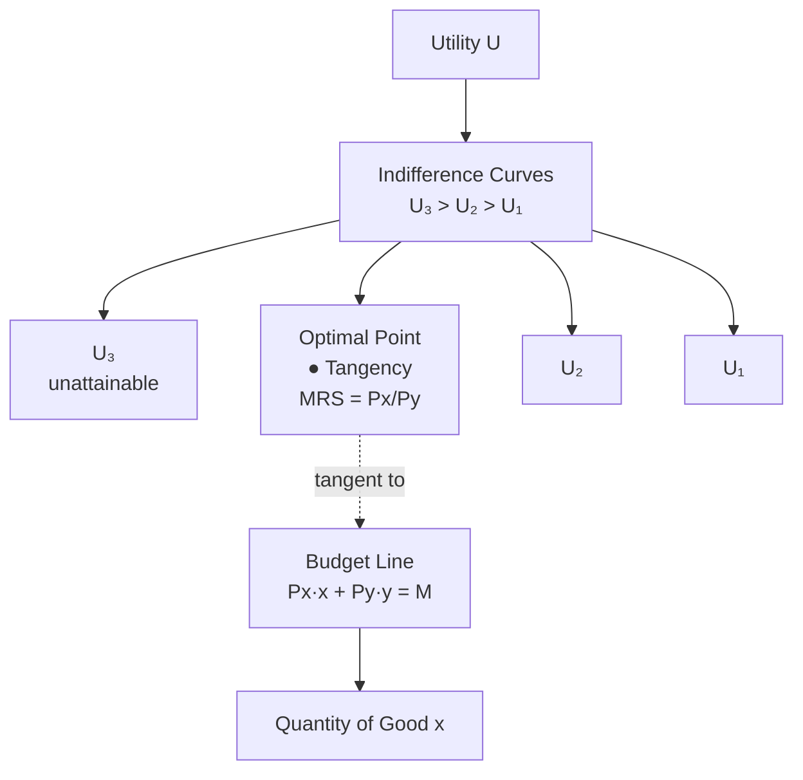
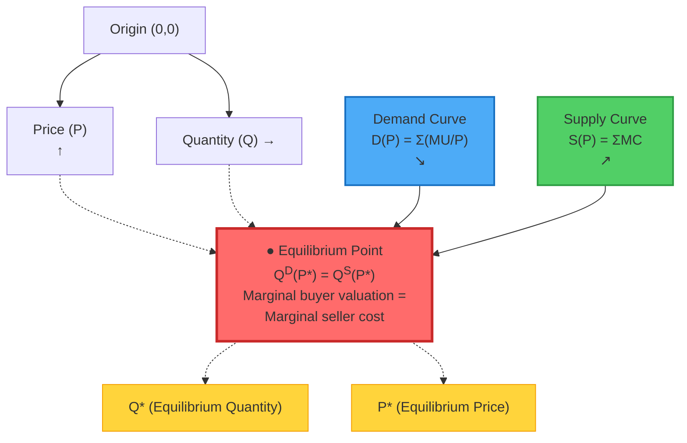

# Lesson 1: Marginalist Revolution Foundations

## 1. First-Principles Intuition & Invariants

The Marginalist Revolution represents one of the most profound conceptual transformations in the history of economic thought, fundamentally reorienting the discipline away from classical labor-based value theories toward a subjective, utility-maximizing framework grounded in incremental decision-making. Between the late 1860s and early 1880s, three economists working independently across different continents—William Stanley Jevons in England, Carl Menger in Austria, and Léon Walras in Switzerland—converged on a singular insight that would reshape the analytical architecture of economics: the value of a good derives not from the labor embedded in its production, nor from any intrinsic property of the object itself, but rather from the subjective utility that an individual derives from consuming one additional unit at the margin of their existing consumption bundle.

This departure from classical political economy cannot be overstated. Adam Smith's labor theory of value, refined by David Ricardo and systematized by Karl Marx, had dominated economic discourse for nearly a century. Under this framework, the exchange value of a commodity was understood to reflect the quantity of socially necessary labor time required for its production. Yet this approach generated persistent conceptual paradoxes that classical economists struggled to resolve satisfactorily. The diamond-water paradox stood as the most visible anomaly: water, essential for survival and requiring relatively modest labor to obtain, commanded almost no market price, while diamonds, largely ornamental and requiring significant extraction effort, traded at extraordinary valuations. Classical economists attempted various reconciliations—distinguishing between use-value and exchange-value, invoking scarcity as an ad hoc modifier—but these remained unsatisfying patches rather than coherent theoretical resolutions.

The marginalist insight dissolved this paradox by recognizing that economic agents do not make discrete all-or-nothing decisions about entire commodity classes. Instead, they evaluate incremental adjustments to their consumption patterns. The relevant question is never "What is the value of water in general?" but rather "What is the value to me of one additional liter of water given my current circumstances?" In a world where water is abundant and individuals have already satisfied their most urgent hydration needs, the marginal utility of an additional unit approaches zero. Conversely, in a world where diamonds are exceedingly rare and individuals possess few if any, the marginal utility of acquiring one additional diamond remains extraordinarily high. Exchange ratios in competitive markets thus reflect these marginal valuations rather than average or total utility, and certainly not the labor embodied in production.

This theoretical reorientation established several foundational invariants that persist throughout neoclassical economic analysis. The principle of diminishing marginal utility asserts that as an individual consumes successive units of a homogeneous good within a given time period, holding all other consumption constant, the additional satisfaction derived from each subsequent unit declines. Formally, if we denote utility as a function $U(x)$ where $x$ represents the quantity consumed of a particular good, then the first derivative $\frac{dU}{dx} > 0$ captures positive marginal utility, while the second derivative $\frac{d^2U}{dx^2} < 0$ encodes the diminishing property. This concavity in the utility function reflects a deep psychological and physiological regularity: the urgency of unsatisfied wants decreases as those wants become progressively satisfied.

The subjective theory of value emerging from this framework breaks decisively with any objective or cost-based determination of worth. Value is not an inherent property of objects waiting to be discovered through measurement of embodied labor or material substance. Rather, value is constituted through the mental valuations of economically purposeful agents confronting scarcity and making choices under constraint. Two individuals facing identical physical goods may assign radically different valuations depending on their existing endowments, preferences, and the intensity of their unsatisfied wants. A glass of water holds negligible value to someone standing beside a mountain spring but commands life-or-death urgency to a traveler lost in the desert. This subjectivism does not imply arbitrary or capricious valuation—individual preferences are assumed to be stable, transitive, and rationally ordered—but it does relocate the source of economic value from the sphere of production to the sphere of consumption and individual psychology.

The marginalist framework also introduced a methodological commitment to optimization under constraint that would become the signature analytical posture of neoclassical economics. Economic agents are modeled as solving constrained maximization problems: consumers maximize utility subject to budget constraints, producers maximize profit subject to technological production functions and input costs, investors maximize expected returns subject to risk tolerances and capital endowments. The margin—the boundary where one additional unit of action transitions from net benefit to net cost—becomes the decisive analytical location. Whether examining labor supply decisions, capital allocation choices, or product mix optimization, the neoclassical economist focuses analytical attention on the point where marginal benefit equals marginal cost, recognizing this equilibrium condition as the first-order necessary condition for an interior optimum.

This theoretical architecture established continuity between microeconomic behavior and aggregate market outcomes in a manner that classical political economy had never satisfactorily achieved. If all market participants equate their marginal rates of substitution to prevailing price ratios, and if producers equate marginal rates of technical substitution to input price ratios, then competitive markets coordinate decentralized decision-making toward allocative efficiency without requiring centralized planning or comprehensive information aggregation. The "invisible hand" intuition of Adam Smith could now be formalized as a mathematical proposition about the relationship between individual optimization and general equilibrium, a project that would reach its apex in the Arrow-Debreu model of the mid-twentieth century.

Yet the Marginalist Revolution was not a monolithic movement, and the three founding figures approached the core insights from meaningfully different angles that would spawn distinct research traditions. Jevons, trained in mathematics and natural sciences, sought to construct economics as a calculus of pleasure and pain, imagining a future where utility could be measured with the same precision as physical quantities. His *Theory of Political Economy* (1871) deployed differential calculus to derive demand curves from utility functions and formulated the equimarginal principle: a rational consumer allocates expenditure across goods such that the ratio of marginal utilities equals the ratio of prices, $\frac{MU_x}{MU_y} = \frac{P_x}{P_y}$. This mathematical formalization would profoundly influence the Anglo-American tradition of economic theory, setting the stage for ordinalist refinements by Pareto, Hicks, and Samuelson that would eventually replace cardinal utility with preference orderings.

Menger's approach in *Principles of Economics* (1871) took a more philosophical and causal-genetic direction, emphasizing the logical structure of economic reasoning and the hierarchical relationship between goods of different orders. First-order goods directly satisfy human wants, while higher-order goods (capital equipment, raw materials, labor services) derive their value imputationally from the consumer goods they help produce. This causal imputation of value from consumption goods backward through the production structure became a distinctive feature of Austrian economic analysis, informing later work on capital theory, entrepreneurship, and the informational properties of price systems. Menger's commitment to methodological individualism and his skepticism toward mathematical formalization created a lasting tension between Austrian and mainstream neoclassical traditions.

Walras, trained as an engineer, pursued the most ambitious mathematical formalization, constructing a system of simultaneous equations representing all markets in an economy and investigating the conditions under which such a system admits solutions corresponding to general equilibrium. His *Elements of Pure Economics* (1874) introduced the tâtonnement process—an abstract auctioneer mechanically adjusting prices until all markets clear—as a conceptual device for exploring stability properties of equilibrium. While Walras's work initially received limited attention, it would become the foundation for twentieth-century general equilibrium theory, providing the mathematical scaffolding that Arrow, Debreu, and McKenzie would later use to prove existence theorems under precisely specified axioms.

The revolution's break from classical value theory extended beyond technical apparatus to embrace fundamentally different conceptions of economic causation and social welfare. Classical political economy had been centrally concerned with the distribution of income among social classes—landlords, capitalists, and workers—and the long-run dynamics of capital accumulation, population growth, and the tendency toward a stationary state. Ricardo's theory of differential rent, Malthus's population dynamics, and Marx's falling rate of profit all addressed questions of class conflict and systemic evolution. The marginalist framework, by contrast, relocated analytical focus to the allocation of given resources among competing uses at a moment in time. Questions of distribution were subsumed within a unified theory of pricing: wages reflect the marginal productivity of labor, interest reflects the marginal productivity of capital, and rent reflects the marginal productivity of land. If factors are paid their marginal products and production functions exhibit constant returns to scale, then Euler's theorem ensures that total output is exactly exhausted by factor payments, leaving no surplus to explain and no inherent class antagonism to resolve.

This reorientation carried profound ideological implications, though the founders themselves held diverse political commitments. The marginalist framework suggested that competitive markets, if functioning without distortion, generate allocations that cannot be improved upon without making some participant worse off—a notion later formalized as Pareto efficiency. The exploitation narrative central to Marxian political economy found no natural expression within marginalist categories: if wages equal the marginal product of labor and workers are free to supply labor or withhold it based on their subjective valuation of leisure, then the employment relationship appears as voluntary exchange rather than coercive extraction. Critics would later argue that this framework systematically obscured power relations, institutional constraints, and path dependencies that shape actual market outcomes, but within its own axiomatic structure, the marginalist approach presented competitive markets as efficiency-generating mechanisms rather than arenas of distributional conflict.

The principle of diminishing returns, while conceptually related to diminishing marginal utility, operates in the domain of production rather than consumption and predates the marginalist revolution by several decades. Classical economists, particularly Malthus and Ricardo, had recognized that holding some factors of production constant while varying others eventually leads to progressively smaller increments in output. Ricardo's analysis of agricultural production on lands of varying fertility provided the clearest early articulation: as cultivation extends to progressively less fertile marginal land, each additional unit of labor and capital yields smaller output increases, generating differential rents for inframarginal superior lands. The marginalists incorporated this production-side principle into their framework, recognizing that diminishing marginal productivity of variable inputs provides the supply-side complement to diminishing marginal utility on the demand side. Together, these principles generate the smooth, well-behaved optimization problems that occupy the core of neoclassical microeconomic analysis.

## 2. Core Architecture & Mechanics

The analytical machinery of marginalist economics rests on a precisely structured mathematical representation of choice under constraint. At its foundation lies the utility function, a mathematical construct encoding an individual's preference ordering over alternative consumption bundles. For a consumer choosing between quantities of two goods, $x$ and $y$, we denote utility as $U(x, y)$. The assumption of positive marginal utility requires that $\frac{\partial U}{\partial x} > 0$ and $\frac{\partial U}{\partial y} > 0$, indicating that additional consumption of either good, holding the other constant, increases total satisfaction. The diminishing marginal utility property imposes concavity: $\frac{\partial^2 U}{\partial x^2} < 0$ and $\frac{\partial^2 U}{\partial y^2} < 0$, ensuring that successive increments yield progressively smaller utility gains.

The consumer's constrained optimization problem takes the form:

$$\max_{x, y} \, U(x, y) \quad \text{subject to} \quad P_x x + P_y y = M$$

where $P_x$ and $P_y$ represent market prices for goods $x$ and $y$ respectively, and $M$ denotes the consumer's monetary income or budget. This formulation embeds the essential tension of economic choice: unlimited wants confronting limited means. The budget constraint defines the feasible set—all consumption bundles the individual can afford given prevailing prices and income—while the utility function ranks these feasible bundles according to subjective preference.

The solution methodology employs the Lagrangian multiplier technique, constructing the auxiliary function:

$$\mathcal{L}(x, y, \lambda) = U(x, y) + \lambda(M - P_x x - P_y y)$$

The first-order necessary conditions for an interior optimum require:

$$\frac{\partial \mathcal{L}}{\partial x} = \frac{\partial U}{\partial x} - \lambda P_x = 0$$

$$\frac{\partial \mathcal{L}}{\partial y} = \frac{\partial U}{\partial y} - \lambda P_y = 0$$

$$\frac{\partial \mathcal{L}}{\partial \lambda} = M - P_x x - P_y y = 0$$

Dividing the first equation by the second eliminates the Lagrange multiplier and yields the tangency condition:

$$\frac{\partial U / \partial x}{\partial U / \partial y} = \frac{P_x}{P_y}$$

This condition encodes the equimarginal principle in precise mathematical form: at the optimum, the marginal rate of substitution—the rate at which the consumer is willing to trade $y$ for $x$ while maintaining constant utility—must equal the market price ratio. Any deviation from this equality represents an unexploited opportunity for utility improvement through reallocation of expenditure.

The geometric representation of this optimization illuminates the underlying logic. Indifference curves—loci of consumption bundles yielding identical utility—form a family of downward-sloping, convex curves in $(x, y)$ space. The slope of an indifference curve at any point equals the negative of the marginal rate of substitution, $-\frac{\partial U / \partial x}{\partial U / \partial y}$. The budget constraint appears as a linear boundary with slope $-\frac{P_x}{P_y}$, defining the edge of the feasible region. The consumer's optimum occurs where an indifference curve touches the budget line tangentially—the highest attainable indifference curve given the constraint. At this tangency point, the subjective willingness to substitute (the indifference curve slope) exactly matches the objective market trade-off (the budget line slope).

The Lagrange multiplier $\lambda$ emerging from this optimization carries its own economic interpretation: it represents the marginal utility of income, the additional utility obtained from a small increase in the budget. When the consumer is optimally allocated across goods, $\lambda$ equals $\frac{\partial U / \partial x}{P_x} = \frac{\partial U / \partial y}{P_y}$, indicating that the last dollar spent on each good yields the same marginal utility increment. This common ratio measures how tightly the budget constraint binds the consumer's choices.

The comparative statics of this model generate the demand curve, the fundamental building block of price theory. Holding income and the price of $y$ constant while varying $P_x$, we trace out the optimal quantity of $x$ as a function of its price. The solution to the optimization problem yields the Marshallian demand function $x^*(P_x, P_y, M)$. Under standard assumptions—positive marginal utility, diminishing marginal utility, and convexity of preferences—this demand function slopes downward: $\frac{\partial x^*}{\partial P_x} < 0$. As the price of a good rises, the budget line rotates inward, causing the tangency point to slide along successively lower indifference curves to bundles with less $x$ consumption.

The Slutsky equation provides the analytical decomposition of this price effect into conceptually distinct components. A change in price generates both a substitution effect—a movement along the original indifference curve as the price ratio changes—and an income effect—a shift to a different indifference curve as purchasing power changes. For a price decrease in good $x$:

$$\frac{dx}{dP_x} = \frac{\partial h(P_x, P_y, \bar{U})}{\partial P_x} - x \frac{\partial x^*}{\partial M}$$

where $h(P_x, P_y, \bar{U})$ denotes the Hicksian (compensated) demand function holding utility constant. The first term captures the substitution effect, which is unambiguously negative by the convexity of preferences: when $x$ becomes relatively cheaper, the consumer substitutes toward $x$ and away from $y$ even at constant utility. The second term captures the income effect, scaled by the quantity consumed: as $P_x$ falls, real income rises, and the consumer's response depends on whether $x$ is a normal good ($\frac{\partial x^*}{\partial M} > 0$) or an inferior good ($\frac{\partial x^*}{\partial M} < 0$). For normal goods, both effects reinforce downward-sloping demand; for inferior goods, the income effect partially offsets the substitution effect but rarely dominates except in the theoretical curiosum of Giffen goods.

The extension to production theory parallels the consumer framework with functional duality. A firm combines inputs—labor $L$ and capital $K$—according to a production function $Q = f(L, K)$ to generate output $Q$. The marginal product of labor, $MP_L = \frac{\partial f}{\partial L}$, measures the additional output from one more unit of labor holding capital fixed. Diminishing marginal productivity imposes $\frac{\partial^2 f}{\partial L^2} < 0$, reflecting technological constraints: as more workers operate a fixed capital stock, coordination difficulties, congestion, and factor indivisibilities eventually cause output increments to shrink.

The profit-maximizing firm solves:

$$\max_{L, K} \, P \cdot f(L, K) - w L - r K$$

where $P$ denotes output price, $w$ the wage rate, and $r$ the rental rate of capital. The first-order conditions require:

$$P \cdot \frac{\partial f}{\partial L} = w \quad \text{and} \quad P \cdot \frac{\partial f}{\partial K} = r$$

These conditions state that each factor is employed up to the point where its value of marginal product equals its market price. The ratio of these conditions yields:

$$\frac{\partial f / \partial L}{\partial f / \partial K} = \frac{w}{r}$$

The left side represents the marginal rate of technical substitution (MRTS)—the rate at which capital can be substituted for labor while holding output constant. At the optimum, this technological substitutability must equal the factor price ratio. Isoquants—curves of constant output in $(L, K)$ space—are the production-theoretic analogue of indifference curves, and the firm's optimal input combination occurs where an isocost line (constant expenditure on inputs) touches the target isoquant tangentially.

The symmetry between consumer and producer optimization reveals the architectural unity of marginalist economics. Both agents face trade-offs encoded in relative prices, both equate subjective margins (MRS or MRTS) to objective price ratios, and both exhaust opportunities for improvement when marginal benefit equals marginal cost. This formal parallelism extends to envelope theorems, duality relationships, and comparative statics, establishing a coherent analytical framework applicable across diverse economic contexts.

Market equilibrium emerges when aggregate quantity demanded equals aggregate quantity supplied at the prevailing price. Summing individual demand curves horizontally generates the market demand curve $Q^D(P)$, while summing individual firm supply curves (derived from marginal cost curves above minimum average variable cost) generates market supply $Q^S(P)$. The equilibrium price $P^*$ satisfies $Q^D(P^*) = Q^S(P^*)$, and the market clears without persistent excess demand or supply. At this price, the marginal valuation of the last unit consumed (reflected in willingness to pay) equals the marginal cost of producing that unit (reflected in supply price). No further mutually beneficial exchanges remain unexploited.

The equilibrium price performs an informational aggregation function that classical economists had intuited but could not rigorously formalize. Each consumer's demand reflects their subjective marginal utility; each producer's supply reflects their objective marginal cost. The market price synthesizes these dispersed subjective valuations and technological constraints into a single summary statistic that coordinates decentralized plans. Hayek would later emphasize this informational property as the defining advantage of market systems over centralized planning: prices encode knowledge about local conditions, individual preferences, and technological possibilities that no central planner could feasibly collect and process.

The welfare implications of competitive equilibrium provide the normative foundation for neoclassical policy analysis. Consumer surplus—the area under the demand curve and above the price line—measures the net benefit consumers derive from market participation, the difference between their maximum willingness to pay and the amount they actually pay. Producer surplus—the area above the supply curve and below the price line—measures the net benefit to producers, the difference between market price and their minimum acceptable compensation. Total surplus, the sum of consumer and producer surplus, is maximized at competitive equilibrium. Any deviation from equilibrium—whether through price controls, quantity restrictions, or taxes—generates deadweight loss, a reduction in total surplus representing potential gains from trade left unrealized.

## 3. High-Performance Optimization & Failure Modes

The marginalist framework, while providing powerful analytical traction on a wide range of economic phenomena, encounters systematic limitations when pushed beyond its core domain of application. Recognizing these boundary conditions and failure modes is essential for rigorous economic reasoning and policy design.

The assumption of diminishing marginal utility, while psychologically plausible for many consumption goods over short time horizons, breaks down in contexts involving habit formation, addiction, or social comparison. Addictive substances may exhibit increasing marginal utility over certain ranges as tolerance builds and dependence develops, violating the concavity assumption central to standard consumer theory. Similarly, positional goods—luxury items whose value derives partly from exclusivity and social signaling—may generate increasing marginal utility as consumption moves an individual into higher-status reference groups. These cases require non-standard utility specifications and can generate multiple equilibria, path dependence, and welfare ambiguities that marginalist optimization does not naturally accommodate.

The cardinality of utility presents a deeper conceptual challenge that sparked extensive methodological debate throughout the early twentieth century. Jevons and the early marginalists treated utility as a measurable quantity, akin to temperature or mass, and imagined future technologies that might directly quantify pleasure and pain. Yet introspective utilities resist interpersonal comparison—there exists no operational procedure for determining whether the utility gain I experience from consuming an additional apple exceeds the utility gain you experience from consuming an additional orange. This measurement problem undermines utilitarian welfare economics, which requires summing utilities across individuals to evaluate social states. The ordinalist revolution, led by Pareto, Hicks, and Allen in the 1930s, reformulated consumer theory in terms of preference orderings rather than cardinal utility functions. Indifference curve analysis survives this transition intact—only the ordering of curves matters, not the numerical utility values assigned to them—but interpersonal welfare comparisons become inadmissible without additional ethical axioms.

The assumption of convex preferences, while generating tractable optimization problems, rules out important classes of consumption decisions. Non-convexities arise naturally when goods are perfect complements (left shoes and right shoes, or hardware and software), when consumption exhibits threshold effects (a medication that requires a minimum dosage to be effective), or when variety itself yields utility (preferring a diverse diet to concentrated consumption of a single food). In these cases, indifference curves exhibit kinks, flat segments, or even convex-to-the-origin curvature, and corner solutions or discrete jumps replace smooth interior optima. Standard calculus techniques fail, and the predicted substitution responses to price changes may be discontinuous or even perverse.

The production-side assumption of diminishing marginal productivity similarly encounters systematic violations in the presence of increasing returns to scale, network externalities, or learning-by-doing effects. Software production, platform markets, and knowledge-intensive industries often exhibit decreasing average costs over the relevant output range—the marginal cost of serving an additional user approaches zero once the fixed development costs are sunk. In such contexts, marginal-cost pricing leads to losses, and competitive equilibrium may fail to exist. Natural monopolies emerge, and efficient market structures require either subsidization, multi-part tariffs, or acceptance of market concentration. The marginalist framework offers limited guidance for organizational design and regulatory policy in these high-fixed-cost, near-zero-marginal-cost environments.

The informational assumptions embedded in standard marginalist analysis—that consumers possess complete knowledge of prices, product characteristics, and their own utility functions—abstract away from the costly search, imperfect information, and bounded rationality that characterize actual market environments. When consumers must invest resources to discover prices, when product quality is difficult to assess before purchase, or when cognitive constraints prevent exhaustive optimization, the simple tangency conditions of the textbook model provide at best an approximation. Search theory, mechanism design, and behavioral economics have developed alternative frameworks for analyzing these informational and cognitive frictions, often yielding predictions at odds with frictionless marginalist models.

The assumption of price-taking behavior—that individual agents treat market prices as parameters beyond their control—holds rigorously only in perfectly competitive markets with atomistic agents and homogeneous products. In markets with product differentiation, strategic interaction, entry barriers, or institutional constraints, firms possess market power and optimization requires game-theoretic reasoning rather than simple marginal-cost pricing. Oligopoly, monopolistic competition, and bilateral bargaining situations generate indeterminacies, multiple equilibria, and coordination failures that the marginalist framework does not address. The Marshallian partial equilibrium apparatus, which analyzes one market in isolation holding all other prices constant, obscures general equilibrium feedbacks and cross-market spillovers that may dominate outcomes in highly interconnected economies.

The dynamic extensions of static marginalist optimization introduce temporal complexities that fundamentally alter the structure of optimal decision-making. Intertemporal choice requires discounting future utility, introducing the time preference rate as an additional parameter. The Euler equation governing optimal consumption paths—$\frac{\partial U / \partial C_t}{\partial U / \partial C_{t+1}} = (1 + r)(1 + \delta)$ where $r$ is the interest rate and $\delta$ the pure time preference rate—shows that consumption smoothing depends on the intertemporal elasticity of substitution, a parameter that governs willingness to shift consumption across time periods in response to interest rate changes. Time-inconsistent preferences, where future selves discount the present differently than current selves discount the future, generate self-control problems, commitment devices, and dynamically inconsistent plans that violate the standard rationality axioms.

Uncertainty introduces a further layer of complexity, requiring expected utility maximization rather than simple utility maximization. Von Neumann-Morgenstern utility functions represent preferences over lotteries, and risk aversion is encoded in the curvature of the utility function over wealth. The coefficient of relative risk aversion, $-\frac{W U''(W)}{U'(W)}$, governs portfolio choice, precautionary saving, and insurance demand. Yet expected utility theory itself faces empirical challenges from phenomena like the Allais paradox, probability weighting biases, and ambiguity aversion, spawning alternative frameworks such as prospect theory and rank-dependent expected utility that modify the axioms to accommodate observed choice patterns.

The marginalist framework's policy implications rest on the normative premise that efficiency—maximizing total surplus—constitutes the appropriate social objective. This premise embeds contentious value judgments that merit scrutiny. Pareto efficiency is silent on distributional concerns: an allocation where one individual possesses all resources while others starve can be Pareto efficient if any redistribution would make the wealthy individual worse off. Efficiency and equity trade-offs permeate policy design, and marginalist analysis offers no principled way to weigh these competing objectives without imposing external ethical criteria. The compensation principle—that policies improving efficiency should be adopted if winners could hypothetically compensate losers—founders on the practical and political obstacles to actually implementing such transfers.

Externalities and public goods represent systematic market failures where decentralized marginal optimization generates inefficient outcomes. When production or consumption imposes costs or benefits on third parties not reflected in market prices, private marginal cost diverges from social marginal cost, and competitive equilibrium oversupplies negative externalities (pollution) while undersupplying positive externalities (education, vaccination). The Pigouvian prescription—taxing negative externalities and subsidizing positive ones at rates equal to marginal external damage or benefit—requires information about damage functions and welfare impacts that governments rarely possess with precision. Public goods, characterized by non-rivalry and non-excludability, cannot be efficiently provided through voluntary exchange because free-riding incentives cause individuals to understate their true willingness to pay. The Samuelson condition for optimal public good provision—that the sum of marginal rates of substitution across all individuals equals the marginal rate of transformation—cannot be implemented through decentralized markets.

The assumption of perfect competition, while analytically tractable, seldom holds even approximately in actual market environments. Product differentiation, asymmetric information, and transaction costs generate persistent departures from the idealized model. Industrial organization research has documented substantial and persistent price dispersion for homogeneous goods, sluggish price adjustment to cost shocks, and non-competitive markups in sectors ranging from retail to healthcare. These empirical patterns suggest that real-world price formation involves search costs, menu costs, strategic pricing, and institutional constraints that marginalist theory abstracts away.

The measurement and estimation of utility functions and production functions remains an active area of empirical challenge. Revealed preference methods infer preferences from observed choices, but identification requires strong assumptions about information, rationality, and the absence of measurement error. Demand system estimation—whether using flexible functional forms like the Almost Ideal Demand System or more structural approaches like discrete choice models—must navigate issues of endogeneity, omitted variables, and parameter proliferation. Production function estimation confronts the fundamental identification problem that input choices correlate with unobserved productivity shocks, biasing ordinary least squares estimates. The credibility revolution in applied microeconomics has shifted focus toward quasi-experimental designs, natural experiments, and randomized controlled trials that identify causal effects without requiring full structural specification, though such designs often sacrifice external validity and policy generalizability.

The computational implementation of marginalist optimization in high-dimensional settings pushes against computational complexity bounds. Consumer choice over hundreds of goods, firm production with dozens of inputs, or general equilibrium models with thousands of markets require numerical methods and approximation algorithms. Gradient descent, Newton-Raphson iteration, and constraint optimization algorithms can fail to converge, converge to local rather than global optima, or exhibit numerical instability depending on function curvature, starting values, and step sizes. The curse of dimensionality compounds these difficulties: solution time and memory requirements grow exponentially with the number of choice variables, limiting the scale and fidelity of computable models.

Despite these limitations, the marginalist framework remains the dominant analytical paradigm in modern microeconomics and the foundational layer for macroeconomic models incorporating microeconomic foundations. Its success stems not from empirical perfection but from conceptual coherence, mathematical tractability, and the ability to generate falsifiable predictions across a wide range of economic phenomena. Understanding both its power and its boundaries equips the practitioner to deploy marginalist reasoning where it provides insight while recognizing contexts where alternative frameworks—institutional analysis, evolutionary game theory, behavioral economics, or computational agent-based modeling—offer superior traction on the phenomena under investigation. The marginalist revolution did not end economic inquiry; it provided a precise analytical language and a systematic toolkit that subsequent generations have extended, refined, and in some domains transcended, but never fully abandoned.
