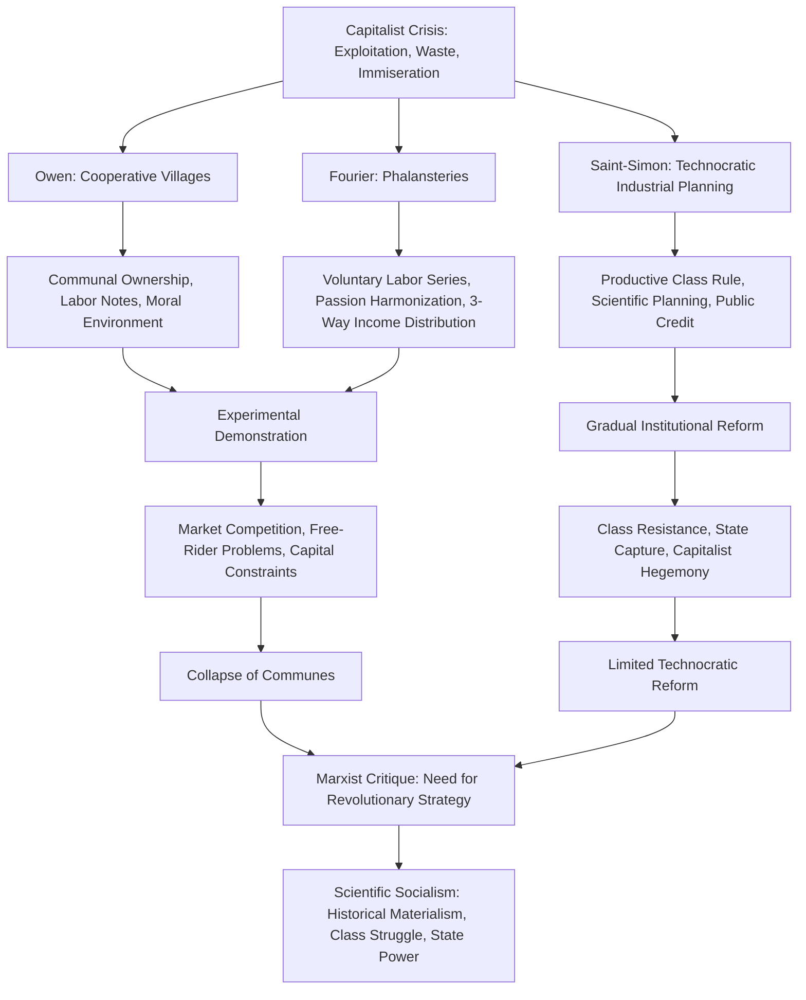

# Lesson 2: Utopian Socialism—Early Visions of Cooperative Production

## 1. First-Principles Intuition & Invariants

The arc of socialist thought begins not with Marx's dialectical materialism or Lenin's vanguard party, but with a disparate collection of visionary reformers who confronted the early Industrial Revolution's brutal dislocations with radical proposals for reorganizing production, property, and human association itself. Robert Owen, Charles Fourier, and Henri de Saint-Simon—dubbed "utopian socialists" by Marx and Engels in a gesture that was simultaneously dismissive and reverential—constructed elaborate blueprints for cooperative economies that would transcend competitive market capitalism without the need for revolutionary upheaval or class warfare. Their systems rested on a shared conviction that human nature was not fixed but profoundly malleable, shaped by social institutions and economic arrangements. If the factory system and private property produced alienation, greed, and immiseration, then redesigned institutions—cooperative workshops, communal property, scientific management of production—could cultivate solidarity, rational benevolence, and shared prosperity.

Understanding utopian socialism requires situating it within the precise historical conjuncture of early industrial capitalism, roughly 1800 to 1850, when the transformation from agrarian feudalism to mechanized factory production was most violent and disorienting. The enclosure movements had severed peasant populations from traditional common lands, creating a propertyless proletariat forced to sell labor power in nascent industrial cities. Working conditions in textile mills, coal mines, and iron foundries were appalling: twelve- to sixteen-hour workdays, child labor as young as five years old, dangerous machinery with no safety protocols, and wages that hovered near subsistence. Classical political economy, as articulated by Ricardo and Malthus, offered a grim prognosis: the Iron Law of Wages dictated that competitive labor markets would drive compensation toward biological subsistence, while Malthusian population dynamics predicted perpetual misery for the laboring classes. The utopian socialists rejected this fatalism entirely. They insisted that scarcity and suffering were not natural laws but artifacts of defective social organization, and that human ingenuity could design institutions capable of abolishing poverty, class antagonism, and the exploitation of labor.

The conceptual invariants shared across Owen, Fourier, and Saint-Simon begin with the primacy of association over atomistic individualism. Where classical liberalism posited self-interested agents pursuing private gain in competitive markets as the engine of prosperity, the utopians argued that cooperation, not competition, was the natural foundation of human flourishing. They envisioned economies structured around voluntary associations—communes, phalansteries, workshops—in which members jointly owned the means of production and distributed the social product according to principles of equity and need rather than market power or inherited wealth. Property would be transformed from an individual right enforcing exclusion and extraction into a collective stewardship serving communal welfare.

A second invariant was the belief in the moral and educative function of economic institutions. Owen, in particular, grounded his system in the Enlightenment premise that character was formed by environment rather than innate depravity or divine grace. If workers were ignorant, brutish, or prone to vice, it was because the factory regime and urban slums degraded them; place the same individuals in a cooperative community with humane working conditions, universal education, and rational social arrangements, and they would develop into enlightened, productive citizens. Fourier extended this logic into an elaborate psychology of "passions," arguing that existing society repressed and distorted natural human inclinations, while a scientifically designed社社社会—the phalanstery—would harmonize passions into a symphony of voluntary, joyful labor. Saint-Simon, though less focused on communal living, shared the conviction that a reorganized economy led by industrial producers and scientists would replace the parasitic feudal aristocracy and idle rentiers with a rational meritocracy dedicated to maximizing production for collective benefit.

A third commonality was the emphasis on experimental demonstration rather than mass political mobilization. The utopian socialists were not, in the main, revolutionaries. They did not call for the seizure of state power, the expropriation of the bourgeoisie, or the violent overthrow of existing regimes. Instead, they sought to establish model communities that would prove, through their superior productivity and human fulfillment, the viability of cooperative production. Owen founded New Lanark in Scotland and later New Harmony in Indiana; Fourier inspired dozens of phalansteries across France and the United States; Saint-Simon's disciples attempted to implement technocratic reforms within existing French institutions. The underlying theory was that successful examples would inspire voluntary replication, gradually displacing competitive capitalism through peaceful persuasion and the force of demonstrated superiority. This faith in exemplary praxis, detached from any theory of how economic systems reproduce themselves through class struggle and state power, was precisely what Marx and Engels would later critique as "utopian" in contrast to their own "scientific" socialism grounded in historical materialism and dialectical conflict.

Yet the utopians were hardly naive about the scale of transformation required. They understood that piecemeal reforms—higher wages here, shorter hours there—could not address the systemic irrationalities of capitalist production. Fourier, for instance, calculated with obsessive precision the wastefulness of competitive commerce: redundant shops, fraudulent marketing, planned obsolescence, and the misdirection of human effort into parasitic financial speculation rather than useful production. Owen documented how factory owners extracted enormous profits while workers lived in squalor, and he demonstrated at New Lanark that humane treatment, reduced hours, and investment in worker education actually increased productivity and profitability. Saint-Simon envisioned a wholesale replacement of the political state—which he saw as an instrument of military conquest and aristocratic privilege—with an administrative apparatus run by engineers, scientists, and industrialists who would rationally plan production to meet human needs.

The theoretical architecture of utopian socialism thus rested on three pillars: first, the rejection of competitive individualism and the market mechanism as principles of economic coordination; second, the assertion that human nature and social outcomes were products of institutional design, subject to conscious reconstruction; and third, the strategy of peaceful, experimental demonstration as the path to systemic transformation. These invariants would be subjected to withering critique by later socialist theorists, particularly Marx, who argued that the utopians failed to grasp the objective dynamics of capitalist accumulation, the centrality of class struggle, and the necessity of confronting state power. Nonetheless, the utopian tradition bequeathed to subsequent socialist thought an enduring emphasis on cooperative ownership, democratic workplace governance, and the vision of an economy organized for human need rather than private profit.

## 2. Core Architecture & Mechanics

The operational mechanics of utopian socialist systems varied considerably across the three principal theorists, reflecting different diagnoses of capitalism's failures and distinct proposals for institutional redesign. Examining each in sequence illuminates the diversity of early socialist thought while revealing shared structural commitments to communal ownership, cooperative labor, and the abolition of wage employment as a subordinate relationship.

**Robert Owen and the Cooperative Commonwealth**

Owen's system began with a concrete empirical demonstration at New Lanark, the cotton mill he managed in Scotland from 1800 onward. Inheriting a mill town characterized by brutal working conditions, child labor, and worker destitution, Owen implemented a series of reforms that were radical for the era: he reduced the working day from fourteen hours to ten and a half, refused to employ children under ten years old, established schools for worker children with a curriculum emphasizing practical knowledge and moral development rather than rote catechism, built decent housing for workers, and organized cooperative retail stores that sold goods at cost rather than extracting profit. Critically, Owen documented that these reforms did not reduce profitability; on the contrary, productivity increased because workers were healthier, better educated, and more motivated. The New Lanark experiment thus refuted the prevailing assumption that exploitation was necessary for profit, demonstrating that cooperative and humane management could outperform coercive wage labor.

Building on this success, Owen formulated a comprehensive plan for a "new moral world" organized around cooperative villages. Each village would house between 500 and 3,000 inhabitants living in communal buildings arranged in a quadrangle, with shared kitchens, dining halls, schools, and recreational facilities at the center. The land would be collectively owned, and members would engage in cooperative agriculture and manufacture, with labor organized not by wage contracts but by voluntary association and mutual obligation. The distribution of goods would be based on labor contribution measured in "labor notes"—a proto-currency that recorded hours worked—but with substantial communal provisioning for children, the elderly, and the infirm. Owen envisioned that cooperative villages would achieve such superior productivity through the elimination of competitive waste, rational land use, and mechanization that they could comfortably support all members while accumulating surplus for expansion. Crucially, Owen believed that communal living and cooperative labor would transform character: freed from the competitive struggle for subsistence and immersed in an environment of mutual aid, individuals would shed selfish vices and develop rational benevolence.

Owen attempted to realize this vision at New Harmony, Indiana, purchasing 20,000 acres in 1825 and inviting settlers to join the experiment. The project attracted roughly 900 participants, a heterogeneous mix of laborers, artisans, intellectuals, and idealists, many with little agricultural or manufacturing skill. The community struggled from the outset with internal conflicts over governance, labor discipline, and the distribution of resources. Owen had assumed that cooperative goodwill and rational discussion would suffice to coordinate production and resolve disputes, but in practice, free-rider problems emerged: some members shirked labor while consuming communal resources, generating resentment among diligent workers. Attempts to impose work requirements clashed with the ideology of voluntary association, and the community fragmented into competing factions. Within two years, New Harmony collapsed, dissolving into private property holdings and conventional economic relations. Owen's later ventures in Britain, including cooperative workshops and labor exchanges that used labor notes as currency, encountered similar difficulties: the labor notes could not circulate beyond the cooperative sector, limiting their utility, and the workshops struggled to compete with capitalist firms that paid lower wages and extracted longer hours.

The structural mechanics of Owenite socialism reveal both its strengths and fatal weaknesses. The emphasis on cooperative ownership and democratic governance within the workplace prefigured the producer cooperative and worker self-management movements that would flourish in later socialist and anarchist traditions. The labor note system anticipated later attempts to construct non-market socialist accounting, including the calculation debates of the 1930s between Austrian economists and socialist planners. Yet Owen's assumption that communal property and cooperative labor could be voluntarily established within a surrounding capitalist economy, without confronting market competition or state power, proved untenable. Cooperative enterprises faced an adverse selection problem: the most skilled and industrious workers could often earn higher incomes in capitalist firms, leaving cooperatives with less productive labor. Moreover, without access to capital markets or state support, cooperatives could not invest in machinery or scale production to match capitalist competitors. Owen's faith in the transformative power of environment underestimated the persistence of individualist motivations and the difficulty of sustaining collective discipline absent either market incentives or coercive authority.

**Charles Fourier and the Phalanstery**

Fourier's system was at once more psychologically sophisticated and more fantastically elaborate than Owen's. Fourier began with a theory of human passion, identifying twelve fundamental drives—including the senses, ambition, friendship, love, and the "butterfly passion" for variety and the "composite passion" for combining pleasures—that existing society repressed or perverted, generating neurosis, vice, and social conflict. He argued that "Civilization," by which he meant contemporary capitalist society, was the most oppressive stage of human history, worse even than barbarism or savagery, because it systematically thwarted natural passions through monotonous wage labor, lifelong monogamy, and the suppression of sensual pleasure. Fourier's utopia, the phalanstery, was designed to harmonize all passions, allowing each individual to pursue diverse, voluntary activities that aligned personal gratification with collective productivity.

The architectural and organizational mechanics of the phalanstery were meticulously specified. Each phalanstery would house approximately 1,620 individuals—a number Fourier derived from combinatorial calculations about the diversity of personality types—living in a single large building with private apartments for families and individuals but extensive communal spaces for dining, socialization, and recreation. The building would be surrounded by agricultural land and workshops for manufacturing, with production organized into small voluntary groups called "series," each dedicated to a specific task such as cultivating fruit, raising livestock, or producing textiles. Individuals would choose which series to join based on their passions and inclinations, and they could move freely between groups throughout the day, ensuring that no one was trapped in monotonous drudgery. Fourier anticipated that even unpleasant tasks like collecting garbage could be made appealing by assigning them to groups of children who loved dirt and competitive games, transforming waste management into playful rivalry.

The economic distribution mechanism in the phalanstery combined labor contribution, capital investment, and talent in a three-way division of the social product. Fourier proposed that roughly 5/12 of the community's income be allocated to labor, 4/12 to capital (rewarding those who contributed property or invested resources), and 3/12 to talent (compensating inventors, artists, and skilled professionals). This formula was intended to attract both workers and capitalists to the phalanstery, demonstrating that cooperative production could reward all contributors more generously than competitive capitalism. Fourier calculated that the superior efficiency of the phalanstery—achieved through the elimination of commercial intermediaries, the specialization of labor according to passion rather than coercion, and the mechanization of agriculture—would generate such abundance that even the poorest members would enjoy luxury.

Fourier himself never attempted to establish a phalanstery, spending his later years waiting in vain for a wealthy patron to finance his vision. However, his disciples founded more than 40 experimental communities in France and the United States during the 1840s, the most famous being Brook Farm in Massachusetts, which converted to Fourierist principles in 1844. Like Owen's New Harmony, these ventures encountered severe difficulties. The assumption that individuals would voluntarily organize labor according to passion proved problematic when certain essential but tedious tasks had few enthusiasts. The complex income distribution formula generated disputes and resentments, particularly when capital contributors claimed disproportionate shares. Most critically, the phalansteries remained embedded in capitalist economies, selling their agricultural and manufactured goods in markets where they competed with firms employing cheaper wage labor and more exploitative conditions. Few lasted more than a few years; Brook Farm collapsed in 1847 after a disastrous fire destroyed a central building, leaving the community financially ruined.

Fourier's theoretical contribution lay in his recognition that socialist transformation required not merely changes in property relations but a wholesale reimagining of work itself. His insistence that labor could and should be pleasurable, that productive activity could be aligned with human passion rather than imposed as drudgery, anticipated later debates about alienation, self-actualization, and the qualitative transformation of labor under socialism. His critique of commercial waste and parasitic intermediaries foreshadowed Marx's analysis of unproductive labor and the irrationalities of capitalist distribution. Yet Fourier's system also revealed the limitations of designing socialism as a closed, self-sufficient commune: without control over broader economic coordination, credit, and investment, such experiments remained marginal and vulnerable.

**Henri de Saint-Simon and Technocratic Industrial Planning**

Saint-Simon's vision diverged sharply from Owen and Fourier in scale and mechanism. Rather than proposing self-contained communes, Saint-Simon envisioned transforming the entire national and eventually global economy through a scientifically managed industrial system led by producers—engineers, scientists, industrialists, and workers—displacing the parasitic classes of aristocrats, rentiers, and military officers. His central insight was that modern industry had created the technical capacity for abundance, but the persistence of feudal and monarchical institutions misdirected resources toward war, luxury consumption by idle elites, and unproductive speculation rather than investment in productive infrastructure.

Saint-Simon's economic architecture rested on a distinction between productive and unproductive classes. The productive classes included everyone engaged in creating useful goods and services: farmers, factory workers, merchants, engineers, scientists, and industrial entrepreneurs. The unproductive classes comprised those who consumed without producing: hereditary nobility, clergy, military officers, and financiers who profited from lending rather than organizing production. Saint-Simon argued that the productive classes had interests fundamentally aligned—they all benefited from expanding industrial output and improving efficiency—while the unproductive classes were parasites whose wealth derived from legal privilege and coercion rather than contribution to social welfare. The political implication was that the productive classes should seize control of the state apparatus, transforming it from an instrument of military domination and aristocratic privilege into an administrative body dedicated to coordinating production and distributing resources according to merit and need.

The governance mechanism Saint-Simon proposed was technocratic and hierarchical rather than democratic. He envisioned a central planning body composed of three chambers: a Chamber of Invention, staffed by engineers and artists who would propose new projects; a Chamber of Examination, staffed by scientists who would evaluate proposals for technical feasibility; and a Chamber of Execution, staffed by industrialists who would implement approved projects. Political decisions would be subsumed into technical and administrative questions: determining how to allocate resources, where to build infrastructure, and what to produce would be matters of scientific calculation rather than ideological contestation or class struggle. Saint-Simon's slogan "from each according to his capacity, to each according to his works" encapsulated his meritocratic principle: individuals would be educated and trained to their full potential and rewarded in proportion to their productive contribution.

Saint-Simon did not advocate for the abolition of private property or the equalization of income. He accepted inequality as necessary to incentivize talent and innovation, but he insisted that wealth must be earned through productive contribution rather than inherited or extracted through rent and speculation. His system retained capitalist entrepreneurs and private firms, but subordinated them to a rational industrial plan that directed investment toward socially beneficial projects: canals, railroads, public works, and scientific research. The financial system would be reorganized as a public credit institution that allocated capital based on productive merit rather than collateral or political connection.

Saint-Simonianism influenced a generation of technocrats and industrialists in France, contributing to the development of state-led infrastructure projects, engineering schools, and proto-planning institutions under the Second Empire. His disciples attempted to realize elements of his vision through ventures like the Suez Canal and proposals for transcontinental railroads. However, the technocratic elitism of his system and its retention of capitalist property relations placed it at the boundary between socialism and progressive liberalism. Later Marxists would critique Saint-Simon for ignoring class struggle and assuming that capitalists and workers could harmoniously cooperate under scientific management, failing to recognize that exploitation was not a matter of irrational organization but an inherent feature of capitalist accumulation.

**Comparative Mechanics and Transition Dynamics**

Comparing the three systems reveals a spectrum of institutional designs for transcending capitalism. Owen emphasized small-scale communal property and cooperative labor, grounded in the moral transformation of character through environment. Fourier focused on liberating human passion through voluntary, diversified work organized in autonomous series within self-sufficient phalansteries. Saint-Simon prioritized large-scale industrial planning and technocratic coordination, retaining market mechanisms and private enterprise within a framework of rational, productive investment. All three rejected competitive market allocation as the primary mechanism for coordinating production, proposing instead various forms of conscious social organization: communal deliberation for Owen, voluntary affinity groups for Fourier, scientific planning for Saint-Simon.

The transition dynamics in each system relied on peaceful, gradual diffusion rather than revolutionary rupture. Owen and Fourier believed that successful experimental communities would inspire voluntary replication, eventually outcompeting and replacing capitalist enterprises through demonstrated superiority. Saint-Simon expected that the productive classes would gradually recognize their common interests and peacefully assume control of state institutions, implementing rational planning without violent expropriation. None confronted the mechanisms through which capitalist classes might resist such transformations: their control of state coercion, legal systems that enforced property rights, and competitive dynamics that undermined cooperative enterprises. This omission—the absence of a theory of power, class struggle, and the state's role in reproducing capitalist relations—was the core of Marx and Engels' critique.

## 3. High-Performance Optimization & Failure Modes

The utopian socialist experiments of the 19th century provide rich empirical evidence for analyzing the structural constraints and failure modes that confront cooperative enterprises operating within capitalist economies. Dissecting these failures illuminates enduring challenges for socialist institution-building: the governance paradox of reconciling voluntary association with collective discipline, the capital starvation problem facing enterprises that reject wage labor and profit maximization, the boundary problem of interfacing non-market internal coordination with external market competition, and the scale problem of achieving systemic transformation through localized experiments.

**Governance and Incentive Alignment**

The most immediate difficulty encountered by Owen's New Harmony and Fourierist phalansteries was the governance challenge of sustaining cooperative labor without either market wage incentives or hierarchical coercion. Owen's labor note system attempted to solve this through peer monitoring and transparent accounting: each member's labor contribution would be recorded, and the distribution of goods would be proportional to hours worked, creating a direct link between individual effort and consumption. However, this mechanism foundered on several problems. First, it assumed homogeneous labor quality, treating an hour of skilled craftsmanship as equivalent to an hour of unskilled drudgery, which generated complaints from more productive workers who felt undercompensated relative to their contribution. Second, it relied on voluntary compliance with time reporting and task completion, creating opportunities for shirking and free-riding that eroded communal trust. Third, it provided no mechanism for coordinating production across different tasks: who would decide how many hours to allocate to agriculture versus manufacturing, or which goods to produce in what quantities?

Fourier's passion-based voluntary labor attempted to bypass these problems by aligning work with intrinsic motivation, but this created a different set of coordination failures. When certain essential tasks had few enthusiasts—mucking stables, repairing tools, maintaining infrastructure—the communities had to resort either to social pressure, which contradicted the principle of voluntary association, or to compensating unpleasant tasks with higher income shares, which reintroduced market-like price signals and differential rewards. Moreover, the freedom to move between tasks throughout the day, while appealing in theory, made it difficult to complete projects requiring sustained, coordinated effort over weeks or months. Agricultural cycles and manufacturing processes have natural rhythms and dependencies that constrain the temporal organization of labor; crops must be harvested when ripe, iron must be forged while hot, and collaborative tasks require participants to show up at the same time. The tension between voluntary, passion-driven labor and the objective requirements of production proved difficult to resolve.

Modern cooperative economics and mechanism design theory illuminate these difficulties. The Alchian-Demsetz theory of the firm argues that monitoring costs and team production externalities create an efficiency rationale for hierarchical employment contracts: when output is jointly produced by multiple workers, individual contributions are difficult to measure, creating incentives for shirking unless a residual claimant (the capitalist) monitors effort and captures the marginal product. Worker cooperatives can mitigate this through peer monitoring and shared residual claims, but only when the group is small enough that social sanctions are effective and when members possess roughly equal skills and work ethics. As cooperatives scale, monitoring costs rise, free-rider problems intensify, and internal inequality generates tensions between high- and low-productivity members. The historical record suggests that long-lived cooperatives typically develop either strong ideological or religious cohesion that sustains voluntary discipline (as with the Shakers or Hutterites) or they adopt quasi-hierarchical management structures that resemble capitalist firms in practice, undermining the egalitarian and democratic ideals that motivated their founding.

**Capital Accumulation and Investment Constraints**

A second fatal weakness of utopian socialist experiments was their inability to accumulate capital and invest in productivity-enhancing machinery at rates competitive with capitalist firms. Capitalist enterprises generate investment funds through retained profits, which are the residual after paying wages and other costs, and through access to credit markets that provide loans collateralized by physical assets and future profit streams. Worker cooperatives and communal ventures, by contrast, faced severe capital constraints. If they distributed all surplus to members as consumption, they could not invest in expansion or mechanization. If they retained surplus for investment, members received lower immediate compensation than they could earn in wage employment, creating incentives to exit. Owen's New Harmony and Fourier's phalansteries were established with initial capital from wealthy patrons, but when that was exhausted, they had no mechanism for sustained reinvestment.

The problem was compounded by adverse selection in capital markets. Lenders demanded higher interest rates from cooperatives than from conventional firms because the absence of concentrated ownership made enforcement of debt contracts more difficult: who could be held accountable if a cooperative defaulted? Moreover, cooperatives' egalitarian principles and democratic governance slowed decision-making, reducing flexibility in responding to market fluctuations and making them less attractive investments. The empirical regularity observed across centuries is that worker-owned enterprises are systematically starved of capital relative to conventional firms, limiting their ability to adopt new technologies, scale production, or compete on price.

Saint-Simon's technocratic model attempted to address this through public credit institutions that would allocate investment based on productive merit rather than collateral or profit potential. His vision anticipated later socialist proposals for state development banks and planning commissions that would direct capital toward socially beneficial projects with long gestation periods or positive externalities that private markets underinvest in: infrastructure, basic research, education, and environmental protection. However, absent broader socialist transformation, such institutions remained marginal or were captured by existing elites, directing loans to politically connected firms rather than objectively meritorious projects. The historical experience of state-led development banks is mixed: some, like the German Kreditbanks or the Japanese development finance institutions of the post-war era, successfully mobilized capital for industrialization, while others became conduits for corruption and malinvestment. The utopian socialists' failure to theorize how public credit could be insulated from private capture or integrated into a coherent plan reflected their broader neglect of state power and class struggle.

**Market Competition and the Boundary Problem**

The boundary problem—how non-market socialist enclaves interface with surrounding capitalist economies—proved insurmountable for the experimental communities. Cooperatives and communes that traded goods in external markets faced a relentless price discipline: they had to match or undercut the prices of capitalist competitors who employed wage labor at subsistence levels, extracted long working hours, and exerted harsh discipline. Cooperative enterprises that provided better working conditions, shorter hours, and democratic governance necessarily had higher labor costs per unit output unless they achieved offsetting productivity gains through superior worker motivation or skill. The empirical evidence from 19th-century experiments suggests that such gains were modest and inconsistent. Workers in cooperatives were often more satisfied and loyal, reducing turnover costs, but they were not sufficiently more productive to offset the cost disadvantages.

The strategic response options available to cooperatives were limited and unattractive. They could reduce labor costs by intensifying work, extending hours, or cutting compensation, but this eroded the very features that distinguished them from capitalist firms and demoralized members. They could withdraw from market competition by producing only for internal communal consumption, but this confined them to small scale and primitive technology, making them economically marginal and unable to demonstrate the viability of socialism for modern industry. They could seek niche markets where quality or ethical branding commanded price premiums, but such niches were small and offered no path to systemic transformation. Or they could lobby for state protection—tariffs, subsidies, favorable regulations—but this required political power that early socialists lacked.

Marx's critique of utopian socialism centered precisely on this problem: the assumption that socialist institutions could be peacefully constructed within capitalism through voluntary association and exemplary demonstration ignored the structural dynamics of capitalist competition, which systematically undermined and marginalized non-capitalist forms. Capitalist firms that failed to maximize profit and accumulate capital were driven out by competitors who did; market selection pressured all enterprises toward cost minimization, labor discipline, and capital intensification regardless of the formal property structure. Cooperatives that survived did so by adopting capitalist practices—hiring non-member wage workers, centralizing managerial authority, prioritizing profitability—or by occupying protected niches where market pressures were attenuated. The larger lesson, which would inform Marxist strategy, was that socialism could not be built in islands within a capitalist ocean; it required confronting and transforming the entire economic system, which in turn necessitated seizing state power and expropriating capitalist property.

**Scale, Replication, and Network Effects**

A final failure mode was the inability of successful experiments to replicate and scale. Owen's New Lanark was a genuine success by conventional business metrics, achieving both profitability and improved worker welfare, yet it did not inspire widespread imitation. Most factory owners rejected Owen's reforms, correctly perceiving that their competitive advantage depended on extracting maximum labor at minimum cost. The few cooperatives that survived—such as the Rochdale Pioneers, who established a successful consumer cooperative in 1844—remained niche institutions, providing modest benefits to members but not challenging the dominance of capitalist production.

The replication problem reflects a deeper structural asymmetry between capitalist and socialist expansion dynamics. Capitalist firms expand through competitive success: those that generate higher profits can reinvest in growth, undercut competitors, and acquire market share, creating a self-reinforcing accumulation dynamic. Cooperatives, by distributing surplus to members rather than concentrating it for reinvestment and lacking access to capital markets, expand much more slowly. Moreover, network effects favor capitalist coordination: as capitalist commodity production becomes dominant, institutions evolve to support it—contract law, financial markets, managerial expertise, supply chains—making it easier to establish new capitalist firms than alternative forms. The cooperatives remained isolated experiments, unable to build interconnected networks or develop supportive ecosystems.

Saint-Simon's technocratic vision recognized the need for system-level coordination, but his reliance on persuading enlightened elites to voluntarily adopt rational planning was equally naïve. Capitalist classes and state managers had material interests in preserving existing property relations and power structures; they would not surrender control simply because engineers and scientists demonstrated more efficient alternatives. The transition from utopian to scientific socialism involved recognizing that systemic transformation required not demonstration projects but organized class struggle: building mass movements capable of confronting capitalist and state power, expropriating private property, and constructing new institutions through conscious political action rather than market competition or voluntary replication.

**Enduring Contributions and Historical Residue**

Despite their practical failures, the utopian socialists bequeathed a rich legacy to subsequent socialist movements. The emphasis on cooperative ownership and worker self-management inspired the producer cooperative movement, which survived in niche sectors and experienced revivals during periods of labor militancy and socialist experimentation. The Mondragón Cooperative Corporation in the Basque Country, established in the 1950s, represents perhaps the most successful large-scale realization of Owenite principles, employing tens of thousands of worker-owners in manufacturing, retail, and financial services. However, Mondragón's success depended on unique historical conditions—Basque nationalism, Catholic social teaching, and Spanish state policies that supported cooperative development—and even it has faced pressures toward demutualization and conventional corporate governance as it competes in global markets.

The critique of alienated labor and the vision of work as a site of human flourishing rather than drudgery, most forcefully articulated by Fourier, influenced later Marxist humanism, the Frankfurt School's analysis of instrumental rationality, and contemporary debates about post-work futures and universal basic income. Fourier's insistence that socialist transformation must address not only property relations but the qualitative character of labor anticipated the New Left's emphasis on participatory democracy, anti-authoritarian organization, and the politics of everyday life.

Saint-Simon's technocratic planning model informed the development of indicative planning in post-war France, state socialism in the Soviet Union, and contemporary debates about algorithmic coordination and cybernetic socialism. His emphasis on productive investment, scientific management, and the subordination of finance to industry resonated with developmentalist ideologies across the political spectrum, from Keynesian demand management to Leninist vanguard industrialization. The tension between democratic participation and expert administration, which Saint-Simon resolved in favor of the latter, remains a central fault line within socialist thought: whether to organize economic coordination through direct democracy and worker councils or through centralized planning by technical specialists is a question that divided anarchists from Marxists, Trotskyists from Stalinists, and market socialists from central planners.

The ultimate significance of utopian socialism lies not in its practical achievements, which were negligible, but in its articulation of socialist imagination: the conviction that human societies are not bound by eternal laws of scarcity and competition, that economic institutions can be consciously designed to serve human needs and aspirations, and that capitalism's immiseration and irrationality are not natural but historical, and therefore subject to transformation. This imaginative leap, this refusal of capitalist realism, provided the ethical and visionary foundation upon which Marx and Engels would construct a more rigorous theoretical edifice grounded in historical materialism, class analysis, and revolutionary strategy. Understanding utopian socialism is thus essential not because it offers a viable model for contemporary socialist practice, but because it reveals the deep structure of socialist critique and aspiration that continues to animate movements for economic justice and human emancipation.
