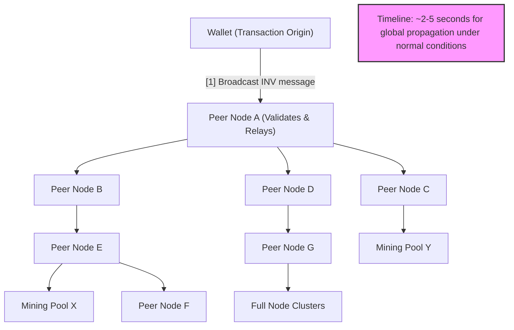

# Lesson 4: Network Protocol Dynamics

## 1. First-Principles Intuition & Invariants

Bitcoin's monetary policy emerges not from central bank committees or legislative decree but from a distributed network of rational economic actors enforcing consensus rules through computational proof-of-work. The network protocol operates as the constitutional substrate upon which all higher-order financial properties—scarcity, censorship resistance, settlement finality—are constructed. Understanding this protocol layer is essential for finance practitioners analyzing Bitcoin as an asset class, payment rail, or monetary instrument because network health directly determines settlement assurance, liquidity velocity, and systemic risk exposure.

The Bitcoin network architecture implements a peer-to-peer gossip topology without designated coordinator nodes or hierarchical authority structures. Every participating node maintains an identical copy of the blockchain ledger and independently validates all transactions against consensus rules encoded in software. This radical decentralization creates a trust-minimized system where no counterparty can unilaterally alter monetary policy, reverse settled transactions, or censor specific economic actors. From a finance perspective, this architectural choice trades off transaction throughput and latency for settlement assurance and jurisdictional neutrality—a deliberate engineering decision prioritizing final settlement credibility over payment processing efficiency.

The network protocol governs four fundamental information flows that together constitute Bitcoin's operational mechanics. Transaction propagation distributes unconfirmed payment instructions across the peer topology, enabling nodes to construct candidate blocks. Block relay transmits newly-mined blocks containing confirmed transactions, advancing the consensus chain and finalizing settlement. Mempool mechanics describe how nodes maintain queues of unconfirmed transactions, applying economic prioritization based on fee density to optimize block template construction. Network security protocols defend against eclipse attacks, Sybil attacks, and denial-of-service vectors that could partition the network or degrade consensus convergence. Each flow embodies specific economic incentives and information-theoretic constraints that shape Bitcoin's macroeconomic properties as a financial system.

The core invariant governing all network protocol behavior is incentive compatibility under Byzantine fault assumptions. Participants cannot be compelled to behave honestly through legal contracts or fiduciary duty; instead, the protocol aligns rational self-interest with network health through economic mechanism design. Miners commit capital expenditure to proof-of-work mining because successful block discovery yields block subsidy and transaction fee revenue. Full nodes voluntarily validate transactions despite receiving no direct payment because running a node enables trust-minimized verification of incoming payments—a service valuable to merchants, exchanges, and institutional custodians requiring settlement assurance without counterparty risk. Transaction originators attach fee premiums to incentivize miners to include their payments in the next block, creating a competitive fee market that dynamically prices blockspace scarcity.

From a monetary economics perspective, the network protocol implements a difficulty-adjusted proof-of-work consensus mechanism that targets deterministic supply issuance regardless of hashrate fluctuations or energy cost volatility. Every 2016 blocks—approximately two weeks—the network recalibrates mining difficulty to maintain an average ten-minute block interval, ensuring predictable monetary inflation aligned with Bitcoin's programmatic supply schedule. This automatic stabilization mechanism operates without human intervention, creating a monetary base expansion trajectory independent of political pressure or institutional discretion. The result is a credibly neutral settlement layer whose monetary properties derive from thermodynamic proof rather than institutional promise.

Transaction settlement finality in Bitcoin emerges probabilistically rather than through instant finality guarantees characteristic of traditional payment networks. A transaction included in the most-recent block achieves one confirmation, representing roughly 99.9% settlement assurance for small-value payments. Each subsequent block adds cumulative proof-of-work, exponentially reducing the probability that an attacker could reorganize the chain and reverse the transaction. Industry convention treats six confirmations—approximately one hour—as practical finality for high-value settlements, reflecting the astronomical computational cost required to rewrite six blocks of accumulated proof-of-work. This probabilistic settlement model differs fundamentally from instant finality in systems like Fedwire or SWIFT, where centralized operators provide immediate irrevocability guarantees. Bitcoin's approach trades off settlement speed for elimination of trusted intermediaries, creating a system where finality emerges from thermodynamic expenditure rather than counterparty creditworthiness.

The economic topology of the Bitcoin network exhibits characteristics of both a public good and a commons resource. The blockchain ledger itself functions as a non-excludable, non-rivalrous public good—anyone can verify the chain's integrity without diminishing others' ability to do so. However, blockspace for transaction inclusion represents a rivalrous common resource subject to congestion externalities. When network demand exceeds the protocol's constrained throughput capacity of approximately 500,000 transactions per day, users compete through fee auctions to secure inclusion in the next block. This creates a dynamic fee market where transaction urgency and economic value determine prioritization, analogous to congestion pricing in highway tolls or peak-hour electricity rates. Understanding these dual economic properties—public good verification combined with scarce blockspace allocation—is essential for modeling Bitcoin's role in portfolio construction and payment system design.

## 2. Core Architecture & Mechanics

The Bitcoin network topology implements an unstructured peer-to-peer overlay network where nodes maintain connections to approximately eight outbound peers and accept up to 125 inbound connections from other participants. This random mesh architecture prevents the formation of central hubs whose failure or compromise could fragment the network, while providing sufficient redundancy that transaction and block propagation reach all reachable nodes within seconds. Each node discovers peers through a bootstrapping process involving hardcoded DNS seed addresses and peer-exchange protocols, gradually constructing a diverse connection set spanning multiple autonomous systems and geographic regions. The deliberate absence of supernode hierarchies or designated relay infrastructure creates a flat topology resistant to targeted disruption or regulatory capture.

When a wallet constructs a new transaction, it broadcasts the signed transaction to its connected peers using the Bitcoin protocol's inventory announcement mechanism. Each receiving node validates the transaction against consensus rules—verifying cryptographic signatures, checking that inputs reference unspent outputs, confirming that total outputs do not exceed inputs plus acceptable fee—and upon successful validation, adds the transaction to its local mempool while relaying the inventory announcement to its own peers. This recursive gossip propagation ensures that within seconds, a transaction initiated anywhere in the world reaches mining nodes worldwide, ready for inclusion in the next candidate block.



The mempool constitutes each node's local queue of valid but unconfirmed transactions awaiting inclusion in a block. Nodes maintain independent mempools with potentially divergent contents due to network latency, policy variations, and local resource constraints. Transaction selection from the mempool follows a fee-rate optimization strategy where miners construct block templates prioritizing transactions offering the highest fee per byte, maximizing revenue within the one-megabyte base block size limit. This creates a continuous fee market where users signal transaction urgency through attached fees—low-fee transactions may wait hours or days during congestion periods, while high-fee transactions achieve next-block confirmation even under peak demand.

The mempool's economic function resembles an order book in traditional financial markets. Just as limit orders queue in an exchange's order book awaiting execution when market price reaches their specified level, transactions queue in the mempool awaiting inclusion when their fee rate exceeds the marginal cost of blockspace. During low-demand periods, the mempool clears completely as blocks include all pending transactions regardless of fee rate. During high-demand episodes—such as during speculative mania or when novel protocols like Ordinals inscriptions drive blockspace demand—the mempool swells to hundreds of megabytes, and only transactions offering fees exceeding 50-100 satoshis per byte achieve timely confirmation. This dynamic pricing mechanism allocates scarce blockspace to highest-value use cases, implementing a decentralized auction without central market-maker intermediation.

Block relay implements a distinct propagation pathway optimized for the larger data volumes and critical timing requirements of newly-mined blocks. When a miner discovers a valid proof-of-work solution, they immediately broadcast the block header to connected peers using compact block relay protocols that minimize bandwidth consumption. Nodes receiving the compact block can reconstruct the full block from transactions already present in their mempool, requesting only the small fraction of transactions they have not yet seen. This optimization reduces block propagation latency from several seconds to under 500 milliseconds for well-connected nodes, critical for minimizing orphan risk and ensuring rapid consensus convergence across the global network.

```text
Block Relay Protocol Sequence

Mining Pool discovers valid nonce
    |
    | [1] Construct full block (header + transactions)
    v
    | [2] Broadcast CMPCTBLOCK message (compact representation)
    v
Connected Peers (Well-connected nodes)
    |
    | [3] Reconstruct block from mempool transactions
    | [4] Request missing transactions via GETBLOCKTXN
    v
    | [5] Validate block (PoW, Merkle root, consensus rules)
    v
    | [6] Relay to own peers recursively
    v
Network-wide propagation: 95% of nodes within 2-3 seconds
                         99% of nodes within 5-10 seconds
```

The economic incentive structure governing block relay creates a principal-agent alignment between miners and the broader network. Miners benefit from rapid block propagation because delayed propagation increases the probability that competing miners working on the same block height will discover alternative blocks, creating temporary forks and orphaning the slower block. Orphaned blocks yield no revenue despite consuming energy and capital, representing pure economic loss. This incentivizes miners to maintain high-quality network connections, participate in relay networks like FIBRE and Falcon, and adopt protocol optimizations like compact blocks that accelerate propagation. The result is a distributed system where profit-maximizing behavior by self-interested miners naturally produces rapid information dissemination beneficial to overall network health.

Network security protocols defend against adversarial actors attempting to manipulate transaction visibility or partition consensus groups. Eclipse attacks isolate target nodes by monopolizing their peer connections, enabling attackers to feed victims falsified blockchain views or censor specific transactions. Bitcoin's defense mechanisms include randomized peer selection, diverse peer connection requirements spanning multiple netgroups, and honest peer connection persistence that prefers long-lived legitimate connections over newly-announced peers. These countermeasures make eclipse attacks costly and detectable, requiring attackers to control substantial infrastructure across diverse network locations.

Sybil attacks attempt to flood the network with pseudonymous attacker-controlled nodes to gain disproportionate influence over topology or consensus. Bitcoin mitigates Sybil attacks through proof-of-work's resource-intensive consensus mechanism, which prevents attackers from cheaply manufacturing voting influence. While an attacker can trivially spin up thousands of full node peers, these nodes carry no weight in consensus determination—only miners contributing computational work influence which chain achieves the most cumulative difficulty. This separation between routing-layer participation (cheap, requiring only network bandwidth) and consensus-layer influence (expensive, requiring capital-intensive mining hardware) prevents Sybil attacks from undermining Bitcoin's security model.

Denial-of-service attacks target node resource exhaustion through floods of invalid transactions, excessive connection requests, or bandwidth-consuming spam. Bitcoin nodes implement rate limiting, connection throttling, and resource-bounded validation queues that prevent individual malicious peers from monopolizing CPU cycles or memory. Nodes ban peers exhibiting abusive behavior patterns, gradually constructing reputation-based connection policies that preferentially maintain connections to well-behaved participants. These distributed defenses operate without centralized coordination, relying instead on each node's local policy enforcement to collectively harden network resilience against volumetric attacks.

## 3. High-Performance Optimization & Failure Modes

Optimizing network protocol performance for institutional deployment requires understanding the latency-throughput-security tradeoff space and implementing architectural patterns aligned with specific operational requirements. Exchanges and payment processors prioritizing low-latency transaction detection deploy high-bandwidth full nodes with extensive peer connections exceeding 100 outbound connections, ensuring rapid visibility into newly-broadcast transactions before first confirmation. These nodes sacrifice bandwidth and computational resources to minimize the probability of missing transactions due to propagation delays or adversarial filtering, critical for detecting double-spend attempts and managing hot-wallet exposure.

Mining operations optimize for block relay latency rather than transaction propagation speed, since milliseconds of delay in receiving newly-mined blocks translate directly to wasted hashrate and orphan risk. Professional mining pools operate dedicated relay networks using protocols like FIBRE (Fast Internet Bitcoin Relay Engine) that bypass standard gossip propagation through direct UDP block announcements to strategic relay nodes. These relay networks reduce intercontinental block propagation from multi-second delays to sub-200-millisecond latencies, providing competitive advantage in the race to build upon the most-recent block. The economic value of such optimizations scales with mining revenue—a large pool generating multiple blocks daily can justify significant infrastructure investment to reduce orphan probability by even fractional percentages.

Mempool management strategies differ significantly between node operators based on their economic role within the Bitcoin ecosystem. Miners maximize fee revenue through sophisticated mempool algorithms that account for child-pays-for-parent (CPFP) dynamics, where high-fee transactions depend on unconfirmed low-fee parent transactions, requiring both to be included together. Transaction accelerator services construct mempool views optimized for identifying stuck low-fee transactions amenable to CPFP acceleration, creating business models around providing faster confirmation services. Lightweight nodes operated by consumer wallets may maintain minimal or zero mempool state, relying instead on third-party APIs to estimate appropriate fee rates, trading off sovereignty for reduced resource requirements.

The fee estimation problem constitutes a critical operational challenge for financial applications building on Bitcoin. Accurate fee estimation requires modeling mempool depth dynamics, historical confirmation time distributions, and predicting future transaction demand—a forecasting problem analogous to volatility prediction in derivatives pricing. Overpaying fees wastes capital, particularly problematic for high-frequency payment applications like Lightning Network channel management or exchange consolidation transactions. Underpaying fees risks delayed confirmation and poor user experience, potentially causing operational disruptions during time-sensitive settlement windows. Sophisticated fee estimation algorithms implement machine learning models trained on historical mempool data, incorporate real-time mempool monitoring via well-connected nodes, and dynamically adjust estimates based on time-of-day patterns and recent blockchain congestion trends.

Network partition scenarios represent the most severe failure mode confronting Bitcoin's protocol layer. If the global network fragments into isolated subgraphs unable to communicate—whether due to nation-state internet censorship, submarine cable failures, or coordinated denial-of-service attacks—each partition continues producing blocks independently, creating divergent blockchain histories. Upon reconnection, the network converges to the chain with greatest cumulative proof-of-work, orphaning all blocks produced on minority partitions. This creates settlement reversal risk for transactions confirmed only on the ultimately-orphaned chain, potentially enabling double-spend attacks against merchants and exchanges operating within the minority partition.

Mitigating partition risk requires network topology diversity spanning multiple autonomous systems, internet service providers, and jurisdictional boundaries. Institutional operators deploy geographically-distributed node clusters with satellite backup connectivity and mesh network fallback options, ensuring continued network visibility even during regional internet disruptions. Tor-enabled nodes provide censorship-resistant connectivity bypassing nation-state firewalls, critical for maintaining global network coherence under adversarial conditions. The economic incentive to maintain connectivity derives from the catastrophic settlement risk posed by operating on a minority fork—exchanges processing deposits on a chain that subsequently gets orphaned face complete loss of deposited funds, creating strong motivation to invest in redundant connectivity infrastructure.

Eclipse attack defense in production environments combines network-layer diversity with application-layer monitoring. Operators configure nodes to maintain peer connections across diverse ASNs and geographic regions, preventing attackers from monopolizing connectivity through control of a single network provider. Continuous monitoring compares local blockchain state against multiple independent block explorers and peer nodes, triggering alerts when discrepancies suggest potential eclipse conditions. Some institutions operate multiple independent full nodes in different data centers with diverse connectivity, cross-validating blockchain views to detect and respond to isolation attempts before settlement decisions are made based on potentially-falsified chain state.

The long-term economic sustainability of Bitcoin's network protocol depends critically on the fee market transition occurring as block subsidies decline through successive halvings. Currently, miners derive approximately 95% of revenue from block subsidies with transaction fees contributing only marginally. As subsidies approach zero over the next century, transaction fees must grow to represent the entirety of mining revenue, incentivizing sufficient hashrate to secure the network against double-spend attacks. This transition creates macroeconomic uncertainty around whether fee revenue will scale adequately to maintain security, or whether security budget constraints will emerge as block subsidies diminish. Some economic models suggest that Layer 2 protocols like Lightning Network may process the majority of retail payment volume, concentrating only final settlement transactions on the base layer and creating a high-value, low-volume fee market supporting security through expensive but infrequent settlements.

Protocol development and upgrade mechanisms operate through a carefully-designed social consensus process balancing innovation against stability and decentralization. Unlike traditional financial infrastructure where central operators deploy upgrades through administrative authority, Bitcoin protocol changes require voluntary adoption by economically-significant node operators, miners, and users. Soft fork upgrades maintain backward compatibility, allowing upgraded nodes to enforce stricter rules while legacy nodes continue validating blocks as valid under old rules. Hard fork upgrades break backward compatibility, requiring coordinated simultaneous upgrades across the network or resulting in permanent chain splits. The high coordination cost and risk of contentious splits creates strong status-quo bias, slowing protocol evolution but preventing centralized control over monetary policy or consensus rules—a deliberate tradeoff prioritizing credible neutrality over rapid feature deployment.

Recent protocol innovations illustrate the tension between network capacity expansion and preserving decentralization properties. Segregated Witness (SegWit) implemented in 2017 increased effective block capacity to approximately 2.7 megabytes while fixing transaction malleability, enabling Layer 2 protocols like Lightning Network. Taproot activated in 2021 introduced Schnorr signatures and MAST contracts, improving privacy and smart contract efficiency. Both upgrades proceeded through multi-year development and testing cycles, extensive public review, and gradual voluntary adoption, reflecting Bitcoin's conservative change management culture. This glacial pace frustrates proponents of rapid scaling but maintains the credible commitment to unchanging monetary policy that underpins Bitcoin's value proposition as sound money immune to discretionary supply manipulation.
