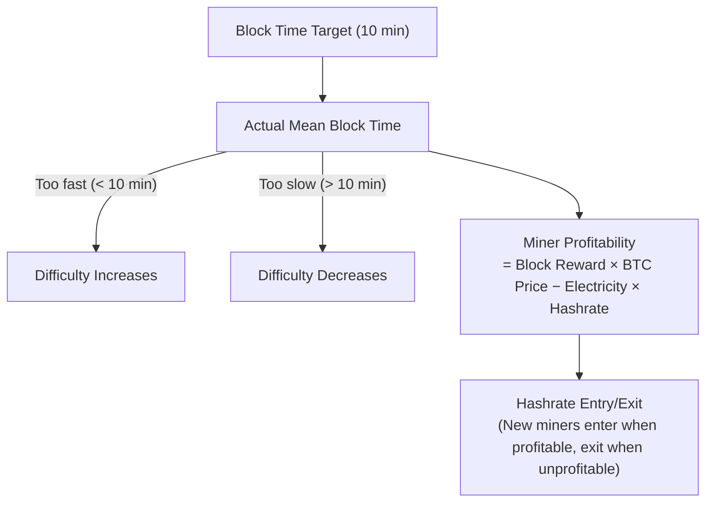

# Lesson 2: Cryptocurrency Design, Tokenomics, Monetary Policy

## 1. First-Principles Intuition & Invariants

Every monetary system rests on a single irreducible question: who decides how much money exists, and by what rule? For five thousand years the answer was institutional — kings debasing coinage, central banks expanding reserves, treasuries issuing debt that the banking system monetized. Cryptocurrency represents the first credible attempt to answer that question with code rather than authority. The rule is embedded in protocol, auditable by any node on the network, and — in the strongest designs — formally immutable. Understanding this shift from discretionary to algorithmic monetary policy is the foundational act of analysis before any tokenomics spreadsheet, any yield calculation, or any on-chain issuance model is worth examining.

The analogy to central banking is not rhetorical decoration. It is structurally exact. When a central bank commits to an inflation target, it is essentially programming a reaction function — the Taylor Rule being the canonical example — and asking the market to believe the commitment is credible. The entire architecture of modern independent central banking is an institutional technology for making that commitment binding against future political pressure. Bitcoin's protocol does the same thing in silicon: the commitment is not a policy statement by a governor but a consensus rule enforced by every validating node simultaneously. The credibility of the commitment derives not from institutional reputation but from the cost of overriding it, which requires controlling 51% of the network's hashing power — an attack whose economic viability collapses precisely as the network grows.

This creates a first invariant worth internalizing: **in cryptocurrency design, monetary policy is security policy.** A supply schedule that is easy to change is a supply schedule that an adversary can change. This conflation of economic rules with consensus rules is what makes tokenomics fundamentally different from traditional corporate finance or even traditional monetary economics. The supply of a government currency can be changed by a vote. The supply of Bitcoin can only be changed if the entire economic network — miners, full nodes, exchanges, custodians, and long-term holders — collectively consents to the change. In practice this means Bitcoin's 21-million-unit cap is not a policy, it is a Nash equilibrium: no individual participant has an incentive to defect from it because doing so would destroy the value of the coins they already hold.

### Monetary Quantity and the Velocity Equation

Before dissecting specific issuance mechanisms, the practitioner needs a theoretical anchor. The quantity theory of money, expressed in Irving Fisher's exchange equation, states:

$$MV = PQ$$

where $M$ is the money supply, $V$ is the velocity of circulation, $P$ is the aggregate price level, and $Q$ is real output. In a cryptocurrency context this equation remains valid but each term requires reinterpretation. $M$ becomes the circulating supply of tokens at any given block height — not the total issued supply, since coins locked in long-term holdings, lost wallets, or staking contracts do not circulate. $V$ is measurable on-chain through transfer volume relative to supply, often called the network velocity ratio. $P$ and $Q$ compress into the aggregate transaction throughput valued in some external numeraire, typically USD.

The policy implication is immediate. If a protocol commits to a fixed $M$ — as Bitcoin does asymptotically — then growth in $Q$ (more economic activity denominated in the token) must, by the equation of exchange, produce a falling $P$ (deflation in token-denominated prices) or a rising $V$ (faster circulation). Both effects have been empirically observed in Bitcoin's history: the secular appreciation of BTC against goods denominated in it, and the high velocity spikes during bull markets when speculative turnover overwhelms the base of productive transactional use.

Ethereum's design philosophy since EIP-1559 and the Merge represents a deliberate departure from this fixed-$M$ framework toward what its designers call an **ultra-sound money** regime — a floating but tightly governed supply that responds to network demand. This is conceptually closer to a price-level targeting regime than to a quantity rule, and analyzing it demands different tools.

### Utility Value vs. Store-of-Value vs. Security Token

A practitioner must distinguish three fundamentally different token value theories before modeling any specific asset, because the discount rate, the terminal value assumption, and the relevant risk factors are entirely different for each category.

The **medium-of-exchange model** values a token through its velocity and monetization of transaction flow. If a token is required to pay fees on a network, its value in equilibrium is approximately the present discounted value of the fee flow it captures, divided by its velocity. High velocity is a *liability* in this model because it implies the token is held for the minimum time necessary to transact, minimizing the demand to hold it.

The **store-of-value model** inverts this logic entirely. A token that functions as a savings vehicle needs to be held for extended periods, which suppresses velocity and increases the demand for the fixed stock. Bitcoin's monetary policy — the terminal supply cap, the halving schedule, the difficulty adjustment — is entirely optimized for this use case. The economic logic is Misesian: sound money is money whose supply cannot be inflated away by a discretionary authority, and the premium a sound-money token earns is precisely the premium that savers pay to escape the inflation tax.

The **productive-asset model** values a token as a claim on future cash flows generated by the network it governs or secures. This applies most cleanly to Proof-of-Stake networks where validators earn issuance and fee revenue, and where token holders who stake receive a yield while token holders who do not stake are diluted. This creates an explicit equity-like structure: the token is simultaneously the currency of the network and a share in its revenue, with dilution dynamics that mirror corporate equity issuance.

Understanding which model applies — and in most real networks some combination of all three applies — is the first step in any rigorous tokenomics analysis.

---

## 2. Core Architecture & Mechanics

### The Supply Schedule as a Constitutional Document

In traditional finance, a central bank's balance sheet policy is documented in monetary policy statements that can be revised quarterly. In a well-designed cryptocurrency, the supply schedule is encoded directly in the consensus rules and changing it requires a hard fork — a backward-incompatible protocol change that every node on the network must voluntarily adopt. This makes the supply schedule effectively constitutional: it can be amended, but only with overwhelming consensus, and the history of attempted supply schedule changes in major cryptocurrencies (Bitcoin Gold, various BCH forks) shows that markets consistently punish departures from the original monetary constitution with severe discount to the forked chain.

The practitioner should think of the supply schedule as a time-series function mapping block height to cumulative issuance:

$$S(h) = \sum_{k=0}^{h} r(k)$$

where $h$ is the block height and $r(k)$ is the block reward at height $k$. For Bitcoin, this function takes the specific stepped form of a geometric series:

$$r(k) = \frac{50}{2^{\lfloor k / 210000 \rfloor}} \text{ BTC}$$

The halving occurs every 210,000 blocks (approximately every four years at a ten-minute block target), and the total supply converges to:

$$S_{\infty} = 50 \cdot 210000 \cdot \sum_{n=0}^{\infty} \frac{1}{2^n} = 50 \cdot 210000 \cdot 2 = 21{,}000{,}000 \text{ BTC}$$

This is not an arbitrary number. It is the closed-form sum of a geometric series with ratio one-half, anchored to Satoshi's initial block reward of 50 BTC and the halving interval. The elegance of the design is that it produces a deflationary trajectory that asymptotically approaches the cap without ever requiring a protocol rule that actively burns coins.

### The Architecture of Proof-of-Work Mining Economics

Mining economics is best understood as a commodity industry with endogenous cost of production. The key insight — which professional analysts frequently underweight — is that the difficulty adjustment algorithm is a negative feedback loop that sets the network's marginal cost of production in real time.



This loop means Bitcoin's network has a mechanically enforced tendency toward a marginal cost equal to the block reward value. Miners who can produce hashes at below-average cost earn economic rents; those above average cost are progressively squeezed out as difficulty rises. This is precisely the competitive dynamics of a commodity market, and it has strong empirical support: the correlation between Bitcoin's market price and estimated cost of production — using electricity and hardware metrics — has historically been in the range of 0.70–0.85, though it breaks down sharply during speculative bubbles and miner capitulation events.

The miner's optimization problem can be stated formally. Let $\pi$ denote the hash rate of a single miner, $\Pi$ the total network hash rate, $R$ the block reward in BTC, $P$ the BTC/USD price, $c$ the electricity cost per terahash, and $e$ the energy efficiency of the miner's hardware in joules per terahash:

$$\text{Miner Profit} = \frac{\pi}{\Pi} \cdot R \cdot P - \pi \cdot e \cdot c$$

At equilibrium, free entry drives profit to zero:

$$\frac{\pi^*}{\Pi} \cdot R \cdot P = \pi^* \cdot e \cdot c$$

$$\Rightarrow \quad \Pi^* = \frac{R \cdot P}{e \cdot c}$$

This is the equilibrium hash rate as a function of price, block reward, hardware efficiency, and electricity cost. It tells us several things with direct policy relevance. First, a halving event that cuts $R$ by 50% will, holding all else equal, drive approximately half the network's hash rate offline until difficulty adjusts downward and the remaining miners return to profitability. This is the **miner capitulation** dynamic observed in the months following each halving. Second, improvements in $e$ (hardware efficiency, measured in J/TH) allow miners to remain profitable at lower prices and higher difficulty, explaining the persistent arms race in ASIC development. Third, cheap electricity is the dominant competitive advantage in mining, which is why mining has concentrated in jurisdictions with stranded hydroelectric capacity (Iceland, Sichuan, Paraguay) and, since China's 2021 ban, in U.S. states with low industrial power rates.

### Proof-of-Stake: Issuance as a Yield Instrument

The transition from Proof-of-Work to Proof-of-Stake fundamentally changes the economic structure of issuance. In PoW, new coins are paid to entities who perform external work (computation). In PoS, new coins are paid to entities who lock up existing coins as collateral — a process called staking. The economic function is different: instead of compensating for real resource consumption, issuance compensates for illiquidity and opportunity cost.

Ethereum's post-Merge issuance model is the most analytically interesting live example. The annual validator reward $Y$ as a function of the total staked ETH $S$ follows a square-root relationship derived from the protocol's target of preventing any single validator from holding outsized share of the network:

$$Y(S) = B \cdot \sqrt{S}$$

where $B$ is a base reward constant set by the protocol. As more ETH is staked, the total issuance rises, but the yield *per validator* falls, because:

$$y_{individual} = \frac{B \cdot \sqrt{S}}{S} = \frac{B}{\sqrt{S}}$$

This is an elegant supply-demand equilibrium mechanism. When staking yields are high (because $S$ is low), more validators are attracted to stake. As $S$ increases, yields fall, reducing the incentive for additional staking. The system converges toward a staking ratio determined by validators' opportunity cost — currently stabilizing in the range of 25–30% of circulating ETH supply.

The simultaneous burn mechanism introduced by EIP-1559 creates the deflationary counterweight. Under EIP-1559, every transaction on Ethereum pays a **base fee** that is algorithmically determined by block utilization and immediately destroyed:

$$\text{Net ETH Issuance} = \text{Staking Rewards} - \text{Base Fee Burns}$$

When network activity is high enough that the burn rate exceeds the issuance rate, ETH supply contracts. This is the ultra-sound money dynamic: ETH becomes deflationary precisely during periods of peak economic activity, which is when the network is most valuable. The chart of ETH's post-Merge net issuance shows periods of negative net supply growth during high-activity periods (NFT mints, DeFi liquidation cascades, airdrop claim rushes), confirming the mechanism functions as designed.

The flow architecture of EIP-1559 can be represented as follows:

```text
User Transaction
       │
       ▼
  ┌────────────────────────────────────┐
  │         Transaction Fee            │
  │                                    │
  │   Base Fee (algorithmic)           │──► BURNED (destroyed)
  │   + Priority Tip (user set)        │──► Validator
  └────────────────────────────────────┘
  
  Block Space Utilization
       │
       ├─── > 50% full ──► Base Fee increases next block
       └─── < 50% full ──► Base Fee decreases next block
  
  Net Supply Change per Block
  = Staking Issuance − Base Fee Burn
  = [B/√S × validators] − [base_fee × gas_used]
```

### Token Utility Models and the Demand-Side of the Value Equation

Supply schedules determine the numerator of the value fraction; utility models determine the denominator's driver — demand. The practitioner's toolkit here draws on the concept of **protocol revenue capture**, which asks what fraction of the economic value flowing through a network accrues to token holders rather than to validators, developers, or users.

The **fat protocol thesis**, articulated by Union Square Ventures in 2016, posited that value in blockchain networks accrues to the base layer protocol rather than the applications built on top, inverting the structure of traditional internet value capture where protocols (TCP/IP, HTTP) were commoditized and application layers (Google, Facebook) captured the value. The empirical record is mixed: Ethereum has captured enormous value at the protocol layer, but many layer-1 protocols with high total value locked (TVL) in applications have seen the protocol token significantly decouple from application-layer growth.

A more rigorous framework is the **monetary premium decomposition**, which separates a token's market capitalization into:

$$\text{Market Cap} = \text{Productive Value} + \text{Monetary Premium} + \text{Speculative Premium}$$

Productive value is the discounted cash flow from fee revenue and staking yield. Monetary premium is the incremental demand for the token as a savings vehicle, store of value, or collateral asset — the premium Bitcoin holders pay above any cash-flow-based valuation because they believe the token functions as digital gold. Speculative premium is the residual, driven by expectations of future adoption that have not yet materialized as cash flows.

For Bitcoin, productive value is currently near zero (there is no yield, and transaction fees are modest relative to market cap), and the entire valuation consists of monetary premium plus speculative premium. For Ethereum, productive value is non-trivial: at peak network activity, annualized burn plus staking yield represents a meaningful fraction of market cap, and the asset begins to be analyzable by modified DCF methods.

---

## 3. High-Performance Optimization & Failure Modes

### Game-Theoretic Security and the 51% Attack Surface

The security of a Proof-of-Work network is ultimately an economic problem, not a cryptographic one. The hash functions used (SHA-256 for Bitcoin, Ethash/Keccak for pre-Merge Ethereum) are not broken by a 51% attack — the attacker simply acquires enough hashing power to outpace the honest chain. The cost of that attack is therefore the floor price of the security guarantee.

The standard framework for analyzing 51% attack cost uses the concept of **cost-to-attack ratio**:

$$\text{Attack Cost} = \text{Hashrate Required} \times \text{Hardware Cost} + \text{Electricity Cost} \times \text{Attack Duration}$$

For Bitcoin at current hash rates (approximately 600 EH/s as of mid-2024), acquiring 51% of network hash rate would require capital expenditure in the tens of billions of dollars in ASIC hardware alone, plus several dollars per second in electricity. The attack therefore only makes economic sense if the attacker can extract more value than the attack costs — primarily through double-spend fraud on exchange deposits. For large networks with deep liquidity and standard exchange confirmation requirements (6+ blocks for Bitcoin, representing one hour of confirmation), the double-spend profit is structurally limited below the attack cost, making the attack economically irrational.

This is not a universal guarantee. Smaller Proof-of-Work networks with market caps in the tens of millions of dollars are acutely vulnerable. The critical vulnerability emerges when **rental attack capacity exists**: if a large population of ASIC hardware is available for short-term rental (via NiceHash or similar platforms) that exceeds the target network's deployed hash rate, an attacker need not purchase hardware. They rent it for the duration of the attack, reducing the fixed cost component substantially. Ethereum Classic (ETC) suffered three successful 51% attacks in 2020 for precisely this reason — Ethash hardware that had been deployed for Ethereum proper was available for rent at a price point below ETC's potential double-spend profit.

The game-theoretic security model for Proof-of-Stake is structurally different. The attacker must acquire 33% of staked supply (to disrupt finality) or 51% (to control block production). This requires buying the token in the open market, which creates a self-defeating price impact — the act of accumulating the attack stake drives up the price of the very asset the attacker is trying to attack. Additionally, the protocol can **slash** an attacker's stake upon detection of equivocation (signing two conflicting blocks), creating a direct financial loss that functions as a bonded penalty:

$$\text{Slashing Penalty} = \alpha \cdot S_{validator}$$

where $\alpha$ is the protocol's slashing rate (typically 1/32 of the validator's stake for minor offenses, up to the full stake for coordinated attacks) and $S_{validator}$ is the validator's staked balance. This penalty structure is a Vickrey-Clarke-Groves-adjacent mechanism that makes honest behavior the dominant strategy for validators with any finite discount rate, as long as the expected cost of slashing exceeds the expected profit from the attack.

### Inflationary vs. Deflationary Dynamics and Long-Run Protocol Viability

The transition from inflationary issuance to fee-sustained security is the central long-run sustainability challenge for every Proof-of-Work cryptocurrency. Bitcoin's block subsidy halves approximately every four years, and by 2140 issuance falls effectively to zero. At that point, miner revenue must come entirely from transaction fees. The protocol's long-run security depends on whether fee revenue in that future state is sufficient to sustain a hash rate that makes 51% attacks economically irrational.

The concern is real and quantitative. If the fee market is thick — meaning high transaction volume at competitive fee rates — miner revenue may sustain security even without subsidy. If the fee market is thin (because Bitcoin has been superseded as a payment medium, leaving only high-value settlement transactions), fee revenue may be insufficient. The practitioner should model this as a present-value problem: the expected present value of fee revenues conditional on various adoption scenarios, discounted at the appropriate risk-adjusted rate for a 100-year horizon. This is not a tractable closed-form calculation, but sensitivity analysis across fee-per-transaction and transactions-per-block assumptions is informative.

The contrasting risk for inflationary protocols is dilution. Many DeFi protocols launched between 2020 and 2022 issued governance tokens with extremely aggressive initial emission schedules — sometimes 50–80% of total supply in the first two years — to bootstrap liquidity through yield farming. The economic effect was a persistent selling pressure from yield farmers who had no underlying demand for the token and immediately sold issuance rewards for stablecoins. The empirical pattern across protocols such as Sushiswap, Compound, and many others shows a consistent decay profile: token price declines roughly proportionally to the emission rate during the high-inflation early period, with the decline steepening when liquidity mining incentives are the primary marginal buyer.

This failure mode is formalized in what practitioners call the **mercenary capital problem**: capital attracted purely by yield will depart precisely when yield decreases, leaving the protocol with less liquidity than before the incentive campaign. The fix is not higher emissions but better-designed incentive structures that align capital duration with protocol needs — veToken models (veCRV, veBAL) being the most sophisticated live attempt, which locks tokens for extended periods in exchange for boosted yields and governance rights, transforming a marginal speculator into a vested stakeholder.

### The veToken Model and Long-Duration Incentive Design

Curve Finance's vote-escrowed CRV model is the canonical advanced case study in tokenomics mechanism design. The core mechanism is straightforward: CRV token holders lock their tokens for a period between one week and four years, receiving veCRV in proportion to both the amount locked and the duration:

$$\text{veCRV} = \text{CRV locked} \times \frac{t_{lock}}{t_{max}}$$

where $t_{max}$ is four years. veCRV is non-transferable and decays linearly toward zero as the lock expiration approaches. Holders of veCRV receive a share of Curve's protocol fees (50% of trading fees are distributed to veCRV holders), a governance vote to direct CRV liquidity mining emissions toward specific pools, and a yield boost multiplier of up to 2.5× on their own liquidity provision in Curve pools.

The economic consequences of this design are significant. First, locking creates artificial scarcity of circulating CRV, reducing sell pressure from yield farmers. Second, the governance vote over emissions creates a secondary market for influence — protocols that want their stablecoin pools to have high CRV emissions must either acquire veCRV themselves (the **bribe** market, formalized by platforms like Votium) or convince large veCRV holders to vote their way. This created the **Curve Wars** of 2021–2022, in which protocols including Convex Finance, Yearn Finance, and Frax Protocol spent hundreds of millions of dollars acquiring veCRV to control CRV emissions, effectively turning a tokenomics mechanism into a geopolitical competition for liquidity.

The practitioner-level lesson is that tokenomics mechanisms designed to solve one problem (mercenary capital flight) will generate second-order game-theoretic effects (bribery markets, protocol wars for emission control) that the designers did not anticipate. This is Hayek's local knowledge problem manifesting in mechanism design: the full set of strategic behaviors available to sophisticated actors in a permissionless environment is not computable by any designer ex ante. The implication for analysis is that any tokenomics model should be stress-tested not just for its mechanical properties but for the equilibrium strategies it induces among rational actors with heterogeneous objectives and endowments.

### Failure Mode Taxonomy and Practitioner Risk Framework

The practitioner needs a systematic framework for diagnosing tokenomics failure modes before committing capital or analytical resources. The dominant failure modes fall along two axes: **supply-side failures** (issuance creates persistent sell pressure that undermines price, security, or utility) and **demand-side failures** (utility assumptions that do not materialize in practice).

Supply-side failures include hyperinflationary emission schedules where total issuance growth outpaces adoption, **rug-pull dynamics** where founding team allocations vest without lockups and founders sell into initial liquidity, and **unlock cliffs** where large tranches of venture or team tokens unlock simultaneously, creating predictable selling windows. The practitioner should always download the full token allocation table and vesting schedule before any analysis, map cumulative unlock events against the emission schedule, and model the worst-case daily selling pressure from each category of unlock.

Demand-side failures are more subtle. **Circular demand** is the most dangerous: a token's primary utility is to earn more of the token (staking for staking rewards denominated in the same token), which creates value only as long as new buyers enter the system. This is structurally identical to a Ponzi scheme, though with varying degrees of intentionality. Terra/Luna's design — where UST demand was sustained primarily by an unsustainable 20% yield offered on Anchor Protocol, funded by Luna issuance rather than productive revenue — is the most catastrophic recent example of circular demand dynamics at scale. The death spiral that destroyed approximately $40 billion in nominal value in seventy-two hours in May 2022 followed directly from the design: when UST demand faltered and the peg broke, the algorithmic mint/burn mechanism required issuing enormous quantities of Luna to absorb the UST redemptions, hyperinflating Luna's supply, destroying its price, and removing the remaining collateral backing UST — an endogenous feedback loop with no floor.

The analytical safeguard against circular demand is to identify whether the protocol generates **exogenous revenue** — fees paid by users for services they would pay for even if the token had no appreciating value. Uniswap's trading fees are exogenous: traders pay them because they want the trade executed, independent of UNI's price. Curve's fees are exogenous: stablecoin swappers pay them for low-slippage execution. A protocol whose only revenue source is issuance to its own holders is not generating exogenous revenue, and no amount of sophisticated veToken mechanics can substitute for that fundamental economic foundation.

The final consideration for practitioners is **regulatory and legal design risk**, which increasingly intersects with tokenomics architecture. Tokens designed with explicit cash flow distributions to holders (dividends, buybacks, profit shares) face the strongest argument for classification as securities under the Howey test, which requires the registration obligations and investor protection disclosures of traditional securities. This has driven many protocols toward pure governance token designs where holders receive voting rights rather than cash flows, or toward fee burn models (Ethereum's EIP-1559, BNB's quarterly burns) where value accrues to holders through supply reduction rather than explicit distribution. The economic effect may be equivalent, but the legal form matters for the access of retail participants and institutional custodians to the asset. The practitioner must model these constraints as real costs in the token's value framework — not because the law is economically efficient in its distinctions, but because regulatory overhang is a priced risk that affects discount rates and addressable market size.

The deepest invariant that emerges from examining all these mechanisms together is that tokenomics is not financial engineering applied to digital assets — it is mechanism design under adversarial conditions, where every incentive you create will be gamed by the most sophisticated actor who encounters it. The discipline demands simultaneous fluency in monetary economics, game theory, institutional economics, and empirical on-chain data analysis. The protocols that survive over decade-long timeframes are not the ones with the most sophisticated emission curves but the ones that correctly identified the equilibrium behavior of their participants and designed rules robust to the full range of that behavior.
