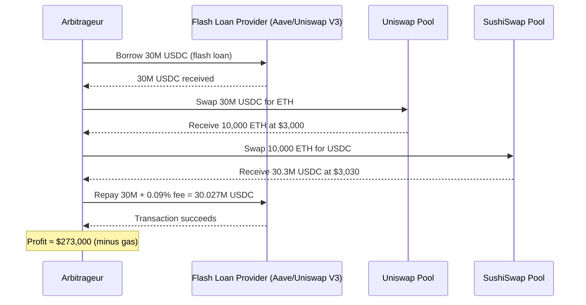

# Lesson 4: Advanced DeFi—Derivatives, Yield Optimization, Systemic Risks

## 1. First-Principles Intuition & Invariants

Traditional financial derivatives exist to solve a fundamental economic problem: the separation and transfer of price risk from those who bear it involuntarily to those who willingly accept it for a premium. A wheat farmer hedges against harvest-price collapse by selling futures; an airline hedges jet-fuel costs by buying oil options; a pension fund hedges duration risk by swapping fixed for floating. In each case, the derivative's value derives from a benchmark asset, and its economic function is risk reallocation. Decentralized finance inherits this exact utility but changes the institutional substrate on which derivatives are constructed. There is no clearinghouse, no prime broker, no margin clerk, no legal enforcement of collateral obligations. Instead, the entire apparatus of counterparty risk management is encoded directly into smart contracts that execute autonomously on a public blockchain, visible to anyone and alterable by no one without governance consensus.

The foundational invariant of DeFi derivatives is therefore **trustless over-collateralization**. Traditional derivatives operate on a credit-extension model: a broker evaluates your creditworthiness, allows you to post partial margin, and extends leverage against the expectation that you will meet margin calls or be liquidated through a legal process. DeFi inverts this. Because no counterparty can assess identity or enforce legal recourse—blockchain addresses are pseudonymous and often irreversibly anonymous—the system must assume default is always imminent and pre-fund it. Every derivative position must be backed by collateral locked at the contract level, typically in excess of the position's notional value, and liquidation mechanics are automated and parametric rather than discretionary. This is the economic equivalent of requiring 100% cash collateralization for every forward contract, which would be commercially absurd in traditional finance but becomes the load-bearing invariant of on-chain markets.

The second invariant is **oracle dependency**. A derivative contract needs a reference price to determine settlement values, margin adequacy, and liquidation triggers. In traditional finance, this is handled by regulated exchanges and data vendors operating under legal liability for accurate reporting. On-chain, the contract itself is blind to the external world—it cannot natively observe the USD price of Ethereum or the level of the S&P 500. An oracle is the bridge: a mechanism, typically a median of off-chain price feeds reported by a decentralized set of node operators (as in Chainlink) or an on-chain time-weighted average price derived from a deep AMM pool (as in Uniswap's TWAP), that injects external price information into the contract's execution logic. The oracle is the single most critical attack surface in DeFi derivatives, because if the price is wrong, every downstream mechanism—margin checks, liquidations, funding rate settlements—will execute on false premises and move real value to the attacker.

The third invariant is **composability**, the property that allows any DeFi protocol's smart contract to call, integrate with, or build upon any other protocol's contracts without permission. Composability is the source of DeFi's most powerful innovation: the ability to construct multi-layered financial products in a single transaction. A user can deposit ETH into MakerDAO to mint DAI, lend that DAI to Aave to receive aDAI interest-bearing tokens, post those as collateral on a perpetual futures exchange to open a leveraged ETH long, and hedge the resulting exposure with put options on an options AMM—all atomically. But composability is also the source of DeFi's most dangerous systemic property: **cascading contagion**. Each protocol in the chain depends on the correctness and solvency of every upstream protocol, and a failure at any node propagates through the entire stack. The economic analogy is a financial network where every institution is simultaneously a counterparty to every other institution through rehypothecated collateral, except that the linkages are explicit and machine-readable rather than opaque and mediated through legal entity structures.

These three invariants—over-collateralization, oracle dependency, and composability—define the frontier of what DeFi derivatives can achieve and where they fail. Traditional derivatives theory tells us that risk can be decomposed, priced, and transferred efficiently given sufficiently deep markets and reliable price discovery. The DeFi challenge is replicating that efficiency without the institutional scaffolding of legal enforcement, identity verification, and discretionary risk management, relying instead on code, collateral, and cryptographic guarantees.

## 2. Core Architecture & Mechanics

### Perpetual Futures and the Funding Rate Mechanism

A perpetual futures contract, or "perp," is a derivative that replicates the payoff of a futures contract but never expires. In traditional futures markets, convergence between the futures price and the spot price is enforced by physical or cash settlement at a fixed expiry date. As expiry approaches, arbitrageurs can buy spot and sell futures (or vice versa) to capture the basis, and this arbitrage pressure forces the two prices together. A perpetual contract has no expiry, so there is no natural convergence mechanism. The funding rate replaces expiry-based settlement as the mechanism that anchors the perp price to the underlying spot index.

The funding rate is a periodic payment exchanged between long and short position holders. When the perp trades above the spot index, longs pay shorts; when it trades below, shorts pay longs. The economic logic is straightforward: if the derivative is overpriced relative to spot, longs are penalized for holding an asset that should be cheaper, creating an incentive to sell or flip short, which drives the price back toward the index. The funding rate is typically computed as:

$$f_t = \frac{P_{\text{mark}} - P_{\text{index}}}{P_{\text{index}}} \times \frac{1}{T_{\text{interval}}}$$

where $P_{\text{mark}}$ is the current mark price of the perpetual contract, $P_{\text{index}}$ is the oracle-reported spot index price, and $T_{\text{interval}}$ is the normalization factor for the funding period. On major exchanges like dYdX or Hyperliquid, funding is typically charged every eight hours, though continuous funding accrual has become increasingly common to prevent large discrete jumps. The sign and magnitude of $f_t$ directly encode the market's directional skew: a persistently positive funding rate signals net long speculation, and a deeply negative rate signals crowded shorts.

The liquidation mechanism is the second critical component of perp architecture. Because positions are over-collateralized, the protocol must automatically close positions before their margin falls below zero to protect the insurance fund—a protocol-managed reserve that backstops losses from adverse liquidations. The liquidation engine monitors each account's maintenance margin ratio:

$$MMR = \frac{\text{Equity}}{\text{Position Notional}}$$

where Equity is the account's total collateral value adjusted for unrealized P&L. When the mark price moves such that $MMR$ falls below the protocol's maintenance threshold (typically 5% to 10% depending on the asset and leverage tier), the position becomes eligible for liquidation. Liquidators—often automated bots—can submit orders to close the undercollateralized position, receiving a portion of the remaining margin as a "liquidation penalty" or "keeper fee" for providing this service. The rest is returned to the liquidated user. If the market gaps severely and the liquidated position's losses exceed its remaining collateral, the insurance fund absorbs the shortfall. If the insurance fund is exhausted—a catastrophic failure mode—the exchange enters socialized loss mode, where profitable traders' gains are haircut to cover the deficit.

```text
┌─────────────────────────────────────────────────────────────────┐
│                  PERPETUAL FUTURES ARCHITECTURE                  │
├─────────────────────────────────────────────────────────────────┤
│                                                                 │
│  ┌──────────────┐     ┌──────────────────┐    ┌──────────────┐  │
│  │  Oracle Feed │────▶│  Funding Engine  │───▶│ P&L Settle   │  │
│  │ (Chainlink/  │     │  f = (Pmark-     │    │ Mark-to-     │  │
│  │  TWAP/Pyth)  │     │  Pindex)/Pindex  │    │ Market       │  │
│  └──────────────┘     └──────────────────┘    └──────────────┘  │
│         │                        │                     │        │
│         ▼                        ▼                     ▼        │
│  ┌──────────────┐     ┌──────────────────┐    ┌──────────────┐  │
│  │ Price Index  │     │  Margin Engine   │───▶│ Liquidation  │  │
│  │ Aggregator  │     │  MMR = Equity /  │    │ Engine       │  │
│  └──────────────┘     │  Notional       │    │ (Keeper Bots)│  │
│                       └──────────────────┘    └──────────────┘  │
│                                  │                     │        │
│                                  ▼                     ▼        │
│                       ┌──────────────────────────────────────┐  │
│                       │         Insurance Fund                │  │
│                       │  (Backstops liquidation deficits)     │  │
│                       └──────────────────────────────────────┘  │
│                                                                 │
└─────────────────────────────────────────────────────────────────┘
```

### Options Protocols and On-Chain Greeks

Options in DeFi face a problem that traditional exchanges solve through market makers and electronic order books: liquidity provision and price discovery for instruments with complex, non-linear payoff structures. Most DeFi options protocols bypass order books entirely and use automated market makers (AMMs) modeled on the Black-Scholes framework. The fundamental architectural insight is that an options AMM is a volatility seller—a liquidity provider deposits collateral into a pool, and the pool writes options against that collateral, earning premium income while bearing volatility risk.

The Black-Scholes formula for a European call option provides the theoretical fair value:

$$C = S_0 \cdot N(d_1) - K \cdot e^{-rT} \cdot N(d_2)$$

where:

$$d_1 = \frac{\ln(S_0/K) + (r + \sigma^2/2)T}{\sigma\sqrt{T}}, \quad d_2 = d_1 - \sigma\sqrt{T}$$

Here $S_0$ is the current spot price, $K$ is the strike, $r$ is the risk-free rate, $T$ is time to expiry, $\sigma$ is implied volatility, and $N(\cdot)$ is the cumulative standard normal distribution. On-chain, the protocol does not rely on users quoting prices; rather, the AMM computes a fair option price using a volatility input and adjusts that input based on demand. When the pool sells options, its implied volatility parameter rises (making options more expensive, reflecting reduced risk appetite or inventory pressure); when it buys options back or sees low demand, volatility falls. This creates a dynamic, demand-responsive pricing curve analogous to the constant-product AMM ($x \cdot y = k$) used by Uniswap, but parameterized by Black-Scholes variables rather than a simple invariant.

Protocols like Lyra and Deribit-style AMMs extend this with explicit management of the option Greeks. The delta of a position—$\Delta = N(d_1)$—measures exposure to spot price changes and must be hedged by holding or shorting the underlying. The gamma—$\Gamma = N'(d_1)/(S_0\sigma\sqrt{T})$—measures the rate of change of delta and is the primary risk for an option writer, as it causes hedging costs to explode near the strike at expiry (the "gamma squeeze"). On-chain protocols handle delta hedging either by automatically buying or selling the underlying through a spot AMM or by outsourcing the risk to hedgers who earn fees for providing delta-neutral liquidity. The economic efficiency of these protocols depends critically on the accuracy of their volatility oracle: if the protocol's implied volatility lags the real market, arbitrageurs can systematically buy underpriced or sell overpriced options, draining the pool.

### Synthetic Assets and the Debt Pool Model

Synthetic assets are on-chain derivatives that track the price of an external asset without requiring ownership of the underlying collateral. The dominant architecture, pioneered by Synthetix, uses a pooled collateral and shared debt model rather than bilateral contracts. Users lock a base collateral asset—originally SNX, the protocol's native token, now increasingly ETH or other blue-chip assets—into the protocol's contract and mint a debt denominated in a synthetic USD equivalent (sUSD). This debt is over-collateralized at a ratio typically set at 400% or higher, far more conservative than lending protocols, because the collateral itself is volatile and the protocol must ensure solvency across extreme price moves.

The critical mechanic is the **debt pool**: every minter in the system is responsible for a proportional share of the total system debt, not just their own individual minted amount. If Alice mints 10,000 sUSD and Bob mints 10,000 sUSD, each is responsible for 50% of the 20,000 sUSD total debt. If Alice then uses her sUSD to buy a synthetic Ethereum position (sETH) and ETH doubles in price, the total system debt rises, and Bob's share of that debt increases even though Bob did nothing. Bob's collateralization ratio deteriorates because of Alice's trade. This creates a web of mutualized risk that is economically equivalent to every depositor in a bank being simultaneously a depositor and a shareholder of the bank's balance sheet, exposed to every other depositor's investment decisions.

The debt pool model is efficient for liquidity—it allows anyone to mint any synthetic asset at any time without finding a counterparty—but it introduces systemic risk that does not exist in isolated collateralization models. A sharp move in the price of a heavily-tracked synthetic can trigger cascading liquidations across the entire system, as minters who never held that synthetic find their collateralization ratios falling below threshold. This is the on-chain analog of a correlated banking crisis: individual institutions appear solvent in isolation, but their interconnections through shared collateral pools make them collectively fragile.

### Yield Farming and Impermanent Loss Mathematics

Yield farming is the practice of providing liquidity to automated market makers or lending pools in exchange for trading fees and protocol token rewards. The core economic tradeoff is **impermanent loss (IL)**, the difference between holding an asset pair in an AMM pool versus simply holding the assets in a wallet. IL arises because the AMM's constant-product formula ($x \cdot y = k$) forces the pool to sell the appreciating asset and buy the depreciating asset as prices move, resulting in the pool holding less of the valuable asset and more of the less valuable one relative to a static hold position.

For a 50/50 liquidity pool with two assets, the impermanent loss as a function of the price ratio $R = P_1/P_0$ (current price relative to initial deposit price) is:

$$IL(R) = 2\sqrt{R} / (1 + R) - 1$$

This expression is always non-positive (or zero when $R = 1$), meaning the LP position underperforms a simple hold strategy when prices move in either direction. At $R = 2$ (the price doubles), IL equals approximately 5.72%. At $R = 4$ (the price quadruples), IL equals approximately 20%. At $R = 0.5$ (the price halves), IL is again approximately 5.72% by symmetry. The loss is "impermanent" in the sense that it recovers if prices return to the original ratio, but this framing is misleading for practitioners: if the LP withdraws at any intermediate point, the loss is realized and permanent.

Yield optimization strategies attempt to offset IL through fee revenue and token rewards. The breakeven condition is:

$$\text{Fee Revenue} + \text{Token Rewards} \geq |IL(R)|$$

In practice, sophisticated yield farmers deploy concentrated liquidity (as in Uniswap v3, where LPs specify a price range for their liquidity) to maximize fee generation per unit of capital, dynamically adjust ranges as prices move, and hedge IL using options or perp positions. A common strategy is to pair volatile asset liquidity provision with a short position on the volatile asset via a perpetual contract: if the volatile asset appreciates, the LP incurs IL but the short position loses value, partially offsetting; if it depreciates, the short gains, offsetting the IL in the other direction. The residual unhedged risk is the basis—the difference between the AMM's spot price and the perp's mark price—which fluctuates with funding rates and oracle delays.

### Flash Loans and Atomic Arbitrage

Flash loans are a uniquely DeFi-native primitive with no direct traditional finance analog. A flash loan is an uncollateralized loan that must be borrowed and repaid within a single blockchain transaction. If the loan is not repaid by the end of the transaction, the entire transaction reverts—no state changes persist, no funds are transferred, and it is as if the loan never happened. The economic significance is enormous: it allows any agent to access arbitrarily large capital for arbitrage or liquidation purposes with zero capital at risk and zero credit assessment, provided the strategy is profitable within the atomic transaction.

A typical flash loan arbitrage works as follows: the borrower detects a price discrepancy between two AMMs for the same asset—say ETH trades at $3,000 on Uniswap and $3,030 on SushiSwap. The borrower executes a single transaction that borrows $30 million USDC via flash loan, swaps it for ETH on Uniswap at $3,000, sells the ETH on SushiSwap at $3,030, repays the $30 million plus a 0.09% flash loan fee ($27,000), and pockets the approximately $63,000 remaining profit. All of this happens atomically; if any step fails (for example, the price moves before the transaction is mined), the entire transaction reverts and the borrower loses only gas fees. This mechanism is economically efficient—it rapidly eliminates price discrepancies across markets—but it concentrates arbitrage execution into atomic transactions that are invisible to traditional market participants and subject to MEV extraction.



Maximal Extractable Value (MEV) is the revenue that block producers (validators or miners) can capture by reordering, including, or excluding transactions within a block. The most common MEV extraction is the "sandwich attack": when a large swap appears in the mempool (the set of pending transactions), an MEV searcher front-runs it by buying the asset first (pushing the price up), lets the victim's transaction execute at the inflated price, then sells immediately after (back-running). The victim receives a worse execution price, and the searcher captures the spread. Flash loan arbitrage opportunities are particularly vulnerable to MEV because they are visible in the mempool before execution. Protocols like Flashbots and private mempools have emerged to mitigate this by allowing users to submit transactions directly to block producers, bypassing the public mempool, though this reintroduces a form of permissioned access that conflicts with DeFi's trustless ethos.

## 3. High-Performance Optimization & Failure Modes

### Oracle Manipulation and TWAP Mitigation

The most economically damaging attack vector in DeFi derivatives is oracle manipulation. If an attacker can cause the oracle to report a false price, even briefly, every contract relying on that oracle will execute on false premises. The classic attack pattern targets lending protocols that use spot AMM prices as oracles: an attacker takes out a large flash loan, uses it to push the price of an illiquid token sharply upward on the reference AMM pool, borrows against the artificially inflated collateral on a lending protocol that reads that AMM price, repays the flash loan (which returns the AMM price to normal), and walks away with a loan far exceeding the collateral's true value. The lending protocol is left with an undercollateralized position and realizes the loss when the collateral is eventually sold at its true market price.

The bZx attacks of February 2020 are the canonical case study. An attacker used a flash loan to borrow ETH, swapped it on an illiquid Uniswap pool to push the sUSD/ETH price to an extreme level, and then used the inflated sUSD as collateral to borrow more ETH from the bZx lending protocol. The entire sequence was executed atomically through flash loans from dYdX and bZx itself, netting approximately $350,000 in profit and leaving the protocol with bad debt. The attack demonstrated that any protocol using a spot AMM price as an oracle is vulnerable to manipulation by anyone who can temporarily move that price with borrowed capital.

The mitigation is the **Time-Weighted Average Price (TWAP)** oracle. Rather than reading the instantaneous price from an AMM pool, a TWAP oracle computes the average price over a time window:

$$P_{\text{TWAP}} = \frac{\sum_{i=1}^{n} P_i \cdot \Delta t_i}{\sum_{i=1}^{n} \Delta t_i}$$

where $P_i$ is the pool price at timestamp $i$ and $\Delta t_i$ is the time interval between observations. Uniswap v2 and v3 natively support TWAP oracles by storing cumulative price sums that contracts can read and compute differences over any desired window. A TWAP with a 30-minute window requires an attacker to sustain the manipulated price for that entire duration to affect the oracle output, which is economically prohibitive because the attacker must hold the manipulated position (and bear the associated risk) for the full window. The tradeoff is latency: a 30-minute TWAP cannot respond to real price moves faster than 30 minutes, which is problematic for protocols that need rapid price updates for margining or liquidation. More sophisticated oracle designs, such as Chainlink's decentralized off-chain aggregation, use a committee of independent node operators reporting prices with median-based aggregation and deviation thresholds, attempting to balance accuracy, latency, and manipulation resistance. The choice of oracle architecture is a direct tradeoff between responsiveness and security, and the optimal choice depends on the sensitivity of the consuming protocol to stale prices versus manipulated prices.

### Composability and Cascading Liquidation Risk

The interconnected nature of DeFi protocols creates systemic risk through collateral rehypothecation and cascading liquidations. Consider a representative stack: a user deposits ETH into MakerDAO to mint DAI, then deposits that DAI into Aave to borrow USDC, then uses the USDC as margin on a perpetual futures exchange to open a 10x ETH long. If ETH drops 10%, the perp position is liquidated, eliminating the USDC margin. The user now has DAI debt on Aave with no USDC collateral, triggering an Aave liquidation that sells the user's aDAI at a discount. The liquidator now needs to sell aDAI, which may involve withdrawing from Aave and selling DAI on an AMM, which pushes DAI slightly below its peg, triggering arbitrageurs to buy DAI and sell ETH, putting further downward pressure on ETH. This feedback loop can amplify a moderate price move into a cascade.

The economic formalization of this risk borrows from the literature on financial network contagion. Allen and Gale's (2000) model of interbank contagion shows that in a network where banks hold deposits at each other, the failure of one bank can trigger a domino effect if the connections are sufficiently dense. The DeFi version is more severe because the linkages are not just deposit relationships but collateral chains where the same asset serves as backing for multiple obligations. The effective leverage in the system is not just the leverage at any single protocol but the product of leverage across the stack. A 3x leverage position at MakerDAO, redeposited at 3x leverage at Aave, redeposited at 3x leverage on a perp exchange, produces an effective leverage of $3 \times 3 \times 3 = 27x$ on the original ETH collateral, even though each individual protocol sees only a 3x position and considers itself adequately collateralized.

Practitioners mitigate this risk by mapping collateral flows across protocols and identifying "concentration points"—assets that serve as collateral across multiple layers. If ETH is the base collateral at the bottom of a stack that supports 10x effective leverage, the entire stack is vulnerable to a single asset's price movement. The optimization strategy is collateral diversification across uncorrelated assets and protocol layers, and position sizing that accounts for the effective system leverage rather than the nominal per-protocol leverage. Risk dashboards that track the total value locked in each protocol and the collateral composition of each protocol are essential tools, but they are limited by the opacity of some protocols' internal accounting and the difficulty of tracing flash-loan-enabled instantaneous rehypothecation chains.

### Systemic Death Spirals and Protocol Design Failures

A particularly destructive failure mode is the **death spiral**, a self-reinforcing feedback loop where a protocol's native token price decline triggers actions that further depress the token price. The Iron Finance collapse of June 2021 is a textbook example. Iron Finance operated a partially algorithmic stablecoin, IRON, pegged to the US dollar and backed by a combination of USDC (a fully collateralized stablecoin) and TITAN (the protocol's native governance token). When confidence in the peg wavered, users redeemed IRON for its underlying collateral, which included TITAN. The redemption mechanism minted TITAN tokens to satisfy redemptions, increasing the TITAN supply and depressing its price. As TITAN fell, the over-collateralization ratio of IRON deteriorated, prompting more redemptions, which minted more TITAN, driving the price lower in a self-reinforcing cycle. Within hours, TITAN went from approximately $60 to effectively zero, and IRON lost its peg.

The economic mechanism is a bank run combined with a feedback loop through the protocol's own incentive structure. Traditional bank runs are self-fulfilling prophecies: depositors withdraw because they fear insolvency, and the withdrawals cause the insolvency. DeFi death spirals add a mechanical amplification layer: the redemption mechanism itself creates selling pressure on the backing asset, which is the protocol's own token. This is equivalent to a bank whose deposits are backed by its own stock, so that every withdrawal triggers a stock issuance that dilutes existing shareholders and erodes the capital base.

The lesson for protocol designers is that any mechanism where the protocol's native token is used as collateral for the protocol's own liabilities creates a reflexive risk that can be fatal under stress. Protocol design should enforce a strict separation between the native token (which should serve governance and incentive functions) and the collateral backing protocol liabilities (which should be exogenous assets whose value does not depend on the protocol's continued operation). The Anchor Protocol on Terra, which offered a subsidized 20% yield on UST deposits funded by the protocol's reserve, created a similar dynamic: when confidence wavered, withdrawals reduced the protocol's TVL, which reduced its ability to sustain the yield, which prompted further withdrawals. The yield subsidy, while effective at attracting deposits during normal operation, created a structural dependency that made the protocol fragile under stress. The design lesson is that yield subsidies funded by protocol reserves or native token emissions are not sustainable risk-free returns but latent systemic risks that activate precisely when the system is under greatest stress.

### Regulatory Considerations and the Composability Dilemma

The regulatory landscape for DeFi derivatives is in active flux, and the central tension is that DeFi's core architectural property—permissionless composability—is fundamentally incompatible with traditional financial regulation's reliance on gating access through licensed intermediaries. The Commodity Futures Trading Commission (CFTC) has asserted jurisdiction over cryptocurrency derivatives, including perpetual futures, treating them as commodity contracts subject to the Commodity Exchange Act. The CFTC has pursued enforcement actions against several DeFi protocols, including Ooki DAO (formerly bZx), arguing that the DAO's governance token holders are collectively liable for operating an unregistered derivatives exchange. The Securities and Exchange Commission (SEC) has concurrently asserted that many DeFi tokens are unregistered securities under the Howey test, creating overlapping and sometimes contradictory regulatory claims.

The practical implication for practitioners is that DeFi derivatives protocols are increasingly implementing geographic restrictions and KYC (Know Your Customer) verification at the wallet level. Protocols like dYdX have transitioned from fully permissionless models to versions that restrict access based on IP address and, in some cases, require identity verification. This creates a tension with composability: if a lending protocol accepts any collateral without restrictions but a derivatives protocol requires KYC, then the composability link between them is broken, because a user who mints collateral on the unrestricted protocol cannot use it on the restricted one without passing through a gate that may not be compatible with the atomic, pseudonymous model that DeFi was designed around.

The resolution that the industry is converging toward is a tiered model: a permissionless base layer (spot AMMs, simple lending) where regulatory risk is lowest, and a permissioned derivatives layer where KYC-gated access is enforced through attestations or zero-knowledge proofs of identity verification. This preserves some composability within tiers while creating a regulatory firewall between them. The tradeoff is that the most economically powerful DeFi constructions—those that span lending, derivatives, and synthetic asset protocols in a single transaction—are precisely those that cross the regulatory boundary and are therefore most threatened by the imposition of tiered access. The practitioner must therefore evaluate not only the technical risk of a DeFi position but also the regulatory risk that the protocol or its composability links may be restricted or shut down by enforcement action, potentially stranding capital in contracts that can no longer be accessed through the original composability path.

The overarching lesson from the failure modes cataloged here is that DeFi derivatives are not simply traditional derivatives executed on a blockchain. The shift from legal enforcement to code enforcement, from credit-based to collateral-based margining, from bilateral to pooled risk, and from permissioned to permissionless access fundamentally changes the risk characteristics of the system. The same properties that make DeFi derivatives powerful—composability, automation, permissionless access—also make them fragile in ways that traditional derivatives are not. Practitioners who treat DeFi derivatives as drop-in replacements for traditional instruments, without accounting for oracle risk, composability contagion, and regulatory uncertainty, are repeating the mistakes of every prior financial innovation: underestimating the tail risks that emerge when familiar instruments are placed in a novel institutional context.
