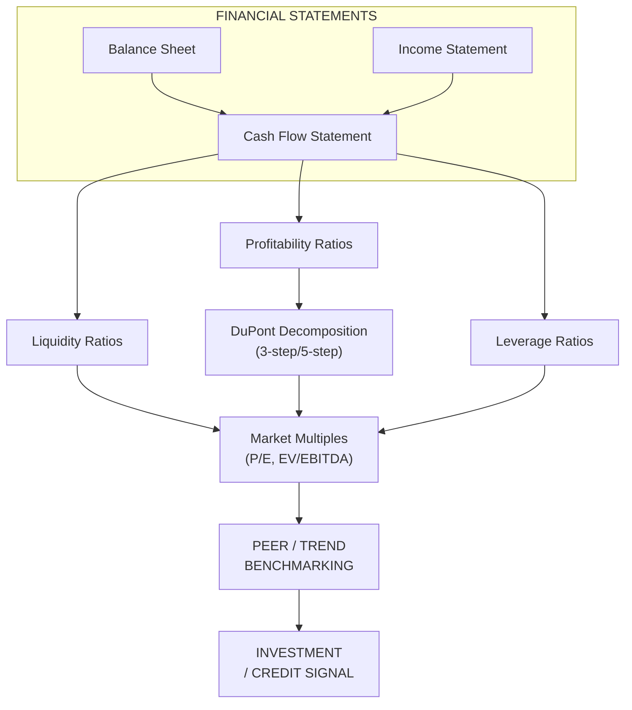

# Lesson 2: Ratio Analysis Frameworks

## 1. First-Principles Intuition & Invariants

Financial ratio analysis is not merely an exercise in arithmetic; it is the structural decomposition of a firm's economic reality into comparable, dimensional signals. At its core, a ratio normalizes two financial magnitudes against each other, stripping away absolute scale so that a \$5 billion revenue company can be meaningfully compared against a \$50 million competitor. This act of normalization is the invariant upon which the entire edifice of comparative financial analysis rests. Without it, analysts would be left reading raw dollar figures from balance sheets and income statements, unable to distinguish whether a company's \$200 million interest expense reflects prudent leverage on a massive asset base or a distress-level debt burden on a dwindling one.

The theoretical foundation of ratio analysis draws from two parallel streams in economic theory. The first is the microeconomic theory of the firm, where production functions, cost structures, and capital allocation decisions manifest as measurable financial outcomes. The second is the accounting identity that links the balance sheet, income statement, and cash flow statement into a coherent system of stock and flow variables. The balance sheet provides a stock snapshot at a point in time, while the income and cash flow statements record flows over a period. Ratios that mix stocks and flows—such as return on assets, which divides net income (a flow) by total assets (a stock)—carry an implicit temporal mismatch that the practitioner must address, typically by averaging the stock variable across the beginning and ending period balances.

The fundamental invariants of ratio analysis are threefold. First, every ratio is a dimensionless quantity, constructed so that the numerator and denominator share a common unit that cancels. When this is not the case—such as dividing net income by the number of shares outstanding—the result is a per-share metric rather than a true ratio, and the distinction matters for how the figure should be interpreted and compared. Second, ratios derive their meaning from comparison against a reference frame: a historical time series of the same firm, a peer group of comparable firms, or an industry benchmark. A current ratio of 2.1 is not inherently "good" or "bad"; it acquires meaning only when juxtaposed against the firm's own historical liquidity trajectory, the working capital norms of its industry, and the structural demands of its operating cycle. Third, ratios are interdependent. A high return on equity driven by aggressive leverage is not the same signal as a high return on equity driven by superior operating margins, and the DuPont decomposition framework exists precisely to disentangle these distinct causal pathways.

The microeconomic underpinning of profitability ratios connects directly to the firm's production function and market structure. Gross margin reflects the degree of pricing power the firm commands, which in turn derives from the elasticity of demand for its products and the competitive structure of its output market. A firm operating in a near-competitive market with highly elastic demand will see its gross margins compressed toward the marginal cost of production, while a firm with differentiated products and inelastic demand can sustain margins that reflect its economic rent. Operating margin extends this analysis by incorporating fixed cost coverage, capturing the degree of operating leverage that amplifies (or dampens) the effect of revenue changes on operating income. The relationship is formally expressed as $\text{Degree of Operating Leverage} = \frac{\%\Delta \text{EBIT}}{\%\Delta \text{Sales}} = \frac{\text{Contribution Margin}}{\text{EBIT}}$, a measure that tells the analyst how sensitive operating profit is to a given percentage change in revenue.

Liquidity ratios address a fundamentally different economic question: not profitability, but solvency across time. The concern is whether the firm's short-term assets, converted through the normal operating cycle into cash, will be sufficient to retire short-term obligations as they come due. This is fundamentally a question of asset-liability maturity matching, and it connects to the Keynesian notion of liquidity preference—the firm holds liquid assets not because they are productive, but because they provide a buffer against the uncertainty of cash flow timing. The trade-off is explicit: every dollar held in cash or near-cash is a dollar not deployed into productive capital, and the opportunity cost of excessive liquidity is the return foregone on longer-term investment.

Leverage ratios interrogate the firm's capital structure, the domain of Modigliani and Miller's foundational theorems. In the frictionless MM world without taxes, capital structure is irrelevant—firm value is determined by operating cash flows, not by how those flows are split between debt and equity holders. In the real world, of course, the tax deductibility of interest creates a corporate tax shield that biases toward debt, while the costs of financial distress (bankruptcy, restructuring, lost operational flexibility) bias away from it. Leverage ratios measure where the firm sits on this trade-off curve, and the interest coverage ratio specifically tests whether the firm's operating cash generation is sufficient to service its debt obligations under current conditions, as well as providing a buffer against adverse economic shocks.

Market valuation multiples bridge the gap between the firm's intrinsic financial performance and the market's collective assessment of that performance. A price-to-earnings ratio of 25 tells us that the market is willing to pay \$25 for every dollar of current-period earnings, a figure that embeds assumptions about future growth, risk, and the time value of money. The theoretical anchor for all valuation multiples is the discounted cash flow model: in its simplest Gordon Growth form, $P_0 = \frac{D_1}{r - g}$, which implies $P/E = \frac{D_1 / E_1}{r - g} = \frac{p}{r - g}$, where $p$ is the payout ratio, $r$ is the cost of equity, and $g$ is the sustainable growth rate. Every valuation multiple is a reduced-form expression of this underlying present value relationship, and the analyst who uses multiples without understanding their DCF foundation is applying a formula without comprehension.

## 2. Core Architecture & Mechanics

The architecture of ratio analysis can be understood as a hierarchical decomposition that moves from raw financial statements through successive layers of normalization and aggregation. At the base layer sit the three primary financial statements—the balance sheet, income statement, and cash flow statement—which themselves are constructed from the general ledger through the accrual accounting process. The first transformation layer computes individual ratios by pairing specific line items according to established analytical relationships. The second layer groups these individual ratios into functional categories: liquidity, profitability, leverage, efficiency, and market valuation. The third layer applies the DuPont decomposition to profitability ratios, breaking them into their constituent operational and financial drivers. The final layer contextualizes the results through peer comparison, trend analysis, and integration with qualitative assessment.

### Liquidity Ratios

The liquidity category contains ratios that test the firm's ability to meet short-term obligations. The current ratio, $\text{Current Ratio} = \frac{\text{Current Assets}}{\text{Current Liabilities}}$, is the broadest measure, capturing all assets expected to be converted to cash within one year against all liabilities due within the same period. Its limitation is that it includes inventory and prepaid expenses, assets whose conversion to cash may be slow or uncertain. The quick ratio, also known as the acid-test ratio, strips out inventory: $\text{Quick Ratio} = \frac{\text{Current Assets} - \text{Inventory}}{\text{Current Liabilities}}$. For firms with long inventory conversion periods—heavy manufacturing, for instance—the quick ratio provides a more conservative test of immediate liquidity. The cash ratio goes further still, isolating only cash and marketable securities: $\text{Cash Ratio} = \frac{\text{Cash} + \text{Marketable Securities}}{\text{Current Liabilities}}$.

The most operationally informative liquidity metric is often the cash conversion cycle (CCC), which measures the time elapsed between cash outflow for production inputs and cash inflow from sales:

$$\text{CCC} = \text{DIO} + \text{DSO} - \text{DPO}$$

where $\text{DIO}$ is Days Inventory Outstanding, $\text{DSO}$ is Days Sales Outstanding, and $\text{DPO}$ is Days Payable Outstanding. Each component is calculated as:

$$\text{DIO} = \frac{\text{Average Inventory}}{\text{COGS}} \times 365, \quad \text{DSO} = \frac{\text{Average Accounts Receivable}}{\text{Revenue}} \times 365, \quad \text{DPO} = \frac{\text{Average Accounts Payable}}{\text{COGS}} \times 365$$

A negative cash conversion cycle, as seen in companies like Amazon or Costco, means the firm collects cash from customers before it must pay its suppliers—a structural advantage that effectively turns working capital into a source of financing rather than a use of it. This is one of the most powerful operational signals in ratio analysis, because it reflects the firm's bargaining power in its supply chain and the efficiency of its operating model.

### Profitability Ratios

Profitability ratios decompose the firm's ability to generate returns from its asset base and capital structure. Gross profit margin, $\text{GPM} = \frac{\text{Revenue} - \text{COGS}}{\text{Revenue}}$, isolates the production economics from all other corporate functions. Operating margin, $\text{OM} = \frac{\text{EBIT}}{\text{Revenue}}$, incorporates selling, general, and administrative expenses, capturing the full cost of running the business before financing decisions and tax effects. Net profit margin, $\text{NPM} = \frac{\text{Net Income}}{\text{Revenue}}$, includes all expenses and captures the bottom-line return per dollar of revenue.

The return-on-investment category translates these margin figures into returns on the capital deployed. Return on assets, $\text{ROA} = \frac{\text{Net Income}}{\text{Average Total Assets}}$, measures the firm's efficiency in using its total asset base to generate profit. Return on equity, $\text{ROE} = \frac{\text{Net Income}}{\text{Average Shareholders' Equity}}$, measures the return available to common shareholders after all other claims have been satisfied. Return on invested capital, $\text{ROIC} = \frac{\text{NOPAT}}{\text{Invested Capital}}$, where $\text{NOPAT} = \text{EBIT} \times (1 - \text{Tax Rate})$ and $\text{Invested Capital} = \text{Total Debt} + \text{Equity} - \text{Cash}$, is arguably the most analytically rigorous profitability measure because it isolates operating performance from capital structure effects and non-operating assets.

### Leverage and Coverage Ratios

Leverage ratios measure the proportion of the firm's capital that comes from debt rather than equity, and the firm's ability to service that debt. The debt-to-equity ratio, $\text{D/E} = \frac{\text{Total Debt}}{\text{Total Equity}}$, is a structural measure of capital composition. The debt-to-assets ratio, $\text{D/A} = \frac{\text{Total Debt}}{\text{Total Assets}}$, expresses the proportion of the firm's assets financed by creditors. The equity multiplier, $\text{EM} = \frac{\text{Total Assets}}{\text{Total Equity}}$, is the complementary figure used in the DuPont decomposition, expressing total assets per dollar of equity.

The interest coverage ratio, $\text{ICR} = \frac{\text{EBIT}}{\text{Interest Expense}}$, measures how many times the firm's operating income covers its interest obligations. A ratio of 4.0 means the firm's EBIT could decline by 75% before it would be unable to meet interest payments from current operations. The debt service coverage ratio extends this concept to include principal repayments: $\text{DSCR} = \frac{\text{EBITDA}}{\text{Interest} + \text{Principal Payments}}$. For analysts evaluating credit risk, the DSCR is often more informative than the static leverage ratios, because it captures the actual cash flow burden of the debt rather than just its balance sheet magnitude.

### DuPont Decomposition

The DuPont framework is the most powerful analytical tool in the ratio analyst's toolkit because it decomposes a single summary statistic—return on equity—into distinct operational and financial drivers, each of which can be independently analyzed, benchmarked, and improved. The classic three-step DuPont decomposition is:

$$\text{ROE} = \underbrace{\frac{\text{Net Income}}{\text{Revenue}}}_{\text{Net Margin}} \times \underbrace{\frac{\text{Revenue}}{\text{Total Assets}}}_{\text{Asset Turnover}} \times \underbrace{\frac{\text{Total Assets}}{\text{Equity}}}_{\text{Equity Multiplier}}$$

This identity reveals that two firms with identical ROE can arrive there through fundamentally different operating models. A luxury goods company might achieve 20% ROE through a 15% net margin and 1.3x asset turnover with modest leverage, while a grocery chain might achieve the same 20% ROE through a 2% net margin, 5.0x asset turnover, and aggressive leverage. These are not interchangeable outcomes; they carry different risk profiles, different competitive moats, and different sensitivities to economic conditions.

The five-step DuPont decomposition extends the analysis by breaking net margin further into its tax burden, interest burden, and operating margin components:

$$\text{ROE} = \underbrace{\frac{\text{Net Income}}{\text{EBT}}}_{\text{Tax Burden}} \times \underbrace{\frac{\text{EBT}}{\text{EBIT}}}_{\text{Interest Burden}} \times \underbrace{\frac{\text{EBIT}}{\text{Revenue}}}_{\text{Operating Margin}} \times \underbrace{\frac{\text{Revenue}}{\text{Total Assets}}}_{\text{Asset Turnover}} \times \underbrace{\frac{\text{Total Assets}}{\text{Equity}}}_{\text{Equity Multiplier}}$$

The interest burden term, $\frac{\text{EBT}}{\text{EBIT}}$, will be less than 1.0 for any firm with positive interest expense, and it shrinks as leverage increases. This means the DuPont decomposition explicitly quantifies the cost that leverage imposes on ROE through the interest burden, even as the equity multiplier simultaneously boosts ROE by reducing the equity denominator. The net effect of leverage on ROE is the product of these two opposing forces, and the DuPont framework makes that trade-off visible and quantifiable.

### Market Valuation Multiples

Market valuation multiples translate financial statement data into market-price terms, enabling comparison of the firm's market valuation against its fundamental performance. The price-to-earnings ratio, $\text{P/E} = \frac{\text{Price per Share}}{\text{EPS}}$, is the most widely used, but it conflates growth expectations, risk, and the payout ratio into a single number. The EV/EBITDA multiple, $\frac{\text{Enterprise Value}}{\text{EBITDA}}$, is often preferred for cross-company comparison because it strips out the effects of capital structure (by using enterprise value rather than market capitalization) and non-cash charges (by using EBITDA rather than net income). The price-to-book ratio, $\frac{\text{Market Cap}}{\text{Book Value of Equity}}$, is most informative for financial firms where book value approximates the liquidation value of assets, and less informative for technology or service firms where intangible assets dominate value creation.

The following diagram illustrates the complete ratio analysis workflow from raw financial statements through to final investment signal:

### Efficiency and Turnover Ratios

Efficiency ratios measure how effectively management deploys the firm's assets to generate revenue. The total asset turnover, $\text{TATO} = \frac{\text{Revenue}}{\text{Average Total Assets}}$, captures the overall capital intensity of the business model. Fixed asset turnover, $\frac{\text{Revenue}}{\text{Average Net PP\&E}}$, isolates the productivity of long-term productive assets. Inventory turnover, $\frac{\text{COGS}}{\text{Average Inventory}}$, measures how rapidly the firm cycles through its inventory, with the reciprocal expressing this in days. Receivables turnover, $\frac{\text{Revenue}}{\text{Average Accounts Receivable}}$, measures the speed of collection from customers. These ratios connect directly to the cash conversion cycle and, in aggregate, they describe the operating cadence of the business.

## 3. High-Performance Optimization & Failure Modes

The practitioner who runs ratio analysis at scale—whether screening a universe of 8,000 public equities, building a factor model, or conducting a rigorous M&A due diligence review—must navigate a series of analytical pitfalls and operational inefficiencies that can silently corrupt results. The most common failure mode in ratio analysis is denominator distortion, and it manifests in several forms that require active mitigation.

### Earnings Distortion and Normalization

When computing profitability ratios, the numerator (net income or EBIT) may be distorted by one-time charges, asset write-downs, restructuring costs, or gains on asset sales. An analyst who computes ROA using reported net income during a year in which the firm took a large goodwill impairment will systematically understate the firm's ongoing profitability. The remedy is to construct a normalized earnings figure by adjusting for non-recurring items, a process that requires careful reading of the footnotes, management discussion and analysis, and non-GAAP reconciliations. The discipline here is to avoid blind acceptance of management's own non-GAAP adjustments, which often exclude items that are in fact recurring (stock-based compensation being the most contentious example), and instead build an independent normalized figure grounded in the firm's actual operating economics.

The same concern applies to the denominator. Average total assets should use beginning and ending balances, but if the firm made a large acquisition during the period, the ending balance sheet reflects assets that were not present for most of the reporting period. In such cases, a weighted-average asset base that accounts for the timing of the acquisition provides a more accurate denominator. For return on equity calculations involving firms that have executed significant share buybacks, the equity denominator may be artificially depressed by treasury stock, inflating ROE in a way that does not reflect genuine operational improvement.

### Industry and Peer Selection

The benchmarking layer of ratio analysis is where most analytical errors occur. Peer group selection is not a matter of SIC code matching; it requires judgment about which firms face comparable economic conditions. A retailer that owns its stores (capital-intensive, low asset turnover) is not a valid peer for a retailer that leases all its locations (capital-light, high asset turnover), even if they sell to the same end market. The lease accounting under ASC 842 has partially addressed this by bringing operating leases onto the balance sheet, but the distinction between owned and leased real estate still affects depreciation, interest expense classification, and the comparability of leverage ratios.

Industry-specific norms matter enormously. A software firm with a current ratio of 1.2 might be in robust health, while a bank with the same ratio would be signaling severe liquidity stress. Construction firms routinely operate with negative working capital due to progress billing, making their current ratios structurally low without indicating distress. The analyst must internalize the economic logic of the industry—the typical operating cycle, the capital intensity, the competitive structure—before assigning meaning to any ratio.

### The Cash Flow Divergence Trap

The most insidious failure mode in ratio analysis is the divergence between accrual-based profitability and actual cash generation. A firm can report strong and improving net income while its cash from operations deteriorates, a pattern that historically precedes many corporate failures. The accruals ratio, $\text{Accruals} = \frac{\text{Net Income} - \text{CFO}}{\text{Average Total Assets}}$, quantifies the gap between accounting earnings and cash flow as a proportion of the asset base. High and rising accruals indicate that a growing share of reported earnings consists of non-cash items—unbilled receivables, deferred cost capitalization, revenue recognition adjustments—which are inherently less reliable and more subject to management discretion. The Sloan accruals anomaly, documented in 1996, showed that high-accrual firms systematically underperform low-accrual firms in subsequent returns, a finding that remains robust decades later and underscores the importance of cross-checking every profitability ratio against its cash flow counterpart.

### Leverage Ratio Distortions Under Off-Balance-Sheet Items

Before the consolidation of variable interest entities under FIN 46(R) and ASC 810, off-balance-sheet structures allowed firms to carry substantial economic debt that was invisible on the balance sheet. Enron's collapse is the canonical example, but the issue persists in modified forms: operating lease commitments (now capitalized under ASC 842 and IFRS 16, though the income statement treatment differs between operating and finance lease classification), pension underfunding, and contingent guarantees all represent forms of leverage that may not appear in standard debt-to-equity calculations. The rigorous analyst constructs an adjusted leverage ratio that incorporates the present value of lease commitments, unfunded pension obligations, and other fixed commitments, arriving at a leverage figure that reflects the firm's total fixed financial obligations rather than just its on-balance-sheet debt.

### Temporal Consistency and Period Selection

Ratio trends are more informative than ratio levels, but trend analysis requires consistent period selection. Quarterly ratios are distorted by seasonal patterns—retailers report peak revenue in Q4, manufacturers may concentrate capital expenditure in specific quarters—and these seasonal effects can produce apparent trend breaks that are simply artifacts of the calendar. The practitioner should use trailing twelve-month (TTM) calculations for flow-based ratios, constructed by summing the most recent four quarters of income statement and cash flow data, to smooth seasonal variation. For stock-based ratios, the most recent balance sheet provides the denominator. This TTM approach ensures that profitability, efficiency, and coverage ratios are calculated over a consistent period that reflects the full operating cycle.

### Forward-Looking Ratio Projection

Static ratio analysis tells the analyst where the firm has been, not where it is going. For investment decision-making, the practitioner must project ratios forward, typically through a three-to-five-year financial model that links revenue growth assumptions, margin trajectories, capital expenditure plans, and working capital needs to forecasted balance sheet and income statement figures. The DuPont decomposition provides the structural framework for this projection: the analyst forecasts sales growth, then applies margin assumptions to derive operating income, projects the asset base from capital expenditure and depreciation schedules, and models the capital structure to determine the equity multiplier. The result is a projected ROE path that can be compared against the cost of equity to determine whether the firm is expected to create or destroy shareholder value.

The sustainable growth rate, $\text{SGR} = \text{ROE} \times \text{Retention Ratio} = \text{ROE} \times (1 - \text{Payout Ratio})$, provides a quick diagnostic for whether the firm's growth plans are internally financeable. A firm growing faster than its SGR must either raise external capital, increase its retention ratio, or accept declining margins and asset quality. A firm growing slower than its SGR is generating cash in excess of its reinvestment needs, and the analyst should assess how management intends to deploy that surplus—dividends, buybacks, acquisitions, or debt repayment—each of which carries different implications for shareholder value.

### Signal Extraction and the Analyst's Workflow

The optimized practitioner workflow for ratio analysis follows a structured sequence. First, pull the TTM income statement and most recent balance sheet, along with the prior year balance sheet for averaging. Second, compute the full ratio suite: liquidity (current, quick, cash, CCC), profitability (gross margin, operating margin, net margin, ROA, ROE, ROIC), leverage (D/E, D/A, equity multiplier, interest coverage, DSCR), efficiency (asset turnover, inventory turnover, DSO, DPO), and market multiples (P/E, EV/EBITDA, P/B). Third, apply the five-step DuPont decomposition to ROE, identifying whether each component is a contributor to or detractor from the firm's return relative to peers. Fourth, benchmark each ratio against a carefully selected peer group, computing both the median and the interquartile range to understand the dispersion within the peer set. Fifth, compute the accruals ratio and cross-check reported profitability against cash from operations. Sixth, construct a normalized earnings figure adjusting for identified non-recurring items and re-run the profitability ratios. Seventh, project key ratios forward under explicit assumptions about growth, margins, and capital structure.

This workflow produces a ratio analysis that is empirically grounded, internally consistent, and resistant to the most common analytical failures. The output is not a table of numbers but a structured narrative about how the firm makes money, where its competitive advantages and vulnerabilities lie, and what its financial trajectory implies for its valuation and credit quality. The ratios are the evidence; the analysis is the argument.
