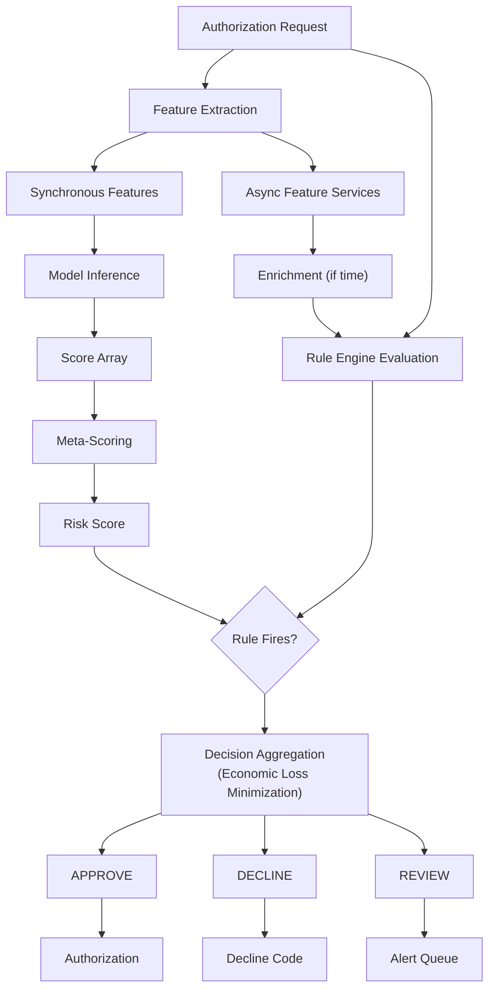

# Lesson 4: Operational Systems, Regulatory Frameworks, Evaluation Metrics

## 1. First-Principles Intuition & Invariants

Financial fraud detection operates under a fundamental constraint that distinguishes it from nearly every other applied machine learning domain: the cost asymmetry between false negatives and false positives is not merely unbalanced but catastrophically skewed, and yet the system must operate at transaction volumes that preclude human review of every alert. A retail bank processing thirty thousand card transactions per second cannot route every suspicious event to a human analyst. The operational reality demands that fraud detection systems must autonomously classify the overwhelming majority of transactions while maintaining error rates measured in basis points. This tension between speed, accuracy, and economic viability defines the entire architecture of production fraud detection systems.

The core invariant governing all operational fraud detection is the **real-time decision constraint**: a payment authorization must receive a fraud score and risk determination within the payment network's timeout window, typically between 100 and 300 milliseconds for card-present transactions and up to 2 seconds for card-not-present e-commerce flows. This latency budget must accommodate feature extraction from transaction metadata, model inference across potentially dozens of specialized classifiers, rule engine evaluation, and in some architectures, real-time feature enrichment from external data sources such as device fingerprinting services or geolocation APIs. The system cannot defer judgment, cannot request additional time, and cannot pause the customer experience without converting a potential fraud prevention into a certain revenue loss through transaction abandonment.

Beyond latency, the economic structure of fraud losses and prevention costs creates a second invariant: **the optimization target is not classification accuracy but rather the minimization of total economic loss**, which encompasses actual fraud losses, false positive friction costs, and operational investigation expenses. A fraud detection system that achieves 99.9% precision and recall but routes ten thousand alerts per day to a team of fifty analysts has failed catastrophically, because the labor cost of alert triage will exceed the prevented fraud losses. Conversely, a system that achieves perfect automation by rejecting every transaction above a conservative threshold will hemorrhage revenue through legitimate customer declinations. The operational system must therefore encode not merely a classification boundary but an economic decision surface that balances these competing losses across heterogeneous transaction types, customer segments, and merchant categories.

Regulatory frameworks impose a third invariant that financial institutions cannot optimize away: **explainability and auditability requirements** mandated by anti-money laundering statutes, know-your-customer regulations, and fair lending laws. A black-box neural network that achieves superior fraud detection performance but cannot articulate why a specific transaction triggered an alert or why a particular customer account was suspended will expose the institution to regulatory penalties, litigation risk, and reputational damage. The operational architecture must therefore maintain a complete audit trail linking every alert to the specific features, rules, and model scores that contributed to the decision, often requiring that this provenance information be reconstructable years after the original transaction for regulatory examination or legal discovery.

The combination of these three invariants—real-time latency constraints, economic loss minimization, and regulatory explainability—dictates that production fraud detection systems cannot rely on a single monolithic model but must instead implement a **layered defense architecture** composed of fast deterministic rule engines for high-confidence patterns, intermediate-latency machine learning models for probabilistic scoring, and human-in-the-loop workflows for ambiguous cases that require investigative judgment. This architecture mirrors the structure of an immune system: innate responses (rules) provide immediate defense against known threats, adaptive responses (models) learn to recognize novel attack patterns, and specialized cells (analysts) handle complex cases that require contextual reasoning beyond pattern matching.

The operational reality of managing this layered system introduces a fourth invariant often overlooked in academic treatments: **concept drift and adversarial adaptation** occur continuously and unavoidably. Fraudsters observe which attack patterns succeed and which trigger alerts, then systematically modify their behavior to evade detection. A rule that successfully blocks synthetic identity fraud today will become obsolete within weeks as attackers probe the decision boundary and discover workarounds. Machine learning models trained on historical fraud patterns will degrade in performance as the statistical distribution of fraud tactics shifts. The operational system must therefore incorporate not merely detection logic but also continuous model monitoring, automated retraining pipelines, and rapid rule deployment mechanisms that allow fraud analysts to encode newly discovered attack patterns into production defenses within hours rather than weeks.

This adversarial dynamic creates an economic feedback loop: as fraud detection systems improve, the expected return on unsophisticated fraud attempts declines, which selects for more sophisticated attackers willing to invest in evasion techniques. The resulting evolutionary arms race means that fraud detection performance is not a static achievement but rather a relative position in a continuous adaptation contest. Institutions that fail to maintain investment in system updates and analyst training will experience performance degradation even if their models and rules remain unchanged, because the attack distribution is shifting around them.

The measurement of fraud detection performance must therefore account for this dynamic environment through metrics that capture not merely point-in-time classification accuracy but rather the economic value delivered under adversarial conditions over time. The traditional machine learning metrics of precision, recall, and F1 score provide useful signals for model development but fail to capture the operational realities of alert triage workload, customer friction costs, and the long-term sustainability of detection strategies. A comprehensive evaluation framework must incorporate catch rates (the percentage of actual fraud detected before losses are realized), false positive rates (the burden imposed on operations and customers), mean time to detection (the lag between fraud occurrence and alert generation), and ultimately the return on investment calculated as prevented losses minus system costs divided by system costs.

## 2. Core Architecture & Mechanics

The operational architecture of a production fraud detection system decomposes into four primary subsystems that must execute in coordination while maintaining independent scalability and fault tolerance: the real-time scoring engine, the rule management and evaluation framework, the alert triage and case management workflow, and the model performance monitoring and retraining pipeline. Each subsystem addresses a distinct aspect of the operational challenge while sharing a common data model representing customer profiles, transaction histories, and fraud patterns.

The **real-time scoring engine** serves as the first point of contact for every transaction entering the payment processing flow. When a payment authorization request arrives from a merchant acquirer or card network, the transaction payload—containing merchant category code, transaction amount, timestamp, card number, billing address, shipping address, and various metadata fields—enters a feature extraction pipeline that must complete within the first 20 to 50 milliseconds of the latency budget. Feature engineering in production fraud systems differs fundamentally from offline model development because features must be computed from data available at decision time without introducing data leakage or requiring expensive database queries that would violate latency constraints.

The feature extraction process typically maintains two tiers of feature availability: **synchronous features** derived directly from the transaction payload or from in-memory caches of customer aggregate statistics, and **asynchronous features** retrieved from external services that may not return within the authorization window. Synchronous features include transaction amount, merchant category, time of day, day of week, and customer aggregate statistics such as thirty-day transaction count, ninety-day transaction volume, average transaction amount, and geographic diversity of recent transactions. These features can be computed through low-latency key-value lookups against an in-memory cache backed by a distributed data store such as Redis or Aerospike, with typical access latencies below 5 milliseconds.

Asynchronous features include device fingerprinting signals, IP geolocation data, email domain reputation scores, and cross-institution velocity checks retrieved from fraud intelligence networks. The scoring engine must architect a decision flow that proceeds with incomplete information: the system evaluates all synchronous features first to produce a preliminary risk score, submits asynchronous feature requests in parallel, and then either returns the preliminary score if the authorization deadline approaches or waits for asynchronous enrichment to refine the score if sufficient time remains. This graceful degradation ensures that network failures or service latency in external dependencies cannot cause authorization timeouts that would decline legitimate transactions.

The feature vector, once assembled, flows through a model inference pipeline that typically consists of multiple specialized models rather than a single universal classifier. A common architecture deploys separate models for different transaction contexts: card-present versus card-not-present, domestic versus international, low-value versus high-value, first-time merchant versus repeat merchant. This specialization improves performance because each model can optimize for the fraud patterns and feature distributions specific to its context without being distorted by the need to generalize across heterogeneous scenarios. The inference pipeline executes these models in parallel, with each model producing a fraud probability score between zero and one.

Model scores are then aggregated through a **meta-scoring function** that combines individual model outputs with business logic to produce a final transaction risk score. The simplest meta-scoring approach takes a weighted average of model scores, with weights learned through offline analysis to minimize economic loss on historical data. More sophisticated architectures implement a second-layer meta-model that learns nonlinear interactions between base model scores and contextual features. Regardless of approach, the meta-scoring function must also incorporate score calibration to ensure that a score of 0.05 genuinely represents a 5% fraud probability, because downstream decision thresholds and cost-benefit calculations depend on well-calibrated probability estimates.

The rule engine operates in parallel with the model inference pipeline and serves three distinct purposes: enforcing hard constraints mandated by regulation or business policy, implementing deterministic fraud patterns that have been validated through investigative analysis, and providing override logic that can block transactions even when model scores suggest legitimacy. Rules differ from models in that they produce binary decisions (fire or not fire) rather than continuous probability scores, and they provide explicit, human-interpretable logic rather than learned statistical patterns. A typical rule might encode the constraint: "decline all card-not-present transactions from IP addresses in country X when the cardholder billing address is in country Y and the transaction amount exceeds $500." This rule cannot be violated by model scores; if it fires, the transaction is declined regardless of how confident the models are that the transaction is legitimate.

Rule engines in production systems must support **priority ordering and conflict resolution** because multiple rules may fire simultaneously and recommend contradictory actions. The standard approach implements a priority queue where rules are evaluated in order of decreasing priority, and the first rule that fires determines the final action. High-priority rules typically encode regulatory requirements and critical fraud patterns, while low-priority rules implement less certain heuristics that can be overridden by model scores. The rule management interface must allow fraud analysts to create, modify, disable, and test rules without requiring code deployment, typically through a domain-specific language or graphical interface that compiles rule logic into optimized evaluation code.

The decision aggregation layer combines rule outcomes and model scores to produce a final transaction disposition: approve, decline, or route for manual review. The economic optimization framework dictates that this decision should minimize expected loss, calculated as:

$$
\mathbb{E}[\text{Loss}] = P(\text{fraud}) \cdot L_{\text{fraud}} + P(\text{legitimate}) \cdot L_{\text{friction}} + \mathbb{1}_{\text{review}} \cdot C_{\text{review}}
$$

where $P(\text{fraud})$ is the model's estimated fraud probability, $L_{\text{fraud}}$ is the loss incurred if fraud is approved, $P(\text{legitimate}) = 1 - P(\text{fraud})$ is the probability of legitimate activity, $L_{\text{friction}}$ is the customer friction cost and potential revenue loss from declining a legitimate transaction, and $C_{\text{review}}$ is the operational cost of routing the transaction for manual analyst review. The optimal decision minimizes this expected loss: approve if the expected loss of approval is less than the expected loss of decline or review, route to manual review if the expected loss of immediate decision exceeds the review cost, and decline otherwise.

This economic decision framework requires careful calibration of the loss parameters. The fraud loss $L_{\text{fraud}}$ is directly observable as the transaction amount plus chargeback fees, but the friction cost $L_{\text{friction}}$ is substantially harder to measure because it includes not only the immediate lost transaction revenue but also the long-term customer lifetime value impact when legitimate customers abandon the institution after experiencing false declines. Industry estimates suggest that each false positive decline costs between one and five times the transaction amount in long-term customer value, though this varies dramatically by customer segment and competitive market dynamics.

Transactions routed to manual review enter the **alert triage and case management system**, which represents the second major operational subsystem. Alert queues must be architected to balance workload distribution across analyst teams while respecting analyst specialization and expertise. A common approach implements multiple queues prioritized by estimated fraud severity and expected case complexity: high-value transactions, account takeover alerts, synthetic identity patterns, and first-party fraud investigations each flow to specialized queues staffed by analysts with relevant training and access to investigative tools.

The alert presentation interface must surface not merely the transaction details but also the complete investigative context required for rapid decision-making: the model scores and contributing features that triggered the alert, the customer's transaction history and account profile, any previous fraud alerts or confirmed fraud on the account, behavioral anomalies detected in recent activity, and links to external investigative resources such as device fingerprinting reports, social media profiles, and cross-institution fraud intelligence. The interface must also provide workflow tools for common investigative actions: calling the cardholder for verification, placing temporary holds on the account, requesting additional authentication, or escalating to law enforcement.

Analyst decisions feed back into the system through two critical paths: they provide ground truth labels for model retraining, and they encode discovered fraud patterns as new rules for immediate deployment. When an analyst confirms that an alert represents genuine fraud, the system must trigger downstream workflows: blocking the compromised account, reversing unauthorized transactions, issuing card replacement, updating customer contact information if account takeover is suspected, and filing Suspicious Activity Reports if regulatory thresholds are exceeded. When an analyst identifies a novel fraud pattern—for instance, a merchant compromise affecting a specific acquirer—they must be able to encode a rule targeting that pattern and deploy it to production within minutes to prevent additional losses while the compromised merchant is remediated.

The operational metric that governs alert triage efficiency is **alert precision**, defined as the fraction of routed alerts that are confirmed as fraud upon investigation. Industry benchmarks for sustainable alert precision range from 10% to 30%: lower precision overwhelms analysts with false positives and creates incentive to approve alerts without thorough investigation, while higher precision suggests that the review threshold is too conservative and that many automated approvals likely include undetected fraud. The optimal precision target depends on the economic parameters: institutions with high fraud losses and low analyst labor costs should tolerate lower precision to achieve higher recall, while institutions with low fraud rates and high labor costs should target higher precision even at the cost of reduced recall.

## 3. High-Performance Optimization & Failure Modes

The performance optimization of operational fraud detection systems must address three distinct bottlenecks: latency and throughput in the real-time scoring path, alert triage capacity and analyst efficiency, and model staleness under adversarial concept drift. Each bottleneck admits different optimization strategies with different operational tradeoffs.

Real-time scoring latency is dominated by two components: feature extraction database lookups and model inference compute time. Feature extraction optimization begins with aggressive caching strategies that maintain customer aggregate statistics in distributed in-memory stores with millisecond access latency. The cache invalidation strategy must balance freshness against update costs: updating every customer's aggregate statistics after every transaction would create prohibitive write amplification, while updating only on cache miss would serve stale features that degrade fraud detection performance. A practical compromise implements **asynchronous batch updates** where aggregate statistics are recomputed every few minutes and propagated to the cache, combined with event-driven invalidation for specific high-risk scenarios such as sudden velocity spikes that might indicate ongoing fraud.

When database queries cannot be avoided—for instance, retrieving the full transaction history for a customer flagged for investigation—the query must be optimized through appropriate indexing, query result caching, and read replica scaling. Transaction history tables are typically partitioned by customer identifier and time range to enable efficient range scans, with separate indexes on merchant identifier, transaction amount, and geographic location to support investigative queries. The database schema must be denormalized to avoid joins during scoring: instead of normalizing merchant information into a separate table, merchant metadata is duplicated into the transaction record to enable single-query feature extraction.

Model inference latency depends on model complexity and the serving infrastructure. Large ensemble models such as gradient boosted decision trees with thousands of trees can require tens of milliseconds for inference, consuming a substantial fraction of the latency budget. Inference optimization techniques include model compression through tree pruning or distillation, early exit strategies where inference terminates when confidence exceeds a threshold, and GPU acceleration for deep learning models. The serving infrastructure must support horizontal scaling to handle peak transaction loads, typically through containerized model servers deployed on Kubernetes clusters that can autoscale based on request queue depth and CPU utilization.

A critical but often overlooked optimization concerns **feature engineering feedback loops** that can create temporal data leakage in production. If aggregate statistics include the current transaction when computing thirty-day velocity, the model is effectively allowed to see its own prediction target during inference, which can create spurious patterns where the model learns to detect its own prior decisions rather than genuine fraud. The feature engineering pipeline must implement strict temporal cutoffs ensuring that all features are computed from data strictly preceding the current transaction timestamp. This constraint creates implementation complexity: precomputed aggregate caches must exclude the current transaction, which may require maintaining separate cache entries for "as-of" statistics at different timestamps.

Alert triage optimization focuses on maximizing analyst productivity through intelligent queue prioritization, automated evidence gathering, and investigative workflow streamlining. Queue prioritization should order alerts by expected value of investigation: the probability that the alert represents fraud multiplied by the potential loss amount. High-value, high-probability alerts should surface first, while low-value or low-probability alerts should be deprioritized or even auto-resolved after a timeout period. Some institutions implement **collaborative filtering approaches** where alerts are routed to analysts based on historical success rates: analysts who have demonstrated expertise in account takeover investigations receive more account takeover alerts, creating specialization that improves both accuracy and efficiency.

Automated evidence gathering reduces investigative time by precomputing and presenting relevant context before the analyst opens the alert. When a transaction is routed for review, background workers should immediately retrieve device fingerprinting reports, IP geolocation data, cardholder contact history, and previous fraud cases involving the same merchant or card BIN range. This information should be rendered in the alert interface when the analyst opens the case, eliminating the manual lookup steps that would otherwise consume the first thirty seconds of investigation time. For high-volume operations, reducing average case investigation time from three minutes to two minutes enables a 50% increase in analyst throughput without additional hiring.

The investigative workflow should also incorporate **decision support tools** that guide analysts through systematic evaluation protocols. Checklists ensure that all relevant evidence is examined before making a determination, reducing inconsistency and improving training outcomes for new analysts. Automated suggestions can highlight specific evidence items that warrant attention: if the transaction IP geolocation is three thousand miles from the cardholder's billing address, the interface should flag this discrepancy prominently rather than requiring the analyst to manually compute geographic distance. These decision support mechanisms must be carefully designed to augment rather than replace analyst judgment; fully automated suggestions that analysts rubber-stamp without review will propagate model errors and create liability exposure.

Model performance monitoring and retraining pipelines address the concept drift challenge through continuous evaluation against ground truth labels and automated retraining triggers. The monitoring system must track multiple performance metrics across different time windows and population segments to detect degradation early: daily fraud catch rates, false positive rates by customer segment, model score calibration curves, and feature distribution shifts. A sudden drop in catch rate or spike in false positives triggers an investigation workflow where data scientists examine alert samples to diagnose whether the degradation reflects genuine concept drift, data quality issues, or adversarial adaptation.

The retraining pipeline must balance model freshness against stability and validation rigor. Retraining too frequently creates operational burden and risks deploying undertested models, while retraining too infrequently allows performance to degrade under concept drift. A standard approach implements **weekly retraining cycles** where models are retrained on the most recent six months of transaction data, evaluated on a held-out validation set representing the most recent week, and deployed to production only if performance exceeds the current production model on both validation accuracy and a business metrics dashboard. This validation gate prevents accidental deployment of degraded models due to training bugs or data quality issues.

Champion-challenger testing provides additional validation by deploying new models to a small fraction of production traffic while the existing model continues serving the majority of requests. The challenger model's predictions are logged and evaluated offline without affecting actual transaction decisions, enabling performance comparison under genuine production conditions without risking large-scale fraud losses if the new model underperforms. After sufficient statistical evidence accumulates—typically requiring several days to a week of parallel operation—the champion-challenger comparison determines whether to promote the new model to full production or discard it and investigate why the offline validation results did not generalize.

Regulatory compliance and audit requirements impose additional operational constraints that interact with performance optimization strategies. Anti-money laundering regulations require that financial institutions maintain **complete transaction monitoring coverage** without gaps or downtime, which necessitates high-availability architecture with failover redundancy and disaster recovery capabilities. The scoring system must be deployed across multiple data centers with automatic failover to ensure that hardware failures, network partitions, or software bugs cannot create monitoring blind spots that would violate regulatory obligations. The failover mechanism must be tested regularly through chaos engineering exercises that deliberately introduce failures to verify that backup systems activate correctly.

Know-your-customer regulations require that customer risk profiles be continuously updated based on transaction patterns, account changes, and external risk intelligence. This creates a bidirectional data flow where fraud detection signals feed into customer risk scoring systems used for account opening decisions, transaction limit setting, and enhanced due diligence triggers. A customer who exhibits fraud red flags in transaction monitoring—for instance, structuring patterns consistent with money laundering—must be flagged for investigation even if no individual transaction exceeds reporting thresholds. The operational system must therefore maintain customer-level risk aggregation logic that accumulates signals across transactions over time and triggers enhanced review when cumulative risk exceeds thresholds.

Explainability requirements create fundamental tensions with model performance optimization. The most accurate fraud detection models—deep neural networks with hundreds of thousands of parameters—are essentially black boxes that cannot articulate why a specific transaction received a particular score. Regulators and legal frameworks increasingly require that adverse action notices explain the reasons for declining transactions or closing accounts, which necessitates that decisions be traceable to specific, understandable factors. The operational resolution to this tension typically involves maintaining two parallel scoring systems: a high-performance black-box model for initial screening and risk scoring, and an interpretable rule-based or linear model that generates explanations for decisions that require justification.

The interpretable model is trained to approximate the black-box model's decisions while maintaining transparency: if the black-box model assigns a high fraud score, the interpretable model identifies which features contribute most strongly to that assessment and presents them as the decision rationale. This explanation may not perfectly reflect the black-box model's internal reasoning, but it provides a legally defensible and human-understandable justification that satisfies regulatory requirements. The explanation generation must also filter out protected attributes: even if the black-box model implicitly uses demographic proxies correlated with fraud rates, the explanation system must never cite protected characteristics as decision factors.

False positive management represents the most operationally expensive failure mode in fraud detection systems. Each false positive imposes direct costs through analyst investigation time and customer friction costs through declined transactions and damaged trust. High false positive rates also create pernicious second-order effects: analysts overwhelmed by low-precision alerts begin to approve without thorough investigation, which reduces effective fraud catch rates and creates liability exposure when inadequately investigated alerts later prove to be fraud. Customer friction from repeated false declines drives account attrition, particularly among high-value customers who have alternative banking relationships and low switching costs.

False positive reduction strategies must distinguish between irreducible false positives—transactions that genuinely resemble fraud based on available information—and avoidable false positives caused by model miscalibration, missing features, or insufficient training data. Irreducible false positives can only be addressed through **adaptive authentication** that steps up customer verification when model confidence is low: instead of declining an ambiguous transaction, the system challenges the customer to complete multi-factor authentication or answer knowledge-based questions. This verification step adds friction but is far less damaging than outright decline, and successful authentication provides strong evidence that future similar transactions should be approved.

Avoidable false positives are addressed through targeted model improvements: collecting additional features that distinguish fraud from legitimate activity in problem scenarios, reweighting training data to emphasize false positive errors in underrepresented segments, or training specialized models for high-false-positive contexts. The model development process must incorporate **false positive error analysis** where data scientists systematically review false positive samples to identify common patterns and root causes. If false positives concentrate among specific customer segments—for instance, frequent international travelers whose legitimate foreign transactions resemble fraudulent activity—a specialized model or rule exemption can be developed for that segment.

The cost-benefit analysis framework for fraud detection systems must incorporate all relevant costs and benefits to guide resource allocation and system design decisions. The benefits include prevented fraud losses, reduced chargeback processing costs, and improved customer trust through demonstrated security. The costs include system development and operational expenses, analyst labor costs, customer friction losses from false positives, and regulatory compliance overhead. The return on investment is calculated as the net benefit divided by total costs:

$$
\text{ROI} = \frac{(\text{Prevented Fraud} + \text{Reduced Chargebacks}) - (\text{False Positive Losses} + \text{Operational Costs})}{\text{System Development} + \text{Infrastructure} + \text{Labor}}
$$

Mature fraud detection programs typically achieve ROI between 300% and 800%, meaning that every dollar invested in fraud detection returns three to eight dollars in net benefit. This high return justifies substantial investment in system sophistication, but it also creates pressure to optimize continuously: a 10% improvement in false positive rate might reduce annual losses by millions of dollars for a large institution, which justifies significant engineering effort.

Performance measurement frameworks must account for the adversarial environment through metrics that capture not merely current performance but also robustness and adaptability. Static accuracy metrics measured on historical data provide limited insight because the fraud distribution is nonstationary. More informative metrics include **time to detection degradation** after deployment, measuring how quickly fraud catch rates decay as attackers adapt to the system, and **recovery time from concept drift**, measuring how quickly the retraining pipeline restores performance after degradation is detected. Systems that maintain high catch rates for months after deployment and recover within days of detection onset demonstrate superior robustness compared to systems that degrade rapidly and require weeks to retrain.

The ultimate measure of fraud detection program maturity is the institution's **fraud loss rate** as a percentage of transaction volume, benchmarked against industry peers and tracked over time. Typical fraud loss rates for well-managed card programs range from 5 to 15 basis points (0.05% to 0.15% of transaction volume), with significant variation by card type, transaction channel, and customer demographics. Institutions that consistently maintain fraud losses below peer benchmarks while avoiding excessive false positive rates demonstrate effective integration of technology, operations, and risk management. This performance is not achieved through any single system component but rather through the coordinated optimization of detection models, rule frameworks, analyst workflows, and continuous adaptation processes that together create a resilient defense against an evolving adversarial threat.
