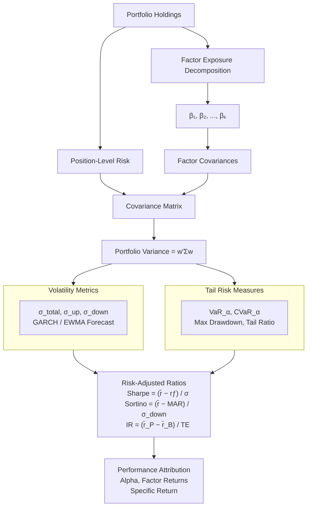

# Lesson 3: Risk Measurement Frameworks

## 1. First-Principles Intuition & Invariants

Risk measurement in finance confronts a fundamental paradox: the future is unknowable, yet investment decisions demand quantitative assessments of uncertainty. Unlike engineering disciplines where physical laws constrain outcomes, financial markets exhibit path-dependent, non-stationary dynamics driven by human behavior, institutional constraints, and reflexive feedback loops. The practitioner's challenge lies not in discovering some hidden "true" risk measure, but in constructing robust quantitative frameworks that capture economically meaningful dimensions of portfolio vulnerability under realistic market conditions.

The foundational insight underlying all modern risk measurement begins with Harry Markowitz's 1952 recognition that rational investors care about the entire probability distribution of returns, not merely expected values. Before Markowitz, the dominant investment paradigm treated securities as isolated bets evaluated solely on anticipated payoffs. By formalizing portfolio selection as a mean-variance optimization problem, Markowitz established that risk—operationalized as return volatility—constitutes an irreducible dimension of investment choice. The efficient frontier emerges as the locus of portfolios offering maximum expected return for each level of volatility, or equivalently, minimum volatility for each expected return target.

Yet volatility as a risk measure embeds strong assumptions that frequently fail in practice. The normal distribution hypothesis underlying mean-variance analysis implies symmetric return distributions with exponentially decaying tail probabilities. Actual financial return series exhibit fat tails, negative skewness in equity markets, and time-varying volatility clustering. The 1987 market crash, the Long-Term Capital Management collapse in 1998, and the 2008 financial crisis all demonstrated that rare tail events occur with far higher frequency than Gaussian models predict. Modern risk measurement frameworks therefore stratify into complementary layers: volatility metrics capture routine fluctuations suitable for Gaussian approximation, while downside risk measures explicitly model tail behavior and asymmetric loss distributions.

The second foundational principle recognizes that risk is inherently multidimensional and context-dependent. A pension fund managing liabilities with twenty-year duration faces fundamentally different risks than a high-frequency trading desk holding positions for milliseconds. The liability-driven investor cares about tracking error relative to actuarial obligations, inflation risk, and the correlation structure between asset returns and liability cash flows. The proprietary trading desk focuses on maximum drawdown, Value-at-Risk over short horizons, and profit-and-loss volatility within position limits. Consequently, no single risk metric suffices for all investment contexts. Practitioners must construct risk measurement architectures tailored to specific mandate constraints, liability structures, and regulatory requirements.

The third invariant concerns the distinction between ex-ante risk forecasts and ex-post realized outcomes. Risk models generate conditional probability distributions based on historical data, market-implied volatilities, or factor exposures. These forward-looking estimates represent expected risk under assumed stationarity or specified evolution models for return-generating processes. Ex-post performance attribution then measures realized volatility, drawdowns, and tail losses after the fact. The divergence between forecasted and realized risk reveals model risk, regime changes, and structural breaks. Effective risk management demands continuous model validation through backtesting, stress testing, and scenario analysis that probes model behavior under conditions absent from calibration samples.

Risk-adjusted performance measurement constitutes the fourth foundational pillar. Raw returns provide insufficient information for evaluating investment skill because high returns may simply reflect elevated risk-taking rather than superior alpha generation. The Sharpe ratio, introduced by William Sharpe in 1966, normalizes excess returns by total volatility to produce a scale-invariant measure of risk efficiency. Extensions like the Sortino ratio focus exclusively on downside deviations, while the information ratio measures active returns per unit of tracking error. These ratios transform the multidimensional problem of portfolio comparison into scalar rankings, enabling performance comparison across strategies with different risk profiles.

The capital asset pricing model (CAPM) and its empirical offspring introduce systematic versus idiosyncratic risk decomposition as a fifth core principle. Beta measures a security's sensitivity to broad market movements, representing the component of return variation explained by a common risk factor. In equilibrium, investors receive compensation only for bearing non-diversifiable systematic risk; idiosyncratic risk vanishes through portfolio diversification. While the single-factor CAPM fails empirically—the size premium, value premium, and momentum anomalies all contradict CAPM predictions—the conceptual separation between systematic and specific risk remains essential. Modern factor models from Fama-French to principal component analysis extend this logic to multiple risk dimensions, with tracking error measuring active risk relative to factor exposures.

## 2. Core Architecture & Mechanics

Volatility measurement begins with the arithmetic calculation of standard deviation but immediately confronts critical implementation decisions around return periodicity, estimation windows, and weighting schemes. Consider a portfolio with daily closing prices $P_t$ over $T$ trading days. The log-return series is computed as $r_t = \ln(P_t / P_{t-1})$, preferred over arithmetic returns $R_t = (P_t - P_{t-1})/P_{t-1}$ because log-returns aggregate additively over time and better approximate normality. The sample standard deviation under equal weighting takes the form:

$$\sigma = \sqrt{\frac{1}{T-1} \sum_{t=1}^{T} (r_t - \bar{r})^2}$$

where $\bar{r}$ denotes the sample mean return. This estimator assumes return independence and stationarity, treating all observations as equally informative. In practice, volatility exhibits pronounced time-variation: market turbulence clusters, with high-volatility days following other high-volatility days. The GARCH (Generalized Autoregressive Conditional Heteroskedasticity) framework addresses this by modeling volatility as a dynamic process. The simplest GARCH(1,1) specification writes:

$$\sigma_t^2 = \omega + \alpha \epsilon_{t-1}^2 + \beta \sigma_{t-1}^2$$

where $\epsilon_t = \sigma_t z_t$ with $z_t$ drawn from a standard normal distribution, $\omega > 0$ represents the long-run variance baseline, $\alpha$ captures the impact of recent return shocks, and $\beta$ measures volatility persistence. Estimation proceeds via maximum likelihood, and the model produces conditional volatility forecasts that adapt to changing market conditions. Empirical parameter estimates typically show $\alpha + \beta \approx 0.98$ for daily equity returns, indicating near-unit-root persistence in volatility shocks.

Exponentially weighted moving average (EWMA) volatility offers a simpler recursive alternative that assigns exponentially decaying weights to past squared returns:

$$\sigma_t^2 = \lambda \sigma_{t-1}^2 + (1 - \lambda) r_{t-1}^2$$

The decay parameter $\lambda$ controls the effective memory span, with RiskMetrics standardizing $\lambda = 0.94$ for daily equity volatility and $\lambda = 0.97$ for longer-horizon estimates. This specification requires no parameter estimation beyond choosing $\lambda$, updates trivially with each new observation, and adapts quickly to volatility regime shifts. The EWMA reduces to an infinite weighted average:

$$\sigma_t^2 = (1-\lambda) \sum_{i=0}^{\infty} \lambda^i r_{t-1-i}^2$$

The effective lookback window spans approximately $1/(1-\lambda)$ days, yielding roughly 16 days of effective history with $\lambda = 0.94$.

Implied volatility derived from option prices provides a forward-looking alternative to historical estimation. The Black-Scholes option pricing formula contains a single unobservable parameter: the volatility of the underlying asset over the option's remaining life. By inverting observed option prices, market participants extract the volatility expectation embedded in option premiums. The VIX index, constructed from S&P 500 index option prices across multiple strikes and maturities, represents the market's expected 30-day volatility on an annualized basis. Unlike historical volatility that looks backward, implied volatility aggregates the collective forecast of option market participants. The VIX typically exceeds subsequently realized volatility due to variance risk premium—investors pay elevated premiums for portfolio insurance, creating a persistent gap between implied and realized measures.

Value-at-Risk (VaR) quantifies tail risk by answering a specific question: what is the maximum loss expected with a given confidence level over a specified time horizon? Formally, VaR at confidence level $\alpha$ solves:

$$P(L > \text{VaR}_\alpha) = 1 - \alpha$$

where $L$ represents portfolio loss. A one-day 95% VaR of \$2 million states that portfolio losses will exceed \$2 million on only 5% of days, or roughly once per month. VaR provides a scalar summary of tail risk, facilitates position sizing through comparison against capital buffers, and enjoys regulatory status in Basel banking accords and SEC risk disclosures.

Three primary methodologies compute VaR with distinct tradeoffs. The parametric (variance-covariance) approach assumes normally distributed returns and calculates VaR as:

$$\text{VaR}_\alpha = \mu + \sigma \Phi^{-1}(\alpha)$$

where $\mu$ represents expected return (often approximated as zero for short horizons), $\sigma$ denotes portfolio volatility, and $\Phi^{-1}$ is the inverse standard normal cumulative distribution. For 95% confidence, $\Phi^{-1}(0.95) = 1.645$, yielding $\text{VaR}_{0.95} \approx 1.645\sigma$ for zero-mean returns. This method executes instantaneously and scales easily to large portfolios through covariance matrix calculations, but systematically underestimates risk in the presence of fat tails or non-linear exposures like options.

Historical simulation constructs the empirical return distribution by replaying historical scenarios. The practitioner marks the current portfolio to market under each of the past $T$ trading days, sorts the resulting P&L distribution, and extracts the $(1-\alpha)$ quantile. This approach requires no distributional assumptions and captures actual tail behavior observed historically. However, it treats all historical observations as equally relevant (unless weighted), cannot estimate VaR beyond the worst historical loss in the sample, and fails to incorporate forward-looking market intelligence. A portfolio backtested on data preceding 2007 would miss the specific tail dynamics of the subsequent financial crisis.

Monte Carlo simulation generates synthetic return paths by repeatedly sampling from a specified stochastic return model, repricing the portfolio under each scenario, and extracting the VaR quantile from the simulated loss distribution. This approach handles complex portfolios with derivatives and path-dependent payoffs, incorporates sophisticated return models capturing fat tails and correlation breakdowns, and produces smooth VaR estimates even at extreme quantiles. The computational cost scales with scenario count—typically 10,000 to 100,000 paths for stable estimates—and model risk remains substantial since results depend entirely on assumed return dynamics.

Conditional Value-at-Risk (CVaR), also termed Expected Shortfall, addresses a critical VaR deficiency: VaR reveals nothing about the magnitude of losses beyond the threshold. Two portfolios with identical VaR can have vastly different tail risk if one exhibits fat tails with extreme losses conditional on breaching VaR. CVaR measures the expected loss given that VaR has been exceeded:

$$\text{CVaR}_\alpha = E[L \mid L > \text{VaR}_\alpha]$$

For a 95% VaR, CVaR represents the average loss across the worst 5% of outcomes. CVaR satisfies coherence axioms that VaR violates: it is subadditive (portfolio CVaR never exceeds the sum of constituent CVaRs), positively homogeneous, and translation invariant. These properties make CVaR suitable for portfolio optimization, whereas VaR optimization can produce perverse incentives to concentrate risk just below the VaR threshold.

Beta decomposition quantifies systematic risk exposure by regressing asset returns against market or factor returns. The single-index model writes:

$$r_{i,t} = \alpha_i + \beta_i r_{M,t} + \epsilon_{i,t}$$

where $r_{i,t}$ represents asset $i$'s excess return (above the risk-free rate), $r_{M,t}$ denotes the market portfolio excess return, $\beta_i = \text{Cov}(r_i, r_M) / \text{Var}(r_M)$ measures systematic risk, and $\epsilon_{i,t}$ captures idiosyncratic return variation. Ordinary least squares estimation yields:

$$\hat{\beta}_i = \frac{\sum_{t=1}^{T} (r_{i,t} - \bar{r}_i)(r_{M,t} - \bar{r}_M)}{\sum_{t=1}^{T} (r_{M,t} - \bar{r}_M)^2}$$

A beta of 1.3 indicates the asset moves 1.3% on average for each 1% market move, amplifying both gains and losses relative to the benchmark. Low-beta securities ($\beta < 1$) exhibit defensive characteristics, outperforming in market downturns but lagging in rallies. The R-squared statistic from the regression measures the proportion of return variance explained by market movements:

$$R^2 = \frac{\beta_i^2 \text{Var}(r_M)}{\text{Var}(r_i)} = 1 - \frac{\text{Var}(\epsilon_i)}{\text{Var}(r_i)}$$

High R-squared implies the asset tracks the market closely, while low R-squared signals substantial idiosyncratic risk. Sector-specific or international portfolios often exhibit low R-squared against domestic equity benchmarks, reflecting exposure to distinct risk factors.

Multifactor models extend single-index beta to capture exposure across multiple systematic risk dimensions. The Fama-French three-factor model augments market beta with size and value factors:

$$r_{i,t} = \alpha_i + \beta_{i,M} r_{M,t} + \beta_{i,\text{SMB}} \text{SMB}_t + \beta_{i,\text{HML}} \text{HML}_t + \epsilon_{i,t}$$

where SMB (Small Minus Big) represents the return spread between small-cap and large-cap stocks, and HML (High Minus Low) captures the value premium between high and low book-to-market firms. The Carhart four-factor model adds a momentum factor (UMD), while the Fama-French five-factor model incorporates profitability and investment factors. Each beta coefficient quantifies exposure to its corresponding risk premium, enabling precise risk attribution. A portfolio with $\beta_{\text{SMB}} = 0.8$ and $\beta_{\text{HML}} = 1.2$ tilts toward small-cap value stocks and should be evaluated relative to that benchmark rather than a cap-weighted market index.

Tracking error measures active risk relative to a benchmark, defined as the standard deviation of return differences between a portfolio and its reference index:

$$\text{TE} = \sigma(r_P - r_B) = \sqrt{\frac{1}{T-1} \sum_{t=1}^{T} [(r_{P,t} - r_{B,t}) - \overline{(r_P - r_B)}]^2}$$

Active managers targeting 50 to 100 basis points of annual tracking error pursue modest benchmark deviations, while aggressive strategies tolerate 300 to 500 basis points or more. Tracking error decomposes into systematic and specific components through factor analysis. If the portfolio and benchmark share identical factor exposures but differ in security selection, tracking error arises purely from idiosyncratic bets. Conversely, sector tilts or factor timing generate systematic tracking error through deliberate beta deviations. Ex-ante tracking error forecasts combine position-level risk contributions:

$$\text{TE}^2 = \sum_{i=1}^{N} \sum_{j=1}^{N} (w_{P,i} - w_{B,i})(w_{P,j} - w_{B,j}) \sigma_{ij}$$

where $w_{P,i}$ and $w_{B,i}$ represent security $i$'s weight in the portfolio and benchmark, and $\sigma_{ij}$ denotes the covariance between securities $i$ and $j$. This quadratic form requires estimation of the $N \times N$ covariance matrix, typically constructed from factor models to ensure positive definiteness and reduce parameter count.

The Sharpe ratio transforms raw returns into risk-adjusted performance by dividing excess return over the risk-free rate by total volatility:

$$\text{SR} = \frac{\bar{r}_P - r_f}{\sigma_P}$$

This ratio measures the reward per unit of total risk, enabling comparison between strategies with different volatility profiles. A Sharpe ratio of 1.0 indicates the portfolio generates one unit of excess return for each unit of volatility, considered strong performance for long-only equity strategies. Hedge funds and sophisticated trading strategies often target Sharpe ratios between 1.5 and 2.5 through diversification and dynamic risk management. The Sharpe ratio inherits mean-variance optimization assumptions, treating upside and downside volatility symmetrically and implicitly assuming normally distributed returns. Strategies with positive skewness (frequent small gains and rare large gains) receive conservative Sharpe ratio assessments, while negatively skewed strategies (frequent small gains and rare catastrophic losses) appear artificially attractive.

The Sortino ratio refines the Sharpe ratio by replacing total volatility with downside deviation, penalizing only returns falling below a minimum acceptable return (MAR):

$$\text{Sortino} = \frac{\bar{r}_P - \text{MAR}}{\sigma_{\text{down}}}$$

where downside deviation is:

$$\sigma_{\text{down}} = \sqrt{\frac{1}{T} \sum_{t=1}^{T} \min(r_{P,t} - \text{MAR}, 0)^2}$$

Practitioners commonly set MAR to zero or the risk-free rate, though institutional investors may use actuarial targets or inflation benchmarks. The Sortino ratio rewards strategies that suppress downside risk while preserving upside potential, aligning with investor preferences for asymmetric return distributions. Private equity and venture capital funds with long-tailed return profiles naturally score better on Sortino versus Sharpe metrics.

The information ratio measures active return per unit of active risk for benchmark-relative strategies:

$$\text{IR} = \frac{\bar{r}_P - \bar{r}_B}{\text{TE}}$$

This ratio evaluates the efficiency of active management: how much alpha does the manager generate for each basis point of tracking error taken? An information ratio of 0.5 represents a realistic target for skilled active managers, implying 50 basis points of alpha per 100 basis points of tracking error. Information ratios above 1.0 indicate exceptional skill or favorable market environments. The fundamental law of active management, articulated by Grinold and Kahn, decomposes the information ratio as:

$$\text{IR} = \text{IC} \sqrt{BR}$$

where IC represents the information coefficient (correlation between forecasted and realized returns) and BR denotes breadth (the number of independent active bets). This identity reveals that consistent alpha generation requires either high forecast accuracy (large IC) or numerous independent opportunities (large BR). Long-only stock pickers face constrained breadth due to position sizing and diversification requirements, while high-frequency traders exploit low-IC signals across thousands of independent opportunities to achieve competitive information ratios.

## 3. High-Performance Optimization & Failure Modes

Covariance matrix estimation constitutes the primary computational bottleneck in portfolio risk measurement, with complexity scaling quadratically in the number of securities. A portfolio of 1,000 stocks requires estimation of nearly 500,000 unique covariances. Direct sample covariance estimation from historical returns produces ill-conditioned matrices plagued by estimation error, particularly for short estimation windows or highly correlated assets. The Ledoit-Wolf shrinkage estimator addresses this by blending the sample covariance with a structured target, typically the constant-correlation matrix:

$$\hat{\Sigma}_{\text{shrink}} = \delta F + (1-\delta) S$$

where $S$ represents the sample covariance, $F$ denotes the shrinkage target, and $\delta$ controls the shrinkage intensity. The optimal shrinkage parameter minimizes expected squared error between the estimator and the true covariance matrix under asymptotic conditions. This regularization reduces eigenvalue dispersion, stabilizes matrix inversion for portfolio optimization, and typically improves out-of-sample risk forecasts compared to unconstrained sample covariances.

Factor models achieve dimensionality reduction by expressing the covariance structure through a smaller set of systematic risk factors. If returns follow a $K$-factor model with $K \ll N$ factors, the covariance matrix decomposes as:

$$\Sigma = B \Omega B' + D$$

where $B$ is the $N \times K$ factor loading matrix, $\Omega$ represents the $K \times K$ factor covariance matrix, and $D$ contains specific variances on its diagonal. Estimation reduces from $O(N^2)$ covariances to $O(NK)$ factor loadings plus $K(K+1)/2$ factor covariances and $N$ specific variances. Commercial risk models from MSCI Barra and Axioma employ 50 to 100 factors spanning industries, styles, countries, and currencies, achieving computational tractability for portfolios containing thousands of securities while preserving economically interpretable risk decomposition.

Risk calculation in multi-asset portfolios with derivatives demands careful treatment of non-linear exposures. Options and structured products exhibit convexity that simple variance calculations miss entirely. A delta-hedged option portfolio may appear risk-neutral under linear approximation yet face substantial gamma risk from large market moves. Full revaluation under Monte Carlo simulation captures these effects but requires iterative pricing of every derivative under each scenario. The computational burden scales as $O(M \times N_{\text{deriv}})$ where $M$ denotes scenario count and $N_{\text{deriv}}$ represents the number of derivatives requiring repricing. Practitioners balance accuracy against speed through variance reduction techniques: antithetic variates, control variates, importance sampling, and quasi-random sequences (Sobol, Halton) that achieve faster convergence than pseudo-random sampling.

Backtesting validation requires careful attention to statistical power and look-ahead bias. VaR models claim that losses exceeding VaR occur with frequency $1-\alpha$. Testing whether observed breach frequency matches theoretical predictions involves binomial hypothesis tests, but small samples provide weak power to detect model failures. A 95% VaR estimated on daily data produces only 12 to 13 expected breaches per year. Distinguishing between a correctly specified model and one that understates risk by 10% requires years of data. The Basel traffic light system classifies models based on the number of VaR exceptions over 250 trading days: green zone (0-4 exceptions), yellow zone (5-9), and red zone (10+). Models entering the red zone trigger regulatory capital add-ons or model replacement mandates.

Conditioning information structure introduces another failure mode: VaR estimates conditional on today's volatility regime may prove irrelevant if volatility spikes tomorrow. The correct risk measure conditions on the information set available at position initiation, not subsequent realizations. Cross-sectional variation in VaR across different portfolio vintages reveals time-variation in risk-taking opportunities. Strategies that dynamically scale positions inversely to forecasted volatility (volatility targeting) maintain roughly constant VaR through time, sacrificing returns in high-volatility regimes to preserve capital stability.

Correlation breakdown during crises represents perhaps the most pernicious risk measurement failure. Diversification strategies premised on stable correlation structures collapse when correlations surge toward one during market stress. The 2008 financial crisis saw equity correlations across countries and sectors spike above 0.8, eliminating geographic and style diversification benefits precisely when needed most. Risk models calibrated on normal-period data systematically understate crisis risk. Stress testing and scenario analysis provide essential complements to probabilistic risk measures by examining portfolio behavior under historically realized or hypothetically constructed market shocks. The Federal Reserve's Comprehensive Capital Analysis and Review (CCAR) mandates that large banks demonstrate resilience under severely adverse scenarios including deep recession, unemployment spikes, and equity declines exceeding 50%.

Model risk emerges from the gap between mathematical risk models and the true but unknowable return-generating process. All risk models embed simplifications: return distribution assumptions, stationarity of parameters, factor structure stability, and liquidity availability. These assumptions fail during regime changes, structural breaks, and tail events. Robust risk management demands model diversification—computing risk estimates under multiple methodologies and reconciling differences. If parametric VaR shows \$5 million, historical simulation indicates \$7 million, and Monte Carlo with fat-tailed distributions yields \$9 million, the practitioner faces a range of estimates rather than a single number. Conservative risk management errs toward the higher estimates and investigates why methodologies diverge.

Liquidity risk interacts multiplicatively with market risk in portfolios containing illiquid securities or derivatives. VaR calculations assume positions can be liquidated or hedged at prevailing market prices, an assumption violated when bid-ask spreads widen or market depth evaporates. Liquidity-adjusted VaR incorporates endogenous price impact by modeling how the act of unwinding positions moves prices adversely. For a position requiring $T$ days to liquidate, the relevant risk horizon extends over the liquidation period, and price impact accumulates across executed tranches. The 1998 LTCM crisis demonstrated catastrophically that leveraged portfolios in illiquid markets face liquidation risk: forced sales trigger price declines that propagate through correlated positions, amplifying losses beyond any ex-ante statistical risk measure.

Risk attribution decomposes total portfolio risk into contributions from individual positions or factors, enabling targeted risk reduction. The marginal contribution to risk (MCR) for position $i$ equals:

$$\text{MCR}_i = \frac{\partial \sigma_P}{\partial w_i} = \frac{1}{\sigma_P} \sum_{j=1}^{N} w_j \sigma_{ij}$$

The component contribution to risk (CCR) scales MCR by position size:

$$\text{CCR}_i = w_i \cdot \text{MCR}_i$$

These contributions sum to total portfolio volatility: $\sum_{i=1}^{N} \text{CCR}_i = \sigma_P$. Positions with high MCR contribute disproportionately to portfolio risk even if their individual volatilities appear moderate, arising from correlation structure amplification. Risk parity strategies explicitly target equal risk contribution across assets rather than equal weight allocation, typically resulting in overweight positions in low-volatility assets like bonds and underweight in equities.

Scenario analysis and reverse stress testing probe model behavior beyond the boundaries of historical experience. Forward-looking scenarios construct hypothetical market shocks based on macroeconomic narratives: emerging market currency crises, sovereign debt defaults, commodity price spikes, or geopolitical conflicts. Practitioners reprice portfolios under these scenarios to assess vulnerability to specific risk factors. Reverse stress testing inverts the logic by searching for scenarios that would cause catastrophic portfolio losses or breaches of regulatory capital requirements, even if those scenarios appear improbable. This approach surfaces hidden concentrations and unanticipated correlations that statistical models overlook. The Bank of England mandates reverse stress testing for systemically important financial institutions, requiring identification of scenarios producing failure regardless of assigned probability.

High-frequency risk management in electronic trading environments demands sub-second risk calculations and automated position limits. Market-making algorithms and statistical arbitrage strategies execute thousands of trades daily with intraday position turnover. Traditional end-of-day risk reporting arrives far too late for intraday risk control. Real-time risk engines maintain running estimates of portfolio Greeks (delta, gamma, vega for options portfolios), VaR updates with each trade, and automated position limits that trigger risk reduction when breached. These systems interface directly with order management systems, blocking new orders when aggregate risk metrics exceed hard limits. The 2012 Knight Capital trading glitch demonstrated the catastrophic potential of inadequate real-time risk controls: a software error generated \$7 billion in erroneous trades over 45 minutes, producing a \$440 million loss that bankrupted the firm.

The final failure mode concerns the agency problem in risk measurement and reporting. Traders and portfolio managers face incentive structures rewarding returns with imperfect penalties for risk-taking. Risk officers measuring and reporting risk independently from revenue-generating units provide essential checks, but organizational pressures can compromise risk governance. The 2012 "London Whale" incident at JPMorgan illustrated how a trader's accumulation of massive credit derivative positions evaded risk detection through manipulation of volatility assumptions in VaR calculations. Effective risk management demands not only sophisticated quantitative models but also organizational structures ensuring that risk measurement remains independent, senior risk officers hold veto authority over excessive risk-taking, and incentive compensation incorporates risk-adjusted performance metrics rather than absolute returns.
