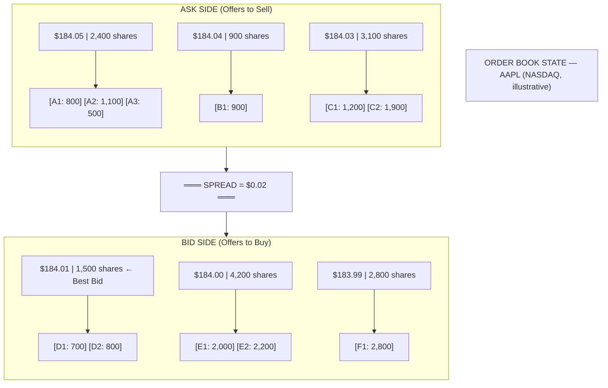
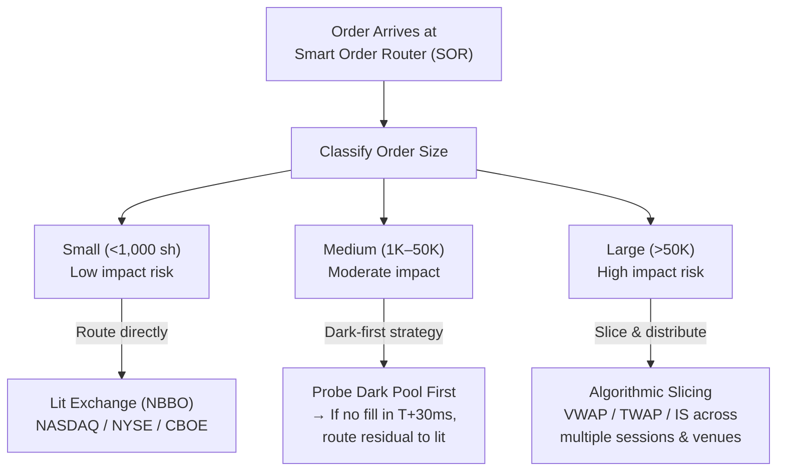

# Lesson 4: Market Microstructure, Liquidity Provision, Price Discovery

## 1. First-Principles Intuition & Invariants

Every price you see on a trading screen is not a fact about the world — it is an *outcome* of a mechanism. Behind that quoted number sits an architecture of competing interests, asymmetric information, and constrained optimization by dealers, algorithms, and institutional order routers. Market microstructure is the discipline that cracks open that mechanism and examines its parts. For the practitioner, understanding it is not an academic exercise; it determines whether a theoretically profitable strategy survives after execution costs, whether a large institutional order moves the market against itself, and whether the spread you pay is fair compensation to a dealer or a tax extracted by an informed flow.

The study begins with a deceptively simple observation: in any double-auction market, there are agents who supply liquidity and agents who demand it. The market maker posts a bid and an ask simultaneously, standing ready to buy at the lower price and sell at the higher. The difference — the **bid-ask spread** — is the market maker's gross revenue per round-trip share. But framing it purely as revenue misses the mechanism. The spread exists because the market maker faces three distinct and permanent risks, each demanding compensation.

The first risk is **order processing cost**: the clerical and technology overhead of intermediation. This component is largely fixed and has been driven toward zero by electronic limit order books and co-location, which is precisely why spreads in highly liquid large-cap equities can be a single penny. The second risk is **inventory risk**, formalized by Stoll (1978) and Ho and Stoll (1981). A market maker who sells shares to a buyer now carries a short position. If prices rise before an offsetting buyer arrives, the dealer loses. The dealer is thus a forced holder of a stochastic inventory, and the spread must compensate for the variance of that inventory's mark-to-market value over the holding period. The Ho-Stoll model formalizes this intuition: the market maker solves for the utility-maximizing spread given an expected inventory reversion time and a price variance $\sigma^2$. In that framework, the half-spread $s/2$ can be decomposed as:

$$\frac{s}{2} = \frac{\phi \sigma^2 T}{2} + C$$

where $\phi$ is the dealer's risk aversion coefficient, $\sigma^2$ is the variance of the asset's return, $T$ is the expected order arrival interval, and $C$ captures processing costs. The critical empirical implication is that spreads should widen when volatility rises — which is precisely what every options trader, equity market maker, and ETF authorized participant observes in the minutes surrounding macroeconomic data releases.

The third and most consequential risk is **adverse selection**, and it is here that microstructure theory becomes genuinely subtle. The market maker cannot distinguish between an uninformed retail investor buying 100 shares of Apple because their retirement account rebalanced and a hedge fund buying 100 shares because their satellite imagery model just detected an anomalous surge in Foxconn factory shipments. Both orders look identical in the limit order book. If the hedge fund is right — if its information is real — the market will move in its direction shortly after execution, and the market maker who sold to it at the ask will find the new equilibrium price above what it received. It has been systematically picked off by superior information.

This adverse selection cost was formalized by Glosten and Milgrom (1985) in one of the most important models in financial economics. In their framework, every incoming order is a signal about the asset's true value. Even if any single counterparty is uninformed with high probability, the conditional probability that a buyer has private information is nonzero, and the market maker updates its belief about fundamental value with every trade. The equilibrium spread is not set to cover average costs — it is set so that revenue from uninformed order flow exactly covers expected losses to informed traders. The model predicts that spreads are wider for stocks with more information asymmetry, more volatile fundamentals, and thinner uninformed order flow — a prediction the data confirm robustly across asset classes and market regimes.

The Glosten-Milgrom framework leads directly to the concept of **order flow toxicity**, which has become the central operational concern of contemporary liquidity providers. If a dealer's order flow is "toxic," it means the proportion of informed trades in the incoming flow is high enough to generate systematic losses. VPIN (Volume-Synchronized Probability of Informed Trading), developed by Easley, López de Prado, and O'Hara (2012), operationalizes this into a real-time metric. The core insight is that informed traders tend to execute directionally: they buy when they know the price will rise, they sell when they know it will fall. This imbalance between buyer-initiated and seller-initiated volume, measured in synchronized volume time rather than calendar time, is a proxy for the fraction of informed flow. A VPIN reading near 1 means almost all recent volume is directional; near 0 means it is balanced and likely uninformed. Market makers and exchange surveillance teams monitor VPIN in real time precisely because elevated readings precede liquidity crises — the Flash Crash of May 6, 2010 saw VPIN spike to its 99th percentile distribution value more than an hour before prices collapsed.

Understanding these three layers — inventory risk, adverse selection, and order processing cost — provides the theoretical skeleton. But the practitioner must also understand how **price discovery** actually works in fragmented markets, where the same stock may trade simultaneously on NYSE, NASDAQ, BATS, IEX, and a dozen dark venues. Price discovery is the process by which private information about an asset's fundamental value gets incorporated into its observable market price. In a world with a single centralized exchange, this is straightforward: informed traders buy until the price reflects their information, and the spread adjusts. In a fragmented world, the same mechanism operates across venues simultaneously, with high-frequency arbitrageurs linking prices and enforcing the law of one price within microseconds. The econometric tool for measuring where price discovery originates is **Hasbrouck's (1995) information share**, which decomposes the variance of the efficient price innovation across venues. A venue with high information share is where informed trading concentrates; a venue with low information share is a price-taker, echoing the consensus price formed elsewhere.

---

## 2. Core Architecture & Mechanics

### The Limit Order Book: Structure and State Machine

The central data structure of modern equity markets is the **limit order book (LOB)**, a priority-sorted queue of resting orders on each side of the market. Understanding its internal mechanics is prerequisite to any execution analysis. The book maintains two sides: the bid side, sorted descending by price (best bid at the top), and the ask side, sorted ascending by price (best ask at the top). Each price level contains a FIFO queue of orders, each carrying a timestamp, size, and participant identifier. The spread is simply the gap between the best ask and the best bid.

An incoming **market order** to buy 2,000 shares walks the ask side of the book. It executes first against the best ask at \$184.03, consuming 2,000 shares from the available 3,100 — filling C1 entirely and partially filling C2. The remaining 1,100 shares in C2 stay on the book. No price impact beyond the first level. An incoming market order for 5,000 shares, however, would consume all three ask levels, with the final portion executing at \$184.05. This "walking the book" behavior is the operational definition of **market impact**: the order itself moves the price by consuming available liquidity.

The state machine governing the LOB has four canonical event types. A **limit order submission** adds a new entry to the appropriate price-time position in the queue. A **cancellation** removes an existing resting order without any trade occurring. A **market order** or **aggressive limit order** (one priced through the spread) consumes resting liquidity and generates an execution. And a **modification**, in many implementations, is operationally equivalent to a cancel-and-resubmit, losing time priority if the price changes. The practitioner significance of time priority is non-trivial: a resting order at the best bid that arrived one microsecond earlier than a competing order at the same price will execute first. This is why co-location — physically placing servers in the same data center as the exchange matching engine — reduces latency by nanoseconds and directly translates to queue position and therefore fill rate on passive limit orders.

### Spread Decomposition: From Quote to Component

The bid-ask spread a practitioner observes is not a single atomic number. Roll (1984) provided the first empirical decomposition, noting that if the only source of spreads were order processing costs, prices would follow a pattern of small reversals as transactions alternated between bid and ask. By measuring the serial covariance of price changes — which is negative when orders bounce between bid and ask — Roll derived:

$$s_{\text{Roll}} = 2\sqrt{-\text{Cov}(\Delta p_t, \Delta p_{t-1})}$$

This "effective spread" estimate from price data alone, without quote data, was methodologically important for historical studies. Modern practitioners have finer tools. The **realized spread** isolates the pure market maker revenue: take the trade price, compare it to the midpoint five minutes after the trade, and measure the difference. If the market maker sold at the ask, and the midpoint five minutes later is below the ask, the difference is their realized profit — net of adverse selection losses already reflected in the subsequent price move. The **price impact** component is what remains: the permanent price movement attributable to the information content of the order. Together:

$$\underbrace{\text{Effective Spread}}_{\text{total execution cost}} = \underbrace{\text{Realized Spread}}_{\text{market maker revenue}} + \underbrace{\text{Price Impact}}_{\text{information cost}}$$

For a large-cap liquid stock like AAPL in normal conditions, a typical effective spread of two cents might decompose into roughly one cent of realized spread and one cent of price impact. For a small-cap stock with high information asymmetry, the price impact component dominates, sometimes representing 80% or more of the total effective spread. This decomposition is operationally critical for a buy-side analyst benchmarking execution quality: an algorithm that achieves tight effective spreads but consistently triggers large price impact is trading aggressively and moving the market; one with wider effective spreads but negligible price impact is trading patiently and minimizing information leakage.

### Order Flow, VPIN, and Toxicity Detection

The VPIN metric operationalizes order flow toxicity into a continuous monitoring framework. The computation proceeds by bucketing trades into equal-volume bars (rather than equal-time bars, which is the methodological innovation) and classifying each trade as buy-initiated or sell-initiated using the Lee-Ready algorithm: trades above the midpoint are buyer-initiated; trades below are seller-initiated; trades at the midpoint are classified by tick direction.

$$\text{VPIN} = \frac{\sum_{\tau=1}^{n} |V_\tau^B - V_\tau^S|}{n \cdot V}$$

where $V_\tau^B$ and $V_\tau^S$ are the buy and sell volumes in bucket $\tau$, $V$ is the fixed volume per bucket, and $n$ is the rolling window (typically 50 volume buckets). A VPIN approaching 1 signals that nearly all volume is hitting one side of the book — a hallmark of a large informed actor or a correlated institutional flow. Market makers on options desks and equity desks monitor this in real time and widen their quotes or pull liquidity entirely when VPIN crosses threshold values. This quote withdrawal is precisely the liquidity spiral mechanism that amplified the 2010 Flash Crash: as VPIN rose, liquidity providers stepped away, the LOB thinned dramatically, and market orders began walking the book to increasingly distant price levels.

### Dark Pools, Lit Markets, and Venue Selection

The fragmentation of equity trading across venue types is one of the defining structural features of post-Reg NMS U.S. equity markets. A **lit market** — NYSE, NASDAQ, CBOE BZX, IEX — displays its limit order book publicly in real time. Every quote is visible to any participant connected to the SIP (Securities Information Processor) or directly to the exchange feed. A **dark pool** — operated by broker-dealers such as Goldman Sachs Sigma X, Morgan Stanley MS Pool, or by independent operators like Liquidnet — executes trades without pre-trade transparency. Orders resting in a dark pool are invisible; a match occurs only when an offsetting order enters the same pool.

The economic rationale for dark pools is straightforward: a large institutional order routed entirely to a lit exchange signals its presence immediately through the market impact of consuming lit liquidity, inviting front-running by high-frequency participants who detect the aggressive order flow and step ahead. By matching inside the spread in a dark venue — typically at or near the midpoint between the NBBO bid and ask — the institutional buyer captures a portion of the spread rather than paying it, and avoids pre-trade information leakage. The tradeoff is **execution uncertainty**: a dark order may never find a match if the opposing institutional flow does not exist in the same pool.

The practical consequence is a two-tier market. High-frequency market makers who provide liquidity on lit exchanges earn the spread from uninformed retail and small institutional flow, which the SEC's payment-for-order-flow (PFOF) regime routes to internalizers like Citadel Securities and Virtu rather than to exchanges. Meanwhile, large informed institutional flow migrates to dark venues to minimize adverse selection costs imposed on them by other informed participants. This sorting mechanism has important implications for the quality of price discovery on lit markets: if lit venues increasingly capture only uninformed flow, quoted spreads narrow (because adverse selection risk is low) but price discovery slows, as the information-bearing trades are hidden in dark pools. The empirical literature finds mixed evidence on this — Comerton-Forde and Putnins (2015) show that dark trading above roughly 10–15% of total volume begins to impair price discovery, as the concentration of price-forming trades in opaque venues prevents the LOB from efficiently aggregating dispersed information.

### Tick Size and Its Market Structure Effects

**Tick size** — the minimum allowable price increment — is not a neutral administrative parameter. It is an economic constraint that shapes queue dynamics, spread floors, and the incentive to supply liquidity. The SEC's decimalization of U.S. equity markets in 2001, which reduced the minimum tick from 1/8 of a dollar to \$0.01, compressed spreads dramatically and reduced explicit trading costs for small retail and institutional orders. But it also reduced the economic value of time priority at any given price level, because the spread "rent" a market maker earned from posting a limit order fell by an order of magnitude. This contributed to the arms race toward speed: when the per-trade reward from queue position is thin, the only way to maintain profitability is to cycle through enormous order volume, which requires the fastest possible order submission and cancellation infrastructure.

For stocks trading at high prices, a one-cent tick is economically negligible relative to the stock price. For stocks trading near \$5–10, a one-cent tick represents 10–20 basis points of the price, potentially wider than the economically warranted spread. This creates a **binding tick constraint**: the LOB crowds at the best bid and ask, queue length grows long, and the probability of execution at the inside price falls. Empirical evidence from the SEC's 2016 Tick Size Pilot Program, which widened tick sizes to five cents for a subset of small-cap stocks, found that quoted spreads widened predictably, but that market maker participation increased and depth at the inside quote improved — confirming the theoretical prediction that wider ticks restore rent to liquidity provision and attract capital to smaller, less-liquid stocks.

---

## 3. High-Performance Optimization & Failure Modes

### Implementation Shortfall and the Almgren-Chriss Execution Framework

The professional standard for measuring and optimizing execution quality is **Implementation Shortfall (IS)**, developed by Perold (1988). IS measures the difference between the paper portfolio return — computed at the price when the investment decision was made — and the actual return realized after all execution costs. If a portfolio manager decides to buy 500,000 shares of a stock at the prevailing midpoint of \$50.00, but the actual volume-weighted average execution price (VWAP) across the sliced order is \$50.18 due to market impact and adverse drift, the IS is 36 basis points. This is the true economic cost of the execution decision, capturing not only explicit spreads but also market impact, timing risk, and opportunity costs from unfilled portions.

Almgren and Chriss (2001) provided the canonical optimization framework for trading under IS. The fundamental tradeoff is between **market impact** and **timing risk**. If you trade a large block slowly (over many hours), you minimize market impact — each individual slice is small relative to daily volume and moves the price minimally. But you bear substantial timing risk: the stock may move adversely over the extended execution window due to public information or general market moves, entirely unrelated to your trading. If you trade quickly, you eliminate timing risk but impose severe market impact on yourself. The Almgren-Chriss model formalizes this tradeoff by minimizing the expected cost plus a risk-aversion-weighted variance of execution cost.

Given a total position $X$ to be liquidated over time horizon $T$, with trading trajectory $x(t)$ and remaining inventory $\tilde{x}(t) = X - x(t)$, the expected cost has two components: temporary price impact, proportional to the trading rate $\dot{x}(t)$, and permanent price impact, proportional to total shares traded. The optimization yields a closed-form solution where the optimal strategy is a time-weighted schedule with a "front-loading" correction proportional to risk aversion:

$$x^*(t) = X \cdot \frac{\sinh\left[\kappa(T - t)\right]}{\sinh(\kappa T)}$$

where $\kappa = \sqrt{\lambda \sigma^2 / \eta}$, with $\lambda$ the trader's risk aversion, $\sigma^2$ the asset's return variance, and $\eta$ the temporary impact coefficient. For $\lambda \to 0$ (no urgency), the strategy converges to a uniform TWAP schedule. For large $\lambda$, the strategy front-loads aggressively. Modern execution algorithms — VWAP, TWAP, Participation Rate, and Arrival Price algorithms offered by every major prime broker — are implementations of variants of this theoretical framework, calibrated with proprietary impact coefficients estimated from the broker's own historical execution data.

### Failure Modes in Execution: When the Model Breaks

The Almgren-Chriss framework and its descendants rest on regularity assumptions that fail in precisely the market conditions where execution is most consequential. The impact model assumes permanent and temporary price impacts are linear in trading rate — an approximation that holds reasonably well for trading rates up to perhaps 15–20% of average daily volume, but breaks down at higher rates as liquidity becomes genuinely scarce. During the January 2021 GameStop squeeze, for instance, any execution model calibrated on historical impact coefficients was categorically wrong: the LOB on the ask side had been stripped by retail buy orders routed through Robinhood, and what remained was a hollow book where even modest institutional size lifted the price by dollars per share.

A more insidious failure mode is **information leakage through order pattern recognition**. If an institutional algorithm executes at a fixed participation rate — buying, say, 20% of every five-minute volume bar — a sufficiently sophisticated high-frequency participant that detects this pattern can predict the next trade with high probability and step ahead. This is not illegal front-running in the traditional sense; it is statistical inference from public trade data. The practical mitigation is **randomization**: introducing stochastic variation in order timing, size, and venue selection so that no detectable autocorrelation pattern emerges in the execution footprint. Sophisticated buy-side desks now specify randomization parameters explicitly when configuring their algorithms via FIX protocol tags, and evaluate execution by looking for serial correlation in their own order-to-midpoint price paths.

**Adverse selection in dark pools** is a failure mode that is structurally underappreciated. The common intuition — that dark pools are "safer" for large institutional orders because there is no pre-trade transparency — ignores the information content of the matching itself. A dark pool operator who sees two counterparties matching knows something about the direction of institutional demand even before any public price impact. More critically, some dark pool designs allow HFT firms to participate as liquidity providers, which introduces the same adverse selection dynamic that motivates institutional investors to avoid lit exchanges in the first place. The practitioner response is to configure order routers to selectively route to dark pools with explicit constraints on participant type, excluding pools that permit high-frequency flow from participating as the contra side of institutional orders.

### Tick Dynamics at Market Open and Close

The first and last minutes of the trading session are structurally different from the continuous trading session, and execution strategies must account for this. At the **open**, the LOB emerges from the overnight pre-market session through an opening auction that aggregates all overnight limit orders and determines an equilibrium clearing price. VPIN is typically elevated in the opening minutes as overnight information — earnings, macro data, analyst upgrades — is incorporated into price. Spreads are wide, depth is shallow relative to midday, and market impact coefficients are substantially higher. Any VWAP algorithm that participates at a constant rate throughout the day will systematically over-trade during the open and underperform its benchmark, because the implicit impact model assumes stable intraday liquidity.

At the **close**, the closing auction on major U.S. exchanges concentrates a large fraction of daily volume into a single price-forming event. NYSE and NASDAQ closing auctions now routinely represent 7–10% of total daily volume in large-cap names, and index funds that must track closing prices are structurally forced to participate. This creates a predictable liquidity event that sophisticated participants exploit through **market-on-close (MOC) imbalance data**, published by NYSE approximately 20 minutes before the close. The imbalance — the net difference between MOC buy and sell orders — reveals the direction of forced index demand, allowing liquidity providers to position themselves on the contra side. A large buy imbalance in the minutes before the close is public information that mechanically predicts an upward price drift into the auction clearing price, and the spread between the last pre-auction quote and the closing auction price is effectively a tax on index funds that cannot avoid participation.

### Measuring and Monitoring Execution Quality: TCA in Practice

**Transaction Cost Analysis (TCA)** is the systematic post-trade measurement framework that operationalizes all of the foregoing theory into practitioner accountability. Every institutional execution desk runs TCA, either through proprietary systems or through third-party providers such as Bloomberg BTCA, ITG/Virtu Analytics, or Abel Noser. The core output is a decomposition of execution performance into components that isolate the impact of timing decisions, algorithm choice, venue selection, and market conditions.

The standard TCA report measures each order's performance against multiple benchmarks simultaneously. The **arrival price** benchmark measures IS directly: execution VWAP versus the midpoint at order receipt, capturing pure execution cost net of alpha. The **interval VWAP** benchmark measures whether the algorithm tracked the market's natural volume distribution during the execution window. The **close price** benchmark is relevant for index-aware mandates. Best-practice TCA then controls for market conditions during the execution window — measuring whether adverse performance reflects execution decisions or simply that the market moved against the order direction during a period of elevated volatility — allowing the analyst to distinguish bad execution from bad luck.

The practitioner workflow is to run TCA on a rolling basis, segment results by broker, algorithm type, order size decile, sector, and time-of-day, and use the resulting performance attribution to adjust algorithm parameter settings and broker allocation. If a particular broker's VWAP algorithm consistently underperforms arrival price on orders exceeding 1% of ADV (average daily volume), the inference is that the algorithm's impact model is under-calibrated for large orders and is trading too aggressively at the wrong times. The capital allocation to that broker's algorithm is reduced, and the conversation is taken to the broker's execution consulting desk for recalibration with the institution's own order flow characteristics.

Execution quality in fragmented, information-asymmetric markets is not an accident of market conditions. It is an engineered outcome, produced by practitioners who understand the theoretical foundations of price formation, monitor real-time liquidity signals, construct execution strategies that balance impact against timing risk, and rigorously evaluate their own performance with the same quantitative discipline they apply to alpha generation. The spread is not just a cost. It is a signal, a mechanism, and a consequence — and the practitioner who understands it at the level of its constituent parts has a durable, structural advantage over one who simply watches the ticker.
