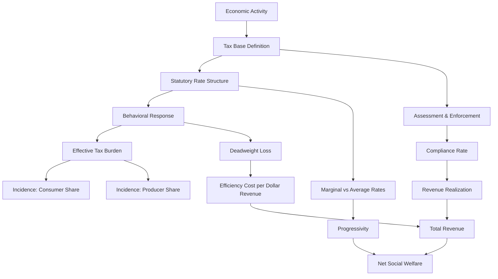

# Lesson 1: Foundations of Taxation Theory

## 1. First-Principles Intuition & Invariants

Taxation stands as the compulsory transfer of economic resources from private agents to the state, fundamentally altering the allocation of scarce goods and services within an economy. Unlike voluntary market transactions that reveal preferences through willingness to pay, taxation operates through coercion backed by legal enforcement. This coercive mechanism introduces profound questions about legitimacy, fairness, and economic efficiency that have occupied philosophers, economists, and policymakers since the emergence of organized states.

The theoretical foundation of taxation rests on two distinct yet interrelated justifications. The **benefit principle** asserts that individuals should contribute to public revenues in proportion to the benefits they receive from government services. Under this logic, a motorist who uses highways extensively should bear more of the road maintenance burden than one who rarely drives. This principle aligns taxation with a quasi-market exchange where citizens purchase government services through their tax payments. The framework exhibits intuitive appeal and traces its intellectual lineage to voluntary exchange theories, but encounters severe practical limitations. Many government services—national defense, public health infrastructure, environmental regulation—provide non-excludable benefits that cannot be meaningfully apportioned to individual beneficiaries. How does one measure the precise benefit an individual derives from diplomatic relations, epidemic preparedness, or climate change mitigation? The benefit principle collapses when confronted with pure public goods characterized by non-rivalry and non-excludability.

The **ability-to-pay principle** offers an alternative normative foundation grounded in vertical equity rather than reciprocal exchange. This doctrine holds that tax burdens should be distributed according to taxpayers' economic capacity, typically measured through income, consumption, or wealth. The principle embeds a fundamental value judgment: those with greater command over resources possess enhanced ability to contribute to collective financing without experiencing equivalent sacrifice. A household earning $50,000 annually experiences substantially greater utility loss from surrendering $10,000 in taxes than a household earning $500,000 experiences from the same absolute payment, assuming standard diminishing marginal utility of income. The ability-to-pay framework dominates modern tax policy design in advanced economies, manifesting through progressive income tax schedules, wealth taxes, and means-tested transfer programs.

Within the ability-to-pay paradigm, theorists distinguish between **horizontal equity** and **vertical equity**. Horizontal equity demands that individuals with equal ability to pay bear equal tax burdens—the principle of equal treatment of equals. Two households with identical incomes, family structures, and economic circumstances should face identical tax liabilities. Violations of horizontal equity generate arbitrary discrimination and undermine the perceived legitimacy of the tax system. Vertical equity addresses the distribution of tax burdens across individuals with unequal ability to pay. Should the tax system be proportional (constant rate), progressive (increasing rate with income), or regressive (decreasing rate with income)? This question cannot be resolved through pure economic analysis but requires explicit social welfare judgments about distributive justice and inequality aversion.

The efficiency dimension of taxation centers on the recognition that taxes distort economic behavior by creating wedges between pre-tax and post-tax relative prices. When the government imposes an excise tax on gasoline, it drives a wedge between the price consumers pay and the price producers receive. Consumers respond by reducing quantity demanded; producers respond by reducing quantity supplied. The tax shrinks the market, destroying transactions that would have occurred in its absence. These foregone transactions represent real welfare losses—neither consumers nor producers capture the surplus that would have been generated by the unmade exchanges, and the government collects no revenue from them. Economists term this welfare destruction **excess burden** or **deadweight loss**, measured as the triangular area between the demand curve, supply curve, and the tax-induced quantity reduction on a standard supply-demand diagram.

The magnitude of deadweight loss depends critically on the elasticities of supply and demand. When demand and supply exhibit low elasticity (steep curves), quantity adjustments remain modest and deadweight loss stays small relative to tax revenue. Conversely, when either demand or supply demonstrates high elasticity (flat curves), even moderate tax rates trigger substantial quantity contractions and generate large efficiency costs. The deadweight loss grows with the square of the tax rate, a relationship known as the **Harberger formula**: $DWL \approx \frac{1}{2} \varepsilon \cdot t^2 \cdot P \cdot Q$, where $\varepsilon$ represents the relevant elasticity, $t$ denotes the tax rate, $P$ is the pre-tax price, and $Q$ is the pre-tax quantity. This quadratic relationship implies that doubling the tax rate quadruples the efficiency cost per dollar of revenue raised, establishing a powerful argument for broad tax bases and low rates rather than narrow bases and high rates.

The concept of **tax incidence** reveals that the legal obligation to remit tax payments bears no necessary relationship to the economic burden of taxation. When Congress imposes a payroll tax nominally split between employers and employees, economic incidence depends entirely on relative elasticities of labor supply and labor demand, not the statutory division. If labor supply exhibits low elasticity (workers have limited outside options) and labor demand exhibits high elasticity (firms can easily substitute capital for labor or relocate production), workers will bear the overwhelming majority of the tax burden through reduced wages, regardless of whether the tax is levied on employers or employees. The side of the market with lower elasticity—the side with fewer alternatives and less ability to adjust behavior—absorbs more of the tax burden.

Formally, consider a per-unit tax $t$ imposed on a market with linear demand $Q^D = a - bP$ and linear supply $Q^S = c + dP$. The pre-tax equilibrium price $P_0$ satisfies $a - bP_0 = c + dP_0$, yielding $P_0 = \frac{a-c}{b+d}$. After imposing the tax, the price consumers pay $P_C$ and the price producers receive $P_P$ must satisfy $P_C = P_P + t$ along with $a - bP_C = c + dP_P$. Solving this system reveals that consumers bear the fraction $\frac{d}{b+d}$ of the tax burden while producers bear $\frac{b}{b+d}$. The share falling on consumers increases with the supply elasticity $\eta_S \propto d$ and decreases with the demand elasticity $\eta_D \propto b$. This incidence formula generalizes beyond linear functions: the relatively inelastic side bears more burden regardless of functional form.

Tax incidence analysis exposes frequent disconnects between political rhetoric and economic reality. Corporate income taxes are often defended as placing burdens on wealthy shareholders, but empirical evidence increasingly suggests that labor bears a substantial portion of the corporate tax burden through reduced wages as capital flows to lower-tax jurisdictions. Property taxes notionally paid by landlords are largely capitalized into lower property values and passed forward to tenants through higher rents when housing supply is inelastic. The true distribution of tax burdens requires rigorous empirical analysis of behavioral responses and general equilibrium effects, not mere inspection of statutory provisions.

The principle of **tax neutrality** holds that, in the absence of market failures, the tax system should minimize distortions to private economic decisions. A perfectly neutral tax would raise revenue without altering relative prices or marginal rates of substitution between goods, leisure, or intertemporal consumption. The closest approximation to neutrality is a **lump-sum tax**—a fixed levy independent of individual behavior or characteristics. If every citizen faces an identical $10,000 annual tax regardless of income, consumption, labor supply, or investment decisions, the tax generates no substitution effects and produces zero deadweight loss. However, lump-sum taxes violate ability-to-pay principles with extreme severity, imposing proportionally crushing burdens on low-income households while barely affecting the wealthy. Democratic societies universally reject pure lump-sum taxation as politically and ethically unacceptable despite its efficiency advantages.

Real-world tax systems must balance efficiency losses against equity objectives and administrative feasibility. This trilemma generates the central challenge of tax design: how to raise necessary revenue while minimizing distortions, achieving acceptable distributional outcomes, and maintaining reasonable administrative costs. The tension between these objectives admits no technical solution but requires explicit social welfare judgments about the relative importance of efficiency versus equity.

The **optimal taxation** framework pioneered by James Mirrlees formalizes this tradeoff by characterizing tax structures that maximize social welfare subject to revenue requirements and incentive constraints. The government seeks to maximize a social welfare function $W = \sum_i u_i(c_i, l_i)$ where $u_i$ represents individual utility depending on consumption $c_i$ and labor supply $l_i$. The government faces a revenue constraint $\sum_i T(y_i) \geq R$ where $T(\cdot)$ denotes the tax function, $y_i$ is individual income, and $R$ represents required revenue. Critically, the government cannot observe individual ability or effort but only the resulting income $y_i = w_i l_i$ where $w_i$ is the wage rate. This asymmetric information constraint prevents the government from implementing first-best lump-sum taxation differentiated by ability.

The optimal income tax problem reduces to designing a schedule $T(y)$ that maximizes welfare subject to revenue requirements and incentive compatibility constraints ensuring individuals do not misrepresent their abilities. The solution involves trading off the redistributive benefits of high marginal rates against the efficiency costs of labor supply distortions. Mirrlees' seminal 1971 analysis demonstrated that under standard assumptions (utilitarian social welfare, log utility, particular ability distributions), optimal marginal rates should be positive throughout but surprisingly low, rarely exceeding 40% even at very high incomes. Subsequent refinements by Diamond, Saez, and others have derived more nuanced results showing that optimal rates depend sensitively on the shape of the ability distribution and society's inequality aversion.

A particularly striking result from optimal tax theory is the **zero top rate theorem**: under certain technical conditions, the marginal tax rate on the highest-earning individual should be zero. The intuition follows from the fact that distorting the top earner's behavior generates efficiency costs but produces no redistributive benefits since no one exists above them to redistribute toward. However, this result depends on restrictive assumptions—specifically, that the ability distribution has bounded support with a highest type. When the distribution has a thick upper tail, as empirical income distributions appear to, the optimal top rate is positive and potentially substantial.

The **Ramsey rule** for optimal commodity taxation provides complementary insights for indirect tax design. When the government must finance expenditures through excise taxes on various goods while lacking access to lump-sum taxation, optimal rates should be inversely proportional to demand elasticities. Goods with inelastic demand should face higher tax rates, minimizing quantity distortions per dollar of revenue raised. Formally, optimal tax rates satisfy $\frac{t_i}{1+t_i} \propto \frac{1}{\varepsilon_i}$ where $t_i$ is the tax rate on good $i$ and $\varepsilon_i$ is its compensated elasticity. This prescription implies higher taxes on necessities (food, medicine, housing) which exhibit inelastic demand, contradicting vertical equity objectives. The contradiction highlights the fundamental tension between efficiency and equity in second-best taxation.

The **inverse elasticity rule** admits important refinements when incorporating distributional concerns. The many-person Ramsey rule modifies optimal rates to account for the distributional characteristics of consumption: $\frac{t_i}{1+t_i} \propto \frac{1}{\varepsilon_i} - \frac{\text{Cov}(c_i, \lambda)}{\bar{\lambda} \bar{c}_i}$ where $\lambda$ represents the marginal utility of income and the covariance term captures how consumption of good $i$ correlates with income. Goods consumed disproportionately by the wealthy should face higher rates even if demand is elastic, while necessities consumed by the poor warrant lower rates despite inelastic demand. This adjustment brings efficiency-focused commodity tax theory closer to equity-based intuitions.

The principle of **simplicity** in tax design operates alongside efficiency and equity as a crucial but often underappreciated dimension. Complex tax codes impose substantial compliance costs on taxpayers and administrative costs on government revenue agencies. Households and firms must maintain detailed records, hire tax professionals, and navigate labyrinthine regulations to meet their obligations. The IRS estimates that individual taxpayers collectively spend over 2 billion hours annually on tax compliance, representing an enormous real resource cost that produces no output. Complex provisions also create opportunities for sophisticated tax planning and avoidance, generating horizontal inequities between equally situated taxpayers with different access to tax expertise.

Simplicity conflicts with both efficiency and equity objectives in practice. Achieving horizontal equity across diverse household circumstances—family structure, medical expenses, regional cost-of-living differences, charitable contributions—requires detailed provisions that increase complexity. Targeting tax relief to specific activities deemed socially beneficial (retirement saving, education, home ownership, research and development) necessitates narrow credits and deductions that complicate the code. The efficiency case for differentiated commodity taxes based on elasticities demands that the tax system distinguish thousands of goods, creating classification disputes and compliance burdens.

The tradeoff between simplicity and other objectives became starkly visible in the Tax Reform Act of 1986, which dramatically reduced marginal rates and eliminated numerous deductions and credits, substantially simplifying the U.S. federal income tax. Subsequent decades witnessed gradual erosion of this simplification as Congress reinstated targeted provisions for various policy objectives. By 2025, the Internal Revenue Code exceeds 70,000 pages including regulations and commentary, illustrating the persistent political pressure for complexity arising from legitimate demands for equity refinement and behavioral incentives.

## 2. Core Architecture & Mechanics

The architecture of taxation systems comprises three fundamental layers: the **tax base** defining what is taxed, the **rate structure** specifying how much is taxed, and the **assessment and collection mechanism** determining how taxes are measured and enforced. Each layer embeds crucial design choices that shape efficiency, equity, and administrative outcomes.

Tax bases fall into three primary categories: income, consumption, and wealth. An **income tax** applies to flows of economic resources accruing to taxpayers during a specified period. Comprehensive income, as defined by the Haig-Simons criterion, equals the sum of consumption plus change in net worth: $I = C + \Delta W$. This definition captures all sources of material well-being increases, including wages, business profits, interest, dividends, capital gains, imputed rents from owner-occupied housing, and fringe benefits. Real-world income taxes deviate substantially from this comprehensive base through various exclusions (employer health insurance premiums, municipal bond interest), deductions (mortgage interest, state and local taxes), and deferrals (retirement account contributions).

A **consumption tax** applies to resources devoted to current consumption rather than saving. Consumption equals income minus net saving: $C = I - \Delta W$. Consumption tax bases can be implemented through direct methods (requiring taxpayers to report consumption) or indirect methods (taxing income but allowing deduction of net saving). The latter approach encompasses cash-flow consumption taxes and expenditure taxes. Alternatively, governments implement consumption taxation indirectly through value-added taxes (VAT) or retail sales taxes that apply at the point of sale rather than to individual taxpayers' annual consumption totals.

**Wealth taxes** apply to stocks of accumulated assets rather than flows of income or consumption. Property taxes on real estate represent the most common wealth tax in practice. Comprehensive net worth taxes, while rare, apply to the total market value of assets minus liabilities. Wealth transfer taxes—estate taxes, inheritance taxes, gift taxes—constitute a hybrid category taxing wealth transfers between generations.

The choice between income, consumption, and wealth taxation generates profound implications for efficiency and equity. Income taxation distorts the savings decision by taxing both current consumption and future consumption (through taxation of investment returns), while consumption taxation taxes only current consumption, avoiding the intertemporal distortion. Consider an individual choosing between consuming $100 today or saving it to consume $(1+r)^n \cdot 100$ dollars in $n$ years, where $r$ represents the market interest rate. Under income taxation with rate $\tau$, the future consumption option yields only $(1 + r(1-\tau))^n \cdot 100(1-\tau)$ in after-tax consumption, imposing a tax penalty on waiting. Under consumption taxation with the same rate, both options face the tax once, preserving the market rate of return on saving.

This efficiency advantage of consumption taxation must be weighed against distributional concerns. Since high-income households save substantially larger fractions of income than low-income households, shifting from income to consumption taxation redistributes the tax burden downward in the income distribution unless accompanied by offsetting rate structure adjustments. The saving rate gradient by income has been extensively documented: households in the bottom income quintile save virtually nothing (and often dissave), while households in the top quintile save 20-30% of income. Pure consumption taxation therefore appears regressive from a lifetime perspective despite being proportional to annual consumption.

The debate between income and consumption taxation dominated public finance economics through the late twentieth century, with influential economists including Robert Hall, Alvin Rabushka, and Laurence Kotlikoff advocating consumption-based reforms. The Meade Committee report in the United Kingdom and the Treasury Department's "Blueprints for Basic Tax Reform" in the United States articulated detailed consumption tax proposals. Despite theoretical support, comprehensive consumption tax reforms have not been implemented in major advanced economies, primarily due to transitional concerns (existing wealth would escape taxation under a consumption tax) and distributional objections.

Rate structures exhibit three basic forms: **proportional** (flat) rates where $T'(y) = \tau$ is constant, **progressive** rates where $T'(y)$ increases with income, and **regressive** rates where $T'(y)$ decreases with income. Progressive taxation can be achieved through graduated marginal rate schedules or through initial exemptions and credits combined with flat rates. The U.S. federal income tax employs explicit marginal rate graduation with rates rising from 10% to 37% across seven brackets as of 2025. The overall progressivity of the system depends not only on statutory rates but also on the distribution of deductions, credits, and exclusions across the income distribution.

Quantifying progressivity requires precise definitions. **Average tax rates** measure total tax liability divided by total income: $ATR = \frac{T(y)}{y}$. **Marginal tax rates** measure the additional tax owed on an additional dollar of income: $MTR = \frac{dT}{dy}$. A tax system is progressive if and only if the average tax rate rises with income, which requires that the marginal rate exceeds the average rate: $MTR > ATR$. Formally, $\frac{d(ATR)}{dy} = \frac{1}{y}\left(MTR - ATR\right)$, confirming that progressivity demands $MTR > ATR$.

The **tax wedge** concept quantifies the distortion taxation introduces into relative prices. In labor markets, the tax wedge measures the difference between the total cost to employers and the net wage received by workers, expressed as a percentage of the total cost. If an employer pays $60,000 in wages plus $4,590 in payroll taxes (7.65% for Social Security and Medicare), the total cost equals $64,590. If the employee faces a 22% marginal income tax rate plus 7.65% employee payroll taxes, their net compensation equals $60,000 \times (1 - 0.22 - 0.0765) = \$42,210. The total tax wedge equals $\frac{64,590 - 42,210}{64,590} = 34.7\%$, representing the combined burden of income and payroll taxes. Cross-country comparisons reveal that total tax wedges on labor vary from under 20% in low-tax jurisdictions to over 50% in high-tax European welfare states.

The elasticity of taxable income (ETI) has emerged as the central sufficient statistic for evaluating the efficiency costs of income taxation. The ETI measures the percentage change in reported taxable income resulting from a one-percent change in the net-of-tax rate $(1-\tau)$. Formally, $ETI = \frac{d \ln y}{d \ln(1-\tau)}$. This elasticity aggregates all behavioral responses to taxation: labor supply adjustments, occupational choice, effort intensity, tax avoidance strategies, timing of income realization, and legal tax evasion. Feldstein (1999) demonstrated that the marginal deadweight loss of taxation equals $\frac{1}{2} \cdot ETI \cdot \frac{\tau}{1-\tau} \cdot y$, and the revenue-maximizing top marginal rate satisfies $\tau^* = \frac{1}{1 + a \cdot ETI}$ where $a$ reflects the Pareto parameter of the income distribution.

Empirical estimation of the ETI confronts severe identification challenges. Tax reforms change statutory rates in ways potentially correlated with other economic conditions, creating endogeneity concerns. High-income taxpayers possess sophisticated tax planning resources enabling extensive avoidance, potentially upward-biasing ETI estimates. Short-run responses to tax changes may differ substantially from long-run responses as individuals adjust careers and human capital investments. Meta-analyses suggest ETI estimates typically range from 0.2 to 0.4 for broad populations, with substantially higher estimates (0.5 to 1.5) for top-bracket taxpayers. These estimates imply that revenue-maximizing top rates fall in the range of 50-70%, well above current U.S. federal rates but below peak historical rates exceeding 90%.

Tax assessment mechanisms determine how tax bases are measured and verified. Income taxation requires taxpayers to maintain records of all income sources, claim allowable deductions and credits, compute tax liability, and remit payment. The process depends fundamentally on third-party information reporting: employers report wages via Form W-2, financial institutions report interest and dividends via Form 1099, and investment intermediaries report capital gains and losses. Items subject to third-party reporting exhibit compliance rates exceeding 95%, while items lacking such reporting (cash business income, informal sector earnings) show compliance rates as low as 40-50%. The contrast underscores the importance of information systems and enforcement capacity in determining the effective tax base.

Value-added taxes employ sophisticated cross-verification mechanisms to encourage compliance. Each firm in the production chain remits tax on its sales but claims credits for tax paid on its purchases. The credit mechanism creates incentives for purchasers to demand invoices documenting that their suppliers remitted tax, generating a paper trail that facilitates enforcement. Firms concealing sales sacrifice valuable input credits, limiting the benefits of evasion. This self-enforcing property partially explains why VATs achieve higher compliance rates than retail sales taxes in countries with weak tax administration capacity.

Capital income taxation confronts unique challenges arising from international capital mobility and sophisticated financial engineering. Multinational corporations shift profits to low-tax jurisdictions through transfer pricing manipulation, debt loading of high-tax subsidiaries, and intellectual property relocations. High-net-worth individuals utilize offshore entities, tax havens, and complex financial instruments to defer or avoid taxation. The proliferation of digital business models untethered from physical presence further erodes traditional nexus-based tax systems. These challenges have motivated international coordination efforts including the OECD's Base Erosion and Profit Shifting (BEPS) initiative and proposals for minimum global corporate tax rates.

This architecture diagram maps the causal flow from economic activity through tax policy design to ultimate welfare outcomes. The tax base definition interacts with the rate structure to generate statutory liabilities, which trigger behavioral responses depending on relevant elasticities. These responses determine both the distribution of real economic burdens (incidence) and the efficiency costs (deadweight loss). Simultaneously, the assessment and enforcement system determines what fraction of statutory liabilities translates into actual revenue collections. The combined effects of revenue realization, efficiency costs, and distributional outcomes feed into aggregate social welfare evaluations.

## 3. High-Performance Optimization & Failure Modes

Optimal tax system design in practice requires navigating multiple dimensions of the efficiency-equity-simplicity trilemma while maintaining political feasibility and administrative capacity. High-performance taxation systems exhibit several key characteristics: broad bases with few exemptions to minimize deadweight loss per dollar raised, rate structures calibrated to society's distributional preferences and empirical elasticity estimates, robust information reporting and enforcement mechanisms to limit evasion, and periodic reassessment to adapt to evolving economic structures.

The **broad base, low rate** principle represents the consensus normative recommendation emerging from optimal tax theory. Narrow bases necessitate high rates to raise required revenue, and since deadweight loss increases with the square of the tax rate, concentrating taxation on narrow bases generates disproportionate efficiency costs. Broadening the base allows lower rates, dramatically reducing distortions. The Tax Reform Act of 1986 exemplified this principle by eliminating numerous deductions and credits while reducing the top marginal income tax rate from 50% to 28%. Subsequent decades witnessed base erosion through reinstated preferences, raising top rates back to 37% by 2025 while maintaining many exemptions, illustrating the political difficulty of sustaining broad bases.

**Tax expenditure analysis** provides a crucial tool for evaluating hidden subsidies embedded in tax codes. Tax expenditures are revenue losses resulting from preferential provisions: deductions, credits, exclusions, deferrals, and preferential rates. The mortgage interest deduction, employer health insurance exclusion, and capital gains rate preferences each constitute major tax expenditures, collectively reducing federal revenue by over $1.5 trillion annually as of 2025. Analyzing tax expenditures reveals that many represent inefficient policy instruments: the mortgage interest deduction primarily benefits high-income homeowners in expensive markets rather than promoting marginal homeownership, while the employer health insurance exclusion inflates health costs by subsidizing excessive insurance coverage.

The political economy of tax reform exhibits a characteristic asymmetry: concentrated interests benefit from narrow tax preferences and lobby intensively for their preservation, while the diffuse public bearing the costs of higher rates or deficits remains poorly organized. This dynamic generates a ratchet toward base erosion and complexity over time. Successful reforms require rare windows of political opportunity, often following economic crises that discredit existing systems and create reform coalitions. The 1986 reform succeeded partly because inflation-driven bracket creep had created widespread resentment of the tax system, enabling a reform coalition.

**Dynamic scoring** of tax changes has emerged as a contentious methodological issue in revenue estimation. Conventional static scoring assumes taxpayer behavior remains unchanged when computing revenue effects of rate or base changes. Dynamic scoring incorporates behavioral responses including labor supply adjustments, saving responses, and macroeconomic feedback effects through interest rates and growth. Dynamic scoring typically shows smaller revenue losses from rate cuts (since higher rates induce tax avoidance) and smaller revenue gains from rate increases. The Congressional Budget Office and Joint Committee on Taxation have gradually incorporated limited dynamic effects into official estimates, though controversy persists regarding appropriate modeling assumptions, particularly about long-run growth effects.

The elasticity of taxable income framework provides microfoundations for dynamic scoring but reveals the sensitivity of results to parameter assumptions. Small differences in assumed elasticities translate into large differences in projected revenue effects and welfare consequences. Moreover, the relevant elasticity depends on the policy context: responses to temporary rate changes differ from responses to permanent changes, and responses to federal tax changes may differ from responses to state tax changes where migration represents an additional margin of adjustment.

**Failure modes in tax system design** typically manifest through several channels. First, **enforcement collapse** occurs when information reporting systems degrade or evasion becomes socially acceptable. Russia's experience in the 1990s exemplified this failure as weak state capacity and cultural norms enabled massive tax evasion, starving the government of revenue and necessitating a radical flat tax reform in 2001. Second, **bracket creep and fiscal drag** arise when nominal tax brackets are not indexed to inflation. As nominal incomes rise with inflation, taxpayers drift into higher marginal brackets despite constant real incomes, creating stealth tax increases and political backlash. The United States indexed federal brackets to inflation in 1985, but many state income taxes remain unindexed.

Third, **capital flight and base erosion** emerge when mobile tax bases face high rates in environments with low-tax alternatives. Corporate inversions, whereby U.S. firms reorganize as foreign corporations through mergers, accelerated during periods when U.S. corporate rates substantially exceeded international norms. The 2017 reduction in the U.S. federal corporate rate from 35% to 21% partially addressed this concern, though profit-shifting through transfer pricing persists. Fourth, **complexity spirals** develop as each new provision generates unintended interactions requiring further patches. The interaction of the individual Alternative Minimum Tax with regular income tax provisions creates scenarios where marginal tax rates spike to 35% on otherwise middle-income taxpayers, necessitating repeated AMT patches to prevent politically unacceptable outcomes.

**Optimal audit and enforcement strategies** balance the marginal deterrence benefits of additional enforcement resources against their costs. The optimal audit rate $\pi^*$ satisfies $\frac{dE}{d\pi} \cdot \frac{\tau \cdot \Delta I}{\mu} = c$ where $\frac{dE}{d\pi}$ represents the elasticity of evasion with respect to the audit rate, $\tau$ is the tax rate, $\Delta I$ is the income concealed by evaders, $\mu$ is the fraction of audits that detect evasion, and $c$ is the cost per audit. This formula implies that audit efforts should concentrate on areas with high evasion elasticity, high tax rates, and large concealed amounts—precisely the pattern observed with IRS focus on high-income returns.

However, the U.S. IRS has faced persistent budget constraints since 2010, resulting in declining audit rates especially for high-income and corporate filers. Audit rates for taxpayers earning over $10 million fell from 20% in 2010 to under 5% by 2020, potentially contributing to rising tax gaps (differences between taxes owed and taxes paid). Economic analysis consistently shows that IRS enforcement generates returns far exceeding costs: each additional dollar of IRS funding yields $5-$10 in additional revenue through direct audits and deterrence effects. The failure to fund enforcement adequately represents a striking policy inefficiency.

**International tax coordination** has intensified as capital mobility limits unilateral tax policy effectiveness. The OECD's BEPS project aims to establish common standards for nexus rules, transfer pricing, and information exchange. The 2021 global minimum corporate tax agreement, setting a floor of 15%, represents an unprecedented multilateral constraint on tax competition. However, coordination faces inherent challenges: countries retain incentives to defect and offer preferential treatment to attract mobile capital and high-skill labor. Small jurisdictions benefit disproportionately from serving as tax havens, creating distributional conflicts in negotiating common rules.

**Carbon taxation** exemplifies optimal taxation principles applied to environmental externalities. The Pigouvian prescription calls for taxing carbon emissions at the social cost of carbon—the present value of marginal damages from emitting one additional ton. Estimates of this social cost range from $50 to $200 per ton depending on discount rates and damage functions. A well-designed carbon tax internalizes the externality, causing firms and consumers to face the full social cost of their emissions decisions, thereby inducing efficient abatement. Revenue from carbon taxes can finance reductions in other distortionary taxes (the double dividend hypothesis) or be rebated lump-sum to address distributional concerns.

Yet carbon tax implementation confronts severe political obstacles. The visible price increases for gasoline, heating, and electricity generate strong political opposition, as demonstrated by the Yellow Vest protests in France triggered by fuel tax increases. Industries facing international competition resist unilateral carbon pricing that disadvantages them relative to foreign competitors. These political constraints have limited carbon tax adoption: as of 2025, explicit carbon taxes exist in only about 30 jurisdictions worldwide, with rates typically far below estimated social costs.

**Value-added tax design** involves crucial choices about rate structure, exemptions, and registration thresholds. Pure VAT theory recommends a single rate with no exemptions, maximizing revenue for a given distortion and minimizing cascading effects. However, distributional concerns motivate reduced rates or zero-rating for necessities (food, medicine) in many jurisdictions. The European Union VAT system allows member states to apply reduced rates as low as 5% for specified categories while maintaining standard rates around 20%. This rate differentiation creates complexity and enforcement challenges, as firms exploit classification ambiguities (is a Jaffa Cake a cake or a biscuit for tax purposes?).

The registration threshold—below which small businesses need not register for VAT—trades off administrative simplicity against base breadth. Higher thresholds exclude more small firms, reducing their compliance costs and the tax authority's administrative burden. However, high thresholds create inefficient bunching as firms remain below the threshold to avoid VAT obligations, distorting business size decisions. Empirical studies document substantial bunching just below VAT thresholds in numerous countries, confirming the behavioral response. Optimal threshold choice depends on the distribution of firm sizes, administrative costs, and enforcement capacity.

**Wealth taxation** has reemerged in policy debates following rising wealth inequality, but implementation confronts formidable challenges. Accurately valuing assets, particularly illiquid holdings in private businesses and real estate, requires sophisticated appraisal mechanisms prone to manipulation. Wealth taxes create liquidity problems for asset-rich, cash-poor taxpayers, potentially forcing fire sales. Most importantly, wealth is highly mobile internationally; high-net-worth individuals can relocate themselves and restructure asset holdings to avoid wealth taxes. France's experience with a wealth tax demonstrates these challenges: substantial emigration of wealthy households, extensive tax planning through asset restructuring, and ultimately revenue far below initial projections led to the tax's repeal in 2018 (replaced with a more limited real estate wealth tax).

Estate taxation represents an alternative approach to taxing accumulated wealth at generational transfers rather than annually. Economic arguments for estate taxation emphasize equal opportunity principles: inherited wealth generates arbitrary advantages unrelated to merit or effort. Efficiency arguments suggest that estate taxes generate smaller distortions than lifetime taxes by applying once rather than repeatedly. However, estate taxes may distort lifecycle saving and portfolio decisions, and raise administrative challenges in valuing estates and preventing avoidance through gifts and trusts. The U.S. federal estate tax has oscillated dramatically, with exemption thresholds rising from $675,000 in 2001 to $13.6 million in 2025 (per individual), effectively transforming it into a tax on only the very wealthiest estates.

**Behavioral responses to taxation** extend beyond simple labor supply and saving adjustments to encompass sophisticated avoidance strategies. High-income taxpayers respond to rate changes by retiming income realization (exercising stock options, recognizing capital gains), shifting income between ordinary and preferential categories (converting compensation to capital gains), and changing organizational form (incorporating as S-corporations to avoid corporate tax or as C-corporations to access benefits). Evidence from tax return data reveals massive spikes in capital gains realizations and stock option exercises in years preceding rate increases, confirming that timing flexibility generates substantial taxable income elasticity even absent real activity changes.

The distinction between **tax avoidance** (legal) and **tax evasion** (illegal) often blurs in practice. Aggressive tax planning exploits ambiguities and loopholes in tax law, occupying a gray zone between clear compliance and clear violation. The growth of sophisticated tax advisory services enables wealthy taxpayers to navigate this gray zone systematically, generating horizontal inequities between those with access to high-quality tax advice and those without. Some tax scholars argue for shifting toward bright-line rules that eliminate gray zones, while others advocate for strengthening anti-abuse doctrines (economic substance, business purpose) that empower tax authorities to disregard transactions lacking genuine business purpose.

The revenue-maximizing top rate calculation demonstrates the practical application of optimal tax theory. Given the Pareto distribution's thick upper tail with parameter $\alpha \approx 1.5$ and ETI estimates around 0.3 for top earners, the revenue-maximizing rate equals approximately $\tau^* = \frac{1}{1 + 1.5 \times 0.3} = 69\%$. Current top federal rates of 37% sit well below this threshold, suggesting room for rate increases before reaching the peak of the Laffer curve. However, this calculation ignores state income taxes (adding 0-13 percentage points), behavioral responses beyond taxable income (labor supply, human capital investment), and political economy constraints. Moreover, the social welfare-maximizing rate may differ from the revenue-maximizing rate depending on inequality aversion parameters in the social welfare function.

**Tax competition between jurisdictions** generates a race-to-the-bottom dynamic for mobile tax bases. When capital can flow freely between jurisdictions, each government faces pressure to reduce capital tax rates to attract investment. The Nash equilibrium involves inefficiently low capital tax rates and excessive reliance on immobile factors like labor and consumption. This theoretical prediction has been borne out empirically: corporate tax rates in OECD countries declined from an average of 47% in 1980 to 23% in 2020, while top personal income tax rates fell less dramatically. The decline appears driven substantially by strategic tax competition rather than shifting normative views about optimal taxation.

Federal systems face internal tax competition as well. U.S. states compete for businesses and high-income residents through income, corporate, and sales tax rates. High-tax states experience outmigration of both businesses and affluent individuals toward low-tax destinations, particularly after recent federal reforms capped state and local tax deductions. This migration creates fiscal pressures on high-tax jurisdictions and limits their ability to fund redistributive programs. The optimal assignment of tax instruments across government levels typically recommends mobile bases (capital, corporate profits) at the federal level where tax competition is less severe, and immobile bases (property, sales) at the state and local levels.

The ultimate measure of tax system performance is the **marginal cost of public funds** (MCF): the social cost of raising an additional dollar of revenue through taxation. The MCF exceeds one because taxation generates deadweight loss and administrative costs alongside revenue. For a tax with elasticity $\varepsilon$ and rate $t$, the MCF approximately equals $MCF = 1 + \frac{\varepsilon t}{1-t}$. This formula reveals that the marginal cost rises with both the rate and the elasticity. Empirical estimates suggest that MCF ranges from 1.2 to 1.5 for broad-based taxes with low rates, but can exceed 2.0 for narrow taxes with high rates. Government spending programs are economically justified only when their marginal social benefit exceeds the MCF—a threshold substantially above one dollar of benefit per dollar spent.

The practitioner's synthesis of taxation theory prioritizes several key principles. Design tax systems with the broadest feasible bases to permit low rates, minimizing deadweight loss per dollar raised. Calibrate rate progressivity to balance efficiency costs against distributional objectives using empirical elasticity estimates and explicit social welfare judgments. Invest in information systems and enforcement capacity to limit evasion and maintain the effective tax base. Coordinate internationally to prevent erosion of mobile tax bases through aggressive tax competition. Index brackets and thresholds to inflation to prevent stealth tax increases through fiscal drag. Regularly conduct tax expenditure analysis to identify and eliminate poorly targeted preferences. Evaluate proposed tax changes using dynamic scoring that incorporates realistic behavioral responses. Above all, recognize that tax policy inevitably involves difficult tradeoffs admitting no purely technical solutions, and make those tradeoffs explicit rather than obscuring them through complexity.
