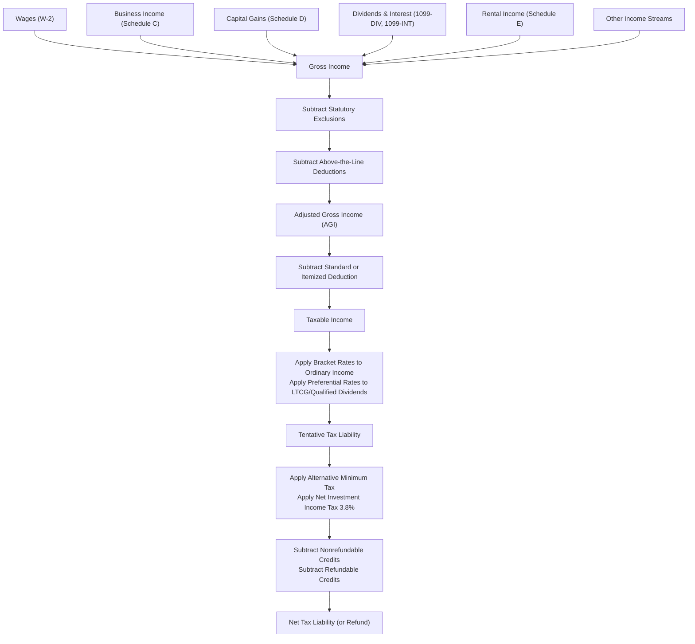

# Lesson 2: Income Taxation Architecture

## 1. First-Principles Intuition & Invariants

Income taxation represents the most significant revenue source for modern fiscal states, yet its architecture embodies a fundamental tension between equity objectives, efficiency constraints, and administrative feasibility. At its core, an income tax system must solve a deceptively complex optimization problem: extract revenue to fund public goods while minimizing deadweight loss, preserving horizontal and vertical equity, and maintaining political legitimacy across heterogeneous populations with vastly different earnings capacities and consumption preferences.

The theoretical foundation rests on the Haig-Simons comprehensive income definition, which posits that income equals consumption plus the change in net worth over a given period. Formally, $I_t = C_t + \Delta W_t$, where $I_t$ denotes income in period $t$, $C_t$ represents consumption, and $\Delta W_t$ captures the change in wealth. This definition establishes a conceptual boundary: income taxation should capture all accretions to economic power, whether realized through wage compensation, capital appreciation, imputed rents, or in-kind benefits. However, practical tax codes diverge sharply from this Platonic ideal, carving out exclusions, deferrals, and preferential treatment that reflect administrative constraints, political economy compromises, and deliberate policy interventions to correct market failures or achieve distributional objectives.

The architecture of progressive rate structures emerges from utilitarian welfare foundations and the principle of diminishing marginal utility of income. If each additional dollar provides less subjective well-being to a high-income household than to a low-income household—a proposition formalized through concave utility functions $U'(I) > 0$ and $U''(I) < 0$—then efficiency-adjusted equity requires higher marginal tax rates on higher income tranches. The Mirrlees optimal taxation framework extends this intuition into a mechanism design problem: the social planner cannot directly observe individual ability or effort, only realized income, which creates an adverse selection problem. High-ability individuals may reduce labor supply or engage in tax avoidance to mimic lower-ability types and escape redistributive taxation. The optimal nonlinear income tax schedule therefore balances redistribution against the efficiency costs of labor supply distortion, yielding marginal rates that generally rise with income but taper at the very top to avoid extreme distortions among the most productive agents.

Progressive taxation operates through a bracket structure that partitions the income domain into discrete intervals, each subject to a distinct marginal rate. The marginal tax rate $\tau_m$ applies only to income within a specific bracket, while the average tax rate $\tau_a = T(I)/I$ captures the total tax liability $T(I)$ as a proportion of total income. This distinction proves critical for understanding labor supply elasticities and taxpayer behavior. A taxpayer facing a 35% marginal rate does not surrender 35% of total income; rather, only the incremental dollar earned within that bracket faces the 35% assessment. The average rate remains lower, smoothed by the zero-rate standard deduction, lower rates on initial tranches, and the mechanical mathematics of bracket aggregation.

The tax base definition determines what flows constitute taxable income and profoundly shapes both revenue potential and economic distortions. Narrow bases riddled with exclusions—employer-provided health insurance, municipal bond interest, unrealized capital gains—require higher statutory rates to achieve equivalent revenue, concentrating distortions on taxed activities and creating lobbying rents around exemption boundaries. Broad-base, low-rate structures reduce these distortions but face political headwinds from constituencies benefiting from targeted preferences. The erosion of the tax base through proliferating deductions, credits, and loopholes generates what economists term "tax expenditures"—revenue forgone through preferential treatment that functions economically as direct government spending but escapes the budgetary scrutiny applied to explicit appropriations.

Deductions reduce taxable income and therefore provide greater absolute tax savings to high-bracket taxpayers. A $10,000 mortgage interest deduction saves $3,700 for a taxpayer in the 37% bracket but only $1,200 for a taxpayer in the 12% bracket, creating a regressive incidence pattern that subsidizes asset accumulation among high-income households. Credits, conversely, reduce tax liability dollar-for-dollar and can be designed as refundable, providing benefits even to households with zero pre-credit tax liability. The Earned Income Tax Credit (EITC) exemplifies this architecture, phasing in at low earnings to subsidize labor force participation, plateauing across a range, then phasing out to avoid creating work disincentives at higher incomes. The credit structure directly targets labor supply decisions through transfer-inclusive budget constraints, while deductions primarily affect portfolio allocation and consumption bundles among itemizers.

Capital gains treatment introduces a temporal dimension and realization principle that fundamentally alters the incidence and efficiency properties of income taxation. Accrual-basis taxation would assess gains annually as asset values appreciate, aligning with the Haig-Simons ideal and eliminating lock-in effects. However, administrative burdens, liquidity constraints, and valuation difficulties for non-traded assets render pure accrual taxation infeasible for most asset classes. The realization principle—taxing gains only upon sale—creates three major distortions. First, the lock-in effect: taxpayers defer realizations to postpone tax liability, reducing asset liquidity and preventing efficient reallocation to higher-value uses. Second, the step-up basis at death: unrealized gains held until death escape income taxation entirely as heirs receive assets at current market value, creating enormous tax planning incentives around estate timing and generating horizontal inequity between otherwise identical individuals who differ only in asset holding periods. Third, preferential rates on long-term capital gains—often 20 percentage points below top ordinary income rates—drive aggressive income recharacterization, transforming labor compensation into capital gains through carried interest structures, stock option timing, and entrepreneurial income classification.

Behavioral responses to income taxation operate through three primary channels: labor supply adjustments along the intensive margin (hours worked) and extensive margin (labor force participation), intertemporal income shifting across tax periods, and avoidance or evasion activities that reduce reported income without altering real economic activity. The elasticity of taxable income (ETI) aggregates these responses into a summary statistic capturing the percentage change in reported income per percentage point change in the net-of-tax rate $(1 - \tau)$. Meta-analyses suggest ETI values near 0.40 for high-income taxpayers, implying substantial behavioral responsiveness, though estimates vary by income source, time horizon, and whether the tax change is perceived as permanent or transitory. High ETI values impose severe constraints on revenue-maximizing tax rates—the Laffer curve peak—and generate large efficiency costs per dollar of redistributed income. For top earners, estimated revenue-maximizing marginal rates cluster near 50-70%, well above most historical U.S. rates but below the confiscatory rates seen in mid-century European social democracies.

The treatment of pass-through entities—partnerships, S corporations, sole proprietorships—creates additional architectural complexity. Unlike C corporations facing entity-level corporate taxation, pass-through income flows directly to individual returns and faces personal income tax rates. The Tax Cuts and Jobs Act introduced a 20% deduction for qualified business income (QBI) from pass-throughs, ostensibly to narrow the rate differential with newly reduced corporate rates but creating sharp discontinuities and planning opportunities around entity choice, income classification between labor and capital components, and wage-versus-profit characterization for owner-operators. High-income professionals previously organized as service partnerships suddenly faced strong incentives to restructure operations, purchase equipment to satisfy tangible asset tests, or separate into management and operating entities to maximize deduction eligibility.

The architectural design choices embedded in income tax codes—rate schedules, base definitions, credit structures, realization rules—jointly determine the system's distributional incidence, efficiency costs, administrative burden, and revenue stability across business cycles. No single design dominates across all dimensions; every structure embodies tradeoffs between competing objectives. Understanding these tradeoffs at the mechanical level enables sophisticated tax planning, informs policy evaluation, and reveals opportunities for arbitrage across jurisdictions, entity types, and income characterizations.

## 2. Core Architecture & Mechanics

The mechanical structure of a progressive income tax system consists of interconnected computational layers that transform gross economic flows into net tax liability. These layers operate sequentially, with each stage applying distinct rules, thresholds, and rate schedules that interact to produce the final obligation.

The computation begins with gross income aggregation. Taxpayers consolidate all income streams—wages reported on Form W-2, business income on Schedule C, capital gains and dividends on Schedule D and Form 1099-DIV, rental income on Schedule E, retirement distributions on Form 1099-R, and other sources—into a comprehensive gross income figure. The Internal Revenue Code defines gross income broadly under Section 61 as "all income from whatever source derived," though subsequent sections carve out specific exclusions. These statutory exclusions, not reflecting taxpayer elections but rather congressional determinations that certain flows lack taxable character, include municipal bond interest (Section 103), certain fringe benefits (Section 132), gifts and inheritances (Section 102), and life insurance proceeds (Section 101). The exclusion of employer-provided health insurance alone represents over $200 billion in annual tax expenditures, dwarfing most explicit federal programs.

From gross income, taxpayers subtract above-the-line deductions to arrive at adjusted gross income (AGI). These deductions—educator expenses, student loan interest, health savings account contributions, self-employment tax deduction, alimony payments for pre-2019 divorces—reduce income before the standard versus itemized deduction election and therefore benefit all eligible taxpayers regardless of itemization status. The AGI threshold holds particular significance because numerous phase-outs, eligibility tests, and alternative calculations key off this metric. The premium tax credit for health insurance, IRA contribution deductibility, passive activity loss limitations, and the 3.8% net investment income tax all incorporate AGI-based triggers.

The standard deduction versus itemized deduction election represents the next bifurcation point. For 2024, the standard deduction provides $14,600 for single filers and $29,200 for married couples filing jointly, amounts indexed annually for inflation. Taxpayers itemize only when their aggregate Schedule A deductions—state and local taxes (capped at $10,000), mortgage interest (on up to $750,000 of acquisition debt), charitable contributions, and medical expenses exceeding 7.5% of AGI—exceed their standard deduction. The Tax Cuts and Jobs Act dramatically increased the standard deduction while capping state and local tax deductions, causing itemization rates to plummet from 30% to under 10% of returns. This shift simplified compliance for most households but concentrated remaining itemization among high-income taxpayers in high-tax states, intensifying political conflicts over the SALT cap.

Subtracting the greater of the standard or itemized deduction from AGI yields taxable income, the base upon which statutory rates apply. The rate structure for 2024 establishes seven brackets for single filers: 10% on income up to $11,600, 12% on income from $11,600 to $47,150, 22% from $47,150 to $100,525, 24% from $100,525 to $191,950, 32% from $191,950 to $243,725, 35% from $243,725 to $609,350, and 37% on income exceeding $609,350. Married couples filing jointly face doubled thresholds through the 35% bracket, eliminating marriage penalties across most of the income distribution. Computing liability requires applying each marginal rate only to income within its respective bracket—a tedious calculation in principle but simplified through tax tables and software implementations that embed the cumulative arithmetic.

The mathematical relationship between marginal and average rates follows directly from the bracket structure. For a single filer with $150,000 of taxable income, the first $11,600 faces 10% taxation ($1,160), the next $35,550 faces 12% ($4,266), the next $53,375 faces 22% ($11,743), and the remaining $49,475 faces 24% ($11,874), yielding total tax of $29,043. The marginal rate stands at 24%—the rate on the next dollar earned—while the average rate equals $29,043 / $150,000 = 19.4%. This divergence between marginal and average rates confuses public discourse, with taxpayers frequently misinterpreting marginal rates as applying to all income and therefore overestimating their tax burdens or misjudging labor supply incentives.

Capital gains and qualified dividends receive preferential rate treatment through a parallel rate structure. Long-term capital gains—realized on assets held over one year—and qualified dividends face maximum rates of 0%, 15%, or 20%, depending on taxable income thresholds distinct from the ordinary income brackets. For 2024, the 0% rate applies to single filers with taxable income below $47,025, the 15% rate applies from $47,025 to $518,900, and the 20% rate applies above $518,900. These preferential rates stack atop the ordinary income calculation: the tax software first computes tax on ordinary income using standard brackets, then applies capital gains rates to long-term gains and qualified dividends, ensuring that capital income never faces the top 37% marginal rate unless it constitutes short-term gains taxable as ordinary income.

The realization principle governing capital gains creates profound planning opportunities and distortions. A taxpayer holding appreciated stock faces no current tax liability until sale, allowing wealth accumulation at the pre-tax rate of return. The deferral value grows exponentially with holding period and return rate. An asset purchased for $100,000 appreciating at 8% annually to $466,096 after 20 years incurs no tax during the accumulation phase. Upon realization, the $366,096 gain faces a 20% rate (assuming high income), yielding $73,219 in tax and $392,877 in after-tax proceeds. Had the gains been taxed annually at 20%, the effective return would fall to 6.4%, accumulating to only $341,516 after-tax—an $51,361 difference attributable purely to deferral. This deferral incentive generates lock-in effects where taxpayers hold suboptimal portfolios to avoid realization, reducing market efficiency and capital allocation quality.

The step-up basis at death amplifies these distortions. A decedent's heirs receive assets with a tax basis reset to fair market value at death, permanently escaping income taxation on pre-death appreciation. An individual purchasing stock for $50,000 that appreciates to $2 million over a lifetime pays zero income tax if held until death; heirs inherit with a $2 million basis and owe nothing unless they sell for more than $2 million. This treatment creates enormous planning value in holding appreciated assets, timing inter-vivos gifts, and structuring grantor trusts to receive basis step-ups while removing assets from the taxable estate. The revenue cost exceeds $40 billion annually, concentrated among the top 1% of estates, and generates sharp horizontal inequity between high-wealth individuals with appreciated asset portfolios and high-income professionals with primarily wage income lacking deferral opportunities.

Tax credits apply after computing tentative tax liability on taxable income, directly reducing the amount owed rather than reducing the base. Nonrefundable credits—child tax credit (up to $2,000 per qualifying child), lifetime learning credit, retirement savings contributions credit—can reduce liability to zero but provide no benefit beyond that threshold. Refundable credits—earned income tax credit, additional child tax credit, premium tax credit—generate payments even when they exceed pre-credit liability, functioning as transfer payments integrated into the tax system. The earned income tax credit phases in at 34% of earnings for a family with two children, plateaus from roughly $15,000 to $20,000 of earnings, then phases out at 21% through $50,000 of income. This structure creates effective marginal rates—combining payroll taxes, EITC phase-out, and income tax phase-in—exceeding 50% for some low-income workers, generating poverty traps where additional earnings yield minimal net income gains.

The alternative minimum tax (AMT) operates as a parallel tax system designed to prevent high-income taxpayers from using preferences to eliminate liability entirely. Taxpayers compute tax under both the regular system and the AMT system, paying whichever yields higher liability. The AMT starts with taxable income, adds back certain deductions and exclusions (state and local taxes, miscellaneous itemized deductions, certain business preferences), subtracts an AMT exemption ($85,700 for single filers in 2024, phasing out at higher incomes), and applies a two-bracket rate structure of 26% and 28%. The Tax Cuts and Jobs Act substantially increased the AMT exemption and phase-out threshold, reducing the number of affected taxpayers from over 5 million to under 200,000, though the structure remains poised to recapture revenue if TCJA provisions sunset as scheduled in 2025.

The net investment income tax (NIIT) adds a 3.8% surtax on investment income—interest, dividends, capital gains, rents, royalties, passive business income—for taxpayers with modified adjusted gross income exceeding $200,000 (single) or $250,000 (married). This Medicare surtax, enacted alongside the Affordable Care Act, partially closes the rate differential between earned and unearned income, pushing the effective top federal rate on long-term capital gains to 23.8% (20% + 3.8%) and on qualified dividends to the same combined rate. High-income taxpayers face additional state income taxes, often 5-13%, driving all-in marginal rates on capital gains to 30-37% in high-tax jurisdictions—well above the frequently cited 20% federal preferential rate but still materially below the 40-50% marginal rates on ordinary income in those same jurisdictions.

Pass-through business income—from sole proprietorships, partnerships, S corporations, and LLCs taxed as partnerships—flows to individual returns and faces personal rates, but the qualified business income deduction under Section 199A allows eligible taxpayers to deduct 20% of qualified pass-through income, subject to phase-ins, wage limitations, and service business restrictions. For a taxpayer in the 37% marginal bracket claiming the full 20% deduction, the effective rate on pass-through income falls to 29.6% (37% × 80%), narrowing but not eliminating the rate advantage of C corporate income taxed at the flat 21% corporate rate. The interaction between individual rates, the QBI deduction, and corporate rates creates arbitrage opportunities around entity choice, income characterization, and profit distribution timing.

The mechanical architecture of income taxation thus consists of sequential filters and rate applications, each governed by statutory thresholds, phase-outs, and computational rules embedded in thousands of pages of Internal Revenue Code provisions and Treasury regulations. Sophisticated taxpayers navigate this architecture through entity choice, income timing, expense characterization, and credit optimization to minimize effective tax rates—often legally and within the boundaries of legislative intent, sometimes through aggressive positions testing regulatory ambiguities and audit risk tolerances.

## 3. High-Performance Optimization & Failure Modes

Optimizing tax outcomes within the income tax architecture requires mapping liability functions across decision dimensions—income timing, character, entity structure, geographic sourcing, and holding periods—then exploiting discontinuities, thresholds, and rate differentials to minimize present-value tax costs. The objective function maximizes after-tax wealth $W_{AT}$ subject to legal constraints and audit risk tolerance, formally:

$$\max_{x_1, \ldots, x_n} \sum_{t=0}^{T} \frac{(1 - \tau_t(x_1, \ldots, x_n)) \cdot I_t(x_1, \ldots, x_n)}{(1 + r)^t}$$

where $x_1, \ldots, x_n$ represent decision variables (realization timing, entity choice, expense allocation), $\tau_t$ denotes the effective tax rate in period $t$ conditional on these choices, $I_t$ represents income, and $r$ is the discount rate. This formulation reveals that tax optimization inherently involves intertemporal arbitrage—shifting income and deductions across periods to exploit rate differentials and deferral value.

Income timing strategies exploit the time value of tax deferral and rate arbitrage across periods. Taxpayers expecting lower future rates—due to retirement, business cycle income fluctuations, or anticipated legislative changes—defer income recognition and accelerate deductions to shift income into low-rate years. Conversely, taxpayers expecting higher future rates reverse this strategy. Publicly traded executives facing vesting equity compensation can elect 83(b) treatment on restricted stock, paying tax immediately on grant-date value rather than vesting-date value, converting future ordinary income appreciation into capital gains taxed at preferential rates upon sale. The strategy succeeds when the stock appreciates materially and the executive remains with the firm through vesting; it fails if the stock declines or the executive forfeits unvested shares after paying tax on higher initial value.

Realization timing on capital assets exploits the lock-in effect and rate thresholds. Taxpayers near the boundary between 15% and 20% long-term capital gains rates can defer large realizations to years with lower AGI, saving 5 percentage points on realized gains. High-income taxpayers facing the 3.8% net investment income tax similarly benefit from spreading realizations across multiple years to remain below NIIT thresholds. However, deferral imposes portfolio efficiency costs—holding suboptimal allocations to avoid realization—and mortality risk reduces the deferral horizon. The optimal realization strategy balances tax savings from deferral against opportunity costs from constrained portfolio rebalancing and the probability-weighted value of basis step-up at death.

Tax-loss harvesting mechanically exploits the realization principle's asymmetry: losses can be realized immediately to offset gains while maintaining economic exposure through substantially identical replacement securities after the 31-day wash-sale period. A taxpayer with $100,000 in embedded gains and $50,000 in embedded losses realizes the losses first, offsets $50,000 of gains, and defers tax on the remaining $50,000 by continuing to hold appreciated positions. The $50,000 loss realization provides immediate tax savings at the 20-23.8% capital gains rate ($10,000-$11,900), while the unrealized gain defers tax indefinitely. Automated tax-loss harvesting algorithms continuously scan portfolios for realization opportunities, often generating 1-2% of annual tax alpha through systematic loss capture without altering risk-adjusted return profiles.

Charitable contribution strategies exploit the deductibility of appreciated property at fair market value without recognition of embedded gains. A taxpayer holding stock purchased for $10,000 now worth $100,000 can donate the shares to a qualified charity, claim a $100,000 charitable deduction (subject to 30% AGI limitation for capital gain property), and avoid $18,000-$21,420 in capital gains tax (20-23.8% rate). The charity receives $100,000 and pays no tax due to its exempt status, while the donor enjoys a $37,000 deduction value (at 37% marginal rate) plus $18,000-$21,420 in avoided capital gains tax, totaling $55,000-$58,420 in tax savings on a $100,000 contribution—effectively a $41,580-$45,000 after-tax cost for $100,000 in charitable impact. Donor-advised funds allow taxpayers to bunch multiple years of contributions into high-income years, claim large deductions to exceed the standard deduction threshold, then distribute funds to operating charities over time according to philanthropic rather than tax-driven timing.

Qualified opportunity zone investments permit taxpayers to defer capital gains recognition by investing proceeds in QOZ funds within 180 days of realization, with the gain deferred until the earlier of fund disposition or December 31, 2026. Investments held over 10 years receive complete exclusion of post-investment appreciation, effectively converting deferred gains into permanently tax-free appreciation on QOZ investments. A taxpayer realizing a $1 million capital gain can invest $1 million (including the deferred $200,000 tax liability, typically requiring additional funds) in a QOZ fund, defer the $200,000 tax until 2026, potentially reduce the deferred gain by 10% if invested before 2020, and exclude all QOZ investment appreciation if held beyond 10 years. The structure provides powerful deferral and exclusion benefits but requires illiquid real estate or operating business investments in designated distressed census tracts, imposing concentration risk and return drag from geographic and sector restrictions.

Entity structure optimization exploits rate differentials and income characterization rules. High-income service professionals historically organized as C corporations to access lower corporate rates, particularly before the Tax Cuts and Jobs Act. Post-TCJA, the 21% flat corporate rate plus shareholder-level tax on dividends or capital gains creates a combined burden often exceeding direct pass-through taxation at 37% individual rates net of the 20% QBI deduction. However, C corporations enable income deferral through retained earnings—profits accumulate at 21% corporate tax, with shareholder-level tax deferred until dividend or liquidation—creating deferral value for businesses reinvesting earnings. The optimal structure depends on distribution policy, accumulation horizon, and whether shareholders anticipate basis step-up at death to escape dividend taxation.

Pass-through entities accessing the Section 199A qualified business income deduction face complex limitations distinguishing specified service trades or businesses (SSTBs)—professional services like law, accounting, consulting, health—from non-SSTB activities like manufacturing, retail, and real estate. SSTBs lose the deduction entirely when taxable income exceeds $383,900 (single) or $483,900 (married), while non-SSTBs remain eligible subject to wage and property limitations. This discontinuity creates sharp incentives to restructure service businesses, separate management functions into non-SSTB entities, or recharacterize income streams to access deduction benefits. Real estate professionals particularly benefit: rental income typically qualifies for the full 20% deduction without wage or property limitations if the taxpayer materially participates, creating opportunities to convert professional service income into real estate partnership allocations through integrated business structures.

Geographic arbitrage exploits state income tax differentials and federal deductibility limitations. High-income taxpayers in states with top marginal rates of 10-13% (California, New York, New Jersey) face combined federal and state rates approaching 50% on ordinary income but can deduct only $10,000 of state and local taxes on federal returns. Establishing domicile in zero-income-tax states (Florida, Texas, Nevada, Washington, Wyoming) eliminates state income tax entirely, providing 10-13 percentage point rate reductions worth hundreds of thousands annually for high earners. Domicile changes require genuine relocation—physical presence, voter registration, driver's license, primary residence—and face aggressive audit scrutiny from high-tax states protecting revenue bases. Statutory residency tests count days of physical presence, with taxpayers often maintaining meticulous calendars and supporting documentation to defend zero-income-tax domiciles against source-state residency challenges.

Retirement account optimization exploits tax deferral and, for Roth accounts, permanent exclusion of investment returns. Traditional 401(k) and IRA contributions provide immediate deductions, allowing pre-tax accumulation but requiring ordinary income taxation on distributions. Roth contributions receive no immediate deduction but grow tax-free and distribute without taxation, creating arbitrage opportunities when current rates exceed expected future rates or when taxpayers anticipate high-return investments whose appreciation would otherwise face substantial future taxation. The optimal Roth versus traditional allocation depends on current versus expected future marginal rates, investment return assumptions, holding periods, and estate planning objectives—Roth accounts provide tax-free accumulation for heirs under inherited IRA rules, while traditional accounts impose required minimum distributions and ordinary income taxation on beneficiaries.

Mega backdoor Roth conversions exploit after-tax 401(k) contributions for high earners exceeding Roth IRA income limits. Taxpayers contribute after-tax dollars to 401(k) plans up to the $69,000 total annual limit (2024, including employer contributions), then immediately convert after-tax balances to Roth accounts within the plan or through in-service distributions to Roth IRAs. The conversion incurs no tax because the contributions were already after-tax, but subsequent appreciation grows tax-free in the Roth account rather than facing ordinary income taxation as it would in a traditional after-tax account. This strategy effectively allows high-income taxpayers otherwise barred from direct Roth contributions to funnel $30,000-$40,000 annually into tax-free Roth accounts, accumulating millions in permanently tax-exempt wealth over multi-decade careers.

Failure modes in income tax optimization arise from three primary sources: statutory discontinuities creating cliff effects, audit risk from aggressive positions, and behavioral responses that alter pre-tax economic activity rather than merely arbitraging tax rules. Cliff effects concentrate penalties at phase-out thresholds. The child tax credit phases out at $200,000 (single) or $400,000 (married), reducing the credit $50 for every $1,000 of income above the threshold. A married couple at $399,000 AGI receives the full $4,000 credit (two children), while a couple at $401,000 receives $3,900—a $100 credit loss on $2,000 of additional income, creating a 5% implicit marginal rate spike atop ordinary income tax and NIIT. The QBI deduction for SSTBs exhibits more severe cliffs: a single consultant at $383,000 taxable income retains the full 20% deduction worth $28,000 in tax savings (at 37% marginal rate), while $1,000 of additional income eliminates the deduction entirely, creating an effective marginal rate exceeding 2,000% on that incremental dollar. These discontinuities generate sharp incentives for income shifting—delaying billings, accelerating deductions, maximizing retirement contributions—to remain below thresholds.

Audit risk scales with position aggressiveness and income level. The IRS audits 0.4% of individual returns overall but 2.3% of returns reporting $1 million or more in income and 8.9% of returns reporting $10 million or more. Aggressive positions on QBI deduction eligibility, passive activity loss limitations, charitable contribution valuations, or non-qualified deferred compensation timing invite scrutiny, particularly when reported positions deviate from industry norms or rely on non-binding private letter rulings. Taxpayers must evaluate audit risk-adjusted expected values: a position saving $50,000 with 20% audit probability and 50% probability of full disallowance yields an expected value of only $45,000 ($50,000 × 80% no-audit + $25,000 × 20% audit), before considering penalties, interest, and professional fees. Conservative practitioners apply probability-weighted trees to position selection, accepting some tax cost to avoid material audit exposure on aggressive structures.

Behavioral responses that alter real economic activity rather than merely tax reporting create genuine efficiency costs. The elasticity of taxable income captures these responses: labor supply reductions, entrepreneurial effort scaling, occupational choice distortions, and human capital investment decisions influenced by after-tax returns. High marginal rates discourage work effort at the intensive margin—overtime, second jobs, spousal labor force participation—particularly when combined with phase-outs of means-tested benefits that create effective marginal rates exceeding 60%. An individual facing a 35% federal marginal rate, 6% state rate, 7.65% payroll tax, and 21% EITC phase-out confronts an effective marginal rate of 69.65%, retaining only $30.35 of an additional $100 earned. These rate spikes concentrate labor supply distortions among secondary earners and low-income workers navigating benefit cliffs, reducing household earnings capacity and social mobility.

Intertemporal elasticity drives timing responses. Publicly observable events like tax reform create bunching of realizations: the 2012 anticipation of higher 2013 capital gains rates triggered $200 billion in accelerated dividend payments and capital gains realizations in December 2012, illustrating high short-run elasticity. However, long-run elasticity reflects more fundamental responses—occupational choice, educational investment, migration, risk-taking—that determine productive capacity and innovation rather than merely shifting income across accounting periods. The deadweight loss from income taxation scales with elasticity and the square of the marginal rate, formally $DWL = \frac{1}{2} \epsilon \tau^2 I$, where $\epsilon$ denotes elasticity, $\tau$ the marginal rate, and $I$ the income base. This quadratic relationship implies that doubling marginal rates quadruples deadweight loss per dollar of income, placing severe efficiency constraints on revenue-maximizing rate structures and favoring broad bases with moderate rates over narrow bases with high rates.

The architecture of income taxation thus creates a complex optimization landscape where sophisticated taxpayers exploit discontinuities, thresholds, and rate differentials to minimize effective tax rates through legal planning, while behavioral responses to statutory structures generate efficiency costs, labor supply distortions, and resource misallocations that reduce aggregate economic output. Optimal tax policy design balances distributional objectives against these efficiency costs, seeking broad bases, moderate rates, and minimized discontinuities to limit arbitrage opportunities while maintaining administrative feasibility and political sustainability. For practitioners, mastering this architecture enables effective tax planning, compliance risk management, and strategic business structure design that minimizes tax drag on wealth accumulation while remaining well within legal and ethical boundaries of tax practice.
