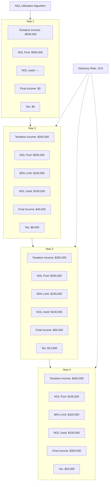
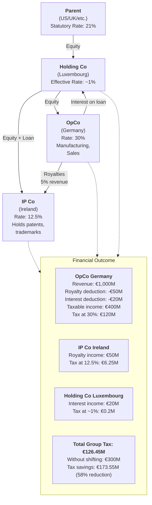

# Lesson 4: Corporate Taxation Structures

## 1. First-Principles Intuition & Invariants

The corporate income tax occupies a peculiar and economically contested position within the broader fiscal architecture of modern economies. Unlike personal income taxation, which targets individual economic agents at the moment they receive compensation or realize gains, corporate taxation intercepts returns to capital at the entity level before those returns ever reach the ultimate beneficial owners—shareholders, bondholders, and other claimants on the firm's residual cash flows. This intermediate layer of taxation generates what economists and tax practitioners universally recognize as the double taxation problem: corporate profits face taxation first at the entity level when earned, then again at the individual level when distributed as dividends or realized as capital gains upon share disposition.

The theoretical justification for entity-level taxation rests on several competing rationales. The benefit principle suggests corporations should bear tax burdens commensurate with the public goods and legal infrastructure they consume—contract enforcement, property rights protection, transportation networks, and educated labor forces. The ability-to-pay principle holds that large profitable enterprises possess greater fiscal capacity than dispersed individual shareholders. More pragmatically, administrative convenience argues that collecting revenue at the corporate nexus proves far more efficient than attempting to trace and tax each shareholder's proportional income share annually, particularly for publicly traded firms with millions of dispersed equity holders and continuous secondary market trading.

Yet these justifications collide with fundamental principles of economic neutrality and efficiency. In a first-best frictionless world, the canonical Ramsey optimal taxation framework suggests taxing only final consumption or immobile factors like land rents, leaving returns to mobile capital untaxed to avoid distorting intertemporal savings and investment decisions. Corporate taxation violates this prescription by creating discrete wedges between the pre-tax return corporations must earn on marginal investment projects and the after-tax return ultimately received by savers who supply that capital. The marginal effective tax rate (METR) captures this distortion, measuring the percentage-point reduction in the real rate of return caused by the tax system's treatment of depreciation allowances, inventory accounting methods, interest deductibility, and statutory rate schedules.

The economic incidence of corporate taxation—who ultimately bears the burden—remains among the most empirically contested questions in public finance. The statutory incidence falls on the corporation as a legal entity, but economic incidence traces through general equilibrium adjustments in factor prices. In a closed economy with fixed capital stock, shareholders bear the full burden through reduced returns to equity. In a small open economy facing perfectly elastic international capital supply at the world interest rate, domestic labor absorbs the burden as mobile capital flees to lower-tax jurisdictions, reducing the capital-labor ratio and depressing wages. Empirical estimates of labor's share of corporate tax incidence range from 20 percent in older closed-economy studies to 70 percent or higher in recent open-economy calibrations, with the true incidence depending critically on capital mobility elasticities, the prevalence of location-specific rents, and the international coordination of tax policy regimes.

The foundational invariant governing all corporate tax architecture is the identity equating taxable income to the tax base. Taxable income emerges not from accounting profit as reported under Generally Accepted Accounting Principles (GAAP) or International Financial Reporting Standards (IFRS), but from a parallel statutory calculation that begins with book income then applies a cascade of adjustments mandated by the tax code. These adjustments fall into three essential categories: timing differences that shift income recognition across periods (depreciation schedules, loss carryforwards, deferred revenue), permanent differences that create definitional divergence between book and tax treatment (municipal bond interest exclusion, meals and entertainment disallowance, fines and penalties), and rate structure interactions determining the marginal tax burden on the next dollar of profit.

Depreciation scheduling exemplifies the profound impact of timing differences on effective tax burdens and investment incentives. Physical capital assets experience economic depreciation—the true decline in productive value over time—according to decay functions determined by technological obsolescence, physical wear, and market conditions. Tax depreciation follows statutory schedules that bear only rough correspondence to economic reality. The Modified Accelerated Cost Recovery System (MACRS) employed in United States federal taxation assigns assets to prescribed recovery periods (5 years for computers and vehicles, 7 years for office furniture, 15 years for land improvements, 39 years for nonresidential real property) then applies accelerated methods like 200-percent declining balance that front-load deductions into early ownership years. This acceleration provides an interest-free loan from the Treasury, as firms defer tax payments and earn returns on the retained cash. The present value of depreciation allowances directly reduces the effective tax rate on capital investment: full immediate expensing (100 percent bonus depreciation) can reduce the METR to zero or even negative rates, creating investment subsidies.

The net operating loss (NOL) carryforward and carryback provisions address asymmetry in the taxation of gains versus losses. In a perfectly symmetric system, the government would function as a silent partner, sharing proportionally in both profits and losses through refundable credits. No tax system achieves this ideal. Instead, loss provisions allow firms to offset taxable income in profit years with losses incurred in prior or future periods, partially smoothing tax burdens across volatile earnings cycles. The United States Tax Cuts and Jobs Act of 2017 eliminated NOL carrybacks (except for certain industries), permitted indefinite carryforwards, but capped annual utilization at 80 percent of taxable income. These restrictions create option value in tax planning: firms facing expiring loss carryforwards may undertake tax-motivated restructurings or accelerate income recognition to capture deductions before they lapse. The present-value erosion of loss carryforwards through time discounting and statutory expiration creates effective tax rate asymmetries that penalize cyclical and startup businesses relative to stable incumbents.

International taxation introduces the fundamental tension between worldwide and territorial systems. Under worldwide taxation, a jurisdiction claims tax authority over all income earned by resident corporations regardless of geographic source, providing foreign tax credits to mitigate double taxation. Territorial systems tax only income sourced within national borders, exempting foreign-earned profits. The economic choice between regimes hinges on efficiency and revenue tradeoffs. Worldwide taxation with imperfect credits creates repatriation locks: firms defer bringing foreign earnings home to avoid residual domestic tax, leading to inefficient offshore cash accumulation. Territorial systems eliminate this distortion but sharpen incentives for profit shifting—accounting maneuvers that reallocate reported income from high-tax to low-tax jurisdictions without altering real economic activity.

Transfer pricing constitutes the primary mechanism for multinational profit shifting. When related entities within a corporate group transact across borders—selling inventory, licensing intellectual property, providing management services, or extending intracompany loans—the prices assigned to these transactions determine each jurisdiction's taxable income. Tax authorities require arm's-length pricing: transfer prices should reflect what unrelated parties would negotiate in comparable circumstances. Yet the arm's-length standard proves nearly impossible to enforce for unique intangible assets and integrated production processes where no comparable independent transactions exist. Pharmaceutical companies transfer patent rights to subsidiaries in Ireland or Singapore; technology firms locate intellectual property holding companies in the Netherlands or Bermuda; manufacturers structure contract manufacturing arrangements where high-value functions appear to occur in low-tax jurisdictions. The OECD Base Erosion and Profit Shifting (BEPS) initiative attempted to tighten transfer pricing documentation requirements and align taxation with value creation, but enforcement remains plagued by information asymmetries and sovereignty constraints.

Tax havens exploit these weaknesses by offering near-zero corporate tax rates, strong financial secrecy protections, and favorable legal regimes for intellectual property and passive income. The mechanics of haven utilization follow predictable patterns. A multinational establishes a subsidiary in a jurisdiction like the Cayman Islands or Luxembourg—often merely a brass-plate office with minimal substance—then arranges intracompany transactions that shift income into this entity. Common structures include the Double Irish with Dutch Sandwich (before Ireland's closure of this route), check-the-box entity classification elections allowing U.S. tax law to disregard foreign subsidiary structures, and hybrid mismatch arrangements exploiting inconsistencies between countries' entity characterization rules. Empirical research by Zucman, Tørsløv, and others estimates that roughly 40 percent of multinational profits—over $650 billion annually—are shifted to tax havens, resulting in global corporate tax revenue losses exceeding $200 billion per year.

The fundamental invariant linking all these mechanisms is the effective tax rate identity:

$$\text{ETR} = \frac{T}{E} = \frac{t \cdot (E - D - X)}{E} = t \left(1 - \frac{D + X}{E}\right)$$

where $T$ denotes actual tax liability, $E$ represents economic income, $t$ stands for the statutory rate, $D$ captures the present value of depreciation and timing benefits, and $X$ encompasses all exclusions and profit shifting. This identity reveals that effective rates can deviate dramatically from statutory rates through the denominator effect of tax planning. A firm with 21 percent statutory rate facing $100 million economic income might achieve a 10 percent effective rate by generating $52.4 million in deductions and exclusions. The tax planning objective function maximizes firm value by minimizing the present value of all current and future tax payments subject to non-tax costs—transaction expenses, regulatory penalties, reputation damage, and operational distortions.

## 2. Core Architecture & Mechanics

The mechanical operation of corporate tax systems rests on a computational architecture that transforms accounting profit through a series of addback and deduction layers to arrive at taxable income. This process begins with book income as reported on audited financial statements prepared under GAAP or IFRS—the starting point reflecting revenue recognized according to accounting standards and expenses matched against those revenues under accrual principles. Tax authorities then impose a statutory reconciliation procedure, embodied in forms like the United States Schedule M-1 (for corporations below certain asset thresholds) or the more detailed Schedule M-3 (for larger corporations), which systematically adjusts book income line-by-line to conform with tax code definitions.

The architecture of these adjustments follows a deterministic tree structure where each adjustment category branches into specific computational subroutines. Consider the depreciation adjustment pathway. The firm first determines the depreciable basis for each asset—generally its acquisition cost plus capitalized improvements minus any Section 179 immediate expensing election. The asset then maps to a MACRS property class based on Asset Depreciation Range (ADR) midpoint life classifications established in Revenue Procedure 87-56. Residential rental property falls into 27.5-year class; nonresidential real property into 39-year class; most machinery and equipment into 5- or 7-year classes. The recovery method applies next: most personal property uses 200-percent declining balance switching to straight-line at the optimal crossover point, while real property employs straight-line exclusively. The half-year convention assumes mid-year acquisition for personal property regardless of actual purchase date, while the mid-month convention applies to real property. Section 168(k) bonus depreciation permits immediate expensing of a specified percentage (100 percent through 2022, phasing down thereafter) of qualified property, creating a first-year deduction potentially exceeding the asset's cost when combined with Section 179.

The computational cascade for a single depreciable asset acquired for $1 million in year one, classified as 7-year MACRS property with 100 percent bonus depreciation available, proceeds as follows. The firm may elect $1 million immediate Section 168(k) bonus depreciation, generating a full first-year deduction and rendering subsequent MACRS calculations moot. Alternatively, electing out of bonus depreciation, the firm applies 200-percent declining balance: first-year depreciation equals $\frac{2}{7} \times \$1{,}000{,}000 \times 0.5 = \$142{,}857$ (with half-year convention reducing the first year by half). Year two depreciation equals $\frac{2}{7} \times (\$1{,}000{,}000 - \$142{,}857) = \$244{,}898$. This continues until the declining balance rate falls below straight-line, at which point the method switches. The present value of this depreciation stream, discounted at the firm's after-tax cost of capital, determines the tax shield value.

Loss carryforward mechanics operate through a cumulative tracking algorithm maintaining a running balance of utilized and unutilized losses. When current-year taxable income before NOL deduction turns negative, that loss enters the NOL pool. In subsequent profit years, the firm calculates tentative taxable income, then applies NOL deduction subject to the 80-percent limitation: the deduction cannot exceed 80 percent of tentative taxable income, ensuring at least 20 percent of current profit remains taxable even when substantial loss carryforwards exist. The remaining 20 percent of income bears tax at the full statutory rate, while the offset 80 percent effectively receives zero-rate treatment. This creates a marginal effective tax rate of $0.2t$ rather than zero for firms with NOL carryforwards, preserving some revenue even when past losses shelter most current income.

This stylized sequence demonstrates the mechanical flow: Year 1 generates a $500,000 loss entering the NOL pool with zero tax liability. Year 2 produces $200,000 tentative income; 80 percent equals $160,000 maximum deduction, consuming $160,000 from the pool and leaving $40,000 taxable income subject to $8,400 tax. The pool carries forward $340,000. By Year 4, only $100,000 NOL remains, insufficient to hit the 80-percent cap, so the full remaining loss offsets income. The asymmetry becomes evident: summing all four years yields $400,000 cumulative income ($-500k + $200k + $300k + $400k$), which in a symmetric system would generate $84,000 total tax, but the actual liability reaches only $84,000 due to time-value erosion if we account for discounting, or potentially more due to the 80-percent cap preventing full immediate utilization.

Transfer pricing architecture embeds a compliance and valuation workflow requiring contemporaneous documentation under penalty regimes. The OECD Transfer Pricing Guidelines enumerate five primary methodologies arranged in hierarchical preference order. The Comparable Uncontrolled Price (CUP) method identifies transactions between independent parties for identical or highly similar products and applies those prices to controlled transactions—the most direct approach but applicable only when true comparables exist. The Resale Price Method examines the markup earned by distributors purchasing from related parties and reselling to independent customers, working backwards from the final sales price by applying an arm's-length gross margin. The Cost Plus Method applies an appropriate markup to costs incurred by a manufacturer or service provider selling to related parties, benchmarking the markup against independent firms performing similar functions. When transactional methods fail, the Transactional Net Margin Method (TNMM) compares net profit margins (operating income relative to sales, assets, or costs) of the tested party against margins earned by comparable independent firms. Finally, the Profit Split Method allocates combined profits from integrated transactions based on the relative value of functions performed, assets employed, and risks assumed by each party—the method of last resort for unique intangibles and integrated operations lacking meaningful comparables.

The computational implementation requires building comparable company sets through database searches in Bloomberg, S&P Capital IQ, or specialized transfer pricing databases like Moody's BvD Orbis. Analysts filter for companies operating in similar industries (often at three- or four-digit NAICS or SIC code levels), performing comparable functions (manufacturing versus distribution versus R&D), and exhibiting similar risk profiles (balance sheet leverage, operational complexity). Statistical screening removes outliers beyond two or three standard deviations from median profitability metrics. The interquartile range of comparable margins establishes the arm's-length range: tested party results falling within the 25th to 75th percentile presumptively satisfy arm's-length standards, while results outside this range require adjustment. Tax authorities increasingly demand annual contemporaneous documentation including functional analysis, economic analysis, and comparability studies—often hundreds of pages per tested party—with penalties for inadequate documentation ranging from 20 to 40 percent of underpayments.

The strategic architecture of profit shifting combines entity structuring with pricing and financing optimization. A simplified multinational structure might position a holding company in a treaty-favorable jurisdiction like Luxembourg, which in turn owns operating subsidiaries in high-tax manufacturing jurisdictions (Germany, United States, Japan) and low-tax intellectual property holding subsidiaries (Ireland, Singapore, Switzerland). The IP subsidiary holds patents, trademarks, and proprietary technology, licensing these intangibles to operating subsidiaries in exchange for royalty payments. The royalty rate becomes the critical planning variable: aggressive pricing produces large deductible payments in high-tax jurisdictions and corresponding income in the low-tax haven. Meanwhile, the holding company extends intercompany loans to operating subsidiaries, generating deductible interest expense in high-tax locations and interest income in the Luxembourg entity (which may receive favorable treatment under a participation exemption or ruling).

This architecture illustrates the compounding effect of multiple mechanisms: royalty payments shift €50 million from 30 percent Germany to 12.5 percent Ireland (saving €8.75 million annually), while interest payments shift €20 million to ~1 percent Luxembourg (saving €5.8 million). The critical enforcement challenge involves substantiating the arm's-length nature of the 5 percent royalty rate and the interest rate on intercompany loans. Tax authorities scrutinize whether the IP company possesses sufficient substance—employees, decision-makers, functional capacity—to justify its ownership of valuable intangibles, or whether it constitutes a mere conduit lacking economic purpose beyond tax avoidance.

The double taxation integration mechanics take three primary architectural forms across jurisdictions. Classical systems impose full double taxation: corporate profits face entity-level tax, then distributions to shareholders face individual dividend tax with no relief mechanism, resulting in combined tax rates potentially exceeding 50 percent when federal and state/provincial rates compound. The United States employed this structure from 1986 through 2002 and substantially returned to it after the 2017 tax reform (though qualified dividend rates of 15-20 percent rather than ordinary income rates provide partial relief). Full imputation systems eliminate double taxation by providing shareholders a tax credit for corporate taxes paid on distributed earnings. Australia and New Zealand operate imputation systems: when a corporation pays $100 profit with 30 percent corporate tax, distributing the remaining $70 carries a franking credit of $30, and the shareholder includes $100 in income and receives a $30 credit against individual tax liability. If the shareholder's marginal rate equals 30 percent, no additional tax is due; if below 30 percent, the shareholder receives a refund; if above, residual tax is paid. Partial integration systems provide intermediate relief, such as dividend deduction at the corporate level (Estonia) or reduced dividend tax rates at the shareholder level (United States post-2003 with 15/20 percent qualified dividend rates versus ordinary income rates up to 37 percent).

The economic efficiency implications differ markedly across integration regimes. Classical double taxation creates severe distortions in corporate financial policy, biasing firms toward debt over equity financing (interest deductibility versus non-deductible dividends creates a debt tax shield) and retained earnings over distributions (deferral of shareholder-level tax). Full imputation eliminates these distortions for domestic shareholders but creates international complications: foreign shareholders generally cannot claim imputation credits, placing domestic corporations at a disadvantage when raising capital internationally. Partial integration systems thread a middle path but introduce new complexities around qualified versus non-qualified dividend classification and realization-based capital gains tax on retained earnings.

## 3. High-Performance Optimization & Failure Modes

Advanced corporate tax optimization operates at the intersection of legal entity architecture, financial product structuring, and cross-jurisdictional arbitrage, seeking to minimize the present value of all taxes paid while managing regulatory, reputational, and operational constraints. The optimization objective function extends beyond simple rate minimization to encompass timing acceleration, jurisdictional sourcing, character conversion (ordinary income to capital gains or exempt income), and the strategic utilization of hybrid instruments exploiting classification inconsistencies across tax systems.

Entity classification optimization begins with check-the-box elections under U.S. Treasury Regulations Section 301.7701-3, which permit eligible foreign entities to elect treatment as either corporations (separate taxable entities) or disregarded entities/partnerships (transparent for tax purposes). A U.S. multinational might establish a foreign subsidiary in a manufacturing jurisdiction, then create a wholly-owned subsidiary of that entity in an IP holding jurisdiction. By electing to treat the IP subsidiary as disregarded, payments between the manufacturing entity and the IP entity become ignored for U.S. tax purposes—no Subpart F income inclusion under controlled foreign corporation rules, no withholding tax, and no limitation on earnings stripping—while the local jurisdiction respects the separate legal existence and allows royalty deductions. This creates a hybrid mismatch: the payment is deductible locally but invisible to the U.S. parent, achieving double non-taxation. The OECD BEPS Action 2 recommendations target these arrangements, and many jurisdictions have enacted hybrid mismatch rules denying deductions or requiring income inclusions when counterparty jurisdictions do not tax corresponding income, but implementation remains incomplete and inconsistent across borders.

Debt optimization strategies exploit interest deductibility to strip earnings from high-tax jurisdictions while generating income in low-tax locations or for tax-exempt investors. The canonical structure involves a controlled foreign corporation in a low-tax jurisdiction extending loans to operating subsidiaries in high-tax jurisdictions at aggressive but defensible interest rates. The interest deduction reduces taxable income in high-tax locations, while the corresponding income in the low-tax lender jurisdiction faces minimal tax. Earnings stripping rules attempt to limit this arbitrage through debt-to-equity ratio tests or percentage-of-EBITDA limitations. The U.S. Tax Cuts and Jobs Act introduced Section 163(j), limiting business interest deductions to 30 percent of adjusted taxable income (essentially EBITDA through 2021, EBIT thereafter, with EBIT producing tighter limits by excluding depreciation and amortization from the base). This limitation applies without regard to whether debt is owed to related or unrelated parties, reflecting a shift from targeted anti-abuse rules to broad-based interest limitation. Firms optimize around this constraint by concentrating interest expense in unrestricted entities, utilizing carryforward provisions, and restructuring to increase the EBITDA base through asset dispositions or business realignments.

Intellectual property migration strategies relocate high-value intangibles to low-tax jurisdictions early in their development lifecycle when valuation remains modest, avoiding the significant exit taxes and transfer pricing scrutiny associated with moving mature, proven IP. A pharmaceutical company conducting early-stage research in the United States might establish a cost-sharing arrangement with an Irish subsidiary: both parties contribute resources to joint development and both receive rights to resulting IP in their respective territories. The Irish entity's cost-sharing payments reflect its proportional share of development costs, which at early stages may total only tens of millions for compounds with eventual multi-billion-dollar values. When compounds reach commercialization, the Irish entity owns European and potentially worldwide rights (excluding United States) acquired for a cost basis reflecting R&D expenses rather than fair market value of proven technology. This creates enormous income shifting potential as European and global sales generate royalty and manufacturing income in Ireland's 12.5 percent regime. The IRS challenges these arrangements through "periodic adjustment" audits, asserting that actual value received exceeded cost-sharing payments, but proving this requires complex economic analysis with significant evidentiary burdens.

The tax planning failure modes that generate the highest financial and reputational costs stem from documentation inadequacy, substance deficiency, and economic purpose doctrine application. Transfer pricing documentation failures lead directly to penalties: U.S. regulations impose 20 percent accuracy-related penalties on underpayments exceeding $5 million (or 10 percent of gross receipts) unless the taxpayer satisfies contemporaneous documentation requirements. Documentation must include functional analysis describing activities performed and risks assumed, economic analysis with comparable company searches and statistical testing, and consideration of alternative methods. Firms that implement aggressive transfer pricing without rigorous contemporaneous support face penalties compounding the base tax underpayment, often resulting in effective cost exceeding the tax benefit achieved. The optimal documentation strategy involves probabilistic modeling: estimate the likelihood and magnitude of adjustment under audit, calculate expected penalty costs, and invest in documentation quality until marginal documentation cost equals marginal reduction in expected penalties.

Substance deficiency constitutes a more fundamental failure mode where tax authorities successfully argue that legal structures lack economic purpose beyond tax avoidance and should be disregarded or recharacterized. The pivotal case law includes Gregory v. Helvering (establishing that transactions must serve business purpose beyond tax reduction), Bollinger v. Commissioner (requiring sufficient non-tax business activity to respect entity classification elections), and more recently the European Commission's state aid investigations into advance pricing agreements and tax rulings provided to Apple, Amazon, and Starbucks. These cases establish that even legally compliant structures may be challenged when they exhibit minimal operational substance: shell entities with no employees, offices, or decision-making capacity; intellectual property holding companies that perform no R&D, product development, or IP management functions; or financing vehicles that undertake no risk assessment, credit monitoring, or collection activities. The substance test increasingly focuses on people functions—where do key personnel reside, where are decisions made, where is value truly created—rather than legal formalities. Optimization in this dimension requires genuine operational restructuring: relocating executives, establishing regional headquarters with real management authority, and ensuring that tax-driven structures align with actual business operations and decision-making locus.

The economic purpose doctrine and step transaction doctrine permit tax authorities to collapse or recharacterize transaction sequences that lack legitimate business rationale. A firm that distributes low-basis appreciated property to a subsidiary, liquidates that subsidiary, then immediately sells the assets has attempted to convert corporate-level gain into shareholder-level gain eligible for preferential rates or offsetting losses. Tax authorities may invoke step transaction doctrine to collapse this sequence, treating it as a direct corporate asset sale followed by dividend distribution. The binding constraint preventing such recharacterization involves demonstrating non-tax business reasons for each step—operational synergies, regulatory requirements, contractual obligations—and introducing temporal delays and operational changes that negate the argument of predetermined integrated plan. The optimization frontier trades tax benefits against these demonstrable business purposes and temporal inefficiencies: more aggressive structures yield higher tax savings but greater recharacterization risk and required business justification costs.

International tax planning encounters an additional failure mode in the form of controlled foreign corporation anti-deferral regimes, particularly U.S. Subpart F and the newer Global Intangible Low-Taxed Income (GILTI) provisions. Subpart F requires U.S. shareholders owning more than 50 percent of a controlled foreign corporation to include certain passive and highly mobile income categories in current income regardless of distribution, preventing indefinite deferral of foreign earnings. GILTI extends this logic to active business income, requiring U.S. shareholders to include annually their share of the CFC's income exceeding a 10 percent return on tangible assets (Qualified Business Asset Investment, or QBAI). The GILTI inclusion rate equals the full amount of tested income minus the QBAI-based exemption, then multiplied by a fraction allowing deduction of 50 percent of the inclusion (37.5 percent after 2025), resulting in an effective federal tax rate of approximately 10.5 percent (13.125 percent after 2025) assuming a 21 percent statutory rate. Foreign tax credits provide relief, but only 80 percent of foreign taxes offset GILTI liability, and credits cannot cross category boundaries (GILTI credits cannot offset general limitation income tax). This architecture creates planning constraints: locating tangible assets in CFCs increases the QBAI base and reduces GILTI inclusions, but concentrating assets offshore conflicts with domestic manufacturing incentives under Foreign-Derived Intangible Income (FDII) provisions. Optimization requires jurisdiction-by-jurisdiction modeling of the effective tax rate including GILTI, FDII, and state tax interactions, then allocating functions, assets, and risks to minimize global tax burden subject to operational feasibility and non-tax business constraints.

The optimal tax planning horizon incorporates regulatory change risk and political economy dynamics. Aggressive structures generating significant current tax savings may prove value-destructive if they trigger legislative responses or invite enhanced audit scrutiny creating uncertain future liabilities. The European Commission's state aid investigations illustrate this dynamic: multinationals that received advance pricing agreements or tax rulings from Ireland, Luxembourg, and the Netherlands decades ago face multi-billion-euro retroactive assessments after the Commission concluded these arrangements constituted illegal state aid. Apple faced a €13 billion assessment (ultimately overturned on appeal, but only after years of uncertainty), Amazon a €250 million assessment, and Starbucks and Fiat similar challenges. These cases demonstrate that tax positions considered acceptable under historical administrative practice may face recharacterization under evolving legal theories, creating option-like tail risk where the downside far exceeds the expected value of annual tax savings.

The dynamic optimization problem therefore requires solving not merely for current-period tax minimization but for the maximization of firm value incorporating probabilistic future states of tax law, enforcement intensity, and political attention:

$$V^* = \max_{\{s_t, p_t\}} \sum_{t=0}^{\infty} \beta^t \left[ CF_t(s_t, p_t)(1 - \tau_t(s_t, p_t)) - C_t(s_t, p_t) - \mathbb{E}[L_t(s_t, p_t)] \right]$$

where $s_t$ represents structure choices (entity locations, IP ownership, debt levels), $p_t$ denotes pricing decisions (transfer prices, interest rates, royalty rates), $CF_t$ is pre-tax cash flow, $\tau_t$ is the effective tax rate function depending on structures and pricing, $C_t$ captures non-tax costs (documentation, restructuring, operational inefficiency), and $\mathbb{E}[L_t]$ represents the expected present value of future liabilities including audits, penalties, and legislative changes. The discount factor $\beta = \frac{1}{1+r}$ reflects the firm's cost of capital. This formulation clarifies that tax optimization is not a static exercise in rate minimization but a dynamic balancing of current benefits against future costs and risks, where the shadow price of aggressive positions rises with audit scrutiny, political attention, and the firm's public visibility.

The behavioral distortions created by corporate taxation extend beyond planning optimization to real economic decisions affecting location, organizational form, capital structure, and investment timing. The effective marginal tax rate on new investment governs the hurdle rate corporations apply to capital budgeting decisions. A firm facing a 21 percent statutory rate, with present value of depreciation allowances equal to 85 percent of asset cost, confronts a marginal effective tax rate of approximately 18.8 percent on equity-financed investment, raising the required pre-tax return above the cost of capital by this wedge. Debt financing reduces or eliminates this wedge through interest deductibility, but Section 163(j) limitations and thin capitalization rules constrain leverage. Jurisdictions offering more generous depreciation (full expensing, shorter recovery periods) or lower statutory rates attract greater capital investment, with elasticities estimated between 0.5 and 1.5 in the empirical literature: a 10-percentage-point corporate rate reduction increases investment by 5 to 15 percent.

Organizational form distortions arise when different business structures face divergent tax treatment. Corporations face entity-level tax plus shareholder-level tax on distributions; partnerships and S corporations face only entity-level taxation with income passing through to owners' individual returns; limited liability companies may elect either treatment. Small and medium enterprises optimize around these boundaries, choosing pass-through structures when shareholder marginal tax rates approximate or fall below combined corporate plus dividend rates, and corporate structures when retained earnings strategies or ultimate exit through corporate acquisition prove more valuable. The 2017 Tax Cuts and Jobs Act introduced Section 199A, allowing non-corporate taxpayers a 20 percent deduction for qualified business income from pass-through entities, explicitly designed to equalize tax treatment between pass-throughs (facing individual rates up to 37 percent less the 20 percent deduction, yielding effective rates up to 29.6 percent) and corporations (facing 21 percent corporate rate plus shareholder-level tax on distributions). This equalization attempt itself created new distortions: specified service businesses face phaseouts limiting Section 199A benefits, creating sharp cliffs where small increases in income trigger large increases in effective tax rates, and incentivizing income fragmentation and contractual restructuring to remain below phase-out thresholds.

The efficiency costs of these distortions manifest as deadweight loss triangles in the canonical Harberger analysis: the corporate tax wedge causes marginal investment projects with positive social returns (pre-tax return exceeds social opportunity cost of capital) but negative private returns (after-tax return falls short of required return) to be rejected, destroying surplus equal to the integral of foregone returns above the social cost of capital. Empirical estimates place the marginal efficiency cost of corporate taxation between $0.20 and $0.40 per dollar of revenue raised, meaning that each additional dollar of corporate tax revenue destroys $0.20 to $0.40 in economic surplus through distorted capital allocation. These estimates exclude administrative and compliance costs (tax department salaries, professional fees, documentation burdens) and behavioral waste (executives devoting cognitive resources to tax planning rather than operational improvement), which plausibly double the social cost. The policy implication is that corporate taxation ranks among the most distortionary revenue instruments available to governments, justified only by political economy constraints on less distortionary alternatives (land value taxation, consumption taxation) or by the pragmatic reality that capital income must be taxed somewhere to prevent wholesale erosion of the individual income tax base through income-shifting into corporate solution.
