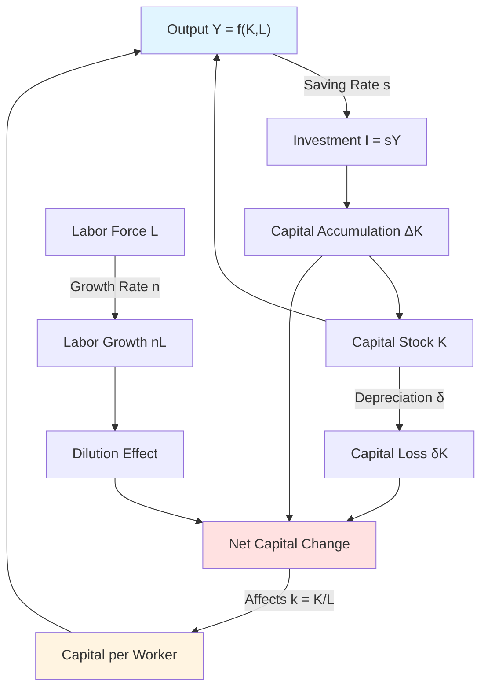

# Lesson 1: The Solow Model – Capital Accumulation Dynamics

## 1. First-Principles Intuition & Invariants

The Solow-Swan model, first formulated independently by Robert Solow and Trevor Swan in 1956, stands as the foundational framework for understanding long-run economic growth through capital accumulation. At its core, the model addresses a deceptively simple question: why do some economies grow rich while others stagnate? The answer, Solow demonstrated, lies not in perpetual accumulation of physical capital alone, but in the dynamic equilibrium between investment flows that expand the productive capacity of an economy and depreciation forces that erode it.

The intellectual breakthrough of the Solow model resides in its rejection of the Harrod-Domar knife-edge instability that plagued earlier growth theories. Where Harrod and Domar saw inherent instability—economies either exploding toward infinite growth or collapsing into stagnation depending on precise parameter alignment—Solow introduced diminishing returns to capital accumulation that naturally stabilize the system. This self-correcting mechanism emerges from a neoclassical production function exhibiting constant returns to scale but diminishing marginal products for individual factors. As an economy accumulates more capital per worker, each additional unit of capital generates progressively smaller increments to output, creating a gravitational pull toward a steady-state equilibrium where investment exactly offsets depreciation.

The model's predictive power extends beyond mere existence of equilibrium. It generates stark empirical predictions about convergence dynamics: poor countries with low capital stocks should grow faster than rich countries, as they operate in regions of the production function where marginal returns remain high. This conditional convergence hypothesis, while not uniformly supported in cross-country data without controlling for differences in technology and institutions, provides the theoretical foundation for understanding growth differentials and the possibility of poverty traps when other factors constrain capital accumulation.

Three fundamental invariants structure the entire Solow framework. First, output in the economy depends on the aggregate capital stock and labor force through a well-behaved production function. This function must satisfy Inada conditions—marginal products approach infinity as factors approach zero and approach zero as factors approach infinity—to guarantee interior solutions. Second, a constant fraction of output is saved and invested in new capital, while the remainder is consumed. This saving rate, treated as exogenous in the baseline model, directly determines the economy's investment flow. Third, capital depreciates at a constant exponential rate, creating a drag on capital accumulation that strengthens as the capital stock grows.

The interaction between these three elements generates the model's central insight: economies possess a unique steady-state capital intensity (capital per worker) where investment flows precisely balance depreciation flows. Below this steady state, investment exceeds depreciation, and the capital stock grows. Above it, depreciation dominates, and the capital stock contracts. The steady state acts as an attractor in the dynamic system, pulling economies toward it from any initial condition. Crucially, this equilibrium is characterized by constant capital per worker, not constant aggregate capital—the capital stock continues growing in absolute terms at the same rate as the labor force, maintaining a fixed ratio.

The distinction between levels and growth rates proves essential for interpreting the model's implications. The Solow framework is fundamentally a theory of long-run income levels, not long-run growth rates. In steady state, output per worker remains constant unless driven upward by exogenous technological progress. This prediction clashes with the sustained per capita growth observed in industrialized economies over centuries, a tension Solow resolved by introducing labor-augmenting technological progress as an exogenous force. Technology enters the production function as a multiplier on effective labor units, allowing output per worker to grow indefinitely even as capital per effective worker converges to a steady state.

The model's policy implications emerge most clearly through the concept of the Golden Rule capital stock—the steady-state capital intensity that maximizes consumption per worker. Because saving diverts resources from immediate consumption, a tension exists between accumulating capital to raise future output and consuming current production. The Golden Rule identifies the optimal resolution of this tension: the steady state where the marginal product of capital equals the sum of the population growth rate and the depreciation rate. At this point, the increment to output from an additional unit of capital exactly offsets the resources required to maintain that capital against depreciation and equip new workers entering the labor force.

Economies can deviate from the Golden Rule in either direction. Dynamic inefficiency occurs when the saving rate is too high, pushing the capital stock beyond the Golden Rule level. In this over-accumulation regime, reducing saving would raise both current and future consumption—the economy sacrifices consumption to accumulate capital that generates returns insufficient to justify the foregone consumption. Conversely, most developing economies operate below the Golden Rule, where higher saving rates would sacrifice current consumption but generate future consumption gains that exceed the sacrifice. The asymmetry in policy implications is striking: escaping dynamic inefficiency is unambiguously welfare-improving, while increasing saving below the Golden Rule involves genuine intertemporal tradeoffs.

The mathematical architecture of the model rests on the capital accumulation equation, a first-order differential equation that governs the time evolution of capital per worker. This equation embeds the fundamental economic tension: investment adds to capital, while depreciation and population growth dilute it. The phase diagram representation of this equation provides immediate geometric intuition—the capital stock increases wherever the investment curve lies above the effective depreciation line, and decreases wherever it lies below. The intersection of these curves defines the steady state, and the model's stability follows from the fact that investment curves derived from neoclassical production functions always cut effective depreciation lines from above, ensuring convergence from any initial capital stock.

Transition dynamics along the convergence path exhibit predictable patterns. Growth rates are highest far from steady state, where the gap between investment and effective depreciation is widest. As capital accumulates and approaches steady state, growth rates decline smoothly toward zero. This deceleration generates the characteristic concave transition path visible in rapidly developing economies—initially explosive growth that gradually moderates as the economy closes the gap with its long-run equilibrium. The speed of convergence depends on structural parameters: higher depreciation rates accelerate convergence by strengthening the restoring force, while higher capital shares in production slow convergence by reducing the rate at which marginal returns to capital decline.

The Solow model's elegance lies in its analytical tractability combined with rich transitional dynamics. Despite relying on just a handful of parameters—a production function, a saving rate, a depreciation rate, and a population growth rate—the framework generates testable predictions about cross-country income differences, growth rate convergence, and the relationship between investment rates and living standards. Its limitations are equally clear: technological progress enters exogenously, saving rates are treated as fixed rather than derived from optimization, and human capital accumulation is absent. Yet these limitations have proven productive rather than fatal, spawning generations of extensions that endogenize technology, derive saving from utility maximization, and incorporate education and skill formation. The baseline Solow model remains the essential starting point, the canonical framework against which all subsequent growth theories define themselves.

## 2. Core Architecture & Mechanics

The production technology in the Solow model takes the form of an aggregate production function mapping capital and labor inputs into output. The standard specification employs a Cobb-Douglas functional form, written in intensive form as:

$$y = f(k) = k^\alpha$$

where $y \equiv Y/L$ represents output per worker, $k \equiv K/L$ represents capital per worker, and $\alpha \in (0,1)$ denotes capital's share in national income. This intensive-form representation exploits the constant returns to scale property of the aggregate production function $Y = F(K, L)$, allowing us to work entirely in per-worker terms by factoring out the scale of the labor force.

The Cobb-Douglas specification satisfies all essential neoclassical properties. The marginal product of capital, given by $f'(k) = \alpha k^{\alpha - 1}$, is positive for all positive capital stocks and approaches infinity as $k \to 0$ (the first Inada condition). As capital per worker grows large, the marginal product approaches zero: $\lim_{k \to \infty} f'(k) = 0$ (the second Inada condition). These boundary conditions guarantee interior solutions and ensure that economies neither accumulate infinite capital nor allow their capital stock to collapse to zero. The production function exhibits diminishing returns—the second derivative $f''(k) = \alpha(\alpha - 1)k^{\alpha - 2} < 0$ confirms that each additional unit of capital per worker generates progressively smaller output increments.

Capital accumulation dynamics are governed by the fundamental equation of motion. In continuous time, the change in capital per worker obeys:

$$\dot{k} = sf(k) - (n + \delta)k$$

where $s \in (0,1)$ represents the saving rate (fraction of output saved and invested), $n \geq 0$ represents the population growth rate, and $\delta > 0$ represents the depreciation rate. This equation encapsulates the entire mechanics of the model. The term $sf(k)$ represents gross investment per worker—the fraction of output allocated to capital formation. The term $(n + \delta)k$ represents effective depreciation per worker, combining physical depreciation of existing capital ($\delta k$) with the dilution effect of population growth ($nk$), which requires equipping new workers with capital to maintain capital intensity.

The steady state emerges where $\dot{k} = 0$, implying that investment exactly balances effective depreciation:

$$sf(k^*) = (n + \delta)k^*$$

For the Cobb-Douglas specification, solving explicitly for the steady-state capital intensity yields:

$$k^* = \left(\frac{s}{n + \delta}\right)^{1/(1-\alpha)}$$

Steady-state output per worker follows immediately:

$$y^* = (k^*)^\alpha = \left(\frac{s}{n + \delta}\right)^{\alpha/(1-\alpha)}$$

The steady-state formulas reveal the model's comparative statics. Output per worker depends positively on the saving rate and negatively on both population growth and depreciation. The exponent $\alpha/(1-\alpha)$ determines the quantitative sensitivity: with $\alpha = 1/3$ (a standard empirical estimate for capital's income share), the exponent equals $1/2$, so a one percent increase in the saving rate raises steady-state output per worker by half a percent. This moderate sensitivity reflects diminishing returns—high saving rates generate high capital stocks, but the output gains are dampened by declining marginal productivity.

The phase diagram representation provides geometric insight into convergence dynamics. Plot capital per worker $k$ on the horizontal axis and flows on the vertical axis. The actual investment curve $sf(k)$ rises from the origin with declining slope, reflecting diminishing returns. The effective depreciation line $(n + \delta)k$ is a straight ray from the origin with constant slope $n + \delta$. The intersection defines steady state $k^*$. For any $k < k^*$, the investment curve lies above the depreciation line, so $\dot{k} > 0$ and capital per worker rises. For any $k > k^*$, depreciation dominates, so $\dot{k} < 0$ and capital per worker falls. The steady state is globally stable—regardless of initial conditions, the economy converges monotonically toward $k^*$.

The Golden Rule capital stock maximizes steady-state consumption per worker. Since consumption per worker equals output minus investment in steady state, we have:

$$c^* = f(k^*) - (n + \delta)k^*$$

Maximizing with respect to $k^*$ yields the first-order condition:

$$f'(k^{GR}) = n + \delta$$

The Golden Rule equates the marginal product of capital to the effective depreciation rate. Intuitively, accumulating one more unit of capital per worker generates $f'(k)$ additional units of output per worker, but requires $(n + \delta)$ units of output per worker to maintain it against depreciation and population growth. Consumption is maximized when these flows balance exactly. For the Cobb-Douglas production function, the Golden Rule capital stock is:

$$k^{GR} = \left(\frac{\alpha}{n + \delta}\right)^{1/(1-\alpha)}$$

The corresponding Golden Rule saving rate that achieves this steady state is:

$$s^{GR} = \alpha$$

This striking result states that the Golden Rule saving rate equals capital's share in national income. With $\alpha = 1/3$, the Golden Rule prescription is to save exactly one-third of output. Economies saving more than this rate are dynamically inefficient—they accumulate excessive capital that reduces consumption below its potential. Economies saving less operate below the Golden Rule, where higher saving would eventually raise consumption despite the initial sacrifice.

Transition dynamics between steady states reveal the model's short-run versus long-run distinction. Consider an economy initially in steady state that experiences a permanent increase in the saving rate from $s_1$ to $s_2 > s_1$. At the moment of the change, the capital stock remains fixed at its old steady-state level $k^*_1$, but investment immediately jumps to $s_2 f(k^*_1)$, exceeding effective depreciation. Capital per worker begins rising, and output per worker rises with it. The economy traces a transition path toward the new higher steady state $k^*_2$.

The growth rate of capital per worker during transition is:

$$g_k = \frac{\dot{k}}{k} = s\frac{f(k)}{k} - (n + \delta)$$

This growth rate is highest immediately after the saving rate increase, when the gap between the new investment rate and effective depreciation is widest. As capital accumulates and $k$ rises toward $k^*_2$, the term $f(k)/k$ declines (the average product of capital falls), and the growth rate gradually decelerates. In the new steady state, $g_k$ returns to zero—capital per worker stops growing, though absolute capital $K$ continues expanding at rate $n$ to keep pace with labor force growth.

The speed of convergence can be characterized by log-linearizing the capital accumulation equation around steady state. Define $\tilde{k} \equiv \ln(k/k^*)$ as the log deviation from steady state. Taylor expansion yields:

$$\frac{d\tilde{k}}{dt} \approx -\lambda \tilde{k}$$

where the convergence rate $\lambda$ is given by:

$$\lambda = (1 - \alpha)(n + \delta)$$

This first-order linear differential equation has the solution:

$$\tilde{k}(t) = \tilde{k}(0) e^{-\lambda t}$$

The log deviation from steady state decays exponentially at rate $\lambda$. The half-life of convergence—the time required to close half the gap—is $t_{1/2} = \ln(2)/\lambda$. With standard parameter values ($\alpha = 1/3$, $n + \delta = 0.05$ per year), the convergence rate is $\lambda = 0.033$ per year, implying a half-life of approximately 21 years. This relatively slow convergence explains why we observe persistent income differences across countries—even if countries share identical technology and preferences, differing initial capital stocks take decades to converge.

The depreciation-investment balance at steady state embodies a deep accounting identity. Total investment must cover both replacement of depreciated capital ($\delta K$) and provision of capital for new workers ($nK$). In steady state with capital per worker constant, these two components exactly exhaust gross investment:

$$I = sY = \delta K + nK = (n + \delta)K$$

Dividing through by $L$ recovers the steady-state condition $sf(k^*) = (n + \delta)k^*$ in intensive form. This identity reveals why high depreciation rates or rapid population growth necessitate high investment rates to maintain a given standard of living—more resources must be devoted merely to preventing capital dilution, leaving less available for raising capital intensity.

The model's comparative dynamics with respect to the depreciation rate illustrate this tension. An increase in $\delta$ raises effective depreciation $(n + \delta)k$ for any given capital stock, shifting the depreciation line upward in the phase diagram. The steady state shifts leftward to a lower capital intensity $k^*$, and output per worker falls. Intuitively, faster depreciation erodes capital stocks more rapidly, requiring higher investment flows just to maintain existing capital intensity. Unless the saving rate rises to offset the higher depreciation, the economy settles at a lower equilibrium with reduced living standards.

The introduction of technological progress extends the model to generate sustained growth in output per worker. Labor-augmenting (Harrod-neutral) technological progress takes the form:

$$Y = F(K, AL)$$

where $A$ represents the efficiency of labor, growing exogenously at rate $g$: $\dot{A}/A = g$. Defining variables in units of effective labor ($\tilde{k} \equiv K/(AL)$ and $\tilde{y} \equiv Y/(AL)$), the capital accumulation equation becomes:

$$\dot{\tilde{k}} = s\tilde{y} - (n + g + \delta)\tilde{k}$$

The steady state in effective-labor units exhibits the same structure as before, but now output per worker $y = A\tilde{y}$ grows at rate $g$ even in steady state, as labor efficiency improves. The augmented model reconciles the Solow framework with the historical fact of sustained per capita growth: capital per effective worker converges to a constant, while capital per natural worker and output per worker grow perpetually at the exogenous rate of technological progress.

The mechanics of the Solow model, despite their simplicity, embed subtle economic principles. Diminishing returns create self-stabilization, ensuring that pure capital accumulation cannot generate unbounded growth. The saving rate determines the level of the steady-state path, not its long-run growth rate. Technological progress becomes the sole source of sustained increases in living standards. These insights, formalized through elementary calculus, transformed macroeconomics from verbal theorizing to quantitative science, establishing the template for all subsequent growth modeling.

## 3. High-Performance Optimization & Failure Modes

The Solow model's practical application to cross-country growth analysis and policy evaluation requires careful attention to calibration, empirical identification, and structural interpretation. While the model's simplicity makes it tractable, it also renders it fragile when confronted with heterogeneous real-world conditions that violate its stark assumptions. Understanding where the model succeeds and where it fails guides appropriate usage and motivates necessary extensions.

The most direct empirical test of the Solow model examines unconditional convergence: do poor countries grow faster than rich countries, as the model predicts when all countries share identical structural parameters? Cross-country regression evidence overwhelmingly rejects this hypothesis. Estimating growth rates on initial income levels reveals no systematic negative relationship—if anything, the correlation is slightly positive. This failure of unconditional convergence forced a critical refinement: the model predicts conditional convergence, controlling for differences in saving rates, population growth, and technology. When we allow steady states to differ across countries, the data strongly support convergence at approximately the rate predicted by the model—roughly two percent per year.

Calibrating the Solow model to match growth accounting data requires choosing values for the capital share $\alpha$, the saving rate $s$, the depreciation rate $\delta$, and the population growth rate $n$. Standard practice sets $\alpha = 1/3$ based on the labor share of national income observed in advanced economies. Investment rates (closely related to saving rates in closed economies) vary widely, from below 10 percent in some poor countries to above 40 percent in rapidly developing East Asian economies. Depreciation rates typically range from 5 to 10 percent annually for physical capital, reflecting a mixture of rapid depreciation for equipment and slower depreciation for structures. Population growth ranges from near zero or negative in aging industrial economies to above 3 percent annually in high-fertility developing countries.

The model's sensitivity to parameter values underscores the importance of accurate calibration. Because steady-state output depends on $(s/(n+\delta))^{\alpha/(1-\alpha)}$, small changes in saving rates or population growth translate into moderate changes in living standards through the dampening effect of diminishing returns. A country with $s = 0.3$ and $n + \delta = 0.08$ achieves roughly 2.5 times the income per capita of a country with $s = 0.1$ and $n + \delta = 0.08$, assuming equal technology. This explains perhaps half of observed cross-country income variation, leaving substantial room for differences in technology, human capital, and institutional quality.

One critical failure mode emerges from the model's treatment of the saving rate as exogenous. In reality, saving behavior responds to interest rates, demographics, social insurance systems, and credit market development. Developing countries often exhibit low saving rates not because households have high time preference, but because financial markets are underdeveloped, constraining the ability to smooth consumption intertemporally. Policy interventions that raise forced saving (such as mandatory pension contributions) or improve financial intermediation can shift the saving rate, but these endogenous changes violate the model's structure. Interpreting empirical correlations between saving rates and growth requires caution—higher saving may cause growth, or anticipated high growth may induce higher saving through income effects.

The depreciation rate assumption of constant exponential decay abstracts from rich heterogeneity in capital longevity. Infrastructure capital such as roads and bridges depreciates slowly, while computer equipment and software depreciate rapidly. The composition of the capital stock thus matters for aggregate depreciation. An economy shifting toward information technology-intensive production experiences rising effective depreciation, requiring higher investment rates to maintain capital intensity. The Bureau of Economic Analysis tracks depreciation rates by detailed asset class, revealing spreads from under 2 percent for residential structures to over 30 percent for computer hardware. Using an aggregate depreciation rate averaging these components introduces measurement error that propagates through steady-state calculations.

The assumption of a single homogeneous capital good abstracts from vintage effects and embodied technological change. In reality, new capital equipment incorporates the latest technology, while old capital embodies obsolete designs. Investment thus serves two functions: replacing worn-out capital and upgrading to superior technology embodied in new vintages. The putty-clay distinction recognizes that capital is malleable (putty) before installation but fixed (clay) afterward, limiting ex post substitution possibilities. These complications suggest that the effective depreciation rate exceeds pure physical decay, as economic obsolescence retires capital before physical deterioration.

The Solow model's growth accounting framework decomposes output growth into contributions from capital accumulation, labor force growth, and total factor productivity (TFP) growth. Taking logs and differentiating the production function yields:

$$\frac{\dot{Y}}{Y} = \alpha \frac{\dot{K}}{K} + (1-\alpha)\frac{\dot{L}}{L} + \frac{\dot{A}}{A}$$

This equation states that output growth equals the capital contribution ($\alpha$ times capital stock growth) plus the labor contribution ($1-\alpha$ times labor force growth) plus the TFP contribution (growth in the efficiency parameter $A$). Growth accounting computes TFP growth as the residual—the portion of output growth unexplained by input accumulation. Empirically, TFP growth accounts for a substantial fraction of long-run growth in advanced economies, often exceeding 50 percent. This Solow residual reflects not just technological progress but also improvements in human capital, organizational efficiency, resource reallocation, and institutional quality.

The interpretation of TFP growth as a measure of our ignorance, in Moses Abramovitz's memorable phrase, highlights a key limitation. The Solow model treats technology as exogenous, falling like manna from heaven at rate $g$. This black-boxing of the growth engine leaves central questions unanswered: Why do TFP growth rates differ across countries? Why does technology diffusion lag decades behind the frontier? What policies or institutions accelerate innovation? Endogenous growth theory emerged precisely to open this black box, modeling R&D investment, human capital accumulation, and knowledge spillovers as deliberate economic activities rather than exogenous gifts.

A subtle failure mode arises in interpreting transition dynamics. The model predicts that economies far below steady state should grow rapidly, but empirical growth rates rarely exceed 5-6 percent annually for sustained periods, even in countries with very low initial capital stocks. This slower-than-predicted convergence suggests that either (1) countries face different steady states with poor countries having low steady states due to weak institutions or poor policies, or (2) additional constraints beyond physical capital accumulation bind during transitions. Human capital complementarity provides one explanation—accumulating physical capital without simultaneously investing in education and skills yields limited returns, as the workforce cannot effectively utilize advanced machinery. This motivated the Mankiw-Romer-Weil augmented Solow model, which introduces human capital as a second accumulable factor, substantially improving empirical fit.

The political economy of saving rates introduces another layer of complexity. Governments can influence saving through tax policy (retirement account incentives), social insurance (public pensions reducing precautionary saving), and macroeconomic stability (inflation eroding saving returns). But policy choices reflect interest group pressures, electoral incentives, and institutional constraints. A benevolent social planner might choose the Golden Rule saving rate to maximize long-run consumption, but democratic governments face election cycles that shorten effective planning horizons. The median voter may prefer higher current consumption over future gains, leading to saving rates below the Golden Rule in democracies. Authoritarian regimes, less constrained by voter preferences, sometimes impose very high forced saving rates, as seen in Soviet industrialization drives or contemporary Chinese investment rates exceeding 40 percent of GDP.

Dynamic inefficiency—capital accumulation beyond the Golden Rule—occurs rarely in practice but has been investigated for mature economies with aging populations and high capital-output ratios. Abel, Mankiw, Summers, and Zeckhauser (1989) proposed a test: if capital income exceeds net investment, the economy is dynamically efficient, as capital generates sufficient returns to more than cover its own expansion. Most advanced economies pass this test by comfortable margins, suggesting they operate below the Golden Rule where higher saving would reduce current consumption but raise future consumption. The theoretical possibility of dynamic inefficiency nonetheless motivates Diamond's overlapping generations model, which allows for multiple equilibria and inefficient overaccumulation when interest rates fall below the population growth rate.

Optimization techniques for policy analysis involve comparative dynamics experiments. Suppose a government contemplates raising the saving rate through tax incentives. The Solow model predicts the new steady-state output level but provides limited guidance on the transition path's welfare implications. A complete welfare analysis requires specifying intertemporal preferences and computing the present discounted value of consumption along the transition. For logarithmic utility $u(c) = \ln(c)$ and discount rate $\rho$, social welfare is:

$$W = \int_0^\infty e^{-\rho t} \ln(c(t)) dt$$

Evaluating this integral along the transition path from the old to new steady state allows comparing the welfare gain from eventually higher consumption against the welfare loss from reduced consumption during the transition. The condition for a welfare-improving increase in the saving rate depends on the initial position relative to the Golden Rule and the severity of discounting captured by $\rho$.

Numerical methods prove essential for analyzing transition dynamics when closed-form solutions are unavailable. The capital accumulation differential equation $\dot{k} = sf(k) - (n+\delta)k$ can be solved numerically using standard techniques like the Runge-Kutta method. Discretize time into steps $\Delta t$ and iterate:

$$k_{t+\Delta t} = k_t + \Delta t \cdot [sf(k_t) - (n+\delta)k_t]$$

Starting from an initial condition $k_0$, this recursion traces the capital accumulation path. Finer time steps improve accuracy at computational cost. Plotting $k_t$ against time reveals the characteristic concave convergence trajectory, with growth rates highest initially and declining smoothly as the steady state approaches.

Stochastic extensions introduce productivity shocks to capture business cycle fluctuations around the growth trend. Replace the deterministic technology parameter $A$ with a stochastic process $A_t$ following geometric Brownian motion:

$$\frac{dA_t}{A_t} = \mu dt + \sigma dW_t$$

where $\mu$ is the drift (trend growth rate), $\sigma$ is volatility, and $dW_t$ is a Wiener process increment. The capital accumulation equation becomes a stochastic differential equation, and optimal investment policies must account for uncertainty. Solving the stochastic Solow model requires numerical methods like finite difference schemes or Monte Carlo simulation. These extensions bridge toward real business cycle models, which embed the Solow production structure in a dynamic stochastic general equilibrium framework with optimizing agents.

The failure of the baseline Solow model to account for human capital has been partially remedied by treating education as a second accumulable factor. In the Mankiw-Romer-Weil specification, output depends on physical capital $K$, human capital $H$, and raw labor $L$:

$$Y = K^\alpha H^\beta (AL)^{1-\alpha-\beta}$$

Human capital accumulates through education investment, with its own saving rate $s_h$ and depreciation rate. The augmented model features two accumulation equations and a two-dimensional steady state $(k^*, h^*)$. This extension improves empirical fit dramatically—cross-country regressions including both investment rates in physical capital and measures of schooling explain far more of the variation in income levels than the baseline model. The implication for development policy is stark: physical capital accumulation alone cannot close income gaps; simultaneous investment in education and skills proves essential.

Sectoral reallocations provide another source of growth absent from the one-sector Solow model. Agricultural productivity growth releases labor for manufacturing, and manufacturing productivity growth later releases labor for services. As economies develop, resources shift from low-productivity to high-productivity sectors, raising aggregate output beyond what within-sector capital accumulation would generate. Dual economy models, following Arthur Lewis, formalize this reallocation channel. These models generate transition dynamics richer than the Solow model, including extended periods of rapid structural transformation before convergence to balanced growth.

Institutional quality and property rights enforcement alter effective depreciation by changing the security of capital. In countries with weak rule of law, expropriation risk raises the effective depreciation rate beyond physical decay—investors discount the probability that capital will be seized or made worthless by policy changes. This institutional risk premium manifests as capital flight and low investment rates, generating poverty traps even when households have strong saving preferences. The Solow framework accommodates this by interpreting $\delta$ broadly to include all forces that erode capital's productive value, but deeper analysis requires embedding the model in a political economy framework with endogenous property rights.

Resource constraints, particularly for non-renewable inputs like fossil fuels, pose long-run challenges omitted from the baseline model. The Dasgupta-Heal-Solow model with exhaustible resources predicts that sustained growth requires elasticity of substitution between capital and resources to exceed unity, allowing capital deepening to compensate for resource depletion. If the elasticity is too low, economies eventually face declining consumption as essential resources are exhausted. Empirically, technological progress in resource extraction and substitution toward renewable alternatives have postponed these constraints, but the long-run sustainability question remains open.

The policy implications of the Solow model for development strategy have evolved as empirical evidence accumulated. Early interpretations emphasized raising saving and investment rates as the primary lever for escaping poverty. Foreign aid and development loans were justified as gap-filling—providing the capital that poor countries lacked. But conditional convergence evidence suggests that low capital stocks are often symptoms rather than causes of poverty. Countries with weak institutions, poor governance, or distorted prices generate low returns to capital, discouraging investment regardless of saving availability. Effective development policy must address these deeper constraints—improving property rights, reducing regulatory burdens, building infrastructure, investing in education—rather than merely flooding economies with capital.

The Solow model's prediction that marginal returns to capital are higher in poor countries than rich countries, combined with capital mobility, suggests massive capital flows from rich to poor countries should occur. The Lucas paradox is that we observe the opposite—capital often flows uphill from poor to rich countries. Risk premia from political and economic instability, complementarity between capital and skilled labor (scarce in poor countries), and differences in technology absorption capacity resolve this paradox. The implication is sobering: removing capital constraints through foreign borrowing or aid will fail to generate rapid growth unless recipient countries simultaneously address the fundamental factors that depress returns to capital.

The measurement of capital stocks, essential for calibrating the model and conducting growth accounting, faces serious practical challenges. The perpetual inventory method accumulates past investment flows, adjusting for depreciation: $K_t = (1-\delta)K_{t-1} + I_t$. But this requires an initial capital stock estimate and assumptions about depreciation schedules. Different assumptions generate capital stock series that differ by 20 percent or more, with corresponding large effects on estimated TFP growth. Developing countries often lack reliable long-run investment data, forcing researchers to use interpolation or cross-sectional benchmarks from similar countries. These measurement errors propagate through all calculations involving capital, including steady-state predictions and convergence rate estimates.

The Solow model's comparative advantage lies in its parsimony and transparency. With just a handful of parameters and a single state variable, it provides tractable closed-form solutions and clear intuitions about growth mechanics. Its weaknesses—exogenous technology, fixed saving rates, one-dimensional capital—have proven productive, inspiring decades of extensions that enrich the framework while preserving its core insights. For practical policy analysis, the model serves best as an organizing framework rather than a quantitative forecasting tool. It clarifies the distinction between level effects (saving rates, population growth) and growth effects (technological progress), explains why capital accumulation alone cannot sustain growth, and identifies the Golden Rule benchmark for evaluating saving policies. Used carefully, with awareness of its limitations and appropriate extensions for the question at hand, the Solow model remains the indispensable starting point for understanding economic growth.
