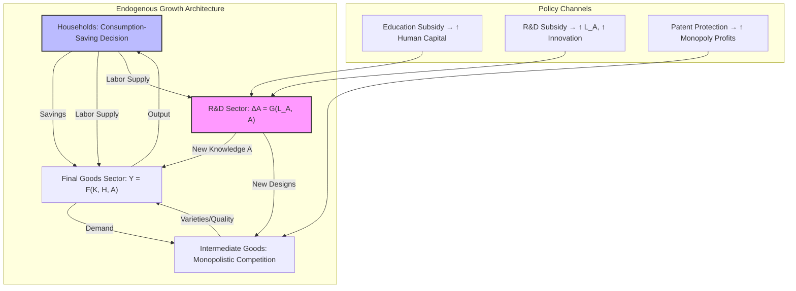

# Lesson 3: Endogenous Growth Theory – AK, R&D, Human Capital

## 1. First-Principles Intuition & Invariants

The Solow-Swan neoclassical growth model, for all its elegance in explaining convergence dynamics and the role of capital accumulation, suffers from a fundamental weakness: it treats technological progress as an exogenous force, arriving like manna from heaven at a rate determined outside the model's internal logic. Long-run growth in output per capita depends entirely on this exogenous productivity parameter, leaving economists with no framework to analyze how policy, innovation incentives, or human capital investment actually generate sustained increases in living standards. The model predicts that without exogenous technological change, economies inevitably reach a steady state where per capita growth ceases entirely—a prediction at odds with centuries of accelerating innovation and rising prosperity in advanced economies.

Endogenous growth theory emerged in the mid-1980s to address this theoretical vacuum by constructing models where the engine of long-run growth arises from within the economic system itself. Rather than assuming technological progress falls from the sky, endogenous growth models formalize the mechanisms through which profit-seeking firms invest in research and development, workers accumulate skills and knowledge, and spillovers from innovation create positive externalities that prevent diminishing returns from crushing sustained growth. The intellectual agenda is ambitious: to explain not merely *that* economies grow, but *why* they grow, *how* policy affects growth rates, and *what* determines the enormous disparities in income levels across countries.

The theoretical breakthrough begins with a simple observation about the nature of knowledge and ideas. Physical capital exhibits diminishing marginal returns—adding another machine to a factory floor yields progressively smaller output gains as the capital stock grows. But knowledge, once discovered, can be replicated and shared at negligible marginal cost. The blueprints for a semiconductor manufacturing process, the chemical formula for a pharmaceutical compound, or the mathematical algorithm underlying a search engine can be used simultaneously by arbitrarily many producers without exhausting the original stock. This non-rivalry property of knowledge creates the possibility of increasing returns to scale at the aggregate level, even when individual production functions display constant or decreasing returns. If the accumulation of knowledge generates positive spillovers—if my innovation makes you more productive without my ability to capture the full value—then the social return to knowledge investment exceeds the private return, and economies can sustain perpetual growth.

Endogenous growth theory formalizes these intuitions through three primary channels. The first, embodied in the AK model, strips away the complexity of separate capital and labor inputs to focus on a broad concept of capital that includes both physical and human components, yielding constant returns and eliminating the tendency toward steady-state stagnation. The second channel, pioneered by Paul Romer, treats technological progress as the output of a distinct research and development sector where profit-maximizing firms invest resources to create new designs, products, or production methods. The third channel emphasizes human capital accumulation—the deliberate investment in education, training, and skill development—as a source of productivity growth with positive externalities that amplify individual returns into economy-wide gains.

The policy implications diverge sharply from neoclassical prescriptions. In the Solow model, policies that increase the saving rate generate only temporary growth effects; the economy transitions to a higher level of output per capita but the long-run growth rate remains pinned down by exogenous technological progress. In endogenous growth models, policies that subsidize R&D, protect intellectual property rights, expand educational access, or reduce barriers to knowledge diffusion can permanently raise the growth rate. The distinction matters profoundly for development strategy: if growth is exogenous, poor countries simply wait for technology to diffuse from rich countries and focus on accumulating capital; if growth is endogenous, countries must build innovation capacity, invest in human capital, and create institutions that incentivize knowledge creation.

Yet endogenous growth theory introduces new challenges. Models featuring increasing returns and knowledge spillovers cannot rely on perfect competition—if firms cannot appropriate the full value of their innovations, someone must finance the gap between social and private returns. This necessity brings monopolistic competition, patent systems, and government subsidies into the core of growth theory. Scale effects emerge as both prediction and problem: if larger economies can spread fixed R&D costs over bigger markets, theory suggests growth rates should accelerate with population size, a prediction contradicted by historical evidence showing relatively stable growth rates despite massive population increases. Reconciling these theoretical tensions with empirical reality drives ongoing research into semi-endogenous growth, idea diffusion across borders, and the microeconomics of innovation.

The formal architecture of endogenous growth models rests on several core invariants. First, sustained per capita growth requires eliminating or offsetting diminishing returns to accumulable factors. This can occur through linearity in broad capital (AK models), through expanding variety of intermediate goods (Romer's product proliferation), through quality improvements that replace old technologies (Schumpeterian creative destruction), or through human capital externalities that raise productivity as average skill levels rise. Second, knowledge must exhibit partial non-rivalry and partial excludability—fully rival knowledge behaves like ordinary capital and yields neoclassical results, while fully non-excludable knowledge cannot incentivize private investment. Third, the decentralized equilibrium typically generates suboptimal growth because individual agents cannot capture the full social value of knowledge spillovers, justifying policy intervention to close the wedge between private and social returns.

The technical machinery involves intertemporal optimization by infinitely-lived households or dynasties, production functions that embed knowledge or human capital as distinct inputs, and market structures that depart from perfect competition to allow firms to recover fixed R&D costs. The canonical infinite-horizon representative agent maximizes discounted utility subject to budget constraints that link consumption, saving, and investment in physical or human capital. Firms maximize profits subject to production technologies that incorporate knowledge stocks, variety of inputs, or quality-adjusted productivity indices. Equilibrium requires that household saving decisions align with firm investment incentives, that labor allocates efficiently across production and R&D sectors, and that knowledge accumulation satisfies the resource constraints and spillover structures built into the model.

The mathematics involves systems of differential equations describing the time paths of consumption, capital stocks, and knowledge accumulation, solved to yield balanced growth paths where all variables grow at constant exponential rates. Unlike the Solow model, where transitional dynamics dominate and the steady state is a fixed point, endogenous growth models often exhibit balanced growth paths as limit trajectories where ratios of variables stabilize but levels continue rising indefinitely. The analytical focus shifts from convergence speeds and comparative statics of steady-state levels to the determinants of long-run growth rates and the transitional dynamics that govern how economies approach balanced growth.

## 2. Core Architecture & Mechanics

The simplest endogenous growth framework, the AK model, collapses the multi-factor production structure of the Solow model into a single aggregate input that we interpret as broad capital, encompassing both physical machines and human skills. The production function takes the stark linear form:

$$Y_t = A K_t$$

where $Y_t$ denotes aggregate output, $K_t$ represents the broad capital stock, and $A$ is a constant productivity parameter. The linearity is deliberate and consequential: the marginal product of capital equals the average product, both equal to $A$, and there are no diminishing returns. When households save a constant fraction $s$ of output and capital depreciates at rate $\delta$, the capital accumulation equation becomes:

$$\dot{K}_t = s Y_t - \delta K_t = s A K_t - \delta K_t = (sA - \delta) K_t$$

Dividing through by $K_t$ yields the growth rate of capital:

$$\frac{\dot{K}_t}{K_t} = sA - \delta$$

Since output is proportional to capital, the growth rate of output equals the growth rate of capital, and per capita variables grow at this same rate if population is constant. The economy exhibits sustained endogenous growth at rate $g^* = sA - \delta$, determined entirely by the saving rate, productivity parameter, and depreciation rate—all internal to the economic system. The saving rate now affects the long-run growth rate, not merely the level of output, reversing a key Solow conclusion.

The AK model sacrifices realism for tractability and insight. Why would capital exhibit constant returns? The usual interpretation invokes human capital complementarity: as physical capital accumulates, human skills must rise proportionally to operate the expanding capital stock effectively, and if human capital is itself produced through an investment process similar to physical capital, the composite "broad capital" measure can display constant returns even though each component separately faces diminishing returns. Alternatively, knowledge spillovers may raise the productivity parameter $A$ endogenously as aggregate capital grows, offsetting diminishing returns at the firm level through aggregate increasing returns.

The intertemporal optimization version of the AK model embeds household preferences with constant relative risk aversion utility $u(C_t) = \frac{C_t^{1-\theta}}{1-\theta}$, where $\theta$ measures the inverse of the intertemporal elasticity of substitution. The household maximizes lifetime utility:

$$\max \int_0^\infty e^{-\rho t} \frac{C_t^{1-\theta}}{1-\theta} dt$$

subject to the budget constraint $\dot{K}_t = A K_t - C_t - \delta K_t$, where $\rho$ is the subjective discount rate. The Hamiltonian formulation yields the Euler equation governing optimal consumption growth:

$$\frac{\dot{C}_t}{C_t} = \frac{1}{\theta} (A - \delta - \rho)$$

On the balanced growth path, consumption and capital grow at the same rate to satisfy the resource constraint, so the equilibrium growth rate is:

$$g^* = \frac{1}{\theta} (A - \delta - \rho)$$

This expression reveals that growth increases with productivity $A$, decreases with impatience $\rho$ and depreciation $\delta$, and decreases with risk aversion $\theta$ (since higher $\theta$ means lower willingness to defer consumption). The transversality condition $\lim_{t \to \infty} e^{-\rho t} \lambda_t K_t = 0$ ensures the household does not die with positive wealth, and it imposes the constraint $A - \delta > \rho$ for finite optimal growth, meaning the net return to capital must exceed the discount rate.

The AK model's stark simplicity makes it a workhorse for analyzing policy effects. A subsidy to capital investment or a reduction in capital taxation directly raises the effective return $A$, permanently increasing the growth rate. A tax on consumption or a forced saving program raises $s$ in the non-optimizing version, also boosting growth. The model predicts no convergence: poor and rich countries grow at rates determined by their own parameters, and income gaps persist or widen indefinitely. This stands in sharp contrast to the Solow model's conditional convergence, where poor countries grow faster and catch up to rich countries with similar technology and saving rates.

Yet the AK model's predictions are too sharp. It implies the growth rate is exactly constant on the balanced growth path with no transitional dynamics—economies jump immediately to the steady-state growth rate, an unrealistic prediction given observed growth volatility and adjustment lags. It offers no role for labor as a separate factor, ignoring the empirical importance of employment and human capital. Most problematically, it provides no mechanism explaining *why* $A$ takes its value or how innovation and knowledge accumulation occur, simply asserting constant returns as an assumption rather than deriving them from deeper foundations.

Paul Romer's 1990 endogenous technological change model addresses these deficiencies by explicitly modeling the production of new knowledge. The economy consists of three sectors: a final goods sector producing consumption and physical capital, an intermediate goods sector producing specialized capital equipment or differentiated inputs, and a research sector producing new designs for intermediate goods. The final goods production function takes the Cobb-Douglas form:

$$Y = L_Y^\alpha \int_0^A x(i)^{1-\alpha} di$$

where $L_Y$ is labor employed in final goods production, $A$ is the measure of available intermediate good varieties (the stock of knowledge), and $x(i)$ is the quantity of intermediate good $i$ used in production. The integral sums across all available varieties, and the exponent $(1-\alpha)$ on each variety means inputs exhibit diminishing returns individually but the proliferation of varieties generates increasing returns to scale at the aggregate level.

The intermediate goods sector operates under monopolistic competition. Each intermediate good is produced by a single firm that owns the patent for design $i$, and the firm faces constant marginal cost in terms of final output, normalized to unity. The firm sets a monopolistic markup over marginal cost, and profit maximization implies each variety is supplied in quantity:

$$x(i) = x^* = L_Y^{\frac{\alpha}{1-\alpha}} A^{\frac{1}{1-\alpha}}$$

which is symmetric across all varieties. Substituting back into the final goods production function and simplifying yields:

$$Y = L_Y^\alpha A x^{*1-\alpha} A = L_Y A^{\frac{1}{1-\alpha}}$$

This shows that output increases with both the labor devoted to production and the number of available varieties, with the elasticity depending on the technology parameter $\alpha$. Critically, this is *not* a Cobb-Douglas function in labor and knowledge; the exponent on $A$ exceeds unity if $\alpha < 1$, generating increasing returns to scale in accumulable factors.

The research sector produces new designs through the knowledge production function:

$$\dot{A} = \delta L_A A$$

where $L_A$ is labor devoted to R&D and $\delta$ is a productivity parameter. The crucial feature is that current knowledge $A$ raises the productivity of researchers—standing on the shoulders of giants, each new researcher benefits from the accumulated stock of prior discoveries. This generates a scale effect: larger economies with more researchers produce knowledge faster, and knowledge production accelerates over time as the knowledge stock grows.

Labor allocates between production and research to equalize returns. In equilibrium, researchers must be compensated for their contribution to knowledge growth, and the value of a new design equals the present discounted value of monopoly profits from intermediate goods production. The balanced growth path satisfies:

$$g_A = \delta L_A$$

where $g_A$ is the growth rate of knowledge, and final output grows at rate:

$$g_Y = \frac{1}{1-\alpha} g_A = \frac{\delta L_A}{1-\alpha}$$

The growth rate depends on the total labor force allocated to research and the productivity of R&D. Policies that subsidize research, strengthen patent protection (increasing monopoly profits and R&D incentives), or expand education (increasing $L_A$) permanently raise growth. Larger economies grow faster, a scale effect that Romer initially embraced but that became a focal point of criticism.

The model's market structure matters crucially. Monopolistic competition allows intermediate goods producers to recover R&D fixed costs through markup pricing, but the markup creates a wedge between price and marginal cost, generating static inefficiency. The decentralized equilibrium growth rate is generically suboptimal: because knowledge exhibits positive spillovers (new designs raise the productivity of future researchers), the social return to R&D exceeds the private return, and the laissez-faire economy underinvests in research relative to the social optimum. The planner's problem, which maximizes social welfare, would allocate more labor to R&D and generate faster growth.

The spillover structure can take several forms. In the Romer formulation, spillovers enter through the knowledge production function's dependence on $A$—each researcher benefits from the entire stock of prior knowledge. Alternative formulations model spillovers in the final goods production function, where aggregate knowledge raises firm-level productivity, or through human capital externalities, where average education levels raise individual productivity. The common thread is that private agents cannot fully appropriate the social value they create, necessitating policy intervention to achieve efficient outcomes.

Variety expansion models like Romer's emphasize horizontal innovation—new products that coexist with existing ones. In contrast, Schumpeterian quality ladder models, developed by Aghion and Howitt, emphasize vertical innovation—quality improvements that render old products obsolete. Each industry features a succession of monopolists, and a successful innovator replaces the incumbent, capturing monopoly profits until the next innovator arrives. The creative destruction process generates growth through quality-adjusted productivity improvements rather than variety proliferation.

The quality ladder framework models each industry $j$ with a quality index $q_j$, and the production function aggregates across industries with the highest-quality product in each used for production. Innovation arrives as a Poisson process with arrival rate $\lambda L_A$, where $L_A$ is research labor and $\lambda$ is research productivity. Each successful innovation raises quality by a fixed factor $\gamma > 1$, and the innovator becomes the monopolist for that industry until displaced. The expected growth rate of aggregate productivity equals:

$$g = \lambda L_A \ln \gamma$$

which depends on the research intensity, the innovation arrival rate, and the step size of quality improvements. Unlike variety expansion models, quality ladder models generate turnover and firm exit—old products disappear, and incumbent monopolists face perpetual threat from entrants.

The policy implications differ subtly. Variety expansion models predict that all innovations are socially valuable since new products supplement rather than replace existing ones, and R&D subsidies unambiguously raise welfare. Quality ladder models introduce business stealing effects: a new innovation destroys the incumbent's monopoly profits, and the private innovator does not internalize this negative externality on the displaced firm. This creates two offsetting distortions—positive spillovers from knowledge creation and negative externalities from profit destruction—and the optimal R&D subsidy depends on which effect dominates.

Human capital models, pioneered by Lucas in 1988, treat education and skill accumulation as engines of growth. The representative agent allocates time between working and learning, and human capital $h$ evolves according to:

$$\dot{h} = \psi u h$$

where $u \in [0,1]$ is the fraction of time devoted to education and $\psi$ is the efficiency of learning. The production function includes both individual human capital and average human capital $\bar{h}$, capturing external effects from an educated workforce:

$$Y = K^\alpha (u h L)^{1-\alpha} \bar{h}^\phi$$

where $\phi$ measures the strength of the human capital externality. The individual takes $\bar{h}$ as given, but in equilibrium $\bar{h} = h$, generating social increasing returns. The balanced growth path features constant time allocation $u^*$ and exponential growth in human capital, physical capital, and output at rate:

$$g^* = \frac{\psi u^*}{1 - \phi}$$

The externality parameter $\phi$ amplifies growth: stronger spillovers from education raise the equilibrium growth rate. Policies that subsidize education or reduce the private cost of schooling increase $u^*$, permanently raising growth. The model predicts that countries with similar fundamentals but different education policies diverge in income levels over time, with the gap growing exponentially.

The empirical evidence on endogenous growth predictions is mixed. Cross-country growth regressions find that R&D intensity, patent counts, and education levels correlate positively with growth rates, consistent with endogenous growth mechanisms. But the predicted scale effects—larger economies should grow faster—fail spectacularly: historical growth rates have remained roughly constant over centuries despite massive increases in population and the research labor force. This led to semi-endogenous growth models, where R&D productivity declines over time as easy ideas are exhausted, offsetting the scale effect and stabilizing long-run growth rates.

The mechanics of knowledge accumulation also reveal constraints. If knowledge production satisfies $\dot{A} = \delta L_A A^\lambda$ with $\lambda < 1$, then diminishing returns to the knowledge stock slow the growth rate even as the research labor force expands. This reconciles constant long-run growth with increasing research effort, but it severs the link between policy and growth—subsidies to R&D raise the level of output but not the long-run growth rate, echoing Solow's conclusion. The debate between fully endogenous and semi-endogenous growth models hinges on the functional form of knowledge production and the presence or absence of scale effects, questions that remain empirically unresolved.

The diagram traces the flow of resources and knowledge through an endogenous growth economy. Households allocate consumption, saving, and labor between production and research activities. The final goods sector combines physical capital, human capital, and the stock of knowledge to produce output, and it purchases differentiated intermediate goods that embody new designs. The R&D sector employs labor and leverages existing knowledge to produce new ideas, which flow into the final goods sector as productivity enhancements and into the intermediate goods sector as new product varieties or quality improvements. Policy interventions—education subsidies, R&D tax credits, patent protection—affect the allocation of labor and resources, altering the equilibrium growth rate.

## 3. High-Performance Optimization & Failure Modes

Translating endogenous growth theory into empirical analysis and policy evaluation requires navigating a series of estimation challenges, identification problems, and model specification decisions. The core difficulty is that growth rates, R&D investment, and human capital accumulation are jointly determined in equilibrium, creating severe endogeneity that confounds causal inference. A naive regression of growth on R&D intensity will conflate the causal effect of research on growth with reverse causality—fast-growing economies may invest more in R&D because they are rich, not the other way around—and with omitted variables like institutional quality or geographic advantages that affect both growth and innovation.

The empirical growth literature addresses these challenges through a combination of instrumental variables, natural experiments, and structural estimation. Instrumental variables exploit exogenous variation in R&D or education that is uncorrelated with unobserved growth determinants. For example, changes in R&D tax credits or sudden shifts in defense spending on research provide plausibly exogenous shocks to innovation intensity. Patent reforms or education expansions driven by political or demographic factors serve as instruments for human capital accumulation. The validity of these instruments hinges on exclusion restrictions—the instrument must affect growth only through the endogenous variable of interest—a strong assumption that is difficult to verify and often violated in practice.

Natural experiments leverage discrete policy changes or institutional shocks that create sharp variation in innovation incentives or educational access. The establishment of land-grant universities in the United States, the German chemical industry's early patent system, or China's expansion of higher education provide settings where researchers can estimate causal effects by comparing growth trajectories before and after the intervention or across regions differentially exposed to the policy. Difference-in-differences designs with multiple pre- and post-treatment periods allow estimation of dynamic treatment effects and tests of parallel trends assumptions. Synthetic control methods construct counterfactual comparison regions by weighting untreated units to match pre-treatment characteristics of the treated region, isolating the policy's impact.

Structural estimation takes endogenous growth models directly to the data, calibrating or estimating deep parameters like R&D productivity $\delta$, the elasticity of substitution across varieties, or the strength of human capital externalities. The researcher specifies functional forms for production and knowledge accumulation, solves the model to derive equilibrium growth rates and factor allocations as functions of parameters, and minimizes the distance between model predictions and observed moments like the R&D share of GDP, the skill premium, or the patent-to-output ratio. Structural estimation allows counterfactual policy analysis—simulating the effect of an R&D subsidy increase or a patent term extension—but it requires strong assumptions about functional forms and equilibrium selection, and misspecification can badly bias estimates.

The calibration approach fixes some parameters based on external evidence and chooses remaining parameters to match model predictions to data targets. For instance, the capital share $\alpha$ can be set to national accounts data, the depreciation rate $\delta$ to investment-capital ratios, and the discount rate $\rho$ to real interest rates. The model's productivity parameters are then chosen so equilibrium growth rates, R&D intensities, and markup ratios match their empirical counterparts. Calibration is transparent and computationally efficient, but it does not provide standard errors or formal tests of model fit, and it implicitly assumes the model is correctly specified.

Moment matching estimation formalizes calibration by selecting parameters to minimize a weighted distance between model-generated moments and their data analogs, yielding asymptotic standard errors and overidentification tests when the number of moments exceeds the number of parameters. The researcher chooses moments that are informative about specific parameters—the growth rate pins down R&D productivity, the skill premium identifies the elasticity of substitution between skilled and unskilled labor, and the R&D expenditure share reveals the fixed cost of innovation. The weighting matrix optimally accounts for sampling variance and correlation across moments, and the minimized objective function provides a test statistic for model specification.

Bayesian estimation treats parameters as random variables with prior distributions, updates priors using the likelihood function derived from the model and data, and generates posterior distributions that quantify parameter uncertainty. Markov Chain Monte Carlo (MCMC) algorithms, such as the Metropolis-Hastings or Gibbs sampler, draw from the posterior by constructing a Markov chain whose stationary distribution equals the posterior. Bayesian methods naturally incorporate parameter uncertainty into policy counterfactuals and allow researchers to impose priors based on microeconomic evidence or theoretical restrictions, but they require specifying the likelihood function and priors, and posterior inference is sensitive to these choices.

Identifying scale effects remains a central empirical challenge. The prediction that growth rates increase with population size or the research labor force has been decisively rejected by long-run historical data: advanced economies experienced sustained growth rate increases from the 18th through mid-20th centuries, but growth rates stabilized or declined after 1970 despite continued expansion of university systems and R&D employment. Semi-endogenous growth models reconcile these patterns by introducing diminishing returns to the knowledge stock or rising research costs—the "fishing out" hypothesis where easy ideas are discovered first and subsequent innovation requires exponentially increasing research effort.

Testing between fully endogenous and semi-endogenous growth models requires long time series on R&D inputs and productivity growth, and the results hinge on measurement choices and functional form assumptions. Studies using patent counts as a proxy for innovation output find declining R&D productivity, supporting semi-endogenous models. But patents are an imperfect measure—they miss process innovations, vary in quality, and capture codified knowledge while ignoring tacit know-how. Alternative measures like total factor productivity (TFP) growth or the value of new products face similar limitations. The fundamental problem is that knowledge is intangible and difficult to quantify, and no single metric captures its multidimensional nature.

Measuring human capital poses analogous difficulties. Years of schooling are a crude proxy that ignores skill quality, curriculum content, and on-the-job training. Test scores like PISA or TIMSS provide internationally comparable cognitive skill measures, but they miss non-cognitive skills, creativity, and problem-solving abilities central to innovation. Wage data can infer human capital from earnings via Mincer regressions, but wages reflect not only productivity but also labor market institutions, discrimination, and rents. Constructing human capital stocks requires aggregating across heterogeneous individuals with different education levels and experience profiles, and the aggregation weights are typically calibrated rather than estimated, introducing model dependence.

Spillover estimation confronts the problem that knowledge diffusion is partial and localized. Firm-level productivity benefits from industry-wide or economy-wide knowledge stocks, but disentangling these effects from firm-specific R&D requires detailed microdata and instruments for aggregate knowledge that are uncorrelated with firm-specific shocks. Geographic spillovers can be estimated by comparing productivity across regions with different R&D intensities or university densities, but spatial correlation in unobserved productivity factors confounds identification. Patent citation networks provide a direct measure of knowledge flows—if firm A cites firm B's patent, knowledge has diffused—but citations capture only a subset of spillovers and may reflect strategic behavior rather than actual knowledge use.

Dynamic panel data methods, such as the Arellano-Bond GMM estimator, address endogeneity and unobserved heterogeneity in firm- or country-level growth regressions. The estimator differences the equation to eliminate fixed effects and instruments lagged differences with lagged levels, under the assumption that innovations to the growth rate are serially uncorrelated. System GMM extends this by stacking level and differenced equations, improving efficiency and allowing estimation of time-invariant regressors. But these methods require large cross-sectional dimensions, strictly exogenous instruments, and no serial correlation in errors—assumptions that often fail in growth applications with small country samples, persistent shocks, and feedback from growth to regressors.

Policy counterfactuals derived from endogenous growth models must account for general equilibrium effects and transition dynamics. A partial equilibrium calculation that increases R&D subsidies and predicts faster growth ignores offsetting mechanisms: higher subsidies require higher taxes or lower government consumption elsewhere, reducing household income and potentially crowding out private investment. Subsidies to R&D may draw labor away from production, lowering current output even as they raise future productivity. If the subsidy is financed by capital taxes, the negative effect on physical capital accumulation may dominate the positive effect on knowledge accumulation, reducing net growth.

Transition dynamics introduce additional complexity. Endogenous growth models on balanced growth paths exhibit constant growth rates, but the transition from an initial state to the balanced growth path can take decades. A policy that raises the long-run growth rate may initially reduce growth if it requires costly reallocation of resources or temporary declines in consumption. The transition path depends on initial conditions, the speed of adjustment in capital and knowledge stocks, and the intertemporal elasticity of substitution in consumption. Solving for transition dynamics requires numerical methods—shooting algorithms or relaxation techniques—that iteratively find time paths satisfying optimality conditions and resource constraints.

Computational implementation of endogenous growth models involves discretizing continuous time into finite periods, linearizing first-order conditions around the balanced growth path for analytical tractability, or solving the full nonlinear system using value function iteration or projection methods. Linearization yields a system of difference equations that can be solved via eigenvalue decomposition or undetermined coefficients methods, providing closed-form expressions for impulse responses to shocks. Value function iteration discretizes the state space—capital, knowledge, and possibly other state variables—and iterates on the Bellman equation until the value function converges, then derives policy functions by optimizing current-period payoff plus discounted continuation value. Projection methods approximate the value or policy function using basis functions like Chebyshev polynomials or splines, and solve for coefficients by imposing optimality conditions at collocation nodes.

Failure modes in empirical endogenous growth analysis often stem from weak identification. If variation in R&D or education is limited or strongly correlated with other growth determinants, instruments will be weak and estimates imprecise. Overidentification tests may fail to reject invalid instruments if sample sizes are small, and the researcher may mistakenly conclude the model is correctly specified. Publication bias toward statistically significant results exacerbates the problem—insignificant estimates of growth effects are less likely to be published, inflating the literature's consensus estimates.

Model misspecification introduces systematic bias. If the true data-generating process features quality ladder innovation but the researcher estimates a variety expansion model, parameter estimates will conflate the effects of new products and quality improvements, and policy counterfactuals will be incorrect. If human capital externalities are non-linear—perhaps exhibiting threshold effects where spillovers only occur above a critical education level—a linear specification will misestimate the marginal effect of education on growth and produce misleading policy predictions.

Measurement error in R&D or human capital attenuates coefficient estimates, biasing growth effects toward zero. If R&D spending includes expenditures that do not contribute to knowledge accumulation—such as duplicative research or unsuccessful projects—the measured R&D stock overstates true productive knowledge, reducing estimated R&D productivity. Classical measurement error in right-hand-side variables can be addressed via instrumental variables, but non-classical error—where measurement mistakes correlate with true values—requires structural modeling of the measurement process.

Cross-country growth regressions face fundamental limitations. With fewer than 200 countries and limited time variation, sample sizes are small and outliers exert large influence. Institutional, geographic, and cultural heterogeneity means that a single growth equation is unlikely to fit all countries—the effect of R&D on growth may differ between advanced and developing economies, or between democracies and autocracies. Fixed effects absorb cross-sectional variation, leaving only within-country time-series variation to identify effects, but this variation is often limited and confounded by common shocks like oil price changes or global financial crises.

Firm-level and regional data offer richer variation but introduce aggregation challenges. Firm-level R&D intensity is endogenous to firm productivity and market structure, and firm-level estimates of R&D effects capture private returns, not social returns inclusive of spillovers. Regional data allow exploitation of spatial variation in innovation and education, but knowledge spillovers cross regional boundaries, creating spatial correlation that biases standard errors and potentially coefficients if spillovers are omitted from the regression.

Recent advances employ machine learning methods to uncover heterogeneous treatment effects and nonlinear relationships. Causal forests estimate conditional average treatment effects of R&D or education on growth as a function of country or firm characteristics, revealing which contexts generate largest growth impacts. Double machine learning combines flexible prediction models with moment conditions to control for high-dimensional confounders while maintaining valid inference on causal parameters. These methods relax functional form assumptions but require large samples and careful tuning to avoid overfitting, and they do not resolve fundamental identification problems arising from simultaneity or omitted variables.

The practical workflow for estimating growth effects begins with assembling panel data on output, capital, labor, R&D expenditures, patent counts, and education levels across countries, regions, or firms. Data sources include the Penn World Table for cross-country comparisons, OECD statistics for advanced economies, UNESCO and Barro-Lee datasets for education, and PATSTAT or the USPTO for patent data. R&D data come from national science foundations or firm financial statements, and total factor productivity is calculated as the Solow residual after accounting for capital and labor contributions to growth.

The researcher specifies a growth regression of the form:

$$g_{i,t} = \alpha + \beta_1 \ln(R\&D_{i,t}) + \beta_2 \ln(H_{i,t}) + \mathbf{\gamma}' \mathbf{X}_{i,t} + \mu_i + \lambda_t + \varepsilon_{i,t}$$

where $g_{i,t}$ is the growth rate of GDP per capita for country or firm $i$ in period $t$, $R\&D_{i,t}$ is research intensity, $H_{i,t}$ is average education, $\mathbf{X}_{i,t}$ includes control variables like institutional quality or openness to trade, $\mu_i$ are country fixed effects, $\lambda_t$ are time fixed effects, and $\varepsilon_{i,t}$ is an error term. The fixed effects absorb time-invariant country characteristics and common time shocks.

Endogeneity of R&D and education is addressed by instrumenting with lagged values, changes in tax policy, or demographic shocks. The first-stage regressions predict R&D and education using instruments, and the second stage regresses growth on predicted values. Hansen's J-test evaluates overidentification restrictions, and weak instrument diagnostics check the relevance of instruments via F-statistics. Cluster-robust standard errors account for serial correlation within countries or spatial correlation across regions.

Alternative specifications include dynamic panel models with lagged growth rates, system GMM estimation, and cointegration tests for long-run relationships between R&D stocks and output levels. Nonlinear specifications test for threshold effects, interaction terms explore heterogeneity across development levels or institutional contexts, and quantile regressions examine whether R&D effects differ across the growth distribution.

Structural estimation proceeds by writing out the model's equilibrium conditions—household Euler equations, firm pricing rules, labor market clearing, and knowledge accumulation laws—and deriving moment conditions linking parameters to observable data moments. For example, the ratio of R&D expenditure to GDP identifies the innovation productivity parameter, the capital-output ratio pins down the capital share, and the growth rate of TFP reveals the knowledge depreciation rate. The researcher minimizes the weighted distance between model moments and data moments, using an identity weighting matrix for computational simplicity or an optimal matrix that accounts for moment covariances.

Sensitivity analysis tests robustness to functional form choices, sample composition, and measurement decisions. Does the estimated growth effect of R&D change if we use patent stocks instead of R&D spending? Do results hold in subsamples of OECD countries versus developing economies? Are estimates sensitive to outliers like China or the U.S., or to the exclusion of specific time periods like the 2008 financial crisis? Placebo tests using outcomes that should not respond to R&D or education provide validation checks.

The interpretation of estimated coefficients requires care. A coefficient on R&D in a growth regression captures the correlation between R&D intensity and growth conditional on controls and fixed effects, but it does not necessarily equal the causal effect of increasing R&D through policy intervention. The coefficient may be biased upward if unobserved productivity shocks simultaneously raise growth and R&D, or downward if measurement error attenuates the true relationship. Even if the coefficient is causal, it reflects the average effect across the sample, and the marginal effect of additional R&D may differ at different baseline levels or in different institutional environments.

Policy design based on endogenous growth models must weigh multiple margins. R&D subsidies raise innovation but require financing through distortionary taxes or cuts to other spending. Patent protection incentivizes innovation by granting temporary monopolies but raises prices and restricts access to knowledge. Education subsidies build human capital but crowd out private education spending and may disproportionately benefit high-ability individuals who would have invested in education regardless. Optimal policy balances these tradeoffs using a social welfare function that aggregates across individuals and time periods, and the solution depends on parameter values, distributional preferences, and political economy constraints.

The empirical literature finds robust positive correlations between R&D, education, and growth, but estimated magnitudes vary widely across studies and methods. Meta-analyses that pool results from multiple papers report average elasticities of growth with respect to R&D of roughly 0.05 to 0.15, meaning a 10% increase in R&D intensity raises growth rates by 0.5 to 1.5 percentage points. Education effects are similarly positive but sensitive to quality measurement—years of schooling exhibit weak effects, but test scores show stronger relationships. Spillover estimates are positive but imprecise, and the geographic reach of spillovers appears limited to roughly 100-300 kilometers, suggesting localized knowledge diffusion.

The debate over scale effects remains unresolved. Some researchers argue that scale effects are real but masked by offsetting declines in R&D productivity, supporting semi-endogenous growth models. Others contend that scale effects operate through market size rather than population—larger markets incentivize innovation by spreading fixed costs over more users, and globalization has expanded effective market size even as individual country populations stabilize. A third view holds that scale effects are negligible because knowledge creation faces increasing complexity and duplication, so expanding the research labor force yields proportional rather than accelerating knowledge growth.

The practical implications for growth policy depend on which view is correct. If growth is fully endogenous, policies that raise R&D or education permanently increase growth rates, and even small effects compound into large welfare gains over long horizons. If growth is semi-endogenous, the same policies raise income levels but not long-run growth rates, limiting the cumulative benefits. Distinguishing these scenarios requires long-run data and careful modeling of R&D productivity trends, and the evidence remains inconclusive.

Recent work emphasizes the quality and direction of innovation, not just its quantity. Breakthrough innovations that open new technological trajectories generate larger spillovers and productivity gains than incremental improvements, but they are harder to predict and incentivize. Mission-oriented R&D policies that direct research toward specific challenges—clean energy, health technologies, artificial intelligence—may achieve social goals more effectively than untargeted subsidies, but they require government to pick winners and risk crowding out private sector initiative.

The rise of digital technologies and artificial intelligence introduces new considerations. Digital goods exhibit extreme scale economies and network effects, amplifying the potential for winner-take-all dynamics and geographic concentration of innovation. AI and automation may substitute for human labor, reducing the role of human capital accumulation as a growth engine while raising returns to skills that complement machines. Open-source software and collaborative research platforms lower knowledge diffusion barriers, potentially strengthening spillovers and accelerating growth, but they weaken intellectual property protection and may reduce private innovation incentives.

Endogenous growth theory provides the conceptual foundation for understanding these dynamics, but the theory must evolve to incorporate new institutional forms, technologies, and data sources. The field continues to grapple with measurement challenges, identification problems, and the tension between theoretical elegance and empirical realism. Practitioners seeking to apply endogenous growth insights to policy or forecasting must navigate these complexities, combining theory, econometrics, and institutional knowledge to draw reliable conclusions from imperfect data.
