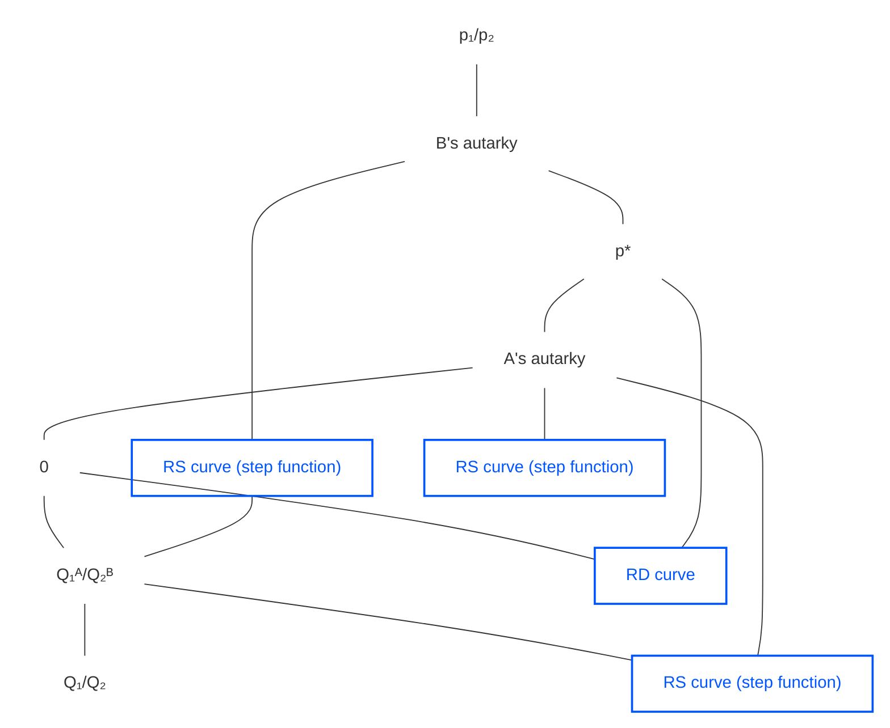

# Lesson 1: Comparative Advantage, Ricardian Foundations

## 1. First-Principles Intuition & Invariants

The principle of comparative advantage stands as one of the most counterintuitive yet ironclad theorems in economic science. David Ricardo's 1817 formulation in *On the Principles of Political Economy and Taxation* established that voluntary trade between nations creates mutual gains even when one nation possesses absolute productive superiority across all goods. This insight demolishes mercantilist intuition and reveals the deep opportunity cost structure governing resource allocation under scarcity constraints.

The Ricardian framework isolates labor as the sole factor of production and constructs a world of two countries producing two tradable goods under conditions of constant returns to scale and perfect labor mobility within national borders but complete immobility across them. Technology differences manifest as fixed labor productivity coefficients—the number of labor hours required to produce one unit of output. These technological asymmetries generate the productivity differentials that drive patterns of specialization and the volume of trade flows.

Consider the autarkic equilibrium, where each nation operates in isolation and produces both goods to satisfy domestic consumption. Each economy faces a production possibilities frontier (PPF) defined by its labor endowment $L$ and the unit labor requirements $a_{Li}$ for good $i$. The slope of this PPF reveals the domestic opportunity cost: producing one additional unit of good 1 requires sacrificing $a_{L1}/a_{L2}$ units of good 2. This ratio defines the autarkic relative price, the rate at which the domestic market values one good against the other absent international exchange.

The critical insight emerges when comparing these opportunity cost ratios across countries. Suppose Country A requires 1 labor hour per unit of wine and 2 hours per unit of cloth, yielding an opportunity cost of 0.5 cloth per wine. Country B requires 3 hours per wine and 4 hours per cloth, producing an opportunity cost of 0.75 cloth per wine. Country A holds absolute advantage in both goods—it produces each with fewer labor hours—yet the opportunity cost structure reveals that Country A sacrifices less cloth when producing wine (0.5 versus 0.75), while Country B sacrifices less wine when producing cloth (1.33 versus 2.0 wine per cloth). Country A possesses comparative advantage in wine, and Country B in cloth, despite A's absolute dominance across the board.

The gains from trade theorem states that when nations specialize according to comparative advantage and exchange at any terms of trade lying between the two autarkic price ratios, both countries consume strictly more of both goods than under autarky. This result requires no assumptions about fairness, equal bargaining power, or balanced trade flows. The mechanism operates through pure opportunity cost arbitrage: each country expands production of the good it sacrifices less to produce and imports the good it would sacrifice more to make domestically. The terms of trade—the international relative price at which goods exchange—determines how the total gains distribute between trading partners, but the existence of mutual gains remains invariant across all feasible terms of trade.

Formalizing this structure requires constructing the closed-form production possibilities set and deriving equilibrium prices under competitive labor markets. Let $L^A$ and $L^B$ denote the labor endowments of countries A and B, with unit labor coefficients $a_{L1}^A, a_{L2}^A, a_{L1}^B, a_{L2}^B$ for goods 1 and 2. The PPF for Country A satisfies the resource constraint:

$$a_{L1}^A q_1^A + a_{L2}^A q_2^A \leq L^A$$

where $q_1^A$ and $q_2^A$ represent quantities produced. The autarkic relative price equals the marginal rate of transformation:

$$\left(\frac{p_1}{p_2}\right)^A_{\text{aut}} = \frac{a_{L1}^A}{a_{L2}^A}$$

Comparative advantage exists when:

$$\frac{a_{L1}^A}{a_{L2}^A} \neq \frac{a_{L1}^B}{a_{L2}^B}$$

Without loss of generality, assume Country A has comparative advantage in good 1:

$$\frac{a_{L1}^A}{a_{L2}^A} < \frac{a_{L1}^B}{a_{L2}^B}$$

Under free trade with terms of trade $p \equiv p_1/p_2$, Country A specializes completely in good 1 when $p > a_{L1}^A/a_{L2}^A$, producing $q_1^A = L^A/a_{L1}^A$ and importing good 2. Country B specializes in good 2 when $p < a_{L1}^B/a_{L2}^B$, producing $q_2^B = L^B/a_{L2}^B$ and importing good 1. The world market clears when the relative supply of good 1 equals relative demand at price $p$.

The trade equilibrium constructs a consumption possibilities frontier strictly exterior to the autarkic PPF for both countries. Each nation's consumption set expands because international exchange allows purchasing goods at terms more favorable than domestic production trade-offs. The magnitude of gains depends on the distance between autarkic price ratios—greater technological asymmetry generates larger potential welfare improvements. Yet even marginal productivity differences suffice to unlock positive gains through specialization.

The invariant principle underlying Ricardian trade theory holds that productivity differences, not absolute advantage, determine trade patterns. A nation's inability to match foreign productivity levels across all sectors imposes no barrier to beneficial exchange. The opportunity cost structure alone governs optimal resource allocation. This insight extends beyond international contexts: firms, regions, and individuals realize gains through specialization driven by comparative, not absolute, productive superiority.

The Ricardian model's predictive power emerges most clearly when technology shocks alter relative productivity. Suppose Country A experiences a labor-saving innovation in good 2, reducing $a_{L2}^A$ while $a_{L1}^A$ remains fixed. This shifts A's autarkic relative price $a_{L1}^A/a_{L2}^A$ upward, potentially reversing comparative advantage if the new ratio exceeds $a_{L1}^B/a_{L2}^B$. Trade patterns flip discontinuously—Country A switches from exporting good 1 to exporting good 2—even though the innovation occurred in the sector where A previously imported. The model thus generates testable predictions linking productivity changes to trade flow reversals.

## 2. Core Architecture & Mechanics

The mechanical structure of the two-country two-good Ricardian model consists of three nested optimization layers: individual labor supply decisions, firm production choices under perfect competition, and international market clearing through terms of trade adjustment. Each layer operates under distinct constraints and information sets, yet the equilibrium aggregates these decentralized choices into coherent specialization patterns.

At the microeconomic foundation, individual workers supply labor inelastically up to their time endowment and consume both goods according to Cobb-Douglas or CES preferences. Normalizing the labor force to unity in each country, workers maximize utility $U(c_1, c_2)$ subject to the budget constraint $p_1 c_1 + p_2 c_2 = w L$, where $w$ denotes the wage rate and $L$ the labor supply. Under homothetic preferences, relative demand depends solely on relative prices, independent of income levels. This generates the relative demand curve $D(p_1/p_2)$, a decreasing function of the relative price of good 1.

Firms operate under constant returns to scale with labor as the sole input. A firm producing good $i$ in country $j$ employs $a_{Li}^j$ labor hours per unit output, paying competitive wage $w^j$. Zero-profit competitive equilibrium requires price equals unit cost:

$$p_i = w^j a_{Li}^j$$

Dividing the price equations yields:

$$\frac{p_1}{p_2} = \frac{a_{L1}^j}{a_{L2}^j}$$

This reveals that autarkic relative prices equal the ratio of unit labor requirements—the domestic opportunity cost. International trade breaks this equality, allowing relative prices to diverge from domestic productivity ratios.

The trade equilibrium emerges through the following sequence. First, establish the autarkic price ratios for both countries from their unit labor coefficients. Assume without loss of generality that:

$$\frac{a_{L1}^A}{a_{L2}^A} < \frac{a_{L1}^B}{a_{L2}^B}$$

This inequality defines Country A's comparative advantage in good 1 and Country B's in good 2. Under free trade, the international relative price $p \equiv p_1/p_2$ must lie between the two autarkic ratios for specialization to occur:

$$\frac{a_{L1}^A}{a_{L2}^A} < p < \frac{a_{L1}^B}{a_{L2}^B}$$

At any terms of trade satisfying this double inequality, Country A finds producing good 1 more profitable than good 2 because $p > a_{L1}^A/a_{L2}^A$ implies $p_1/w^A > a_{L1}^A$ while $p_2/w^A < a_{L2}^A$. Similarly, Country B specializes in good 2 because $p < a_{L1}^B/a_{L2}^B$ makes good 2 relatively more profitable. Complete specialization follows: Country A produces $Q_1^A = L^A/a_{L1}^A$ units of good 1 and zero of good 2, while Country B produces $Q_2^B = L^B/a_{L2}^B$ units of good 2 and zero of good 1.

The world market clearing condition equates relative supply to relative demand:

$$\frac{Q_1^A}{Q_2^B} = D(p)$$

Substituting the specialized production quantities:

$$\frac{L^A/a_{L1}^A}{L^B/a_{L2}^B} = D(p)$$

This equation implicitly defines the equilibrium terms of trade $p^*$ as the relative price at which the global relative supply (determined by labor endowments and productivity) equals relative demand (determined by consumer preferences). The terms of trade lie strictly between the autarkic price ratios, ensuring both countries gain from trade.

The distribution of gains depends on the terms of trade location within the feasible range. If $p^*$ lies closer to Country A's autarkic ratio, Country A captures smaller gains because its consumption prices resemble autarkic conditions. Conversely, terms of trade near Country B's autarkic ratio favor Country A. The exact location depends on relative country size (labor endowments) and demand elasticities. Large countries exert greater influence on world prices, often securing more favorable terms of trade.

The consumption possibilities frontier for Country A under trade extends along the budget line:

$$p^* c_1^A + c_2^A = p^* Q_1^A$$

Rearranging:

$$c_2^A = p^* Q_1^A - p^* c_1^A = p^* \frac{L^A}{a_{L1}^A} - p^* c_1^A$$

The slope equals $-p^*$, which differs from the autarkic slope $-a_{L1}^A/a_{L2}^A$. Since $p^* > a_{L1}^A/a_{L2}^A$, the trade budget line pivots outward around the specialized production point, expanding the feasible consumption set. Country A consumes some quantity $c_1^A < Q_1^A$ domestically and exports $X_1^A = Q_1^A - c_1^A$ units of good 1 in exchange for imports $M_2^A = c_2^A$ of good 2. Trade balance requires:

$$p^* X_1^A = M_2^A$$

confirming that export revenues equal import expenditures valued at world prices.

The mechanics of wage determination complete the equilibrium structure. In Country A, wage equals the value of marginal product in the sector where labor allocates. Under complete specialization in good 1:

$$w^A = \frac{p_1}{a_{L1}^A} = \frac{p^* p_2}{a_{L1}^A}$$

Normalizing $p_2 = 1$ (choosing good 2 as numeraire), we obtain:

$$w^A = \frac{p^*}{a_{L1}^A}$$

Similarly, Country B's wage equals:

$$w^B = \frac{p_2}{a_{L2}^B} = \frac{1}{a_{L2}^B}$$

The wage ratio $w^A/w^B = p^* a_{L2}^B/a_{L1}^A$ reflects both the terms of trade and relative productivity levels. Countries with lower unit labor requirements (higher productivity) earn higher wages, but the terms of trade introduce a wedge that can partially offset absolute productivity disadvantages. A country with uniformly lower productivity can still achieve relatively high wages if the terms of trade favor its export good.

The graphical representation of the Ricardian model employs the relative supply-relative demand diagram in $(Q_1/Q_2, p_1/p_2)$ space. The relative supply curve exhibits a step function structure: at prices below Country A's autarkic ratio, both countries produce good 2 exclusively (infinite relative supply). At prices between the two autarkic ratios, Country A specializes in good 1 and Country B in good 2, generating a vertical relative supply segment at $Q_1^A/Q_2^B$. At prices above Country B's autarkic ratio, both specialize in good 1 (zero relative supply). The relative demand curve slopes downward, intersecting the vertical specialization segment to determine equilibrium terms of trade.

The intersection at $p^*$ and $Q_1^A/Q_2^B$ represents the unique free trade equilibrium with complete specialization. Shifts in relative demand (preference changes favoring good 1) push the RD curve rightward, raising $p^*$ and improving Country A's terms of trade. Changes in labor endowments or productivity alter the relative supply, shifting the vertical segment and adjusting both terms of trade and trade volumes.

The existence of trade gains admits rigorous proof through revealed preference arguments. Under autarky, Country A chooses consumption bundle $(c_1^A)_{\text{aut}}, (c_2^A)_{\text{aut}}$ subject to production constraint $a_{L1}^A (c_1^A)_{\text{aut}} + a_{L2}^A (c_2^A)_{\text{aut}} \leq L^A$. Under trade, Country A accesses consumption $(c_1^A)_{\text{trade}}, (c_2^A)_{\text{trade}}$ satisfying $p^* (c_1^A)_{\text{trade}} + (c_2^A)_{\text{trade}} = p^* L^A/a_{L1}^A$. Since $p^* > a_{L1}^A/a_{L2}^A$, the trade budget line lies strictly above the autarkic PPF except at the complete specialization point. The autarkic bundle remains feasible under trade (Country A could produce it domestically), but optimizing consumers choose a strictly preferred bundle on the expanded trade budget line. By revealed preference, $(c_1^A)_{\text{trade}}, (c_2^A)_{\text{trade}} \succ (c_1^A)_{\text{aut}}, (c_2^A)_{\text{aut}}$, confirming welfare gains.

## 3. High-Performance Optimization & Failure Modes

The Ricardian framework's analytical power derives from its stark simplifications, yet these abstractions generate systematic deviations when confronting empirical trade data. Extending the model to many countries and many goods, incorporating transportation costs, and relaxing complete specialization assumptions sharpen predictive accuracy while preserving the comparative advantage logic.

The $N$-country, $M$-good generalization maintains the core insight that each country exports goods where its relative productivity advantage exceeds the world average. Order goods by Country A's comparative advantage: $a_{L1}^A/a_{L1}^W < a_{L2}^A/a_{L2}^W < \cdots < a_{LM}^A/a_{LM}^W$, where $a_{Li}^W$ represents the world productivity frontier (minimum unit labor requirement globally). Country A exports goods at the low end of this ranking and imports goods at the high end. The cutoff between export and import sectors adjusts to balance trade, determined by relative wages and demand patterns across countries.

In the multi-country setting, the chain of comparative advantage generates a strict ranking of countries by relative wage levels. Denote countries by indices $j = 1, \ldots, N$ and order them such that $w^1 > w^2 > \cdots > w^N$. Country 1 (highest wage) exports only goods where its productivity advantage is sufficiently large to offset the wage premium. Country $N$ (lowest wage) exports goods where productivity disadvantages are smallest. The equilibrium wage structure ensures each country finds a niche in the global division of labor, with no country completely excluded from trade.

Transportation costs introduce a wedge between export and import prices, creating a non-traded goods sector where domestic production persists despite comparative disadvantage. Let $\tau_{ij}$ represent the iceberg transportation cost: shipping one unit from country $i$ to country $j$ requires producing $1 + \tau_{ij}$ units, with $\tau_{ij}$ units melting in transit. Good $k$ trades from Country A to Country B only if:

$$w^A a_{Lk}^A (1 + \tau_{AB}) < w^B a_{Lk}^B$$

This inequality defines the extensive margin of trade—the set of goods that trade versus remaining non-traded. Higher transportation costs shrink the traded goods sector, reducing trade volumes and welfare gains. Declining transportation costs over time (globalization) expand the extensive margin, increasing specialization and magnifying gains from trade.

Empirical calibration of Ricardian models requires estimating unit labor requirements from national input-output tables and labor productivity statistics. The standard approach computes $a_{Li}^j = 1/\text{LP}_{i}^j$, where $\text{LP}_{i}^j$ denotes labor productivity (output per worker) in sector $i$ of country $j$. Comparing these coefficients across countries reveals comparative advantage patterns. However, measurement error in productivity data and sectoral aggregation bias complicate precise estimation. Differences in capital intensity, which the Ricardian model abstracts from, contaminate measured labor productivity as a proxy for pure technological efficiency.

The Ricardian model's failure modes manifest most clearly in its predictions for trade volumes and factor price equalization. The model predicts complete specialization, implying countries export 100% of their output in comparative advantage sectors. Empirically, intra-industry trade (simultaneous import and export of goods within the same sector) accounts for a large share of trade flows, contradicting complete specialization. This discrepancy arises from product differentiation, increasing returns to scale, and imperfect competition—features absent from the Ricardian framework but central to new trade theory.

Factor price equalization represents another stark prediction: under free trade, wage rates equalize across countries when measured in common currency units, despite persistent productivity differences. The mechanism operates through goods price equalization—competitive trade forces goods prices to converge internationally, and zero-profit conditions then imply wages must equalize since $w^j = p_i/a_{Li}^j$ holds for any good produced in country $j$. Empirically, wage gaps persist and even widen over time, suggesting barriers to trade, non-tradable sectors, or factor proportion differences omitted from the Ricardian model.

The terms of trade volatility generates distributional consequences and adjustment costs. External shocks—world demand shifts, productivity changes in trading partners, or exchange rate movements—alter the terms of trade, redistributing welfare between countries. A deterioration in Country A's terms of trade (decline in $p^*$) reduces real wages and consumption possibilities even absent domestic productivity changes. Countries exporting primary commodities face particularly volatile terms of trade due to inelastic supply and demand, creating macroeconomic instability that complicates fiscal planning and investment decisions.

Optimizing the Ricardian framework for policy analysis requires incorporating dynamic considerations: human capital accumulation, technology diffusion, and institutional quality. Countries choose not only static production allocations but also long-run investment in productivity-enhancing capabilities. A country with current comparative advantage in low-skill manufacturing may optimally invest in education and R&D to shift toward high-skill sectors. The static Ricardian model offers no guidance on these dynamic choices, which determine long-run growth trajectories.

Trade policy interventions—tariffs, quotas, and subsidies—distort relative prices and disrupt efficient specialization patterns. A tariff on imports of good 2 raises its domestic price above the world level, inducing domestic production even when comparative advantage lies elsewhere. The resulting welfare loss consists of production inefficiency (resources misallocated to sectors with higher opportunity costs) and consumption distortion (consumers face prices above world levels). The optimal tariff for a large country—one that influences world prices—balances these domestic costs against terms of trade improvements from restricting import demand, but this beggar-thy-neighbor policy provokes retaliation and shrinks global welfare.

Numerical simulation of Ricardian trade equilibria employs general equilibrium solvers that jointly determine wages, prices, production, and consumption across countries. The algorithm iterates on wage vectors $\{w^j\}$ until goods markets clear and trade balances. Starting from autarkic wages, compute domestic production costs $w^j a_{Li}^j$ for each good $i$ and country $j$. Each country produces goods where its cost is lowest globally, generating world supply. Aggregate demand derives from consumer optimization given income $w^j L^j$. Adjust wages until supply equals demand for all goods and trade balances hold. Convergence requires careful numerical stabilization due to the model's non-convexities (discrete specialization jumps).

The Ricardian model's robustness to preference specifications and functional forms underscores its generality. Whether consumers exhibit Cobb-Douglas, CES, or translog preferences, the comparative advantage principle remains invariant: productivity differentials drive specialization, and terms of trade lying between autarkic price ratios generate mutual gains. This invariance extends beyond trade contexts—comparative advantage logic applies to occupational choice, regional specialization, and firm organization. Any allocation problem under resource constraints benefits from opportunity cost reasoning.

Failure mode mitigation strategies focus on enriching the model with realistic frictions while preserving analytical tractability. Introducing a continuum of goods allows smooth adjustment in specialization patterns without discrete jumps. Incorporating intermediate inputs captures vertical specialization and global value chains. Adding non-traded services accounts for the Balassa-Samuelson effect linking productivity growth to real exchange rate appreciation. Each extension sacrifices some Ricardian simplicity but improves empirical fit and policy relevance.

The ultimate optimization criterion for Ricardian trade analysis aligns model complexity with the decision context. For evaluating aggregate welfare effects of trade liberalization, the canonical two-good model suffices to establish direction and rough magnitude of gains. For quantifying industry-level employment impacts, a multi-sector model with labor adjustment costs becomes necessary. For assessing currency misalignment, incorporating non-traded goods and capital flows is essential. The practitioner's judgment determines where on the parsimony-realism frontier to operate, balancing tractability against predictive precision for the policy question at hand.
