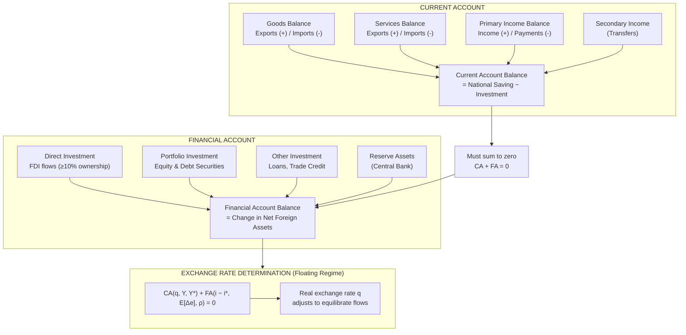

# Lesson 4: Exchange Rates, Balance of Payments Accounting

## 1. First-Principles Intuition & Invariants

The balance of payments is the national accounts system for tracking every cross-border transaction between residents of an economy and the rest of the world. It is a double-entry accounting ledger where every debit must have a corresponding credit, creating an iron-clad identity: the sum of all accounts must equal zero. This seemingly simple constraint encodes profound dynamics about how exchange rates adjust, how capital flows transmit monetary policy shocks, and how current account imbalances accumulate into external asset and liability positions that shape an economy's vulnerability to sudden stops and currency crises.

Understanding the balance of payments begins with recognizing that international transactions create demand and supply for currencies. When a domestic firm exports goods, it receives foreign currency that must eventually be converted into domestic currency, creating demand for the home currency and supply of foreign currency. When a domestic investor purchases foreign bonds, she must sell domestic currency to acquire foreign currency, creating supply of the home currency and demand for foreign currency. The exchange rate is the price that clears this market, equilibrating the flow demand and supply arising from all cross-border transactions.

The balance of payments divides these transactions into three fundamental accounts. The **current account** records trade in goods and services, primary income flows from cross-border ownership of capital, and secondary income transfers. The **capital account** records non-produced, non-financial asset transfers and is quantitatively negligible in most advanced economies. The **financial account** records changes in ownership of financial assets and liabilities, including foreign direct investment, portfolio equity and debt flows, financial derivatives, and reserve asset changes by the central bank. The fundamental identity states:

$$\text{Current Account} + \text{Capital Account} + \text{Financial Account} = 0$$

This identity is not an economic theory subject to empirical validation; it is an accounting tautology enforced by the construction of the data. Every transaction appears twice with opposite signs. If a domestic firm exports machinery worth $1 million and receives payment in foreign currency deposited in a foreign bank account, the credit to the current account (goods export) is exactly offset by a debit to the financial account (increase in foreign assets). If a foreign investor purchases domestic government bonds, the credit to the financial account (increase in domestic liabilities) is offset by a debit elsewhere, typically the current account when the foreign currency is converted and used to purchase domestic goods or services.

The current account balance represents the gap between national saving and national investment, a relationship derived from the national income identity. Start with GDP identity:

$$Y = C + I + G + (X - M)$$

where $Y$ is GDP, $C$ is private consumption, $I$ is investment, $G$ is government consumption, $X$ is exports, and $M$ is imports. National income equals GDP plus net primary income from abroad ($\text{NFI}$), giving disposable income $Y + \text{NFI}$. National saving is $S = Y + \text{NFI} - C - G$. Rearranging the GDP identity and substituting:

$$CA = (X - M) + \text{NFI} + \text{Net Transfers} = S - I$$

The current account is the excess of national saving over domestic investment. A current account surplus means the nation is a net lender to the rest of the world, accumulating claims on foreign assets. A current account deficit means the nation is a net borrower, increasing liabilities to foreigners. This saving-investment perspective clarifies that persistent current account deficits are sustainable only if foreigners are willing to accumulate claims on the deficit nation, either through purchasing assets or extending credit.

Exchange rate determination mechanisms depend critically on the exchange rate regime. Under a **floating exchange rate**, the central bank does not intervene systematically, and the exchange rate adjusts to equilibrate private supply and demand for foreign currency. The current account and private financial flows must sum to zero (ignoring the negligible capital account), meaning:

$$CA + FA_{\text{private}} = 0$$

If the current account runs a deficit, the private financial account must record a net inflow of capital (increase in liabilities or sale of assets) of equal magnitude. The exchange rate adjusts to induce this equilibration. Under a **fixed exchange rate**, the central bank commits to buying or selling foreign reserves to maintain a target exchange rate. The balance of payments identity becomes:

$$CA + FA_{\text{private}} + \Delta R = 0$$

where $\Delta R$ is the change in official reserve assets. If private supply and demand do not equilibrate at the target exchange rate, the central bank absorbs the imbalance by running down or accumulating reserves. Under a **managed float**, the central bank intervenes sporadically to smooth volatility or lean against appreciation or depreciation trends, creating reserve changes that partially offset private imbalances.

The **Marshall-Lerner condition** establishes the requirement for a currency depreciation to improve the trade balance. When the domestic currency depreciates, exports become cheaper in foreign currency terms, and imports become more expensive in domestic currency terms. The trade balance in domestic currency units is:

$$TB = P_X X - eP_M^* M$$

where $P_X$ is the domestic currency price of exports, $X$ is export volume, $e$ is the nominal exchange rate (domestic currency per unit of foreign currency), $P_M^*$ is the foreign currency price of imports, and $M$ is import volume. Differentiating with respect to $e$ and manipulating:

$$\frac{d(TB)}{de} \propto (\varepsilon_X + \varepsilon_M - 1)$$

where $\varepsilon_X$ is the price elasticity of export demand (foreign elasticity) and $\varepsilon_M$ is the price elasticity of import demand (domestic elasticity), both expressed as positive numbers. The Marshall-Lerner condition states that a depreciation improves the trade balance if:

$$\varepsilon_X + \varepsilon_M > 1$$

If the sum of elasticities is less than one, demand is inelastic, and the depreciation worsens the trade balance because the quantity adjustments are insufficient to offset the adverse valuation effects. Empirical evidence suggests that short-run elasticities are often low due to contracts, habits, and the time required to search for alternative suppliers, while long-run elasticities are higher as agents substitute and renegotiate.

The **J-curve** describes the typical time path of the trade balance following a depreciation. In the immediate aftermath, export and import volumes are fixed by existing contracts, but the valuation effect dominates: imports become more expensive in domestic currency, worsening the trade balance. Over several quarters, quantities begin to adjust as contracts expire, firms find new suppliers, and consumers substitute away from expensive imports. If the Marshall-Lerner condition holds in the long run, the trade balance eventually improves beyond its initial level, tracing a path that resembles the letter J. The depth and duration of the initial deterioration depend on the degree of exchange rate pass-through, the currency denomination of trade contracts, and the speed of quantity adjustment.

Exchange rate regimes carry fundamental trade-offs encoded in the **trilemma** or impossible trinity. A country cannot simultaneously maintain an independent monetary policy, a fixed exchange rate, and free capital mobility. With capital mobility, arbitrage enforces uncovered interest parity:

$$E_t[e_{t+1}] = e_t \left(1 + \frac{i_t - i_t^*}{1 + i_t^*}\right) \approx e_t (1 + i_t - i_t^*)$$

where $e_t$ is the spot exchange rate, $E_t[e_{t+1}]$ is the expected future spot rate, $i_t$ is the domestic interest rate, and $i_t^*$ is the foreign interest rate. If the exchange rate is fixed, expected depreciation is zero, forcing $i_t = i_t^*$. The domestic central bank loses monetary autonomy; raising rates would attract capital inflows that the bank must sterilize by selling reserves, ultimately exhausting reserves or forcing devaluation. Conversely, abandoning the peg or imposing capital controls restores monetary independence. Emerging markets often choose intermediate regimes, sacrificing some autonomy to limit exchange rate volatility, but remain vulnerable to speculative attacks when reserves run low and markets doubt the commitment to the peg.

The balance of payments framework also illuminates how global imbalances arise and persist. Persistent current account surpluses in China, Germany, and Japan are mirrored by persistent deficits in the United States and other debtor nations. These imbalances reflect structural differences in saving rates, demographics, financial development, and policy regimes. High saving rates in surplus nations, driven by precautionary motives, aging populations, or export-led growth strategies, generate excess supply of loanable funds that flows to deficit nations with deeper financial markets, higher return opportunities, or lower saving rates. The United States plays a special role as issuer of the dominant reserve currency, facing structurally lower borrowing costs and persistent demand for safe dollar assets that sustains chronic deficits. However, accumulating external liabilities indefinitely is unsustainable; eventually, markets may demand higher risk premia, forcing abrupt adjustments through sharp depreciation or compression of domestic absorption.

## 2. Core Architecture & Mechanics

The balance of payments architecture rests on a hierarchical taxonomy of transactions, each recorded with debits and credits according to strict conventions. A **credit** entry records a transaction that creates a supply of foreign currency (or demand for domestic currency): exports of goods and services, inward income flows, inward transfers, sales of domestic assets to foreigners, and reductions in foreign assets held by residents. A **debit** entry records a transaction that creates demand for foreign currency (or supply of domestic currency): imports, outward income payments, outward transfers, purchases of foreign assets by residents, and reductions in liabilities to foreigners.

The **current account** decomposes into four sub-accounts. The **goods balance** or merchandise trade balance records exports and imports of physical goods: machinery, agricultural products, consumer goods, and raw materials. The **services balance** records cross-border provision of services: transportation, tourism, insurance, financial services, and intellectual property royalties. The **primary income balance** records factor payments arising from cross-border ownership: interest on bonds, dividends on equity, and compensation of employees working abroad. The **secondary income balance** records unilateral transfers with no quid pro quo: remittances from migrant workers, foreign aid grants, and international organization assessments.

The **financial account** records changes in ownership of financial assets and liabilities, organized by functional category reflecting the nature of the relationship. **Direct investment** records equity stakes where the investor exerts significant influence or control, conventionally defined as ownership of 10% or more of voting shares. Inward FDI represents foreign acquisition of domestic assets and is a credit (capital inflow), while outward FDI represents domestic acquisition of foreign assets and is a debit (capital outflow). **Portfolio investment** records equity and debt securities below the 10% threshold, including government bonds, corporate bonds, and minority equity stakes. **Other investment** captures loans, deposits, trade credit, and other financial claims not classified elsewhere. **Reserve assets** record changes in official holdings of foreign exchange reserves, gold, IMF Special Drawing Rights, and reserve position in the IMF, controlled exclusively by the central bank.

The double-entry mechanics ensure internal consistency. Consider a domestic manufacturing firm exporting machinery worth $5 million, receiving payment via wire transfer to its foreign currency account at a domestic bank. The export generates a credit of $5 million in the goods balance under the current account. Simultaneously, the firm's acquisition of a $5 million foreign currency deposit represents an increase in foreign assets, recorded as a debit of $5 million in the financial account under other investment. The net effect on the balance of payments is zero. If the firm subsequently converts the foreign currency to domestic currency, the bank acquires the foreign exchange, which may flow to the central bank as reserve accumulation or remain in private holdings, but the financial account continues to reflect the offsetting transaction.

Exchange rate determination under floating regimes involves simultaneous clearing of the current account and financial account. Define net exports as a function of the real exchange rate $q = eP^*/P$, where $e$ is the nominal exchange rate, $P^*$ is the foreign price level, and $P$ is the domestic price level. A real depreciation (increase in $q$) makes domestic goods cheaper relative to foreign goods, improving the trade balance with a lag governed by the Marshall-Lerner condition. Formally:

$$CA(q, Y, Y^*) = NX(q) + NI(NFA)$$

where $Y$ is domestic income, $Y^*$ is foreign income, $NX$ is net exports depending on the real exchange rate, and $NI$ is net income from net foreign assets $NFA$. Higher domestic income raises imports, worsening the trade balance, while higher foreign income raises exports, improving the balance.

The financial account depends on expected returns and risk, encapsulated in the portfolio balance approach. Investors allocate wealth between domestic and foreign assets based on interest rate differentials and expected exchange rate changes. Uncovered interest parity provides the arbitrage condition:

$$i_t - i_t^* = E_t\left[\frac{e_{t+1} - e_t}{e_t}\right] + \rho_t$$

where $\rho_t$ is a risk premium compensating for exchange rate volatility and country-specific risks. Capital flows into the domestic economy (financial account credit) when domestic assets offer higher expected returns adjusted for risk. Combining the current account and financial account equilibrium:

$$CA(q, Y, Y^*) + FA(i_t - i_t^*, E_t[\Delta e], \rho_t) = 0$$

The exchange rate adjusts to satisfy this condition. An exogenous increase in domestic interest rates attracts capital inflows (FA increases), which must be offset by a deterioration in the current account. This occurs through real appreciation, which reduces net exports. Conversely, an exogenous improvement in the trade balance (say, foreign income boom) creates excess supply of foreign currency, driving nominal and real appreciation until the current account improvement is offset by deterioration in the financial account.

Under fixed exchange rates, the central bank intervenes to maintain $e = \bar{e}$. The balance of payments identity becomes:

$$CA(q, Y, Y^*) + FA_{\text{private}}(i_t - i_t^*, 0, \rho_t) + \Delta R = 0$$

Expected depreciation is zero under a credible peg, simplifying uncovered interest parity to $i_t = i_t^* + \rho_t$. If private flows do not equilibrate the current account, the central bank absorbs the imbalance through reserve changes. A current account deficit with insufficient private capital inflows forces the central bank to sell reserves, financing the deficit. Persistent deficits deplete reserves, eventually forcing devaluation or abandonment of the peg. Conversely, a current account surplus with insufficient private outflows forces reserve accumulation, expanding the monetary base unless sterilized through offsetting domestic asset sales.

The **J-curve dynamics** formalize the time-varying response of the trade balance to exchange rate shocks. Decompose the trade balance into volume and price components:

$$TB_t = P_{X,t} X_t - e_t P_{M,t}^* M_t$$

Immediately after a depreciation at time $t=0$, volumes $X_t$ and $M_t$ are fixed by existing contracts, but $e_t$ jumps. The trade balance deteriorates:

$$\Delta TB_0 = -\Delta e_0 \cdot P_M^* M_0 < 0$$

Over subsequent periods, export demand and import demand adjust. Export volume rises as foreign buyers respond to lower foreign currency prices:

$$\Delta X_t = \varepsilon_X \frac{X_0}{P_X^*} \cdot (-\Delta P_X^*) = \varepsilon_X \frac{X_0}{e_0 P_X^*} \cdot \Delta e$$

Import volume falls as domestic buyers substitute away from expensive imports:

$$\Delta M_t = -\varepsilon_M \frac{M_0}{e_0 P_M^*} \cdot \Delta e$$

The total effect on the trade balance evolves:

$$\Delta TB_t = P_X \varepsilon_X \frac{X_0}{e_0 P_X^*} \Delta e + e P_M^* \varepsilon_M \frac{M_0}{e_0 P_M^*} \Delta e - P_M^* M_0 \Delta e$$

Rearranging:

$$\Delta TB_t \propto \left(\varepsilon_X \frac{P_X X_0}{e_0 P_X^*} + \varepsilon_M \frac{M_0}{e_0} - M_0\right) \Delta e$$

Initially, the elasticities are near zero, and the valuation effect dominates. As $t$ increases, elasticities rise toward long-run values, and if $\varepsilon_X + \varepsilon_M > 1$, the trade balance eventually improves beyond its initial level. Empirical estimates suggest the J-curve trough occurs two to four quarters after the depreciation, with full adjustment taking two to three years.

The **Marshall-Lerner condition** emerges from the requirement that the volume effects outweigh the valuation effects. Starting from initial balanced trade ($P_X X_0 = e_0 P_M^* M_0$), differentiate the trade balance with respect to $e$ and evaluate at the initial equilibrium:

$$\frac{d(TB)}{de} = P_X \frac{\partial X}{\partial e} - P_M^* M_0 - e P_M^* \frac{\partial M}{\partial e}$$

Express derivatives in terms of elasticities:

$$\frac{\partial X}{\partial e} = -\varepsilon_X \frac{X_0}{e_0}, \quad \frac{\partial M}{\partial e} = \varepsilon_M \frac{M_0}{e_0^2 P_M^*}$$

Substitute and simplify using $P_X X_0 = e_0 P_M^* M_0$:

$$\frac{d(TB)}{de} = -P_X \varepsilon_X \frac{X_0}{e_0} - P_M^* M_0 + e_0 P_M^* \varepsilon_M \frac{M_0}{e_0}$$

$$= P_M^* M_0 \left(\varepsilon_X + \varepsilon_M - 1\right)$$

The sign of this derivative determines whether depreciation improves or worsens the trade balance. The critical threshold is $\varepsilon_X + \varepsilon_M = 1$. For $\varepsilon_X + \varepsilon_M > 1$, depreciation improves the balance. For $\varepsilon_X + \varepsilon_M < 1$, depreciation worsens it. Empirical elasticities vary widely across countries and time horizons. Short-run elasticities for advanced economies often sum to 0.5–0.8, while long-run elasticities exceed 1.5–2.0, satisfying the Marshall-Lerner condition.

## 3. High-Performance Optimization & Failure Modes

Practical balance of payments analysis requires assembling high-frequency data from multiple sources and reconciling discrepancies that arise from timing differences, valuation effects, and statistical errors. National statistical agencies publish quarterly balance of payments accounts with a lag of one to three months, but financial market participants require more timely indicators. High-frequency proxies include customs trade data (often available monthly with two-week lags), international reserve changes (published weekly or monthly by central banks), and portfolio flow data from securities custodians and depositories. The IMF International Financial Statistics and Balance of Payments databases provide standardized cross-country data, but researchers must carefully check methodological notes to ensure consistency across reporting regimes, particularly for countries that switched from BPM5 to BPM6 accounting standards after 2008.

Constructing a real-time current account monitor involves downloading monthly goods trade data from customs authorities, estimating services trade using quarterly ratios to goods trade, and projecting primary income using lagged net foreign asset positions and average yield spreads. Trade data arrive in national currency units and must be converted to a common currency using average monthly exchange rates. Seasonal adjustment is essential because trade exhibits strong seasonal patterns driven by holiday shopping, agricultural cycles, and fiscal year-end corporate behavior. The X-13ARIMA-SEATS procedure provided by the U.S. Census Bureau is the standard method, automatically identifying seasonal regressors, outliers, and calendar effects. For economies with structural breaks from trade liberalization or integration into global value chains, segmented seasonal adjustment before and after the break prevents distortion of trend estimates.

Valuation effects complicate the interpretation of financial account changes and net foreign asset positions. When exchange rates fluctuate, the domestic currency value of foreign assets and liabilities changes even without new transactions. A depreciation of the domestic currency mechanically increases the domestic currency value of foreign assets (which are denominated in foreign currency) and increases the domestic currency value of foreign liabilities if those liabilities are denominated in foreign currency. The change in net foreign assets decomposes into:

$$\Delta NFA_t = CA_t + VA_t + OA_t$$

where $CA_t$ is the current account, $VA_t$ is the valuation adjustment from exchange rate and asset price changes, and $OA_t$ captures other adjustments such as debt forgiveness or statistical discrepancies. For countries with large gross foreign asset and liability positions, valuation effects can exceed the current account. The United States, with gross foreign assets and liabilities each exceeding 150% of GDP, experiences multi-hundred-billion-dollar valuation swings from exchange rate movements, dwarfing quarterly current account deficits of $150–200 billion.

Testing the Marshall-Lerner condition empirically requires estimating export and import demand elasticities using time-series or panel regression techniques. The standard specification regresses log trade volumes on log real exchange rates, log foreign income (for exports), and log domestic income (for imports), controlling for secular trends and global shocks:

$$\ln X_t = \alpha_X + \varepsilon_X \ln q_t + \beta_X \ln Y_t^* + \gamma_X t + \delta_X Z_t + u_{X,t}$$

$$\ln M_t = \alpha_M - \varepsilon_M \ln q_t + \beta_M \ln Y_t + \gamma_M t + \delta_M Z_t + u_{M,t}$$

where $Z_t$ includes global demand shocks, commodity price indices, and trade policy variables. Identification requires plausibly exogenous variation in the real exchange rate, which is difficult because exchange rates respond endogenously to trade balances, monetary policy shocks, and risk sentiment. Instrumental variable approaches exploit monetary policy shocks identified from high-frequency changes in interest rate futures around central bank announcements, natural disasters that disrupt supply chains, or political events that generate risk-off currency flows. Distributed lag specifications allow elasticities to vary over time, revealing the J-curve pattern. Cointegration techniques correct for nonstationarity in exchange rates and trade volumes, ensuring long-run elasticity estimates are unbiased.

Empirical evidence consistently shows that short-run elasticities are substantially lower than long-run elasticities. A survey of studies finds median short-run export price elasticities of 0.3–0.5 and import price elasticities of 0.2–0.4, summing to 0.5–0.9, below the Marshall-Lerner threshold. Median long-run elasticities are 0.8–1.2 for exports and 0.6–1.0 for imports, summing to 1.4–2.2, well above the threshold. The time profile of adjustment is typically characterized by half-lives of four to eight quarters, meaning that half of the long-run adjustment occurs within one to two years. These estimates vary across countries, with smaller, more open economies exhibiting higher elasticities due to greater substitutability and less pricing power, while large economies with differentiated export sectors face less elastic demand.

J-curve dynamics create policy challenges for countries attempting to correct current account deficits through depreciation. The initial deterioration in the trade balance can last several quarters, during which the current account deficit widens, requiring larger capital inflows to finance the gap. If foreign investors interpret the widening deficit as evidence of deepening imbalances rather than temporary adjustment, risk premia rise, capital inflows dry up, and the currency depreciates further in a destabilizing spiral. Successful adjustment requires credible communication that the depreciation is correcting misalignment rather than signaling fundamental weakness. Countries with strong institutions, transparent policy frameworks, and diversified export sectors navigate the J-curve more smoothly because markets trust that volume adjustment will eventually dominate.

Exchange rate pass-through, the extent to which exchange rate changes translate into import and export prices, is a critical determinant of Marshall-Lerner elasticities and J-curve depth. Complete pass-through means a 10% depreciation reduces foreign currency export prices by 10% and raises domestic currency import prices by 10%, maximizing quantity responses. Incomplete pass-through occurs when exporters engage in pricing-to-market, absorbing part of the exchange rate change in profit margins to stabilize foreign currency prices. Empirical estimates for advanced economies show first-year pass-through to import prices of 50–70%, rising to 70–90% over three years. Pass-through is higher for commodity imports with homogeneous products and competitive markets, and lower for differentiated manufactured goods with market power and long-term customer relationships. Pass-through has declined over the past two decades as global value chains have increased the share of imported inputs in exports, reducing the sensitivity of export prices to bilateral exchange rate changes.

Capital flow management in emerging markets involves navigating the trilemma by accepting some exchange rate volatility while maintaining partial monetary autonomy and selective capital controls. During periods of abundant global liquidity, large capital inflows appreciate the currency, worsening the trade balance but improving the net income balance as foreign liabilities are serviced at lower domestic currency cost. Central banks accumulate reserves to lean against appreciation, but unsterilized intervention expands the monetary base, creating inflation pressure. Sterilization through domestic bond sales raises domestic interest rates, attracting further inflows and requiring additional intervention. Countries with shallow domestic bond markets face sterilization limits, forcing them to choose between inflation and appreciation. Macroprudential capital flow measures, such as unremunerated reserve requirements on foreign borrowing or taxes on portfolio inflows, can moderate inflows without requiring reserve accumulation, but effectiveness depends on enforcement capacity and the sophistication of evasion strategies.

Sudden stops, episodes where capital inflows abruptly reverse, force sharp current account adjustments compressed into quarters rather than years. Historical sudden stops in Mexico 1994, East Asia 1997, Russia 1998, Argentina 2001, and Turkey 2018 triggered currency crashes of 30–70%, collapses in domestic demand as credit evaporated, and recessions with GDP contractions of 5–15%. The balance of payments identity forces the current account to improve by the magnitude of the financial account reversal. With inelastic short-run trade elasticities, the adjustment occurs through compression of imports via collapsing income and expenditure-switching through massive depreciation. Countries with large external debt denominated in foreign currency face amplified distress because depreciation increases the domestic currency burden of servicing debt, triggering defaults and further capital flight. Reserve buffers delay adjustment and signal creditworthiness, allowing smoother adjustment, but reserves are finite and deplete rapidly during speculative attacks if markets doubt the central bank's commitment or capacity to defend the currency.

Forecasting exchange rates remains notoriously difficult, with random walk benchmarks often outperforming structural models at short horizons. However, balance of payments fundamentals provide predictive power at longer horizons. The portfolio balance approach implies that persistent current account surpluses predict currency appreciation as the country accumulates net foreign assets, eventually requiring appreciation to equilibrate the accumulation. The purchasing power parity (PPP) relationship provides a long-run anchor:

$$q_t = \frac{e_t P_t^*}{P_t} \rightarrow \bar{q}$$

Deviations from PPP revert with half-lives of three to five years. Combining PPP with current account dynamics yields equilibrium exchange rate models where the real exchange rate adjusts to deliver a current account consistent with sustainable net foreign asset positions. The IMF External Balance Assessment (EBA) methodology estimates equilibrium current accounts based on structural fundamentals such as demographics, fiscal balances, and oil balances, and calculates the real exchange rate adjustment needed to close gaps between actual and equilibrium current accounts. These assessments inform multilateral surveillance and policy advice, identifying currencies that are overvalued or undervalued by 10–30% relative to medium-term fundamentals.

Practical implementation of balance of payments analysis for investment strategy involves constructing a systematic monitoring framework that tracks deviations from equilibrium conditions and identifies vulnerabilities. Key indicators include the current account-to-GDP ratio, external debt-to-GDP ratio, short-term external debt relative to reserves, and the net international investment position. Thresholds vary by country characteristics, but current account deficits exceeding 5% of GDP for more than three years, external debt exceeding 60% of GDP, and short-term debt exceeding 100% of reserves are historical red flags associated with elevated crisis risk. Real exchange rate overvaluation exceeding 20% relative to PPP or equilibrium estimates increases the probability of sharp adjustment. Combining these indicators with measures of political stability, institutional quality, and global risk sentiment yields a crisis probability model that has demonstrated out-of-sample predictive power in identifying emerging market stress episodes three to twelve months in advance.

The balance of payments framework also informs understanding of reserve currency dynamics and global imbalances. The United States runs persistent current account deficits, issuing Treasury securities that foreign central banks and private investors willingly accumulate as safe assets. This exorbitant privilege allows the United States to finance deficits at low cost, but generates the Triffin dilemma: satisfying global demand for safe dollar assets requires running deficits, but persistent deficits eventually undermine confidence in the dollar's stability. The post-2008 expansion of central bank balance sheets through quantitative easing, combined with persistent European and Japanese current account surpluses, has compressed global safe asset yields to historic lows, incentivizing reaching for yield and leverage that creates financial stability risks. The rise of China as a major creditor nation with capital controls creates fragmentation in global capital markets, limiting portfolio diversification and reducing the efficiency of global capital allocation. Future balance of payments dynamics will be shaped by whether China liberalizes its capital account, whether the euro emerges as a credible alternative reserve currency, and whether digital currencies alter the demand for traditional reserve assets and the effectiveness of capital controls.
