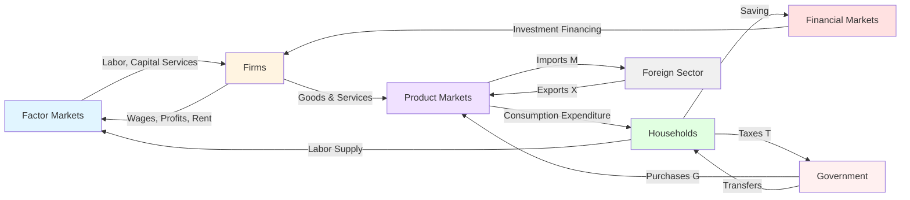

# Lesson 1: Foundations of Macroeconomics Through National Income Accounting

## 1. First-Principles Intuition & Invariants

National income accounting constitutes the empirical foundation upon which all macroeconomic analysis rests. Before we can analyze business cycles, evaluate monetary policy transmission mechanisms, or forecast aggregate demand trajectories, we must first establish a rigorous measurement framework that captures the total productive capacity of an economy and tracks the circular flow of income and expenditure through its constituent sectors. The intellectual architecture of national accounts emerged from the pioneering work of Simon Kuznets in the 1930s and Richard Stone in the 1940s, both seeking to quantify aggregate economic activity during periods of profound crisis—the Great Depression and World War II respectively. Their foundational insight was that an economy's total output must, by accounting identity, equal total income earned and total expenditure undertaken across all economic agents.

The conceptual bedrock of macroeconomic measurement lies in recognizing that every transaction involves two parties: one agent's expenditure becomes another's income. When a household purchases bread from a bakery, the household reduces its cash holdings (expenditure) while the bakery records revenue (income). The baker uses this revenue to pay wages to employees (who earn income), purchase flour from a mill (the mill's income), and retain profit (the baker's income). This circular flow continues indefinitely, with no value vanishing into the void. The national accounts framework exploits this duality to construct three mathematically equivalent approaches to measuring aggregate economic activity: the production approach, which sums value added across all sectors; the income approach, which aggregates all factor payments; and the expenditure approach, which totals final demand across consumption, investment, government purchases, and net exports.

The central object of measurement in national accounting is Gross Domestic Product, denoted $Y$ in standard macroeconomic notation. GDP represents the market value of all final goods and services produced within a nation's geographic boundaries during a specified time period, typically measured quarterly or annually. The critical qualifier "final" excludes intermediate goods to avoid double-counting—we count the automobile but not the steel used in its frame, since the steel's value is already embedded in the vehicle's final price. This leads to the concept of value added, the cornerstone of the production approach. If a lumber mill purchases $\$100$ worth of raw timber and sells $\$250$ worth of processed lumber, its value added equals $\$150$, representing the transformation services the mill provides. Summing value added across all production stages and all industries yields GDP without any double-counting distortions.

The fundamental accounting identity that governs all macroeconomic analysis is the equivalence between aggregate output, aggregate income, and aggregate expenditure:

$$Y \equiv C + I + G + NX$$

where $Y$ denotes GDP (output), $C$ represents household consumption expenditure, $I$ captures gross private domestic investment, $G$ measures government purchases of goods and services, and $NX = X - M$ represents net exports (exports $X$ minus imports $M$). This identity holds not as a behavioral relationship subject to empirical validation but as a definitional truth enforced by the double-entry bookkeeping structure of national accounts. Every dollar of output produced must either be purchased by households, firms, government, or foreign buyers, or it accumulates as unsold inventory, which the accounts classify as unintended inventory investment within $I$.

The equivalence between output and income follows from the factor payment decomposition. Every firm's revenue from selling output gets distributed to the factors of production that contributed to its creation. Labor receives wages and salaries, denoted $W$. Capital owners earn rental income and interest payments, collectively labeled $R$. Entrepreneurs and shareholders claim profits $\Pi$. Summing across all firms and sectors, we obtain:

$$Y \equiv W + R + \Pi$$

This income-side identity reveals that GDP measures not merely production volume but also the purchasing power generated and distributed throughout the economy. When GDP rises by $\$100$ billion, that increase manifests as $\$100$ billion in additional income earned by households and firms, which in turn finances higher consumption and investment expenditure.

The circular flow diagram provides the essential mental model for understanding these identities. In its simplest two-sector form, households supply labor and capital services to firms through factor markets, earning income $Y$. Firms use these inputs to produce goods and services, which households purchase through product markets using their income. In this closed economy with no government sector, households face a binary allocation decision: consume now or save for future consumption. Denoting saving as $S$, we have the household budget constraint:

$$Y \equiv C + S$$

Firms, meanwhile, purchase investment goods—machinery, structures, intellectual property—to expand productive capacity or replace depreciated capital. In equilibrium, planned investment $I$ must equal household saving $S$, since saving represents income not consumed and therefore available to finance capital formation:

$$S \equiv I$$

This saving-investment identity constitutes the foundational equilibrium condition in macroeconomics. When households save more, holding output constant, consumption falls and unsold goods accumulate as unintended inventory investment. Firms respond by cutting production in subsequent periods, driving output and income downward until saving and planned investment again align. Conversely, if investment demand exceeds saving, firms attempt to purchase more capital goods than households are willing to forgo through reduced consumption, generating inflationary pressure that restores equilibrium.

Introducing government and international trade sectors enriches the accounting framework while preserving its internal consistency. Government collects tax revenue $T$ and undertakes expenditure $G$, running a budget deficit when $G > T$ or surplus when $T > G$. The government budget identity becomes:

$$G - T \equiv (T - G)$$

where the right side represents the negative of the budget balance. Household disposable income, the resources available for consumption and saving after taxes, is $Y_d = Y - T$. The household budget constraint generalizes to:

$$Y - T \equiv C + S$$

Combining the expanded household constraint with the output-expenditure identity $Y \equiv C + I + G + NX$ and rearranging yields the fundamental national income accounting identity linking private saving, government deficits, and international capital flows:

$$(S - I) \equiv (G - T) + NX$$

This identity reveals that private saving in excess of domestic investment must finance either government budget deficits or net foreign asset accumulation through trade surpluses. A nation running a current account surplus ($NX > 0$) is necessarily a net lender to the rest of the world, accumulating foreign assets as its domestic saving exceeds the sum of domestic investment and government deficits. Conversely, a country with persistent trade deficits ($NX < 0$) must be absorbing foreign saving to finance domestic investment and government spending beyond its own saving capacity.

The distinction between nominal and real GDP proves essential for measuring genuine changes in productive capacity versus mere price fluctuations. Nominal GDP values output at current market prices, mixing quantity and price changes:

$$Y_{\text{nominal},t} = \sum_{i=1}^{n} P_{i,t} Q_{i,t}$$

where $P_{i,t}$ represents the price of good $i$ in period $t$ and $Q_{i,t}$ denotes the quantity produced. Real GDP isolates quantity changes by valuing output at constant base-year prices $P_{i,0}$:

$$Y_{\text{real},t} = \sum_{i=1}^{n} P_{i,0} Q_{i,t}$$

The GDP deflator, the most comprehensive measure of economy-wide inflation, is defined as the ratio of nominal to real GDP:

$$P_t = \frac{Y_{\text{nominal},t}}{Y_{\text{real},t}} \times 100$$

This deflator captures price changes across all components of GDP—consumption, investment, government purchases, and net exports—making it broader than the Consumer Price Index, which tracks only household consumption goods. The percentage change in the GDP deflator between periods measures the inflation rate:

$$\pi_t = \frac{P_t - P_{t-1}}{P_{t-1}} \times 100\%$$

National accountants face the index number problem when constructing real GDP series: different choices of base year weights yield different growth rates when relative prices shift substantially. The Laspeyres index uses base-year quantities as weights, tending to overstate inflation and understate real growth because it fails to account for substitution toward goods experiencing relative price declines. The Paasche index uses current-year weights, introducing the opposite bias. Modern statistical agencies employ chain-weighted indices, which update weights annually and compute growth rates as geometric averages of adjacent-period comparisons, minimizing substitution bias while maintaining time consistency.

The accounting treatment of investment deserves careful attention because capital goods contribute to production across multiple periods. Gross investment, the $I$ term in the expenditure identity, includes both net additions to the capital stock and replacement of depreciated capital. Denoting the capital stock at the beginning of period $t$ as $K_t$, depreciation during the period as $\delta K_t$ where $\delta$ represents the depreciation rate, and gross investment as $I_t$, the capital accumulation equation becomes:

$$K_{t+1} = K_t + I_t - \delta K_t = (1-\delta)K_t + I_t$$

Net investment, the genuine expansion of productive capacity, equals $I_t - \delta K_t$. Net Domestic Product (NDP) measures output net of depreciation:

$$\text{NDP} = Y - \delta K = C + I_{\text{net}} + G + NX$$

NDP provides a better indicator of sustainable consumption possibilities because it accounts for the capital consumption required to maintain the existing stock, but statistical agencies emphasize GDP in practice because depreciation rates involve significant estimation uncertainty.

The distinction between domestic and national product clarifies the geographic versus ownership basis for measurement. GDP captures production occurring within national borders regardless of factor ownership, while Gross National Product (GNP) attributes output to factors owned by national residents regardless of location. If domestic firms earn $\$50$ billion in profits from foreign operations while foreign firms earn $\$30$ billion from domestic production, then:

$$\text{GNP} = \text{GDP} + 50 - 30 = \text{GDP} + 20$$

Net factor income from abroad (NFIA) equals the difference between factor payments received from abroad and factor payments sent abroad. The identity linking the two measures is:

$$\text{GNP} \equiv \text{GDP} + \text{NFIA}$$

For most advanced economies with balanced international investment positions, NFIA remains small relative to GDP, making the distinction quantitatively minor. For nations heavily engaged in cross-border investment or with large expatriate populations remitting income, the gap can be substantial.

National income accounts also track wealth stocks in addition to income flows. The national balance sheet records the economy's total assets—physical capital, land, financial claims—minus total liabilities at a point in time. Net worth equals assets minus liabilities. The flow of saving during a period translates into changes in wealth stocks through the wealth accumulation identity:

$$W_{t+1} = W_t + S_t + \text{Capital Gains}_t$$

where capital gains represent asset revaluations not captured in measured income. This linkage between flow accounts (GDP, income, saving) and stock accounts (wealth, capital) enables intertemporal analysis of consumption and investment decisions, connecting current saving rates to future consumption possibilities through capital accumulation.

The theoretical power of national income accounting lies in its invariant identities, which hold regardless of economic conditions, policy regimes, or behavioral parameters. When policymakers debate fiscal stimulus, the identity $(S - I) \equiv (G - T) + NX$ imposes a fundamental constraint: expanding the government deficit $(G - T)$ without changing private saving behavior must either crowd out private investment (reducing $I$) or widen the trade deficit (reducing $NX$). The identity does not predict which channel dominates—that depends on interest rate responses, capital mobility, and exchange rate dynamics—but it guarantees that one or both channels must adjust. Similarly, the saving-investment identity ensures that any autonomous increase in investment demand must manifest as either higher income (which generates additional saving through the marginal propensity to save) or dissaving elsewhere in the economy.

These accounting frameworks provide the empirical foundation for constructing quarterly GDP estimates, the most closely watched macroeconomic indicator. Statistical agencies combine surveys of business revenues, household expenditures, tax records, trade flows, and employment data to produce initial estimates released 30 days after quarter-end, followed by two subsequent revisions as additional source data arrive. The accounts undergo comprehensive benchmark revisions every five years, incorporating detailed economic census results and methodological improvements. Despite inevitable measurement error, particularly in the service sector and intangible investment, national accounts provide sufficiently accurate readings to guide monetary policy, track business cycles, and evaluate long-run growth trends.

## 2. Core Architecture & Mechanics

The operational architecture of national income accounting rests on three mutually consistent measurement approaches, each targeting the same aggregate output from different vantage points. Understanding how statistical agencies implement these approaches in practice reveals both the power and limitations of macroeconomic data.

The production approach constructs GDP by summing value added across all industries and sectors. Value added for firm $j$ equals gross output minus intermediate inputs:

$$\text{VA}_j = \text{Revenue}_j - \text{Intermediate Purchases}_j$$

Aggregating across all firms within industry $i$ and then across all industries yields:

$$Y = \sum_{i=1}^{n} \text{VA}_i$$

This approach requires detailed industry-level surveys tracking both gross output (total sales plus inventory changes) and intermediate input purchases. The Bureau of Economic Analysis in the United States organizes this data using the North American Industry Classification System (NAICS), disaggregating the economy into 20 major sectors further subdivided into 350+ detailed industries. Each quarter, the BEA surveys businesses to collect data on shipments, inventories, payroll, and purchased inputs, then aggregates upward through the industrial hierarchy.

The value-added structure naturally avoids double-counting while preserving production detail. Consider a simplified three-stage production chain: a farmer grows wheat (gross output $\$100$, intermediate inputs $\$0$, value added $\$100$), a miller grinds wheat into flour (gross output $\$200$, intermediate inputs $\$100$, value added $\$100$), and a baker produces bread (gross output $\$350$, intermediate inputs $\$200$, value added $\$150$). Summing gross outputs yields $\$650$, severely overstating true production, while summing value added correctly yields $\$350$, matching the final bread output. The value-added approach attributes production to each stage's transformation services while eliminating the intermediate wheat and flour values from the total.

Services pose particular measurement challenges in the production approach because they often lack observable market transactions or physical units. How does one measure the value added of a financial advisor, a teacher, or a government bureaucrat? For market services, accountants use revenues as proxies for output, implicitly assuming market prices reflect marginal productivity. For non-market government services lacking market prices, national accounts measure output by input cost, summing government wages and purchases. This convention implies zero productivity growth in government services by construction, a methodological artifact that understates true GDP growth when government efficiency improves.

The income approach constructs GDP by summing all factor payments generated in production. The national income identity decomposes GDP into:

$$Y \equiv \text{Compensation of Employees} + \text{Gross Operating Surplus} + \text{Taxes on Production and Imports}$$

Compensation of employees includes wages, salaries, and employer-provided benefits such as health insurance and pension contributions. Gross operating surplus captures all capital income—corporate profits, rental income of persons, net interest, and proprietors' income from unincorporated businesses. Taxes on production and imports include sales taxes, property taxes, and import duties that create a wedge between market prices and factor payments.

The BEA constructs income-side estimates primarily from tax records and establishment surveys. The Internal Revenue Service provides comprehensive data on wage and salary disbursements from employer tax filings, corporate profit reports from business tax returns, and rental income from individual returns. The Federal Reserve's quarterly Financial Accounts supplement these tax sources with bank interest payment data and dividend distributions. Proprietors' income, the most difficult component to measure accurately, combines tax records with adjustments for unreported income based on audit studies and third-party information reporting.

Corporate profits receive special attention in national accounts because they exhibit pronounced cyclicality and affect tax revenue forecasts. The BEA reports profits both before and after inventory valuation and capital consumption adjustments. Inventory valuation adjustment (IVA) removes the artificial profit gains or losses arising from inventory price changes, isolating genuine operating profits. When inflation accelerates, firms using FIFO (first-in-first-out) accounting record inventory profits as they sell old low-cost inventory at current high prices, but these gains reflect price changes rather than increased production. The IVA strips out this component:

$$\text{Profits}_{\text{adjusted}} = \text{Profits}_{\text{reported}} - \text{IVA}$$

Capital consumption adjustment (CCAdj) replaces depreciation claimed on tax returns, which follows accelerated schedules for tax purposes, with economic depreciation based on the actual decline in asset values. The combined adjustment produces profits from current production:

$$\text{Profits from Current Production} = \text{Book Profits} - \text{IVA} - \text{CCAdj}$$

This measure best captures the true income generated by corporate capital during the measurement period.

The expenditure approach, the most widely cited in policy discussions, constructs GDP by summing final demand across four major components:

$$Y \equiv C + I + G + (X - M)$$

Personal consumption expenditure $C$ divides into three categories: durable goods (vehicles, appliances, furniture with expected lifespans exceeding three years), nondurable goods (food, clothing, gasoline), and services (healthcare, housing, financial services, recreation). Services constitute approximately 68% of U.S. consumption, reflecting the advanced economy's shift toward intangible output. Consumption data derive primarily from the Census Bureau's monthly retail trade surveys, the BEA's services surveys, and household expenditure surveys conducted by the Bureau of Labor Statistics.

Gross private domestic investment $I$ encompasses three subcategories: nonresidential fixed investment (business structures, equipment, and intellectual property products), residential investment (new single-family and multifamily construction plus improvements), and change in private inventories. The intellectual property products category, added in the 2013 comprehensive revision, capitalizes software development, research and development spending, and entertainment originals such as films and music recordings—expenditures previously treated as intermediate inputs. This reclassification added approximately $\$500$ billion to U.S. GDP levels, raising measured investment rates and recognizing the growing importance of intangible capital.

Inventory investment, the most volatile GDP component, measures the change in the stock of unsold goods held by businesses:

$$\Delta \text{Inventories}_t = \text{Inventories}_t - \text{Inventories}_{t-1}$$

Positive inventory investment adds to GDP even though no final sale occurred, because the goods were produced during the period. Negative inventory investment (inventory depletion) subtracts from GDP because current sales exceed current production, with some consumption satisfied from past production. During recessions, inventory investment frequently turns sharply negative as firms work down excess stocks accumulated during the downturn, amplifying the output decline. During recoveries, inventory rebuilding accelerates GDP growth temporarily until stocks return to desired levels.

Government consumption expenditures and gross investment $G$ includes federal, state, and local purchases of goods and services plus government gross investment in structures and equipment. Critically, $G$ excludes transfer payments such as Social Security benefits, Medicare reimbursements, and unemployment insurance, which redistribute income without directly purchasing output. Transfers affect GDP indirectly by altering disposable income and consumption, but they do not represent government resource exhaustion. The distinction between purchases and transfers becomes essential in fiscal policy analysis: a $\$100$ billion increase in government purchases directly raises GDP by $\$100$ billion through the identity, while a $\$100$ billion transfer increase affects GDP only through induced consumption changes, which depend on the marginal propensity to consume of transfer recipients.

Net exports $NX = X - M$ measure the trade balance, the difference between exports of goods and services and imports. Exports represent foreign demand for domestically produced output, adding to GDP, while imports represent domestic demand for foreign production, subtracting from GDP since they do not contribute to domestic output. The national accounts measure trade flows on a balance-of-payments basis, adjusting reported customs data for timing, valuation, and coverage to match the production timing of GDP. Services exports, including tourism, education services to foreign students, and intellectual property licensing, constitute approximately one-third of total U.S. exports, highlighting the importance of going beyond merchandise trade data.

The expenditure components exhibit distinct cyclical patterns that drive business cycle dynamics. Consumption, the largest and most stable component at roughly 68% of U.S. GDP, tends to smooth fluctuations in income because households save during booms and dissave during recessions, partially stabilizing consumption through precautionary and life-cycle motives. Investment, comprising 17% of GDP but 70% of GDP volatility, amplifies cycles as firms accelerate capital spending during expansions when capacity utilization rises and profit expectations improve, then slash investment sharply when demand weakens. Inventory investment alone, averaging only 0.5% of GDP, contributes disproportionately to quarterly growth volatility.

This circular flow diagram maps the fundamental transactions connecting households, firms, government, and the foreign sector through factor, product, and financial markets. The equivalence of output, income, and expenditure emerges from the circular structure: every dollar of expenditure (flowing from households and government to product markets) becomes a dollar of firm revenue (flowing from product markets to firms), which distributes as a dollar of factor income (flowing from firms through factor markets to households). Saving leakages from the household-consumption loop (the flow from households to financial markets) finance investment injections (the flow from financial markets to firms), maintaining equilibrium when $S = I$ in the closed-economy two-sector model.

Reconciling the three measurement approaches reveals a statistical discrepancy in published national accounts:

$$Y_{\text{production}} \approx Y_{\text{income}} \approx Y_{\text{expenditure}}$$

The approximation symbols reflect unavoidable measurement error from survey sampling, response rates, timing differences, and underground economy activity not captured in official data sources. The BEA publishes the statistical discrepancy as the difference between GDP measured from income and expenditure sides, typically amounting to 1-2% of GDP. Large discrepancies signal data quality issues or evolving measurement challenges, as occurred during the late 1990s when rapid technological change and the growth of e-commerce strained existing data collection systems.

The quarterly GDP estimation process follows a structured release schedule. The advance estimate, released approximately 30 days after quarter-end, relies on partial data covering roughly 75% of total expenditure components. Monthly source data for the first two months of the quarter receive substantial weight, with the final month largely projected from partial indicators. The second estimate, released two months after quarter-end, incorporates more complete monthly data and updated seasonal adjustment factors. The third estimate, released three months after quarter-end, integrates quarterly source data and benchmark revisions. Annual revisions each July incorporate annual source data from tax returns and detailed economic censuses. Comprehensive revisions every five years implement methodological improvements and definitional changes, sometimes revising decades of historical data.

Seasonal adjustment removes predictable intra-year patterns from the published GDP series. Retail sales surge in December from holiday shopping, construction activity declines in winter, and farm output peaks in autumn harvest months. Reporting seasonally adjusted data at annual rates enables direct comparison across quarters without these regular fluctuations obscuring underlying trends. The BEA uses the Census Bureau's X-13ARIMA-SEATS procedure, which estimates seasonal factors from historical patterns while allowing those factors to evolve gradually over time. During the COVID-19 pandemic, seasonal adjustment faced unprecedented challenges as lockdowns and reopenings created atypical patterns that disrupted historical seasonal regularities, leading to larger-than-normal subsequent revisions.

Real GDP construction requires choosing price weights to isolate quantity changes from nominal value changes. Modern national accounts employ Fisher chain-weighted indices, which update weights annually and compute growth rates as geometric averages of adjacent-period Laspeyres and Paasche indices:

$$\text{Fisher Index}_t = \sqrt{\text{Laspeyres}_t \times \text{Paasche}_t}$$

The Laspeyres index uses base-period quantity weights:

$$\text{Laspeyres}_t = \frac{\sum P_{i,t} Q_{i,0}}{\sum P_{i,0} Q_{i,0}}$$

while the Paasche index uses current-period weights:

$$\text{Paasche}_t = \frac{\sum P_{i,t} Q_{i,t}}{\sum P_{i,0} Q_{i,t}}$$

The geometric average minimizes substitution bias while maintaining consistency with economic theory. Chaining these Fisher indices across adjacent periods produces growth rates that reflect evolving expenditure patterns:

$$g_t = \frac{\text{Fisher Index}_t}{\text{Fisher Index}_{t-1}} - 1$$

One consequence of chain-weighting is that real GDP components no longer sum exactly to real GDP—a property that held under fixed-weight indices but fails when weights change over time. The BEA publishes real GDP component contributions to growth, which correctly sum to overall real GDP growth, rather than component levels.

The income and product accounts integrate with the Flow of Funds Accounts (Financial Accounts of the United States) maintained by the Federal Reserve, which track financial asset and liability positions and flows across sectors. The saving measured in GDP accounts flows through financial markets, appearing as net acquisition of financial assets by households and net borrowing by firms and government. The sector-level balance sheets enable tracking wealth accumulation, leverage ratios, and financial fragility indicators that complement the income flows in national accounts.

## 3. High-Performance Optimization & Failure Modes

Applying national income accounting frameworks to real-world macroeconomic analysis requires understanding both the technical precision these accounts enable and the systematic biases and measurement failures that constrain their reliability. Optimization of analytical workflows demands matching data frequency, accounting definitions, and aggregation levels to specific research questions while recognizing the limitations each data source imposes.

The quarterly GDP release cycle creates a natural workflow rhythm for macroeconomic monitoring. Practitioners tracking current conditions focus on the advance estimate, accepting its higher revision uncertainty in exchange for timeliness. The advance estimate relies heavily on monthly indicators—retail sales, industrial production, employment, trade data—that arrive with minimal lag. Analysts optimize nowcasting models by identifying the monthly series most correlated with quarterly GDP components and weighting them according to their historical predictive power. The Federal Reserve Bank of Atlanta's GDPNow model exemplifies this approach, updating GDP growth forecasts continuously as monthly data releases arrive, providing real-time tracking that anticipates official estimates.

For structural analysis and parameter estimation, the third estimate and subsequent annual revisions provide more reliable data at the cost of longer lags. Estimating consumption functions, investment equations, or policy rules requires stable historical series not subject to large revisions. Researchers typically wait for annual revisions to stabilize before using data for formal econometric work, particularly when estimating models sensitive to short-run dynamics. The comprehensive benchmark revisions every five years can substantially alter historical growth rates, productivity trends, and saving rates, sometimes invalidating earlier empirical findings. After the 2013 comprehensive revision capitalized R&D and entertainment originals, estimated investment rates and capital stock growth rates jumped discontinuously, requiring re-estimation of production functions and growth accounting decompositions.

The appropriate level of sectoral disaggregation depends on the analytical task. Forecasting aggregate GDP typically employs the major expenditure components—consumption, investment, government, and net exports—since correlations between detailed components often cancel when aggregated. Sectoral analysis of structural change or productivity growth demands the detailed industry-level data from the production approach, breaking GDP into 15-20 major sectors and potentially the full 350+ industry detail when examining specific markets. The BEA's Input-Output Accounts, published every five years, provide the complete inter-industry transaction matrix showing which industries supply inputs to which others, enabling analysis of supply chain dependencies and economy-wide impacts of sector-specific shocks.

Frequency conversion poses technical challenges when combining quarterly national accounts with monthly or annual data sources. Converting stocks to flows or flows to stocks requires accounting identities: wealth at time $t$ equals initial wealth plus cumulative saving plus capital gains, and flow rates expressed at annual rates equal quarterly values multiplied by four. When mixing annual and quarterly data in empirical models, temporal aggregation and disaggregation introduce measurement error and can induce spurious correlation. Econometric best practice tests for structural breaks when frequency shifts and employs error-correction models that explicitly account for the different data frequencies.

The underground economy—unreported cash transactions, illegal production, and informal sector activity—systematically understates GDP levels and biases growth rates. Statistical agencies employ various adjustment methods to capture underground activity. The IRS uses random audit programs to estimate unreported income, which national accountants extrapolate to aggregate underreporting. For illegal activities, the 2013 comprehensive revision began estimating production of illegal drugs and prostitution in industries where legality varies across states or represents significant economic activity. These adjustments raise GDP levels by 2-3% but have minimal impact on growth rates if underground activity grows proportionally to measured GDP. Countries with larger informal sectors face greater measurement challenges; developing economy GDP estimates carry substantially higher uncertainty than advanced economy figures.

Intangible capital measurement represents a frontier challenge in national accounts. The 2013 revision's capitalization of R&D and entertainment originals acknowledged that innovation-intensive firms invest heavily in intangibles that generate future income streams, much like physical capital. Yet many intangible investments remain expensed rather than capitalized: brand development, organizational capital, worker training, data assets, and software embedded in other products. Research by Corrado, Hulten, and Sichel suggests that comprehensive intangible capital measurement could raise U.S. investment rates by 5-7 percentage points and increase measured GDP growth by 0.2-0.3 percentage points annually. The failure to fully capitalize intangibles understates capital intensity, overstates labor's income share, and misattributes productivity growth.

The treatment of housing services creates an unusual measurement situation. Owner-occupied housing generates consumption value—housing services—without observable market transactions. National accounts impute rental value based on what homeowners would pay to rent equivalent properties, adding this imputed rent to both GDP and household income. This imputation, representing roughly 10% of GDP, ensures that GDP does not fall when households shift from renting to owning, maintaining comparability across housing tenure modes and countries. However, the imputation introduces noise from hedonic property valuation models and makes GDP sensitive to housing price fluctuations independent of actual resource allocation changes.

Government output measurement remains conceptually problematic. Valuing government production at input cost implies that government productivity growth contributes zero to GDP growth, a stark contrast to the private sector where output grows faster than inputs when productivity rises. This convention understates GDP growth in countries where government efficiency improves and overstates growth where government bloat expands. Alternative approaches such as measuring government output by outcomes—educational test scores for schools, conviction rates for justice systems—face severe data limitations and attribution problems, leaving the input cost convention as the practical default despite its theoretical shortcomings.

Price index construction biases affect real GDP growth measurements through substitution and quality adjustment channels. The Laspeyres index overstates inflation by weighting goods experiencing rapid price increases at their higher base-period consumption shares, before consumers substituted toward cheaper alternatives. Chain-weighting reduces but does not eliminate this bias because weights update only annually. Quality adjustment—recognizing that a 2025 automobile provides superior performance, safety, and features compared to a 2020 model—requires hedonic regression techniques that decompose price changes into pure inflation and quality improvements. The BEA makes extensive quality adjustments for computers, vehicles, and many consumer goods, but the adjustments rest on functional form assumptions and excluded characteristics. Disagreement over appropriate quality adjustment methods generates persistent controversy in inflation measurement, with implications for real growth rates and productivity trends.

Import price deflation poses a specific identification challenge. When import prices fall due to foreign productivity gains or exchange rate appreciation, domestic consumers enjoy real income gains, but these gains do not appear as higher measured GDP since imports subtract from output. If a country imports 15% of consumption goods and import prices fall 10% while domestic prices remain stable, real consumption rises 1.5% from import price declines alone, yet measured real GDP growth reflects only the domestic production component. Terms-of-trade adjustments can capture this effect by constructing real gross domestic income, which adjusts GDP for the purchasing power gains from favorable price movements:

$$\text{Real GDI} = \text{Real GDP} + \text{Trading Gains}$$

where trading gains equal the real value of exports minus imports evaluated at base-period prices minus the same at current prices. These adjustments rarely enter policy discussions but matter significantly for commodity exporters and small open economies with volatile terms of trade.

Business cycle turning point identification exploits the expenditure component breakdown to diagnose recession sources. When GDP contracts, examining which components declined and by how much reveals whether the downturn stems from collapsing investment (as in most recessions), export weakness (as in manufacturing-driven slowdowns), or broad-based consumption retrenchment (as in severe financial crises). The 2020 pandemic recession showed an unprecedented consumption collapse concentrated in services as social distancing shut restaurants, travel, and entertainment, while goods consumption and residential investment remained robust from fiscal transfers and remote work trends. This component anatomy guided targeted policy responses.

The national income identity $(S - I) \equiv (G - T) + NX$ provides a diagnostic framework for evaluating macroeconomic imbalances. Large persistent current account deficits ($NX < 0$) indicate that domestic investment and government deficits exceed private saving, requiring foreign capital inflows to finance the gap. Sudden stops in foreign financing, as occurred in the Asian financial crisis and European debt crisis, force rapid adjustments through collapsing investment, fiscal austerity, or both. The identity does not reveal which channel adjusts—that depends on exchange rate flexibility, capital mobility, and policy credibility—but it defines the arithmetic constraint that adjustment must satisfy.

Calibration of macroeconomic models requires mapping theoretical constructs to empirical national accounts counterparts. The consumption smoothing parameter in dynamic models corresponds to the consumption-income ratio $C/Y$ in the data, typically 0.68 in the United States. The depreciation rate $\delta$ maps to the ratio of capital consumption to capital stock, approximately 0.05-0.06 annually for aggregate capital. The investment-output ratio $I/Y$ around 0.17 identifies the steady-state investment rate necessary to maintain capital stock growth equal to output growth. Careful attention to definitions ensures that model simulations produce realistic moments matching empirical national accounts statistics.

Forecasting workflows optimize performance by exploiting lead-lag relationships between GDP components and higher-frequency indicators. Personal consumption expenditure forecasts incorporate retail sales data released mid-month, consumer confidence surveys, and payroll employment figures. Investment forecasts use monthly capital goods shipments, building permits, and manufacturing surveys from the Institute for Supply Management. Net export forecasts integrate customs trade data, exchange rates, and foreign GDP growth. Government purchases largely follow budget appropriations with minimal surprise. Combining these components with historical correlations and judgment produces the consensus GDP forecasts published by the Survey of Professional Forecasters and private sector analysts.

Data revisions create inherent uncertainty in real-time policy analysis. The mean absolute revision between the advance and third GDP estimates averages 0.6 percentage points for quarterly growth rates, large relative to typical growth of 2-3% annually (0.5-0.75% quarterly). Revisions show little systematic bias on average but exhibit serial correlation—overestimates in one quarter tend to be followed by continued overestimates—enabling partial correction. Monetary policymakers account for revision uncertainty by avoiding overreaction to single data points and waiting for confirmation across multiple indicators before adjusting policy stance.

The temporal granularity of quarterly national accounts limits identification of monthly dynamics, particularly important during rapid transitions. The COVID-19 pandemic illustrated this limitation dramatically: GDP plunged in March-April 2020 and began recovering in May, but quarterly data aggregated the collapse and initial rebound into a single Q2 observation, obscuring the turning point timing. Monthly GDP estimates, produced experimentally by some statistical agencies, decompose quarterly figures into monthly paths using higher-frequency indicators, but the decomposition introduces additional model dependence and estimation error.

International comparability of national accounts data requires attention to accounting standard differences and currency conversion methods. The System of National Accounts (SNA), published by the United Nations, provides international standards, but implementation varies across countries in capitalization boundaries, imputation methods, and sectoral classifications. Comparing GDP levels across countries demands purchasing power parity (PPP) exchange rates rather than market rates, since market rates reflect financial flows and monetary policy while PPP rates equalize the cost of representative consumption baskets. The World Bank's International Comparison Program conducts comprehensive PPP surveys every three to six years, but the adjustments remain subject to index number problems and basket representativeness challenges.

The accounting identity constraints impose discipline on forecasting and scenario analysis. Any projection of GDP components must satisfy $Y \equiv C + I + G + NX$ and $(S - I) \equiv (G - T) + NX$. If a forecast projects consumption growth, the income and saving implications follow mechanically. If fiscal policy expands the deficit $(G - T)$, the identity requires either higher private saving, lower investment, or a wider trade deficit. Internally consistent scenarios trace through these accounting linkages, preventing logically impossible combinations like simultaneously projecting surging investment, declining saving, balanced government budgets, and trade surpluses.

Failure modes in applied national accounts work often trace to insufficient attention to accounting consistency, definitional precision, or data limitations. Using GDP levels rather than per capita values confounds population growth with productivity growth. Comparing nominal magnitudes across time without deflation mistakes inflation for real growth. Mixing gross and net concepts—comparing gross investment rates without accounting for depreciation differences—biases capital intensity assessments. Treating statistical discrepancies as negligible when they reach 2-3% of GDP during periods of rapid structural change underweights the measurement uncertainty those discrepancies signal.

The most sophisticated analytical optimization recognizes that national accounts provide a coherent measurement framework rather than literal truth. The accounts impose structure on an inherently high-dimensional, continuously evolving economy by classifying transactions into discrete categories, aggregating across heterogeneous agents, and imposing accounting identities that ensure internal consistency. Within this structure, the accounts deliver precise, consistent, and internationally comparable measures of aggregate activity. Outside this structure—measuring welfare, distributional changes, environmental sustainability, intangible capital—the accounts provide incomplete and sometimes misleading indicators. Effective practitioners exploit the accounts' strengths while supplementing them with distributional data, environmental statistics, balance sheet measures, and sector-specific indicators to construct a comprehensive view of macroeconomic conditions and trends.
