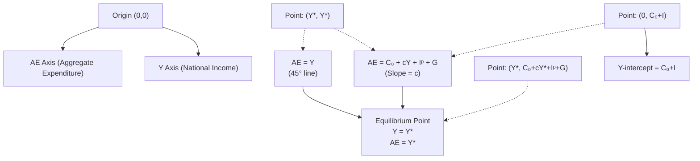

# Lesson 2: Goods Market Equilibrium via the Keynesian Cross

## 1. First-Principles Intuition & Invariants

The Keynesian Cross stands as the foundational apparatus for understanding short-run macroeconomic equilibrium when prices remain sticky and output adjusts to meet aggregate demand. Unlike the classical vision of Say's Law—where supply creates its own demand and markets clear instantaneously through flexible prices—the Keynesian framework confronts the empirical reality of involuntary unemployment, demand deficiencies, and coordination failures that characterized the Great Depression and continue to manifest in modern recessions. At its core, the model posits that actual output $Y$ gravitates toward the level where planned aggregate expenditure $AE$ equals income, creating a self-reinforcing equilibrium through the income-expenditure feedback mechanism.

The analytical power of the Keynesian Cross derives from its explicit rejection of full employment as an automatic outcome. When households and firms collectively decide to spend less than the economy's potential output, no price adjustment mechanism immediately restores full resource utilization. Instead, firms respond to unsold inventories by cutting production, which reduces income distributed to workers and shareholders, which further contracts spending in a cumulative downward spiral. The model captures this multiplier process through the marginal propensity to consume, denoted $c$ where $0 < c < 1$, which governs how much of each additional dollar of income gets recycled into further expenditure rather than leaking out through saving.

The equilibrium condition crystallizes as $Y = AE$, where aggregate expenditure decomposes into consumption $C$, planned investment $I^p$, government purchases $G$, and net exports $NX = X - M$. In the simplest two-sector closed economy, we collapse this to $Y = C + I^p$. The consumption function embodies Keynes's fundamental psychological law: consumption rises with income but by less than the full increment, formalized as $C = C_0 + cY$ where $C_0 > 0$ represents autonomous consumption financed by dissaving or wealth, and $c$ captures the marginal propensity to consume out of disposable income. This creates a structural relationship where total expenditure depends on income through $AE = C_0 + cY + I^p$, and equilibrium income solves $Y^* = C_0 + cY^* + I^p$.

Algebraic manipulation reveals the multiplier mechanism's internal architecture. Rearranging the equilibrium condition yields $Y^* - cY^* = C_0 + I^p$, which factors to $Y^*(1 - c) = C_0 + I^p$, producing the equilibrium income formula:

$$Y^* = \frac{1}{1-c}(C_0 + I^p) = \frac{1}{1-c}\bar{A}$$

where $\bar{A} = C_0 + I^p$ represents total autonomous expenditure—the spending components independent of current income. The multiplier coefficient $k = \frac{1}{1-c}$ quantifies the amplification effect: each dollar of autonomous spending generates $k$ dollars of equilibrium income. When the marginal propensity to consume equals 0.8, the multiplier becomes $\frac{1}{0.2} = 5$, meaning a ten billion dollar increase in government infrastructure spending expands equilibrium GDP by fifty billion dollars through successive rounds of income generation and re-spending.

The intuition behind this seemingly magical multiplication process rests on recognizing that one person's spending constitutes another person's income. When the government builds a new highway, construction workers receive wage income which they partially spend on groceries, housing, and entertainment. Those expenditures become income for grocery clerks, landlords, and service workers, who in turn spend a fraction of their earnings. The initial injection propagates through the economy in diminishing waves, with each round smaller than the last by factor $c$. The infinite geometric series $1 + c + c^2 + c^3 + \ldots$ converges to $\frac{1}{1-c}$ because the marginal propensity to consume remains below unity, ensuring that leakage through saving eventually exhausts the multiplier chain.

The model's invariants govern its behavioral boundaries and policy implications. First, the marginal propensity to consume must satisfy $0 < c < 1$ for economic coherence: negative propensities violate the positive relationship between income and consumption observed empirically, while propensities exceeding unity would generate explosive instability where rising income fuels ever-accelerating consumption without bound. Second, the autonomous expenditure components $C_0$ and $I^p$ must remain truly exogenous—determined outside the model by factors like consumer confidence, animal spirits, or fiscal policy decisions—to preserve the causal chain from spending to income rather than circular reasoning. Third, the model assumes sufficient idle capacity and unemployed resources such that output expands to meet demand without triggering inflation, confining the analysis to depression or recession states where the aggregate supply curve remains horizontal.

The paradox of thrift emerges as a central policy insight from the multiplier mechanism, demonstrating how individually rational behavior can produce collectively irrational outcomes. Suppose households grow pessimistic about future income prospects and decide to increase precautionary saving by reducing autonomous consumption from $C_0$ to $C_0 - \Delta C_0$ where $\Delta C_0 > 0$. The equilibrium income response follows directly from the multiplier formula:

$$\Delta Y^* = \frac{1}{1-c}(-\Delta C_0) = -k\Delta C_0 < 0$$

Income contracts by the multiplier coefficient times the autonomous consumption decline. The paradox manifests when we examine the saving outcome. Private saving equals $S = Y - C = Y - C_0 - cY = (1-c)Y - C_0$. At the new equilibrium, saving becomes $S' = (1-c)Y^* - (C_0 - \Delta C_0) = (1-c)[Y^* - k\Delta C_0] - C_0 + \Delta C_0$. Substituting the multiplier $k = \frac{1}{1-c}$ yields $S' = (1-c)Y^* - (1-c) \frac{\Delta C_0}{1-c} - C_0 + \Delta C_0 = (1-c)Y^* - C_0$, which exactly equals the original saving level. The attempt to save more collectively fails because the income contraction induced by reduced spending eliminates the potential saving increment. In equilibrium, private saving must equal planned investment $S = I^p$ through the goods market clearing condition, and with investment held constant, aggregate saving cannot change despite altered individual intentions.

This result illuminates the fallacy of composition inherent in macroeconomic coordination failures. For an individual household, reducing consumption unambiguously raises saving because the household treats its income as given. But when all households simultaneously curtail spending, aggregate income falls endogenously, and the saving identity $S \equiv Y - C$ collapses back to its original level through the income adjustment. The paradox justifies activist fiscal policy during demand-deficient recessions: government spending increases can offset private retrenchment and stabilize income without crowding out private saving, precisely because idle resources permit output expansion rather than forcing a zero-sum resource allocation trade-off.

The incorporation of government fiscal instruments extends the basic framework to a three-sector economy. Government purchases $G$ enter autonomous expenditure directly, while taxes $T$ reduce disposable income available for consumption. Modeling taxes as either lump-sum $T = \bar{T}$ or proportional $T = tY$ where $0 < t < 1$ represents the marginal tax rate alters the multiplier magnitude. With lump-sum taxation, the consumption function becomes $C = C_0 + c(Y - \bar{T})$, and equilibrium income solves:

$$Y^* = C_0 + c(Y^* - \bar{T}) + I^p + G$$

$$Y^*(1-c) = C_0 - c\bar{T} + I^p + G$$

$$Y^* = \frac{1}{1-c}(C_0 - c\bar{T} + I^p + G)$$

The government spending multiplier remains $\frac{1}{1-c}$, but the balanced budget multiplier—the income change when government spending and lump-sum taxes rise by equal amounts $\Delta G = \Delta T$—simplifies remarkably to unity:

$$\Delta Y^* = \frac{1}{1-c}\Delta G - \frac{c}{1-c}\Delta T = \frac{1}{1-c}\Delta G - \frac{c}{1-c}\Delta G = \frac{1-c}{1-c}\Delta G = \Delta G$$

This counterintuitive result arises because government spending injects its full value into the income stream immediately, while tax increases reduce consumption only by the marginal propensity to consume times the tax increment, leaving $(1-c)\Delta T$ of purchasing power initially unaffected because it would have been saved anyway. The net first-round impact equals $\Delta G - c\Delta T = (1-c)\Delta G$ when the budget remains balanced, and subsequent multiplier rounds amplify this by $\frac{1}{1-c}$, yielding exactly $\Delta G$ total income expansion.

Proportional taxation dampens the multiplier by introducing an automatic stabilizer that reduces the marginal propensity to spend out of gross income. With taxes $T = tY$, disposable income becomes $Y^D = Y - tY = (1-t)Y$, and consumption follows $C = C_0 + c(1-t)Y$. The aggregate expenditure function $AE = C_0 + c(1-t)Y + I^p + G$ has slope $c(1-t) < c$, and equilibrium income becomes:

$$Y^* = \frac{1}{1-c(1-t)}(C_0 + I^p + G)$$

The multiplier shrinks from $\frac{1}{1-c}$ to $\frac{1}{1-c(1-t)}$. For $c = 0.8$ and $t = 0.25$, the multiplier falls from 5 to $\frac{1}{1-0.8(0.75)} = \frac{1}{0.4} = 2.5$. The automatic stabilizer property manifests when shocks hit the economy: if investment collapses by ten billion dollars, equilibrium income contracts by only twenty-five billion rather than fifty billion because the progressive tax system reduces tax collections during the downturn, cushioning disposable income and consumption. This built-in fiscal flexibility operates without discretionary policy action, though at the cost of reducing the potency of intentional fiscal stimulus.

The Keynesian Cross reveals its deepest policy implications when contrasted with the classical full-employment benchmark. In the classical long run, output equals potential $Y = \bar{Y}$ determined by labor supply, capital stock, and technology through the production function $Y = F(K, L)$. Aggregate demand plays no role; Say's Law ensures supply creates its own demand through flexible price adjustment. Saving equals investment through interest rate equilibration in the loanable funds market. Fiscal policy crowds out private investment one-for-one because resources remain fully employed, forcing government absorption of real goods to displace private uses.

The Keynesian short run inverts this causality. Output becomes demand-determined, adjusting to equate actual production with planned expenditure rather than constrained by supply-side potential. The interest rate either remains pegged by monetary policy or stuck at the zero lower bound, severing the loanable funds equilibrium mechanism. Saving passively equals investment through income adjustment rather than active interest rate mediation. Fiscal expansion does not crowd out private investment because idle resources permit simultaneous accommodation of both public and private demands. The model applies when nominal wage and price rigidities prevent market clearing, whether due to long-term contracts, menu costs, coordination failures, or money illusion.

The intellectual foundation traces to Keynes's General Theory of Employment, Interest, and Money published in 1936 during the depths of the Great Depression, when unemployment exceeded twenty-five percent in many industrialized nations and classical theory offered no explanation beyond temporary disequilibrium. Keynes challenged the classical axiom that supply creates its own demand, arguing instead that insufficient aggregate demand could persist indefinitely without spontaneous correction. His emphasis on effective demand—the level of output firms expect to sell rather than physical production capacity—reoriented macroeconomics from supply constraints to demand deficiencies as the binding constraint on employment and output during recessions.

The formal algebraic articulation through the 45-degree diagram emerged from the interpretive work of John Hicks, Paul Samuelson, and Alvin Hansen in the 1940s and 1950s, synthesizing Keynesian insights into the IS-LM framework that dominated macroeconomic pedagogy for decades. The Keynesian Cross forms the goods market equilibrium locus—the IS curve—while money market equilibrium generates the LM curve, with joint determination of income and interest rates at their intersection. This neoclassical synthesis attempted to reconcile Keynesian short-run demand management with classical long-run supply-side growth theory, positioning the Keynesian Cross as the foundation for understanding business cycle fluctuations even as potential output evolved along classical lines.

## 2. Core Architecture & Mechanics

The Keynesian Cross model operates through three interconnected mechanical systems: the consumption function mapping income to household spending, the equilibrium condition equating production with expenditure, and the dynamic adjustment process converging to equilibrium through inventory accumulation or depletion. Understanding these architectural components requires dissecting each mechanism's internal structure and tracing the signal flow from exogenous shocks through behavioral responses to equilibrium outcomes.

The consumption function $C = C_0 + cY$ embodies the primary behavioral relationship converting income into expenditure. Autonomous consumption $C_0$ represents the irreducible minimum spending required for subsistence when income falls to zero, financed through dissaving or depletion of accumulated wealth. Empirically, $C_0$ captures factors shifting the entire consumption schedule: consumer confidence indices, wealth effects from asset price changes (the portfolio balance channel where rising stock or housing values increase consumption at every income level), credit availability (relaxed lending standards lower precautionary saving needs), and demographic composition (retirees consume a larger fraction of income than working-age savers). The marginal propensity to consume $c = \frac{\partial C}{\partial Y}$ measures the sensitivity of consumption to income changes, with typical empirical estimates ranging from 0.6 to 0.9 depending on the income concept and time horizon.

The distinction between average and marginal propensities illuminates consumption behavior across income distributions. The average propensity to consume $APC = \frac{C}{Y} = \frac{C_0 + cY}{Y} = \frac{C_0}{Y} + c$ declines with income because the autonomous component gets diluted across a larger income base. Low-income households exhibit $APC > 1$, consuming more than their income through borrowing or dissaving, while high-income households show $APC < 1$, saving substantial fractions of earnings. The marginal propensity $c$ remains constant under the linear specification, though more sophisticated consumption theories allow income-dependent marginal propensities through non-linear specifications like $C = C_0 + c_1 Y + c_2 Y^2$.

The aggregate expenditure function $AE = C + I^p + G = C_0 + cY + I^p + G$ combines the consumption function with exogenous autonomous expenditure components. Planned investment $I^p$ represents firms' intended capital formation, excluding unintended inventory changes that serve as the equilibrium adjustment mechanism. In the simplest Cross formulation, investment remains exogenous at $I^p = \bar{I}$, abstracting from interest rate effects that would introduce IS curve slope. Government purchases $G$ capture public consumption and investment, treating fiscal policy as an exogenous policy lever subject to political discretion rather than endogenous response to economic conditions (though automatic stabilizers partially endogenize taxes).

The geometric representation plots aggregate expenditure $AE$ on the vertical axis against income $Y$ on the horizontal axis, with a 45-degree reference line where $AE = Y$ identifies all potential equilibrium points. The aggregate expenditure schedule intersects this reference line at the unique equilibrium income $Y^*$. The diagram's mechanics illuminate adjustment dynamics:

At income levels below equilibrium $Y < Y^*$, the aggregate expenditure schedule lies above the 45-degree line, indicating planned spending exceeds production. Firms experience unintended inventory depletion as customers purchase more goods than were produced during the period. Negative inventory investment $(I_{unintended} = Y - AE < 0)$ signals excess demand, prompting firms to expand production toward $Y^*$. Conversely, at $Y > Y^*$, planned expenditure falls short of output, generating unintended inventory accumulation $(I_{unintended} > 0)$ that induces production cutbacks. The equilibrium condition $Y = AE$ equivalently states that unintended inventory investment equals zero $(I_{unintended} = 0)$, with actual investment (planned plus unintended) equaling realized saving through the national income identity.

The multiplier mechanism's architectural propagation follows a recursive structure. An exogenous increase in autonomous spending $\Delta \bar{A}$ (whether from higher investment, government spending, or autonomous consumption) initiates a chain reaction. In the first round, output and income rise by $\Delta Y_1 = \Delta \bar{A}$ to meet the new demand. The second round emerges as recipients of this income spend fraction $c$ on consumption, generating $\Delta Y_2 = c \Delta \bar{A}$ additional demand. The third round produces $\Delta Y_3 = c^2 \Delta \bar{A}$, and the process continues indefinitely. Total income change sums the infinite geometric series:

$$\Delta Y^* = \Delta \bar{A} + c\Delta \bar{A} + c^2\Delta \bar{A} + c^3\Delta \bar{A} + \ldots = \Delta \bar{A}(1 + c + c^2 + c^3 + \ldots)$$

For $|c| < 1$, the series converges to $\frac{1}{1-c}$, yielding $\Delta Y^* = \frac{\Delta \bar{A}}{1-c} = k\Delta \bar{A}$. The multiplier's magnitude depends inversely on the marginal propensity to save $s = 1 - c$: high saving rates dampen the multiplier by leaking income out of the expenditure cycle, while low saving rates amplify it through sustained re-spending.

The temporal dynamics of convergence depend on the adjustment speed parameter governing how quickly firms respond to inventory discrepancies. A canonical specification assumes output adjusts proportionally to the expenditure gap:

$$\Delta Y_t = \lambda(AE_t - Y_t)$$

where $\lambda > 0$ measures adjustment speed. High $\lambda$ produces rapid convergence; low $\lambda$ implies sluggish production responses. Substituting the aggregate expenditure function yields:

$$\Delta Y_t = \lambda[C_0 + cY_t + I^p + G - Y_t] = \lambda[\bar{A} + cY_t - Y_t]$$

This first-order difference equation converges to steady state $Y^* = \frac{\bar{A}}{1-c}$ from any initial income level, with convergence speed determined by eigenvalue $\phi = 1 - \lambda(1-c)$. For stability, $|\phi| < 1$ requires $0 < \lambda < \frac{2}{1-c}$. Most empirical estimates suggest quarterly adjustment speeds around $\lambda = 0.5$, implying convergence within several quarters following shocks.

The incorporation of taxation alters the expenditure function's structure and equilibrium mechanics. With lump-sum taxes $\bar{T}$, disposable income $Y^D = Y - \bar{T}$ replaces gross income in the consumption function, yielding $C = C_0 + c(Y - \bar{T}) = C_0 - c\bar{T} + cY$. The autonomous component absorbs the tax term, and the multiplier retains form $k = \frac{1}{1-c}$. Proportional taxation $T = tY$ introduces an endogenous leakage through the tax system. Disposable income becomes $Y^D = Y - tY = (1-t)Y$, and consumption follows $C = C_0 + c(1-t)Y$. The aggregate expenditure slope flattens from $c$ to $c(1-t)$, reducing the multiplier to:

$$k_t = \frac{1}{1 - c(1-t)} = \frac{1}{1-c+ct}$$

For $c = 0.8$ and $t = 0.25$, $k_t = \frac{1}{1-0.8+0.2} = 2.5$ compared to the no-tax multiplier of 5. The automatic stabilizer effect manifests algebraically: a one-dollar autonomous spending shock generates $\Delta Y^* = 2.5$ instead of $\Delta Y^* = 5$, moderating both expansions and contractions.

Transfer payments $TR$ augment disposable income symmetrically to taxes but with opposite sign: $Y^D = Y - T + TR$. Unemployment insurance, Social Security, and means-tested welfare programs create countercyclical automatic stabilizers by rising during recessions (when unemployment climbs) and falling during expansions. Modeling transfers as proportional to the output gap $TR = b(\bar{Y} - Y)$ where $b > 0$ and $\bar{Y}$ denotes potential output introduces an additional stabilizing term in the aggregate expenditure function, further dampening the multiplier.

The balanced budget multiplier's unity value emerges from the differential impact timing of spending and taxation. When government spending rises by $\Delta G$ financed entirely by higher lump-sum taxes $\Delta T = \Delta G$, the initial round injects $\Delta G$ into aggregate demand while extracting $c\Delta G$ through reduced consumption (since households save fraction $(1-c)\Delta T$). The net first-round impact equals $\Delta G - c\Delta G = (1-c)\Delta G$. Subsequent multiplier rounds amplify this by $\frac{1}{1-c}$:

$$\Delta Y^* = \frac{1}{1-c} \cdot (1-c)\Delta G = \Delta G$$

The result demonstrates that fiscal stimulus remains possible even under balanced-budget constraints, though the multiplier effect diminishes from $\frac{1}{1-c}$ to unity. The mechanism operates because government spending exhibits a marginal propensity of one (every dollar goes directly to demand), while taxation has marginal propensity $c < 1$ (only fraction $c$ would have been spent). The $(1-c)$ gap represents forced consumption reduction from higher taxes offset by equal spending increase from government purchases.

The open economy extension introduces net exports $NX = X - M$ as a fourth expenditure component, with exports $X$ exogenous (determined by foreign income and exchange rates) and imports $M$ endogenous through an import function $M = M_0 + mY$ where $m$ is the marginal propensity to import. The aggregate expenditure function becomes:

$$AE = C_0 + cY + I^p + G + X - M_0 - mY = (C_0 + I^p + G + X - M_0) + (c - m)Y$$

The expenditure slope reduces from $c$ to $(c-m)$, recognizing that imports leak income out of the domestic expenditure cycle similarly to saving. The open-economy multiplier becomes:

$$k_{open} = \frac{1}{1 - (c - m)} = \frac{1}{1 - c + m}$$

For $c = 0.8$ and $m = 0.15$, $k_{open} = \frac{1}{0.35} \approx 2.86$ compared to the closed-economy multiplier of 5. Small open economies with high import propensities exhibit smaller multipliers because fiscal stimulus leaks abroad through import demand, benefiting foreign producers rather than domestic income. This structural reality constrains fiscal policy effectiveness in globally integrated economies and explains why monetary unions like the Eurozone experience attenuated fiscal multipliers: member states' spending partially stimulates partner countries rather than exclusively boosting domestic activity.

## 3. High-Performance Optimization & Failure Modes

The Keynesian Cross framework enables precise empirical estimation and policy simulation when calibrated to real-world data and institutional detail, but achieving reliable forecasts and policy guidance requires confronting the model's boundary conditions, parameter uncertainty, and structural limitations. Optimizing the framework for applied macroeconomic analysis involves careful attention to consumption function specification, multiplier magnitude estimation, policy lag timing, and recognition of conditions under which the demand-driven paradigm breaks down.

Consumption function estimation begins with selecting the appropriate income concept. Keynes formulated consumption as a function of current disposable income $C = C_0 + c(Y - T)$, but Milton Friedman's permanent income hypothesis and Franco Modigliani's life-cycle theory demonstrate that forward-looking households base consumption on expected lifetime resources rather than transitory income fluctuations. This insight suggests replacing current income with permanent income $Y^P$, defined as the annuity value of lifetime wealth:

$$C = c_P Y^P$$

where $c_P \approx 1$ (households consume essentially all permanent income) and $Y^P$ depends on current income, expected future income, and accumulated assets. Empirically, permanent income can be proxied by a distributed lag of past income values or extracted via statistical filters separating transitory from permanent components.

The practical implication for multiplier estimation proves profound. If households perceive fiscal stimulus as temporary, consumption responds weakly because permanent income changes little. A one-year tax rebate of one thousand dollars might raise permanent income by only the annuity value of that sum (roughly twenty to thirty dollars annually at reasonable discount rates), generating minimal consumption response. This explains why the 2008 Economic Stimulus Act rebates and 2020 pandemic stimulus checks exhibited multipliers substantially below theoretical values based on measured marginal propensities to consume: many recipients saved the windfall or used it to pay down debt rather than increasing consumption proportionally. Optimizing fiscal multipliers requires designing permanent rather than temporary policy changes, or targeting liquidity-constrained households whose consumption tracks current income closely because they cannot smooth through borrowing.

Estimating the marginal propensity to consume empirically requires addressing endogeneity between income and consumption. Simple regression of consumption on income suffers from simultaneity bias: positive shocks to autonomous consumption raise income through the multiplier, creating spurious correlation. Instrumental variables estimation using exogenous shifters of income (weather shocks affecting agricultural output, resource price movements, or defense spending changes unrelated to domestic economic conditions) provides consistent estimates. Time-series studies typically yield marginal propensities around 0.6 to 0.7 for quarterly U.S. data, while cross-sectional estimates cluster near 0.8 to 0.9, with the discrepancy likely reflecting aggregation effects and permanent income considerations.

The multiplier's empirical magnitude varies systematically with economic conditions in ways that guide policy optimization. During severe recessions with substantial idle capacity and constrained monetary policy (zero lower bound environments), fiscal multipliers empirically reach 1.5 to 2.5 as estimated by International Monetary Fund studies and identified through natural experiments like the American Recovery and Reinvestment Act. Conversely, near full employment with active monetary policy offsetting fiscal stimulus, multipliers collapse toward 0.5 or below as central banks raise interest rates to prevent overheating, crowding out private investment and consumption. This regime-dependence counsels concentrating aggressive fiscal expansion in deep recessions when resource slack permits output expansion without inflation, while exercising restraint during expansions when supply constraints bind.

Policy implementation lags introduce temporal complexities obscured by the static Keynesian Cross. Recognition lags between shock occurrence and policy diagnosis typically span several months as economic data arrives with delays and requires statistical filtering to distinguish cyclical movements from measurement noise. Legislative lags in democracies can stretch six to eighteen months as fiscal packages navigate committee deliberations, floor debates, and political negotiations. Implementation lags add further delays: infrastructure spending requires environmental reviews, competitive bidding, and construction timelines extending years. By the time stimulus reaches the economy, cyclical conditions may have reversed, rendering countercyclical policy procyclical. Optimizing fiscal stabilization requires favoring rapid-deployment mechanisms like unemployment insurance extensions, temporary payroll tax cuts, and aid to state governments facing balanced-budget requirements, which disburse within weeks rather than years.

Automatic stabilizers bypass legislative lags entirely through pre-committed policy rules that activate mechanically during downturns. Proportional income taxation automatically reduces revenue during recessions, supporting disposable income without discretionary action. Unemployment insurance and means-tested transfer programs expand eligibility and payment duration when joblessness rises. The stabilization coefficient $\beta$ measuring how much automatic stabilizers dampen output volatility can be quantified from the tax-modified multiplier:

$$\beta = 1 - \frac{k_t}{k_0} = 1 - \frac{1-c}{1-c+ct} = \frac{ct}{1-c+ct}$$

For $c = 0.8$ and $t = 0.25$, $\beta = \frac{0.2}{0.4} = 0.5$, implying automatic stabilizers cut output volatility in half relative to a no-tax baseline. This justifies maintaining progressive tax structures and generous social insurance systems as built-in stabilization infrastructure, reducing reliance on discretionary policy subject to implementation lags and political dysfunction.

The paradox of thrift illuminates a critical failure mode where microeconomic rationality produces macroeconomic pathology. During financial crises when household balance sheets deteriorate and uncertainty spikes, precautionary saving surges even as investment collapses. The simultaneous autonomous consumption decline and investment fall compound into severe recessions through the multiplier. Japan's Lost Decades following the 1990 asset bubble collapse exemplify this dynamic: household saving rates rose from twelve percent to fifteen percent while corporate investment cratered, generating deflation and stagnant output despite near-zero interest rates. Breaking the paradox requires either offsetting fiscal expansion (government dissaving through deficits to absorb private saving surplus) or monetary stimulus lowering real interest rates enough to restore investment demand.

The liquidity trap represents the most severe failure mode for demand management. When nominal interest rates hit the zero lower bound and deflation expectations raise real interest rates above their natural level, monetary policy loses traction. The IS curve shifts left from collapsing investment and consumption, while the LM curve becomes horizontal at zero nominal rates. Fiscal policy assumes sole stabilization responsibility, but even large multipliers may prove insufficient if private sector deleveraging and pessimistic expectations overwhelm stimulus efforts. The Great Depression and 2008 global financial crisis both exhibited liquidity trap dynamics, requiring unprecedented fiscal and monetary interventions (quantitative easing, forward guidance, and fiscal packages exceeding ten percent of GDP in some nations) to arrest output collapse.

Supply-side constraints define the domain where Keynesian demand management ceases to apply. When the economy operates at potential output $Y = \bar{Y}$, further fiscal stimulus cannot raise real output but instead generates inflation as excess nominal demand chases limited real goods. The aggregate supply curve becomes vertical, and classical economics reasserts dominance. Estimating potential output and the output gap $Y - \bar{Y}$ thus becomes critical for calibrating appropriate policy stance. Production function approaches combine labor force participation, NAIRU unemployment estimates, capital stock measurements, and total factor productivity trends to construct potential GDP series. Statistical filters like the Hodrick-Prescott filter or Hamilton filter extract trend from actual GDP time series, though these methods suffer from end-point bias (recent trend estimates revise substantially as new data arrives).

Empirical applications of the Keynesian Cross require assembling quarterly national income and product account data from sources like the Bureau of Economic Analysis. Consumption corresponds to personal consumption expenditures decomposed into durable goods, nondurable goods, and services. Investment includes fixed nonresidential investment (structures and equipment), residential investment, and change in private inventories (where unintended inventory investment measures disequilibrium). Government purchases combine federal defense and nondefense spending with state and local government consumption and investment, excluding transfer payments which affect disposable income rather than directly entering expenditure. Net exports equal exports minus imports of goods and services.

Estimating the consumption function proceeds through ordinary least squares regression of real personal consumption expenditures $C_t$ on real disposable personal income $Y_t^D$:

$$C_t = \hat{C}_0 + \hat{c} Y_t^D + \varepsilon_t$$

For U.S. quarterly data 1980-2020, typical estimates yield $\hat{C}_0 \approx 300$ billion (2012 dollars) and $\hat{c} \approx 0.92$, though substantial serial correlation in residuals $\varepsilon_t$ indicates model misspecification—likely omitted wealth effects and interest rate channels. Augmented specifications incorporating lagged consumption (reflecting habit formation or permanent income smoothing), net worth (equity and housing wealth), and real interest rates substantially improve fit and reduce autocorrelation.

Multiplier estimation through structural vector autoregressions (SVARs) provides empirical validation and magnitude quantification. A simple three-variable VAR including real GDP, government purchases, and tax revenue identifies fiscal shocks through timing restrictions: government spending shocks enter contemporaneously in the GDP equation (capturing the direct demand effect), while GDP affects spending and taxes with one-period lag (representing budget response lags). The cumulative impulse response of GDP to a government spending shock, divided by the initial spending increase, yields the empirical multiplier. Meta-analyses synthesizing dozens of such studies find multipliers ranging from 0.5 to 2.5 depending on country, time period, and identification strategy, with central estimates near unity.

State-dependent multiplier estimation exploits regional variation and recession/expansion differences. Cross-state analysis comparing output responses to federal spending shocks (military procurement, highway grants) that vary geographically finds multipliers around 1.5 to 2.0, likely upward-biased by factor mobility (workers migrate to booming states) and monetary accommodation. Regime-switching models distinguishing recessions from expansions consistently show multipliers two to three times larger in slumps than booms, confirming the theoretical prediction that resource slack magnifies fiscal effectiveness.

The framework's structural limitations constrain its domain of validity. The Keynesian Cross assumes price rigidity, abstracting from inflation entirely. This simplification proves acceptable for analyzing short-run demand fluctuations when prices adjust slowly, but breaks down over longer horizons or during supply shocks (oil embargoes, pandemic production disruptions) where inflation and output move independently. Extending the model to incorporate aggregate supply through the Phillips curve or New Keynesian DSGE framework becomes necessary for medium-run forecasting and optimal policy design.

The fixed-price assumption also ignores interest rate channels connecting fiscal policy to monetary conditions and investment. The IS-LM extension addresses this by making investment depend inversely on real interest rates $I = I_0 - br$ where $b > 0$ measures investment interest sensitivity. Fiscal expansion shifts the IS curve right, raising both output and interest rates in general equilibrium. The interest rate increase partially crowds out private investment, reducing the net multiplier below the simple Keynesian value. Full crowding out occurs if monetary policy fixes money supply (vertical LM curve at full employment), causing interest rates to rise enough that investment falls dollar-for-dollar with government spending increases.

Modern inflation-targeting central banks operating through interest rate rules rather than money supply control alter the multiplier mechanics substantially. If the central bank follows a Taylor rule raising rates in response to output gaps, fiscal stimulus induces monetary tightening that offsets the expenditure increase. The net multiplier depends on the Taylor rule coefficients: aggressive inflation-targeting (steep Taylor rule) generates near-complete crowding out and minimal multipliers, while accommodative policy (flat Taylor rule or zero lower bound) permits large multipliers approaching the simple Keynesian values.

Ricardian equivalence poses a deeper theoretical challenge to fiscal multiplier logic. If households are forward-looking and perceive government bonds as deferred taxation, debt-financed fiscal stimulus leaves permanent income unchanged because the present value of future tax liabilities exactly offsets current transfers. Consumption remains invariant, and the multiplier collapses to zero (or negative if distortionary taxes affect labor supply). Empirically, Ricardian equivalence appears to hold partially: roughly one-third to one-half of tax cuts get saved rather than spent, suggesting some forward-looking behavior, but substantial consumption responses persist, particularly among liquidity-constrained households unable to smooth consumption intertemporally.

Open-economy leakage through imports substantially dampens multipliers in small, highly integrated economies. A Canadian or Belgian fiscal stimulus leaks heavily abroad because marginal propensities to import reach 0.3 to 0.4, compared to 0.1 to 0.15 for large economies like the United States or Japan. Monetary unions exacerbate this constraint: individual Eurozone members cannot devalue to improve competitiveness, making fiscal stimulus relatively ineffective at the national level while potentially more effective at the union-wide level (where leakage remains internal). This asymmetry creates coordination problems where decentralized fiscal policy proves inadequate, but political constraints prevent centralized stimulus.

Implementing Keynesian analysis in real-time policy requires confronting radical uncertainty about model parameters and structural relationships. Multiplier estimates span a factor of five across studies, consumption functions exhibit structural breaks during financial crises, and potential output remains fundamentally unobservable. Robust policy design acknowledges this uncertainty through decision rules that perform reasonably across parameter ranges rather than optimizing conditional on point estimates. This favors simple, transparent policies (unemployment insurance extensions, direct cash transfers, infrastructure investment) over fine-tuned stimulus calibrated to fragile econometric models.

The Keynesian Cross remains the indispensable foundation for understanding demand-driven output determination in the short run. Its stripped-down simplicity isolates the multiplier mechanism with crystalline clarity, providing intuition that survives in far more complex DSGE models incorporating rational expectations, nominal rigidities, and optimizing behavior. For practitioners diagnosing recession causes, forecasting near-term output, or designing countercyclical policy, the Cross offers immediate insights: measure the output gap, estimate the marginal propensity to consume, calculate the multiplier including tax and import leakages, and quantify the autonomous expenditure change required to close the gap. These calculations guide Congressional Budget Office estimates of fiscal package impacts, Federal Reserve staff forecasts, and central bank policy briefs worldwide. The model's mechanics may appear deceptively simple, but its implications—that markets can fail to coordinate at full employment, that aggregate demand matters independently of supply, and that government policy can stabilize output—represent a profound intellectual revolution whose practical relevance persists nine decades after the General Theory.
