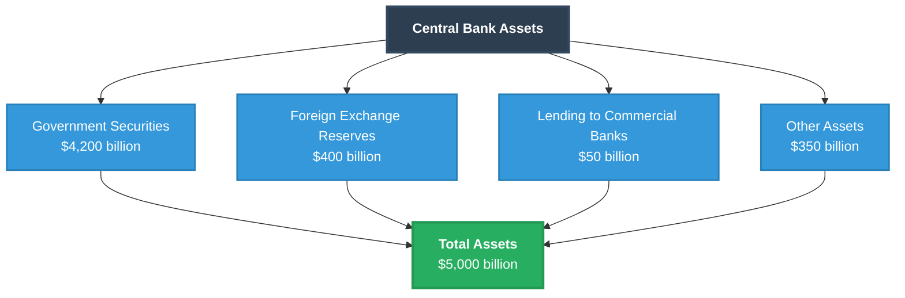
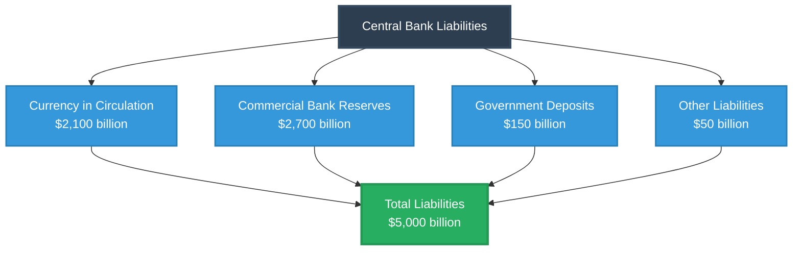
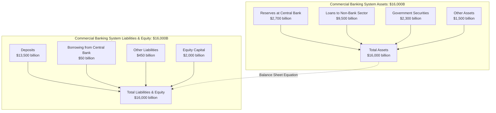
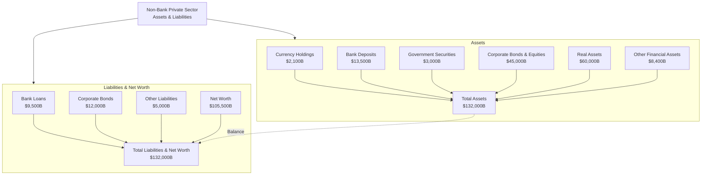

# Lesson 1: Money Supply Creation Mechanisms

## 1. First-Principles Intuition & Invariants

The creation of money within a modern economy represents one of the most misunderstood yet operationally critical processes in macroeconomic policy. Unlike commodity-backed monetary systems where physical gold or silver constrained the aggregate money stock, contemporary fiat currency regimes rely on an interlocking architecture of central bank liabilities, commercial bank credit creation, and regulatory reserve requirements to expand and contract purchasing power across the economy. Understanding this machinery at the mechanical level—tracing the exact balance sheet transformations, reserve flows, and multiplier dynamics—forms the foundation for rigorous monetary policy analysis, financial stability assessment, and credit cycle forecasting.

At its conceptual core, the money supply exists not as a single homogeneous stock but as a nested hierarchy of monetary aggregates, each possessing distinct liquidity characteristics and transmission velocities through the real economy. The monetary base, denoted $M_0$ or sometimes $MB$, comprises the most liquid instruments: physical currency in circulation and commercial bank reserves held as deposits at the central bank. This base money serves as the raw fuel for the broader credit expansion process. From this foundation, progressively less liquid aggregates emerge: $M_1$ adds demand deposits and traveler's checks to currency holdings, capturing immediately spendable purchasing power; $M_2$ further incorporates savings deposits, small-denomination time deposits, and retail money market mutual fund shares, representing slightly deferred but still highly accessible liquidity. Some jurisdictions track even broader aggregates like $M_3$ and $M_4$, extending into institutional money market instruments, large time deposits, and repurchase agreements, though these measures have fallen out of favor in certain central bank statistical programs due to definitional ambiguities and declining policy relevance.

The relationship between these aggregates hinges on the fractional reserve banking mechanism, a system whereby commercial banks hold only a fraction of deposit liabilities as reserves while lending out the remainder to borrowers. This institutional arrangement, governed by regulatory reserve requirements or in some modern regimes by voluntary reserve balances driven by interest on excess reserves, permits the creation of bank deposits—and thus broad money—far exceeding the monetary base supplied by the central bank. The ratio of broad money to base money, conventionally termed the money multiplier, emerges endogenously from the behavioral decisions of banks, depositors, and borrowers interacting within a framework of central bank policy and prudential regulation.

Two competing theoretical paradigms frame our interpretation of this process. The exogenous money view, closely associated with early monetarist doctrine, posits that the central bank exerts direct control over the monetary base through open market operations and reserve supply policies, with the broad money stock mechanically determined by a stable, predictable multiplier arising from fixed reserve requirements and stable currency-to-deposit ratios. In this framework, causation flows strictly from base money to broad money: the central bank injects reserves, banks expand lending against those reserves up to the regulatory constraint, and deposits multiply accordingly. The money multiplier becomes a structural coefficient, $m = \frac{1}{r + c(1-r)}$, where $r$ represents the reserve requirement ratio and $c$ the public's currency preference ratio, delivering a deterministic mapping from monetary base $MB$ to broad money $M$ via $M = m \cdot MB$.

The endogenous money view, by contrast, inverts this causal structure, arguing that in modern credit economies, loan demand and bank credit extension drive deposit creation, with central bank reserve provision accommodating the resultant settlement needs rather than constraining them ex ante. Under this interpretation, commercial banks create deposits in the act of making loans—crediting a borrower's account while simultaneously recording an asset claim—without requiring pre-existing reserves. Reserves enter the picture only subsequently, as banks settle interbank payment flows and meet regulatory or operational reserve targets after deposit creation has occurred. The central bank, operating within an interest rate targeting framework, supplies whatever quantity of reserves banks demand at the policy rate, rendering the monetary base endogenous to credit dynamics rather than an independent policy instrument. This perspective aligns more closely with the operational realities of contemporary central banking, where most major central banks target short-term interest rates rather than reserve quantities, and where excess reserves in the post-2008 quantitative easing era have decoupled traditional money multiplier relationships.

Reconciling these views requires recognizing that the relevant transmission mechanism depends critically on the policy regime and institutional environment. In a regime with binding reserve requirements, scarce reserves, and no remuneration of excess reserves, the exogenous money framework captures meaningful constraints: banks genuinely face a reserve constraint that limits credit expansion, and central bank open market operations that inject or drain reserves exert direct influence on bank lending capacity. In a regime with abundant reserves, interest on excess reserves, and an interest rate targeting framework—the environment prevailing across most advanced economies since the global financial crisis—the endogenous money perspective dominates: banks hold excess reserves far beyond regulatory requirements, the marginal lending decision depends on creditworthy borrower demand and capital adequacy rather than reserve availability, and the money multiplier collapses as a stable behavioral relationship. The shift from reserve-targeting to interest rate-targeting monetary policy frameworks over the past four decades reflects this institutional evolution and fundamentally alters the operational meaning of money supply creation.

The central bank balance sheet provides the accounting foundation for understanding these dynamics. On the asset side, the central bank holds government securities acquired through open market operations, foreign exchange reserves accumulated through intervention in currency markets, and in some cases lending facilities extended to commercial banks or other financial institutions during periods of stress. On the liability side, the central bank issues currency notes demanded by the public and maintains reserve deposit accounts for commercial banks. The sum of currency in circulation and bank reserves constitutes the monetary base, representing the central bank's direct monetary liabilities to the non-bank public and the banking system. When the central bank conducts an open market purchase of government bonds, it credits the selling bank's reserve account, expanding both sides of its balance sheet simultaneously: assets rise by the bond acquisition, liabilities rise by the reserve creation. This operation injects base money into the banking system without yet affecting broad money aggregates—that expansion occurs only if and when commercial banks subsequently extend credit against those reserves, creating new deposit liabilities in the process.

The reserve requirement mechanism translates central bank reserve supply into potential deposit expansion through a legally mandated constraint. If the central bank imposes a ten percent reserve requirement, meaning banks must hold reserves equal to at least ten percent of their deposit liabilities, then each additional dollar of reserves theoretically supports ten dollars of deposits in the limiting case where banks hold no excess reserves and the public holds no currency. The formal derivation proceeds from the balance sheet identity: total reserves $R$ must equal required reserves $r \cdot D$ where $D$ represents total deposits and $r$ the reserve requirement ratio. If we further account for currency holdings $C$ by the non-bank public and define the currency-to-deposit ratio $c = C/D$, we can express the monetary base as $MB = R + C = r \cdot D + c \cdot D = (r+c) \cdot D$. Solving for deposits yields $D = \frac{MB}{r+c}$, and broad money $M = C + D = c \cdot D + D = (1+c) \cdot D = \frac{1+c}{r+c} \cdot MB$. The money multiplier emerges as $m = \frac{1+c}{r+c}$, a coefficient determined by regulatory policy and public behavior rather than bank optimization.

This mechanical formulation, while algebraically elegant, obscures the dynamic process through which deposit expansion actually unfolds. Consider a concrete sequence: the central bank purchases one million dollars in government bonds from Bank A, crediting Bank A's reserve account. Bank A now holds one million dollars in excess reserves beyond its required holdings. Seeking to earn interest income on these idle balances, Bank A extends a one million dollar loan to a business customer, crediting the customer's deposit account. The bank's balance sheet expands: assets rise by the loan receivable, liabilities rise by the deposit. At this stage, Bank A's reserves remain unchanged at one million dollars, but its deposit liabilities have increased by one million, so it must now hold additional required reserves of $r \cdot 1{,}000{,}000$ dollars. The bank retains $(1-r) \cdot 1{,}000{,}000$ dollars in excess reserves.

The process continues as the business customer writes a check or initiates a payment to a supplier who banks at Bank B. When Bank B receives the payment instruction, it claims settlement through the interbank payment system, debiting Bank A's reserve account and crediting Bank B's reserve account by the payment amount. Assuming the payment equals the full one million dollars, Bank A's reserves fall from one million to zero, while its deposit liabilities also fall by one million as the customer's account is debited. Bank A returns to its initial reserve position. Bank B, meanwhile, now holds one million dollars in new reserves and has credited its customer's deposit account by one million, creating one million in new deposits. Bank B faces a required reserve holding of $r \cdot 1{,}000{,}000$ and possesses $(1-r) \cdot 1{,}000{,}000$ in excess reserves, enabling it to extend $(1-r) \cdot 1{,}000{,}000$ dollars in new loans.

This iterative process cascades through the banking system. Bank B lends $(1-r) \cdot 1{,}000{,}000$ dollars, creating new deposits that eventually flow to Bank C, which then lends $(1-r)^2 \cdot 1{,}000{,}000$ dollars, and so forth. The cumulative deposit expansion converges to the geometric series $D = 1{,}000{,}000 \cdot \left[1 + (1-r) + (1-r)^2 + (1-r)^3 + \ldots \right] = \frac{1{,}000{,}000}{r}$, precisely the money multiplier prediction for the case with no currency drain. If we incorporate currency leakage—some fraction $c$ of each deposit creation is withdrawn as cash rather than remaining in the banking system—the effective multiplier falls to the composite expression derived earlier, $m = \frac{1+c}{r+c}$, as currency withdrawals remove reserves from the system and cannot be re-lent.

The critical insight underlying this mechanical expansion process is that individual banks create deposits through lending but cannot individually determine their reserve positions, as reserves flow away through the interbank settlement system whenever deposit-holders make payments to customers of other banks. Only the banking system in aggregate faces the reserve constraint imposed by the central bank's monetary base supply. An individual bank experiencing deposit outflows must either attract new deposits, borrow reserves in the interbank market, or access the central bank's discount window if it cannot meet its reserve requirement. The interbank federal funds market (or equivalent overnight lending markets in other jurisdictions) equilibrates reserve distribution across banks, with the overnight policy rate serving as the central bank's primary operational target in modern frameworks.

The transition from reserve-quantity targeting to interest rate targeting fundamentally altered this transmission mechanism. Under a reserve-quantity regime, the central bank announces a target for total reserves or the monetary base and conducts open market operations to achieve that target, allowing the federal funds rate to fluctuate as the market-clearing price for the scarce reserve stock. Banks compete for limited reserves, bidding up the overnight rate when reserves are tight and driving it down when reserves are abundant. In this environment, the money multiplier operates as a binding constraint, and open market operations directly affect credit conditions by altering reserve scarcity.

Under an interest rate-targeting regime, the central bank announces a target for the overnight policy rate and supplies whatever quantity of reserves is necessary to maintain that rate, typically by standing ready to lend reserves at a penalty rate (the discount window or standing lending facility rate) and to remunerate reserves at a floor rate (the interest on reserves rate or deposit facility rate). These facilities create a corridor within which the market rate fluctuates, with the central bank passively accommodating reserve demand through open market operations. In this regime, reserves cease to be a scarce resource constraining credit expansion. Banks hold reserves to meet regulatory requirements and to facilitate payment settlement, but the marginal lending decision depends on the cost of funding (determined by the policy rate), the expected return on loans (determined by creditworthy borrower demand and risk assessments), and capital adequacy constraints (determined by prudential regulation) rather than reserve availability.

The post-2008 quantitative easing programs conducted by the Federal Reserve, European Central Bank, Bank of England, and Bank of Japan dramatically illustrated this regime shift. Central banks purchased trillions of dollars in government bonds and mortgage-backed securities, massively expanding their balance sheets and flooding the banking system with reserves. Commercial bank reserve holdings in the United States surged from approximately forty billion dollars in 2008 to over two trillion dollars by 2014, yet broad money aggregates expanded far less proportionally, and bank lending growth remained subdued. The money multiplier, defined as the ratio of $M_2$ to the monetary base, collapsed from approximately nine before the crisis to below four by 2014, invalidating the stable multiplier assumption central to the exogenous money framework. Banks accumulated vast excess reserve balances earning the interest on excess reserves rate rather than expanding loans proportionally, as credit demand remained weak in the aftermath of the recession and banks faced tightened capital requirements under Basel III regulations.

This empirical breakdown of the traditional multiplier relationship vindicates the endogenous money perspective and highlights the role of bank capital adequacy as the binding constraint on credit creation in modern economies. Under Basel III and similar prudential frameworks, banks must maintain minimum capital ratios—typically measured as Tier 1 capital divided by risk-weighted assets—rather than simply reserve ratios. A bank holding ample reserves but insufficient capital relative to its risk-weighted asset portfolio cannot expand lending without raising additional equity, regardless of reserve abundance. Since loans carry positive risk weights (typically 50-100% for standard commercial loans, higher for higher-risk exposures), each dollar of new lending increases risk-weighted assets and consumes regulatory capital. The capital constraint thus functions analogously to the reserve constraint in older theoretical models, but with the crucial difference that capital is far more costly to adjust than reserves. A bank facing a reserve deficiency can borrow overnight in the interbank market or from the central bank at relatively low cost; a bank facing a capital deficiency must either retain earnings over time or issue new equity at potentially steep dilution to existing shareholders.

The regulatory arbitrage between reserve constraints and capital constraints explains much of the structural evolution in shadow banking and financial intermediation beyond traditional commercial banking. Money market mutual funds, securitization vehicles, repurchase agreement financing, and other non-bank credit intermediaries emerged in part to circumvent reserve requirements and capital regulations, creating credit and liquidity transformation outside the formal banking system. These shadow banking activities generate monetary aggregates—repo financing and money market fund shares function as near-money substitutes for bank deposits—without appearing in traditional measures or facing traditional reserve constraints, complicating monetary policy transmission and financial stability monitoring. The financial crisis of 2008 revealed the systemic risks embedded in this shadow banking expansion, as runs on money market funds and repo markets triggered fire sales and credit market freezes despite traditional banks holding adequate reserves.

Central bank unconventional monetary policies—quantitative easing, credit easing, forward guidance, negative interest rates—represent attempts to transmit monetary stimulus through channels beyond the traditional reserve injection mechanism when policy rates approach the zero lower bound and conventional open market operations lose traction. Quantitative easing works not by expanding reserves per se (since reserves are already abundant and non-binding) but by extracting duration risk and credit risk from private portfolios, compressing term premia and credit spreads through portfolio rebalancing effects. When the central bank purchases long-duration government bonds, it removes duration risk from the market, inducing private investors to rebalance into riskier assets like corporate bonds and equities to achieve desired risk-return profiles. The resulting asset price increases and yield declines stimulate investment and consumption through wealth effects and reduced borrowing costs, bypassing the traditional bank lending channel entirely.

Forward guidance operates through expectation management, committing the central bank to maintain low policy rates for an extended period to reduce longer-term interest rates through the expectations component of the yield curve. If market participants believe the policy rate will remain near zero for the next five years, the five-year bond yield must reflect the average expected path of short rates over that horizon, anchoring medium-term rates even when current rates cannot fall further. The credibility and state-contingency of forward guidance commitments critically determine their effectiveness, as markets discount guidance perceived as non-binding or conditional on economic outcomes the central bank cannot control.

Negative interest rate policy, implemented by the European Central Bank, Bank of Japan, and several smaller European central banks, directly penalizes excess reserve holdings to incentivize bank lending and discourage reserve hoarding. By setting the deposit facility rate or interest on reserves rate below zero, the central bank imposes a carrying cost on reserve balances, theoretically motivating banks to reduce reserve holdings by expanding credit or purchasing other assets. In practice, the transmission of negative rates has proven complex, as banks face constraints on passing negative rates through to depositors (who can withdraw currency instead) and on compressing net interest margins (which impairs bank profitability and potentially reduces lending capacity). The reversal rate—the policy rate level below which further cuts become contractionary rather than expansionary by damaging bank intermediation—limits the scope for deeply negative rates.

The operational mechanics of central bank balance sheet expansion and contraction deserve careful attention, as they form the tangible execution layer for monetary policy implementation. An open market purchase proceeds as follows: the central bank's trading desk identifies a target quantity of securities to acquire, typically government bonds, and contacts primary dealers or conducts a competitive auction. When a bank sells a bond to the central bank, the central bank debits its securities portfolio account (increasing assets) and credits the selling bank's reserve account (increasing liabilities). The bank's balance sheet shows a corresponding transformation: its government bond holdings decline by the sale amount, and its reserve holdings increase by the same amount. The aggregate monetary base expands by the transaction size, as the central bank has created new reserves without any offsetting destruction of existing liabilities.

Open market sales reverse this process: the central bank sells bonds from its portfolio to a bank, debiting the bank's reserve account and crediting its own securities account, thereby reducing both sides of its balance sheet. The bank's reserves fall, the monetary base contracts, and the bank acquires bonds in place of reserves. In steady state, a central bank engaged in neither net purchases nor net sales conducts only the operations necessary to offset autonomous factors affecting reserve supply—currency demand fluctuations, changes in Treasury deposits at the central bank, and foreign exchange intervention—to maintain its policy rate target.

The central bank's lending facilities provide an alternative channel for reserve injection, particularly during periods of financial stress. The discount window in the United States, the marginal lending facility in the Eurozone, and analogous facilities in other jurisdictions allow eligible banks to borrow reserves on demand, typically against pledged collateral, at a penalty rate above the policy target rate. This standing facility places a ceiling on the overnight interbank rate, as no bank will pay more than the discount rate when it can borrow from the central bank directly. During the 2008 crisis, the Federal Reserve massively expanded its lending facilities, introducing new programs like the Term Auction Facility, Primary Dealer Credit Facility, and Commercial Paper Funding Facility to provide liquidity to a broader range of counterparties and against a wider range of collateral than traditional discount window operations permitted. These emergency lending programs expanded the monetary base and the Federal Reserve's balance sheet, but unlike open market operations, they represented temporary credit extension rather than permanent reserve creation, as borrowers repaid the loans once market conditions normalized.

Currency issuance represents the final component of monetary base creation, though it operates passively in response to public demand rather than as an active policy tool. When a bank customer withdraws cash from a deposit account, the bank debits the customer's deposit and debits its reserve account at the central bank, requesting physical currency notes. The central bank ships currency to the bank and debits the bank's reserve account, transforming reserves into currency while leaving the total monetary base unchanged. Currency in circulation rises, reserves fall, but the sum remains constant. The central bank accommodates currency demand elastically, printing and distributing notes as requested by banks and destroying worn notes returned from circulation. Changes in currency demand—rising during holiday shopping seasons or in response to financial panics, falling as electronic payment adoption increases—exert autonomous effects on reserve levels that the central bank must offset through open market operations to maintain its policy rate target.

The distinction between the monetary base and broad money aggregates encapsulates the difference between central bank liabilities and the credit-created purchasing power circulating in the economy. The monetary base measures the central bank's direct obligations, the foundational liquidity from which all other money forms derive. Broad money aggregates measure the total stock of liquid purchasing power held by the non-bank public, including bank-created deposit liabilities that exceed base money by the factor of the money multiplier in traditional frameworks or by the endogenous dynamics of credit demand in modern frameworks. Monitoring both aggregates provides complementary information: base money growth signals central bank policy actions and reserve availability, while broad money growth signals credit expansion and aggregate demand pressures in the real economy.

The velocity of money, defined as the ratio of nominal GDP to a monetary aggregate ($V = PY/M$ where $P$ represents the price level, $Y$ real output, and $M$ the money stock), captures the average frequency with which a unit of money circulates through the economy to support transactions. The quantity theory of money, $MV = PY$, posits that if velocity remains stable, changes in the money supply translate proportionally into changes in nominal GDP, either through price level changes (inflation) or real output changes depending on supply-side constraints. Monetarist doctrine emphasized the stability and predictability of velocity, particularly for $M_2$ in the United States, arguing that controlling money supply growth would tightly control inflation over the medium run.

Empirical evidence on velocity stability has proven mixed and period-dependent. Velocity exhibited reasonable stability in the United States from the 1960s through the early 1980s, supporting monetarist policy prescriptions and the Federal Reserve's brief experiment with monetary targeting under Chairman Volcker. Subsequent financial innovation, deregulation, and shifts in money demand relationships destabilized velocity, leading central banks to de-emphasize monetary aggregates in favor of interest rate targeting by the 1990s. The post-2008 period witnessed a dramatic collapse in velocity as quantitative easing massively expanded base money and broad money while nominal GDP growth remained subdued, reflecting the liquidity trap phenomenon where additional money creation fails to stimulate spending due to weak credit demand and portfolio effects that induce money hoarding rather than expenditure.

## 2. Core Architecture & Mechanics

The operational architecture of money supply creation unfolds across three interconnected balance sheet systems: the central bank balance sheet, the aggregate commercial banking system balance sheet, and the consolidated non-bank private sector balance sheet. Tracing the flow of reserves, deposits, and credit across these systems reveals the mechanical transmission paths through which monetary policy actions propagate into real economic outcomes.

The central bank balance sheet forms the foundation of the monetary system, its structure reflecting the institution's dual role as currency issuer and lender of last resort. On the asset side, the balance sheet typically comprises:



The government securities portfolio accumulates through open market operations, representing the primary tool for injecting or draining base money under normal conditions. These holdings might include Treasury bills, notes, and bonds across the maturity spectrum, with the composition reflecting both monetary policy objectives and market functioning considerations. During quantitative easing programs, central banks deliberately skew purchases toward longer maturities to extract duration risk from private portfolios and compress term premia.

Foreign exchange reserves arise from currency market intervention, particularly in emerging market economies or export-oriented advanced economies managing exchange rate appreciation. When a central bank purchases foreign currency to prevent domestic currency appreciation, it credits the selling bank's reserve account with newly created domestic currency, expanding the monetary base. Sterilization operations—simultaneous sales of domestic government bonds to offset the reserve injection—neutralize the monetary base impact but leave the exchange rate effect intact.

Lending to commercial banks encompasses discount window borrowing, standing facility usage, and any emergency lending programs active during crisis periods. Unlike securities holdings which represent permanent reserve creation, lending facilities generate temporary reserve expansion, as banks repay the loans when liquidity conditions normalize or the penalty interest rate makes alternative funding sources more attractive.

The liability side of the central bank balance sheet mirrors the asset composition:



Currency in circulation represents physical notes and coins held by the non-bank public and commercial banks' vault cash. This component responds passively to public demand, fluctuating with seasonal patterns, payment system evolution, and confidence in bank deposits. During financial panics, currency demand surges as depositors withdraw funds, draining reserves and tightening liquidity conditions unless the central bank conducts offsetting open market purchases.

Commercial bank reserves—the sum of required reserves and excess reserves—constitute the operational fulcrum of monetary policy transmission. In a scarce-reserves regime, small variations in reserve supply generate large swings in the federal funds rate as banks compete for limited balances. In an abundant-reserves regime, the central bank sets the policy rate by adjusting the interest paid on reserves rather than by manipulating reserve quantities, and the relationship between reserve levels and the policy rate flattens considerably.

Government deposits at the central bank fluctuate with Treasury cash management operations, exerting autonomous effects on reserve availability. When the Treasury receives tax payments, funds flow from commercial bank deposits to the Treasury's central bank account, draining reserves from the banking system. When the Treasury disburses payments, funds flow from its central bank account into commercial bank deposits, injecting reserves. These flows can be large and unpredictable, requiring the central bank to forecast and offset them through open market operations to prevent unintended policy rate volatility.

The monetary base, the sum of currency in circulation and commercial bank reserves, totals $4,800 billion in this stylized example, representing the central bank's total monetary liabilities to the non-bank public and banking system. Changes in the monetary base stem from central bank asset purchases or sales (open market operations), lending facility utilization, foreign exchange intervention, or autonomous factor movements.

The commercial banking system balance sheet aggregates across all deposit-taking institutions subject to reserve requirements and prudential regulation:



The reserve position of $2,700 billion corresponds exactly to the central bank's reserve liability, ensuring consolidation consistency. If the reserve requirement ratio stands at ten percent, required reserves equal $1,350 billion (ten percent of $13,500 billion in deposits), leaving $1,350 billion in excess reserves. This substantial excess reserve position characterizes the post-quantitative easing environment across major advanced economies, where central banks flooded the system with reserves far exceeding regulatory requirements.

The loan portfolio of $9,500 billion represents credit extended to households, businesses, and non-bank financial institutions, generated through the deposit creation process described earlier. Each loan creates a matching deposit liability, expanding both sides of the banking system balance sheet simultaneously. The credit creation process does not require pre-existing deposits—banks create deposits in the act of lending—but does require adequate capital to absorb the risk-weighted asset increase and sufficient reserves to settle interbank payments as deposit-holders transact.

Government securities holdings provide liquid, low-risk assets earning interest, serving both as a yield-generating investment and as a buffer stock for liquidity management. Banks can sell government bonds to the central bank in open market operations or pledge them as collateral for discount window borrowing, converting them into reserves on demand. The securities portfolio thus functions as near-reserves in terms of liquidity.

The deposit base of $13,500 billion corresponds to the $M_1$ or $M_2$ monetary aggregate (depending on deposit composition), representing the broadest commonly measured money stock. The ratio of deposits to base money, $13,500 / 4,800 \approx 2.8$, implies a realized money multiplier far below the theoretical maximum of $1/r = 10$ predicted by the simple reserve requirement model, reflecting the large excess reserve holdings that break the mechanical multiplier relationship.

Equity capital of $2,000 billion provides the loss-absorbing buffer required by prudential regulation, ensuring banks can withstand loan defaults and asset value declines without becoming insolvent. The Tier 1 capital ratio, calculated as Tier 1 capital divided by risk-weighted assets, imposes the binding constraint on credit expansion in modern banking systems. If loans carry an average risk weight of seventy percent, risk-weighted assets total approximately $6,650 billion (seventy percent of $9,500 billion in loans, assuming other assets carry lower weights), yielding a Tier 1 capital ratio of approximately thirty percent—well above typical regulatory minimums of eight to ten percent, suggesting capital abundance alongside reserve abundance in this stylized post-QE scenario.

The consolidated non-bank private sector balance sheet captures the asset and liability positions of households, non-financial corporations, and non-bank financial institutions:



Currency holdings and bank deposits together constitute the liquid monetary wealth available for transaction purposes, corresponding to the $M_1$ or $M_2$ aggregate depending on definitional scope. The sum of $15,600 billion exceeds the banking system's deposit liabilities by the $2,100 billion in currency, matching the monetary base composition and ensuring sectoral consolidation consistency.

Bank loans appear as liabilities on the non-bank private sector balance sheet, the mirror image of the loan asset on the banking system balance sheet. Each dollar of bank credit expansion simultaneously increases deposits (private sector assets) and loans (private sector liabilities), leaving net worth unchanged but expanding gross balance sheets on both sides. This balance sheet expansion captures the essential nature of bank intermediation: banks create purchasing power by issuing liquid deposit liabilities backed by illiquid loan assets.

The flow of funds through the money creation process can be visualized as a series of linked balance sheet transformations:

```
Stage 1: Central Bank Open Market Purchase

Central Bank Balance Sheet:
  Assets: +$100B Government Securities
  Liabilities: +$100B Bank Reserves

Bank A Balance Sheet:
  Assets: -$100B Government Securities, +$100B Reserves
  Liabilities: No change
```

At this initial stage, the central bank has purchased government bonds from Bank A, crediting Bank A's reserve account. The monetary base expands by $100 billion (the reserve creation), but broad money remains unchanged—the transaction merely swaps one bank asset (government securities) for another (reserves) without affecting deposit liabilities.

```
Stage 2: Bank A Extends Credit

Bank A Balance Sheet:
  Assets: +$100B Loans
  Liabilities: +$100B Deposits

Borrower Balance Sheet:
  Assets: +$100B Bank Deposits  
  Liabilities: +$100B Bank Loans
```

Bank A, holding excess reserves after the central bank purchase, extends $100 billion in loans to creditworthy borrowers. In the act of lending, the bank creates new deposits in borrowers' accounts, expanding both sides of its balance sheet. Broad money has now increased by $100 billion, as new deposits have been created. Bank A's reserve position remains at $100 billion, but its deposit liabilities have risen by $100 billion, creating a required reserve obligation of $10 billion (assuming a ten percent reserve requirement), leaving $90 billion in excess reserves.

```
Stage 3: Borrower Expenditure and Interbank Settlement

Borrower Balance Sheet:
  Assets: -$100B Bank A Deposits, +$100B Bank B Deposits
  Liabilities: $100B Bank Loans (unchanged)

Bank A Balance Sheet:
  Assets: -$100B Reserves
  Liabilities: -$100B Deposits
  
Bank B Balance Sheet:
  Assets: +$100B Reserves
  Liabilities: +$100B Deposits
```

Borrowers spend the newly created deposits, writing checks or initiating electronic transfers to suppliers and vendors who bank at other institutions. When Bank B receives payment instructions for $100 billion, it claims settlement through the interbank payment system, transferring $100 billion in reserves from Bank A to Bank B. Bank A's balance sheet contracts back toward its original position, while Bank B now holds new reserves and new deposits. Bank B faces a required reserve holding of $10 billion against its new deposits, leaving it with $90 billion in excess reserves available for lending.

```
Stage 4: Bank B Extends Credit (Round 2)

Bank B Balance Sheet:
  Assets: +$90B Loans
  Liabilities: +$90B Deposits

New Borrower Balance Sheet:
  Assets: +$90B Bank Deposits
  Liabilities: +$90B Bank Loans
```

Bank B extends $90 billion in new loans, creating $90 billion in additional deposits. Broad money has now expanded by $190 billion total ($100B + $90B) from the initial $100 billion reserve injection. The process continues as these new borrowers spend their deposits, transferring reserves to Bank C, which then lends $81 billion, and so forth.

The cumulative deposit expansion converges to the geometric series:

$$D_{\text{total}} = 100 + 90 + 81 + 72.9 + \ldots = 100 \cdot \left(1 + 0.9 + 0.9^2 + 0.9^3 + \ldots \right) = \frac{100}{1 - 0.9} = \frac{100}{0.1} = 1000$$

Thus, the initial $100 billion reserve injection generates $1,000 billion in total deposits, yielding a realized money multiplier of ten, consistent with the theoretical prediction $m = 1/r = 1/0.1 = 10$ for the case with no currency drain.

Incorporating currency leakage complicates the mechanics. If depositors withdraw twenty percent of each new deposit as currency rather than leaving it in the banking system, each round of lending loses reserves to currency withdrawals, dampening the multiplier effect:

```
Stage 2 (Revised): Bank A Extends Credit with Currency Withdrawal

Bank A Balance Sheet:
  Assets: +$100B Loans, -$20B Reserves (currency withdrawal)
  Liabilities: +$80B Deposits

Borrower Balance Sheet:
  Assets: +$80B Bank Deposits, +$20B Currency
  Liabilities: +$100B Bank Loans
  
Central Bank Balance Sheet:
  Assets: No change
  Liabilities: +$20B Currency, -$20B Reserves
```

The $20 billion currency withdrawal drains reserves from Bank A and transforms reserves into currency on the central bank's balance sheet, leaving the monetary base unchanged but reducing the reserves available for further lending. Bank A retains $80 billion in reserves after the withdrawal, faces required reserves of $8 billion on its $80 billion in deposits, and holds $72 billion in excess reserves. When borrowers spend their deposits and transfer reserves to Bank B, only $80 billion (not $100 billion) flows through interbank settlement, as $20 billion exited the banking system as currency.

The revised multiplier formula accounting for currency leakage becomes:

$$m = \frac{1 + c}{r + c}$$

where $c$ represents the currency-to-deposit ratio ($c = C/D$). For $r = 0.1$ and $c = 0.25$ (a twenty percent currency withdrawal rate implies $c = 0.2/0.8 = 0.25$), the multiplier becomes:

$$m = \frac{1 + 0.25}{0.1 + 0.25} = \frac{1.25}{0.35} \approx 3.57$$

significantly lower than the no-currency-drain case.

The interbank federal funds market equilibrates reserve distribution across banks, ensuring that reserve-short banks can obtain reserves from reserve-surplus banks without triggering discount window borrowing. Banks with excess reserves lend them overnight to banks facing reserve deficiencies, with the market-clearing federal funds rate determined by the aggregate supply and demand for reserves. The central bank's open market operations shift the supply curve, while banks' aggregate reserve demand reflects required reserve holdings plus desired excess reserve buffers for payment settlement and liquidity management.

In a traditional scarce-reserves regime, the reserve demand curve slopes downward: at high federal funds rates, banks minimize excess reserve holdings and operate close to required minimums, accepting payment settlement risk and potential discount window borrowing to avoid the opportunity cost of idle reserves. At low federal funds rates, banks willingly hold larger excess reserve buffers, as the foregone interest income is minimal. The central bank's open market operations determine the level of aggregate reserves, and the federal funds rate adjusts to clear the market at that quantity.

```
Federal Funds Market (Scarce Reserves Regime):

Rate (%)
    |
    |               Reserve Demand
  5 |                     \
    |                      \
  4 |                       \
    |                        \
  3 |------------------------·----- Federal Funds Rate
    |                         \
  2 |                          \
    |                           \
  1 |                            \
    |                             \
  0 |________________________________
         Reserve Supply (Fixed by CB)
            Quantity ($B)
```

The vertical supply curve reflects the central bank's exogenous reserve provision through open market operations. The intersection with the downward-sloping demand curve determines the equilibrium federal funds rate. A central bank aiming to lower the federal funds rate conducts an open market purchase, shifting the supply curve rightward and driving down the equilibrium rate.

In a floor system with abundant reserves and interest on excess reserves, the reserve demand curve exhibits a near-horizontal segment at the interest on reserves rate:

```
Federal Funds Market (Abundant Reserves Regime):

Rate (%)
    |
    |
  5 |
    |                               
  4 |       Discount Rate (ceiling)
    |------------------------------
  3 |        Federal Funds Rate
    |------------------------------
  2 |        Interest on Reserves (floor)  
    |━━━━━━━━━━━━━━━━━━━━━━━━━━━━━━━━━━━━━━━━━━━
  1 |                                Reserve Demand
    |                                       
  0 |________________________________
             Reserve Supply (Abundant)
                Quantity ($B)
```

Banks will not lend reserves in the federal funds market below the interest on reserves rate, as they can simply hold reserves and earn the IOR rate risk-free. Similarly, banks will not borrow in the federal funds market above the discount rate, as they can borrow from the central bank's discount window at that rate. The federal funds rate thus trades in a narrow corridor between the IOR floor and the discount window ceiling, with the central bank adjusting these administered rates rather than reserve quantities to control the policy rate.

Under this floor system, open market operations cease to directly determine the policy rate. The central bank can conduct massive quantitative easing, expanding reserves from hundreds of billions to trillions of dollars, without mechanically affecting the federal funds rate, as the rate remains pinned near the IOR floor regardless of reserve abundance. The transmission mechanism shifts from reserve scarcity effects to portfolio balance effects: by purchasing large quantities of longer-duration securities, the central bank removes duration risk from private portfolios, compressing term premia and inducing private investors to rebalance into riskier assets.

## 3. High-Performance Optimization & Failure Modes

Optimizing monetary policy transmission under the money supply creation framework requires precise calibration of reserve supply, reserve requirement policy, interest on reserves settings, and complementary macroprudential regulations to achieve target inflation and output objectives while maintaining financial stability. The primary performance metric for monetary policy effectiveness is the pass-through of policy rate changes into lending rates, asset prices, and ultimately aggregate demand and inflation. Understanding the failure modes where this transmission breaks down—liquidity traps, credit crunches, excess reserve hoarding, disintermediation through shadow banking—informs the design of robust policy frameworks resilient to financial market dysfunction.

The liquidity trap represents the canonical monetary policy failure mode, occurring when the policy rate approaches the zero lower bound and further conventional monetary easing becomes infeasible. At a zero nominal interest rate, holding currency dominates holding negative-yielding bonds, so the demand for money becomes infinitely elastic—any injection of base money is simply hoarded as currency or excess reserves rather than spent or lent. The IS-LM framework captures this dynamic: the LM curve, representing money market equilibrium, becomes horizontal at the zero lower bound, so rightward shifts of the LM curve through monetary expansion have no effect on output or interest rates.

Japan's lost decades from the 1990s through 2010s exemplified persistent liquidity trap conditions, with policy rates near zero, deflation or near-zero inflation, and massive excess reserve accumulation despite aggressive central bank asset purchases. The Bank of Japan expanded its balance sheet from approximately twenty percent of GDP in the early 2000s to over 100 percent of GDP by 2020 through successive quantitative easing programs, yet inflation remained stubbornly below target and bank lending growth anemic. Excess reserves surged from negligible levels to over 300 trillion yen, reflecting banks' preference to hold reserves earning the slightly positive interest on reserves rate rather than extend credit in an environment of weak loan demand, high credit risk premiums, and deflationary expectations.

Breaking out of a liquidity trap requires either unconventional monetary policies that work through non-traditional channels—quantitative easing to compress term premia, forward guidance to anchor expectations, negative interest rates to penalize reserve hoarding—or coordinated fiscal expansion to directly boost aggregate demand and shift the IS curve rightward. The effectiveness of these alternatives depends critically on credibility and expectation management. If forward guidance successfully convinces markets that low rates will persist for an extended period, longer-term yields fall through the expectations component of the term structure, stimulating interest-sensitive spending even when short rates cannot fall further. If quantitative easing credibly signals the central bank's commitment to maintain accommodation until inflation returns to target, inflation expectations rise, reducing real interest rates and stimulating demand even at a zero nominal rate.

The credit crunch or financial accelerator failure mode occurs when banking system capital constraints or heightened risk aversion sever the link between reserve availability and credit supply. Even with abundant reserves and low policy rates, banks may restrict lending if they face capital inadequacy, elevated non-performing loan ratios, or sharply increased credit risk premiums in the wake of an asset price crash or recession. The financial accelerator mechanism, formalized by Bernanke, Gertler, and Gilchrist, describes how adverse shocks to borrower balance sheets and net worth amplify through credit market imperfections, as weakened borrower creditworthiness tightens lending standards and raises risk spreads, further depressing investment and output, which in turn deteriorates borrower balance sheets in a vicious cycle.

The 2008 global financial crisis demonstrated this mechanism in acute form. The collapse of subprime mortgage-backed securities and the failure of Lehman Brothers triggered massive write-downs of bank assets, evaporating bank capital and forcing deleveraging. Despite the Federal Reserve flooding the system with reserves through unprecedented lending facilities and quantitative easing, bank lending contracted sharply in 2009, as banks hoarded liquidity, tightened credit standards, and rebuilt capital buffers. The money multiplier collapsed, and broad money growth turned negative, as credit destruction through loan defaults and write-offs exceeded new credit creation. Monetary policy transmission severed at the bank lending channel, requiring direct fiscal intervention—recapitalization through the TARP program, mortgage modification programs, and fiscal stimulus—to stabilize credit markets and arrest the downward spiral.

Optimizing policy response to a credit crunch requires complementary tools beyond conventional monetary easing. Capital injections through government equity stakes or asset purchase programs directly address the capital constraint binding credit supply. Credit guarantees and subsidized lending programs (e.g., the Term Asset-Backed Securities Loan Facility, Small Business Administration emergency lending) bypass impaired banks by channeling credit directly to borrowers or reducing credit risk to encourage private lending. Macroprudential easing—temporarily relaxing capital requirements, adjusting risk weights, or allowing regulatory forbearance on non-performing loan recognition—provides breathing room for banks to extend credit without violating prudential constraints, though at the cost of reduced systemic resilience.

Excess reserve hoarding in abundant-reserve regimes represents a subtler transmission failure, where banks accumulate vast reserve balances earning the interest on reserves rate rather than deploying them into credit or securities markets. This phenomenon characterized the post-2008 environment across major advanced economies and intensified during the COVID-19 pandemic, as central bank asset purchases injected trillions in reserves while banks maintained ultra-liquid positions amid uncertainty. The policy concern is that reserves become an inert monetary dead weight, expanding the monetary base without proportional expansion in lending or spending, breaking the presumed link between monetary accommodation and aggregate demand stimulus.

From an endogenous money perspective, this excess reserve accumulation is neither surprising nor problematic: reserves serve to settle interbank payments and meet regulatory requirements, not to fund lending directly, so abundant reserves merely reflect the central bank's chosen operating framework rather than a policy failure. Credit expansion depends on loan demand from creditworthy borrowers and bank willingness to extend credit given capital constraints and risk assessments, not on reserve availability. The relevant transmission channels operate through interest rates and asset prices—lower policy rates and compressed term premia reduce borrowing costs and boost asset valuations, stimulating investment and consumption—not through a mechanical reserve-to-lending multiplier.

Nonetheless, the opportunity cost of reserve hoarding merits attention. If the interest on reserves rate is set too high relative to risk-free market rates, banks face a perverse incentive to hold reserves rather than purchase government securities or make low-risk loans, as reserves offer superior liquidity and equivalent yield. The Federal Reserve's calibration of the interest on reserves rate relative to the federal funds target and Treasury bill yields directly affects banks' reserve demand and portfolio allocation decisions. Setting IOR at the bottom of the target range encourages some reserve economization and securities purchases, while setting IOR at the top of the range maximizes reserve hoarding.

Tiering systems, implemented by the European Central Bank and Swiss National Bank, address this by applying negative interest rates only to reserve balances exceeding a certain threshold, exempting a portion of reserves from the penalty rate. This approach attempts to penalize excessive hoarding while avoiding the full pass-through of deeply negative rates that would compress bank net interest margins unsustainably. The effectiveness depends on setting the exemption threshold low enough to bite while high enough to preserve bank profitability and intermediation capacity.

Shadow banking disintermediation poses a structural challenge to central bank control over broad money aggregates and credit conditions, as financial intermediation migrates outside the regulated banking system to evade reserve requirements, capital regulations, and other prudential constraints. Money market mutual funds accepting short-term deposits and investing in commercial paper and repos create money-like liabilities without holding reserves at the central bank. Securitization vehicles and structured investment vehicles issue asset-backed securities and commercial paper backed by loan portfolios, transforming illiquid credit into tradable securities that function as collateral and liquidity in financial markets. Repurchase agreement financing provides overnight and term funding against securities collateral, enabling leverage and credit creation outside traditional bank deposit-taking.

These shadow banking activities expand the effective money supply beyond officially measured aggregates and transmit credit conditions into the real economy through parallel channels that conventional monetary policy struggles to reach. The Federal Reserve's policy rate influences short-term money market rates that feed into shadow banking funding costs, and quantitative easing affects the securities that serve as shadow banking collateral, but the transmission is indirect and attenuated relative to the traditional bank lending channel. Moreover, shadow banking opacity and interconnectedness with the regulated banking system generate systemic risks, as runs on money market funds or repo market freezes can spill over into bank funding stress and credit market dislocations, as occurred in 2008 and briefly in March 2020.

Extending the regulatory perimeter to encompass shadow banking entities—applying capital requirements, liquidity standards, and stress testing to systemically important non-bank financial institutions—would bring these activities under macroprudential oversight and restore some degree of central bank influence over total credit conditions. The post-crisis reforms, including designation of systemically important financial institutions subject to enhanced prudential standards and central clearing requirements for derivatives, moved in this direction, though significant gaps remain, particularly for asset managers, hedge funds, and cross-border entities operating through offshore vehicles.

The optimal reserve requirement regime depends on the policy objectives and institutional environment. In emerging markets with underdeveloped interbank markets, binding reserve requirements serve as a quantitative credit control tool, allowing the central bank to directly constrain credit expansion by tightening reserve ratios during credit booms and easing them during downturns. This countercyclical reserve requirement policy functions as a macroprudential instrument complementing interest rate policy. In advanced economies with deep money markets and sophisticated banks, reserve requirements have largely lost their credit control function and serve primarily to generate demand for reserves that facilitates monetary policy implementation. Many central banks have reduced or eliminated reserve requirements in favor of interest on reserves and standing facilities to manage the policy rate.

The choice between a corridor system (with a policy rate trading between the interest on reserves floor and discount window ceiling) and a floor system (with the policy rate pinned near the interest on reserves rate through abundant excess reserves) reflects different tradeoffs between operational simplicity and balance sheet efficiency. A corridor system requires precise reserve supply management through daily open market operations to maintain the target rate within the corridor, but keeps the central bank's balance sheet relatively compact, as only required reserves plus a small buffer need to be supplied. A floor system requires minimal operational intervention—the central bank simply sets the IOR rate at the desired target—but necessitates a permanently bloated balance sheet with massive excess reserves to ensure the policy rate remains pinned at the floor. Pre-2008, most central banks operated corridor systems; post-2008, the legacy of quantitative easing naturally transitioned them to floor systems with abundant reserves.

Unwinding quantitative easing and shrinking the central bank balance sheet presents reverse operational challenges. Simply allowing securities to mature without reinvestment gradually drains reserves from the system as the central bank's assets amortize. Alternatively, actively selling securities accelerates reserve drainage but risks market disruption if sales are too rapid or if market liquidity is insufficient to absorb large volumes. The Federal Reserve's 2017-2019 balance sheet normalization program adopted a passive runoff approach, allowing up to fifty billion dollars per month in Treasury and mortgage-backed securities to mature without reinvestment. This gradual approach successfully reduced the balance sheet from $4.5 trillion to $3.8 trillion without significant market stress, though the normalization was halted in 2019 as overnight repo market strains signaled reserve scarcity.

The transition from abundant reserves back to a scarce-reserves corridor system would require draining reserves to a level where the federal funds rate becomes sensitive to reserve supply variations—likely reducing reserves from trillions to hundreds of billions—and reestablishing active daily open market operations to fine-tune reserve levels and maintain the target rate. Whether central banks will pursue this transition or permanently adopt floor systems with structurally large balance sheets remains an open policy question, with different implications for operational frameworks, fiscal-monetary coordination (as large securities holdings generate seigniorage revenue remitted to the Treasury), and financial market structure.

The endogenous money perspective suggests that the distinction matters less than conventional wisdom implies: credit creation ultimately depends on loan demand and bank capital adequacy rather than reserve availability, so whether reserves are scarce or abundant affects operational implementation but not the fundamental transmission mechanism through interest rates and asset prices. Nonetheless, persistently large central bank balance sheets carry potential risks—concentration of interest rate risk, fiscal dominance concerns if large securities portfolios constrain monetary tightening due to fiscal cost considerations, and distortions in securities market functioning if the central bank holds outsized shares of key securities markets.

Ensuring robust monetary policy transmission under diverse economic environments requires maintaining flexibility across multiple operational levers: policy rate adjustments, balance sheet size management, forward guidance communication, macroprudential regulation coordination, and fiscal-monetary policy synchronization. No single tool dominates all circumstances; rather, effective policy deploys the appropriate combination of instruments matched to the specific transmission impairment or constraint binding in each episode. The 2008 crisis validated the necessity of central bank lending facilities and asset purchases to bypass impaired bank lending channels; the 2020 pandemic validated the necessity of coordinated fiscal transfers to directly support household and business balance sheets when credit intermediation alone proved insufficient; future crises will likely reveal new failure modes requiring novel policy innovations. The robust policy framework builds institutional capacity and legal authority to deploy unconventional tools rapidly when conventional transmission channels break, rather than optimizing narrowly for normal-times efficiency at the cost of crisis-mode brittleness.
