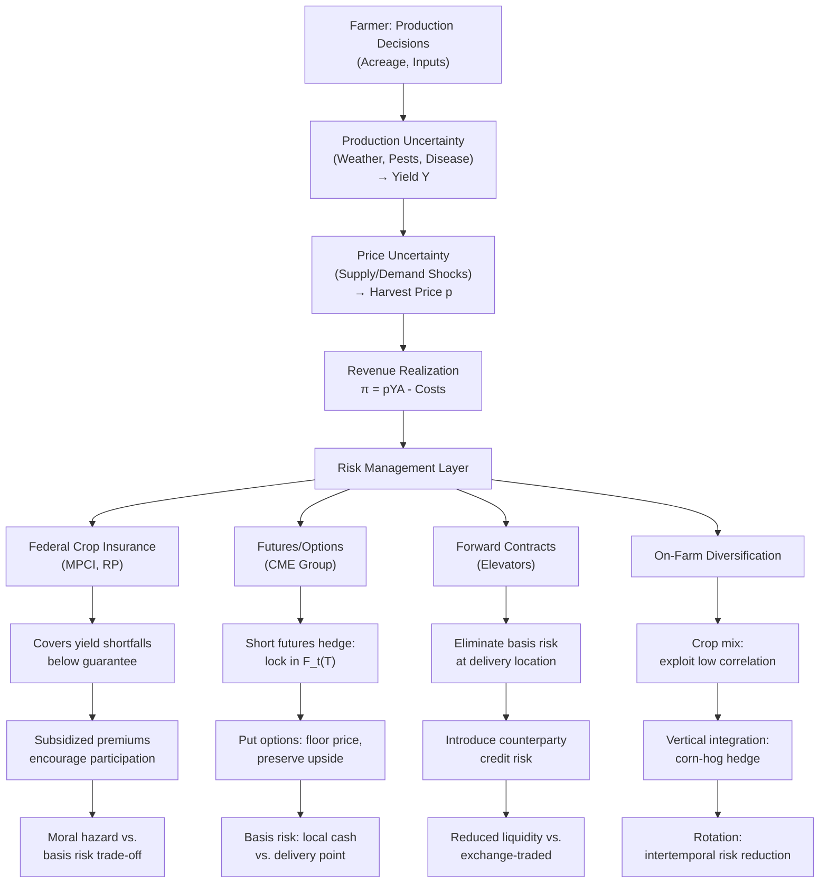

# Lesson 3: Risk Management in Agricultural Economics

## 1. First-Principles Intuition & Invariants

Agricultural production operates under a fundamentally different risk structure than manufacturing or service industries. A factory manager can predict output quantities with reasonable certainty given input flows, labor schedules, and machine uptime. A farmer, by contrast, confronts irreducible biological and meteorological uncertainty at every stage of the production cycle. Planting decisions made in March determine revenue outcomes in October, yet the farmer cannot observe drought probability distributions, pest infestation severity, or harvest-time spot prices when making those irreversible input commitments. This temporal disconnect between costly, uncertain production decisions and stochastic revenue realizations forms the foundational risk problem in agricultural economics.

The classical expected utility framework, originating with von Neumann and Morgenstern's axiomatic treatment of choice under uncertainty, provides the analytical bedrock for modeling farmer decision-making. Unlike the deterministic producer theory developed in earlier lessons—where profit maximization reduces to equating marginal revenue with marginal cost—agricultural producers must maximize expected utility over uncertain profit distributions. The utility function $u(\pi)$ encodes the producer's risk preferences, transforming raw monetary outcomes into subjective welfare indices. A risk-neutral producer treats $u(\pi) = \pi$ linearly, caring only about mean returns. A risk-averse producer exhibits $u''(\pi) < 0$, strictly preferring a certain payoff to a lottery with identical expected value. Most empirical evidence suggests farmers display moderate to strong risk aversion, a behavioral regularity with profound implications for input allocation, crop selection, and insurance demand.

Consider a representative wheat farmer choosing acreage $A$ and nitrogen fertilizer intensity $N$ at planting time. Yield per acre $Y$ follows a random variable determined by rainfall $R$, temperature $T$, and pest pressure $P$, all unobservable ex ante. The production function takes the form $Y = f(N, R, T, P)$, where $f$ exhibits diminishing marginal returns in nitrogen but uncertain multiplicative effects from weather and biological shocks. Revenue equals $pYA$, where $p$ denotes the harvest-time spot price, itself a random variable driven by aggregate supply shocks across producing regions, global demand fluctuations, and inventory carryover from prior seasons. Costs comprise deterministic land rent $rA$, fertilizer expenditure $w_N N A$, and stochastic harvest costs $c(Y)$ that scale with realized yield. Profit therefore becomes:

$$\pi = pf(N, R, T, P)A - rA - w_N N A - c(f(N, R, T, P)A)$$

The farmer's optimization problem is not $\max_{A, N} \pi$, which presumes known realizations, but rather $\max_{A, N} \mathbb{E}[u(\pi)]$, where the expectation integrates over the joint distribution of $(R, T, P, p)$. The first-order conditions for interior optima yield:

$$\mathbb{E}\left[u'(\pi) \left( p \frac{\partial f}{\partial N} A - w_N A - c'(f) \frac{\partial f}{\partial N} A \right)\right] = 0$$

$$\mathbb{E}\left[u'(\pi) \left( pf - r - w_N N - c(f) \right)\right] = 0$$

These conditions differ fundamentally from their deterministic counterparts because marginal utility $u'(\pi)$ covaries with production outcomes and prices. When yield and price shocks are negatively correlated—a natural stabilizer, since poor harvests across all producers typically elevate spot prices—the farmer enjoys partial revenue insurance embedded in market dynamics. When yields and prices exhibit positive correlation—common when regional weather shocks affect only a subset of producers—revenue volatility amplifies beyond pure production risk, intensifying the farmer's risk management problem.

The degree of risk aversion, formalized through the Arrow-Pratt coefficient of absolute risk aversion $r_A(\pi) = -u''(\pi)/u'(\pi)$, governs the magnitude of precautionary adjustments. A farmer with constant absolute risk aversion (CARA preferences) exhibits $u(\pi) = -\exp(-\alpha \pi)$, where $\alpha$ parameterizes risk aversion intensity. Under CARA utility, the certainty equivalent of a normally distributed profit $\pi \sim \mathcal{N}(\mu, \sigma^2)$ equals $CE = \mu - \frac{1}{2}\alpha \sigma^2$, a mean-variance representation that decomposes welfare into expected return minus a risk penalty proportional to variance and risk aversion. This mean-variance framework, though strictly valid only under quadratic utility or normal distributions, provides the workhorse model for empirical agricultural risk analysis.

The coefficient of relative risk aversion $r_R(\pi) = -\pi u''(\pi)/u'(\pi)$ measures risk aversion as a proportion of wealth, a critical distinction for understanding scale effects. Constant relative risk aversion (CRRA preferences) take the form $u(\pi) = \pi^{1-\gamma}/(1-\gamma)$ for $\gamma \neq 1$ or $u(\pi) = \log(\pi)$ for $\gamma = 1$. Empirical estimates from agricultural household surveys typically place $\gamma$ between 1.5 and 4, implying that farmers demand substantial risk premiums to accept actuarially fair gambles. A farmer with $\gamma = 2$ would reject a 50-50 bet to win or lose 20% of wealth even if the expected return were slightly positive, preferring instead to forgo upside potential to avoid downside risk.

Yield risk and price risk exhibit distinct statistical properties requiring separate modeling approaches. Yield distributions typically display right-skewness (occasional bumper crops) and excess kurtosis (fat tails from catastrophic failures), violating normality assumptions. Agronomic production functions with multiple limiting inputs—nitrogen, phosphorus, water—generate nonlinear yield responses where extreme outcomes dominate welfare calculations. Price distributions, by contrast, often approach log-normality due to multiplicative supply and demand shocks aggregating across global markets. Price volatility clusters intertemporally, exhibiting autoregressive conditional heteroskedasticity (ARCH effects), where periods of high volatility persist longer than predicted by independent draws from a stationary distribution.

The covariance structure between yield and price risk determines natural hedging opportunities. Define the revenue per acre as $R = pY$. The variance decomposes as:

$$\text{Var}(R) = \text{Var}(p)\mathbb{E}[Y]^2 + \text{Var}(Y)\mathbb{E}[p]^2 + 2\text{Cov}(p, Y)\mathbb{E}[p]\mathbb{E}[Y] + \text{Var}(p)\text{Var}(Y) + \text{Cov}(p,Y)^2$$

For small yield and price variances, the approximation simplifies to:

$$\text{Var}(R) \approx \text{Var}(p)\mathbb{E}[Y]^2 + \text{Var}(Y)\mathbb{E}[p]^2 + 2\text{Cov}(p, Y)\mathbb{E}[p]\mathbb{E}[Y]$$

Negative covariance $\text{Cov}(p, Y) < 0$ provides natural revenue stabilization, reducing $\text{Var}(R)$ below the sum of independent price and yield variances. This negative correlation arises when individual farm yields correlate strongly with regional or national aggregate production, creating a built-in insurance mechanism. Conversely, when a farm's yield risk is idiosyncratic—uncorrelated with aggregate supply—covariance terms vanish, leaving the farmer exposed to independent price and yield shocks that compound revenue volatility.

Risk preferences interact with wealth levels through decreasing absolute risk aversion (DARA), a property where $r_A(\pi)$ declines as wealth increases. DARA implies that wealthier farmers allocate larger absolute dollar amounts to risky ventures, though possibly smaller wealth proportions. This behavioral regularity explains why larger, better-capitalized farms adopt riskier but higher-return production technologies—high-density planting, precision irrigation, genetically modified varieties—while marginal subsistence farmers cling to low-risk, low-return traditional methods. The poverty trap in agricultural development reflects not irrationality but optimal risk-averse behavior under wealth constraints: a subsistence farmer cannot afford a single catastrophic loss, rationally forgoing expected profit to ensure survival.

Recursive utility models, separating intertemporal substitution from risk aversion, extend the expected utility framework to capture dynamic considerations. A farmer's current acreage and input decisions affect not only immediate profit but also future wealth, land quality through soil nutrient depletion, and human capital through learning-by-doing. Epstein-Zin preferences allow independent parameterization of the intertemporal elasticity of substitution and the coefficient of relative risk aversion, resolving the tension inherent in time-additive expected utility where a single parameter governs both intertemporal smoothing and risk attitudes. Under Epstein-Zin recursion:

$$V_t = \left[ (1-\beta)u(c_t)^{1-1/\psi} + \beta \left(\mathbb{E}_t[V_{t+1}^{1-\gamma}]\right)^{(1-1/\psi)/(1-\gamma)} \right]^{1/(1-1/\psi)}$$

where $\beta$ discounts the future, $\psi$ controls intertemporal substitution, and $\gamma$ governs risk aversion. This recursive structure permits a farmer to exhibit high risk aversion ($\gamma = 3$) while remaining willing to intertemporally substitute consumption ($\psi = 1.5$), rationalizing simultaneous demand for insurance and long-term investment in productivity-enhancing capital.

The invariants governing agricultural risk management crystallize around three principles. First, irreversible planting and input decisions under unresolved uncertainty generate option value, making flexible, adaptive strategies more valuable than static optimization. Second, covariance structures between individual farm outcomes and aggregate market conditions determine natural hedging effectiveness and optimal contract design. Third, risk aversion amplifies the marginal value of risk-reducing instruments—insurance, futures contracts, diversification—beyond their actuarially fair prices, justifying positive risk premiums and transaction costs in equilibrium.

## 2. Core Architecture & Mechanics

The institutional architecture of agricultural risk markets comprises four interlocking layers: crop insurance programs, commodity futures and options exchanges, forward contracting arrangements with processors and elevators, and on-farm diversification strategies. Each mechanism targets distinct dimensions of risk, exploiting different information structures and incentive alignments.

Federal crop insurance in the United States, administered through the Risk Management Agency (RMA) and delivered by approved private insurers, provides the primary yield risk transfer mechanism for major field crops. The foundational product, Multiple Peril Crop Insurance (MPCI), indemnifies farmers against yield losses below a guaranteed level, typically 50% to 85% of the farm's historical average yield. The farmer selects a coverage level $\rho \in [0.5, 0.85]$ and a price election ratio $\theta \in [0.55, 1.0]$, determining the guaranteed yield $\bar{y} = \rho \cdot y_{\text{hist}}$ and the insured price $p_{\text{ins}} = \theta \cdot p_{\text{base}}$, where $p_{\text{base}}$ derives from pre-season futures market quotes.

The indemnity payment triggers when realized yield $y$ falls below the guarantee:

$$I = \max(0, (\bar{y} - y) \cdot p_{\text{ins}} \cdot A)$$

The premium $P$ incorporates a base actuarial rate $r_{\text{base}}$ adjusted for individual farm yield history through continuous rating, farm-level premium subsidies $s(\rho)$ that increase with coverage level, and administrative fees. The farmer's net cost equals:

$$P_{\text{net}} = r_{\text{base}} \cdot \bar{y} \cdot p_{\text{ins}} \cdot A \cdot (1 - s(\rho)) + F_{\text{admin}}$$

Subsidy rates in 2025 range from 64% at the 50% coverage level to 38% at the 85% coverage level, creating a progressive structure that encourages broad participation while limiting moral hazard at high coverage tiers. The actuarial rate $r_{\text{base}}$ derives from county-level loss cost experience, individual farm yield data submitted through the Actual Production History (APH) database, and statistical rating models that adjust for farm-specific risk factors—soil type, irrigation status, crop rotation patterns.

Revenue insurance products extend yield coverage to incorporate price risk. Revenue Protection (RP), the most widely adopted policy, guarantees revenue per acre equal to $\bar{y} \cdot p_{\text{max}}$, where $p_{\text{max}} = \max(p_{\text{base}}, p_{\text{harvest}})$ allows the guarantee to increase if harvest-time futures prices exceed the base price established at planting. The indemnity becomes:

$$I_{\text{RP}} = \max(0, \bar{y} \cdot p_{\text{max}} - y \cdot p_{\text{harvest}}) \cdot A$$

This structure provides asymmetric upside protection: farmers benefit from price increases through the $p_{\text{max}}$ adjustment while receiving indemnities if either yield declines or price collapses. Revenue Protection with Harvest Price Exclusion (RP-HPE) removes the $p_{\text{max}}$ adjustment, locking the guarantee to $p_{\text{base}}$, trading reduced premium for loss of upside price participation.

Area-based insurance products, including the Whole Farm Revenue Protection (WFRP) and Area Risk Protection Insurance (ARPI), indemnify based on county-level yield or revenue outcomes rather than individual farm realizations. The indemnity for ARPI follows:

$$I_{\text{ARPI}} = \max(0, \bar{y}_{\text{county}} - y_{\text{county}}) \cdot p_{\text{base}} \cdot A$$

Area-based triggers eliminate moral hazard because the farmer cannot influence county-level outcomes through input or effort adjustments, permitting lower premiums and reduced underwriting costs. However, basis risk—the imperfect correlation between individual farm losses and area triggers—leaves farmers exposed to idiosyncratic shocks. A farmer whose yield drops 40% due to localized hail receives no indemnity if the county yield declines only 10%, transferring basis risk back to the producer in exchange for moral hazard elimination.

The mechanics of crop insurance loss adjustment involve several stages. At harvest, the farmer notifies the insurance adjuster of an apparent loss, triggering a field appraisal. The adjuster conducts representative sample strips, counting plants, measuring ear or head formation, and estimating yield per acre. The appraised yield $y_{\text{adj}}$ determines the preliminary indemnity. After harvest completes, the farmer submits production records from scale tickets, grain elevator receipts, or on-farm storage inventories. The final settlement reconciles appraised and actual production, adjusting the indemnity if actual yield differs materially from the appraisal. This two-stage verification process balances timely payment against fraud prevention, though it introduces administrative costs and delays that reduce the insurance product's value as immediate liquidity provision.

Futures and options markets provide the second pillar of agricultural risk management. The Chicago Board of Trade (CBOT), now part of the CME Group, lists futures contracts for corn, soybeans, wheat, and other major commodities. A futures contract obligates the holder to deliver or accept delivery of a standardized quantity—5,000 bushels for corn—at a specified grade and location on a designated delivery month. The futures price $F_t(T)$ observed at time $t$ for delivery at time $T$ reflects market participants' consensus expectation of the spot price $S_T$, adjusted for storage costs, interest rates, and convenience yields.

A farmer holding physical inventory faces price risk from spot price fluctuations $S_T$. Taking a short futures position—selling futures contracts—locks in the current futures price, creating a synthetic fixed-price contract. At harvest, the farmer closes the futures position by buying back the contract (offsetting) and sells the physical commodity at the prevailing spot price. The combined cash flow equals:

$$\text{Total Revenue} = S_T \cdot Q + (F_t(T) - F_T(T)) \cdot Q$$

Because futures prices converge to spot prices at delivery, $F_T(T) \approx S_T$, the total revenue simplifies to approximately $F_t(T) \cdot Q$, effectively locking in the futures price observed at planting time. The hedge is imperfect due to basis risk, where $b_T = S_T - F_T(T)$ diverges from zero if local cash prices differ from the futures delivery location's quote (e.g., Iowa farm-gate corn versus Chicago Board of Trade delivery points).

The optimal hedge ratio $h^*$, determining the proportion of expected production to hedge via futures, minimizes revenue variance:

$$h^* = \frac{\text{Cov}(S_T, F_T)}{\text{Var}(F_T)}$$

This expression mirrors the classic portfolio hedge ratio from financial economics. When futures prices perfectly track spot prices ($\text{Cor}(S_T, F_T) = 1$), the optimal hedge ratio approaches unity, suggesting full hedging of expected production. When basis risk is substantial, $h^*$ falls below one, as over-hedging introduces additional variance from imperfect futures-spot correlation.

Options on futures contracts provide asymmetric risk protection, preserving upside participation while capping downside exposure. A put option on corn futures with strike price $K$ grants the right, but not the obligation, to sell futures at $K$. A farmer holding physical corn purchases a put to establish a price floor:

$$\text{Effective Revenue} = \max(S_T, K) \cdot Q - \text{Premium}$$

If the spot price falls below the strike, the farmer exercises the put, locking in $K$. If the spot price rises above the strike, the option expires worthless, allowing the farmer to capture the higher market price minus the option premium. This structure appeals to risk-averse farmers willing to pay a premium to eliminate tail risk while retaining upside potential, contrasting with futures hedges that symmetrically lock in a price.

The put-call parity relationship connects option prices, futures prices, and interest rates:

$$C_t - P_t = (F_t(T) - K) \cdot e^{-r(T-t)}$$

where $C_t$ denotes the call option price, $P_t$ the put price, $F_t(T)$ the futures price, $K$ the strike, $r$ the risk-free rate, and $T-t$ the time to expiration. This arbitrage condition ensures internal consistency across option and futures markets, preventing risk-free profit opportunities from mispriced derivatives.

Volatility surfaces characterize option pricing across strike prices and maturities. Agricultural commodities typically exhibit volatility smiles or smirks, where out-of-the-money puts trade at higher implied volatilities than at-the-money options, reflecting market participants' demand for downside protection and the fat-tailed, negatively skewed nature of commodity price distributions. Implied volatility extracted from option prices via Black-Scholes inversion provides a forward-looking measure of market uncertainty, informing farmers' hedging decisions and insurers' rate-setting.

Forward contracts negotiated directly with grain elevators or food processors constitute the third risk management layer. A forward contract obligates the farmer to deliver a specified quantity at a fixed price on a future date, bypassing exchange-traded markets. The elevator offers $F_{\text{forward}}$, typically referencing nearby futures prices adjusted for basis, transportation costs, and the elevator's margin. Forward contracts eliminate basis risk relative to futures hedging because the farmer locks in the actual delivery location's price, but introduce counterparty risk—the elevator's potential default—and lack the liquidity of exchange-traded instruments.

Minimum-price contracts combine forward contracts with embedded put options. The elevator guarantees a floor price $K$ while allowing the farmer to capture upside if harvest-time prices exceed $K + \text{Premium}$. The farmer effectively sells the crop forward at $K$ and purchases an at-the-money call option, financed by the elevator through an adjusted basis. This structure appeals to producers seeking downside protection without fully surrendering upside potential, though the embedded option premium manifests as a wider basis spread relative to outright forward contracts.

On-farm diversification exploits imperfect correlation across crop yields, livestock revenues, and off-farm income sources to stabilize total household income. A farm producing corn, soybeans, and hogs faces three partially correlated revenue streams:

$$\pi_{\text{total}} = \pi_{\text{corn}} + \pi_{\text{soybeans}} + \pi_{\text{hogs}}$$

The variance of total profit equals:

$$\text{Var}(\pi_{\text{total}}) = \text{Var}(\pi_{\text{corn}}) + \text{Var}(\pi_{\text{soybeans}}) + \text{Var}(\pi_{\text{hogs}}) + 2\text{Cov}(\pi_{\text{corn}}, \pi_{\text{soybeans}}) + 2\text{Cov}(\pi_{\text{corn}}, \pi_{\text{hogs}}) + 2\text{Cov}(\pi_{\text{soybeans}}, \pi_{\text{hogs}})$$

Diversification reduces variance when covariances are less than perfectly positive. Corn and soybean yields typically correlate strongly due to shared weather exposure, limiting diversification benefits. Corn production and hog feeding operations, by contrast, exhibit negative correlation: high corn prices hurt hog producers' feed costs but benefit crop farmers, creating a natural hedge. A vertically integrated corn-hog operation stabilizes revenue by internalizing this negative correlation, though it requires capital investment in livestock facilities and managerial expertise across both enterprises.

Crop rotation introduces intertemporal diversification by altering pest pressure, soil nutrient dynamics, and disease cycles. A corn-soybean rotation reduces yield variance relative to continuous corn monoculture because alternating crops break pest and pathogen life cycles, reducing catastrophic yield loss probability. The nitrogen-fixing properties of soybeans also restore soil fertility, lowering subsequent corn fertilizer requirements and reducing input cost variability. These agronomic spillovers translate into statistical correlation structure: rotating crop yields exhibit lower serial autocorrelation and reduced tail risk compared to monoculture yields, reducing long-run income volatility even if single-year mean returns appear lower.

The mean-variance efficient frontier formalizes diversification benefits geometrically. Plotting expected return $\mathbb{E}[\pi]$ against standard deviation $\sigma[\pi]$ for all feasible crop mixes traces a concave frontier where northwest-most portfolios dominate. A farmer with mean-variance preferences selects the tangency point between the efficient frontier and an indifference curve, trading incremental expected return for reduced risk according to risk aversion intensity. Empirical estimation of the efficient frontier requires historical return covariances, often derived from county-level yield data and futures price time series, though structural breaks from climate change and technological advances complicate the use of historical covariances as forward-looking risk measures.

Insurance and hedging interact through complementarity and substitution channels. Crop insurance covers yield risk that futures cannot hedge—a farmer selling futures forward locks in a price but remains exposed to yield shortfalls that prevent contract fulfillment. Conversely, futures hedge price risk that area-based insurance ignores—a county-based policy provides no protection against individual farm price declines if county yields remain stable. Revenue insurance combines both dimensions, substituting for separate yield insurance and futures hedging, though at a premium structure that may exceed the cost of unbundled instruments for farmers with idiosyncratic risk profiles.

The basis risk decomposition clarifies these interactions. Total revenue risk decomposes as:

$$\text{Var}(R) = \text{Var}(p)\mathbb{E}[Y]^2 + \text{Var}(Y)\mathbb{E}[p]^2 + 2\text{Cov}(p, Y)\mathbb{E}[p]\mathbb{E}[Y]$$

Crop insurance targets the $\text{Var}(Y)\mathbb{E}[p]^2$ term, futures hedging addresses $\text{Var}(p)\mathbb{E}[Y]^2$, and revenue insurance captures the covariance term $2\text{Cov}(p, Y)\mathbb{E}[p]\mathbb{E}[Y]$, which can be positive or negative depending on correlation structure. A farmer facing negative $\text{Cov}(p, Y)$ enjoys natural hedging, reducing the marginal value of insurance, while positive covariance amplifies revenue volatility, increasing optimal coverage levels.

## 3. High-Performance Optimization & Failure Modes

Optimal risk management strategy design balances premium costs, hedge effectiveness, and residual risk exposure across insurance products, derivatives positions, and production adjustments. A farmer maximizing expected utility solves:

$$\max_{A, N, \rho, h} \mathbb{E}[u(\pi(A, N, \rho, h))]$$

subject to acreage constraints, budget limits, and insurance contract terms. The profit function embeds insurance indemnities, futures gains/losses, and premium/margin costs:

$$\pi = S_T Y(N, \varepsilon) A + I(\rho, Y) - P(\rho) + h(F_t - S_T)Y_e A - \text{Margin Costs} - \text{Input Costs}$$

where $Y_e$ denotes expected yield used to size the futures hedge. The first-order conditions intertwine production and hedging decisions: optimal nitrogen intensity $N^*$ depends on the hedge ratio $h$ because hedging alters the marginal revenue product of inputs by changing effective price exposure. A fully hedged farmer ($h = 1$) optimizes against the locked-in futures price $F_t$ rather than the uncertain spot price $S_T$, potentially justifying higher input intensity if futures prices exceed expected spot prices.

Numerical dynamic programming provides the computational workhorse for solving multidimensional risk management problems. The state space includes current wealth $W$, expected yield distribution parameters $(\mu_Y, \sigma_Y)$ updated from recent growing season observations, and futures price levels $F_t$. The value function satisfies the Bellman equation:

$$V(W, \mu_Y, \sigma_Y, F_t) = \max_{\{A, N, \rho, h\}} \mathbb{E}\left[ u(\pi) + \beta V(W', \mu_Y', \sigma_Y', F_{t+1}) \right]$$

where primes denote next-period states. Discretizing the state space and backward iterating from terminal conditions generates the value function and optimal policy functions mapping states to actions. Monte Carlo simulation of yield and price paths under the optimal policy produces distributional forecasts of wealth trajectories, risk-adjusted returns, and probability of financial distress.

Estimation of risk aversion parameters from observed farmer behavior exploits revealed preference logic. Farmers choosing coverage level $\rho$ reveal that the marginal utility gain from additional coverage balances the marginal premium cost. The envelope theorem links observed choices to preference parameters, permitting econometric identification. Maximum likelihood estimation on panel data of farm-level insurance choices, hedging positions, and production outcomes recovers the distribution of risk aversion coefficients $\gamma$ across the population, accounting for unobserved heterogeneity through random coefficient models.

High-frequency futures data enable dynamic hedge ratio estimation. The optimal hedge ratio fluctuates with time-varying volatility and correlation structure, requiring adaptive rebalancing. GARCH models for spot and futures price returns generate conditional variance forecasts $\sigma_{S,t}^2$ and $\sigma_{F,t}^2$, along with conditional correlation $\rho_{SF,t}$. The dynamic hedge ratio updates as:

$$h_t^* = \rho_{SF,t} \frac{\sigma_{S,t}}{\sigma_{F,t}}$$

Rolling window estimation or Kalman filtering tracks $h_t^*$ through the growing season, triggering rebalancing when $h_t^*$ drifts significantly from the current position. Transaction costs—commissions, bid-ask spreads, margin requirements—impose a friction band around rebalancing thresholds: rebalance only if $|h_{\text{current}} - h_t^*| > \delta$, where $\delta$ reflects the transaction cost magnitude as a proportion of position size.

Basis risk mitigation exploits spatial hedging strategies. A farmer in Iowa selling physical corn at the local elevator faces basis $b_T = S_T^{\text{Iowa}} - F_T^{\text{Chicago}}$. Historical basis distributions reveal seasonal patterns and volatility structure: basis typically widens during harvest glut periods and narrows during mid-season scarcity. Estimating basis forecasting models—regressing local cash prices on futures prices, transportation costs, and local supply indicators—improves hedge effectiveness. Advanced strategies include stacking hedges across multiple delivery months, using calendar spreads to exploit seasonal basis patterns, or diversifying delivery points to reduce idiosyncratic location risk.

Crop insurance adverse selection and moral hazard create efficiency losses and market failures. Adverse selection arises when farmers with private information about their risk type disproportionately purchase high coverage, causing actuarial losses that elevate premiums and deter low-risk producers. The Rothschild-Stiglitz separating equilibrium model predicts that insurers offer menus of contracts with coverage-premium pairs designed to induce self-selection: low-risk farmers choose low-coverage, low-premium contracts while high-risk farmers select high-coverage, high-premium options. Continuous rating based on Actual Production History data partially mitigates adverse selection by adjusting premiums to individual farm loss experience, though information asymmetries persist for new entrants and farms transitioning crops or management practices.

Moral hazard manifests through reduced input intensity or neglected pest management when insurance indemnifies yield losses. A farmer with 85% yield coverage internalizes only 15% of marginal yield losses, attenuating incentives to apply fungicides, irrigate during dry spells, or scout for pest infestations. The optimal coverage level trades off risk reduction benefits against moral hazard inefficiency. Empirical studies estimate moral hazard elasticity—the percentage reduction in input use per percentage point increase in coverage—finding modest but statistically significant effects, particularly for discretionary inputs like foliar fungicides and supplemental irrigation.

Area-based insurance eliminates moral hazard by decoupling indemnities from individual farm outcomes but introduces basis risk. The welfare trade-off depends on the correlation between individual farm yields and county-level triggers. Define the correlation coefficient $\rho_{if}$ between individual farm yield $Y_i$ and county yield $Y_c$. The variance reduction from area insurance relative to uninsured equals:

$$\Delta \text{Var} = \text{Var}(Y_i) - \text{Var}(Y_i - \lambda(Y_c - \bar{Y}_c))$$

where $\lambda$ is the indemnity scaling factor. Optimization over $\lambda$ yields $\lambda^* = \frac{\text{Cov}(Y_i, Y_c)}{\text{Var}(Y_c)}$, precisely the regression coefficient of individual on county yields. The residual variance equals:

$$\text{Var}(Y_i)(1 - \rho_{if}^2)$$

so farmers with low individual-county correlation $\rho_{if}$ retain substantial basis risk, reducing area insurance's effectiveness. Spatial heterogeneity in $\rho_{if}$—driven by microclimates, soil types, and irrigation access—implies that area insurance benefits large-scale producers whose land parcels diversify across the county but poorly serves small, geographically concentrated farms.

Index insurance products in developing economies face severe basis risk challenges due to coarse spatial resolution of weather stations and satellite data. A rainfall index insurance product triggers indemnities when cumulative rainfall during the growing season falls below a threshold. If the nearest weather station lies 50 kilometers from a farmer's plot, localized storms may deliver adequate rainfall while the index shows a deficit, or vice versa. Estimating basis risk requires spatially disaggregated rainfall data, often unavailable in data-scarce regions, creating a measurement problem that undermines actuarial pricing and farmer willingness-to-pay.

Systemic risk—aggregate production shocks affecting entire regions simultaneously—strains insurance system solvency and reinsurance capacity. A widespread drought reducing county-level yields by 40% triggers massive indemnity payouts that can exceed insurers' reserves. Federal reinsurance and catastrophic risk backstops through the Standard Reinsurance Agreement socialize systemic risk, transferring tail losses to taxpayers. This implicit government guarantee supports insurance market functioning but creates fiscal exposure during extreme events. The 2012 drought in the U.S. Midwest generated $17 billion in crop insurance indemnities, the largest payout in program history, straining reinsurance funds and prompting premium rate adjustments in subsequent years.

Climate change amplifies systemic risk by shifting yield distribution means and variances in unpredictable ways. Historical yield data underlie actuarial rate-setting, assuming stationarity of yield distributions. Accelerating trends—rising average temperatures, increased precipitation volatility, poleward migration of suitable growing zones—violate stationarity, causing actuarial rates to underestimate true risk. Adaptive rating methodologies incorporating climate model projections and nonstationary time series models adjust premiums to forward-looking risk assessments, though uncertainty in climate scenarios and spatial downscaling propagates into wide actuarial confidence intervals.

Futures market microstructure affects hedge execution and transaction costs. Bid-ask spreads, order flow dynamics, and liquidity provision by market makers determine slippage between intended and realized hedge prices. Algorithmic execution strategies—time-weighted average price (TWAP) or volume-weighted average price (VWAP) algorithms—split large orders across multiple transactions to minimize market impact, reducing the price footprint of a farmer's hedging trade. High-frequency trading and automated market-making have narrowed bid-ask spreads in agricultural futures, reducing transaction costs and improving hedge efficiency, though flash crashes and liquidity evaporation during stress events introduce tail risks.

Margin requirements and mark-to-market settlement impose liquidity demands on hedgers. A farmer selling corn futures faces daily margin calls if futures prices rise, requiring cash infusions to maintain the position even though the unrealized futures loss offsets by expected gains on the physical crop. A sudden $0.50/bushel price spike on 100,000 bushels of futures requires $50,000 in margin, potentially forcing position liquidation if the farmer lacks liquidity. Futures hedging therefore requires not only risk analysis but also cash flow management and credit line arrangements to accommodate intra-season margin volatility.

Options strategies mitigate margin risk by capping maximum loss at the premium paid. A zero-cost collar combines purchasing a put with selling a call at a higher strike, financing the put premium through call premium received. The effective price bounds between the put strike $K_p$ and call strike $K_c$:

$$\text{Effective Price} \in [K_p, K_c]$$

Collar strategies trade unlimited upside for downside protection at zero net premium, appealing to farmers seeking budget-neutral risk reduction. Selecting strike levels balances the floor-ceiling width, with tighter collars requiring lower put strikes or higher call strikes, reducing protection or upside participation respectively.

Portfolio theory applied to farm enterprise selection treats crops as risky assets with expected returns $\mu_i$ and covariances $\Sigma_{ij}$. The mean-variance efficient frontier solves:

$$\min_{\mathbf{w}} \mathbf{w}' \Sigma \mathbf{w}$$

subject to:

$$\mathbf{w}' \boldsymbol{\mu} \geq \mu_{\text{target}}, \quad \sum_i w_i = 1, \quad w_i \geq 0$$

where $\mathbf{w}$ denotes acreage shares. Lagrangian methods yield the efficient frontier parametrically in terms of $\mu_{\text{target}}$. The tangency portfolio, maximizing the Sharpe ratio $(\mu - r_f)/\sigma$, identifies the most risk-efficient crop mix assuming a risk-free asset exists. In agriculture, risk-free returns correspond to government payments or guaranteed contracts, though true risk-free opportunities are rare.

Agronomic constraints—crop rotation requirements, equipment compatibility, labor seasonality—restrict the feasible portfolio set below the unconstrained efficient frontier. A corn-soybean rotation mandate imposes $w_{\text{corn}} \approx w_{\text{soybean}}$, truncating the frontier to feasible rotation patterns. Similarly, planting equipment specific to row crops precludes mixing wheat and corn without capital investment, limiting short-run diversification despite long-run efficient frontier improvements. These physical constraints embed path dependence: historical equipment and land investments lock farms into suboptimal risk-return profiles that persist until capital replacement cycles permit reoptimization.

Behavioral biases distort optimal risk management. Prospect theory predicts loss aversion, where farmers overweight downside outcomes relative to expected utility theory, inducing excessive insurance purchases beyond actuarially optimal levels. Mental accounting separates farm income and off-farm income into distinct psychological accounts, leading to suboptimal hedging when crop revenue loss could be smoothed by drawing on off-farm savings but the farmer perceives farm and non-farm wealth as non-fungible. Regret aversion—anticipating the emotional cost of observing foregone profits—causes farmers to under-hedge relative to variance-minimizing benchmarks, retaining speculative price exposure to avoid ex post regret from locked-in prices below realized spot prices.

Extension education and decision support tools aim to debias farmer risk management. Parametric simulators allowing farmers to input their yield history, risk aversion level, and market outlook generate optimal insurance coverage and hedge ratio recommendations, translating abstract theory into actionable prescriptions. Participatory workshops using interactive games demonstrate variance reduction from diversification and hedging, building intuition for statistical concepts through experiential learning. Field trials measuring input response functions under farmers' actual soil and management conditions provide empirical yield distributions tailored to specific production systems, improving subjective probability assessments and calibrating risk models to local conditions.

Regulatory constraints and subsidy distortions alter optimal private risk management. Crop insurance premium subsidies exceeding 50% induce over-insurance relative to unsubsidized actuarially fair contracts, transferring risk to taxpayers while reducing farmers' incentives to adopt risk-reducing production practices. Loan deficiency payments and price support programs provide implicit put options on commodity prices, substituting for futures hedging and altering the effective price distribution farmers face. Disentangling optimal risk management under distorted incentives requires modeling the entire policy landscape—insurance subsidies, loan programs, disaster aid—as an interconnected system where each margin influences others through budget constraints and complementarity effects.

The welfare economics of agricultural risk markets hinge on market completeness and efficiency. Complete markets offer a full span of Arrow-Debreu state-contingent securities, enabling perfect risk sharing. Agricultural markets remain incomplete—no contracts insure against localized hail damage on a specific 40-acre field, nor against price-yield correlation shifts from climate regime changes. Incompleteness generates uninsurable risk that farmers must bear, reducing allocative efficiency and distorting production decisions. Expanding market completeness through index insurance, parametric weather derivatives, and peer-to-peer risk pooling platforms pushes toward the complete-market ideal, though information costs, moral hazard, and regulatory barriers limit practical implementation.

Systemic risk concentration in agricultural insurance creates contagion channels. Correlated losses across farms within a county, compounded by geographic concentration of insurer portfolios, generate fat-tailed loss distributions that can bankrupt individual carriers during catastrophic events. Reinsurance diversifies insurer portfolios geographically and temporally, but reinsurance markets themselves face capacity constraints during global agricultural shocks—simultaneous droughts in the U.S., Australia, and Argentina exhaust reinsurance capital, elevating premiums and contracting coverage availability. The 2022 European drought and 2023 Canadian wildfires illustrate how correlated climate extremes strain global reinsurance capacity, threatening insurance market stability and forcing governments to expand risk-bearing roles.

Future risk management frontiers include parametric satellite-based index insurance, real-time yield forecasting from drone imagery and machine learning algorithms, and blockchain-enabled smart contracts that automate indemnity payouts based on verifiable weather data feeds. These innovations promise to reduce administrative costs, accelerate claims processing, and expand coverage to previously uninsurable risks. However, basis risk from coarse spatial resolution, adversarial machine learning risks from manipulated input data, and regulatory uncertainty around decentralized insurance platforms pose adoption barriers requiring rigorous field testing, regulatory sandboxes, and multi-stakeholder governance frameworks to mature from proof-of-concept to scaled deployment.
