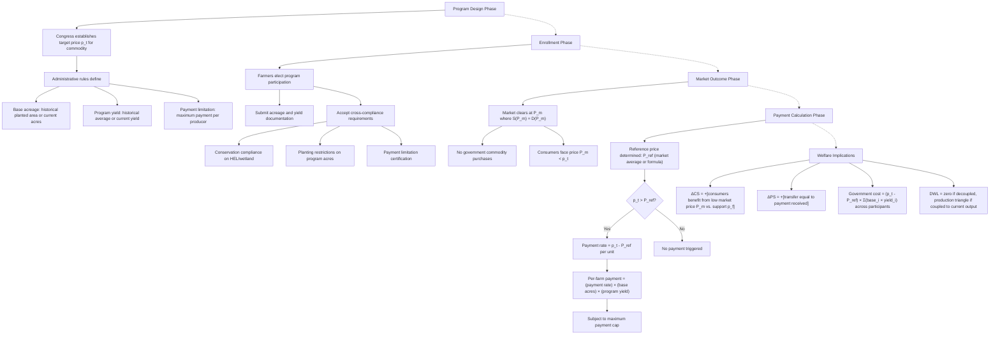
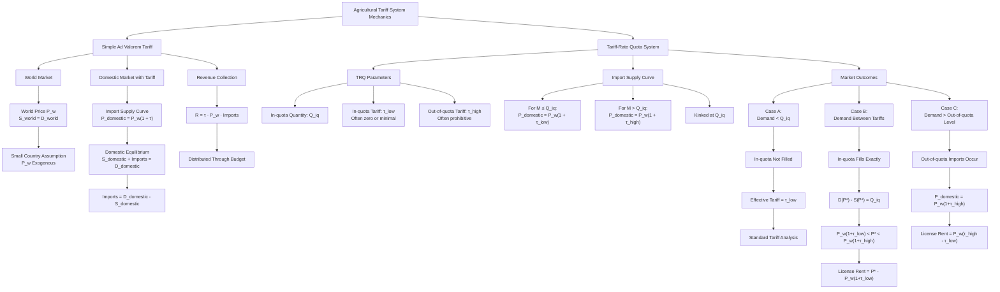

# Lesson 4: Policy Interventions in Agricultural Markets

## 1. First-Principles Intuition & Invariants

Agricultural markets occupy a unique position in the landscape of applied microeconomics, presenting characteristics that distinguish them from standard commodity and manufactured goods markets. The inelastic short-run supply curves driven by biological production cycles, the highly volatile price responses to weather shocks and yield variations, and the political economy pressures stemming from food security concerns create an environment where governments across the ideological spectrum intervene with remarkable consistency. Understanding policy interventions in agricultural markets requires mastering the fundamental welfare economics toolkit—consumer and producer surplus, deadweight loss triangles, and Pareto efficiency criteria—while simultaneously grasping the institutional and political constraints that make pure competitive equilibrium an unattainable benchmark in practice.

The central tension in agricultural policy analysis emerges from the conflict between static allocative efficiency and dynamic distributional objectives. Competitive equilibrium in agricultural markets, absent intervention, generates maximum total surplus under the standard assumptions of convex preferences, diminishing marginal productivity, and complete markets. The sum of consumer surplus—the area beneath the demand curve and above the equilibrium price—and producer surplus—the area above the supply curve and below the equilibrium price—reaches its theoretical maximum at the Walrasian market-clearing price and quantity. Any deviation from this equilibrium, whether through price floors, production quotas, or trade restrictions, creates a wedge between marginal willingness to pay and marginal cost of production, generating deadweight loss as transactions that would create mutual gains from trade fail to occur.

Yet the political economy of agriculture reveals why this theoretical efficiency benchmark proves inadequate as a policy guide. Agricultural producers face income volatility that exceeds most other sectors due to the multiplicative interaction of price and yield uncertainty. When favorable weather conditions produce bumper crops across a region, the inelastic demand for food commodities—consumers cannot double their caloric intake in response to a harvest surplus—causes prices to collapse, often driving total farm revenue downward despite increased physical output. This phenomenon, sometimes termed the "paradox of plenty" in agricultural contexts, creates severe income instability for farming households whose costs exhibit far less variance than their revenues. The asymmetric adjustment costs farmers face—it costs far more to exit and re-enter farming than to remain through difficult years—combined with the sector's historical role as a political constituency and cultural symbol, generate sustained pressure for government intervention.

The welfare economics framework for analyzing these interventions begins with the partial equilibrium supply and demand apparatus, modified to account for the specific institutional mechanisms each policy employs. Consider the fundamental geometry of a competitive agricultural market in autarky, where domestic supply curve $S(p)$ and domestic demand curve $D(p)$ intersect at equilibrium price $p^*$ and quantity $q^*$. Consumer surplus in this unregulated equilibrium equals $CS^* = \int_{p^*}^{\infty} D(p) \, dp$, representing the aggregate willingness to pay in excess of the amount actually paid. Producer surplus equals $PS^* = \int_{0}^{p^*} S(p) \, dp$, capturing the returns to land, capital, and entrepreneurship above variable costs. Total welfare $W^* = CS^* + PS^*$ represents the maximum gains from trade achievable through voluntary exchange in this market.

Government intervention disrupts this equilibrium through several archetypal mechanisms, each generating distinct patterns of surplus redistribution and deadweight loss. Price support programs establish a floor price $p_f > p^*$ at which the government commits to purchase unlimited quantities, effectively creating a perfectly elastic demand curve at the support price. This intervention transforms the market equilibrium: producers expand output to $q_s = S(p_f)$ while consumers reduce purchases to $q_d = D(p_f)$, creating an excess supply $q_s - q_d$ that the government must purchase and hold in stockpiles or dispose of through subsidized exports or destruction. The welfare consequences follow directly from the surplus geometry: producers gain rectangular area $(p_f - p^*) \cdot q_d$ from the higher price on units sold to consumers, plus triangular area representing surplus on expanded production, while losing nothing. Consumers lose rectangular area $(p_f - p^*) \cdot q_d$ as they pay higher prices for reduced consumption. The government expends $p_f \cdot (q_s - q_d)$ to purchase the surplus, a cost ultimately borne by taxpayers.

The deadweight loss from price supports manifests in two distinct triangular regions. The consumption deadweight loss arises because consumers reduce purchases from $q^*$ to $q_d$, foregoing transactions where their willingness to pay exceeds the true marginal cost of production $p^*$. This lost consumer surplus exceeds the gain in producer surplus from reduced consumption, creating a welfare triangle with base $(q^* - q_d)$ and height $(p_f - p^*)$. The production deadweight loss emerges from the expansion of output from $q^*$ to $q_s$, where marginal production costs exceed consumers' marginal willingness to pay for the surplus units. The government purchases these units at price $p_f$ despite their true social value being captured by the demand curve, which lies below the support price for quantities exceeding $q_d$. The total deadweight loss equals approximately $\frac{1}{2}(p_f - p^*)[(q^* - q_d) + (q_s - q^*)]$ under linear supply and demand, though the precise magnitude depends on the curvature of the underlying schedules and the elasticities of supply and demand.

Deficiency payment programs offer an alternative intervention mechanism that achieves similar distributional objectives while eliminating the production deadweight loss component. Under this policy architecture, the government establishes a target price $p_t$ but allows the market to clear freely at equilibrium price $p_m$, which typically falls below the target due to the anticipated subsidy. Producers receive a per-unit payment of $(p_t - p_m)$ for all units sold, bringing their effective price to the target level. This decoupling of the producer and consumer prices generates different welfare implications than price supports. Consumers face the lower market-clearing price $p_m$ rather than the elevated support price, eliminating the consumption distortion and associated deadweight loss. The government's fiscal cost equals $(p_t - p_m) \cdot q_m$, where $q_m$ represents the market-clearing quantity at price $p_m$, a cost that typically exceeds the taxpayer burden under price supports when target and support prices align, but avoids the storage and disposal costs associated with government-held surpluses.

The efficiency properties of deficiency payments relative to price supports hinge critically on the behavioral responses of producers to the two policy regimes. Under price supports, producers face the full supported price $p_f$ at the margin, inducing production expansion to $q_s = S(p_f)$. Under deficiency payments with target price $p_t = p_f$, producers' marginal incentive depends on the program's base calculation. If payments apply to current production—a coupled deficiency payment—producers still face effective price $p_t$ at the margin, generating identical production incentives to price supports. The policy differs only in reallocating the cost from consumers to taxpayers and eliminating government stock accumulation. However, if payments base on historical production or acreage—a decoupled deficiency payment—the marginal production incentive vanishes. Farmers receive transfers as a lump sum unrelated to current output decisions, allowing the market to clear at the efficient quantity $q^*$ while still redistributing income toward agricultural producers. This decoupling represents a movement along the Pareto frontier, transferring surplus from taxpayers to farmers without generating allocative inefficiency, though implementation challenges around defining and updating base periods create practical complications.

Production quotas and supply management regimes impose quantity restrictions rather than price interventions, rationing the right to produce among eligible farmers through tradable or non-tradable quota allocations. In the canonical quota model, the government restricts total production to $q_q < q^*$, causing market price to rise to $p_q = D^{-1}(q_q)$ where demand equals the constrained supply. This price elevation generates producer surplus identical to that under a price floor at $p_q$, but without requiring government purchases or fiscal expenditure. The quota right itself acquires economic value equal to the difference between the market price and the marginal cost of production at quantity $q_q$, creating a rents capitalization that becomes embedded in farmland values or quota permit prices if the restrictions prove durable and the rights tradable.

The welfare decomposition under quotas mirrors that of price supports in its effect on consumer and producer surplus, but diverges sharply in the allocation of the deadweight loss. Consumers lose surplus $(p_q - p^*) \cdot q_q + \frac{1}{2}(p_q - p^*)(q^* - q_q)$, combining the transfer to producers through higher prices with the efficiency loss from reduced consumption. Producers who hold quota rights capture not only this price elevation but also avoid the production expansion that dissipates rents under price supports. The production deadweight loss that emerged under price supports transforms into quota rents captured by permit holders. Total deadweight loss reduces to only the consumption triangle $\frac{1}{2}(p_q - p^*)(q^* - q_q)$, making quotas more efficient than price supports from a static welfare perspective, though the initial allocation of quota rights raises profound distributional questions that the Pareto criterion cannot resolve.

The efficiency properties of quota systems depend critically on the tradability of production rights. Under non-tradable quotas assigned to specific farms through grandfathering or political allocation, the marginal cost of production diverges across producers as those with low-cost production opportunities cannot expand while high-cost producers retain quota rights. This heterogeneity creates an additional allocative inefficiency: aggregate supply at quantity $q_q$ fails to minimize total production costs, as a reallocation of quota from high-cost to low-cost producers would reduce the resource costs of generating the restricted output. The sum of marginal costs across producers exceeds the minimum achievable, generating an invisible deadweight loss that standard demand-supply diagrams obscure. Making quotas tradable eliminates this inefficiency as low-cost producers purchase rights from high-cost producers, driving quota prices to equal the shadow value of the production constraint and ensuring the restricted output emerges from the most efficient producers. The Canadian dairy supply management system exemplifies this tradable quota architecture, with quota values per cow reaching hundreds of thousands of dollars in some provinces, capitalizing decades of expected future rents into current asset prices.

Trade policies and tariffs introduce the dimension of international price transmission and the distinction between small open economy and large country cases that fundamentally alter the welfare calculus. Consider a small open economy facing a perfectly elastic world supply at price $p_w < p^*$, where $p^*$ represents the autarky equilibrium price. In free trade, domestic consumers purchase quantity $D(p_w)$ while domestic producers supply only $S(p_w)$, with imports $M = D(p_w) - S(p_w)$ making up the difference. Consumer surplus expands dramatically relative to autarky as consumers access the lower world price, while producer surplus contracts as domestic farmers cannot compete with cheaper imports. The gains from trade equal the increase in total surplus $(CS + PS)$ relative to autarky, geometrically represented by the two triangles between autarky and world prices: the consumption expansion triangle and the production contraction triangle that captures the resource savings from importing goods where comparative advantage lies abroad.

An import tariff $t$ in the small open economy raises the domestic price to $p_w + t$ without affecting the world price, as the economy's import demand is infinitesimal relative to global markets. This tariff generates four distinct welfare regions. Consumers lose surplus equal to the area beneath the demand curve between $p_w$ and $p_w + t$ over the range from post-tariff consumption to free-trade consumption, a large trapezoid comprising the transfer to domestic producers, the government tariff revenue, and two deadweight loss triangles. Domestic producers gain surplus equal to the area above the supply curve between these two prices over the range from free-trade production to post-tariff production, capturing the protective effect of the tariff. Government collects revenue $t \cdot M_t$, where $M_t = D(p_w + t) - S(p_w + t)$ represents post-tariff imports, a transfer from consumers that enters the domestic welfare calculation if we assume tariff revenue returns to the domestic economy through public goods provision or lump-sum redistribution.

The two deadweight loss triangles under the tariff correspond precisely to the production and consumption distortions analyzed under price supports. The production triangle emerges as domestic output expands from $S(p_w)$ to $S(p_w + t)$, with marginal production costs rising along the supply curve while the true opportunity cost remains $p_w$—the resource cost of acquiring the goods through trade. Society devotes resources worth $p_w + t$ to produce goods that could be acquired for $p_w$ through imports, wasting resources valued at approximately $\frac{1}{2} t [S(p_w + t) - S(p_w)]$. The consumption triangle arises as domestic consumption contracts from $D(p_w)$ to $D(p_w + t)$, foregoing transactions where willingness to pay exceeds the world price, generating welfare loss approximately $\frac{1}{2} t [D(p_w) - D(p_w + t)]$. The total deadweight loss from the tariff equals the sum of these triangles, representing the efficiency cost of the distributional transfer from consumers to producers.

The large country case introduces terms-of-trade effects that modify this welfare calculus by recognizing that tariff-imposing country's import demand affects world prices. When the domestic tariff reduces import demand from $M$ to $M_t$, world price falls from $p_w$ to $p_w'$ to clear the global market. Domestic consumers now face price $p_w' + t$, which may exceed, equal, or fall short of the original free-trade domestic price $p_w$ depending on the relative magnitudes of the tariff and the world price decline. The welfare decomposition now includes an additional terms-of-trade gain: domestic consumers and producers transact at the lower world price $p_w'$ for the quantity of imports $M_t$ still purchased, capturing surplus $(p_w - p_w') \cdot M_t$ that represents a transfer from foreign producers to the domestic economy. This terms-of-trade effect can dominate the deadweight loss triangles for sufficiently large countries with inelastic rest-of-world export supply, generating the possibility of an optimal tariff $t^* > 0$ that maximizes domestic welfare at the expense of foreign producers and global efficiency.

The optimal tariff formula emerges from maximizing domestic welfare $W = CS + PS + t \cdot M$ with respect to the tariff rate, recognizing that imports $M$ and world price $p_w$ both depend on $t$. The first-order condition yields $t^* = -\frac{1}{\varepsilon_{M,p}}$, where $\varepsilon_{M,p}$ represents the elasticity of foreign export supply facing the domestic economy. When foreign supply is perfectly elastic—the small country case—the optimal tariff equals zero, as the country cannot affect world prices and the tariff generates only deadweight loss. When foreign supply exhibits finite elasticity, the optimal tariff trades off the terms-of-trade gain from depressing world prices against the marginal deadweight loss from further distorting domestic consumption and production. This beggar-thy-neighbor characteristic of the optimal tariff exposes the fundamental tension between national welfare maximization and global efficiency, explaining why tariff negotiations through multilateral institutions like the WTO focus on coordinated reduction schedules that prevent terms-of-trade manipulation.

Agricultural trade policies in practice exhibit complexity far beyond simple ad valorem tariffs, employing tariff-rate quotas, variable levies, and export subsidies that respond to price fluctuations and interact with domestic support programs. The European Union's Common Agricultural Policy historically combined high internal support prices with variable import levies that absorbed the difference between world and internal prices, creating a regime that automatically adjusted border protection to maintain domestic price stability regardless of world market conditions. Export subsidies completed the policy architecture by allowing the EU to dispose of production surpluses generated by support prices onto world markets, depressing global prices and imposing negative externalities on competing exporters. The Uruguay Round Agreement on Agriculture initiated disciplines on these trade-distorting subsidies, converting variable levies to bound tariffs, capping export subsidies, and distinguishing between production-linked "amber box" support subject to reduction commitments and decoupled "green box" support exempt from disciplines.

The Pareto efficiency implications of agricultural policy interventions follow directly from the deadweight loss analysis but warrant explicit articulation in the context of the First Fundamental Welfare Theorem. Competitive equilibrium in an agricultural market, absent externalities and with complete information, satisfies Pareto efficiency: no alternative allocation can make any agent better off without making another worse off. Price supports, production quotas, and tariffs all generate allocations that lie interior to the Pareto frontier, as the deadweight loss regions represent unexploited gains from trade. A hypothetical policy reform that eliminates the intervention and redistributes the resulting surplus gains through lump-sum transfers can make all parties better off—consumers, producers, and taxpayers—relative to the distorted equilibrium. Producers could receive transfers equal to their producer surplus under the intervention, consumers would benefit from lower prices, and the elimination of deadweight loss would generate surplus sufficient to finance the required transfers with resources remaining.

This Kaldor-Hicks potential compensation principle exposes the political economy puzzle of agricultural protection: if removing interventions generates aggregate gains sufficient to compensate losers, why do these inefficient policies persist across democracies and regime types? Several explanations emerge from public choice theory and the economics of collective action. Agricultural producers, though small in population share, exhibit high per-capita stakes in policy outcomes and concentrated geographic distribution that facilitates political organization, while consumers bear small individual costs from elevated food prices that rarely motivate political mobilization. The logic of collective action thus systematically favors producer interests in the policy formation process. Additionally, the lump-sum transfers required for Pareto-improving reform face practical implementation barriers. Taxes and transfers in reality distort labor supply, savings decisions, and other margins, generating their own deadweight losses that erode the theoretical efficiency gains. The Second Fundamental Welfare Theorem assures us that any Pareto efficient allocation can be achieved through competitive markets combined with lump-sum redistribution, but the non-existence of non-distortionary lump-sum instruments in practice constrains the attainable set of allocations.

The dynamic efficiency considerations complicate the static welfare analysis by introducing intertemporal dimensions of policy evaluation. Price stabilization programs that dampen volatility through buffer stocks or contingent interventions may generate welfare gains beyond the static deadweight loss calculus by allowing risk-averse farmers to make efficient long-run investment decisions and preventing inefficient exit and re-entry dynamics. The option value of maintaining agricultural capacity for food security during global supply disruptions provides another potential justification for support policies, though quantifying this benefit requires specifying the probability distributions of catastrophic events and the economy's ability to adjust through trade and substitution. Environmental externalities from intensive agriculture—nutrient runoff, pesticide contamination, biodiversity loss—introduce another dimension where laissez-faire equilibrium diverges from social optimum, potentially justifying interventions that internalize these external costs through Pigouvian taxation or subsidy reduction.

The measurement of consumer and producer surplus in agricultural markets requires careful attention to the functional forms of supply and demand and the time horizons over which adjustments occur. Short-run agricultural supply curves exhibit steep slopes or even vertical segments due to the biological fixity of production decisions: once seeds are planted, farmers will harvest regardless of price declines unless prices fall below variable costs of harvest. The relevant producer surplus in the short run thus reflects quasi-rents to land and fixed capital that cannot adjust. Long-run supply curves exhibit greater elasticity as land can shift between crops, farmers can exit or enter the sector, and technology adoption can respond to price signals. Policy evaluation thus requires distinguishing between short-run impacts where the quasi-fixed factors earn rents or suffer losses, and long-run equilibria where factors earn their opportunity costs and producer surplus reflects returns to scarce inputs like high-quality farmland.

Consumer surplus measurement faces its own complications from the income effects that arise when agricultural goods constitute a significant budget share, violating the partial equilibrium assumption of constant marginal utility of income. The compensating variation—the income required to restore a consumer to their initial utility level after a price change—and equivalent variation—the income change equivalent in welfare terms to a price change—provide theoretically grounded alternatives to the consumer surplus triangle when income effects are large. For small price changes or goods with small budget shares, the consumer surplus approximation proves adequate, but large policy shifts affecting staple foods in developing economies require the more sophisticated compensating variation approach that accounts for movements along indifference curves rather than demand curves.

Empirical estimation of welfare effects from agricultural policies requires econometric identification of supply and demand curves from observed price-quantity data, a classic simultaneous equations problem where both curves shift over time due to weather, technology, and policy changes. Instrumental variables approaches exploit exogenous supply shifters like weather variation and pest outbreaks to identify demand curves, while demand shifters like income growth and population changes identify supply curves. Structural estimation of systems of supply and demand equations allows recovery of the underlying elasticity parameters that govern the magnitudes of deadweight loss triangles and the distribution of surplus. Modern empirical work increasingly employs reduced-form quasi-experimental designs exploiting policy discontinuities—trade liberalization episodes, quota auction introductions, support program phase-outs—to identify causal effects of interventions on prices, quantities, and participant welfare without fully specifying structural supply and demand systems.

## 2. Core Architecture & Mechanics

The operational mechanics of agricultural policy interventions require understanding the institutional structures through which governments implement price floors, quota systems, and trade restrictions, translating the theoretical welfare geometry into tangible administrative procedures and market participant responses. Each intervention mechanism exhibits distinct signal paths from policy announcement to producer and consumer behavioral adjustment, creating characteristic patterns of surplus redistribution and resource misallocation that manifest in observable market outcomes.

Price support systems operate through government commodity loan programs or standing purchase commitments that establish a floor beneath which market prices cannot sustainably fall. The United States Department of Agriculture's commodity loan program exemplifies this architecture: eligible farmers pledge their harvested grain as collateral for non-recourse loans at the statutory loan rate, receiving immediate cash flow while retaining the option to either repay the loan plus interest and reclaim their commodity, or forfeit the collateral to the government in full satisfaction of the loan obligation when market prices remain below the loan rate. This option structure creates an effective price floor at the loan rate, as rational farmers forfeit whenever market price falls below loan rate plus storage costs, making the government the residual purchaser of surplus production.

```mermaid
flowchart TD
    A["Announcement Phase:<br/>Government declares support price p_f<br/>and eligible commodities"]
    B["Farmers observe p_f and<br/>form production expectations"]
    C["Planted acreage adjusts:<br/>A_planted = f(p_f, input costs, weather forecast)"]
    
    D["Growing Season:<br/>Weather realization determines yield<br/>Y = g(A_planted, rainfall, temperature)"]
    E["Aggregate supply manifests:<br/>Q_s = A_planted × Y"]
    
    F["Harvest & Market Phase:<br/>Market price P_m emerges from D(P_m) = Q_d"]
    
    G{"P_m ≥ p_f?"}
    
    H["Farmers sell to private buyers at P_m"]
    I["Government purchases zero quantity"]
    J["Market clears without intervention"]
    
    K["Consumers purchase Q_d = D(p_f) at price p_f"]
    L["Government purchases<br/>Q_surplus = Q_s - Q_d at price p_f"]
    M["Government storage accumulates inventory"]
    N["Storage costs = s · Q_surplus per period"]
    O["Inventory disposal:<br/>export subsidy, food aid, or destruction"]
    
    P["Welfare Accounting (P_m < p_f case)"]
    Q["ΔCS = -["(p_f - p*)·Q_d + ½(p_f - p*)·(Q* - Q_d)"]<br/>(Consumer surplus loss)"]
    R["ΔPS = +[(p_f - p*)·Q_d + rectangle on expanded production]<br/>(Producer surplus gain)"]
    S["Government cost = p_f·Q_surplus + s·Q_surplus"]
    T["DWL = consumption triangle +<br/>production triangle + storage costs"]
    
    A --> B --> C
    C --> D --> E
    E --> F --> G
    
    G -->|Yes| H --> I --> J
    G -->|No| K --> L --> M --> N --> O
    
    L --> P
    P --> Q
    P --> R
    P --> S
    P --> T
```

The deficiency payment mechanism decouples producer and consumer prices through direct subsidy payments calculated as the shortfall between a target price and market-clearing or reference price. Implementation requires administrative determination of eligible production, either through current output monitoring or historical base acreage and yield calculations. The United States employed coupled deficiency payments extensively during the 1970s-1990s under the deficiency payment program, where target prices exceeded market prices for corn, wheat, cotton, and rice, triggering per-bushel payments equal to the difference applied to program acres times program yield.



Production quota and supply management systems ration output through quantity allocations enforced by penalties for excess production or denial of market access. The Canadian dairy supply management exemplifies comprehensive quota implementation: provincial marketing boards allocate quota measured in kilograms of butterfat production rights, enforce penalties for over-quota production, and prohibit unquoted sales. Quota becomes a capitalizable asset tradable among producers within provincial boundaries, with market prices for quota revealing the present value of expected future rents from restricted supply.

```mermaid
flowchart TD
    Start["Quota System Operational Structure"]
    
    Start --> Phase1["Initial Allocation Phase"]
    
    Phase1 --> Target["Government determines target supply:<br/>Q_target < Q*"]
    Target --> AllocMethod["Allocation method determines<br/>quota distribution"]
    
    AllocMethod --> Grand["Grandfathering:<br/>Q_i = historical share × Q_target"]
    AllocMethod --> Auction["Auction:<br/>highest bidders receive quota rights"]
    AllocMethod --> PerCapita["Per-capita equal allocation:<br/>Q_i = Q_target / N_farmers"]
    
    Grand --> Phase2
    Auction --> Phase2
    PerCapita --> Phase2
    
    Phase2["Production Phase with Tradable Quotas"]
    
    Phase2 --> Constraint["Each producer i faces quota constraint:<br/>q_i ≤ Q_i_quota"]
    
    Constraint --> ProfitMax["Profit maximization:<br/>max["p_q · q_i - C_i(q_i)"]<br/>subject to q_i ≤ Q_i_quota"]
    
    ProfitMax --> Condition1{"MC_i(Q_i_quota) < p_q ?"}
    ProfitMax --> Condition2{"MC_i(Q_i_quota) ≥ p_q ?"}
    
    Condition1 -->|Yes| Binds["Quota constraint binds"]
    Binds --> Shadow["Shadow value:<br/>λ_i = p_q - MC_i(Q_i_quota)"]
    Shadow --> Buyer["Producer willing to buy<br/>additional quota at price ≤ λ_i"]
    
    Condition2 -->|Yes| UnderProduce["Producer produces q_i < Q_i_quota"]
    UnderProduce --> Seller["Willing to sell quota at price ≥<br/>MC_i(q_i) - p_q"]
    
    Buyer --> SecMarket
    Seller --> SecMarket
    
    SecMarket["Secondary Quota Market"]
    
    SecMarket --> QuotaPrice["Quota price P_quota emerges where:<br/>Σ[demand from low-cost producers] =<br/>Σ[supply from high-cost producers]"]
    
    QuotaPrice --> Equilibrium["Equilibrium:<br/>P_quota = shadow value for marginal producer"]
    
    Equilibrium --> Realloc["Quota reallocation continues until<br/>MC_i(q_i) = MC_j(q_j) ∀ i,j"]
    
    Realloc --> CostMin["Cost minimization achieved:<br/>Q_target produced at minimum resource cost"]
    
    CostMin --> MarketPrice["Market Price Determination"]
    
    MarketPrice --> RestrictQty["Restricted quantity Q_target<br/>enters consumer market"]
    
    RestrictQty --> PriceRise["Price rises to:<br/>p_q = D^(-1)(Q_target)"]
    
    PriceRise --> Revenue["Producer revenue = p_q · Q_target"]
    Revenue --> Rent["Quota rent per unit =<br/>p_q - MC(Q_target)"]
    Rent --> CapValue["Capitalized quota value =<br/>PV[future rents per unit] × quota_i"]
    
    CapValue --> Welfare["Welfare Distribution"]
    
    Welfare --> ConsLoss["Consumer loss = area under demand,<br/>above p_q, from Q_target to Q*"]
    Welfare --> ProdGain["Producer gain = quota rent rectangle +<br/>triangular quasi-rents"]
    Welfare --> QuotaCap["Quota value capitalization =<br/>rents incorporated into land/permit prices"]
    Welfare --> DWL["DWL = consumption triangle only<br/>(production efficiency restored by trade)"]
```

The tariff implementation architecture in agricultural trade transforms border prices through ad valorem percentage charges or specific per-unit duties, creating a wedge between world and domestic prices that protects domestic producers while generating government revenue. Tariff-rate quotas introduce non-linear schedules where imports up to a threshold enter at low in-quota rates while above-quota imports face prohibitive out-of-quota tariffs, creating a kinked effective supply curve facing domestic consumers.



The distribution of quota rents and tariff revenues introduces additional layers to the welfare analysis, as the mechanism for allocating import licenses or quota permits determines who captures the rectangular rent area between world and domestic prices. When governments auction import licenses, the revenue approximates the quota rent rectangle, accruing to the domestic treasury similarly to tariff revenue. When licenses are allocated through historical import shares or political allocation without payment, quota rents transfer to import license holders as windfall profits. When exporting countries negotiate voluntary export restraints—quantitative restrictions imposed by the exporting nation—rents transfer to foreign exporters who can allocate the restricted supply among themselves, representing a pure transfer from the importing country to foreign producers.

The comparative static responses of surplus measures to parameter changes reveal the sensitivity of welfare conclusions to underlying supply and demand elasticities. Consider the deadweight loss from a tariff $t$ in the small country case with linear supply $Q_s = a + bP$ and demand $Q_d = c - dP$ curves. The production deadweight loss equals $DWL_{prod} = \frac{1}{2} t \cdot b \cdot t = \frac{1}{2}bt^2$, directly proportional to the supply elasticity $\epsilon_s = \frac{b \cdot P}{Q}$ and rising quadratically in the tariff rate. The consumption deadweight loss $DWL_{cons} = \frac{1}{2}dt^2$ depends symmetrically on demand elasticity. More elastic supply and demand magnify deadweight loss for any given tariff rate, as the quantity distortions become larger. This elasticity dependence explains why agricultural commodities with inelastic short-run supply and demand generate smaller static deadweight losses from trade barriers than manufactured goods, though this observation provides no normative justification for protection, only a positive prediction about political economy outcomes.

The intertemporal dimension of policy analysis requires extending the static partial equilibrium framework to account for storage, expectations, and investment responses. Agricultural commodities that can be stored—grains, oilseeds, sugar—create intertemporal arbitrage opportunities where price expectations in future periods affect current storage decisions and market-clearing prices. A credible price support announced for the next harvest period raises current prices as private storage expands in anticipation of the support, creating an intertemporal substitution of consumption from present to future. The rational expectations equilibrium in a storage model with government support requires that the marginal cost of storage—interest charges plus physical depreciation—equals the expected marginal benefit from selling stored inventory when prices rise or the government purchases at the support price. This intertemporal no-arbitrage condition generates storage demand curves that amplify the market impact of announced future policies beyond their static partial equilibrium effects.

Dynamic stochastic simulation models capture these intertemporal and uncertainty dimensions by modeling supply and demand as functions of current and lagged prices, incorporating storage arbitrage conditions, and solving for stochastic rational expectations equilibria under specified distributions of productivity shocks. These simulation frameworks allow welfare evaluation of price stabilization policies, comparing the utility gains to risk-averse producers and consumers from reduced price volatility against the fiscal costs and deadweight losses from stabilization interventions. Calibration to empirically estimated elasticities and shock distributions permits quantitative assessment of optimal stabilization policy, typically finding that moderate stabilization through buffer stock releases in high-price years and accumulation in low-price years can generate welfare gains that exceed administrative costs, while perfect price stabilization proves prohibitively expensive due to the accelerating marginal costs of reducing volatility toward zero.

## 3. High-Performance Optimization & Failure Modes

The translation from theoretical welfare analysis to practical policy optimization requires confronting the information constraints, political economy frictions, and unintended behavioral responses that characterize real-world agricultural policy implementation. Optimal intervention design from a welfare economics perspective seeks to achieve distributional objectives—income support for farmers, food security assurance, rural community preservation—at minimum deadweight loss cost, subject to the informational and institutional constraints facing the policy authority. This optimization program differs fundamentally from the laissez-faire benchmark where no intervention maximizes total surplus, instead accepting distributional goals as binding constraints and minimizing efficiency costs conditional on those goals.

The optimal income transfer mechanism under full information would employ lump-sum payments to farmers uncorrelated with production decisions, harvesting the distributional gains without creating marginal incentive distortions. Such perfectly decoupled payments transform the policy problem from one of efficiency-equity tradeoff to pure redistribution along the Pareto frontier. In practice, administrative constraints prevent perfect decoupling. Determining which households merit farmer income support requires observing farming status, creating moral hazard as marginal households adjust their agricultural participation to qualify for transfers. Basing payments on historical production avoids distorting current decisions but freezes inequities from the base period and prevents efficient reallocation toward more productive farmers. The optimal second-best policy balances these concerns, typically employing decoupling to eliminate production distortions while accepting some base period lock-in and qualification moral hazard as unavoidable costs of targeting transfers toward farming households.

The comparative evaluation of alternative policy instruments through the deadweight loss metric reveals a strict welfare ranking when policies aim to transfer identical surplus amounts to producers. Deficiency payments dominate price supports because they eliminate the consumption distortion, allowing consumers to purchase at lower market-clearing prices rather than elevated support prices. Both deficiency payments and price supports, when coupled to current production, generate identical production distortions as marginal output receives the same effective price. Decoupled deficiency payments dominate coupled payments by eliminating the production distortion. Quotas dominate price supports when quota rights are tradable, as production occurs efficiently among low-cost producers, though quotas still impose consumption distortions from elevated prices. The first-best lump-sum transfer dominates all these mechanisms but faces targeting and moral hazard obstacles that make pure implementation infeasible.

This welfare ranking confronts the positive political economy observation that price supports historically dominated policy portfolios despite their inferior efficiency properties. Several factors explain this puzzle. Price supports operate through commodity markets with diffuse per-consumer costs, making taxpayer costs less salient than the explicit budget line items required for deficiency payments or lump-sum transfers. Farm interest groups exhibit stronger revealed preference for price-based interventions that maintain the cultural narrative of farmers earning income through markets rather than receiving welfare transfers. Bureaucratic interests favor price supports as they require larger administrative apparatus for commodity storage and disposal compared to the simple payment calculations under deficiency programs. These political economy considerations demonstrate that minimizing deadweight loss rarely serves as the binding constraint on actual policy design, instead entering as one factor among many in a political objective function that weighs fiscal opacity, constituent symbolism, and bureaucratic scope alongside allocative efficiency.

The empirical identification of optimal intervention parameters requires estimating supply and demand elasticities that determine the marginal deadweight loss from price distortions. Classical ordinary least squares regression of quantity on price generates biased estimates in agricultural markets where both supply and demand shift simultaneously due to weather variation, productivity shocks, and policy changes. The canonical identification strategy employs instrumental variables that shift one curve while leaving the other unchanged. Weather variables—rainfall, temperature deviations, frost days—serve as instruments for supply shifts that identify the demand curve, as they affect quantity supplied through yield impacts while not directly entering consumer preferences. Income growth and population changes serve as demand shifters that identify supply curves by moving willingness to pay independently of production costs. Two-stage least squares estimation using these instruments recovers consistent estimates of price elasticities that permit deadweight loss calculation for proposed policy interventions.

Modern empirical work increasingly exploits natural experiments and policy discontinuities that generate quasi-random variation in prices or quantities, identifying local treatment effects without requiring full structural specification of supply and demand systems. The introduction of tradable quota systems provides one such experiment: comparing marginal cost distributions across producers before and after quota markets commence reveals the efficiency gains from reallocation toward low-cost producers. Trade liberalization episodes where tariffs drop discontinuously allow difference-in-differences estimation comparing domestic prices, production, and consumption in liberalizing versus non-liberalizing sectors or countries, identifying the causal impact of trade barriers on market outcomes and surplus distribution. These reduced-form designs sacrifice the ability to conduct counterfactual simulations at arbitrary parameter values in exchange for credible identification of causal effects under weaker functional form assumptions.

The failure modes of agricultural policy interventions manifest through several characteristic pathologies that emerge from the interaction of policy distortions with producer optimization, generating outcomes that often surprise policy designers who neglect general equilibrium and dynamic adjustment margins. The capitalization of farm support into land values represents a critical failure mode where the intended income transfer to farmers dissipates into higher rents captured by landowners. When support programs link payments to farmed acreage, the rental value of farmland rises to reflect the present value of expected future payments, creating a one-time wealth gain to landowners at program initiation but no ongoing benefit to tenant farmers or new landowners who pay elevated land prices. This capitalization converts the flow of agricultural support into a stock of land value, making policy reform politically difficult as landowners lobby to preserve the asset value embedded in their property even if they no longer farm.

The empirical magnitude of capitalization depends on the durability and acreage-linkage of support programs. Studies of United States farm programs find capitalization rates of 50-100 percent for programs with stable payment formulas linked to base acreage, meaning that land values rose to fully reflect expected payment streams, eliminating income gains for purchasers acquiring land after program implementation. Decoupled payments capitalized less than coupled payments, as the market perceived greater political vulnerability for transfers not linked to production. The capitalization channel reveals a fundamental tension in agricultural policy: supporting farm income requires either limiting new entry and land transactions—creating locked-in benefits for incumbent farmers but preventing efficient reallocation—or accepting that support values dissipate into land prices, converting income transfers into wealth transfers that accrue to landowners at program adoption.

The supply expansion problem under price supports creates accelerating fiscal costs as the gap between support price and market-clearing price widens with accumulated surplus production. The United States dairy price support program during the 1980s exemplifies this failure mode: support prices set above market equilibrium induced milk production expansion while consumption stagnated, requiring government purchases that peaked above 10 percent of total production. Storage costs for accumulated butter and cheese inventories compounded the fiscal burden, while efforts to dispose of surpluses through subsidized exports triggered international trade disputes as foreign producers challenged the market-distorting impacts. The eventual policy response combined production quotas to limit milk production with gradual support price reductions, demonstrating the instability of pure price support programs that fail to constrain quantity responses.

The non-tariff barrier proliferation in agricultural trade represents another failure mode where politically constrained countries circumvent tariff reduction commitments through regulatory instruments that achieve equivalent import restriction. Sanitary and phytosanitary standards, while legitimately protecting consumer health from contaminated or diseased imports, exhibit systematic abuse as non-tariff barriers when applied more stringently to imports than domestic production or when based on non-scientific risk assessments. Technical barriers to trade including labeling requirements, quality standards, and packaging regulations similarly serve protectionist objectives while formally complying with tariff bindings. The quantitative impact of these non-tariff measures often exceeds that of remaining tariffs, converting tariff liberalization victories into pyrrhic achievements when regulatory barriers expand to fill the protection void.

Empirical measurement of non-tariff barrier trade impacts employs gravity model estimation where bilateral trade flows depend on economic size, distance, common language, and policy variables. Inclusion of indicator variables for sanitary regulations, technical standards, and inspection requirements permits identification of their trade-restricting effects conditional on tariffs. These estimates reveal ad valorem equivalent tariff impacts for non-tariff measures frequently exceeding 20-30 percent for agricultural products, dwarfing the single-digit bound tariffs achieved through WTO negotiations. The regulatory heterogeneity across countries creates a complex matrix of bilateral barriers where each importing country maintains unique standards, multiplying compliance costs for exporters serving multiple markets and fragmenting global agricultural trade more severely than uniform tariffs would.

The quota rent dissipation problem emerges when production quotas lack effective enforcement or tradability constraints prevent efficient allocation. In fisheries managed through total allowable catch limits divided into non-tradable individual vessel quotas, heterogeneous vessel productivity creates large cost differences across the fleet. Restricting total harvest to the sustainable catch level raises price and creates quota rents, but the rents dissipate through excessive fishing effort as high-cost vessels continue operating rather than selling quota to more efficient vessels. This common pool rent dissipation parallels the classic overuse problem in open access resources, demonstrating that quantity restriction alone proves insufficient without reallocation mechanisms that minimize the resource costs of producing the restricted output. Making quotas tradable restores efficiency by allowing low-cost vessels to purchase rights from high-cost vessels until marginal costs equalize across the fleet, maximizing rents subject to the catch constraint.

The measurement of total welfare costs from agricultural interventions requires aggregating deadweight losses across all markets and policy instruments while accounting for cross-market interactions through input substitution, product transformation, and international trade linkages. A comprehensive analysis cannot treat each commodity market in isolation, as support for corn production affects livestock feed costs and therefore meat supply, while export subsidies for wheat affect world prices and therefore import costs for wheat-importing countries. Computable general equilibrium models address these interactions by specifying production functions, consumer utility functions, and market clearing conditions across all sectors simultaneously, calibrating parameters to input-output tables and elasticity estimates, then simulating the counterfactual equilibrium under alternative policy scenarios. The welfare change from policy reform equals the equivalent variation—the income change that would generate the same utility change as the policy reform—aggregated across all agents in all countries.

OECD's Producer Support Estimate methodology provides standardized cross-country measurement of agricultural support, calculating the annual monetary value of gross transfers from consumers and taxpayers to agricultural producers arising from policy interventions. The PSE decomposes total support into market price support—the gap between domestic and world prices multiplied by production—and budgetary payments from taxpayers. Expressing PSE as a percentage of gross farm receipts permits cross-country comparisons, revealing substantial variation from below 10 percent in Australia and New Zealand to above 50 percent in Japan, Korea, and Switzerland. Time series analysis shows declining PSE percentages across OECD countries from peaks near 40 percent in the mid-1980s to approximately 18 percent by 2020, reflecting gradual liberalization under WTO disciplines and domestic reform pressures.

The incidence of agricultural policy interventions—who ultimately bears the costs and captures the benefits—depends critically on the relative elasticities of supply and demand and on whether markets are open or closed to trade. The standard tax incidence result applies: the more inelastic side of the market bears greater burden of a tax or captures greater benefit from a subsidy, regardless of the statutory point of application. In agriculture, short-run supply curves are more inelastic than demand curves for most commodities due to the biological production cycle rigidity, suggesting farmers capture most benefits from price supports in the short run. In the long run, supply elasticities rise as land reallocates and entry-exit dynamics unfold, shifting more of the surplus toward consumers and landowners. In open economies where domestic markets face perfectly elastic import supply at world prices, price supports and tariffs generate larger production distortions as domestic producers expand output in response to elevated prices while consumers continue purchasing at world prices plus the tariff wedge.

The dynamic consistency problem in agricultural policy arises because optimal support levels announced for future periods create incentives for current production and investment decisions that render the announced policy suboptimal when the future period arrives. Consider a government announcing high support prices for next year's harvest to encourage planting. Farmers respond by expanding acreage, but when harvest occurs and the large crop materializes, the government faces escalating fiscal costs from purchasing the surplus at the announced support price. The time-consistent policy would renege on the support commitment, allowing prices to fall to market-clearing levels. But farmers anticipating this dynamic inconsistency discount the announced support price by the probability of reneging, reducing the policy's effectiveness in inducing production. This credibility problem explains the persistence of agricultural support programs once implemented: governments build reputations for honoring support commitments precisely because breaking commitments would destroy future policy effectiveness.

The optimal policy design under dynamic consistency constraints employs institutional commitment mechanisms that raise the cost of policy reversal. Legislated support prices with statutory language requiring commodity purchases at specified rates create legal obligations that prevent discretionary reneging. Multi-year authorization periods during which support levels remain fixed generate predictability that enhances farmer response while limiting the government's ability to adjust to realized production outcomes. Delegating policy implementation to semi-autonomous commodity agencies with industry representation creates bureaucratic vested interests that lobby for program continuation, reducing reversal probability at the cost of making programs difficult to reform when economic conditions change. These commitment mechanisms trade off the flexibility to respond to new information against the credibility gains from constraining future discretion.

The intersection of agricultural policy with environmental externalities introduces another dimension of market failure where standard Pigouvian taxation or subsidy approaches conflict with farm income support objectives. Intensive agriculture generates nutrient runoff that contaminates watersheds, pesticide applications that harm non-target species and pollinators, and tillage practices that accelerate soil erosion and carbon emissions. The efficient internalization of these external costs requires taxing the polluting activities—nitrogen fertilizer taxes, pesticide excise taxes, tillage penalties—bringing private costs into alignment with social costs. But commodity price supports that elevate farm income perversely intensify environmental degradation by encouraging production expansion on marginal lands and intensified input application to maximize returns on the supported price. The second-best policy problem becomes one of jointly optimizing income support and environmental regulation, typically requiring decoupled payments to achieve distributional goals combined with environmental input taxes or practice standards that internalize external costs.

The conservation compliance provisions attached to United States farm programs exemplify this joint optimization approach: farmers receiving commodity support payments must implement soil conservation practices on highly erodible land and preserve existing wetlands, creating cross-compliance linkages that leverage the distributional transfer to achieve environmental objectives. The magnitude of compliance costs relative to payment benefits determines the binding constraint on farmer behavior. When payment values substantially exceed compliance costs, farmers adjust practices to qualify for transfers, generating environmental improvements beyond what direct regulation could achieve without the payment inducement. When compliance costs exceed payment benefits, high-environmental-cost farmers exit the program, allowing support to concentrate on lower-externality producers. This screening mechanism enhances program efficiency by sorting participants based on environmental costs.

The political economy equilibrium of agricultural protection emerges from the interaction of producer and consumer lobby pressures, bureaucratic interests, and institutional structures that aggregate preferences into policy outcomes. The Grossman-Helpman protection for sale model provides a game-theoretic framework where organized interest groups offer political contributions contingent on policy choices while the government maximizes a welfare function that trades off social welfare against contributions. The equilibrium support level for each commodity sector depends on the sector's organization strength, the government's weight on social welfare versus contributions, and the import penetration ratio that determines the deadweight loss per dollar of protection. This framework predicts higher protection for organized sectors with low import penetration—precisely the pattern observed in agricultural data where dairy, sugar, and rice receive substantially higher support than grains and oilseeds.

The empirical testing of political economy models of protection employs cross-sectional regression of sector-specific support measures on political organization variables, import competition measures, and sector characteristics. Results consistently find that political organization substantially predicts support levels even after controlling for economic variables, confirming the central role of lobbying in agricultural policy formation. The policy implications suggest that reducing agricultural protection requires altering the political economy equilibrium, either through international agreements that allow governments to credibly commit to liberalization despite domestic lobbying, through compensation mechanisms that buy out producer opposition to reform, or through institutional reforms that reduce the translation of lobbying expenditures into policy influence.
