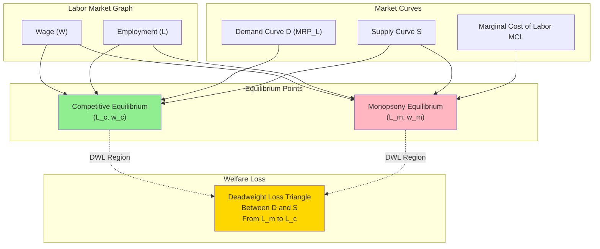

# Lesson 4: Monopsony, Search Frictions, Unions, Institutional Constraints

## 1. First-Principles Intuition & Invariants

The canonical competitive labor market model assumes that workers face a horizontal demand curve for their labor—they are wage takers, accepting the market-clearing price without friction or negotiation. Firms, in turn, face a horizontal supply curve at the competitive wage, hiring as many workers as they desire at the prevailing rate. This symmetric price-taking behavior produces the standard result that employment occurs where the value of the marginal product equals the wage, and the allocation is Pareto efficient with zero deadweight loss. Yet this textbook equilibrium dissolves rapidly when we relax the assumption of perfect competition on the demand side of the labor market.

A monopsony arises when a single buyer of labor possesses market power sufficient to influence the wage rate through its hiring decisions. Unlike the competitive firm that treats the wage as an exogenous parameter, the monopsonist recognizes that recruiting an additional worker requires raising the wage not only for that marginal hire but for all inframarginal employees as well. This wedge between the marginal cost of labor and the wage rate creates an incentive to restrict employment below the competitive benchmark, generating allocative inefficiency and deadweight loss. The monopsony problem is not a theoretical curiosity confined to isolated company towns or single-employer islands. Modern empirical labor economics has documented substantial employer concentration in many metropolitan labor markets, particularly in nursing, teaching, and non-compete constrained professional services, where a handful of hospital systems, school districts, or dominant firms exercise significant wage-setting power.

The wage markdown under monopsony can be formalized by examining the firm's optimization problem. Let the labor supply curve facing the firm be $w = w(L)$, strictly increasing in employment $L$. The firm's total revenue is $R(L)$, with marginal revenue product $MRP_L = R'(L)$. The wage bill is $w(L) \cdot L$, and the marginal cost of labor is

$$
MCL = \frac{d[w(L) \cdot L]}{dL} = w(L) + L \cdot w'(L).
$$

Because $w'(L) > 0$, the marginal cost of labor exceeds the wage: $MCL > w$. The monopsonist hires workers until $MRP_L = MCL$, which occurs at a lower employment level than the competitive optimum where $MRP_L = w$. The resulting wage markdown is the difference between the value of the marginal product and the wage actually paid, and this gap represents both a transfer from workers to the employer and a deadweight loss from foregone mutually beneficial employment relationships.

The magnitude of the markdown depends on the elasticity of labor supply to the firm. If the firm faces an upward-sloping but elastic supply curve, the markdown is modest. If supply is highly inelastic—because workers face high mobility costs, possess firm-specific skills, or are bound by non-compete agreements—the monopsonist can suppress wages substantially below the competitive level. This observation is central to recent empirical research showing that even modest levels of employer concentration can produce significant wage effects, particularly when combined with search frictions and institutional barriers to worker mobility.

Search frictions introduce a second fundamental departure from the Walrasian labor market. In the canonical search model pioneered by McCall, workers are unemployed and receive random wage offers drawn from a known distribution $F(w)$. Each period, the worker observes a single offer and must decide whether to accept it or reject it and continue searching. Accepting the offer yields a perpetual income stream of $w$ per period, while rejecting it incurs an opportunity cost of foregone employment but preserves the option value of finding a better match in the future. The worker's optimal strategy is characterized by a reservation wage $w^*$: accept any offer $w \geq w^*$ and reject offers below the threshold.

The reservation wage is determined by equating the value of accepting a marginal offer to the value of continued search. Let $V_u$ denote the value of unemployment and $V_e(w)$ the value of employment at wage $w$. In steady state, the reservation wage $w^*$ satisfies

$$
V_e(w^*) = V_u,
$$

and the value functions obey the Bellman equations

$$
rV_u = b + \lambda \int_{w^*}^{\infty} [V_e(w) - V_u] \, dF(w),
$$

$$
rV_e(w) = w + \delta [V_u - V_e(w)],
$$

where $r$ is the discount rate, $b$ is the flow value of unemployment (leisure, home production, or unemployment benefits), $\lambda$ is the job offer arrival rate, and $\delta$ is the exogenous separation rate. Combining these equations and solving for $w^*$ yields the reservation wage condition

$$
w^* = b + \frac{\lambda}{r + \delta} \int_{w^*}^{\infty} [w - w^*] \, dF(w).
$$

The second term on the right-hand side captures the option value of search: the expected present value of wage gains from waiting for a better offer. An increase in unemployment benefits $b$ raises the reservation wage directly, as does an increase in the offer arrival rate $\lambda$, which makes search more productive. Conversely, a higher discount rate or separation rate reduces the option value and lowers the reservation wage, making workers more willing to accept lower-paying jobs immediately.

Search frictions generate equilibrium unemployment even in the absence of wage rigidity or aggregate demand deficiencies. Workers optimally reject low-wage offers in pursuit of higher-value matches, and this selective acceptance strategy produces a positive unemployment rate in steady state. The efficiency properties of the decentralized search equilibrium depend on whether workers internalize the social value of their search effort. In the classic Diamond-Mortensen-Pissarides matching framework, firms post vacancies at a cost, and the meeting rate between unemployed workers and vacant jobs is determined by a matching function $m(U, V)$, where $U$ is unemployment and $V$ is vacancies. The equilibrium typically exhibits inefficient entry: firms may post too many or too few vacancies relative to the social optimum because they do not internalize the congestion externalities their hiring decisions impose on other firms and workers. This inefficiency provides a potential rationale for active labor market policies, including job placement services, training subsidies, and search assistance programs.

Collective bargaining introduces a third mechanism through which labor market institutions shape wage and employment outcomes. A labor union acts as a monopoly supplier of labor, negotiating wages and employment terms on behalf of its members. The union's objective function typically depends on both the wage level and the employment level, reflecting the dual mandate to maximize compensation for employed members while maintaining sufficient employment to preserve union membership and political cohesion. A simple formulation is the Stone-Geary utility function

$$
U(w, L) = (w - w_0)^\alpha L^{1 - \alpha},
$$

where $w_0$ is the outside option wage and $\alpha \in (0, 1)$ parameterizes the union's relative preference for wages versus employment. The firm's labor demand curve is $L = L(w)$, downward sloping in the wage. The union chooses the wage to maximize its objective subject to the constraint that employment is determined by the firm's demand curve. The first-order condition yields

$$
\frac{\alpha}{w - w_0} = -(1 - \alpha) \frac{L'(w)}{L(w)} = (1 - \alpha) \epsilon_L,
$$

where $\epsilon_L > 0$ is the absolute value of the labor demand elasticity. Rearranging, the union wage satisfies

$$
w = w_0 + \frac{\alpha}{(1 - \alpha) \epsilon_L} w,
$$

implying a wage markup over the outside option that is increasing in the union's wage preference parameter $\alpha$ and decreasing in the labor demand elasticity $\epsilon_L$. Unions with highly elastic labor demand face a steep employment cost for wage increases and therefore moderate their wage demands. Conversely, unions facing inelastic demand—due to the firm's monopoly product market power, high capital-labor substitution costs, or legal restrictions on outsourcing—can extract larger wage premia without triggering substantial employment losses.

The interaction between union bargaining and monopsony power produces theoretically ambiguous employment effects. In a competitive labor market, a union wage premium unambiguously reduces employment below the competitive level, creating a deadweight loss. Under monopsony, however, the union acts as a countervailing force, pushing wages and employment closer to the competitive benchmark. If the union sets the wage exactly at the competitive level, employment rises to the efficient quantity, eliminating the monopsony deadweight loss entirely. If the union pushes wages above the competitive level, employment may still exceed the monopsony optimum, though it will fall short of the competitive level. This theoretical insight is crucial for interpreting the empirical literature on minimum wages under imperfect competition.

The minimum wage debate has been transformed by the recognition that labor markets frequently exhibit monopsony power. The canonical competitive model predicts that a binding minimum wage reduces employment by pricing low-productivity workers out of the market. Under monopsony, the same minimum wage can increase employment by compelling the monopsonist to move up the labor supply curve toward the efficient allocation. The critical question is whether the minimum wage binds between the monopsony wage and the competitive wage—in which case employment rises—or above the competitive wage—in which case employment falls. The elasticity of employment with respect to the minimum wage provides an empirical signature of market structure: a zero or positive elasticity suggests monopsony or significant search frictions, while a negative elasticity is consistent with the competitive model.

The efficiency wage hypothesis offers a fourth explanation for wage rigidity and involuntary unemployment. In the Shapiro-Stiglitz shirking model, firms cannot perfectly monitor worker effort, and workers choose between exerting effort or shirking. Shirking is detected with probability $q$ per unit time, and detected shirkers are fired. Let $V_e$ and $V_u$ denote the value of employment and unemployment, respectively, and let $\bar{e}$ denote the disutility of effort. A worker exerts effort if and only if

$$
V_e - \bar{e} \geq (1 - q)(V_e) + q V_u,
$$

which simplifies to the no-shirking condition

$$
V_e - V_u \geq \frac{\bar{e}}{q}.
$$

The gap between the value of employment and unemployment must exceed the ratio of effort disutility to the detection probability. Firms set wages to satisfy this constraint, and the resulting efficiency wage exceeds the market-clearing level. In equilibrium, involuntary unemployment serves as a worker discipline device: the threat of job loss and the resulting spell of unemployment deters shirking. The efficiency wage model predicts that wages will not fall to clear the labor market even in the presence of excess labor supply, and it provides a microeconomic foundation for Keynesian unemployment without appealing to nominal wage rigidity or menu costs.

Efficiency wages can also arise from adverse selection and gift exchange mechanisms. In the adverse selection variant, high wages attract higher-quality workers by pooling applicants from a heterogeneous distribution of ability. Firms cannot observe worker quality directly and use wages as a screening device, paying above-market rates to ensure that only high-ability workers apply. In the gift exchange model, workers reciprocate generous wages with elevated effort, driven by social preferences for fairness and reciprocity rather than purely pecuniary incentives. Experimental and field evidence supports the empirical relevance of gift exchange, particularly in settings where monitoring is costly and worker morale significantly affects productivity. Both mechanisms imply that cutting wages in response to unemployment reduces firm profitability because the wage reduction drives away the most productive workers or demoralizes the existing workforce, more than offsetting the direct cost savings.

## 2. Core Architecture & Mechanics

The structural mechanics of monopsony wage determination can be visualized by comparing the competitive and monopsonist equilibrium conditions graphically. In a competitive labor market, the labor supply curve $S(w)$ represents the aggregate willingness of workers to supply labor at each wage level, and the labor demand curve $D(L)$ represents the marginal revenue product of labor. Equilibrium occurs at the intersection $(L_c, w_c)$, where $MRP_L = w_c$. Total surplus is maximized, with worker surplus equal to the area below the supply curve and above the wage, and firm surplus equal to the area below the demand curve and above the wage.

Under monopsony, the firm recognizes that hiring an additional worker requires raising the wage for all existing workers. The marginal cost of labor schedule $MCL(L)$ lies above the supply curve, with the vertical distance between them proportional to the slope of the supply curve and the current employment level. The monopsonist hires workers until $MRP_L = MCL$, which occurs at employment level $L_m < L_c$. The monopsony wage $w_m$ is read off the supply curve at $L_m$, strictly below the competitive wage $w_c$. The wedge between $MRP_L$ at $L_m$ and the wage $w_m$ represents the markdown—the difference between what the marginal worker produces and what they are paid.

The deadweight loss is the triangular area between the demand and supply curves from $L_m$ to $L_c$, representing the surplus from mutually beneficial employment relationships that are not realized under monopsony. The size of this deadweight loss depends on the elasticity of labor supply and the curvature of the demand curve. If labor supply is highly inelastic, the monopsonist can suppress employment significantly without raising wages much, leading to a large markdown and substantial allocative inefficiency.

When a minimum wage $w_{min}$ is imposed in a monopsony labor market, the firm's effective labor supply curve becomes horizontal at $w_{min}$ up to the point where it intersects the original supply curve, after which it resumes its upward slope. The marginal cost of labor schedule also becomes horizontal at $w_{min}$ over the same range, because the firm no longer raises wages for inframarginal workers when hiring within this region. If $w_m < w_{min} \leq w_c$, the minimum wage shifts the effective marginal cost curve downward, and the monopsonist's profit-maximizing employment level increases to the point where $MRP_L = w_{min}$. At $w_{min} = w_c$, employment reaches the competitive level $L_c$, and deadweight loss is eliminated. If $w_{min} > w_c$, the minimum wage overshoots the competitive benchmark, and employment falls below $L_c$, reintroducing deadweight loss from the opposite direction.

The search model's reservation wage dynamics are governed by the flow values of employment and unemployment and the transition rates between states. In discrete time, we can simulate the worker's decision process using a simple algorithm. Initialize the worker in the unemployed state. Each period, draw a wage offer $w$ from the offer distribution $F(w)$. If $w \geq w^*$, the worker accepts and transitions to employment, receiving the wage $w$ every period until exogenously separated back to unemployment at rate $\delta$. If $w < w^*$, the worker rejects the offer, receives the unemployment benefit $b$, and draws a new offer next period with probability $\lambda$.

The reservation wage $w^*$ adjusts endogenously to equilibrate the worker's indifference condition. An increase in unemployment benefits $b$ raises the flow value of unemployment, requiring a higher reservation wage to make the worker willing to accept employment. An increase in the offer arrival rate $\lambda$ raises the option value of search, as workers expect to receive higher offers more frequently, again raising the reservation wage. An increase in the separation rate $\delta$ reduces the expected duration of employment, lowering the present value of accepting a job and reducing the reservation wage. These comparative statics have direct policy implications: generous unemployment insurance raises reservation wages, lengthens unemployment spells, and improves match quality by enabling workers to wait for better offers. Job training programs that increase the offer arrival rate similarly raise reservation wages and unemployment duration, though they improve long-run employment outcomes by facilitating better matches.

The Diamond-Mortensen-Pissarides matching model introduces vacancy posting and bilateral search. Let $\theta = V / U$ denote the labor market tightness, the ratio of vacancies to unemployment. The job-finding rate for workers is $\lambda(\theta)$, increasing in tightness, and the vacancy-filling rate for firms is $q(\theta) = \lambda(\theta) / \theta$, decreasing in tightness. Firms post vacancies until the expected present value of a filled job equals the cost of posting. Workers search until the expected present value of employment equals the value of continued unemployment. The equilibrium tightness $\theta^*$ simultaneously satisfies the free-entry condition for firms and the reservation wage condition for workers.

The Hosios condition provides a criterion for constrained efficiency in the matching model. If workers capture a share of the match surplus equal to the elasticity of the matching function with respect to unemployment, the decentralized equilibrium replicates the social planner's solution. Deviations from the Hosios condition lead to inefficient entry: if workers capture too large a share, firms post too few vacancies, and if workers capture too small a share, firms post too many vacancies relative to the social optimum. Wage bargaining institutions, including collective bargaining agreements and minimum wage laws, affect the division of surplus and therefore the efficiency of vacancy posting and search effort.

The union's wage-setting problem can be analyzed using the standard monopoly markup framework. The union faces the firm's downward-sloping labor demand curve $L(w)$ and chooses the wage to maximize its objective function $U(w, L(w))$. The first-order condition is

$$
\frac{\partial U}{\partial w} + \frac{\partial U}{\partial L} L'(w) = 0,
$$

which can be rearranged to express the union's marginal rate of substitution between wages and employment:

$$
-\frac{L'(w)}{L(w)} = \frac{\partial U / \partial w}{\partial U / \partial L} \cdot \frac{1}{L(w)}.
$$

For the Stone-Geary utility function, this simplifies to the markup formula derived earlier. The union's wage premium over the competitive wage depends on the relative weight placed on wages versus employment and the responsiveness of labor demand to wage changes. Unions in industries with highly elastic labor demand—due to competitive product markets, low capital intensity, or easy substitution between labor and capital—face a steep tradeoff and set modest wage premia. Unions in industries with inelastic labor demand—such as regulated utilities, government services, or firms with strong product market power—can extract substantial wage gains without triggering large employment losses.

The efficiency wage model's no-shirking condition can be embedded into a general equilibrium framework by aggregating across firms and workers. Let $N$ be the total labor force, $L$ the total employment, and $U = N - L$ the unemployment. The value of employment at the efficiency wage $w_e$ satisfies

$$
(r + \delta) V_e = w_e - \bar{e},
$$

where $r$ is the discount rate and $\delta$ is the separation rate. The value of unemployment satisfies

$$
(r + \lambda) V_u = b + \lambda V_e,
$$

where $\lambda$ is the job-finding rate and $b$ is the flow value of unemployment. Combining these and imposing the no-shirking condition $V_e - V_u = \bar{e} / q$ yields the efficiency wage:

$$
w_e = b + \bar{e} \left(1 + \frac{r + \delta + \lambda}{q} \right).
$$

The efficiency wage exceeds the worker's outside option $b$ plus effort cost $\bar{e}$ by a premium that depends on the discount rate, separation rate, job-finding rate, and detection probability. In steady state, flows into and out of unemployment must balance: $\delta L = \lambda U$, which determines the equilibrium unemployment rate $u = U / N$. If the efficiency wage exceeds the market-clearing wage, the labor market remains in perpetual excess supply, with involuntary unemployment serving as a worker discipline device.

## 3. High-Performance Optimization & Failure Modes

Empirical identification of monopsony power in real-world labor markets requires measuring the elasticity of labor supply to the firm. The traditional approach estimates the firm-level labor supply elasticity by regressing employment on wages, controlling for worker and firm characteristics. A low elasticity—on the order of one to four—suggests substantial monopsony power, as the firm can reduce employment significantly without experiencing large wage increases. More recent quasi-experimental approaches exploit merger and acquisition activity, using the increase in employer concentration within a local labor market as a shock to monopsony power. Difference-in-differences estimates from hospital mergers, school district consolidations, and retail chain acquisitions consistently find wage declines of three to five percent following increases in employer concentration, with larger effects in thin labor markets and for workers with firm-specific skills or occupational licensing requirements.

The dynamic monopsony model extends the static framework by allowing firms to incur recruitment and training costs. In this setting, the firm faces an upward-sloping supply curve of new hires, and the stock of incumbent workers adjusts sluggishly through hiring and separation. The firm's optimization problem becomes dynamic, trading off the short-run cost of higher wages against the long-run benefit of a larger, more stable workforce. The solution exhibits wage rigidity: firms smooth wages over time rather than adjusting them period-by-period to clear the spot market. This wage rigidity amplifies the employment effects of minimum wage increases, as firms cannot immediately adjust wages downward in response to the binding floor. Empirical evidence from minimum wage natural experiments—including the canonical Card-Krueger study of fast food employment in New Jersey and Pennsylvania, and subsequent studies using border discontinuities and staggered state-level increases—generally finds small or zero employment effects, consistent with dynamic monopsony models where the minimum wage moves firms from a subcompetitive wage toward the competitive benchmark.

Calibration of search models to match observed unemployment duration and wage dispersion requires careful attention to the offer arrival rate, separation rate, and wage offer distribution. The job-finding rate can be estimated from Current Population Survey (CPS) data by tracking unemployment-to-employment transitions over consecutive months. The separation rate is estimated from employment-to-unemployment transitions. The wage offer distribution is not directly observable but can be inferred from accepted wages using the fact that accepted wages are right-truncated draws from the offer distribution, truncated at the reservation wage. Maximum likelihood estimation of structural search models uses these moments to recover the underlying parameters. A common finding is that the offer arrival rate while unemployed is substantially lower than the arrival rate while employed, creating a "job ladder" dynamic where workers accept initial low-wage jobs and subsequently search on the job for better opportunities. This job ladder mechanism generates wage growth from job mobility and explains a substantial fraction of the observed lifecycle wage profile, particularly for less-educated workers and workers early in their careers.

Policy evaluation in search models requires solving for the equilibrium reservation wage and unemployment rate under counterfactual policy parameters. An increase in unemployment benefits raises the reservation wage, lengthening unemployment spells and reducing the job-finding rate. This partial equilibrium effect is straightforward. The general equilibrium effect operates through vacancy posting: higher unemployment benefits may raise workers' outside options, shifting bargaining power toward workers and reducing firms' incentives to post vacancies. This general equilibrium feedback can amplify the unemployment effect, particularly if the labor market is tight and firms face binding recruitment constraints. Conversely, if the labor market is slack and firms face excess labor supply, the general equilibrium feedback is weak, and the partial equilibrium effect dominates. Empirical estimates from variation in unemployment insurance generosity across states and time periods find elasticities of unemployment duration with respect to benefit levels on the order of 0.4 to 0.8, suggesting substantial responsiveness. Welfare calculations must balance the consumption smoothing benefit of unemployment insurance against the allocative efficiency cost of lengthened unemployment spells and reduced labor force attachment.

Union wage premia are identified empirically using longitudinal data on workers who transition between union and non-union jobs. A simple cross-sectional comparison of union and non-union wages confounds the union effect with unobserved worker quality, as higher-ability workers may sort into union jobs. Fixed-effects estimation controls for time-invariant worker heterogeneity by comparing the same worker's wage before and after a union status change, either through joining a newly unionized workplace or moving from a union to a non-union employer. Meta-analyses of the union wage premium literature find average premia of ten to twenty percent in the United States, with larger effects in the public sector, construction trades, and industries with high union density. The employment effects of unionization are more ambiguous: within-firm estimates using unionization elections as quasi-experiments find modest negative effects on employment growth, but cross-sectional comparisons are confounded by selection and reverse causality, as firms anticipating employment declines may be less resistant to unionization.

The interaction between unions and minimum wages under monopsony can be tested empirically by examining whether minimum wage effects vary with local union density. If unions act as a countervailing force against monopsony, we expect minimum wage increases to have larger positive employment effects in low-union areas where monopsony power is unchecked, and smaller or negative effects in high-union areas where unions have already pushed wages toward the competitive level. Empirical evidence on this hypothesis is mixed: some studies find positive interactions between union density and minimum wage effects, while others find no significant heterogeneity. The ambiguity likely reflects the difficulty of isolating union effects from other local labor market characteristics, including industry composition, firm size distribution, and regional economic conditions.

Efficiency wage models generate testable predictions about the relationship between wages, monitoring intensity, and turnover. Firms with high monitoring costs should pay higher wages to deter shirking, and these wage premia should be associated with lower quit rates and longer job tenure. Empirical tests using establishment-level data find that industries with high monitoring costs—such as retail, food service, and janitorial services—pay wage premia conditional on observable worker characteristics, and these premia are negatively correlated with turnover rates. Inter-industry wage differentials persist even after controlling for worker fixed effects, consistent with the efficiency wage hypothesis that firms in high-monitoring-cost industries pay above-market wages to reduce shirking and turnover. The magnitude of these wage premia is substantial, on the order of ten to fifteen percent, and they are larger for low-skill workers where monitoring is most difficult and turnover costs are highest.

Failure modes in labor market models with imperfect competition and frictions arise from misspecification of the supply elasticity, the matching function, or the bargaining protocol. Overestimating the supply elasticity leads to underestimating monopsony power and predicting negative minimum wage effects when positive effects should occur. Underestimating the supply elasticity leads to overestimating monopsony power and recommending excessively high minimum wages that push employment below the competitive level. Calibrating search models with misspecified offer arrival rates produces incorrect predictions about unemployment duration and wage dispersion, leading to faulty policy prescriptions regarding unemployment insurance generosity and active labor market programs. Misspecifying the union's objective function—for example, assuming the union maximizes total wage bill rather than a utility function that balances wages and employment—leads to incorrect predictions about union wage demands and employment effects. Careful empirical work must validate the structural assumptions underlying these models before using them for policy evaluation, and sensitivity analysis should assess the robustness of policy conclusions to alternative specifications of elasticities, matching functions, and bargaining parameters.
