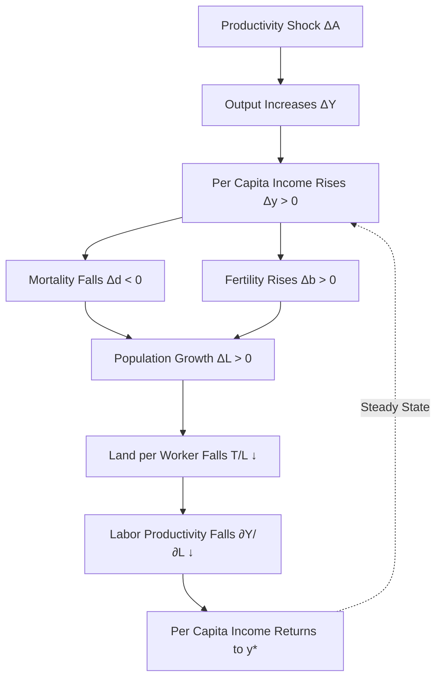

# Lesson 1: Pre-Industrial Economic Foundations

## 1. First-Principles Intuition & Invariants

The pre-industrial economy operated under fundamentally different constraints than modern growth regimes. Understanding these foundations is not an exercise in historical curiosity but a necessity for policy practitioners who must recognize when contemporary economies exhibit structural characteristics that echo Malthusian dynamics—subsistence agriculture in Sub-Saharan Africa, labor-surplus economies in South Asia, or resource-constrained island nations. The pre-industrial world offers a laboratory for observing economic behavior under extreme capital scarcity, technological stagnation, and demographic pressure, conditions that persist in modified form across significant portions of the global economy today.

The Malthusian constraint stands as the central organizing principle of pre-industrial economic life. Thomas Malthus formalized in 1798 what agrarian societies had experienced for millennia: any technological improvement that raised agricultural productivity would trigger population growth until per capita income returned to subsistence levels. This created a demographic-economic feedback loop where prosperity contained the seeds of its own destruction. When harvest yields improved through crop rotation innovations or favorable weather, mortality declined and fertility increased. The resulting population surge then subdivided landholdings, reduced labor productivity, and pushed wages back toward biological subsistence. This iron law meant that for the vast majority of human history, average living standards remained trapped near subsistence despite periodic technological advances.

The mathematical formulation of this trap reveals its policy implications. Let $Y$ represent aggregate output, $L$ represent population, and $y = Y/L$ represent per capita income. In the Malthusian regime, output grows with land area $T$ and labor according to a production function exhibiting diminishing returns: $Y = A \cdot T^\alpha \cdot L^\beta$ where $\alpha + \beta < 1$, capturing the fixed supply of arable land. Population dynamics follow $\dot{L}/L = n(y)$ where the population growth rate $n$ increases with per capita income above subsistence $\bar{y}$ and becomes negative below it. The steady-state equilibrium occurs where $n(y^*) = 0$, pinning per capita income at $y^* = \bar{y}$. Any productivity shock that shifts $A$ upward temporarily raises $y$, but the induced population growth mechanically returns the economy to $y^*$ within one or two generations.

This framework has immediate relevance for development policy. When practitioners encounter economies where fertility rates remain high and inversely correlated with income shocks, where agricultural productivity gains fail to translate into sustained welfare improvements, or where land fragmentation accelerates despite rising output, they are observing Malthusian mechanics in operation. The policy challenge is not to deny these dynamics but to identify the specific mechanisms—property rights, credit market failures, educational deficits, or public health constraints—that prevent the demographic transition necessary to escape the trap.

Agrarian productivity in pre-industrial economies depended on three margin categories: extensive (expanding cultivated area), intensive (raising yields per acre), and organizational (improving factor allocation). The extensive margin dominated early agricultural development. European colonization of the Americas, Russian expansion into Siberia, and Han Chinese settlement of Manchuria all represented extensive growth strategies. These expansions generated temporary per capita income gains by raising the land-to-labor ratio, but population growth eventually closed the gap. The intensive margin—yield improvements through crop selection, fertilization, irrigation, or multi-cropping—proved more durable but faced severe diminishing returns given pre-industrial technology. Medieval European three-field rotation systems raised yields roughly 25% above two-field systems, but further improvements required inputs (nitrogen fertilizers, mechanical reapers) unavailable before industrialization.

The organizational margin receives insufficient attention in conventional economic history, yet it holds critical policy lessons. Even with fixed technology and land, economies could achieve substantial productivity gains through better property rights definition, reduced transaction costs, and improved factor allocation. The gradual enclosure of common lands in England between 1500 and 1850 exemplifies this mechanism. Open-field systems with scattered strips and communal grazing rights generated significant inefficiencies: coordination failures in planting and harvest timing, overgrazing of commons (the classic Garrett Hardin tragedy), and underinvestment in land-specific improvements like drainage or soil conservation. Enclosure consolidated holdings, assigned exclusive property rights, and enabled landowners to capture the full returns from improvements. Productivity gains ranged from 20% to 50% depending on soil type and prior management quality, achieved without technological change.

Contemporary policy parallels abound. Land tenure formalization programs in Sub-Saharan Africa, ejido reform in Mexico, and hukou system modifications in China all attempt to unlock organizational productivity gains through clearer property rights and reduced transaction costs. The challenges mirror those of historical enclosure: existing communal arrangements often provide insurance and risk-sharing functions that formal property rights do not replicate, powerful incumbents may capture disproportionate gains, and the landless may face worse outcomes despite aggregate productivity improvements. Effective policy requires understanding both the efficiency gains and the distributional consequences.

Property rights evolution in pre-industrial economies followed predictable patterns driven by resource scarcity and enforcement costs. When land was abundant relative to labor, exclusion costs exceeded the value of excluding others, and property rights remained communal or weakly defined. As population density increased and land became scarce, the value of exclusion rose while enforcement costs fell (more neighbors to monitor, higher stakes in detecting violations), making formal property rights efficient. Douglass North and Robert Thomas demonstrated this dynamic across medieval Europe: property rights over agricultural land formalized earliest in densely populated regions like the Low Countries and northern Italy, while remaining communal longer in sparsely populated Scandinavia and Eastern Europe.

The critical policy insight is that property rights are endogenous to economic conditions, not exogenous institutional choices. Attempts to impose formal property rights in environments where enforcement costs remain prohibitive or where resource abundance makes exclusion inefficient will fail or generate perverse outcomes. This explains why colonial land registration systems often collapsed in low-density tropical regions, why pastoral societies resisted sedentary tenure systems, and why contemporary land titling programs show mixed results. The sequencing matters: investments that reduce enforcement costs (literacy, surveying technology, courts) or increase resource scarcity (population growth, market integration) must precede or accompany property rights formalization.

Trade networks in the pre-industrial era expanded despite transaction costs that would be unimaginable today. A merchant shipping grain from the Black Sea to Venice in 1400 faced piracy, shipwreck, port exactions, currency exchange losses, and information asymmetries about prices at destination. Transaction costs often exceeded 50% of final value. Yet trade flourished when price differentials exceeded these costs, driven by extreme regional specialization in natural resource endowments. The Eurasian spice trade, Baltic grain exports, and Chinese silk and porcelain shipments all exploited price differentials of 500% to 1000% for products with high value-to-weight ratios.

The organizational response to these transaction costs holds lessons for modern policy in high-friction environments. Merchants developed sophisticated contract enforcement mechanisms absent state legal systems: reputation networks within ethnic or religious trading diasporas (Genoese, Armenians, Maghribi traders), conditional lending arrangements that aligned incentives, hostage-taking of factors' family members, and multilateral punishment systems where cheating one merchant triggered exclusion by all. Avner Greif's analysis of the Maghribi traders' coalition demonstrates how reputation mechanisms can support exchange volumes comparable to formal legal systems when monitoring costs are low and time horizons are long. Contemporary applications include remittance networks among immigrant communities, diamond trading within tight-knit networks, and informal credit systems in developing economies. Policy that ignores these endogenous enforcement institutions and attempts to replace them with formal legal systems risks destroying working mechanisms before alternatives function effectively.

Proto-industrialization represents the critical transition phase between agrarian economies and industrial capitalism, yet it remains underappreciated in policy discourse. The term, coined by Franklin Mendels, describes the emergence of rural manufacturing for distant markets during the 17th and 18th centuries, primarily in textiles but extending to metallurgy, pottery, and woodworking. Rural households combined agricultural work with manufacturing, using slack seasons and female and child labor to produce goods for merchant intermediaries who organized production and marketed output.

This organizational form solved several binding constraints simultaneously. It evaded urban guild restrictions that blocked entry and limited scale in traditional handicraft centers. It accessed low-cost rural labor with opportunity costs determined by marginal agricultural productivity rather than urban wage rates. It distributed fixed capital requirements (looms, spinning wheels, tools) across thousands of households rather than concentrating them in expensive workshops. And it allowed merchants to scale production rapidly by adding households rather than building factories. The Flemish linen industry, English woolens, Swiss watchmaking, and Silesian linen all followed this pattern, achieving output levels and geographic reach that prefigured factory industrialization.

The demographic-economic feedback loops of proto-industrialization fundamentally altered Malthusian dynamics and created preconditions for sustained growth. When rural households gained access to manufacturing income, they could support larger families on existing landholdings. This severed the direct link between agricultural productivity and population, allowing population growth to continue even as per capita agricultural land declined. More critically, proto-industrial regions developed distinctive demographic patterns: earlier marriage, higher fertility, and stronger son-preference in inheritance (manufacturing skills were more portable than land). These changes accumulated over generations, creating regions with high population density, diversified income sources, and commercial market orientation—precisely the conditions that facilitated rapid industrial adoption when factory technology became available.

Contemporary parallels exist in the growth of labor-intensive manufacturing in rural China, Bangladesh, and Vietnam, where export processing zones and contract manufacturing have transformed agrarian regions. Policy implications include recognizing that rural industrialization can precede rather than follow agricultural productivity growth, understanding that successful manufacturing clusters often emerge from endogenous skill accumulation rather than planned industrial parks, and noting that demographic transitions may accelerate in regions with diversified income sources even when agricultural productivity stagnates.

The pre-industrial world's most important lesson for policy practitioners is that sustained growth requires escaping multiple reinforcing constraints simultaneously. Agricultural productivity improvements alone trigger population growth that erodes per capita gains. Manufacturing development without agricultural surplus cannot feed urban workers. Property rights formalization without enforcement institutions creates conflict rather than efficiency. Trade network expansion without organizational mechanisms to reduce transaction costs hits diminishing returns quickly. The economies that eventually achieved sustained growth—northwestern Europe, parts of China, Japan—were those where multiple constraints relaxed in complementary fashion, whether through deliberate policy or historical accident. This suggests that contemporary development policy must adopt a systems perspective, identifying binding constraint combinations rather than single bottlenecks, and sequencing interventions to create mutually reinforcing momentum.

## 2. Core Architecture & Mechanics

The internal mechanics of pre-industrial economies can be represented as a system of interconnected markets and institutions operating under resource constraints and positive feedback dynamics. Understanding this architecture allows policy practitioners to identify structural vulnerabilities and intervention points in contemporary economies that share similar characteristics.

The agricultural production system formed the foundation. A representative peasant household operated under a technology constraint represented by a Cobb-Douglas production function: $Y_A = A \cdot T^\alpha \cdot L_A^\beta \cdot K^\gamma$ where $Y_A$ is agricultural output, $T$ is cultivated land (fixed in the short run), $L_A$ is labor allocated to agriculture, $K$ represents capital (tools, draft animals, structures), and $A$ captures total factor productivity incorporating technology, soil quality, and weather. The constraint $\alpha + \beta + \gamma < 1$ reflects diminishing returns from fixed land. With $\alpha \approx 0.4$, $\beta \approx 0.5$, and $\gamma \approx 0.1$, each 1% increase in labor input raised output by only 0.5%, making labor productivity highly sensitive to the land-to-labor ratio.

Household labor allocation followed an implicit optimization problem. The household maximized utility $U(C, Leisure)$ subject to constraints: consumption $C = Y_A + w \cdot L_M$ where $w$ is the wage rate for manufacturing work and $L_M$ is labor allocated to manufacturing, and the time constraint $L_A + L_M + Leisure = \bar{L}$ where $\bar{L}$ represents total household labor endowment. In pure agrarian regimes, manufacturing opportunities were absent ($w = 0$), forcing consumption to equal agricultural output minus any required payments to landlords or the state. In proto-industrial regions, positive $w$ created labor allocation margins: households shifted labor from agriculture to manufacturing until the marginal value product in agriculture ($\partial Y_A / \partial L_A$) equaled the manufacturing wage $w$.

The demographic feedback mechanism operated through both mortality and fertility channels. Mortality rates followed $d(y) = d_0 + d_1 \cdot \max(0, \bar{y} - y)$ where mortality increased sharply when per capita income $y$ fell below subsistence $\bar{y}$. Fertility followed $b(y) = b_0 + b_1 \cdot \max(0, y - \bar{y})$ where birth rates rose with income above subsistence due to earlier marriage and better maternal nutrition. Population dynamics then followed $\dot{L}/L = b(y) - d(y)$, creating the steady state at $y^* = \bar{y}$ where birth and death rates balanced. This architecture explains why pre-industrial populations exhibited high-frequency fluctuations (harvest failures causing mortality spikes followed by compensating fertility increases) around a stable long-run mean.

Property rights systems can be modeled as assignment rules determining control rights over output streams. In a simple landlord-tenant framework, the landlord owned land $T$ and the tenant provided labor $L_A$. Output was divided according to a sharing rule: landlord received $R(Y_A)$ and tenant received $Y_A - R(Y_A)$. Common arrangements included fixed rent ($R = \bar{R}$, independent of output), sharecropping ($R = \theta \cdot Y_A$ with $\theta \in (0,1)$), and wage labor ($R = Y_A - w \cdot L_A$ with the landlord as residual claimant). Each arrangement generated different incentive structures and efficiency properties.

Fixed rent maximized tenant effort incentives since the tenant captured the full marginal product of additional labor, but exposed tenants to full output risk and created adverse selection problems (only tenants expecting high output would accept high fixed rents). Sharecropping provided risk-sharing but generated moral hazard: the tenant received only fraction $(1-\theta)$ of marginal output, reducing effort below the efficient level. Wage labor eliminated tenant risk but required costly landlord monitoring and generated shirking problems. The prevalence of sharecropping in pre-industrial agriculture (medieval Europe, Mughal India, Qing China) reflected its superiority in environments with imperfect insurance markets, unobservable tenant effort, and heterogeneous land quality.

Contemporary policy applications include understanding why land rental markets in developing countries exhibit persistent sharecropping despite apparent inefficiency, recognizing that contract choice reflects optimal responses to information and enforcement constraints rather than irrationality, and noting that interventions targeting one contract margin (e.g., rent control on fixed-rent contracts) may shift contracts toward less efficient forms rather than improving tenant welfare.

Trade network architecture in pre-industrial economies resembled a hierarchical graph structure with multiple layers of intermediation. At the base, rural producers sold output to local merchants who aggregated shipments. These local merchants sold to regional wholesalers who operated at market towns and had access to credit and storage facilities. Regional wholesalers connected to long-distance merchants who organized international shipments and bore the highest risks and transaction costs. Information flowed downward (price signals from terminal markets) and goods flowed upward, with each intermediary adding a margin reflecting services provided and risks borne.

Transaction costs at each node included transport costs $\tau_T$ (roughly proportional to distance and inversely proportional to cargo value density), spoilage and theft losses $\tau_L$ (especially severe for perishables), information costs $\tau_I$ (learning prices at distant markets), contract enforcement costs $\tau_E$ (ensuring payment and quality), and monopolistic markups $\tau_M$ (when intermediaries faced limited competition). Total costs compounded multiplicatively: the price ratio between terminal market and rural producer was $(1 + \tau_T) \cdot (1 + \tau_L) \cdot (1 + \tau_I) \cdot (1 + \tau_E) \cdot (1 + \tau_M)$. With each component in the 10-20% range, total costs reached 100-200%, explaining why only high-value goods (spices, silk, precious metals) justified long-distance trade.

The organizational innovations that reduced these costs demonstrate how institutional development can substitute for technological progress. Merchant guilds created reputation tracking systems that reduced $\tau_E$ by facilitating multilateral punishment of cheaters. Bills of exchange and correspondent banking networks reduced $\tau_I$ and $\tau_E$ by enabling remote payment and credit verification. Joint-stock companies and insurance pools reduced individual risk exposure from $\tau_L$, enabling larger shipments and economies of scale that lowered per-unit $\tau_T$. The cumulative effect was substantial: transaction costs in European trade fell from roughly 200% in 1400 to 100% by 1600 and 50% by 1750, achieved entirely through organizational innovation before steam power or telegraphs.

Proto-industrial organization requires careful attention because it represents a feasible transition path between agrarian subsistence and factory industrialization. The system operated as a distributed production network coordinated by merchant-organizers. The merchant provided raw materials (wool, flax, cotton, metal stock) on credit to rural households, specified product characteristics and quality standards, retrieved finished goods, and marketed output to distant buyers. Households supplied labor and owned simple tools but had no market access or working capital. This vertical disintegration solved the merchant's monitoring problem—household production occurred in the workers' homes, making direct supervision impossible—through piece-rate compensation: payment depended only on output quantity and quality, not effort or time.

The organizational architecture can be represented as a principal-agent model with multiple agents. The merchant (principal) faced a production function $Q = \sum_{i=1}^{N} q_i$ where $q_i$ is output from household $i$. The merchant paid households piece rate $p$ per unit, incurred material costs $m$ per unit, faced marketing costs $c$, and sold output at terminal market price $P$. Profit was $\pi = (P - p - m - c) \cdot Q$. Each household chose effort $e_i$ to maximize $p \cdot q_i(e_i) - \psi(e_i)$ where $\psi(e_i)$ represented effort disutility. The piece rate $p$ balanced incentivizing household effort against merchant profit margins.

This system achieved impressive scale: the Flemish linen industry employed over 100,000 rural households by 1600, and the English woolen industry exceeded 500,000 by 1750. Scale emerged from the ease of adding production units (households) rather than expanding centralized facilities. The system's limitations became binding only when technology required fixed capital (power sources, large machinery) that could not be distributed across households and when coordination complexity exceeded merchant capacity. These constraints eventually drove the transition to factory production.

## 3. High-Performance Optimization & Failure Modes

Understanding how pre-industrial economies occasionally escaped Malthusian stagnation and how they more frequently failed to do so provides essential guidance for contemporary development policy. The optimization problem is not simply maximizing growth rates but navigating complementary constraint relaxation without triggering offsetting negative feedbacks.

The most successful pre-industrial growth episodes shared several characteristics. Northwestern Europe between 1500 and 1800 exhibited agricultural productivity improvements (enclosure, crop rotation, Dutch intensive methods), manufacturing expansion (proto-industrialization in textiles and metallurgy), trade network deepening (Baltic grain trade, Atlantic commerce), institutional development (secured property rights, commercial courts, patent systems), and demographic transition (declining fertility among urban populations, later marriage in proto-industrial regions). No single factor drove growth; instead, positive feedbacks linked these dimensions. Agricultural surplus fed urban manufacturing workers, manufacturing income raised rural living standards and reduced fertility, trade expansion justified infrastructure investments, and property rights security encouraged long-term improvements.

The critical transition occurred when positive feedbacks between income and population reversed direction. Instead of rising income triggering proportional population growth, income gains began accumulating as per capita improvements. This shift required breaking the direct link between mortality and fertility. Several mechanisms contributed. Proto-industrial income allowed households to support children through non-agricultural income, reducing land constraints on family size but also raising the opportunity cost of children's time (they could work in manufacturing). Urban manufacturing raised female labor force participation and delayed marriage. Protestant Reformation emphasis on literacy increased educational investments that competed with fertility. Gradually, fertility began responding negatively rather than positively to income, creating conditions for sustained per capita growth.

Policy practitioners should note that this transition occurred over multiple generations, involved substantial regional heterogeneity, and was not inevitable. Many regions with high agricultural productivity failed to industrialize (Poland, southern Italy), while some with modest agriculture succeeded (Belgium, Switzerland). The distinguishing factor was complementarity: regions where multiple constraints relaxed simultaneously and where positive feedback loops reinforced rather than offset each other. This suggests that development policy must target constraint bundles rather than isolated bottlenecks and must sequence interventions to create momentum rather than scattering resources across disconnected priorities.

The agricultural productivity optimization problem illustrates these principles. Raising yields required complementary investments: improved seeds required better soil preparation, which required draft animals and tools, which required fodder and capital, which required secure tenure to justify investment. Attempting to improve any single component without addressing complementary requirements produced disappointing results. English agricultural improvement succeeded because enclosure (property rights), selective breeding (technology), marling and drainage (capital investment), and crop rotation (agronomic knowledge) advanced together. The same technologies transplanted to regions with insecure tenure, missing credit markets, or inadequate draft animals failed to raise productivity.

Contemporary analogies include recognizing why high-yield seed varieties underperform without complementary fertilizer access, irrigation, and extension services; why land titling programs fail to unlock credit markets when banks lack agricultural expertise or foreclosure mechanisms; and why agricultural mechanization can reduce rather than increase productivity when it displaces labor in economies with surplus workers and inadequate non-agricultural employment. The lesson is not that agricultural productivity is unimportant but that its impact depends on complementary system elements.

Trade network optimization faced different constraints. The core problem was reducing transaction costs to make trade profitable for goods with lower value-to-weight ratios. Successful strategies combined technological, organizational, and institutional improvements. The Dutch fluyt ship design reduced transport costs 30-40% through specialized cargo design, standardized components, and minimal crew requirements. Marine insurance pools reduced risk premiums by spreading losses across multiple voyages. The Amsterdam Exchange Bank (1609) reduced currency exchange costs and enabled efficient payment clearing. Commercial courts provided predictable contract enforcement. The cumulative effect lowered transaction costs sufficiently that Baltic grain, a bulky low-value commodity, became profitable to ship long distances.

The critical insight is that transaction cost reduction exhibits strong complementarities. Improved ships matter less without insurance to cover remaining risks. Insurance is less valuable without courts to enforce contracts. Courts function poorly without standardized commercial law. Regions that developed these elements in isolation saw limited trade expansion; those that developed complementary systems (northern Italy, Dutch Republic, England) experienced explosive trade growth. The sequencing lesson is to prioritize interventions that reduce multiple transaction cost components simultaneously rather than optimizing single dimensions in isolation.

The most common failure mode in pre-industrial economies was the "high-level equilibrium trap" where societies achieved relatively high agricultural productivity and population density but failed to industrialize. This pattern appeared in China, India, and the Islamic world—regions with sophisticated agriculture, extensive trade networks, and advanced technology that nonetheless remained primarily agrarian until forced industrialization under colonial pressure or post-colonial nationalism. Kenneth Pomeranz's analysis of China circa 1800 shows per capita income and agricultural productivity comparable to northwestern Europe, yet China did not industrialize endogenously.

The trap's mechanics reveal why productivity alone is insufficient. High agricultural productivity supported large populations, which lowered labor costs, which made labor-intensive methods more profitable than capital-intensive mechanization, which reduced incentives to develop labor-saving technology. China's coal deposits were located far from navigable rivers and population centers, raising transport costs and making coal less competitive with abundant labor. Secure property rights and effective government reduced rather than increased the demand for institutional innovations that protected commerce. The very success of traditional methods locked in technological trajectories that inhibited radical innovation.

Breaking such traps requires shocks that change relative factor prices or constraint sets. In Europe, the Black Death (1347-1351) killed one-third of the population, raising labor costs and creating incentives for labor-saving innovation. New World colonization provided raw material supplies (cotton, sugar) and markets that justified factory-scale production. Coal deposits near navigable rivers in Britain made energy-intensive technology economically viable. No comparable shocks occurred in China, India, or the Middle East, allowing high-level equilibrium to persist.

The policy implication is sobering: sometimes productivity improvements can reinforce stagnation rather than generating transformation. When policy increases labor supply (through rural-urban migration restrictions, population growth, or labor market regulations) in economies with limited capital, it may reduce rather than increase the incentives for capital-intensive industrialization. When traditional methods are highly productive and well-adapted to local conditions, they may block adoption of alternative technologies even when those alternatives have higher long-run potential. Escaping such traps may require discontinuous policy changes that shift the entire constraint set rather than marginal improvements to existing systems.

Another critical failure mode involved premature specialization in resource extraction. Regions with valuable natural resources (silver in Spanish America, sugar in the Caribbean, spices in Southeast Asia) often developed extractive institutions that concentrated wealth, suppressed manufacturing, and blocked human capital development. The Spanish silver economy illustrates the mechanism. Massive silver inflows from Potosí enriched the Spanish crown but generated inflation (the "price revolution"), reduced manufacturing competitiveness, and created dependence on imported goods. Spain's manufacturing sector withered while Dutch and English industries captured markets. Silver enriched Spain but impoverished its long-run development trajectory.

The resource curse mechanism operates through multiple channels. Concentrated resource rents attract rent-seeking behavior rather than productive entrepreneurship. Resource price volatility creates macroeconomic instability that discourages long-term investment. Currency appreciation from resource exports (the Dutch disease) reduces manufacturing competitiveness. Resource extraction requires little human capital, reducing educational investment. The combination locks regions into resource dependence with limited industrialization.

Contemporary policy parallels are obvious: oil-dependent Middle Eastern economies, mineral-rich African countries, and even advanced economies facing energy transition challenges all confront these dynamics. The pre-industrial experience suggests that escaping resource dependence requires deliberate policies that counteract natural market forces: mandatory savings funds to smooth revenue volatility (Norway's sovereign wealth fund), currency sterilization to prevent exchange rate appreciation, educational investments disconnected from resource sector demand, and institutional protections against rent-seeking. Without such interventions, resource abundance paradoxically constrains rather than enables development.

A final failure mode involved incomplete demographic transition. Many pre-industrial societies achieved significant per capita income gains but failed to consolidate them because population growth accelerated faster than productivity improvements. This pattern appeared in regions where proto-industrialization expanded manufacturing income but did not shift fertility preferences or where public health improvements reduced mortality without corresponding fertility declines. The result was that temporary income gains eroded through population growth, returning the economy toward subsistence.

The demographic transition requires both opportunity cost increases (especially for women's time) and preference shifts toward quality over quantity of children. Proto-industrialization often provided the former—women could earn manufacturing wages, raising the cost of time spent on childcare—but not the latter. When cultural norms or inheritance systems continued to favor large families, the quantity-quality tradeoff did not shift. Similarly, public health interventions that reduced infant mortality could increase completed fertility if parents did not adjust childbearing behavior in response to higher child survival rates.

Policy implications for contemporary high-fertility developing economies are direct. Female education and labor force participation remain the most reliable drivers of fertility decline because they raise opportunity costs of childbearing. Public health interventions should couple infant mortality reduction with family planning access to prevent fertility overshooting. Cultural and institutional changes (gender equality, inheritance rules, pension systems that reduce old-age dependence on children) complement economic incentives. Relying on income growth alone to drive demographic transition is insufficient; deliberate policy targeting preferences and constraints is essential.

The optimization challenge for policy practitioners operating in economies with pre-industrial characteristics is to identify which constraints are binding and which relaxations will generate complementary momentum. In land-abundant economies with labor scarcity, agricultural productivity improvements that increase output per worker dominate those that increase output per acre. In proto-industrial regions with manufacturing income, educational investments to improve skill levels yield higher returns than further agricultural intensification. In economies with weak property rights, institutional reforms that secure tenure and reduce expropriation risk may unlock latent investment more effectively than technological transfer. In demographically dynamic regions, policies that accelerate fertility transition create space for per capita income growth that would otherwise be absorbed by population increases.

The pre-industrial experience teaches that escaping stagnation is not simply a matter of increasing investment rates, opening markets, or adopting better technology. It requires simultaneous relaxation of multiple binding constraints in a sequence that generates positive feedback loops rather than offsetting negative responses. It demands attention to institutional foundations (property rights, enforcement mechanisms, social norms) that enable markets to function and innovations to be adopted. And it requires patience: successful transitions unfolded over multiple generations, involved significant regional heterogeneity, and were punctuated by reversals and crises. Policy practitioners who internalize these lessons will approach development challenges with appropriate humility, systems thinking, and long-term perspective—recognizing that the goal is not to replicate any single historical path but to understand the deep structural dynamics that enable or constrain economic transformation.
