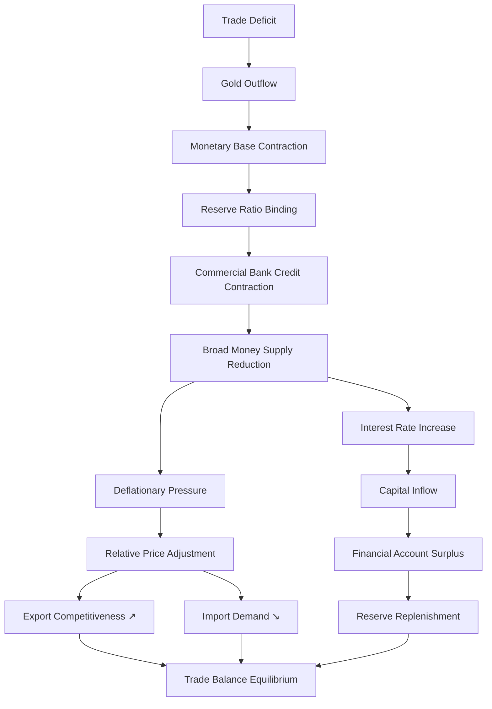

# Lesson 3: Monetary Systems Evolution

## 1. First-Principles Intuition & Invariants

The evolution of monetary systems represents one of the most consequential institutional transformations in economic history, fundamentally reshaping the mechanics of price discovery, international trade settlement, and macroeconomic policy transmission. Understanding this evolution requires stripping away the veneer of political rhetoric and ideological positioning to examine the underlying coordination problems that each monetary regime attempted to solve, the technical constraints that bound their operation, and the strategic incentives that ultimately precipitated their collapse or transformation.

At its core, money serves three fundamental functions that create a nested hierarchy of coordination challenges. As a unit of account, money must provide a stable numerical reference frame that allows economic agents to compare relative prices across heterogeneous goods and services without solving an intractable n-dimensional optimization problem. As a medium of exchange, money must overcome the double coincidence of wants problem inherent in barter economies, enabling indirect exchange through a universally accepted intermediary asset. As a store of value, money must preserve purchasing power across time, allowing agents to decouple consumption decisions from income realization and thereby facilitate intertemporal optimization.

The tension between these three functions creates the central policy dilemma that drives monetary regime evolution. A monetary system optimized for stability as a store of value through rigid supply constraints may fail to provide adequate liquidity during periods of rapid economic expansion, creating deflationary pressures that distort relative price signals and incentivize hoarding rather than productive investment. Conversely, a monetary system optimized for transaction flexibility through elastic supply mechanisms may sacrifice credibility as a store of value, triggering capital flight and undermining the unit of account function through accelerating price level instability.

The gold standard emerged as the dominant international monetary architecture in the late nineteenth century precisely because it offered a technological solution to the credibility problem inherent in earlier commodity money systems. Unlike silver, which faced persistent supply expansion from New World mines and created inflationary pressures in economies on bimetallic standards, gold possessed sufficient scarcity and extraction cost to anchor long-run price level expectations. The chemical inertness and high density of gold created natural advantages for verification and storage, reducing transaction costs in international settlement compared to bulkier commodity alternatives.

The classical gold standard operated through a self-equilibrating mechanism rooted in the quantity theory of money and the law of one price. When a country experienced a balance of payments deficit, gold would flow outward to settle the external imbalance, mechanically contracting the domestic monetary base since currency issuance was backed by fixed gold reserves. This monetary contraction would exert deflationary pressure on domestic prices, improving the trade balance through expenditure switching as foreign goods became relatively more expensive and domestic production became more competitive in international markets. Simultaneously, the reduction in domestic money supply would elevate domestic interest rates, attracting capital inflows that further equilibrated the balance of payments through the financial account.

This adjustment mechanism embedded a brutal asymmetry that would ultimately undermine the system's political sustainability. Deficit countries faced automatic monetary contraction and deflationary adjustment, imposing immediate unemployment costs on domestic labor as nominal wage rigidity prevented instantaneous price-level adjustment. Surplus countries, by contrast, experienced gold inflows and monetary expansion, but faced no symmetric pressure to allow domestic inflation to proceed at the pace required for global rebalancing. Central banks in surplus nations could sterilize gold inflows by conducting offsetting open market sales of domestic securities, preventing monetary expansion while accumulating reserve assets. This asymmetry created a deflationary bias in the global system, concentrating adjustment costs on deficit nations and generating persistent political pressure for monetary policy autonomy.

The theoretical elegance of the gold standard adjustment mechanism obscured a more fundamental constraint that would prove decisive in its collapse. The system required central banks to subordinate domestic macroeconomic stabilization objectives to the maintenance of gold parity, effectively operating monetary policy as a passive accommodation to external balance dynamics. This subordination was politically sustainable during the pre-1914 period when governments faced limited democratic accountability and labor markets exhibited sufficient nominal wage flexibility to allow price-level adjustment without triggering mass unemployment. The First World War shattered both conditions, expanding franchise rights to broader segments of the population while simultaneously demonstrating that governments could finance massive expenditures through monetary expansion when existential threats justified abandoning metallic convertibility.

The interwar gold standard restoration attempted to resurrect the pre-war architecture without addressing the fundamental political economy transformation that had rendered it obsolete. Britain's 1925 return to gold at the pre-war parity of $4.86 per pound sterling embedded a severe real appreciation that decimated export competitiveness, creating persistent unemployment in traditional manufacturing regions and coal mining districts. The maintenance of gold parity required tight monetary policy that elevated real interest rates and strangled domestic credit creation, imposing deflationary adjustment costs that exceeded the political tolerance of a newly enfranchised working class population. France's simultaneous return to gold at a substantially depreciated parity created the opposite problem, generating persistent current account surpluses and gold inflows that French monetary authorities sterilized rather than allowing to inflate domestic prices, thereby perpetuating global imbalances and concentrating deflationary pressure on deficit nations.

The Federal Reserve's response to gold outflows following the 1929 stock market crash crystallized the gold standard's terminal contradiction. Faced with external reserve losses, the Fed tightened monetary policy in 1931 precisely when the domestic economy required aggressive monetary expansion to offset collapsing private credit creation. This procyclical policy response transformed a severe recession into the Great Depression, demonstrating that the gold standard constraint prevented central banks from performing the most basic function of a lender of last resort during banking panics. Britain's September 1931 abandonment of gold parity represented not a policy failure but rather a recognition that no democracy could sustain indefinite deflation and mass unemployment to defend an arbitrary metallic exchange rate.

The theoretical foundation for this recognition had been laid by Keynes's systematic dismantling of the equilibrium adjustment mechanism's behavioral assumptions. The classical model presumed that prices and wages adjusted rapidly to clear markets, ensuring that monetary contraction would restore external balance through expenditure switching rather than output collapse. Keynes demonstrated that in the presence of nominal rigidities and coordination failures, monetary contraction would primarily reduce real output and employment rather than lowering the price level proportionally, creating a deflationary spiral as falling incomes reduced aggregate demand and further contracted economic activity. The gold standard's automatic adjustment mechanism therefore operated as an amplification device for real shocks rather than a stabilizing anchor for nominal expectations.

The Bretton Woods architecture attempted to preserve the disciplinary benefits of metallic convertibility while granting national governments sufficient monetary policy autonomy to pursue domestic stabilization objectives. The system's core innovation was the distinction between gold convertibility at the international reserve currency level and fixed exchange rates at the peripheral country level. The U.S. dollar would maintain convertibility to gold at $35 per ounce, serving as the anchor for global monetary policy and the primary reserve asset for international settlement. Other nations would fix their currencies to the dollar through central bank intervention in foreign exchange markets, but retained the option to adjust parities in cases of "fundamental disequilibrium" rather than submitting to indefinite deflationary adjustment.

This architecture embedded an asymmetric adjustment mechanism that mirrored and amplified the pre-war gold standard's deflationary bias. The United States, as the reserve currency issuer, faced no external constraint on domestic monetary expansion since its balance of payments deficits were financed through dollar accumulation by foreign central banks rather than gold outflows. Other nations faced the opposite constraint, forced to accumulate dollar reserves when running current account surpluses and facing deflationary pressure when running deficits, but lacking the option to impose symmetric adjustment on the reserve currency country. This asymmetry created what Triffin identified as an impossible trilemma: the system required ongoing U.S. current account deficits to supply dollar liquidity for global reserve accumulation, but the accumulation of dollar liabilities relative to U.S. gold reserves would eventually undermine confidence in dollar-gold convertibility, triggering a run on U.S. gold stocks.

The Bretton Woods system's collapse followed precisely the trajectory Triffin predicted, but the mechanism revealed a more fundamental truth about the nature of monetary sovereignty in a democratic political economy. As European and Japanese current account surpluses generated persistent dollar accumulation during the 1960s, the ratio of foreign dollar claims to U.S. gold reserves rose from roughly parity in 1950 to over 8:1 by 1971. The Johnson administration's simultaneous expansion of Great Society domestic spending and Vietnam War military expenditures created fiscal pressures that precluded the tight monetary policy required to defend gold convertibility. Nixon's August 1971 closure of the gold window represented not a unilateral abrogation of international obligations but rather an acknowledgment that no democratic government would sacrifice domestic employment and real output to defend an arbitrary metallic exchange rate when facing existential political pressures.

The transition to floating exchange rates and fiat monetary systems represented a profound institutional transformation whose implications remain incompletely understood by both policymakers and economic theorists. The removal of external convertibility constraints granted central banks unprecedented discretion over domestic monetary policy, enabling them to pursue explicit stabilization objectives around inflation and employment targets rather than passively accommodating balance of payments dynamics. This discretion created a new credibility problem: absent the automatic discipline of metallic convertibility, what institutional mechanisms would prevent governments from engineering perpetual monetary expansion to finance fiscal deficits and reduce real debt burdens through inflation?

The theoretical response emerged through the rational expectations revolution and the time-inconsistency literature pioneered by Kydland and Prescott. If private agents form expectations rationally by incorporating all available information about central bank incentives, then discretionary monetary policy loses effectiveness as a stabilization tool since anticipated inflation will be immediately incorporated into nominal wage contracts and asset prices. Only unexpected monetary shocks can generate real effects, creating an incentive for central banks to engineer surprise inflation. But if private agents understand this incentive structure, they will incorporate it into their expectations formation, generating an inflationary bias in equilibrium without any corresponding real output gains. The optimal policy response is to commit credibly to a low-inflation rule that eliminates the discretionary temptation, either through constitutional constraints, central bank independence statutes, or reputation mechanisms that make future deviation costly.

This theoretical framework provided the intellectual foundation for the post-1980 reconstruction of monetary policy around explicit inflation targeting regimes and central bank operational independence. New Zealand's 1989 Reserve Bank Act formalized the inflation targeting approach through a legislative mandate specifying a quantitative inflation target range and granting the central bank operational autonomy to achieve it, while simultaneously creating accountability mechanisms through dismissal provisions if the target was persistently missed. This institutional innovation diffused rapidly across advanced economies during the 1990s, creating a global architecture of constrained discretion that attempted to preserve policy flexibility while anchoring inflation expectations through credible commitment devices.

The financial intermediation structure evolved in parallel with these monetary regime transformations, creating feedback loops that amplified both the stability benefits and systemic fragility of each architecture. The classical gold standard period coincided with the emergence of modern commercial banking systems characterized by fractional reserve practices and maturity transformation, where banks funded long-term illiquid loans through short-term demandable deposit liabilities. This structure created inherent instability since deposit withdrawals could force fire sales of illiquid assets at distressed prices, triggering contagion as losses at individual institutions undermined confidence in the broader banking system. The gold standard constraint prevented central banks from providing unlimited lender-of-last-resort support during panics, since reserve currency creation to support illiquid banks would violate convertibility obligations and trigger external gold drains.

The development of central banking doctrine during the nineteenth century represented successive attempts to navigate this tension between financial stability and convertibility maintenance. Bagehot's canonical prescription during the 1866 Overend Gurney crisis established the principle that central banks should lend freely at penalty rates against good collateral during panics, providing liquidity support to solvent but illiquid institutions while allowing insolvent firms to fail. This doctrine attempted to thread the needle between systemic collapse and moral hazard, but embedded a judgment problem that would prove intractable during severe crises: distinguishing illiquidity from insolvency requires accurate asset valuation precisely when market dysfunction makes valuation impossible.

The Great Depression revealed the catastrophic consequences of applying Bagehot's doctrine mechanically during a systemic crisis where collateral values were collapsing across the entire financial system. The Federal Reserve's failure to provide aggressive lender-of-last-resort support during the banking panics of 1930-1933 transformed a severe recession into a deflationary collapse, as bank failures destroyed monetary aggregates and severed credit intermediation channels. Friedman and Schwartz's subsequent demonstration that the Depression was fundamentally a monetary phenomenon caused by Federal Reserve passivity rather than inevitable real forces established the intellectual case for aggressive central bank intervention during systemic crises, regardless of traditional collateral quality constraints.

The Bretton Woods period saw the parallel development of international financial intermediation through the Eurodollar market, creating an offshore dollar-denominated banking system operating outside U.S. regulatory jurisdiction and Federal Reserve reserve requirements. This institutional innovation emerged initially from Soviet efforts to hold dollar reserves outside U.S. legal reach during the Cold War, but expanded rapidly as multinational corporations and international banks sought to circumvent domestic interest rate regulations and capital controls. The Eurodollar market's growth created a fundamental challenge to capital account restrictions that underpinned the Bretton Woods architecture, since economic agents could evade domestic monetary policy through offshore dollar intermediation, rendering capital controls progressively ineffective and accelerating the system's collapse.

The post-Bretton Woods floating rate era coincided with explosive growth in financial innovation and securitization, transforming intermediation from a relationship-based bank loan model to a market-based securities distribution model. The originate-to-distribute mortgage securitization structure epitomized this transformation, with mortgage originators immediately selling loans to investment banks who pooled and tranched them into securities sold to institutional investors. This structure promised to distribute credit risk across a broader base of capital market participants rather than concentrating it on bank balance sheets, theoretically enhancing financial stability through diversification.

The 2008 financial crisis demonstrated that this intermediation transformation had instead concentrated systemic risk through interconnected leverage and opacity mechanisms that overwhelmed regulatory capacity. The shadow banking system of money market funds, securitization vehicles, and repurchase agreement funding created bank-like maturity transformation and leverage outside the regulatory perimeter, without access to central bank liquidity facilities or deposit insurance backstops. When subprime mortgage losses triggered investor runs on shadow banking liabilities, the resulting fire sales and credit contraction generated a systemic crisis that required unprecedented central bank interventions including quantitative easing balance sheet expansion and explicit guarantees of money market fund liabilities.

The crisis revealed a deeper truth about the relationship between monetary regime architecture and financial intermediation structure that remains unresolved in contemporary policy frameworks. The transition from commodity-backed to fiat monetary systems created an implicit government backstop for the entire financial system, since central banks with unconstrained balance sheet capacity can always prevent nominal defaults on domestic currency liabilities through unlimited liquidity provision. This backstop eliminates the nominal stability of commodity-backed systems while creating moral hazard incentives for excessive leverage and risk-taking, since financial institutions understand that systemic crises will trigger government intervention to prevent cascade failures. The optimal regulatory response requires calibrating capital and liquidity requirements to internalize this moral hazard without triggering credit contraction that stifles productive investment, a balance that remains elusive in practice.

## 2. Core Architecture & Mechanics

The operational mechanics of historical monetary systems reveal how abstract coordination problems materialized into concrete institutional structures with measurable transmission mechanisms and quantifiable adjustment dynamics. Examining these mechanisms in technical detail illuminates both the internal consistency of each regime's theoretical logic and the practical constraints that ultimately precipitated their transformation or collapse.

The gold standard's self-equilibrating adjustment mechanism operated through a precise mechanical sequence linking external imbalances to domestic monetary aggregates and price levels. Consider a country experiencing a trade deficit where import expenditures exceed export revenues. This deficit must be financed through gold shipments from the domestic economy to foreign trading partners, since gold served as the final settlement medium for international transactions. The gold outflow reduced the monetary base mechanically through the reserve backing requirement that linked currency issuance to metallic reserves. If the central bank maintained a 40% gold reserve ratio, then each ounce of gold outflow necessitated a contraction of 2.5 ounces worth of currency in circulation.

This monetary base contraction transmitted through the fractional reserve banking system with multiplier effects determined by banks' reserve ratios and portfolio behavior. If commercial banks maintained a 10% reserve ratio against deposit liabilities, then a $100 reduction in monetary base would ultimately contract broad money supply by $1,000 through the cessation of credit creation as banks reduced lending to maintain required reserve ratios. The monetary contraction would exert deflationary pressure on domestic prices through reduced aggregate demand, as households and firms facing tighter credit conditions reduced consumption and investment expenditures.

The price-level adjustment would then trigger expenditure switching through several concurrent channels. Domestic goods became cheaper relative to foreign goods in both absolute terms and after adjusting for exchange rate parity, improving export competitiveness and reducing import demand. Simultaneously, the monetary contraction elevated domestic interest rates as banks competed for scarce reserves, attracting capital inflows that provided additional balance of payments financing through the financial account. The adjustment process would continue until the trade balance equilibrated at the prevailing exchange rate, with gold flows reversing direction once the current account moved into surplus.

The quantitative magnitudes of this adjustment mechanism reveal why the system generated such severe macroeconomic instability during the interwar period. Empirical estimates from the 1920s British economy suggest that restoring external balance after the 1925 return to gold at the pre-war parity required approximately 10-15% domestic deflation to offset the real appreciation embedded in the exchange rate choice. With nominal wages exhibiting substantial downward rigidity, this deflation necessitated prolonged unemployment to reduce labor costs through quantity adjustment rather than price adjustment. The required unemployment rate to generate 10% cumulative wage deflation over a five-year period exceeded 15% on average, creating politically intolerable social costs that undermined public support for gold standard maintenance.

The Bretton Woods architecture modified this adjustment mechanism by introducing exchange rate flexibility as a crisis release valve while maintaining nominal anchor through dollar-gold convertibility. The system operated through a two-tier structure where the United States maintained gold convertibility at $35 per ounce for official foreign central bank transactions, while other countries maintained dollar exchange rate pegs through foreign exchange intervention rather than automatic gold flows. This structure created distinct adjustment mechanisms for reserve currency and peripheral countries that generated asymmetric policy constraints.

For non-reserve countries operating under dollar pegs, balance of payments disequilibria triggered foreign exchange intervention rather than direct monetary base changes. Consider a country experiencing capital inflows from higher domestic interest rates relative to U.S. rates. The incipient currency appreciation would prompt the central bank to purchase foreign exchange, selling domestic currency to maintain the peg. This intervention would expand the domestic monetary base, creating inflationary pressure unless sterilized through offsetting domestic open market operations selling government securities. The sterilization capacity depended on the central bank's domestic security holdings, creating a constraint on how long intervention could continue without triggering domestic monetary expansion.

The reserve currency country faced an inverse constraint structure that created the Triffin dilemma's operational mechanics. U.S. current account deficits resulted in dollar accumulation by foreign central banks seeking to prevent their currencies from appreciating. These dollar reserves appeared as liabilities on the Federal Reserve's balance sheet, but required no corresponding domestic monetary contraction since foreign central banks held dollars as interest-bearing securities rather than demanding gold conversion. The U.S. could therefore run persistent current account deficits financed through dollar reserve accumulation without facing the automatic monetary contraction that would occur under a pure gold standard.

This asymmetry created a confidence game dynamic where the sustainability of the system depended on foreign central banks' willingness to accumulate dollar reserves despite the rising ratio of dollar liabilities to U.S. gold stocks. The confidence threshold can be formalized through a critical ratio $\rho^*$ where dollar claims $D$ relative to gold reserves $G$ triggers conversion demand:

$$\rho^* = \frac{D}{P_g \cdot G}$$

where $P_g$ is the official gold price. As long as $\rho < \rho^*$, foreign central banks preferred holding interest-bearing dollar securities to non-interest-bearing gold. Once $\rho$ exceeded $\rho^*$, conversion demand would emerge, forcing either U.S. gold reserve depletion or dollar devaluation relative to gold. By 1971, $\rho$ had risen above 8:1, far exceeding any plausible confidence threshold, making the system's collapse inevitable once a credible conversion threat emerged.

The floating exchange rate regime that emerged after Bretton Woods' collapse eliminated the fixed nominal anchor and forced central banks to target alternative nominal variables to anchor inflation expectations. The transition revealed a fundamental taxonomy of monetary policy frameworks distinguished by their choice of intermediate target and operational instrument. Under monetary targeting regimes implemented initially by Germany's Bundesbank and subsequently by the Federal Reserve under Volcker's chairmanship, central banks announced quantitative targets for monetary aggregate growth rates and adjusted short-term interest rates to achieve them.

The monetary targeting framework operated through the quantity theory identity relating money supply $M$, velocity $V$, price level $P$, and real output $Y$:

$$M \cdot V = P \cdot Y$$

Taking growth rates yields:

$$\Delta m + \Delta v = \Delta p + \Delta y$$

If velocity growth $\Delta v$ is stable and real output growth $\Delta y$ is determined by supply-side factors, then controlling money growth $\Delta m$ directly determines inflation $\Delta p$. The central bank would announce a target money growth rate $\Delta m^*$ consistent with desired inflation $\Delta p^*$ given projections for output growth and velocity trends:

$$\Delta m^* = \Delta p^* + \Delta y^f - \Delta v^e$$

where $\Delta y^f$ is forecasted potential output growth and $\Delta v^e$ is expected velocity growth.

The operational implementation required adjusting the policy interest rate to achieve the target money growth through the money demand function. If actual money growth exceeded the target, the central bank would raise interest rates to reduce money demand and slow monetary expansion. This indirect targeting approach proved problematic in practice because velocity exhibited substantial instability during the 1980s as financial innovation and deregulation altered the relationship between monetary aggregates and spending behavior. The velocity instability broke the link between money growth and inflation, rendering monetary targeting ineffective as a nominal anchor.

The inflation targeting regime that replaced monetary targeting addressed the velocity instability by directly targeting the policy objective rather than an intermediate variable. Under inflation targeting, the central bank announces a quantitative inflation target $\pi^*$ (typically 2% for advanced economies) and adjusts the policy interest rate to achieve it over a medium-term horizon. The framework operates through a forward-looking reaction function that adjusts rates based on projected inflation deviations from target rather than current inflation:

$$i_t = r^* + \pi_t^e + \alpha(\pi_t^e - \pi^*) + \beta(y_t - y_t^*)$$

where $i_t$ is the policy rate, $r^*$ is the equilibrium real rate, $\pi_t^e$ is expected inflation, $y_t - y_t^*$ is the output gap, and $\alpha, \beta$ are response coefficients. The Taylor principle requires $\alpha > 0$, ensuring that real interest rates rise when inflation exceeds target, creating stabilizing dynamics.

The transmission mechanism from policy rate changes to inflation operates through multiple channels with varying lag structures. The interest rate channel directly affects consumption and investment through the intertemporal substitution effect, where higher rates increase the opportunity cost of current spending relative to future consumption. The credit channel operates through bank lending standards and credit availability, where rate increases tighten financial conditions and reduce credit supply to borrowers lacking alternative funding sources. The exchange rate channel works through currency appreciation when domestic rates rise relative to foreign rates, reducing import prices and export demand. The asset price channel transmits through equity and housing market valuations, where rate increases reduce present values and generate negative wealth effects on consumption.

The lag structure between policy rate changes and inflation outcomes creates a fundamental challenge for monetary policy implementation. Empirical estimates suggest interest rate changes require 12-18 months to fully affect real output and an additional 6-12 months to translate into inflation dynamics, creating a total transmission lag of 18-30 months. This lag structure forces central banks to adjust policy based on inflation forecasts rather than current outcomes, creating the potential for systematic forecast errors that generate policy mistakes.

The financial intermediation structure fundamentally shapes these transmission mechanisms through the liability structure and leverage of financial institutions. In traditional commercial banking systems, policy rate changes directly affect bank funding costs through deposit interest rates and wholesale funding markets, transmitting immediately to lending rates on adjustable-rate loans. Fixed-rate loans create maturity mismatch where banks face immediate funding cost increases but maintain constant interest income, compressing net interest margins and reducing profitability. The profitability squeeze forces banks to tighten lending standards and reduce credit supply, amplifying the contractionary impact of rate increases.

The shadow banking intermediation structure that emerged during the 2000s created transmission channels that operated outside the traditional banking system through securitization and wholesale funding markets. Money market funds provided cash management services similar to bank deposits but invested in short-term securities rather than holding reserves at the central bank. Securitization vehicles funded mortgage and consumer loan portfolios through issuance of asset-backed securities in capital markets rather than deposit funding. Repurchase agreements (repos) provided short-term collateralized funding for securities dealers and hedge funds, creating a parallel monetary system outside central bank reserve creation.

This shadow banking structure amplified monetary policy transmission during normal times by creating additional credit supply channels that reduced borrower dependence on traditional bank lending. But during crisis periods, the absence of central bank backstops created catastrophic instability when investor confidence collapsed. The 2008 crisis demonstrated this fragility when the Reserve Primary Fund "broke the buck" by posting net asset value below $1 after Lehman Brothers' bankruptcy, triggering massive redemptions from money market funds. The redemption wave forced funds to liquidate holdings of commercial paper and repo agreements, severing short-term funding markets for shadow banking entities. The Federal Reserve's subsequent creation of emergency liquidity facilities including the Commercial Paper Funding Facility and Term Asset-Backed Securities Loan Facility represented an ad hoc extension of central banking functions to shadow banking entities, effectively acknowledging that modern financial intermediation required broader central bank support than traditional bank-only frameworks contemplated.

The operational mechanics of quantitative easing represent the most significant monetary policy innovation of the post-2008 period, creating transmission channels that operate through portfolio balance effects rather than traditional interest rate channels. When policy rates reach the zero lower bound, central banks lose the ability to provide additional monetary stimulus through conventional rate reductions. Quantitative easing addresses this constraint by expanding the central bank balance sheet through large-scale asset purchases, typically focusing on government bonds and mortgage-backed securities.

The portfolio balance transmission mechanism operates through the preferred habitat theory of the term structure, where investors have preferences over bond maturities based on duration matching with liabilities. When the central bank purchases long-term bonds, it removes duration risk from private portfolios, forcing investors to rebalance into alternative assets including corporate bonds, equities, and real assets. This rebalancing reduces risk premia and long-term interest rates across asset classes, stimulating investment and consumption even when short-term policy rates remain at zero.

The quantitative magnitudes of quantitative easing programs reveal the scale of balance sheet expansion required to generate measurable effects on financial conditions and real activity. The Federal Reserve's three quantitative easing programs between 2008 and 2014 expanded its balance sheet from $900 billion to $4.5 trillion, purchasing approximately $3.6 trillion in Treasury securities and mortgage-backed securities. Empirical estimates suggest this balance sheet expansion reduced 10-year Treasury yields by approximately 100 basis points and generated cumulative real GDP growth of 2-3% relative to a counterfactual without quantitative easing. These magnitudes imply that quantitative easing operated with substantially weaker transmission than conventional policy rate changes, requiring massive balance sheet expansion to achieve effects comparable to 200-300 basis points of conventional rate reductions.

## 3. High-Performance Optimization & Failure Modes

The optimization of monetary policy frameworks requires balancing multiple competing objectives that create fundamental tradeoffs in regime design. The conventional trilemma of international macroeconomics formalizes one critical constraint, establishing that countries cannot simultaneously maintain fixed exchange rates, open capital accounts, and monetary policy autonomy. This trilemma structure forces policymakers to select two vertices while sacrificing the third, creating distinct regime archetypes with characteristic stability properties and vulnerability patterns.

The fixed exchange rate with capital controls regime, exemplified by the Bretton Woods system and contemporary Chinese monetary policy, preserves monetary policy autonomy by restricting cross-border capital flows. This architecture allows central banks to set domestic interest rates based on internal stabilization objectives without triggering destabilizing capital flows that would undermine the exchange rate peg. The optimization challenge centers on capital control effectiveness, which degrades over time as financial innovation creates new channels for circumventing restrictions. The Eurodollar market's emergence during the 1960s demonstrated this degradation dynamic, as offshore dollar intermediation rendered U.S. capital controls progressively ineffective and accelerated Bretton Woods' collapse.

The operational implementation of capital controls reveals a taxonomy of restriction types with varying effectiveness and economic costs. Price-based controls, such as Chile's unremunerated reserve requirement on capital inflows during the 1990s, create wedges between domestic and foreign interest rates without directly prohibiting transactions. Quantity-based controls, such as limits on foreign exchange transactions or approval requirements for capital account transactions, directly restrict flow volumes but create incentive for evasion through mispricing of trade transactions and informal currency markets. The empirical evidence suggests price-based controls achieve modest effectiveness in shifting the composition of capital flows toward longer maturities without substantially affecting total flow volumes, while quantity-based controls exhibit declining effectiveness over time as evasion channels proliferate.

The floating exchange rate with open capital account regime represents the dominant contemporary architecture for advanced economies, sacrificing exchange rate stability to preserve monetary policy autonomy in the presence of unrestricted capital mobility. This framework optimizes monetary policy effectiveness by allowing central banks to adjust rates based on domestic conditions without external constraints, but creates exchange rate volatility that generates uncertainty for international trade and investment. The welfare tradeoff depends on the relative costs of exchange rate volatility versus monetary policy constraints, with theoretical models suggesting that larger, less open economies with flexible product and labor markets benefit most from floating rate regimes.

The optimization of inflation targeting frameworks within floating rate regimes requires calibrating the reaction function coefficients $\alpha$ and $\beta$ to balance inflation stabilization against output gap smoothing. Setting $\alpha$ too low creates insufficient nominal anchor, allowing persistent inflation deviations from target that destabilize expectations. Setting $\alpha$ too high generates excessive output volatility as the central bank aggressively adjusts rates in response to transitory inflation shocks that would self-correct without intervention. The optimal calibration depends on the economy's structural parameters including price stickiness, the slope of the Phillips curve, and the transmission lag from policy to inflation.

Empirical estimation of optimal reaction function coefficients proceeds through calibrated dynamic stochastic general equilibrium models that match key business cycle moments in the data. For the U.S. economy, simulations suggest optimal coefficients of $\alpha \approx 1.5$ and $\beta \approx 0.5$, implying that real interest rates should rise by 50 basis points for each percentage point that inflation exceeds target, and by 25 basis points for each percentage point of positive output gap. These coefficients imply substantially stronger response to inflation than output deviations, reflecting the primacy of inflation stabilization in anchoring expectations while still allowing some accommodation of real activity fluctuations.

The forward-looking nature of inflation targeting creates a time-consistency problem when inflation exhibits persistence through backward-looking expectation formation or indexation mechanisms. If private agents form expectations based on lagged inflation $\pi_{t-1}$ rather than the announced target $\pi^*$, then the central bank faces a temptation to accommodate persistent inflation rather than impose the output costs required to reduce expectations. The credibility of the inflation target depends on establishing a reputation for following through on announced plans even when the short-run costs appear excessive, creating path-dependent dynamics where early target misses undermine future effectiveness.

The quantitative easing framework that emerged during the zero lower bound period created distinct optimization challenges that remain incompletely resolved in contemporary practice. The portfolio balance transmission mechanism depends on market segmentation where investors have imperfect substitutability across asset classes and maturities. If investors treat all duration risk as perfectly substitutable, then central bank purchases of long-term bonds would have no effect beyond redistributing duration across portfolios without changing risk premia or required returns. The empirical effectiveness of quantitative easing implies meaningful segmentation, but the structural origins and stability of this segmentation remain uncertain.

The optimal scale of quantitative easing programs depends on nonlinear transmission dynamics where marginal effectiveness diminishes with cumulative purchase volumes. Initial purchases remove duration risk from investors with strong preferred habitat preferences, generating large effects on term premia and interest rates. Subsequent purchases extract duration from progressively less segmented investors with weaker preferences, generating smaller marginal effects. This diminishing returns structure creates an optimal stopping point where the marginal benefit of additional purchases equals the marginal cost of balance sheet expansion, including potential financial stability risks from compressed risk premia and distorted asset price signals.

The exit strategy from quantitative easing creates a distinct policy challenge since balance sheet normalization could trigger disruptive increases in long-term interest rates if executed too rapidly. The Federal Reserve's 2013 "taper tantrum" demonstrated this risk when Chairman Bernanke's announcement of future purchase reductions triggered a 100 basis point spike in 10-year Treasury yields and broad emerging market currency depreciation. The episode revealed that quantitative easing had created path-dependent market expectations where investors assumed indefinite balance sheet expansion, requiring careful forward guidance to manage expectations during the normalization process.

The optimal balance sheet normalization path trades off the benefits of rapid reserve reduction against the risks of financial market disruption and premature tightening of financial conditions. Simulations using Federal Reserve staff models suggest that gradual balance sheet runoff through redemption reinvestment limits rather than active security sales minimizes market disruption while still allowing normalization over a multi-year horizon. The 2017-2019 Federal Reserve normalization followed this gradual approach, reducing the balance sheet from $4.5 trillion to $3.8 trillion through redemption limits before halting and subsequently reversing course during the 2020 pandemic crisis.

The failure modes of monetary policy frameworks cluster around several characteristic patterns that reveal the boundary conditions under which regime design breaks down. The gold standard's deflationary spiral during the Great Depression represents the canonical example of procyclical monetary policy amplifying real shocks through rigid nominal constraints. The failure mechanism operated through the interaction of banking panics, debt deflation, and gold standard constraints on lender-of-last-resort intervention. Banking panics destroyed monetary aggregates through deposit withdrawal and currency hoarding, creating deflationary pressure on the price level. Falling prices elevated real debt burdens, triggering default cascades that further impaired bank balance sheets and contracted credit supply. The gold standard prevented aggressive monetary expansion to offset these deflationary forces, since reserve currency creation to support illiquid banks would violate convertibility obligations.

The policy lesson from this failure mode is that monetary frameworks must preserve sufficient flexibility to provide lender-of-last-resort support during systemic banking crises, even at the cost of temporary convertibility suspension or exchange rate adjustment. The Federal Reserve's aggressive balance sheet expansion during the 2008 crisis, increasing from $900 billion to $2.2 trillion in four months through emergency lending programs, demonstrated the application of this lesson. The intervention prevented the deposit destruction and credit contraction that characterized the Great Depression, stabilizing the financial system despite massive institutional failures including Lehman Brothers, Washington Mutual, and Wachovia.

The inflation targeting regime's failure mode centers on the zero lower bound constraint that prevents further interest rate reductions once policy rates reach zero. This constraint creates asymmetric policy capacity where central banks can tighten monetary conditions indefinitely through rate increases but face a floor on stimulus capacity that binds during severe demand shortfalls. The Japanese experience during the 1990s and 2000s demonstrated that zero lower bound episodes can persist for extended periods when private sector balance sheet deleveraging creates persistent deflationary pressure that conventional monetary policy cannot offset.

The optimal policy response to zero lower bound constraints requires combining quantitative easing with explicit forward guidance that shapes expectations about future rate paths. The Federal Reserve's December 2008 statement that rates would remain near zero "for an extended period" represented the initial application of this approach, subsequently strengthened through explicit calendar-based guidance ("rates will remain low through mid-2013") and later threshold-based guidance ("rates will remain low until unemployment falls below 6.5% or inflation exceeds 2.5%"). The forward guidance operates by reducing expected future short-term rates, lowering current long-term rates through the expectations hypothesis of the term structure and stimulating current spending through intertemporal substitution.

The credibility of forward guidance depends on central bank reputation and the consistency of announced thresholds with the monetary policy reaction function. If the announced threshold suggests rate increases will occur later than the reaction function implies, the guidance lacks credibility and fails to affect expectations. If the threshold is too aggressive, requiring rates to remain low even after substantial economic recovery, the guidance risks destabilizing inflation expectations and undermining the nominal anchor. The optimal threshold calibration must balance these competing risks while providing sufficient stimulus during the zero lower bound period.

The financial stability risks created by extended periods of low interest rates represent a distinct failure mode that emerged during the post-2008 period. Low rates compress risk premia and encourage leverage accumulation as investors search for yield through riskier assets and maturity transformation. This reach-for-yield behavior creates financial fragility since leveraged portfolios become vulnerable to losses when rates eventually normalize, potentially triggering fire sales and credit market disruption. The 2019 repo market disruption demonstrated this fragility when technical factors triggered a spike in overnight repo rates from 2% to 10%, forcing Federal Reserve intervention through temporary open market operations despite overall financial conditions remaining accommodative.

The optimal monetary policy response to financial stability risks remains contested in contemporary policy frameworks. The prevailing "Jackson Hole consensus" established after the financial crisis holds that monetary policy should focus on inflation and employment stabilization while financial stability concerns are addressed through macroprudential regulation including countercyclical capital buffers, leverage ratio requirements, and stress testing. This separation principle attempts to avoid the policy errors of the pre-crisis period when central banks raised rates to deflate asset bubbles, sacrificing real activity to address financial imbalances that could be better managed through regulatory tools.

The alternative "leaning against the wind" approach argues for incorporating financial stability considerations directly into the monetary policy reaction function, accepting modestly higher unemployment in exchange for reduced financial fragility. Simulations using estimated DSGE models with financial frictions suggest that optimal policy leans modestly against credit booms by maintaining rates 25-50 basis points higher than pure inflation targeting would prescribe during periods of rapid credit growth. This modest leaning generates measurable reductions in crisis probability while imposing limited output costs, but requires accurate real-time identification of unsustainable credit booms, a task that proved elusive during the pre-2008 period.

The exchange rate regime choice creates distinct failure modes that manifest through sudden stop crises in emerging market economies. Fixed exchange rate regimes with open capital accounts create vulnerability to self-fulfilling speculative attacks when investors doubt the central bank's commitment or capacity to defend the peg. The second-generation currency crisis models developed after the 1992 European Exchange Rate Mechanism crisis formalize this dynamic through multiple equilibrium structures where the optimal policy response depends on market expectations. If investors expect the peg to hold, capital inflows create appreciation pressure that the central bank easily manages through reserve accumulation. If investors expect abandonment, capital outflows force massive reserve losses and interest rate increases that generate recession, making abandonment optimal ex post and validating the initial expectation.

The empirical frequency and severity of fixed exchange rate crises support the case for greater exchange rate flexibility in emerging markets facing volatile capital flows. The Asian financial crisis of 1997-1998 demonstrated the catastrophic costs of defending overvalued pegs during capital flow reversals, with Thailand, Indonesia, and South Korea experiencing GDP contractions exceeding 10% and banking system collapses requiring massive government interventions. The alternative floating rate regimes adopted after the crisis exhibited substantially greater resilience during subsequent capital flow volatility episodes including the 2008 global financial crisis and 2013 taper tantrum.

The policy lesson is that exchange rate regime choice must account for the economy's structural characteristics including trade openness, financial integration, and the distribution of foreign currency debt across sectors. Small, highly open economies with limited foreign currency debt may benefit from fixed or managed float regimes that reduce transaction costs and anchor inflation expectations. Larger, less open economies with substantial foreign currency debt face greater crisis vulnerability under fixed rates and benefit from greater exchange rate flexibility that allows automatic adjustment to external shocks without requiring catastrophic reserve losses or interest rate spikes.

The operational implementation of these regime choice principles requires developing institutional capacity for effective floating exchange rate management, including deep foreign exchange markets, credible monetary policy frameworks, and prudential regulation limiting foreign currency mismatches in bank and corporate balance sheets. Many emerging markets that nominally adopted floating rates during the 2000s continued intervening heavily to limit exchange rate volatility, creating "fear of floating" dynamics where announced regime flexibility exceeded actual practice. This gap between declared and actual regimes creates policy uncertainty and reduces the credibility of monetary frameworks, undermining their effectiveness as nominal anchors.

The measurement and forecasting challenges facing contemporary monetary policy represent a final category of failure modes that create systematic policy errors. The Phillips curve relationship linking unemployment to inflation has exhibited substantial instability during the post-1990 period, with inflation remaining subdued despite unemployment falling below levels historically associated with accelerating price pressures. This flattening of the Phillips curve slope complicates policy calibration since conventional models suggest unemployment below the natural rate should generate rising inflation, while empirical evidence indicates this relationship has weakened substantially.

The structural origins of Phillips curve flattening remain debated, with competing explanations emphasizing globalization and import price competition, technological change altering price-setting dynamics, credible inflation targeting anchoring expectations, and measurement error in unemployment gap estimates. The policy implications differ substantially across these explanations. If flattening reflects well-anchored expectations from credible frameworks, then policy should maintain existing approaches while monitoring expectation indicators. If flattening reflects structural change in price-setting reducing the unemployment-inflation tradeoff, then policy can maintain lower unemployment without inflation costs. If flattening reflects mismeasurement of labor market slack, then policy risks falling behind the curve by maintaining excessive accommodation.

The Federal Reserve's experience during 2017-2019 revealed these measurement challenges in practice. As unemployment fell below 4%, conventional models predicted accelerating inflation requiring rate increases to prevent overheating. Actual inflation remained persistently below the 2% target despite sustained economic expansion, leading to questions about whether the natural rate of unemployment had declined or whether the Phillips curve had fundamentally weakened. The subsequent 2020 pandemic shock precluded definitive resolution, leaving uncertainty about the reliability of gap-based policy rules when structural parameters exhibit instability.

The resolution of these measurement and forecasting challenges will fundamentally shape the evolution of monetary policy frameworks during the coming decades. The Federal Reserve's 2020 framework review acknowledged these challenges through adoption of flexible average inflation targeting, committing to achieve 2% inflation on average over time rather than treating it as a symmetric point target. This modification allows for makeup dynamics where periods of below-target inflation are followed by deliberate overshooting, improving the credibility of the framework when inflation exhibits persistent downward bias. The ultimate effectiveness of this framework innovation depends on whether it successfully anchors long-run expectations while providing sufficient flexibility to accommodate supply-side shocks and measurement uncertainty, challenges that will only be resolved through extended experience across diverse economic conditions.
