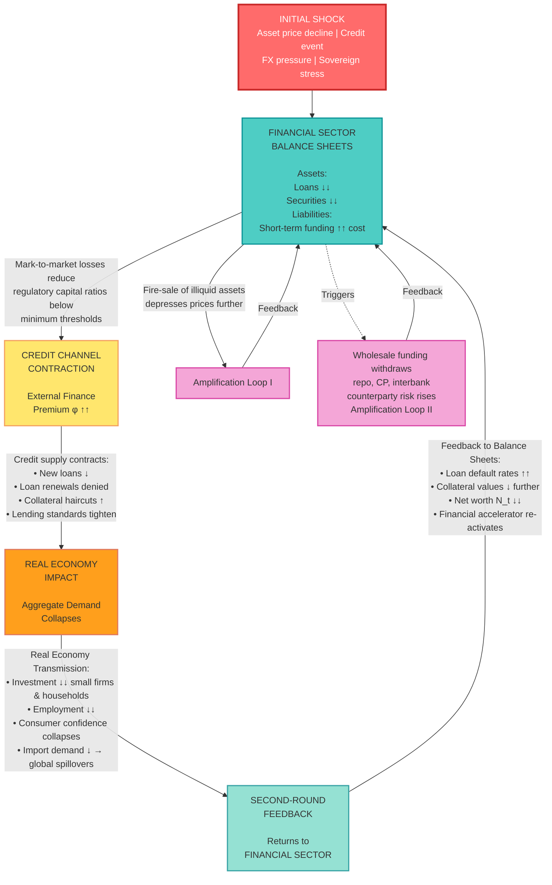

# Lesson 6: Economic Crises Dynamics

## 1. First-Principles Intuition & Invariants

Every economic crisis, regardless of its surface manifestation, is at its core a sudden, violent repricing of risk. What appears in the headlines as a stock market collapse, a bank run, or a sovereign default is downstream of a more fundamental process: the destruction of trust in a nominal claim. When households, firms, and financial institutions simultaneously revise their beliefs about the solvency of counterparties, the liquidity of assets, or the sustainability of a fiscal path, the resulting coordination failure can produce output losses and institutional damage that persist for a decade or longer. Understanding crises as coordination failures embedded in a network of balance sheet interdependencies is the first invariant every policy analyst must internalize before examining any specific historical episode.

The second invariant is that crises are almost always preceded by credit booms. Hyman Minsky articulated this mechanism with the greatest precision: in a prolonged expansion, rising asset prices validate leveraged balance sheets, lenders relax credit standards, and the economy drifts from what he called hedge finance, where cash flows comfortably service debt, through speculative finance, where roll-over risk is tolerated, toward Ponzi finance, where borrowers depend on asset price appreciation simply to remain solvent. The transition from expansion to crisis is not random; it is endogenous to the financial cycle itself. This is not merely a theoretical claim. The U.S. savings-and-loan crisis of the 1980s, the Japanese asset price bubble of the late 1980s, the East Asian crisis of 1997–1998, and the Global Financial Crisis of 2007–2009 all exhibit textbook Minsky trajectories traceable in the data on credit-to-GDP gaps, loan-to-value ratios, and term spreads.

The third invariant concerns the multiplier effect of financial accelerators. Bernanke, Gertler, and Gilchrist formalized this in their financial accelerator model: a negative shock to net worth tightens borrowing constraints, which reduces investment, which reduces income, which further erodes net worth in a self-reinforcing spiral. The formal expression of this mechanism rests on the external finance premium $\phi_t$, which is a decreasing function of the borrower's net worth $N_t$ relative to the project size $K_t$:

$$\phi_t = \phi\left(\frac{N_t}{p_t K_t}\right), \quad \phi' < 0$$

As asset prices $p_t$ fall, the collateral coverage ratio $N_t / p_t K_t$ collapses, the external finance premium spikes, credit contracts, and investment falls further. The elegant and disturbing feature of this mechanism is its symmetry with the boom: just as the accelerator amplifies expansions by compressing risk premia as collateral values rise, it amplifies contractions when they fall. Policy analysts who understand this structure know why stabilizing asset prices in a crisis is not about protecting wealthy investors; it is about breaking the feedback loop before it destroys the credit supply to ordinary firms and households.

The fourth invariant is the distinction between illiquidity and insolvency, which Walter Bagehot articulated in *Lombard Street* (1873) and which remains the most operationally important conceptual divide in crisis management. An illiquid institution holds assets whose long-run value exceeds its liabilities but cannot meet short-term claims because its assets cannot be sold quickly without catastrophic price impact. An insolvent institution's liabilities genuinely exceed the present value of its assets regardless of the time horizon. Central banks can and should rescue the former; rescuing the latter distorts incentives and socializes losses without restoring productive capacity. In practice, distinguishing illiquidity from insolvency under crisis conditions is extraordinarily difficult, because the panic that creates illiquidity also destroys the market prices needed to assess solvency. This ambiguity is not a theoretical nuisance; it is the central operational dilemma that policymakers in Frankfurt, Washington, and Tokyo have faced repeatedly, and their choices in that moment determine whether a crisis is contained or becomes a depression.

The fifth invariant governs the interaction between fiscal and monetary regimes. Thomas Sargent's analysis of the four great European inflations of the 1920s demonstrated that hyperinflation is not simply a monetary phenomenon in the narrow sense; it is a fiscal phenomenon that monetary policy is forced to accommodate when a government cannot credibly commit to primary surplus generation. The unpleasant monetarist arithmetic formalized by Sargent and Wallace showed that in a fiscal-dominant regime, tight monetary policy today merely defers inflation to the future while increasing the debt burden that eventually must be monetized. Conversely, Sargent's finding was that hyperinflations ended abruptly once fiscal reform was credible, even before the central bank had actually reduced the money stock, because expectations are forward-looking. This fiscal-monetary interaction is not a relic of Weimar Germany; it resurfaced in the Latin American debt crises of the 1980s, in Turkey's inflation episodes of the 1990s and again in the 2020s, and it frames the contemporary debate about central bank independence and fiscal dominance in high-debt economies.

---

## 2. Core Architecture & Mechanics

### The Balance Sheet Cascade: How Crises Propagate

The mechanical architecture of a financial crisis is best understood as a cascade through interconnected balance sheets. Each institution's assets are another institution's liabilities, and when a shock forces mark-to-market losses or triggers margin calls on one node of the network, the fire-sale spillovers and counterparty exposures transmit distress across the entire system before regulators can map the exposure graph. The following diagram traces the propagation path from an initial shock through the banking system to the real economy:

This architecture explains why standard countercyclical fiscal policy, though necessary, is insufficient on its own to arrest a financial crisis. Stimulus spending increases aggregate demand at the bottom of the diagram, but it does not break the amplification loops at the top where credit supply has collapsed. Effective crisis intervention must simultaneously address both the balance sheet repair problem and the demand shortfall.

### The Anatomy of a Banking Panic

A banking panic is a specific form of coordination failure. Diamond and Dybvig (1983) formalized it as a game with multiple equilibria: when all depositors believe that other depositors will not run, it is individually rational to keep funds on deposit; when all depositors believe others will run, it is individually rational to run first. The panic equilibrium is self-fulfilling. No new information about bank solvency is strictly required to trigger it; a shift in coordination expectations alone can destroy an otherwise solvent institution by forcing asset liquidation at fire-sale prices, thereby converting an illiquidity problem into an actual insolvency.

The historical record confirms this theoretical architecture with painful regularity. During the U.S. banking panics of 1930–1933, Milton Friedman and Anna Schwartz documented in *A Monetary History of the United States* that the Federal Reserve's failure to act as lender of last resort allowed a series of bank runs to cascade into a 33% contraction of the money supply. The mechanism was straightforward: as banks failed, the currency-to-deposit ratio and the reserve-to-deposit ratio both rose, contracting the money multiplier and therefore the money supply even though the monetary base was not dramatically reduced. The deflation that followed increased the real burden of nominal debt, destroyed borrower net worth, and triggered further bank failures in the classic debt-deflation spiral that Irving Fisher described in his 1933 essay. The Great Depression was not an inevitable consequence of the 1929 stock market crash; it was the product of a specific sequence of policy failures that turned a recession into a catastrophe.

The contrast with the policy response to the 2007–2009 crisis is instructive. The Federal Reserve, led by Ben Bernanke whose academic career was largely devoted to the monetary economics of the Great Depression, deployed lender-of-last-resort facilities at unprecedented scale. The Term Auction Facility, the Primary Dealer Credit Facility, the Commercial Paper Funding Facility, and the currency swap lines with foreign central banks collectively prevented the interbank market freeze of September–October 2008 from becoming a full-scale deposit run. The result was a severe recession but not a depression, a distinction that the balance sheet cascade model explains directly: the amplification loops were interrupted at the financial sector level before they could fully destroy the credit channel.

### Sovereign Debt Crisis Mechanics

Sovereign debt crises operate through a parallel but distinct mechanism that Carmen Reinhart and Kenneth Rogoff documented across eight centuries of financial history in *This Time Is Different*. The fundamental structure is again one of multiple equilibria, this time in the sovereign debt market itself. If investors believe a government will default, they demand a risk premium on new borrowing, which raises the interest burden, which deteriorates the fiscal position, which makes default more likely, which validates the original pessimistic belief. Conversely, if investors are confident, low borrowing costs keep the fiscal position manageable. The transition between equilibria can be triggered by a relatively small shock to fundamentals.

The formal condition for debt sustainability requires that the primary surplus $ps_t$ satisfy the intertemporal government budget constraint. Defining $b_t$ as the ratio of debt to GDP, $r$ as the real interest rate, and $g$ as the real GDP growth rate, the debt dynamics equation is:

$$\Delta b_t = (r - g) b_{t-1} - ps_t + \text{SFA}_t$$

where $\text{SFA}_t$ captures stock-flow adjustments (bank recapitalizations, guarantee calls, etc.). Debt is sustainable if and only if the government can generate a primary surplus large enough to offset the snowball effect $(r - g)b_{t-1}$ over the relevant horizon. The critical insight is that in a crisis, $r$ rises sharply as risk premia spike, $g$ falls as the economy contracts, and $ps_t$ deteriorates as automatic stabilizers reduce revenue and increase transfers. All three forces move simultaneously to make the debt trajectory unsustainable, often tipping a country from a region of manageable debt into a self-fulfilling default equilibrium within a matter of weeks.

The Greek sovereign crisis of 2010–2015 is the canonical modern illustration. Greece entered the global financial crisis with a debt-to-GDP ratio of approximately 109% and a primary deficit of around 10% of GDP, figures that had been obscured by statistical misreporting and that were catastrophically incompatible with the euro's single monetary policy and the absence of a formal debt restructuring mechanism. When revised fiscal statistics were published in October 2009, Greek sovereign spreads began widening rapidly; by May 2010, ten-year Greek yields had reached 12%, making the snowball arithmetic plainly unmanageable. The subsequent troika programs of the IMF, European Commission, and European Central Bank imposed fiscal adjustment while simultaneously depressing the denominator of the debt ratio through austerity-driven recession, a tension at the heart of the program design debate that the IMF's own ex-post evaluation acknowledged as a miscalibration of the fiscal multiplier.

### Inflation Crisis Mechanics and the Fiscal Theory of the Price Level

Inflation crises that cross into high or hyper inflation territory are qualitatively different from normal demand-pull or cost-push inflation episodes. They involve a regime shift in which the price level is determined primarily by the fiscal arithmetic rather than by the central bank's control of money. The Fiscal Theory of the Price Level, developed by Leeper, Sims, and Cochrane, formalizes this through the government's intertemporal budget constraint expressed in terms of the real value of nominal debt:

$$\frac{B_{t-1}}{P_t} = \sum_{s=0}^{\infty} \beta^s \left( T_{t+s} - G_{t+s} \right)$$

where $B_{t-1}$ is the outstanding stock of nominal government debt, $P_t$ is the price level, and the right-hand side is the present value of future primary surpluses. In a fiscal-dominant regime, if the government cannot credibly commit to future surpluses, the equilibrating mechanism is an increase in $P_t$, which reduces the real value of outstanding nominal debt until the intertemporal constraint is satisfied. This is inflation as a fiscal adjustment, not a monetary one, and it explains why orthodox monetary tightening without fiscal consolidation simply fails: the market understands that the central bank will eventually be forced to monetize, and that expectation is itself inflationary.

The German hyperinflation of 1921–1923 reached a price level multiplication factor of approximately $10^{10}$ before it was terminated by the introduction of the Rentenmark in November 1923. The stabilization required not merely a currency reform but a credible commitment to fiscal balance, achieved through dramatic expenditure cuts, dismissal of surplus civil servants, and the establishment of an independent central bank. The price level stabilized almost immediately upon the announcement of the reform, before the new currency was fully in circulation, precisely because expectations shifted. This is the empirical foundation of Sargent's argument that credibility operates through expectations and that regime change can be more powerful than any quantity of money supply operations.

---

## 3. High-Performance Optimization & Failure Modes

### Policy Response Calibration: Speed, Scale, and Sequencing

The most consequential practitioner lesson from crisis history is that the speed and scale of initial intervention determine whether a crisis is contained or becomes a depression. This is not a theoretical preference; it is robustly supported by the comparative record. The Federal Reserve's slow and inadequate response between 1930 and 1933, the Swedish Riksbank's initially hesitant response to the 1990–1992 banking crisis before its decisive nationalization strategy, the Argentine authorities' rigid defense of convertibility through 2001 until reserves were exhausted, and the ECB's delayed bond market intervention in 2010–2012 until Mario Draghi's "whatever it takes" commitment in July 2012 all illustrate the same pattern: delay amplifies losses through the feedback mechanisms described above, while decisive and credible intervention can break the self-fulfilling dynamics at a fraction of the eventual cost.

The Taylor Rule provides the standard benchmark for assessing monetary policy stance, but during a crisis the relevant constraint shifts from normal policy calibration to the zero lower bound:

$$i_t = r^* + \pi_t + 0.5(\pi_t - \pi^*) + 0.5(y_t - y^*)$$

When the rule prescribes a nominal rate below zero, as it did in the United States by approximately negative five to seven percentage points in 2009 according to several estimates, conventional monetary policy is exhausted. Policymakers must shift to unconventional instruments: forward guidance, which works through the expectations channel by committing to keep rates low beyond the point where normal data-dependent policy would tighten; large-scale asset purchases, which compress term premia and risk spreads directly; and credit easing, which targets specific dysfunctional markets rather than the aggregate quantity of reserves.

The effectiveness of these instruments depends critically on the credibility of the policy regime. Forward guidance from a central bank with a strong inflation-targeting history carries far more weight than from one with a checkered record. This interaction between institutional credibility and policy effectiveness is a core failure mode in developing and emerging market economies, where the central bank's commitment technology is weaker. In Turkey's repeated inflation crises, in Argentina's multiple exchange rate collapses, and in Brazil's battle against entrenched inflation expectations in the early 1990s, the fundamental obstacle was not the absence of correct policy prescriptions but the absence of an institutional framework capable of making those prescriptions credible.

### Fiscal Policy Failure Modes in Crises

Fiscal policy in a crisis faces three distinct failure modes that practitioners must distinguish. The first is premature consolidation, the error of withdrawing stimulus before the private sector has repaired its balance sheet and before the financial accelerator has fully reversed. The 1937 recession within the Depression, when the Roosevelt administration and the Federal Reserve simultaneously tightened fiscal and monetary policy on the assumption that recovery was self-sustaining, provides the clearest historical example; output fell 11% in 1937–1938 and unemployment rose from 14% back toward 19%. The same error was repeated with greater sophistication in the eurozone between 2011 and 2013, when the austerity programs imposed on periphery countries under troika conditionality compressed aggregate demand precisely when the private sector deleveraging cycle was at its most intense.

The second fiscal failure mode is debt denomination mismatch in emerging markets, the "original sin" problem identified by Eichengreen and Hausmann: when a government borrows in foreign currency because domestic capital markets lack the depth to absorb long-term local-currency debt, a currency depreciation simultaneously increases the domestic-currency value of liabilities and contracts the economy, producing a solvency crisis out of what began as a current account adjustment. Mexico in 1994, Southeast Asia in 1997, and Russia in 1998 all exhibit this architecture. The policy implication is that building the institutional capacity to issue long-term local-currency debt is not a capital market development vanity project; it is a fundamental sovereign risk management imperative.

The third fiscal failure mode is the doom loop between banking sector fragility and sovereign creditworthiness, in which a weak banking sector threatens to impose fiscal costs through recapitalization, which weakens the sovereign, which reduces the value of the sovereign bonds held as capital by the banks, which weakens them further. This was the specific pathology of the eurozone periphery crisis: Irish, Spanish, and Italian banks held large portfolios of their own governments' bonds, so as sovereign spreads widened, bank capital deteriorated, requiring government support, which widened spreads further. The macroprudential policy response, now embedded in Basel III and the EU's Banking Union architecture, requires concentration limits on sovereign exposures and large exposure rules precisely to break this loop before it activates.

### Stabilization Doctrine Architecture

Successful crisis stabilization historically follows a recognizable sequence of institutional and policy interventions, though the precise calibration depends on the crisis type. For banking crises, the Swedish model of 1992–1993 remains the benchmark: the government guaranteed all bank liabilities (breaking the panic equilibrium), required loss recognition and transparent bank-by-bank solvency assessments (distinguishing illiquidity from insolvency), recapitalized viable institutions through government equity injection (aligning incentives for restructuring), and placed insolvent institutions into an asset management company for orderly resolution. The Swedish banking system returned to profitability within two to three years, and the government ultimately recovered most of its recapitalization outlays as asset prices normalized. The contrast with Japan's approach in the 1990s, which allowed zombie lending to continue through regulatory forbearance and delayed loss recognition, produced instead a "lost decade" of persistent low growth.

For inflation stabilization, the cross-country evidence assembled by Sargent, Bruno, Fischer, and others identifies a consistent set of necessary conditions. Monetary reform alone, without fiscal consolidation, invariably fails because the fiscal arithmetic continues to generate monetization pressure. Exchange rate anchoring, which Israel used in 1985 and which numerous Latin American countries employed in the early 1990s, provides a nominal anchor that disciplines wage and price setting expectations, but it creates vulnerability to speculative attack if the anchor becomes overvalued. Successful stabilizations combine a credible fiscal adjustment (usually requiring both revenue increases and expenditure cuts of several percentage points of GDP), an independent central bank with a clear mandate, and either an exchange rate anchor or an inflation targeting framework as the nominal coordination device.

The measurement tool that quantifies fiscal adjustment credibility in real time is the cyclically-adjusted primary balance, which strips out the automatic stabilizer effects of the business cycle to reveal the discretionary fiscal impulse:

$$\text{CAPB}_t = \frac{T_t^{\text{actual}} - T_t^{\text{cyclical}}}{Y_t^{\text{potential}}} - \frac{G_t}{Y_t^{\text{potential}}}$$

An improving CAPB signals genuine structural consolidation; a primary balance that improves only because of cyclical revenue gains will deteriorate again when the cycle turns, and sophisticated bond market investors price this distinction. Policy analysts using the IMF's World Economic Outlook database or the OECD's Economic Outlook can track cyclically-adjusted fiscal balances for 190 countries, allowing direct comparison of adjustment paths across crisis episodes and assessment of whether current consolidation is structural or cosmetic.

### Institutional Reform Patterns and Long-Run Recovery

The terminal phase of crisis management involves institutional reform, the restructuring of the rules, monitoring arrangements, and enforcement mechanisms that determine the future probability and severity of similar crises. Reinhart and Rogoff's historical analysis found that the median duration of a severe financial crisis from peak to recovery of per-capita income is approximately eight years, with sovereign debt crises and those accompanied by currency crashes taking the longest. This finding implies that institutional reform must be designed for durability through multiple political cycles, not merely for the immediate stabilization window.

Douglass North's framework for understanding institutions as "the rules of the game" is directly applicable here. The post-crisis institutional reforms that have historically produced durable improvements in financial stability share three features: they address the specific market failure or regulatory gap that allowed the preceding crisis to develop (not a generic tightening of all standards), they create enforcement mechanisms that are politically insulated from the regulated industry (the classic regulatory capture problem), and they balance rule-based simplicity with the flexibility needed to address novel financial structures. The Basel Accords illustrate both the success and the limits of this approach: Basel I addressed the undercapitalized bank problem of the 1980s, Basel II was then gamed through securitization in ways that created the shadow banking vulnerabilities of 2007–2008, and Basel III added leverage ratios and liquidity coverage requirements that specifically target those shadow banking failure modes. Each reform generation reflects the last crisis, a pattern that is partly unavoidable given the adaptive nature of financial innovation but that argues for embedding real-time systemic risk monitoring into the permanent institutional architecture rather than relying solely on periodic post-crisis regulatory overhaul.

The macroprudential toolkit that has emerged from the post-2009 reform agenda, including countercyclical capital buffers, sectoral risk weights, loan-to-value caps, and debt-service-to-income limits, represents an attempt to address the Minsky dynamic at its source by constraining credit expansion during the boom rather than merely picking up the pieces after the bust. The empirical evidence on these tools is still accumulating, but cross-country comparisons suggest that countries with active macroprudential frameworks, particularly in Scandinavia and parts of East Asia, entered the COVID-19 shock with more resilient financial sectors and were able to deploy expansionary monetary and fiscal policy more aggressively as a result. The practitioner implication is clear: crisis prevention through the credit cycle is cheaper and less disruptive than crisis resolution after the cascade has begun, but it requires institutional capacity, political will, and analytical frameworks that treat financial stability as a public good subject to market failure rather than as an emergent property of well-functioning private markets.
