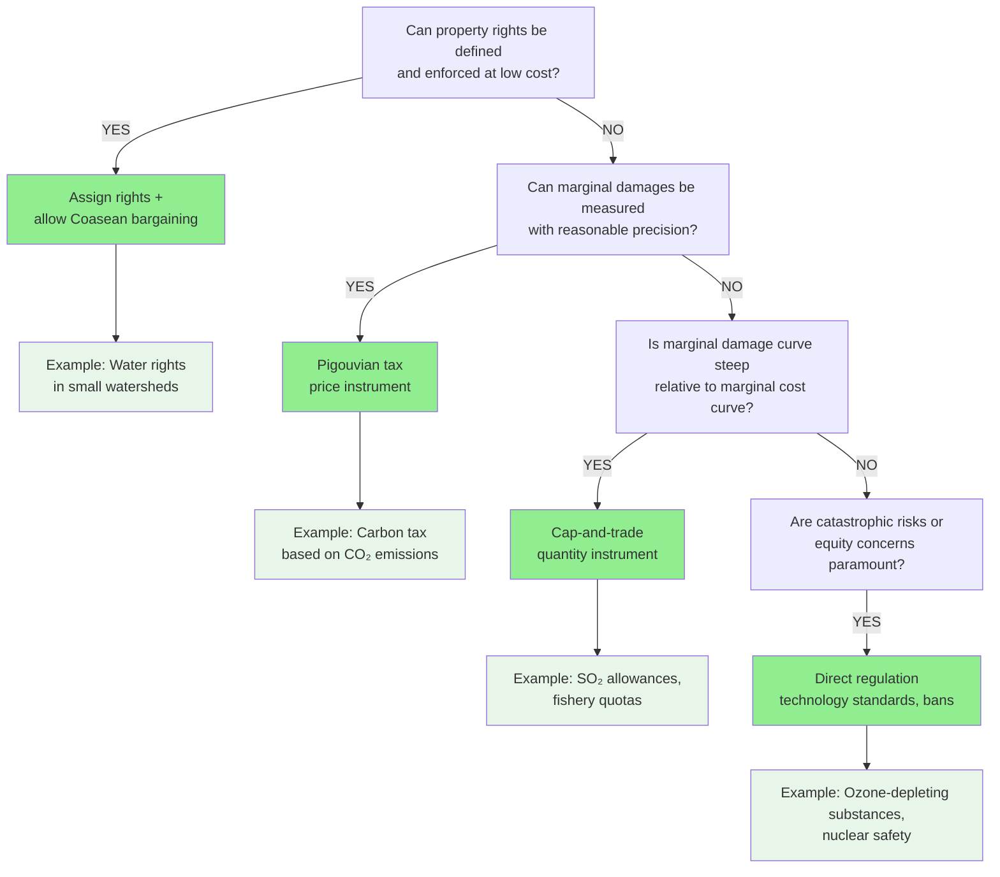

# Lesson 1: Market Failures in Environmental Contexts

## 1. First-Principles Intuition & Invariants

Environmental economics emerges from a fundamental insight that traditional market mechanisms, while remarkably efficient at allocating private goods through price signals, systematically fail when confronted with the physical reality of environmental systems. The atmosphere does not respect property boundaries. A factory's sulfur dioxide emissions do not remain confined to the parcel of land where production occurs but disperse across regional airsheds, imposing respiratory costs on populations dozens or hundreds of kilometers downwind. Rivers carry industrial effluent across jurisdictional boundaries. Fisheries collapse when individual rationality in harvest decisions leads to collective resource depletion. These are not incidental market imperfections to be corrected with minor adjustments but structural failures inherent to the architecture of decentralized price systems when property rights cannot be defined, enforced, or traded at acceptable transaction costs.

The classical Pigouvian framework, developed by Arthur Pigou in *The Economics of Welfare* (1920), formalizes the core externality problem through a wedge between private and social cost. When a steel mill produces output $q$, it incurs private marginal cost $MC_{\text{private}}(q)$ reflected in labor, capital, and raw material expenditures. But combustion generates particulate matter and nitrogen oxides that degrade air quality, imposing health costs—emergency room visits, lost work days, premature mortality—on surrounding populations. These damages constitute marginal external cost $MEC(q)$, yielding social marginal cost $MC_{\text{social}}(q) = MC_{\text{private}}(q) + MEC(q)$. The competitive firm, maximizing profit, produces where price equals private marginal cost: $P = MC_{\text{private}}(q^*)$. But social optimality requires $P = MC_{\text{social}}(q^{**})$, where $q^{**} < q^*$. The market overproduces the pollution-intensive good because the price signal fails to internalize the full social opportunity cost of production.

This divergence between private and social calculus manifests across multiple environmental domains, each exhibiting distinct property rights structures and transaction cost barriers. Negative externalities like air and water pollution represent the classical case where damages flow unidirectionally from emitters to receptors without compensation. Positive externalities arise when landowners preserve forest habitat, generating watershed protection and carbon sequestration benefits that accrue to downstream water users and the global climate system without payment to the forest owner. Public goods—characterized by non-rivalry in consumption and non-excludability—create systematic underprovision. A stable climate system exhibits pure public good properties: one nation's consumption of climate stability does not diminish availability to others (non-rivalry), and no mechanism exists to exclude free-riders who refuse to pay for emissions reductions (non-excludability). The classic voluntary provision problem emerges: each nation faces dominant strategy incentives to free-ride on others' abatement efforts, leading to catastrophic underprovision of the global public good.

Common pool resources occupy a distinct analytical category, combining rivalry in consumption with non-excludability or high exclusion costs. Ocean fisheries exemplify the structure: fish stocks are rivalrous—my harvest directly reduces your available catch—but the open ocean makes property right definition and enforcement prohibitively expensive. Garrett Hardin's "Tragedy of the Commons" (1968) popularized the collective action problem, though the formal game-theoretic structure traces to H. Scott Gordon's fisheries analysis (1954). Each fisher faces a private optimization problem: increase effort until marginal private benefit equals marginal private cost. But aggregate harvest generates negative stock externalities—overfishing reduces future reproduction capacity, imposing costs on all users. The Nash equilibrium harvest $H^*$ exceeds the social optimum $H^{**}$, often catastrophically. North Atlantic cod stocks collapsed in the early 1990s after centuries of sustained harvest, illustrating how individual rationality aggregates to collective disaster when property rights cannot contain the externality.

The Coase Theorem, articulated by Ronald Coase in "The Problem of Social Cost" (1960), provides the foundational counterpoint to Pigouvian taxation by demonstrating that well-defined property rights can internalize externalities through voluntary bargaining, regardless of initial rights allocation, provided transaction costs are zero. Consider a rancher whose cattle stray onto neighboring cropland, trampling wheat worth $\$10{,}000$ annually. A fence costing $\$6{,}000$ would prevent the damage. Under a liability rule where the rancher must compensate crop damage, the rancher will install the fence ($\$6{,}000$ cost avoiding $\$10{,}000$ liability). Under a no-liability rule where the farmer bears trampling costs, the farmer will pay the rancher up to $\$10{,}000$ to install the fence; the rancher accepts any payment above $\$6{,}000$, yielding a bargaining range $[\$6{,}000, \$10{,}000]$ where both parties gain. The fence gets built regardless of legal regime—the efficient outcome emerges through voluntary exchange once property rights are clearly assigned.

But Coase immediately recognized that this elegant theoretical result depends critically on zero transaction costs, a condition almost never satisfied in environmental contexts. Transaction costs encompass search and information costs (identifying all affected parties and quantifying damages), bargaining costs (negotiating agreements among heterogeneous stakeholders with conflicting interests), and enforcement costs (monitoring compliance and adjudicating disputes). When a coal power plant's emissions affect tens of thousands of downwind residents across multiple states, transaction costs become prohibitive. Affected parties must organize collectively, overcoming free-rider problems in monitoring and litigation. Information asymmetries favor the polluter, who possesses superior knowledge of abatement technology and costs. Strategic bargaining behavior—holdouts demanding disproportionate compensation, threats to walk away from negotiations—can block agreements even when total social gains exceed total costs. High transaction costs prevent Coasean bargaining from internalizing the externality, justifying Pigouvian corrective taxation or regulatory quantity constraints as lower-cost institutional mechanisms.

Property rights structures fundamentally shape environmental outcomes by determining who holds decision authority over resource use and who captures the economic rents from conservation or exploitation. Private property rights internalize externalities when the rights-holder bears the full costs and benefits of resource management decisions. A private forest owner deciding whether to clearcut or practice selective harvest faces market prices for timber, but also capitalizes future land values reflecting productivity losses from soil erosion. If property rights are secure, enforceable, and tradeable, the owner has incentives to manage sustainably. But incomplete property rights—insecure tenure, restrictions on transferability, inability to capture non-market values like carbon sequestration or biodiversity—break the incentive structure. Indigenous communities managing forest commons for centuries often lack formal legal title, leaving them vulnerable to displacement when extractive industries claim mining or logging rights. Open access regimes, where no property rights exist, guarantee overexploitation: fishers, loggers, and groundwater pumpers race to extract before competitors, driving resources toward biological or hydrological collapse.

The optimal institutional response to environmental market failures depends on the specific configuration of transaction costs, information asymmetries, and property right feasibility. When transaction costs are low, clearly assigning property rights and allowing Coasean bargaining can achieve efficiency while respecting decentralized decision-making. When transaction costs are moderate but externalities are diffuse, Pigouvian taxes (carbon pricing, effluent charges) or cap-and-trade quantity instruments (sulfur dioxide allowances, fishery quotas) can internalize costs without requiring government to possess detailed technological information. When transaction costs are prohibitively high or equity concerns override efficiency—as in catastrophic risks like stratospheric ozone depletion or nuclear waste disposal—direct regulatory standards (technology mandates, outright bans) may dominate despite efficiency losses. The policy analyst's task is not to apply a universal template but to diagnose the specific anatomy of each market failure and design institutions that minimize the sum of environmental damages, compliance costs, and administrative transaction costs.

## 2. Core Architecture & Mechanics

The analytical machinery for diagnosing and correcting environmental market failures rests on comparative static analysis of equilibrium outcomes under alternative institutional regimes. We begin with the standard partial equilibrium framework for negative externalities, then extend to public goods, common pool resources, and property rights structures.

**Negative Externality: The Canonical Pollution Model**

Consider a competitive industry producing output $q$ at private marginal cost $MC_p(q) = c_0 + c_1 q$, where $c_0$ represents fixed marginal cost and $c_1$ captures increasing marginal costs from capacity constraints. Production generates pollution intensity $e(q)$, imposing external damages $D(e)$ on affected populations. Total social welfare comprises consumer surplus, producer surplus, and external damages:

$$W = \int_0^q P(x) dx - \int_0^q MC_p(x) dx - D(e(q))$$

The competitive market equilibrium occurs where price equals private marginal cost: $P = MC_p(q^*)$. The social optimum requires price to equal social marginal cost:

$$P = MC_s(q^{**}) = MC_p(q^{**}) + \frac{dD}{dq}\bigg|_{q^{**}}$$

The optimal Pigouvian tax exactly equals marginal external damage at the socially optimal output level: $\tau^* = \frac{dD}{dq}\big|_{q^{**}}$. This tax shifts the firm's effective marginal cost curve upward by $\tau^*$, inducing the firm to internalize the externality and choose $q^{**}$ voluntarily. The tax generates revenue $T = \tau^* q^{**}$, which can be returned lump-sum to affected populations (compensation) or used to finance public goods (infrastructure, research and development).

The informational requirements for implementing optimal Pigouvian taxation are stringent. The regulator must know the marginal damage function $\frac{dD}{dq}$, requiring epidemiological studies linking pollution concentrations to health outcomes, atmospheric dispersion modeling to map emissions to ambient concentrations, and economic valuation of health endpoints (mortality, morbidity, lost productivity). The U.S. Environmental Protection Agency's Regulatory Impact Analyses routinely perform these calculations for major air quality rules, estimating that each avoided premature mortality from fine particulate matter reduction yields approximately $\$7$ to $\$10$ million in social benefits using value of statistical life (VSL) methodologies. But uncertainty ranges are large—VSL estimates vary by an order of magnitude across studies—and politically contested. Industry stakeholders challenge high damage valuations; environmental advocates dispute low estimates. This informational asymmetry and political contestability drive many jurisdictions toward quantity-based instruments (cap-and-trade) over price-based taxes, trading off allocative efficiency for reduced informational demands.

**Cap-and-Trade: Quantity Instruments under Uncertainty**

Martin Weitzman's seminal 1974 paper "Prices vs. Quantities" demonstrated that the relative efficiency of taxes versus tradable permits depends on the slopes of marginal cost and marginal damage curves under uncertainty. When marginal damage curves are steep (small quantity deviations generate large welfare losses) and marginal cost curves are flat (abatement costs vary little with output), quantity instruments dominate. When marginal cost curves are steep and marginal damage curves are flat, price instruments dominate.

A cap-and-trade system sets a total emissions cap $\bar{E}$, allocates initial permits summing to $\bar{E}$ (via auction or grandfathering), and allows firms to trade permits. Each firm faces the optimization problem:

$$\min_{q_i, e_i} \quad C_i(q_i) + p_e \cdot e_i \quad \text{subject to} \quad e_i = \phi_i(q_i)$$

where $p_e$ is the equilibrium permit price and $\phi_i(q_i)$ is firm $i$'s emissions function. At equilibrium, all firms equate marginal abatement cost to the permit price: $MAC_i(e_i) = p_e$ for all $i$. This achieves cost-effectiveness—the aggregate cap is met at minimum total abatement cost—without the regulator needing to know individual firms' cost functions. The invisible hand of the permit market aggregates dispersed information and allocates abatement effort efficiently across heterogeneous sources.

The U.S. Acid Rain Program, established under the 1990 Clean Air Act Amendments, implemented a sulfur dioxide cap-and-trade system covering coal-fired power plants. The program capped SO₂ emissions at 8.95 million tons annually (roughly 50% below 1980 levels), allocated tradable allowances, and imposed strict continuous emissions monitoring requirements. Empirical evaluations consistently find that the program achieved compliance at roughly half the projected cost of command-and-control technology mandates, with abatement costs ranging from $\$1{,}000$ to $\$1{,}500$ per ton versus $\$2{,}500$ to $\$3{,}000$ per ton under alternative regulatory scenarios. The cost savings arose from trading flexibility: low-cost abaters (plants that could switch to low-sulfur coal or install scrubbers cheaply) sold permits to high-cost abaters (plants with expensive retrofit constraints), equalizing marginal abatement costs across the system.

**Public Goods: Voluntary Provision and the Free-Rider Problem**

A pure public good exhibits non-rivalry ($MC$ of serving an additional consumer equals zero) and non-excludability (impossible or prohibitively costly to prevent consumption). Climate stability, biodiversity preservation, and basic environmental research satisfy these criteria. Consider $n$ individuals deciding how much to contribute $g_i$ toward provision of a public good $G = \sum_{i=1}^n g_i$. Individual $i$'s utility is:

$$U_i(x_i, G) = u_i(x_i) + v_i(G)$$

where $x_i$ is private consumption and $v_i(G)$ is utility from the public good. With income $y_i$ and public good cost normalized to $1$, the budget constraint is $x_i + g_i = y_i$. Individual $i$ chooses $g_i$ to maximize $U_i$, taking others' contributions as given:

$$v_i'(G^*) = 1$$

where $G^* = g_i^* + \sum_{j \neq i} g_j$. The Nash equilibrium occurs where each individual's marginal benefit from an additional dollar contributed equals the marginal cost (one dollar). But the social optimum requires:

$$\sum_{i=1}^n v_i'(G^{**}) = 1$$

The Samuelson condition for optimal public good provision equates the sum of marginal benefits across all individuals to marginal cost. The voluntary Nash equilibrium undersupplies the public good because each individual ignores the positive externality their contribution confers on others. The free-rider problem intensifies as $n$ grows: with millions of global citizens benefiting from climate stability, each individual's incentive to contribute approaches zero, while the socially optimal contribution remains bounded away from zero.

International climate negotiations exemplify this structure. The 2015 Paris Agreement secured pledges (Nationally Determined Contributions) from 196 parties, committing to emissions reductions intended to limit global warming to well below 2°C above pre-industrial levels. But the agreement lacks binding enforcement mechanisms. Each nation faces incentives to free-ride: if others reduce emissions sufficiently to stabilize the climate, a defecting nation enjoys climate benefits without bearing abatement costs; if others fail to reduce emissions, unilateral abatement by a single nation generates negligible climate benefits at substantial domestic cost. The game-theoretic structure is a multi-player prisoner's dilemma with weak punishment mechanisms, explaining persistent underprovision despite widespread recognition of catastrophic risks.

**Common Pool Resources: The Gordon-Schaefer Bioeconomic Model**

The canonical fishery model, developed by H. Scott Gordon (1954) and Milner Schaefer (1957), illustrates the tragedy of the commons through biological and economic dynamics. Let $X(t)$ denote fish stock (biomass) at time $t$, evolving according to logistic growth:

$$\frac{dX}{dt} = rX\left(1 - \frac{X}{K}\right) - H(t)$$

where $r$ is the intrinsic growth rate, $K$ is environmental carrying capacity, and $H(t)$ is harvest. The Gordon-Schaefer harvest function relates catch to effort $E$ and stock $X$:

$$H = qEX$$

where $q$ is the catchability coefficient. Total revenue is $TR = pH$, where $p$ is price per unit biomass. Total cost is $TC = cE$, where $c$ is cost per unit effort. Profit is:

$$\pi = pqEX - cE = E(pqX - c)$$

Under open access, effort expands until rent dissipates: $\pi = 0$, implying $X_{\text{open}} = \frac{c}{pq}$. Substituting into the steady-state condition $\frac{dX}{dt} = 0$ yields:

$$H_{\text{open}} = rX_{\text{open}}\left(1 - \frac{X_{\text{open}}}{K}\right) = r\frac{c}{pq}\left(1 - \frac{c}{pqK}\right)$$

The social optimum maximizes sustained economic yield:

$$\max_E \quad \pi = pqEX - cE \quad \text{subject to} \quad rX\left(1 - \frac{X}{K}\right) = qEX$$

Solving yields optimal stock $X^* = \frac{K}{2}\left(1 + \frac{c}{pqK}\right)$ and optimal effort $E^* = \frac{r}{2q}\left(1 - \frac{c}{pqK}\right)$. For most parameter values, $X_{\text{open}} < X^*$ and $H_{\text{open}} > H^*$—open access drives stocks below optimal levels and generates excess fishing effort that dissipates economic rents. Empirical applications to North Atlantic cod, Pacific bluefin tuna, and Caribbean spiny lobster consistently find that open access harvests exceed maximum sustainable yield, driving multiple stocks to commercial or biological extinction.

**Property Rights and the Coase Theorem: Transaction Cost Barriers**

The Coase Theorem formalizes the conditions under which voluntary bargaining internalizes externalities. Consider two agents: a polluter generating emissions $e$ with benefit function $B(e)$ and a receptor suffering damage $D(e)$. Total surplus is $W = B(e) - D(e)$, maximized at $e^*$ where $B'(e^*) = D'(e^*)$. Under a liability rule, the polluter must compensate damages, internalizing the cost: the polluter chooses $e$ to maximize $B(e) - D(e)$, yielding $e^*$. Under a no-liability rule, the polluter chooses $e$ to maximize $B(e)$, yielding $e_{\text{no-liability}} > e^*$. But if the receptor can pay the polluter to reduce emissions, the receptor offers payment $t$ conditional on emission reduction to $e$, where $t \in [D(e_{\text{no-liability}}) - D(e), B(e_{\text{no-liability}}) - B(e)]$. Both parties accept such transfers, and the negotiated outcome yields $e^*$ regardless of initial rights assignment.

Transaction costs break this elegant result through multiple channels:

1. **Search and Information Costs**: Identifying all affected parties and measuring damages requires epidemiological studies, atmospheric modeling, and economic valuation—tasks requiring specialized expertise and data that individual receptors cannot afford. The polluter possesses superior information about abatement costs and technology options, creating adverse selection problems in bargaining.

2. **Bargaining Costs with Large Numbers**: When emissions affect thousands or millions of receptors, collective action problems proliferate. Free-riding on others' bargaining efforts, holdout behavior demanding disproportionate compensation, and coordination failures across heterogeneous stakeholders block agreement even when aggregate gains from trade exist.

3. **Enforcement Costs**: Monitoring compliance with voluntary agreements and adjudicating disputes impose ongoing costs. Without third-party enforcement (courts, regulatory agencies), parties must invest in private monitoring or accept non-compliance risks, raising the effective cost of bargaining solutions.

Empirical evidence supports Coase's transaction cost hypothesis. In settings with few parties and low information barriers—neighboring landowners negotiating fence construction, small-scale irrigation cooperatives managing water allocation—Coasean bargaining frequently achieves efficient outcomes. Ronald Coase's original examples (ranchers and farmers, confectionery manufacturer and physician sharing a building) involved bilateral negotiations with observable damages and low enforcement costs. But environmental externalities typically exhibit diffuse damages across large populations, high measurement costs, and complex causal chains linking emissions to damages, rendering transaction costs prohibitive. The policy implication is stark: when transaction costs exceed the deadweight loss from Pigouvian taxation or regulatory standards, centralized correction mechanisms dominate decentralized bargaining despite informational inefficiencies.

## 3. High-Performance Optimization & Failure Modes

Policy design for environmental market failures confronts multiple optimization challenges: minimizing total social cost (environmental damages plus compliance and administrative costs), achieving distributional equity objectives, maintaining dynamic efficiency incentives for technological innovation, and ensuring political feasibility. Failure modes arise from information constraints, strategic behavior by regulated entities, political economy distortions, and unintended consequences of institutional design choices.

**Optimal Tax Design under Uncertainty and Heterogeneity**

Pigouvian taxation achieves static efficiency when the regulator possesses perfect information about marginal damage and cost functions. But environmental systems exhibit deep uncertainty: damage functions depend on dose-response relationships estimated with confidence intervals spanning orders of magnitude; climate sensitivity parameters remain bounded between 1.5°C and 4.5°C per doubling of CO₂ concentrations despite decades of research; ecosystem tipping points (Amazon rainforest dieback, permafrost methane release) lack precise probability distributions. Regulator uncertainty over marginal damage implies the optimal tax deviates from expected marginal damage.

When the regulator faces uncertainty over the true marginal damage function $MD(\theta)$, where $\theta$ is an uncertain parameter, the optimal tax solves:

$$\max_{t} \quad \mathbb{E}_\theta\left[\int_0^{q(t,\theta)} P(x) dx - \int_0^{q(t,\theta)} MC(x) dx - D(q(t,\theta), \theta)\right]$$

where $q(t,\theta)$ is the quantity chosen by firms facing tax $t$ under parameter realization $\theta$. The first-order condition generally does not yield $t^* = \mathbb{E}_\theta[MD(q^*, \theta)]$—the optimal tax is not the expected marginal damage. If marginal damage is convex in output (damages accelerate as pollution increases), Jensen's inequality implies $\mathbb{E}_\theta[MD(q^*, \theta)] < MD(\mathbb{E}_\theta[q^*], \mathbb{E}_\theta[\theta])$, and the optimal tax may exceed expected marginal damage to hedge against high-damage realizations.

Heterogeneity across pollution sources complicates uniform taxation. A coal plant in a densely populated urban area generates higher marginal damages per ton of particulate matter than an identical plant in a remote rural location due to differential population exposure. Efficient taxation requires differentiated rates reflecting local marginal damages: $t_i = MD_i(q_i)$ for source $i$. But administering spatially differentiated tax rates imposes high administrative costs and invites rent-seeking: regulated entities lobby for favorable geographic classifications to reduce tax burdens. The U.S. EPA's regional haze rules under the Clean Air Act exemplify the trade-off: regulations set technology-based standards rather than differentiated taxes, sacrificing allocative efficiency for administrative feasibility and political acceptability.

**Cap-and-Trade Design: Allocation, Banking, and Leakage**

The efficiency of cap-and-trade systems depends critically on permit allocation mechanisms, inter-temporal flexibility provisions, and prevention of emissions leakage. Initial allocation choices—auctioning versus grandfathering (free allocation based on historical emissions)—have no effect on allocative efficiency in frictionless markets (Coase Theorem applies within the trading system), but profoundly impact distributional outcomes and political feasibility. Auctioning maximizes revenue available for efficiency-enhancing uses (financing complementary public goods, reducing distortionary taxes) and avoids windfall rents to incumbent polluters. But grandfathering reduces political opposition from regulated industries, explaining why most implemented cap-and-trade systems (EU Emissions Trading System, Regional Greenhouse Gas Initiative) allocate substantial shares freely in early phases before transitioning toward auctions.

Banking provisions—allowing firms to save permits from period $t$ for use in period $t+1$—improve dynamic efficiency by allowing firms to smooth abatement costs across time. When firms anticipate tighter future caps or technological improvements that reduce future abatement costs, banking optimal ity requires the permit price to rise at the discount rate: $p_{t+1} = (1 + r) p_t$. Empirical analysis of the U.S. SO₂ market found substantial banking in Phase I (1995-1999), with banked allowances exceeding annual allocations, allowing firms to defer high-cost retrofits while low-cost abatement opportunities (fuel switching) were exhausted.

Emissions leakage—relocation of production from regulated to unregulated jurisdictions—undermines cap-and-trade effectiveness when coverage is incomplete. If a carbon price applies to domestic steel producers but not international competitors, production shifts abroad to carbon-intensive jurisdictions, increasing global emissions while reducing domestic output and employment. Leakage rates depend on trade exposure and emissions intensity: energy-intensive, trade-exposed sectors (aluminum, cement, steel) exhibit high leakage potential, while non-traded services (electricity generation in isolated grids) exhibit zero leakage. Border carbon adjustments—tariffs on imports equal to the carbon content of imported goods—can mitigate leakage but raise World Trade Organization compliance concerns and require complex carbon content accounting across global supply chains.

**Common Pool Resource Management: Individual Transferable Quotas**

Converting open-access fisheries to property-right regimes through Individual Transferable Quotas (ITQs) internalizes stock externalities by granting harvesters tradable shares of the total allowable catch (TAC). Each quota holder owns the right to harvest a fixed percentage $\alpha_i$ of the TAC in perpetuity (or long-term lease), where $\sum_i \alpha_i = 1$. The ITQ holder's asset value is:

$$V_i = \sum_{t=0}^\infty \frac{\alpha_i \cdot TAC_t \cdot (p - c/q X_t)}{(1+r)^t}$$

which depends on future stock levels $X_t$. Current overharvesting reduces future stocks, lowering $V_i$. Unlike open-access fishers who ignore stock externalities, ITQ holders internalize the future cost of present extraction through capitalized asset values. Empirical evaluations of ITQ implementation in New Zealand (1986), Iceland (1990), and British Columbia halibut (1991) consistently find increased profitability, reduced overcapacity (fewer vessels, shorter seasons), and stabilized or recovering stocks relative to pre-ITQ open-access conditions.

But ITQ systems confront equity and distributional challenges. Initial quota allocation typically grandfathers rights to incumbent fishers based on historical catch, creating windfall wealth for those receiving quota. New entrants face capital barriers—quota prices in mature ITQ systems often exceed the value of vessels and gear—concentrating fishing rights among established operators. In Alaska, ITQ quota shares for halibut and sablefish trade at prices exceeding $\$50$ per pound of annual quota, requiring hundreds of thousands of dollars in upfront capital for viable operations. Alternative allocation mechanisms—auctioning quota, setting aside shares for community groups or new entrants—address equity concerns but face political opposition from incumbent harvesters who view historical catch as establishing de facto property rights.

**Political Economy Distortions and Regulatory Capture**

Environmental policy operates within political systems where concentrated industry interests exert disproportionate influence relative to diffuse public beneficiaries. A carbon tax imposing $\$50$ per ton CO₂ generates highly salient costs to coal producers, refineries, and energy-intensive manufacturers—costs measured in billions of dollars for individual firms—while benefits (avoided climate damages, improved air quality) accrue diffusely across the global population in small per-capita increments. The political economy of concentrated costs and diffuse benefits systematically biases policy toward weaker standards, grandfathered permit allocations, and exemptions for politically powerful sectors.

Regulatory capture—where regulated industries influence policy design to serve private interests at public expense—manifests through multiple channels. Industry-funded research and expert testimony shape regulatory impact analyses, often underestimating abatement costs or exaggerating economic impacts. Revolving door employment patterns between regulatory agencies and regulated industries create conflicts of interest: EPA officials anticipating future industry employment may bias rulemakings favorably. Campaign contributions and lobbying expenditures secure exemptions and loopholes: U.S. renewable fuel standards include exemptions for small refineries that have expanded beyond statutory intent due to industry pressure.

Mitigating political economy distortions requires institutional design separating technical analysis from political interference. Independent regulatory agencies with statutory mandates and civil service protections partially insulate decisions from short-term political pressures. Benefit-cost analysis requirements, though subject to methodological disputes, constrain arbitrary standards by forcing transparent valuation of costs and benefits. Public comment processes and judicial review create accountability mechanisms, though these also enable industry obstruction through strategic litigation and comment flooding.

**Dynamic Efficiency and Technological Innovation**

Static efficiency—minimizing costs given existing technology—must be balanced against dynamic efficiency—incentivizing innovation that shifts abatement cost curves downward over time. Environmental policies differ markedly in innovation incentives. Technology mandates (required scrubbers, catalytic converters) provide zero incentive to innovate beyond the standard. Firms meeting the mandate face no marginal benefit from further improvements. Performance standards (emissions rate targets) provide modest incentives: exceeding the standard allows increased production without proportionate emissions growth. Price instruments (Pigouvian taxes) and quantity instruments (tradable permits) provide continuous innovation incentives: every unit of abatement reduces tax liability or generates saleable permits, rewarding innovation at all margins.

Empirical evidence supports stronger innovation incentives under market-based instruments. Analysis of U.S. patent filings for SO₂ abatement technologies found a sharp increase following the 1990 Acid Rain Program cap-and-trade implementation, particularly for low-cost scrubber designs and coal cleaning methods. Japanese NOₓ emission charges (1974-1988) generated significant development of low-NOₓ burner technology and selective catalytic reduction systems, with patents concentrated in firms facing highest marginal tax rates. But innovation also responds to complementary policies: R&D subsidies, public procurement of clean technologies, and performance prizes can accelerate development when private returns to innovation are appropriated slowly due to imitation or knowledge spillovers.

**Monitoring, Enforcement, and Compliance**

Policy effectiveness hinges on credible monitoring and enforcement. Self-reported emissions invite strategic underreporting; command-and-control standards require inspections to verify technology installation and proper operation; cap-and-trade systems need continuous emissions monitoring systems (CEMS) to prevent permit violations. The U.S. Acid Rain Program's success depended on mandatory CEMS installation at all covered sources, transmitting hourly emissions data to EPA in near-real-time. Violations trigger automatic penalties ($\$2{,}000$ per excess ton escalating with inflation, now exceeding $\$5{,}000$) and allowance deductions from future allocations equal to the overage. High penalties and near-certain detection achieved 100% compliance rates throughout the program's operation.

But many environmental programs lack credible enforcement. Self-reported data dominate water pollution permitting (NPDES), with inspections occurring every several years due to resource constraints. EPA's civil penalty policy sets fines averaging $\$10{,}000$ to $\$50{,}000$ per violation, amounts often trivial relative to compliance costs for large facilities, particularly when detection probability is low. Economic theory predicts that optimal enforcement requires expected penalties to exceed compliance costs: $p \cdot F \geq C$, where $p$ is detection probability, $F$ is penalty, and $C$ is compliance cost. Underfunded enforcement agencies set low $p$, requiring politically infeasible high $F$ to achieve deterrence, resulting in systematic undercompliance.

**Failure Modes and Diagnostic Checklist**

Environmental policies fail through predictable mechanisms that can be diagnosed systematically:

1. **Information Failures**: Insufficient data on damages, costs, or emissions lead to misaligned tax rates or caps. Diagnostic: Compare ex-post empirical damage estimates with ex-ante regulatory impact analysis assumptions. Remediation: Adaptive management with periodic standard revisions based on updated science.

2. **Leakage and Incomplete Coverage**: Regulated entities shift production or consumption to unregulated sectors or jurisdictions. Diagnostic: Track production/consumption patterns in covered vs. uncovered sectors; measure emission intensity changes. Remediation: Expand coverage, implement border adjustments, or coordinate policies across jurisdictions.

3. **Weak Enforcement**: Low detection probability or penalties allow non-compliance. Diagnostic: Compare self-reported data with independent audits; estimate compliance costs vs. expected penalties. Remediation: Increase inspection frequency, raise penalties, or implement continuous monitoring technology.

4. **Capture and Rent-Seeking**: Industry influence undermines stringency or secures exemptions. Diagnostic: Document lobbying expenditures and campaign contributions; track revolving door employment; compare regulatory stringency across jurisdictions with varying political institutions. Remediation: Strengthen independent analysis requirements, public transparency, and judicial review.

5. **Distributional Inequity**: Policies impose concentrated costs on vulnerable populations or regions. Diagnostic: Conduct distributional incidence analysis across income quintiles and geographic areas. Remediation: Revenue recycling to affected populations, targeted transition assistance, or differentiated policy instruments.

The practitioner's task is not to achieve theoretical first-best optimality—a chimera given pervasive information constraints and political economy realities—but to design institutions that minimize total social cost (environmental damages, compliance costs, administrative costs, and distributional distortions) subject to feasibility constraints. This requires integrating microeconomic foundations (marginal cost and damage functions, general equilibrium interactions), empirical estimation (econometric damage assessments, engineering cost studies), institutional analysis (property rights structures, transaction costs, enforcement mechanisms), and political economy realism (stakeholder incentives, capture risks, coalition building). Environmental economics, at its core, is applied mechanism design under radical uncertainty and pervasive market failures—a domain where theoretical elegance must bend to the messy realities of implementation while never abandoning rigorous analytical foundations.
