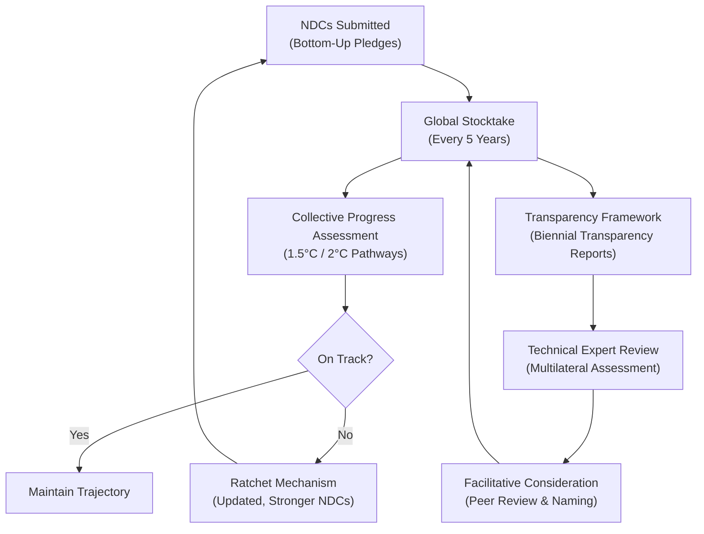
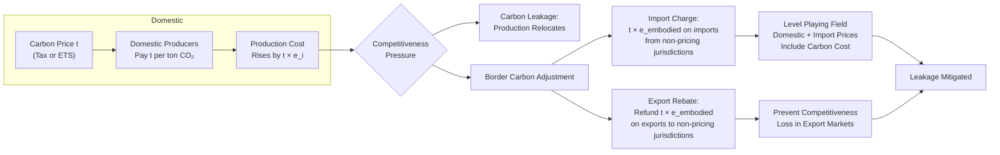

# Lesson 4: International Environmental Policy

## 1. First-Principles Intuition & Invariants

The atmosphere does not recognize borders. A ton of carbon dioxide emitted in Shanghai alters the radiative balance of the entire planet just as surely as a ton emitted in Stuttgart, and the marginal damage it imposes falls on populations who had no role in the decision to burn that carbon. This physical fact—that the Earth's climate system, its ozone layer, its ocean fisheries, and its biodiversity are all structurally global in their scope—creates a category of economic problem that domestic policy instruments cannot solve on their own. The central challenge of international environmental policy is that the institutions capable of enforcing corrective action are themselves structurally national. There is no world government with the authority to impose a Pigouvian tax on sovereign states, no global antitrust regulator with jurisdiction over atmospheric commons, and no international court with the enforcement power to compel a sovereign nation to honor an emissions reduction pledge against its will. Every international environmental agreement, from the Montreal Protocol to the Paris Agreement, must therefore be self-enforcing: it must be in each participant's individual interest to comply, or it must be structured so that the costs of non-compliance exceed the benefits of defection through mechanisms that participating states themselves consent to.

This constraint—that international environmental governance must operate without a coercive central authority—places the entire domain firmly within the theory of global public goods and transboundary externalities. A global public good is defined by two properties: non-rivalry in consumption (one country's enjoyment of a stable climate does not diminish another's) and non-excludability (no country can be prevented from benefiting from it, regardless of whether it contributed to its provision). Climate stability, stratospheric ozone, pandemic preparedness, and the conservation of migratory species all satisfy both conditions. The Samuelson condition, which specifies the efficient provision level for a public good, requires that the sum of marginal benefits across all beneficiaries equal the marginal cost of provision:

$$\sum_{i=1}^{N} MB_i(G) = MC(G)$$

where $G$ is the quantity of the global public good, $MB_i$ is the marginal benefit to country $i$, and $MC$ is the marginal cost of provision. The critical operational implication is that efficient provision requires aggregating willingness-to-pay across all $N$ countries, which in turn requires either a supranational authority with taxation power or a voluntary mechanism that elicits truthful revelation of each country's valuation. In the absence of the former, the latter must contend with the free-rider problem: each country has an incentive to underreport its true willingness-to-pay for the global public good, hoping that others will bear the cost of provision while it enjoys the benefits at zero cost. This is not a behavioral defect or a failure of political will—it is the dominant strategy in any single-shot interaction where benefits are non-excludable.

The transboundary externality framework formalizes the damage pathway. When production or consumption in country $i$ imposes costs on country $j$ without compensation, the standard Pigouvian remedy calls for a tax equal to the full marginal social damage:

$$t^* = \sum_{j=1}^{N} MDC_{ij}$$

where $MDC_{ij}$ is the marginal damage cost imposed on country $j$ by emissions in country $i$. In a domestic context, the government of country $i$ would levy this tax. In an international context, the government of country $i$ has no incentive to internalize damages imposed on foreigners unless those damages feed back through trade, diplomatic, or reputational channels. The Nash equilibrium of the non-cooperative emissions game is therefore one in which each country equates its own marginal abatement cost to its own marginal damage, ignoring the externality imposed on others:

$$MAC_i = MD_i \quad \text{(Nash equilibrium)}$$

while the socially optimal outcome requires each country to equate its marginal abatement cost to the global marginal damage:

$$MAC_i = \sum_{j=1}^{N} MD_{ij} \quad \text{(Social optimum)}$$

The gap between these two conditions is the entire subject matter of international environmental policy. The difference between the Nash equilibrium emissions level and the socially optimal level represents the welfare loss from non-cooperation, and the magnitude of this loss scales with the number of affected countries, the severity of the externality, and the degree of asymmetry in marginal damages across nations. For climate change, where damages span centuries and every nation is both emitter and victim, this welfare loss is enormous—integrated assessment models suggest that the social cost of carbon, which represents the present-value marginal damage of one ton of CO₂ emissions, ranges from roughly $50 to $400 per ton depending on the discount rate and damage function specification, with the non-cooperative equilibrium generating emissions trajectories that far exceed the cooperative optimum.

The game-theoretic structure of this problem maps directly onto the prisoners' dilemma and its n-player generalization. If each country has a dominant strategy to free-ride (emissions abatement is costly, the benefit of any one country's abatement is globally shared and non-excludable), the unique Nash equilibrium is universal free-riding—every country emits too much, and every country is worse off than under cooperation. Scott Barrett's foundational analysis of international environmental agreements demonstrated that this logic is not merely theoretical: it explains why voluntary IEAs tend to attract either broad participation with weak commitments or strong commitments with narrow participation. Barrett showed that a self-enforcing IEA—one that is both internally stable (no signatory wishes to withdraw) and externally stable (no non-signatory wishes to join)—can sustain full cooperation only when the gains from cooperation are modest. When the gains from cooperation are large, as with climate change, the stable coalition is small. This is what Barrett termed the "paradox of cooperation": the situations where international cooperation is most valuable are precisely those where it is hardest to sustain through voluntary means.

Elinor Ostrom's work on common-pool resource governance complicates this pessimistic conclusion by showing that communities can and do solve collective action problems through institutional design—nested enterprises, graduated sanctions, conflict resolution mechanisms, and collective choice arrangements—without a central authority. Her analysis of local and regional commons (fisheries, forests, irrigation systems) demonstrated that Hardin's "tragedy of the commons" is not inevitable but depends on the institutional architecture governing access and use. The question for international environmental policy is whether Ostrom's design principles, developed from local and regional cases, can scale to the global level. The evidence is mixed: the Montreal Protocol on ozone-depleting substances succeeded through a combination of credible scientific assessment, differentiated obligations, a multilateral fund for implementation, and trade restrictions against non-parties, while the climate regime has struggled for three decades to achieve comparable results despite a structurally similar architecture.

The distinction between these two cases illuminates the invariant properties that determine whether international environmental cooperation can succeed. The ozone problem involved a small number of substances with close technological substitutes, concentrated in a handful of industries, with damages that were relatively symmetric across countries and a scientific consensus that solidified quickly. The climate problem involves the entire energy foundation of industrial civilization, with deeply entrenched infrastructure, asymmetric vulnerabilities (some countries are net winners from moderate warming, others face existential risk), and scientific uncertainties that, while now substantially resolved at the aggregate level, persist at the regional impact scale where policy adaptation occurs. The lesson is not that international cooperation is impossible, but that its architecture must be matched to the structural properties of the problem: the number of participants, the distribution of costs and benefits, the availability of substitutes, the time horizon of damages, and the credibility of monitoring and enforcement.

## 2. Core Architecture & Mechanics

The architecture of contemporary international environmental policy rests on three load-bearing structures: the international climate agreement framework, the carbon pricing and market mechanisms that implement domestic commitments, and the trade-environment linkages that prevent leakage and enforce participation. Each of these structures has a specific mechanical logic, and their interaction determines whether the system as a whole can deliver the emissions reductions consistent with stabilizing global temperature.

The Paris Agreement, adopted in 2015 and entering into force in 2016, represents a fundamental architectural departure from its predecessor, the Kyoto Protocol. Where Kyoto imposed top-down, legally binding emissions targets on Annex I (developed) countries with no obligations for developing nations, Paris operates through a bottom-up architecture of Nationally Determined Contributions (NDCs)—each country unilaterally declares its own emissions target and the policies it will use to achieve it. The core mechanism is a ratchet: every five years, the global stocktake assesses collective progress toward the temperature goals, and each country is expected to submit a new, more ambitious NDC. The architecture is explicitly designed to avoid the free-rider trap by replacing legally binding targets (which no sovereign state would accept at the stringency required) with a transparency and peer-pressure framework that makes ambition visible and reputational costs salient.



The critical mechanical question is whether this ratchet actually tightens. The evidence through three NDC cycles (2015, 2020, 2023) shows that aggregate ambition has increased with each round, but the rate of increase is insufficient. The UNFCCC's synthesis report on NDCs submitted through 2023 indicated that full implementation of all pledged NDCs would lead to roughly 2.5–2.9°C of warming by 2100, well above the 1.5°C and 2°C targets. The gap between pledged ambition and the temperature goal creates a structural pressure for escalation, but the mechanism translating this pressure into domestic policy change is reputational rather than legal. A country that fails to submit an enhanced NDC faces diplomatic criticism and potential exclusion from climate finance flows, but faces no financial penalty, trade sanction, or legal consequence under the Paris framework itself.

Carbon pricing mechanisms translate NDC commitments into operational price signals. The two primary instruments are carbon taxes and emissions trading systems (ETS), and the choice between them has consequential implications for international policy design. A carbon tax sets a price on emissions directly—each ton of CO₂ equivalent pays a fixed levy—providing price certainty but leaving the quantity of abatement uncertain. An ETS caps total emissions at a predetermined level and allows trading of permits, providing quantity certainty but leaving the price to be discovered in the market. The EU Emissions Trading System, the world's largest carbon market, covers approximately 40% of EU greenhouse gas emissions through a cap-and-trade architecture with a Market Stability Reserve that adjusts the supply of allowances based on the surplus held in circulation, creating a mechanical price floor and ceiling.

The social cost of carbon (SCC) provides the analytical bridge between the physical science of climate change and the economic logic of carbon pricing. The SCC represents the present-value marginal damage of emitting one additional ton of CO₂, calculated through an integrated assessment model (IAM) that links emissions trajectories, carbon cycle dynamics, temperature response, economic damage functions, and discounting. The three IAMs most commonly used for regulatory analysis are DICE (Dynamic Integrated Climate-Economy, Nordhaus), FUND (Climate Framework for Uncertainty, Negotiation and Distribution, Tol), and PAGE (Policy Analysis of the Greenhouse Effect, Hope). The calculation follows a structured pipeline:

```
┌─────────────────────────────────────────────────────────────────┐
│              Social Cost of Carbon — Calculation Pipeline        │
│                                                                 │
│  Emissions Pulse (1 ton CO₂)                                   │
│        │                                                        │
│        ▼                                                        │
│  Carbon Cycle Module ──► Atmospheric CO₂ Concentration          │
│        │                   (Decay function: ~20% persists       │
│        ▼                    for millennia)                     │
│  Climate Response ──► Temperature Increase (ΔT)                 │
│        │               (Climate sensitivity: ECS ≈ 2.5–4.5°C)   │
│        ▼                                                        │
│  Damage Function ──► Economic Damages D(T)                      │
│        │              (DICE: D = 1/(1 + π₁T + π₂T²))            │
│        ▼                                                        │
│  Discounting ──► Present Value                                  │
│        │          (Ramsey: r = ρ + η·g)                        │
│        ▼                                                        │
│  SCC = Σₜ Dₜ / (1 + r)ᵗ                                        │
│                                                                 │
│  Key Parameters & Sensitivity:                                  │
│  ┌──────────────────────────────────────────────────────────┐  │
│  │ ρ (pure time pref.)  │ Stern: 0.1% │ Nordhaus: 1.5%      │  │
│  │ η (elasticity of MU) │ Stern: 1.0  │ Nordhaus: 2.0      │  │
│  │ g (consumption growth)│ ~1.4–2.0%/yr                     │  │
│  │ → r (consumption DR) │ Stern: ~1.4% │ Nordhaus: ~5.5%   │  │
│  │ → SCC                │ Stern: ~$85  │ Nordhaus: ~$30    │  │
│  └──────────────────────────────────────────────────────────┘  │
│                                                                 │
│  US EPA (2023): ~$190/ton CO₂ (at 2% discount rate)             │
│  US IWG (2021): ~$51/ton CO₂ (at 3% discount rate)             │
│                                                                 │
└─────────────────────────────────────────────────────────────────┘
```

The Ramsey discounting formula $r = \rho + \eta g$ encodes two distinct ethical parameters: $\rho$ is the pure rate of social time preference (the rate at which future utility is discounted simply because it occurs in the future, independent of consumption levels), and $\eta$ is the elasticity of the marginal utility of consumption (which captures the diminishing marginal utility of wealth—future generations that are richer should have their damages discounted because an additional dollar means less to them). The product $\eta g$ represents the "growth discounting" component, where $g$ is the expected growth rate of per-capita consumption. The Stern Review (2006) used $\rho = 0.1\%$, $\eta = 1.0$, and $g \approx 1.3\%$, yielding $r \approx 1.4\%$ and an SCC of roughly $85/ton. Nordhaus used $\rho = 1.5\%$, $\eta = 2.0$, and $g \approx 2.0\%$, yielding $r \approx 5.5\%$ and an SCC of roughly $30/ton. The US EPA's 2023 update, reflecting revised damage functions and a lower discount rate of 2%, produced an SCC estimate of approximately $190/ton. The sensitivity of the SCC to the discount rate is not a calibration nuisance—it is the central ethical question in climate economics, because it determines how much weight current policy gives to damages suffered by people who do not yet exist.

The international dimension of carbon pricing creates the problem of carbon leakage: when one jurisdiction imposes a carbon price and its trading partners do not, energy-intensive industries face higher production costs and may relocate to jurisdictions without carbon pricing, causing emissions to "leak" abroad rather than being abated. Empirical estimates of leakage rates vary widely, from 5% to over 30% depending on the sector, the carbon price differential, and the trade exposure. The primary policy response to leakage is the border carbon adjustment (BCA), which extends the domestic carbon price to imports based on their embodied carbon content and rebates the carbon price on exports to countries without equivalent pricing.



The European Union's Carbon Border Adjustment Mechanism (CBAM), which entered its transitional reporting phase in October 2023 and will begin financial obligations in 2026, is the first operational large-scale BCA. It covers cement, iron and steel, aluminum, fertilizers, electricity, and hydrogen—sectors selected for their high carbon intensity and high trade exposure. During the transitional phase, importers must report the direct and indirect embodied emissions of their products. In the definitive phase, importers will purchase CBAM certificates at a price linked to the weekly average EU ETS auction price, with credits for carbon prices already paid in the exporting country. The mechanical complexity of CBAM lies in calculating embodied emissions for products from jurisdictions with heterogeneous production methods, varying data quality, and diverse carbon pricing instruments. The administrative architecture requires third-party verification of emissions data, default value fallbacks based on benchmarks, and a registry system for certificate trading and surrender.

The World Trade Organization compatibility of BCAs is the subject of intense legal analysis. GATT Article I (most-favored-nation treatment) requires that imports from all WTO members be treated equally, and Article III (national treatment) requires that imported goods be treated no less favorably than domestic goods. A BCA that charges imports based on their embodied carbon while exempting domestic producers from an equivalent charge would violate national treatment. The EU's design attempts to comply by applying the EU ETS carbon price to both domestic production and imports, and by allowing deductions for carbon prices already paid in the exporting country. The more contested question is whether GATT Article XX exceptions—which permit measures "necessary to protect human, animal or plant life or health" or "relating to the conservation of exhaustible natural resources"—can shield BCAs from challenge. The Appellate Body's interpretation requires that such measures not constitute "arbitrary or unjustifiable discrimination" or a "disguised restriction on international trade," conditions that depend critically on the design of the BCA and whether it accommodates different but equivalent regulatory approaches in exporting countries.

## 3. High-Performance Optimization & Failure Modes

The design of effective international environmental policy is fundamentally an exercise in solving a repeated game with incomplete information, heterogeneous players, and irreversibility. The optimization problem is to maximize the expected present value of global welfare subject to the constraint that every country's participation must be voluntary and every country's compliance must be self-enforcing. This constraint structure eliminates the first-best solution (a globally uniform carbon price at the level of the global SCC, enforced by a supranational authority) and forces the policy architect into a second-best world where instrument choice, sequencing, and institutional design must compensate for the absence of coercive enforcement.

The most consequential design trade-off in international climate agreements is between participation breadth and commitment stringency. Barrett's coalition stability analysis formalizes this trade-off through the internal and external stability conditions. A coalition $C$ of $k$ signatory countries is internally stable if no member can improve its welfare by withdrawing:

$$W_i(C) \geq W_i(C \setminus \{i\}) \quad \forall i \in C$$

and externally stable if no non-member can improve its welfare by joining:

$$W_j(C) \geq W_j(C \cup \{j\}) \quad \forall j \notin C$$

where $W_i(C)$ is the welfare of country $i$ when coalition $C$ is in place. The intuition is that a large coalition spreads the abatement burden across many participants, making each individual contribution small and the free-rider temptation correspondingly large. A small coalition with deep commitments may be internally stable because each member's contribution is substantial enough that withdrawal would noticeably worsen the collective outcome, but externally unstable because non-members benefit from the coalition's abatement without bearing its cost. The mathematical result is that the stable coalition size $k^*$ is inversely related to the gain from full cooperation: the larger the prize, the smaller the stable coalition. For climate change, where the gain from cooperation is enormous, the Barrett analysis implies that a broad, deep, self-enforcing agreement is unattainable through a single negotiation. The Paris architecture responds to this by decomposing the problem: rather than seeking a single agreement on a uniform emissions cap, it asks each country to make a unilateral pledge calibrated to its own political constraints, and then uses the transparency framework and ratchet mechanism to iteratively increase ambition.

The failure mode this architecture must guard against is the "pledge-and-ignore" pattern, where countries submit NDCs that are either insufficiently ambitious or are not backed by implementing legislation, and face no consequence for underperformance. The monitoring, reporting, and verification (MRV) architecture is the primary mitigant. Under the Paris Enhanced Transparency Framework, each party must submit a Biennial Transparency Report detailing its greenhouse gas inventory, progress toward its NDC, and support provided or received. These reports undergo a technical expert review and a facilitative, multilateral consideration of implementation. The mechanism is explicitly non-punitive—there are no fines, sanctions, or enforcement procedures—but the reputational cost of visible non-compliance is intended to create a social pressure mechanism analogous to Ostrom's graduated sanctions, where the first tier of enforcement is peer disapproval rather than material penalty.

The empirical question is whether this reputational mechanism is strong enough to sustain compliance when the domestic political costs of meeting an NDC exceed the international diplomatic costs of missing it. The evidence from the first NDC cycle is mixed: most parties submitted NDCs, many fell short of implementation, and the global stocktake process confirmed that the aggregate trajectory was inconsistent with the temperature goals. The ratchet did produce upward revisions—more than 100 countries enhanced their NDCs in the 2020–2023 cycle—but the magnitude of enhancement was insufficient. The architectural failure is not that the mechanism is broken, but that its pace is too slow relative to the physical timeline of accumulating atmospheric carbon.

A second critical failure mode is carbon leakage through trade. Even if a coalition of countries implements ambitious carbon pricing, the emissions displaced to non-participating jurisdictions can erode a significant fraction of the coalition's abatement. The theoretical leakage rate under a partial coalition depends on the elasticity of substitution between domestic and foreign production, the carbon intensity of the substitute production, and the relative size of the coalition. For a coalition representing roughly half of global emissions (approximating the Paris participation), leakage rates of 15–25% are typical in computable general equilibrium models, meaning that 15–25% of the coalition's emissions reduction is offset by increased emissions outside the coalition. The BCA is the primary instrument for reducing leakage, but it introduces its own failure modes: WTO legal challenge, retaliation from trading partners, and the administrative complexity of calculating embodied emissions for heterogeneous production processes.

The risk of trade retaliation is particularly acute when BCAs are applied unilaterally. If a major emitter views a BCA as a protectionist measure rather than a legitimate environmental instrument, it may impose counter-tariffs or file a WTO dispute. The design principle that mitigates this risk is to ensure that the BCA is structured as an extension of an equivalent domestic carbon price, not as a tariff imposed on specific trading partners. The EU's CBAM attempts this by linking the import charge to the EU ETS price and crediting carbon prices paid in the exporting country, but the political reception from major trading partners—including India, China, and Russia—has been largely negative, and the risk of retaliatory measures in the 2026 implementation phase is substantial.

The distributional architecture of international environmental policy is the third major failure surface. The damages from climate change are profoundly asymmetric: low-lying island states face existential risk, sub-Saharan African agricultural systems face severe productivity losses, while high-latitude countries may experience agricultural gains and reduced heating demand in the near term. The mitigation cost structure is equally asymmetric: developing countries argue that the historical responsibility for atmospheric carbon stocks rests predominantly with industrialized nations, and that requiring developing economies to bear equal mitigation costs would lock them into energy poverty. The equity principle of "common but differentiated responsibilities and respective capabilities" (CBDR-RC), embedded in the UNFCCC since 1992, acknowledges this asymmetry but provides no operational formula for translating it into specific burden-sharing obligations.

Climate finance is the principal mechanism for operationalizing CBDR-RC. The commitment by developed countries to mobilize $100 billion annually in climate finance for developing nations by 2020 was made at Copenhagen in 2009, formalized at Cancún in 2010, and extended at Paris. The $100 billion target was met for the first time in 2022, according to OECD reporting, though the accounting methodology has been disputed—particularly the share counted as loans rather than grants, and the question of whether the finance is genuinely additional to existing development assistance. The Green Climate Fund, established as a primary channel for this finance, has approved projects totaling approximately $13 billion since its inception, a scale that reflects the structural difficulty of mobilizing and deploying capital at the rate the political commitments envision.

The loss and damage fund agreed at COP27 in Sharm el-Sheikh and operationalized at COP28 in Dubai represents a structural evolution beyond mitigation finance. It acknowledges that some climate damages are already unavoidable and that the countries least responsible for emissions are disproportionately bearing the cost. The fund's architecture is still being specified, but its existence creates a precedent for compensatory transfers that go beyond the traditional development assistance framework. The failure mode here is the gap between the fund's existence and its capitalization: as of early 2024, initial pledges totaled roughly $700 million, against estimated annual loss and damage needs of hundreds of billions of dollars.

The discount rate debate remains the deepest fault line in the economics of international climate policy, and it has direct operational implications for every quantitative output the system produces. The Ramsey equation $r = \rho + \eta g$ decomposes the discount rate into an ethical parameter ($\rho$, the pure rate of time preference), a structural parameter ($\eta$, the elasticity of marginal utility), and an empirical parameter ($g$, the growth rate of consumption). The Stern position—that $\rho$ should be near zero on ethical grounds, because utility experienced by future persons should not be discounted merely because they are born later—produces a low discount rate, a high SCC, and an aggressive mitigation trajectory. The Nordhaus position—that $\rho$ should reflect observed market behavior and political preferences, which reveal positive time preference—produces a higher discount rate, a lower SCC, and a more gradual mitigation trajectory with significant near-term damages accepted as the cost of economic growth.

Martin Weitzman's critique of both positions demonstrated that when the probability distribution over climate sensitivity or damage function parameters has a fat upper tail, the expected SCC is dominated by the low-probability, catastrophic-damage outcomes rather than the central estimate. Under fat-tailed damage uncertainty, the appropriate policy response is precautionary even at high discount rates, because the expected cost of the tail event dwarfs the expected cost of the central scenario. The operational implication is that sensitivity analysis on the discount rate is not a mere academic exercise—it is the primary determinant of whether the policy system recommends gradual or aggressive mitigation, and the fat-tail argument suggests that even a discount-rate optimist should weight the precautionary case heavily.

The integration of these elements into a coherent policy architecture requires a practitioner to work across multiple levels simultaneously. At the international level, the task is to design agreement structures that maximize participation while maintaining ambition, using transparency mechanisms, ratchet cycles, and linkage between carbon pricing systems to create positive feedback loops. At the domestic level, the task is to implement carbon pricing or regulatory instruments that deliver the NDC commitment at least cost, managing the distributional consequences of higher energy prices through revenue recycling or targeted transfers. At the trade level, the task is to design leakage protection mechanisms that preserve the environmental integrity of domestic carbon pricing without triggering trade disputes or protectionist capture. The failure of any one level compromises the others: a weak international agreement reduces the stringency of domestic policy, inadequate domestic implementation undermines the credibility of the international framework, and trade friction can erode the political coalition supporting the entire architecture. The discipline of international environmental policy is the practice of holding these levels in alignment under conditions of deep uncertainty, asymmetric incentives, and irreversibility.
