# Lesson 2: Taxation Theory, Incidence, Efficiency Costs

## 1. First-Principles Intuition & Invariants

Taxation is among the oldest instruments of state power, and yet its economic consequences remain perpetually contested. The intuition that taxes distort behavior is as old as Adam Smith's canons of taxation, but the precise mechanics of *how* they distort, *who* ultimately bears the burden, and *how much* economic value is destroyed in the process took more than a century of theoretical development to formalize rigorously. This lesson treats taxation not as a fiscal accounting exercise but as a problem in applied price theory: taxes alter relative prices, and altered prices change behavior, and changed behavior has real resource costs that neither the government nor the taxpayer recovers.

### The Wedge and the Welfare Triangle

Every tax drives a wedge between the price the buyer pays and the price the seller receives. This is the foundational mechanical reality from which all taxation theory flows. Consider a specific unit tax $t$ levied on a good in a competitive market. Before the tax, the market clears at price $p^*$ where supply equals demand. After the tax, buyers face $p_D = p^* + \Delta p_D$ and sellers receive $p_S = p_D - t$, with the split between buyer-borne and seller-borne portions determined entirely by the relative elasticities of supply and demand. The government collects $t \cdot Q^T$ in revenue, where $Q^T$ is the post-tax quantity. But quantity has fallen from $Q^*$ to $Q^T$, and the transactions that no longer occur would have generated surplus for both parties. That lost surplus, unrecovered by anyone, is the **excess burden** of taxation — also called the deadweight loss.

The standard partial-equilibrium measure of excess burden can be derived geometrically as the Harberger triangle, but its algebraic content is more instructive for policy work. For small taxes, the excess burden $EB$ approximates:

$$EB \approx \frac{1}{2} \cdot t^2 \cdot \frac{\partial Q}{\partial p} = -\frac{1}{2} \cdot t^2 \cdot \varepsilon_D \cdot \frac{Q}{p}$$

where $\varepsilon_D < 0$ is the own-price elasticity of demand, $Q$ is the pre-tax quantity, and $p$ is the pre-tax price. The quadratic relationship between the tax rate $t$ and excess burden is the single most important practical result in taxation theory. It tells the policy analyst that doubling a tax rate does not double the efficiency cost — it quadruples it. This nonlinearity explains why broad-based, low-rate taxes are systematically more efficient than narrow-based, high-rate taxes targeting the same revenue target, a principle that has shaped the design of value-added tax systems across OECD economies since the 1960s.

The parameter $\varepsilon_D$ in the excess burden formula deserves careful empirical attention. Goods with inelastic demand — necessities, goods with few substitutes, addictive commodities — generate lower excess burden per dollar of revenue. This observation has historically motivated so-called "sin taxes" on tobacco and alcohol on efficiency grounds, though the welfare calculus becomes considerably more complex once distributional weights, externalities, and internalities are properly accounted for.

### Compensated vs. Uncompensated Demand and the Slutsky Decomposition

A subtle but consequential distinction in measuring the efficiency cost of labor and commodity taxes is whether one uses the uncompensated (Marshallian) demand function $x_i(p, m)$ or the compensated (Hicksian) demand function $h_i(p, u)$. The excess burden of a tax measures a *pure substitution distortion* — the welfare cost of changed relative prices holding utility constant — which means it must be computed along the compensated demand curve, not the market demand curve.

The Slutsky equation links the two:

$$\frac{\partial x_i}{\partial p_j} = \frac{\partial h_i}{\partial p_j} - x_j \frac{\partial x_i}{\partial m}$$

The first term on the right is the compensated cross-price effect (the substitution effect), and the second is the income effect scaled by the quantity of good $j$. When estimating excess burden from observed market data, analysts must decompose observed price responses into their substitution and income components and use only the compensated elasticities. Failure to do so systematically understates the deadweight loss of taxes on goods that are normal and have significant income effects, and can lead to policy errors in revenue-efficiency trade-off analysis.

For labor supply, this decomposition is particularly consequential. The uncompensated wage elasticity of labor supply is frequently small or even negative in certain demographic groups (the backward-bending labor supply curve), which might naively suggest that labor taxes generate little excess burden. But the compensated elasticity — the response holding utility constant, eliminating the income effect of the wage change — is typically positive and sometimes substantially so. The excess burden of a labor income tax is properly measured using the compensated elasticity, and empirical estimates using this correct measure consistently show meaningful efficiency costs even when the Marshallian elasticity is near zero.

### Tax Incidence: Statutory vs. Economic

A tax's statutory incidence — who writes the check to the government — is essentially irrelevant to its economic incidence, which describes who actually bears the burden in terms of reduced real purchasing power. This distinction, though elementary in principle, generates persistent confusion in policy debates. Politicians routinely argue that a "corporate tax" or an "employer payroll contribution" falls on firms rather than workers or consumers, but the economic analysis depends entirely on market structure and elasticities, not on the legal assignment of liability.

In a competitive labor market, the economic incidence of a payroll tax falls on whoever bears the more inelastic side of the market. If labor supply is relatively inelastic and labor demand is relatively elastic — the empirically more common situation for low-wage workers with limited outside options — then workers absorb most of the tax in the form of lower net wages, regardless of whether the statutory obligation falls on the employer or the employee. The formal condition is:

$$\frac{dw}{dt_e} = \frac{-\varepsilon_D^L}{\varepsilon_S^L - \varepsilon_D^L}$$

where $w$ is the worker's net wage, $t_e$ is the employer-side payroll tax rate, $\varepsilon_S^L$ is the wage elasticity of labor supply, and $\varepsilon_D^L$ is the wage elasticity of labor demand. When labor supply is perfectly inelastic ($\varepsilon_S^L = 0$), this ratio equals $-\varepsilon_D^L / (-\varepsilon_D^L) = 1$, meaning the worker bears the entire burden. When labor supply is perfectly elastic, the ratio is zero, meaning the firm bears it entirely.

This framework has direct empirical content. Studies of the Swedish payroll tax reform of 2007, which cut employer social contribution rates sharply for youth workers, found that most of the tax reduction was passed through to wages rather than retained as firm profits — consistent with a relatively elastic labor demand for young workers. The policy analyst who ignores incidence theory will consistently misattribute the distributional consequences of tax instruments.

---

## 2. Core Architecture & Mechanics

### Optimal Commodity Taxation: The Ramsey Rule

The question of *which* goods to tax, and at what rates, to raise a given revenue target while minimizing aggregate excess burden is the domain of optimal commodity taxation. Frank Ramsey solved this problem in 1927 in a paper of exceptional elegance and density. The result, known as the Ramsey rule, provides the core design principle for efficient tax systems.

The government's problem is to choose specific tax rates $t_i$ on goods $i = 1, \ldots, n$ to minimize total excess burden subject to raising a fixed revenue requirement $R$. Formally:

$$\min_{t_1, \ldots, t_n} \sum_i EB_i(t_i) \quad \text{s.t.} \quad \sum_i t_i \cdot x_i(p) \geq R$$

The solution to this problem, derived via the Lagrangian method with multiplier $\lambda$ on the revenue constraint, yields the **inverse elasticity rule** as a special case when cross-price effects are absent:

$$\frac{t_i}{p_i} = \frac{\lambda}{\varepsilon_i^H}$$

where $\varepsilon_i^H$ is the compensated own-price elasticity of demand for good $i$. The optimal tax rate is inversely proportional to the compensated elasticity: goods with inelastic demand should bear higher tax rates. This formalizes the intuition that taxing goods whose quantity barely responds to price generates revenue with minimal behavioral distortion.

When cross-price effects between goods are non-trivial — as they inevitably are in an economy where goods compete for household budgets — the full Ramsey rule takes the more general form known as the **proportional reduction rule**. Using compensated demands $h_i$, the optimality condition for each good is:

$$\sum_j t_j \frac{\partial h_j}{\partial q_i} = -\mu \cdot h_i \quad \forall i$$

where $q_i = p_i + t_i$ is the consumer price inclusive of tax, and $\mu$ is a constant fraction satisfying $0 < \mu < 1$. This says that the optimal tax system reduces the compensated demand for every taxed good by the same proportion $\mu$ relative to the untaxed optimum. The proportional reduction condition is the deep structural invariant: an efficient tax system is one that contracts the entire consumption bundle uniformly, not one that selectively crushes particular goods.

The practical implication for policy design is profound. Differential tax rates across closely substitutable goods violate this condition and generate excess burden from inter-good substitution that could be avoided with uniform taxation. This is a central argument for broad-based VAT systems with uniform rates over narrowly targeted excise structures riddled with exemptions.

### The Architecture of Tax Incidence Under Different Market Structures

The partial-equilibrium incidence model extends in important and sometimes counterintuitive ways once market structure departs from perfect competition. The figure below maps the signal path of a commodity tax under four market structures.

```mermaid
flowchart TD

subgraph CM ["COMPETITIVE MARKET"]
    CM1["Tax Wedge (t)"]
    CM2["Consumer Price P_D rises"]
    CM3["Producer Price P_S = P_D − t"]
    CM4["Quantity traded falls → Excess Burden Triangle"]
    CM5["Incidence split by relative elasticities ε_D / ε_S"]
    CM6["Buyer fraction = ε_S / (ε_S − ε_D)"]
    CM7["Seller fraction = −ε_D / (ε_S − ε_D)"]

    CM1 --> CM2
    CM1 --> CM3
    CM2 --> CM4
    CM3 --> CM4
    CM4 --> CM5
    CM5 --> CM6
    CM5 --> CM7
end

subgraph MM ["MONOPOLY MARKET"]
    MM1["Tax Wedge (t)"]
    MM2["MC shifts upward by t"]
    MM3["Monopolist optimum: MR = MC + t"]
    MM4["Price rise ΔP depends on demand curvature"]
    MM5["Linear demand: ΔP = t/2 — firm absorbs half"]
    MM6["Constant-elasticity demand: ΔP > t — overshifting"]
    MM7["Excess burden compounded by pre-existing monopoly markup\nDeadweight loss exceeds competitive benchmark"]

    MM1 --> MM2
    MM2 --> MM3
    MM3 --> MM4
    MM4 --> MM5
    MM4 --> MM6
    MM5 --> MM7
    MM6 --> MM7
end

subgraph MN ["MONOPSONY LABOR MARKET"]
    MN1["Payroll tax on employer side"]
    MN2["Monopsonist sets wage below competitive level"]
    MN3["Tax shifts labor supply curve upward"]
    MN4["Incidence governed by monopsony markdown,\nnot elasticities alone"]
    MN5["Workers may bear more than 100% of tax\n— wage falls below new monopsonist optimum"]

    MN1 --> MN2
    MN1 --> MN3
    MN2 --> MN4
    MN3 --> MN4
    MN4 --> MN5
end

subgraph OL ["OLIGOPOLY / COURNOT MARKET"]
    OL1["Per-unit tax on each firm's marginal cost"]
    OL2["Nash equilibrium shifts: each firm contracts output"]
    OL3["Strategic complementarity: rivals also contract output"]
    OL4["Price rise exceeds competitive passthrough — overshifting common\nunder quantity competition"]
    OL5["Excess burden = deadweight loss + strategic output distortion"]

    OL1 --> OL2
    OL2 --> OL3
    OL3 --> OL4
    OL4 --> OL5
end
```

The monopoly case deserves particular elaboration because it complicates the standard Ramsey prescription. Under monopoly with a constant-elasticity demand curve, it is possible — and not merely a theoretical curiosity — for the consumer price to rise by *more* than the full amount of the tax. This phenomenon, called **overshifting**, arises because a higher marginal cost reduces the monopolist's profit-maximizing output along a demand curve whose elasticity changes with quantity. Empirical evidence of overshifting has been documented in studies of cigarette excise taxes in markets with imperfect competition, suggesting that standard partial-equilibrium incidence calculations that assume competitive markets can systematically misestimate the consumer burden of commodity taxes.

### General Equilibrium Incidence: Harberger's Two-Sector Model

The partial-equilibrium framework ignores factor market feedbacks: when a tax on one sector reduces its use of capital, capital flows to other sectors, changing factor prices throughout the economy. Arnold Harberger's 1962 two-sector model of corporate income tax incidence was the first rigorous treatment of these general equilibrium effects, and it remains the foundational reference for GE tax incidence analysis.

Harberger's economy has two sectors, corporate (sector 1) and non-corporate (sector 2), each producing output with capital and labor under constant returns to scale. Capital is mobile between sectors; labor is immobile in the short run. A tax $\tau$ on returns to capital in sector 1 lowers the net return to capital there, causing capital to flow to sector 2 until after-tax returns are equalized. The long-run incidence depends on the factor intensities of the two sectors and the elasticities of substitution between capital and labor within each.

The general equilibrium price change in wages $\hat{w}$ and capital returns $\hat{r}$ can be expressed in terms of cost share parameters and substitution elasticities. Defining $\theta_{Ki}$ as capital's share of costs in sector $i$, $\lambda_{Ki}$ as sector $i$'s share of total capital employment, and $\sigma_i$ as the elasticity of substitution in sector $i$, the system of GE price equations takes the form:

$$\hat{r} - \hat{w} = \frac{-\tau}{\frac{\lambda_{K1} \sigma_1}{\theta_{L1}} + \frac{\lambda_{K2} \sigma_2}{\theta_{L2}} + \delta}$$

where $\delta$ captures demand-side substitution between the two goods. Harberger's central finding — that under plausible parameter values, the corporate income tax falls almost entirely on capital income broadly defined, not just on corporate-sector capital — was both empirically unexpected and policy-significant. It implied that the distributional burden of the corporate tax was borne by all capital owners in the economy, making it more progressive than a simple sectoral analysis would suggest.

Modern extensions of the Harberger model, including open-economy versions where capital is internationally mobile, overturn this result substantially. When capital can flow across national borders in response to differentials in after-tax returns, the incidence of a unilateral corporate tax increase shifts largely to workers in the taxing country, through capital flight and reduced investment that lowers labor productivity. This GE channel is a central empirical concern in the debate over corporate tax reform and minimum global tax regimes, including the OECD's Pillar Two framework with its 15% global minimum effective tax rate.

### Labor Supply Elasticities and the Marginal Cost of Public Funds

The efficiency cost of raising public revenue through labor income taxation is summarized by the **marginal cost of public funds** (MCF), which measures the welfare cost per additional dollar of revenue collected. For a linear income tax at rate $\tau$ on a labor supply $L(w(1-\tau))$:

$$MCF = \frac{1}{1 - \tau \cdot \frac{\varepsilon_S^C \cdot L}{L + \tau \frac{dL}{d\tau}}}$$

where $\varepsilon_S^C$ is the compensated elasticity of labor supply. When labor supply is completely inelastic (compensated elasticity equals zero), MCF = 1: the government can raise revenue at zero efficiency cost, taking from households what they would have earned regardless. As the compensated elasticity rises, the MCF exceeds one, reflecting the growing excess burden per dollar of revenue. For a 30% marginal tax rate and a compensated labor supply elasticity of 0.3 — a plausible middle estimate from the empirical labor economics literature — the MCF is approximately 1.09 to 1.15, meaning each dollar of government revenue costs the private sector between $1.09 and $1.15 in welfare terms.

The empirical literature on labor supply elasticities is unusually large and unusually contested. The divide between micro-econometric estimates from policy variation and macro calibrations used in DSGE models is both quantitative and methodological. Micro studies using the variation in net wages induced by tax reforms — the approach used in Eissa and Liebman's (1996) influential study of the Earned Income Tax Credit — typically find larger extensive-margin responses (the decision to work at all) than intensive-margin responses (hours conditional on working). The Heckman distinction between these margins is critical for policy design: progressive tax structures that phase out credits sharply create high effective marginal tax rates that distort the intensive margin for middle earners while simultaneously creating high implicit tax rates on labor force entry for low earners at the phase-out boundary.

---

## 3. High-Performance Optimization & Failure Modes

### Designing Efficient Revenue Systems: Practical Trade-off Navigation

The Ramsey rule establishes efficiency conditions for commodity taxation, but the practicing policy analyst faces several constraints that the pure theory abstracts away: distributional equity concerns, administrative feasibility, political economy pressures, and the pervasive presence of market failures that interact with the tax system. Navigating these constraints without sacrificing too much efficiency requires a clear operational hierarchy of considerations.

The most common failure mode in applied tax policy is the **selectivity trap**: a legislature designs a broad-based tax but then carves out exemptions for politically organized industries or consumption categories, leaving a narrow base taxed at a high rate. The efficiency cost of this structure is severe by the quadratic logic discussed earlier. A VAT with a 15% standard rate but exemptions covering 40% of consumption generates far more excess burden per dollar of revenue than a 10% VAT with uniform coverage. Analysts quantifying this cost should compute the **effective tax rate on each consumption category** and measure the coefficient of variation across categories as a summary statistic of base narrowness. High coefficient of variation is a direct indicator of elevated aggregate deadweight loss.

The **optimal tax rate under Ramsey logic can be computed empirically** using three inputs: an estimate of the compensated own-price elasticity for each commodity group, the cross-price substitution matrix between groups, and the revenue requirement. In practice, analysts rarely have full estimates of the cross-price compensated demand matrix, so the inverse elasticity rule serves as a tractable approximation. The workflow for a commodity tax rate-setting exercise proceeds as follows.

First, estimate compensated own-price elasticities for the commodity groups under consideration using demand system estimation — the Almost Ideal Demand System (AIDS) of Deaton and Muellbauer (1980) or the Quadratic AIDS extension remain the standard empirical workhorses, estimated on household expenditure survey data using maximum likelihood or instrumental variables methods where prices are endogenous. Second, invert the elasticities to obtain the efficiency-minimizing tax rates, normalizing to satisfy the revenue constraint. Third, adjust those rates downward for necessities if distributional concerns demand it, documenting the efficiency cost of each distributional adjustment as the implicit cost of equity — a number that should appear explicitly in the policy brief.

### Incidence Estimation: A Practitioner Workflow

Estimating the incidence of a tax reform requires combining theoretical structure with identified empirical variation. The standard strategy in applied work exploits quasi-experimental variation: reforms that change tax rates in some jurisdictions but not others, or for some taxpayer groups but not others, provide the exogenous price variation needed to identify behavioral responses.

The sequence of a credible incidence analysis begins with identifying the market affected — labor, specific commodity, capital — and specifying the competitive structure, since the incidence formula differs under monopoly, monopsony, and oligopoly as described above. The analyst then estimates the relevant elasticities using price variation that is plausibly exogenous to the demand and supply shifters being controlled. Difference-in-differences designs comparing affected and unaffected groups before and after the reform are the most commonly credible approach, with event-study specifications used to verify parallel pre-trends.

A critical failure mode in incidence analysis is **ignoring general equilibrium spillovers**. A study of a payroll tax cut for a subset of workers that tracks only wages in the directly affected group will miss the wage effects in the unaffected group that arise through labor market competition. If the reform is large enough to affect economy-wide factor prices — the condition Harberger identified — then partial-equilibrium estimates systematically misstate the full incidence. Computable general equilibrium (CGE) models are the standard tool for capturing these spillovers, and cross-checks between PE and CGE estimates of the same reform are good practice before finalizing incidence calculations for a policy brief or legislative scoring.

### Optimal Income Taxation: From Ramsey to Mirrlees

The transition from commodity taxation to income taxation introduces a fundamental complication: the tax base itself — earnings — is a choice variable for the household, not an exogenous characteristic. This endogeneity means that the income tax schedule alters the net return to productive effort, creating substitution effects that the optimal income tax must balance against the equity gains from redistribution.

James Mirrlees's 1971 formulation treats households as differing in unobservable skill $n$, which determines their wage and hence their earnings for a given labor supply. The government cannot observe $n$ directly; it only observes earnings $z = n \cdot l$ where $l$ is labor supply. The optimal income tax problem is therefore a mechanism design problem: choose a tax schedule $T(z)$ to maximize a social welfare function $\sum_n \alpha_n V_n$ subject to individual incentive compatibility constraints and a revenue constraint.

The optimal marginal tax rate formula, derived by Diamond (1998) in a tractable form, is:

$$\frac{T'(z)}{1 - T'(z)} = \frac{1 + \frac{1}{\varepsilon_u}}{\varepsilon_c} \cdot \frac{1 - F(z)}{z f(z)} \cdot \left(1 - \frac{\bar{g}(z)}{\lambda}\right)$$

where $\varepsilon_u$ is the uncompensated elasticity of earnings with respect to the net-of-tax rate $(1 - T')$, $\varepsilon_c$ is the compensated elasticity, $F(z)$ and $f(z)$ are the cumulative and density functions of the earnings distribution, $\bar{g}(z)$ is the average social marginal welfare weight for earners above $z$, and $\lambda$ is the marginal value of public funds. The key structural insights from this formula are three. The optimal top marginal rate is higher when the top of the earnings distribution has a thin tail (high $f(z)$ relative to $1 - F(z)$) — that is, when there are few high earners to distort and many people below them to benefit from redistribution. The optimal rate is lower when compensated earnings elasticities are high, because the efficiency cost of distortion is severe. And the rate is lower when the social welfare weight on high earners $\bar{g}(z)$ is high — when society places significant value on the welfare of the already-affluent.

The empirical implementation of this formula requires three inputs that are themselves significant research programs: the earnings distribution $f(z)$, the compensated elasticity $\varepsilon_c$, and the social welfare weights $\bar{g}(z)$. The first is straightforward from administrative tax data. The second is contested in the literature, with estimates for the elasticity of taxable income — which captures avoidance and evasion responses as well as genuine labor supply — ranging from 0.1 to over 0.5 depending on context and identification strategy (Saez, Slemrod, and Giertz 2012 provide the definitive review). The third is unavoidably normative and must be explicitly stated in any policy analysis rather than embedded silently in parameter choices.

### Failure Modes Under Behavioral and Institutional Realities

The neoclassical optimal tax framework rests on the assumption that households optimize continuously and rationally in response to marginal tax incentives. Behavioral economics has accumulated substantial evidence that this assumption fails in ways that matter for tax policy design. Households frequently respond to average rather than marginal tax rates, misperceive complex nonlinear schedules, and exhibit present bias in saving and labor supply decisions. These failures affect both positive incidence analysis (what taxes *do* to behavior) and normative optimal tax analysis (what taxes *should* do given the full welfare calculus).

Chetty, Friedman, and Saez's (2013) study of the EITC phase-out using IRS data found sharp bunching at the first kink point of the EITC schedule — where the phase-in ends — but far less bunching at the phase-out region, consistent with self-employed workers who can observe and optimize to the phase-in rate but salaried workers who cannot costlessly adjust to the phase-out. This salience differential means that the welfare cost of the phase-out's high effective marginal rate is *lower* than standard Mirrleesian analysis implies for inattentive workers, but potentially higher for self-employed workers who do respond. The policy implication is that simplifying the schedule so that all workers face salient marginal rates may actually *increase* behavioral distortion, by making the phase-out rate visible to workers who currently ignore it.

This interaction between information, salience, and marginal rates is a first-order concern for tax reform design that the analyst must model explicitly. The safe practice is to compute efficiency costs under both the full-attention benchmark and a reduced-salience model, present both estimates, and characterize the reform's welfare properties as a range conditional on the behavioral assumption. Presenting only the neoclassical estimate as the definitive welfare cost is the most common analytical failure mode in tax reform scoring, and it has led repeatedly to overestimates of the behavioral response to marginal rate cuts and corresponding overestimates of the revenue cost of tax reductions.

The general equilibrium effects of tax reform similarly represent a persistent blind spot in legislative scoring practice. Static revenue estimates assume no behavioral response; dynamic scores typically model only the first-order labor supply and capital accumulation responses. Neither captures the Harberger-style factor market rebalancing, the oligopolistic overshifting in imperfectly competitive commodity markets, or the long-run distributional consequences of capital reallocation across sectors. Building the institutional capacity to run full GE incidence simulations — using microsimulation models integrated with CGE frameworks, applied to the actual joint distribution of income sources in the household data — is the defining frontier of high-performance applied public economics, and it remains the gap between what the best academic work now achieves and what most government revenue offices currently deliver.
