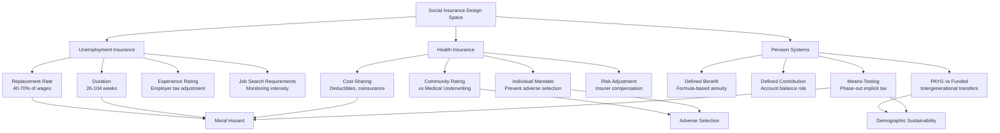

# Lesson 5: Social Insurance Design, Moral Hazard, Adverse Selection

## 1. First-Principles Intuition & Invariants

Social insurance programs represent one of the most ambitious exercises in public economics: pooling risk across heterogeneous populations to provide protection against catastrophic income shocks, health crises, and old-age poverty. Unlike private insurance markets, which can screen applicants and price-discriminate based on observable risk, social insurance operates under universal or near-universal coverage mandates with limited ability to exclude high-risk individuals or adjust premiums to actuarial risk. This fundamental constraint creates a distinctive set of design challenges that sit at the intersection of welfare economics, information asymmetry, and behavioral public finance.

The theoretical case for social insurance rests on three pillars. First, individuals are risk-averse and value consumption smoothing across states of the world. A worker facing a small probability of catastrophic income loss from unemployment or disability values insurance that transfers resources from high-income states to low-income states, even if the premium exceeds the actuarially fair price by a modest administrative loading factor. Second, private insurance markets suffer from classic information failures: adverse selection arises when individuals possess private information about their risk type that insurers cannot observe, causing high-risk types to disproportionately purchase coverage and driving premiums upward until low-risk types exit the market. This unraveling process, formalized by Akerlof's lemons model and extended by Rothschild and Stiglitz in their canonical 1976 paper, can lead to complete market collapse for certain risk categories. Third, individuals exhibit bounded rationality and myopic discounting that causes systematic under-insurance against low-probability, high-consequence risks. Behavioral biases such as present bias, limited attention, and exponential discounting with implausibly high discount rates lead workers to under-save for retirement and forgo health insurance even when subsidized.

These market failures provide the efficiency rationale for government intervention through mandatory social insurance. By requiring universal participation, the government eliminates adverse selection and pools risk across the entire population, capturing the full efficiency gains from risk-sharing. By mandating contribution rates or benefit formulas, social insurance corrects for myopic under-saving and ensures minimum consumption floors in adverse states. The classic Baily-Chetty formula for optimal unemployment insurance makes this tradeoff explicit: the marginal welfare gain from additional consumption smoothing for unemployed workers must be balanced against the marginal efficiency cost from reduced job search effort induced by more generous benefits. Let $u(c)$ denote the concave utility function over consumption, $b$ the unemployment benefit level, $w$ the wage when employed, $e$ the search effort, and $p(e)$ the re-employment probability increasing in effort. The social planner maximizes expected utility subject to a budget constraint, yielding the first-order condition:

$$\frac{u'(c_u)}{u'(c_e)} = 1 + \frac{\varepsilon_{p,b}}{\varepsilon_{D,b}}$$

where $\varepsilon_{p,b}$ measures the elasticity of re-employment probability with respect to benefit generosity (the moral hazard cost) and $\varepsilon_{D,b}$ measures the elasticity of unemployment duration with respect to benefits. The left-hand side captures the consumption-smoothing value: when the marginal utility of consumption while unemployed far exceeds the marginal utility when employed, there are large welfare gains from transferring resources to the unemployed state. The right-hand side incorporates the efficiency cost: if unemployed workers respond to higher benefits by reducing search effort substantially, extending their unemployment duration, then the moral hazard distortion is large and optimal benefits should be lower.

This formula reveals the core tension in social insurance design. Insurance and incentives are fundamentally at odds. Perfect insurance that fully replaces lost income would eliminate all consumption risk, but would also eliminate the financial penalty for remaining unemployed, potentially causing search effort to collapse to zero. The optimal policy balances these forces, providing partial insurance that smooths consumption while preserving sufficient incentive for productive effort. The key parameters are empirical: how responsive is behavior to benefit generosity, and how large is the consumption drop in the uninsured state? High replacement rates are optimal when moral hazard elasticities are small and consumption drops are large; lean programs are optimal when behavioral responses are large and workers possess substantial private savings or informal insurance through family networks.

Adverse selection introduces a distinct set of constraints. When individuals possess private information about their risk type that insurers cannot observe, competitive insurance markets may fail to achieve efficient risk-pooling. Rothschild and Stiglitz demonstrated that no pure-strategy equilibrium may exist in insurance markets with asymmetric information. High-risk types prefer full insurance at pooled prices, while low-risk types prefer partial insurance contracts that separate them from the pool and offer lower premiums. But once a separating equilibrium emerges with different contracts for different risk types, insurers have an incentive to offer a contract that attracts only the low-risk pool, unraveling the separating equilibrium. This non-existence result is stark: competitive forces alone cannot guarantee market equilibrium when information is asymmetric.

Government intervention through mandatory universal coverage eliminates the selection problem by preventing low-risk types from opting out. The social insurance pool includes all risk types, ensuring that premiums reflect average population risk rather than the adversely selected pool that would emerge in a voluntary market. But mandatory coverage introduces its own distortions. Cross-subsidization from low-risk to high-risk types is implicit in any pooled pricing scheme, creating distributional transfers that may conflict with horizontal equity principles if risk types correlate with income or demographic characteristics. A healthy young worker who is mandated to purchase health insurance at community-rated premiums subsidizes older, sicker individuals, a transfer that may be justified on life-cycle grounds (the young worker will eventually become old) but creates political economy tensions.

The pension system design problem extends these insights into an intertemporal setting. Social Security and public pension systems combine three distinct functions: forced saving to correct myopic under-saving, insurance against longevity risk (outliving one's assets), and redistribution from high-lifetime earners to low-lifetime earners through progressive benefit formulas. The pay-as-you-go financing structure, where current workers' contributions fund current retirees' benefits, introduces an additional dimension: demographic sustainability. When fertility rates decline and life expectancy increases, the ratio of workers to retirees falls, forcing either benefit cuts, payroll tax increases, or delayed retirement ages to maintain budget balance. The implicit rate of return on pay-as-you-go contributions equals the growth rate of the wage base, $g + n$, where $g$ is productivity growth and $n$ is population growth. In a mature economy with $g = 0.02$ and $n = 0.01$, this delivers a 3% implicit return. If financial markets offer higher returns, the pay-as-you-go system imposes an implicit tax on labor, distorting labor supply decisions and reducing lifetime welfare relative to a fully funded private system.

Yet the pay-as-you-go structure provides unique insurance value. Workers cannot privately insure against the risk that their birth cohort experiences low lifetime wage growth or high unemployment rates during their working years. A fully funded system locks in each cohort's accumulated savings, exposing them to idiosyncratic cohort shocks. The pay-as-you-go system pools risk across cohorts by tying benefits to current economy-wide wage levels, providing implicit insurance against adverse aggregate shocks. This insurance is particularly valuable when capital markets are incomplete and workers cannot purchase securities indexed to future labor productivity.

Means-testing introduces another layer of complexity. By conditioning benefit eligibility or generosity on income or assets, means-tested programs target resources toward the neediest recipients, improving vertical equity and reducing fiscal cost. But means-testing also creates implicit marginal tax rates that distort labor supply and saving decisions. A worker who earns an additional dollar of income and loses fifty cents of means-tested benefits faces an effective marginal tax rate of 50%, stacked on top of statutory income and payroll taxes. If multiple programs phase out simultaneously—Medicaid, food assistance, housing subsidies, earned income tax credits—implicit marginal rates can exceed 100%, creating poverty traps where additional earnings reduce net income. The optimal means-testing slope trades off targeting efficiency against labor supply distortions, with the optimal phase-out rate depending on the elasticity of labor supply and the social welfare weight placed on low-income recipients.

## 2. Core Architecture & Mechanics

The practical design of social insurance systems requires specifying benefit formulas, eligibility criteria, financing mechanisms, and administrative procedures that translate theoretical principles into operational policy. Each design choice has first-order effects on both welfare outcomes and behavioral responses, making the institutional details of social insurance far from mere implementation minutiae.

Unemployment insurance systems exhibit substantial variation across advanced economies in replacement rates, duration limits, experience rating, and job search requirements. The canonical structure features a wage replacement rate $\rho$ that determines weekly benefits as a fraction of pre-unemployment earnings, subject to minimum and maximum benefit caps. The United States offers replacement rates of 40-50% for up to 26 weeks in most states, with extended benefits triggered during recessions. European systems are typically more generous: Denmark and Sweden offer replacement rates above 60% for durations exceeding one year. These differences reflect both welfare state philosophy and labor market institutions. Countries with strong employment protection legislation and rigid wage structures face lower baseline unemployment risk, making generous unemployment insurance less susceptible to moral hazard. Countries with flexible hire-and-fire regimes and volatile employment experience higher turnover, making long-duration benefits more costly.

The central policy lever is the benefit formula architecture. A flat replacement rate $b = \rho w$ where $w$ is pre-unemployment wages provides proportional insurance but introduces large implicit tax rates on labor supply during unemployment. If a worker finds a job paying 20% less than their previous wage, they face a sharp benefit cliff that may exceed the wage decline, creating incentives to continue searching rather than accept the lower-paying offer. Alternatively, a kinked benefit schedule with higher replacement rates for low earners and lower rates for high earners provides progressive redistribution but complicates the labor supply calculation. The optimal formula depends on the joint distribution of reservation wages and job offer wages, parameters that vary across labor market conditions and worker skill levels.

Experience rating partially addresses the moral hazard problem on the employer side. Under pure community rating, all employers pay the same payroll tax rate regardless of their layoff history, creating a fiscal externality: firms that lay off workers frequently impose costs on the insurance pool but do not internalize these costs in their hiring and firing decisions. Experience rating ties each firm's payroll tax rate to its historical layoff record, measured by the ratio of benefits claimed by its former employees to total wages paid. The tax rate adjusts upward after layoffs and downward during periods of stable employment, creating incentives for firms to internalize the social cost of unemployment spells. Imperfect experience rating arises when tax rates are capped, allowing high-layoff firms to pay less than the full actuarial cost of their unemployment claims. This cap is justified by liquidity constraints for small firms but introduces a subsidy to high-turnover industries like construction and seasonal retail.

Job search requirements and monitoring introduce an administrative dimension to moral hazard mitigation. Requiring unemployed workers to document weekly job search activities, accept suitable job offers, and participate in retraining programs maintains labor market attachment and screens out workers with weak attachment. But monitoring is costly and imperfect. Case workers cannot observe true search effort, only reported applications and interview attendance. Strategic workers can satisfy nominal requirements while conducting low-intensity search, and overly strict requirements may push workers into low-quality job matches that quickly dissolve, restarting the unemployment spell. The optimal monitoring intensity trades off screening effectiveness against administrative cost and match quality losses.

Health insurance markets exhibit the adverse selection and moral hazard dynamics in their starkest form. Private health insurance operated for decades with medical underwriting, where insurers denied coverage or charged higher premiums to applicants with pre-existing conditions. This practice directly addressed adverse selection—high-risk individuals could not conceal their risk type from insurers—but created enormous welfare losses. Individuals with chronic conditions faced prohibitively expensive premiums or complete denial of coverage, leaving them uninsured or locked into existing employer-sponsored plans through "job lock" that reduced labor mobility. The Affordable Care Act eliminated medical underwriting through community rating and guaranteed issue mandates, requiring insurers to offer coverage at uniform premiums regardless of health status. To prevent adverse selection death spirals, the reform imposed an individual mandate requiring all individuals to purchase coverage or pay a tax penalty, later reduced to zero and rendered unenforceable.

The result was a natural experiment in adverse selection dynamics. When the individual mandate penalty was eliminated in 2019, enrollment in exchange plans declined by approximately 10%, concentrated among younger and healthier individuals. Premiums increased by 5-10% in 2020 as the risk pool deteriorated, precisely the unraveling dynamic predicted by theory. This provides clean empirical evidence that adverse selection is not merely a theoretical curiosity but an operational constraint that binds in real insurance markets.

Moral hazard on the demand side arises through ex post behavioral responses to insurance coverage. Insured individuals consume more healthcare than uninsured individuals because insurance lowers the out-of-pocket price faced at the point of care. The RAND Health Insurance Experiment, the largest randomized trial in health economics, assigned families to insurance plans with different cost-sharing structures and measured healthcare utilization over multiple years. Families with full coverage consumed 30-40% more healthcare than families with high deductibles and coinsurance rates, demonstrating substantial price sensitivity. Importantly, the additional utilization had minimal effect on measured health outcomes for the average participant, suggesting that much of the marginal care induced by insurance has low medical value. This finding is central to the design of optimal cost-sharing: high cost-sharing reduces wasteful utilization but imposes financial risk on patients, particularly for low-income families who may forgo high-value care when faced with out-of-pocket costs.

The optimal cost-sharing structure features differentiated coinsurance rates by service type. Preventive care and high-value treatments should face zero or minimal cost-sharing to encourage utilization, while discretionary services and treatments with marginal health benefits should face higher coinsurance to discourage overuse. But this requires insurers to classify services by value, a task complicated by heterogeneity across patients and clinical contexts. A more implementable approach uses annual deductibles combined with out-of-pocket maximums to provide catastrophic protection while maintaining price incentives for routine care. High-deductible health plans paired with health savings accounts follow this structure, though they impose liquidity risk on households with limited liquid assets.

Pension system design spans three structural dimensions: benefit determination, financing, and retirement age policy. Defined benefit systems promise a lifetime annuity based on a formula that incorporates years of service and final or career-average earnings. The U.S. Social Security benefit formula applies progressive replacement rates to average indexed monthly earnings (AIME), replacing 90% of the first $1,115 of AIME, 32% of AIME between $1,115 and $6,721, and 15% of AIME above $6,721 (2025 bend points). This progressive structure provides higher replacement rates for low-lifetime earners, achieving redistributive objectives within the pension system itself. But the redistributive effect is attenuated by differential mortality: high earners live longer and collect benefits for more years, partially offsetting the progressivity of the benefit formula.

Defined contribution systems shift risk from the government to individuals by tying benefits to accumulated contributions and investment returns. Each worker's account balance evolves according to:

$$A_{t+1} = (A_t + c_t w_t)(1 + r_t)$$

where $c_t$ is the contribution rate, $w_t$ is wages, and $r_t$ is the portfolio return. At retirement, the accumulated balance is converted to an annuity or drawn down according to a managed withdrawal rule. This structure eliminates unfunded liabilities and demographic risk—there is no implicit debt to future generations—but exposes workers to investment risk and longevity risk. Workers who retire during market downturns face permanently lower pension wealth, a risk that cannot be diversified away through individual savings. Mandatory annuitization addresses longevity risk but requires competitive annuity markets, which suffer from their own adverse selection problems when annuitization is voluntary.

The longevity insurance value of Social Security is substantial. Private annuity markets offer payouts far below actuarially fair levels because annuitants are positively selected—people who purchase annuities live longer than the average population. Social Security mandates participation, eliminating selection and offering implicit annuity rates close to actuarially fair for the average worker. Workers value this insurance even if the implicit rate of return on contributions is low, because the alternative is bearing longevity risk privately and potentially exhausting savings before death.

Means-testing in pension systems and transfer programs introduces phase-out regions where benefits decline with income or assets. The implicit marginal tax rate in the phase-out region is:

$$\tau_{\text{implicit}} = \frac{d B}{d Y}$$

where $B$ is the benefit and $Y$ is income. A program that phases out at 50 cents per dollar of income imposes a 50% implicit tax. When combined with statutory income taxes and payroll taxes, the effective marginal rate can exceed 60-70%. Consider a worker earning $30,000 annually who faces a 15% federal income tax, 7.65% FICA payroll tax, and a 50% phase-out rate on means-tested benefits. The effective marginal rate is $0.15 + 0.0765 + 0.50 = 0.7265$, meaning the worker retains less than 30 cents of each additional dollar earned. If labor supply elasticity is even moderately positive, this creates substantial efficiency costs.

The optimal means-testing rate minimizes the sum of targeting error and deadweight loss. Universal benefits with no means-testing achieve zero targeting error—all recipients receive benefits regardless of need—but impose high fiscal cost and require high tax rates on the general population to finance the transfers. Strict means-testing with rapid phase-outs achieves precise targeting but creates large implicit tax rates and substantial deadweight loss. The optimal interior solution depends on the empirical labor supply elasticity and the social welfare function. If policymakers place high weight on redistribution to the poorest households and labor supply responses are modest, steep phase-outs are optimal. If labor supply is highly elastic and inequality aversion is moderate, gradual phase-outs or even universal benefits dominate.

The administrative architecture for verifying means-tested eligibility relies on income and asset reporting, which introduces compliance costs and potential fraud. Self-reported income is subject to strategic misreporting, particularly for cash income and informal sector earnings that leave no digital trace. Asset tests require disclosure of bank account balances, real estate holdings, and vehicle ownership, creating administrative burden and potentially penalizing saving. The U.K. Universal Credit system consolidated six means-tested benefits into a single monthly payment with income verification through real-time earnings data from tax authorities, reducing reporting burden but creating payment volatility when earnings fluctuate. The optimal verification system trades off accuracy against administrative cost and intrusiveness.

## 3. High-Performance Optimization & Failure Modes

Optimizing social insurance design requires confronting the fundamental impossibility of simultaneously achieving perfect insurance, efficient incentives, and fiscal sustainability. The policy frontier traces out achievable combinations of these objectives, with movement along the frontier representing tradeoffs rather than Pareto improvements. Understanding where current systems lie on this frontier and what constraints prevent reaching more efficient points requires both empirical evidence on behavioral elasticities and normative judgments about distributional objectives.

The unemployment insurance optimization problem begins with accurate estimation of the behavioral response elasticities that govern the moral hazard cost. The canonical approach regresses unemployment duration on benefit generosity, controlling for individual characteristics and labor market conditions. A vast empirical literature finds duration elasticities in the range of 0.3 to 0.8, meaning a 10% increase in benefit levels extends unemployment duration by 3-8%. But this aggregate elasticity masks substantial heterogeneity. Low-skilled workers with poor job prospects exhibit larger responses than high-skilled workers. Workers in weak labor markets with few job opportunities exhibit smaller responses because search effort has limited productivity when vacancies are scarce. This heterogeneity implies that optimal unemployment insurance should be counter-cyclical: more generous during recessions when moral hazard costs are low and consumption-smoothing value is high, less generous during booms when job-finding rates are high and moral hazard costs dominate.

Implementing state-dependent unemployment insurance requires automatic stabilizers that adjust benefit duration and replacement rates based on macroeconomic indicators. The U.S. Extended Benefits program triggers additional weeks of coverage when state unemployment rates exceed threshold levels, but the thresholds are often too high and the benefit extensions too small to provide sufficient counter-cyclical insurance. Optimal automatic triggers would index benefit generosity continuously to labor market slack measures such as the unemployment rate or the job-finding rate, rather than using discrete threshold rules. This requires real-time data infrastructure and legislative pre-commitment to adjustment formulas, both of which face political economy obstacles.

The liquidity-vs-moral-hazard distinction clarifies why unemployment insurance is valuable even when behavioral responses are large. Households with limited liquid assets cannot smooth consumption during unemployment spells without external insurance, even if they would prefer to re-employ quickly. Unemployment insurance provides liquidity that allows job search to proceed without distress asset sales or borrowing at high interest rates. This liquidity value is highest for hand-to-mouth households with low wealth-to-income ratios, suggesting that means-testing unemployment insurance on household assets could improve efficiency. But asset tests discourage precautionary saving and introduce verification costs, creating their own distortions.

Experience rating optimization requires balancing firm-level incentive effects against revenue volatility and administrative complexity. Perfect experience rating sets each firm's tax rate equal to the present value of expected future benefit claims by its workers, fully internalizing the unemployment externality. But this requires long panel data on each firm's layoff history and imposes severe liquidity constraints on firms experiencing temporary negative shocks. Imperfect experience rating with tax rate floors and ceilings attenuates incentives but provides fiscal insurance to firms. The optimal degree of imperfection depends on the frequency and persistence of firm-level shocks and the labor supply elasticity of marginal workers.

Health insurance market optimization confronts the adverse selection-moral hazard tradeoff in its most acute form. Community rating eliminates selection by pooling risk, but invites unraveling when participation is voluntary. Individual mandates enforce participation but require credible penalties for non-compliance, which face political resistance. The alternative is risk adjustment, where insurers receive payments from a central pool based on the realized health risk of their enrollees, measured by diagnostic codes, pharmacy claims, and demographic factors. Risk adjustment neutralizes the incentive for insurers to cream-skim healthy enrollees, allowing competition on price and quality rather than risk selection. But risk adjustment formulas are gameable: insurers have incentives to upcode diagnoses to inflate risk scores and capture higher payments. The Massachusetts health insurance exchange and Medicare Advantage program both exhibit substantial upcoding, with risk scores rising faster than true health status would predict.

Optimal cost-sharing design must account for the distribution of healthcare spending. A small fraction of patients accounts for the majority of spending: the top 5% of spenders account for 50% of total healthcare expenditure, while the bottom 50% account for less than 3%. This concentration implies that high deductibles provide limited fiscal savings because most spending occurs among patients who exceed the deductible and face low marginal cost-sharing. A high-deductible plan with a $5,000 deductible affects only the 20-30% of patients who incur between $1,000 and $10,000 in annual spending. Catastrophic spending above $50,000 per year occurs among patients who quickly exceed any realistic out-of-pocket maximum.

Value-based insurance design attempts to align cost-sharing with clinical value by imposing low or zero copayments for high-value services and high copayments for low-value services. Preventive care, chronic disease management, and medications with proven efficacy face minimal cost-sharing, while imaging studies with low diagnostic yield, emergency department visits for non-urgent conditions, and brand-name drugs with generic equivalents face high cost-sharing. This requires clinical evidence on comparative effectiveness and willingness to override physician prescribing autonomy, both of which face resistance from the medical profession. Early implementations show modest effects on utilization patterns but limited impact on total spending because high-value care is a small share of total expenditure.

Reference pricing introduces competition by setting a reimbursement level for a class of clinically equivalent services and making patients responsible for any amount above the reference price. California's CalPERS system implemented reference pricing for joint replacement surgery, setting the reimbursement at $30,000 and requiring patients to pay the difference if they chose higher-priced hospitals. Utilization shifted toward lower-priced hospitals, and high-priced hospitals reduced their charges to remain competitive, generating substantial savings without adverse effects on quality. This model is scalable to other shoppable services where patients have time to compare prices and clinical outcomes are measurable, but it is unsuitable for emergency care or services with high information asymmetry.

Pension system sustainability requires aligning contribution rates, benefit formulas, and retirement ages with demographic realities. The sustainability constraint is:

$$\text{PDV(Contributions)} = \text{PDV(Benefits)}$$

where PDV denotes present discounted value. When life expectancy increases or fertility declines, the right-hand side grows faster than the left-hand side, creating an unfunded liability that must be closed through some combination of higher contributions, lower benefits, or delayed retirement. The political economy of pension reform strongly favors delaying retirement ages over cutting benefits or raising taxes, because the burden is spread over future cohorts who cannot vote today. But delayed retirement imposes heterogeneous costs: workers in physically demanding occupations cannot extend their working lives as easily as white-collar professionals, and lower-income workers have shorter life expectancies and collect benefits for fewer years.

Linking retirement ages to life expectancy through automatic indexation addresses demographic sustainability without repeated legislative battles. Denmark and the Netherlands index retirement ages to population life expectancy, ensuring that the ratio of working years to retirement years remains roughly constant as longevity increases. This removes the distributional conflict between generations by making adjustments automatic rather than discretionary. But it requires political consensus to enact the initial legislation, and subsequent generations may attempt to repeal the indexation if they face particularly adverse longevity shocks.

Notional defined contribution systems provide an alternative architecture that mimics defined contribution risk allocation while preserving pay-as-you-go financing. Each worker's account is credited with contributions and a notional rate of return equal to the growth rate of the wage base, but no actual assets are accumulated. At retirement, the notional account balance is converted to an annuity using cohort-specific life expectancy. This structure automatically adjusts benefits to reflect demographic changes—if a cohort lives longer, the annuity factor declines and the annual benefit falls—without explicit legislative action. Sweden and Italy have implemented notional defined contribution systems with broadly successful political acceptance, though both countries have faced pressure to modify formulas during recessions when wage growth stagnates.

Means-testing optimization must account for the full marginal tax rate faced by transfer recipients, including the phase-out of multiple programs simultaneously. Low-income households may receive housing vouchers, food assistance, Medicaid, childcare subsidies, and earned income tax credits, each with its own phase-out schedule. When phase-out regions overlap, implicit marginal tax rates can exceed 100%, creating benefit cliffs where earning an additional dollar reduces net income. The solution is to coordinate phase-out schedules across programs, ensuring that at most one program is phasing out rapidly at any income level. This requires central coordination of program rules, which is administratively feasible but politically difficult because programs are administered by different agencies with different statutory mandates.

The negative income tax provides an elegant unified framework that replaces multiple categorical programs with a single transfer that phases out linearly with income. Each household receives a guaranteed minimum income $G$ and faces a phase-out rate $t$ on earnings $Y$, yielding net transfer:

$$T = G - tY$$

The phase-out rate $t$ is the implicit marginal tax rate. Setting $t = 0.5$ means a household retains 50 cents of each dollar earned. The guaranteed income is chosen to ensure adequate support for non-working households, and the phase-out rate balances targeting efficiency against labor supply distortions. But the negative income tax has never been implemented at scale because it requires politically unpalatable tradeoffs: either the guaranteed income is low and the phase-out rate is low (achieving work incentives but providing inadequate support), or the guaranteed income is high and the phase-out rate is high (providing adequate support but destroying work incentives). Universal basic income proposals face the same trilemma: generosity, targeting, and incentives cannot all be optimized simultaneously with a linear transfer schedule.

Behavioral responses to insurance generosity extend beyond mechanical labor supply effects. Disability insurance exhibits substantial screening challenges: true disability is difficult to observe and verify, while the decision to apply for benefits reflects both health status and labor market opportunities. Applications for disability insurance surge during recessions when job prospects deteriorate, suggesting that marginal applicants are responsive to outside options. Stringent eligibility criteria reduce caseloads but deny benefits to some truly disabled individuals, while lenient criteria allow entry by individuals with modest impairments. Optimal screening trades off false negatives against false positives, with the optimal strictness depending on the ratio of social cost of denying deserving applicants to the social cost of admitting undeserving applicants.

Administrative capacity constraints bind tightly in disability determination. Each applicant must be evaluated by medical reviewers who assess whether impairments prevent substantial gainful activity, a subjective judgment that requires clinical expertise and knowledge of local labor markets. Processing times in the U.S. Social Security Disability Insurance system average 3-6 months for initial applications and 18-24 months for appeals, during which applicants may exhaust savings and rely on family support. Faster processing requires more reviewers but may reduce decision quality. The optimal allocation of resources depends on the value of speed relative to accuracy, and whether waiting times screen out low-need applicants or merely impose hardship.

The catastrophic failure mode of social insurance occurs when fiscal unsustainability forces abrupt benefit cuts or tax increases that erode public trust. Greece's pension crisis illustrates this dynamic: unsustainable benefit promises combined with weak contribution enforcement created implicit liabilities exceeding 200% of GDP. When the fiscal crisis struck in 2010, pensions were cut by 30-50% for many retirees, causing severe hardship and violating implicit social contracts. This outcome was far worse than a gradual adjustment path implemented decades earlier would have been. The policy lesson is that demographic and fiscal sustainability must be addressed proactively through automatic adjustment mechanisms rather than deferred until crisis forces painful adjustments.

Social insurance design is ultimately an exercise in navigating fundamental economic tradeoffs under empirical uncertainty and political constraints. No system achieves perfect insurance, efficient incentives, and fiscal sustainability simultaneously. The art of social insurance policy is identifying which tradeoffs matter most for a given population and labor market context, designing institutional features that push toward the efficient frontier, and building political coalitions that support reforms before crisis necessitates them.
