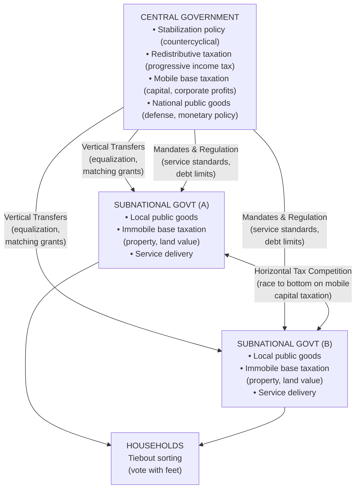

# Lesson 6: Fiscal Federalism, Decentralization, Intergenerational Equity

## 1. First-Principles Intuition & Invariants

The allocation of fiscal authority across vertical layers of government—from supranational unions down through national, regional, and municipal tiers—constitutes one of the most enduring challenges in public economics. Fiscal federalism addresses a deceptively simple question: which level of government should tax, spend, regulate, and redistribute? The answer determines not only allocative efficiency in the provision of public goods but also the dynamic path of regional development, the mobility patterns of firms and households, and the sustainability of public debt across generations.

At its theoretical core, fiscal federalism emerges from the recognition that preferences for public goods exhibit substantial spatial heterogeneity. Citizens in dense urban centers demand different bundles of public services—mass transit, cultural institutions, intensive policing—than residents of rural hinterlands who prioritize agricultural extension services, road maintenance across dispersed networks, and local schools scaled to smaller populations. A centralized unitary state providing a uniform national bundle of public goods generates deadweight loss by forcing citizens into consumption of goods they do not value at the margin. Decentralization, by contrast, allows each jurisdiction to tailor its fiscal policy to match local preferences, yielding a Pareto improvement through better preference revelation and allocative efficiency.

This intuition was formalized by Charles Tiebout in 1956 through a striking analogy: if households are perfectly mobile and possess complete information about the tax-expenditure packages offered by competing jurisdictions, they will sort themselves into communities that best match their preferences, much as consumers choose among differentiated products in a competitive market. Under ideal Tiebout conditions—costless mobility, a large number of jurisdictions, no interjurisdictional spillovers, no economies of scale in public goods provision, and financing exclusively through benefit taxation or head taxes—the resulting spatial equilibrium is Pareto efficient. Each jurisdiction becomes a "club" of homogeneous residents who consume their optimal bundle of local public goods financed by taxes that reflect the marginal cost of provision.

The Tiebout hypothesis transforms the problem of public goods provision from a collective choice dilemma plagued by preference misrepresentation into a decentralized market-like mechanism where "voting with one's feet" disciplines local governments. Jurisdictions that overtax or underprovide services lose residents and tax base to competitors, while efficient jurisdictions attract new members. The competitive pressure induces a sorting equilibrium where each household resides in the jurisdiction that maximizes its utility, and each jurisdiction operates on the Samuelson optimality condition for local public goods. This mechanism obviates the need for costly preference revelation through voting or survey instruments, as revealed preference through locational choice provides the necessary information.

Yet the Tiebout mechanism rests on heroic assumptions that fail systematically in real-world federal systems. Mobility is costly, particularly for low-income households with limited liquid wealth, elderly residents with established social networks, and workers in industries with geographically concentrated employment. Information about the quality of schools, crime rates, environmental amenities, and long-run fiscal stability is imperfect and costly to acquire. Economies of scale in the provision of infrastructure, higher education, and regional transit systems imply that optimal jurisdiction size may be large, reducing the number of competing alternatives and weakening competitive discipline. Most critically, interjurisdictional externalities—pollution spillovers, tax base competition, welfare migration, and public goods with benefits that extend beyond jurisdictional boundaries—drive a wedge between local incentives and global efficiency.

The presence of vertical externalities between different tiers of government and horizontal externalities among jurisdictions at the same tier fundamentally alters the efficiency properties of fiscal decentralization. When a provincial government raises its tax rate on mobile capital, it induces outmigration of the tax base to neighboring provinces, imposing a negative fiscal externality on those jurisdictions that must now either raise their own rates or cut expenditures. This horizontal tax competition generates a race to the bottom, with equilibrium tax rates on mobile factors falling below the level that would prevail under coordinated policy, leading to underprovision of public goods financed by those taxes. The seminal model by Zodrow and Mieszkowski demonstrates that in a symmetric Nash equilibrium with capital mobility, the net return to capital is equalized across jurisdictions, but the equilibrium tax rate is inefficiently low because each jurisdiction ignores the positive externality its tax cut imposes on other regions by increasing the aggregate capital stock.

Vertical externalities arise when multiple levels of government tax the same base or provide substitutable or complementary public goods. If both the federal and provincial governments levy income taxes, a federal tax increase reduces the tax base available to provinces, creating a negative vertical externality. Conversely, federal transfers to provinces that are conditioned on provincial tax effort can generate positive vertical externalities by incentivizing higher subnational taxation. The interaction of vertical and horizontal externalities produces complex strategic environments where the optimal assignment of tax instruments and expenditure responsibilities depends on the elasticity of tax bases, the degree of benefit spillovers, and the structure of intergovernmental grants.

Intergovernmental grants serve as the primary policy instrument for correcting these externalities and achieving distributive objectives in federal systems. The canonical taxonomy distinguishes between unconditional block grants, conditional matching grants, and equalization transfers. An unconditional block grant increases the income of the recipient jurisdiction without altering relative prices, inducing both income and substitution effects that depend on the jurisdiction's preferences over private consumption and public goods. A matching grant reduces the effective price of the subsidized expenditure category, generating a pure substitution effect that is particularly effective at inducing higher spending on goods with positive spillovers such as education or public health. Equalization transfers aim to ensure horizontal equity by providing supplementary revenue to jurisdictions with below-average fiscal capacity, typically measured as the per capita tax base or potential revenue at standardized tax rates.

The optimal design of intergovernmental grants involves a fundamental tradeoff between corrective efficiency and distributive equity on one hand and the preservation of local accountability and fiscal discipline on the other. Generous unconditional transfers insulate local governments from the political cost of taxation, weakening the Tiebout mechanism and reducing the electoral incentive for expenditure efficiency. This soft budget constraint problem is particularly acute when subnational governments anticipate ex post bailouts from the central government in the event of fiscal distress, leading to excessive borrowing and moral hazard in fiscal management. The experience of subnational debt crises in Argentina, Brazil, and Spain illustrates the destructive potential of poorly designed transfer systems that divorce spending authority from revenue responsibility.

The dynamics of public debt introduce an irreducible intertemporal dimension to fiscal federalism through the mechanism of intergenerational redistribution. When a government finances current expenditures through debt issuance rather than taxation, it shifts the tax burden forward in time to future cohorts who must service the accumulated liabilities. The normative evaluation of this redistribution requires a framework for comparing welfare across generations, which is provided by the overlapping generations model pioneered by Paul Samuelson and Peter Diamond. In the canonical two-period OLG structure, agents live for two periods, working and saving in youth, then consuming from accumulated wealth in old age. The government can issue debt to finance public goods, with the burden of repayment falling on future young cohorts.

The key insight from OLG analysis is that dynamic efficiency—the property that the economy operates on the optimal intertemporal production frontier—requires that the real interest rate exceed the growth rate of the economy. When $r > g$, the present value of future tax liabilities associated with permanent debt issuance exceeds the current benefit, implying that debt-financed expenditure imposes a net burden on future generations. Conversely, when $r < g$, the economy exhibits dynamic inefficiency with overaccumulation of capital, and debt issuance can improve welfare by reducing the capital stock and transferring resources from future generations who would otherwise overconsume in equilibrium. The empirical observation that real interest rates on safe government debt in advanced economies have fallen below growth rates in recent decades has revived academic and policy interest in the fiscal space afforded by low borrowing costs, though the sustainability of this configuration remains contested.

Public debt sustainability in a federal system depends critically on the assignment of borrowing authority and the credibility of no-bailout commitments. If subnational governments possess unrestricted borrowing capacity and expect federal assumption of their liabilities in the event of default, the common pool problem generates excessive aggregate debt accumulation. Each subnational government internalizes the full benefit of its borrowing but externalizes a portion of the cost through the implicit federal guarantee. The optimal institutional response typically involves some combination of numerical fiscal rules—such as debt-to-GDP ceilings or balanced budget requirements—and market discipline through no-bailout clauses that expose subnational debt to default risk and credit rationing. The European Union's Stability and Growth Pact and the subsequent Fiscal Compact represent attempts to impose such rules on member states, though enforcement has proven difficult in the absence of credible sanctions.

The intergenerational equity implications of fiscal decentralization extend beyond debt dynamics to encompass the spatial sorting of age cohorts and the distribution of pension liabilities. If elderly retirees migrate to jurisdictions with generous public services and low property taxes while working-age taxpayers concentrate in high-income jurisdictions with greater employment opportunities, the resulting demographic imbalance can generate fiscal stress in retirement destinations. Florida's experience with an aging population that consumes health and long-term care services funded partly by a shrinking working-age tax base illustrates this tension. Federal transfers conditioned on demographic structure can mitigate such imbalances, but they require accurate forecasting of migration patterns and political consensus on the appropriate degree of intergenerational and interregional redistribution.

The fundamental theorem of fiscal federalism, articulated by Wallace Oates, holds that decentralized provision of public goods is always at least as efficient as centralized provision in the absence of economies of scale and interjurisdictional spillovers, because local governments can tailor provision to match heterogeneous preferences while central governments must impose uniform national standards. This theorem establishes a presumption in favor of subsidiarity—the principle that government functions should be assigned to the lowest tier capable of effective performance. However, the presence of spillovers, economies of scale, tax base mobility, and informational asymmetries between tiers of government introduces a rich set of tradeoffs that resist simple allocation rules. The optimal degree of fiscal decentralization depends on the specific characteristics of each public good, the technology of provision, the distribution of preferences, and the institutional capacity of subnational governments.

## 2. Core Architecture & Mechanics

The operational architecture of fiscal federalism consists of three interdependent systems: the assignment of expenditure responsibilities, the allocation of revenue instruments, and the design of intergovernmental transfer mechanisms. Each system involves distinct technical challenges and embodies specific economic tradeoffs that determine the overall efficiency and equity of the federal structure.

Expenditure assignment begins with the Musgrave-Oates principle of matching the spatial extent of benefits to the jurisdictional boundary of the providing government. Public goods whose benefits are geographically contained within a single local jurisdiction—such as street lighting, local parks, and municipal waste collection—should be provided by that jurisdiction to ensure that decision-makers internalize the full costs and benefits. Public goods with benefits that spill over jurisdictional boundaries—such as higher education, public health interventions with communicable disease externalities, and regional transportation networks—require either provision by a higher tier of government whose jurisdiction encompasses the full benefit area or a system of Pigouvian subsidies that compensate providing jurisdictions for the external benefits they generate.

The Samuelson optimality condition for public goods provision states that the sum of marginal rates of substitution across all beneficiaries should equal the marginal rate of transformation in production, $\sum_i MRS_i = MRT$. In a decentralized federal system, this condition must be modified to account for interjurisdictional spillovers. If a fraction $\theta$ of the benefits from a local public good accrue to residents of other jurisdictions, the local government internalizes only $(1-\theta)$ of the total benefits, leading to underprovision. The optimal corrective subsidy is a matching grant with rate $\theta/(1-\theta)$ that effectively reimburses the providing jurisdiction for the external benefits, inducing it to choose the globally efficient provision level.

Revenue assignment involves allocating tax bases and rate-setting authority across tiers of government subject to constraints imposed by tax base mobility, administrative capacity, and equity objectives. The canonical Musgrave assignment principle allocates highly mobile tax bases to central governments while assigning immobile bases to subnational jurisdictions. Capital income and corporate profits, which are highly responsive to tax differentials due to the mobility of financial capital and the ease of profit shifting through transfer pricing, should be taxed primarily by the central government to avoid destructive tax competition. Real property and land, which are perfectly immobile, can be efficiently taxed at the local level without inducing distortionary migration of the tax base. Labor income occupies an intermediate position, with mobility depending on skill level, industry specialization, and the portability of occupational licenses and pension rights.

The Zodrow-Mieszkowski-Wilson model of tax competition formalizes the efficiency loss from decentralized capital taxation. Consider $n$ identical jurisdictions indexed by $j$, each choosing a tax rate $t_j$ on capital to finance a local public good $g_j$. Capital is perfectly mobile across jurisdictions, equalizing the net return $r - t_j$ in equilibrium. Each jurisdiction takes the net return as parametric and chooses $t_j$ to maximize resident utility $U(c_j, g_j)$ subject to the budget constraint $g_j = t_j k_j(r - t_j)$, where $k_j$ is the capital stock allocated to jurisdiction $j$ as a function of the net return. The first-order condition for jurisdiction $j$ is:

$$\frac{\partial U}{\partial g} \left( k_j + t_j \frac{\partial k_j}{\partial r} \left(-\frac{\partial r}{\partial t_j}\right) \right) = 0$$

In a symmetric Nash equilibrium where all jurisdictions choose the same tax rate $t^*$, the term $\partial r / \partial t_j$ captures the impact of a unilateral tax increase on the equilibrium net return to capital. Each jurisdiction ignores the positive externality its tax increase imposes on other jurisdictions by raising the global net return and inducing capital inflow to those jurisdictions. The equilibrium tax rate $t^*$ is strictly below the cooperative optimum $t^c$ that would be chosen by a social planner internalizing all spillovers. The magnitude of the underprovision depends on the elasticity of capital supply and the number of competing jurisdictions, with the distortion increasing as capital becomes more mobile and the number of competitors rises.

Horizontal equalization transfers address the problem of fiscal capacity disparities across jurisdictions with heterogeneous tax bases. The Canadian equalization system provides a concrete institutional example: each province's fiscal capacity is measured as the potential per capita revenue it could raise by applying national average tax rates to its tax bases. Provinces with below-average capacity receive unconditional transfers from the federal government sufficient to bring them up to a specified standard, historically set at the average capacity of all provinces excluding the highest-capacity jurisdictions. The transfer $T_j$ to province $j$ is given by:

$$T_j = \max\left(0, \sum_b \left(\bar{t}_b \bar{B}_b - \bar{t}_b B_{jb}\right) N_j\right)$$

where $\bar{t}_b$ is the national average tax rate on base $b$, $\bar{B}_b$ is the national average per capita base, $B_{jb}$ is province $j$'s per capita base $b$, and $N_j$ is the population of province $j$. This formula ensures that provinces with identical populations but different fiscal capacities receive transfers proportional to their capacity shortfall, enabling them to provide comparable levels of public services at comparable tax rates.

The dynamic architecture of public debt sustainability in a federal system requires formal modeling of the intertemporal government budget constraint. Let $D_t$ denote the stock of government debt at time $t$, $G_t$ primary expenditures, $T_t$ tax revenues, and $r_t$ the real interest rate. The law of motion for debt is:

$$D_{t+1} = (1 + r_t) D_t + G_t - T_t$$

The no-Ponzi condition requires that the present value of debt converges to zero in the limit:

$$\lim_{T \to \infty} \frac{D_T}{\prod_{s=0}^{T-1}(1+r_s)} = 0$$

This condition implies that the current debt stock equals the present value of all future primary surpluses:

$$D_0 = \sum_{t=0}^{\infty} \frac{T_t - G_t}{\prod_{s=0}^{t-1}(1+r_s)}$$

Debt is sustainable if and only if the government can credibly commit to generating sufficient future primary surpluses to service the accumulated liabilities. In a federal system, this requires either explicit coordination of fiscal policies across tiers of government or institutional constraints that prevent subnational governments from issuing debt that implicitly commits the central government's balance sheet.

The overlapping generations framework provides the microfoundations for analyzing intergenerational welfare effects of debt policy. In the canonical two-period model, an agent born at time $t$ supplies labor $\ell_t$ inelastically in youth, earning wage $w_t$, and allocates income between consumption $c_{1t}$ and saving $s_t$. In old age, the agent consumes $c_{2,t+1} = (1+r_{t+1}) s_t$ from accumulated wealth. The lifetime utility function is $U(c_{1t}, c_{2,t+1})$ with standard concavity properties. The government issues one-period debt $D_t$ to finance a public good $G_t$, with repayment through lump-sum taxes on the young generation at $t+1$. The impact of debt-financed expenditure on the welfare of different generations depends on the sign of $r - g$, where $g$ is the population growth rate.

When $r > g$, the economy is dynamically efficient, and permanent debt issuance imposes a burden on future generations. To see this, consider a marginal increase in debt at time $t$ to finance one additional unit of the public good. The benefit accrues to the generation alive at $t$, while the cost is a perpetual stream of debt service payments $(r-g)$ financed by taxes on all future generations. The present value of these payments is $(r-g) / (r-g) = 1$, exactly offsetting the initial benefit, but the incidence is shifted forward in time. When $r < g$, the present value of future debt service is negative, meaning that perpetual rollovers of debt with exponentially growing principal can be serviced by taxes whose present value is less than the initial issuance. This configuration creates fiscal space for intergenerational redistribution from the future to the present.

The mechanics of soft budget constraints in federal systems operate through the strategic interaction between subnational governments' borrowing decisions and the central government's ex post bailout policy. Consider a subnational government choosing a debt level $d$ to finance current expenditures, facing a probability $p(d)$ of fiscal distress that triggers central government intervention. If the central government has a reputational commitment to bailout with probability $\beta(d)$ increasing in $d$, the subnational government's effective borrowing cost is $(1 - \beta(d)) r$, strictly less than the market rate $r$. This implicit subsidy induces overborrowing relative to the social optimum. The time-inconsistency problem arises because the central government cannot credibly commit ex ante to a no-bailout policy when ex post it faces political pressure to prevent subnational default and the associated disruption to public services and credit markets.

Institutional mechanisms to harden budget constraints include numerical fiscal rules enforced through constitutional or statutory provisions, independent fiscal councils that monitor compliance and impose reputational costs on violators, and explicit no-bailout clauses that expose subnational debt to default risk. The U.S. state bankruptcy prohibition and the resulting market discipline imposed by credit rating agencies and differential borrowing costs represent one pole of this institutional spectrum, while the European Central Bank's bond-buying programs during the Eurozone crisis illustrate the difficulty of maintaining no-bailout credibility when systemic financial stability is at stake.

The policy architecture of matching grants for correcting spillovers requires careful calibration of the matching rate to the empirical magnitude of externalities. Consider a provincial investment in higher education that generates benefits both to residents who attend in-state institutions and remain in-state after graduation and to other provinces that receive skilled migrants trained at the first province's expense. If empirical estimates suggest that 30% of graduates emigrate within five years, the optimal federal matching grant should reimburse the origin province for 30% of educational expenditures, raising the effective return on investment and inducing efficient provision levels. However, implementation faces the challenge of estimating spillover magnitudes, which vary by field of study, institution quality, and regional labor market conditions.

## 3. High-Performance Optimization & Failure Modes

The optimization of fiscal federal systems in practice requires navigating several critical tradeoffs and anticipating systematic failure modes that emerge from information asymmetries, time-inconsistency problems, and political economy constraints. High-performance operation demands continuous calibration of transfer formulas, active monitoring of subnational fiscal conditions, and institutional safeguards that preserve incentives for local accountability while preventing catastrophic failures from debt accumulation or beggar-thy-neighbor tax competition.

The first optimization dimension concerns the targeting precision of intergovernmental grants to match the specific market failures they aim to correct. Unconditional block grants provide maximum flexibility to recipient jurisdictions but offer no mechanism to induce higher spending on goods with positive spillovers or to prevent capture by special interests. Conditional matching grants powerfully incentivize spending in targeted categories but require the central government to possess superior information about local needs and to resist political pressure to expand the set of eligible expenditures beyond those with genuine externalities. The optimal grant design typically involves a hybrid structure: a base unconditional allocation to address fiscal capacity gaps and maintain minimum service standards, supplemented by conditional matching rates applied to specific expenditure categories with measurable spillovers such as infrastructure, public health, and education.

The calibration of equalization transfer formulas involves a fundamental tradeoff between horizontal equity and efficiency in resource allocation. Full equalization that brings all jurisdictions to identical fiscal capacity eliminates incentives for subnational governments to pursue tax base development, since any increase in own-source revenue is offset dollar-for-dollar by reduced transfers. This fiscal externality generates a common pool problem where jurisdictions underinvest in economic development. Partial equalization that allows jurisdictions to retain a marginal dollar of additional revenue preserves incentive compatibility but accepts persistent disparities in fiscal capacity and service provision. The Canadian system's exclusion of the highest-capacity provinces from the equalization standard represents an attempt to balance these objectives, though it generates the anomaly that a resource-rich province like Alberta contributes to equalization payments without its own high capacity being reflected in the standard.

Dynamic optimization of debt sustainability requires forward-looking fiscal rules that account for both the stochastic evolution of revenues and expenditures and the endogenous response of interest rates to debt accumulation. A simple debt-to-GDP ceiling provides a transparent benchmark but fails to accommodate legitimate cyclical variation in deficits during recessions or exceptional spending needs during crises. The Swiss debt brake mechanism implements a more sophisticated approach by requiring structural balance over the business cycle: annual deficits are permitted when output falls below potential, but corresponding surpluses are mandated during expansions, with cumulative deviations tracked in a control account that triggers corrective action when imbalances exceed thresholds. This rule preserves countercyclical flexibility while ensuring long-run sustainability.

The failure mode of competitive fiscal dumping through undercutting of tax rates on mobile capital has intensified with globalization and the rise of digital taxation challenges. Multinational corporations exploit transfer pricing and intellectual property localization to shift profits to low-tax jurisdictions, eroding the tax bases of high-tax countries without necessarily relocating real economic activity. The OECD's Base Erosion and Profit Shifting (BEPS) initiative and the recent global minimum corporate tax agreement at 15% represent international coordination efforts to establish floors on tax competition, effectively cartelizing national corporate tax policies to prevent a race to the bottom. However, enforcement remains challenging in the absence of supranational authority to impose sanctions on non-compliant jurisdictions.

The soft budget constraint failure mode manifests most acutely during financial crises when subnational governments face sudden stops in credit markets and revenue collapses from asset price declines. The central government confronts a time-inconsistency problem: ex ante it prefers to maintain a hard budget constraint to preserve incentives for fiscal discipline, but ex post it faces pressure to intervene to prevent default and the associated disruption to public services, bank balance sheets, and intergovernmental payment systems. The optimal institutional response combines ex ante fiscal rules with limited ex post flexibility through structured bailout mechanisms that impose conditionality and governance reforms on recipients. The European Stability Mechanism and the International Monetary Fund's lending programs exemplify this approach, providing liquidity support conditional on fiscal consolidation commitments and structural reforms.

Intergenerational equity optimization requires explicit social welfare functions that aggregate utility across cohorts. The standard approach employs a utilitarian criterion with exponential discounting, $W = \sum_{t=0}^{\infty} \beta^t U(c_t)$, where $\beta < 1$ is the social discount factor. The optimal debt policy equates the marginal cost of taxation today to the present value of marginal costs imposed on future generations through debt service. In the canonical Ramsey model with infinitely lived agents, this reduces to tax smoothing: optimal policy maintains constant marginal tax rates over time, financing temporary expenditure shocks through debt issuance and subsequent gradual repayment. In the OLG framework without operative bequest motives, the social planner must explicitly weigh the welfare of different cohorts, with the discount factor $\beta$ representing the normative weight placed on future generations' well-being relative to the current generation.

The practical implementation of intergenerational welfare analysis employs generational accounting, a technique that calculates the present value of net taxes paid by each cohort over its remaining lifetime under current policy and compares this to a baseline of sustainable policy where the intertemporal government budget constraint binds with equality. The generational imbalance is measured as the difference between the net tax burden of future generations and the burden on current newborns, expressed as a percentage of the lifetime income of future generations. Empirical generational accounting studies for advanced economies consistently reveal substantial imbalances, with future generations facing net tax burdens 20-40% higher than current newborns under baseline policy, driven primarily by unfunded pension and health care liabilities associated with population aging.

The efficiency-equity tradeoff in subnational tax competition can be partially resolved through coordinated minimum tax standards combined with revenue-sharing arrangements. The European Union's state aid rules prohibit member states from offering discriminatory tax breaks to attract specific firms, while allowing variation in statutory rates that reflect genuine differences in public goods provision and administrative efficiency. Revenue sharing allows the central government to tax mobile bases at efficient rates while distributing proceeds to subnational governments based on formulas that reflect both origin (where economic activity occurs) and destination (where beneficiaries reside) principles. The U.S. federal deduction for state and local taxes (SALT) represents an implicit revenue-sharing mechanism that reduces the effective cost of state taxation for itemizing taxpayers, though its distributional consequences heavily favor high-income residents of high-tax states.

The monitoring and enforcement of fiscal rules in real time requires independent fiscal institutions with technical capacity and political insulation. National fiscal councils or independent budget offices perform ex ante analysis of government budget proposals, assess compliance with numerical rules, and publish medium-term sustainability projections that anchor public debate. The Swedish Fiscal Policy Council and the U.S. Congressional Budget Office exemplify this institutional model, providing nonpartisan analysis that shapes legislative deliberation and imposes reputational costs on governments that violate fiscal commitments. However, effectiveness depends on genuine political independence and insulation from executive pressure, which varies substantially across countries and can be eroded over time through appointment processes and budget constraints.

The design of transition paths toward optimal fiscal federalism requires attention to political economy constraints and the path dependence of institutional arrangements. Centralization of fiscal authority meets resistance from subnational governments that face revenue losses and reduced autonomy, while decentralization requires building administrative capacity at lower tiers that may take years to develop. The experience of fiscal decentralization in developing countries illustrates these challenges: rapid devolution of expenditure responsibilities without corresponding revenue assignments or capacity building generates unfunded mandates, service delivery failures, and in some cases capture by local elites. Successful transitions typically involve gradual phasing, with initial devolution of less complex services like primary education and basic health care, followed by more demanding functions like infrastructure development and social assistance as subnational capacity strengthens.

The failure mode of welfare migration—mobility of low-income households to jurisdictions with generous social assistance programs—has been extensively studied but empirical evidence suggests that migration responses to welfare generosity are modest. Most studies find elasticities of migration with respect to benefit levels below 0.1, implying that a 10% increase in benefits induces less than 1% increase in welfare caseloads through migration. This suggests that concerns about race-to-the-bottom in welfare provision may be overstated and that substantial scope exists for subnational variation in redistributive policy without triggering large migration flows. However, the mobility of high-income taxpayers in response to top marginal tax rate differentials is considerably higher, with elasticities in the range of 0.2-0.4 for millionaire taxpayers, constraining the ability of subnational governments to implement strongly progressive taxation.

The optimization of federal systems in the presence of asymmetric shocks requires flexible adjustment mechanisms that prevent region-specific downturns from generating unsustainable fiscal stress. A centralized unemployment insurance system provides automatic stabilization by transferring resources from regions in expansion to regions in recession, smoothing consumption without requiring explicit intergovernmental negotiations. The U.S. federal unemployment insurance system performs this function, with federal extended benefits triggering automatically when state unemployment rates exceed thresholds. The absence of comparable fiscal stabilization mechanisms in the Eurozone contributed to the severity of the sovereign debt crisis, as peripheral countries facing asymmetric negative shocks lacked both exchange rate adjustment and fiscal transfer mechanisms to cushion the blow.

The long-run sustainability of fiscal federalism depends ultimately on maintaining congruence between the jurisdictional scope of fiscal authority and the geographic extent of policy spillovers in an environment of increasing mobility and economic integration. As capital, labor, and information flows become more globally integrated, the optimal jurisdictional scale for taxation and regulation increases, placing pressure on national governments to coordinate policies or cede authority to supranational institutions. The trajectory of European fiscal integration—from the Maastricht convergence criteria through the Fiscal Compact to proposals for a Eurozone budget and common deposit insurance—reflects this logic, though political resistance to further sovereignty transfers limits the pace of integration. The fundamental tension between the efficiency gains from coordinated policy and the democratic legitimacy grounded in national institutions remains unresolved and will continue to shape the evolution of fiscal federalism in the decades ahead.
