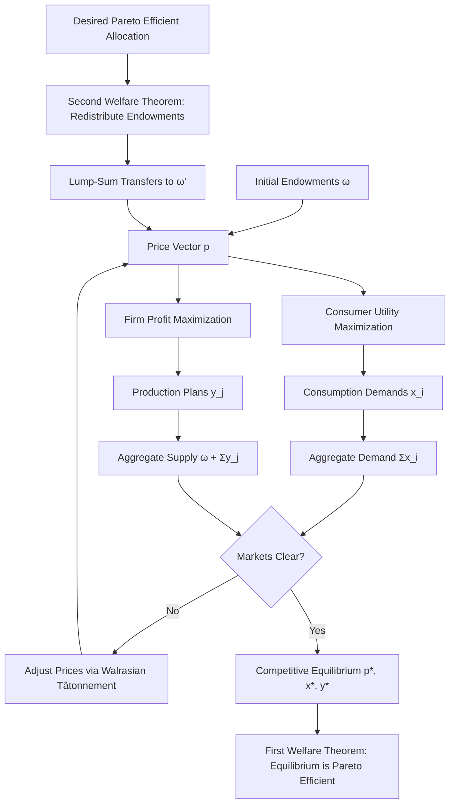

# Lesson 1: Efficiency Criteria, Pareto Optimality, Fundamental Theorems

## 1. First-Principles Intuition & Invariants

Welfare economics confronts a deceptively simple question: when can we declare that an economy is operating well? The very act of defining "well" forces us into treacherous normative territory, where value judgments about interpersonal utility comparisons threaten to undermine any claim to scientific rigor. The Italian economist Vilfredo Pareto, working in the late nineteenth and early twentieth centuries, cut through this philosophical thicket with a criterion so minimal, so stripped of ethical baggage, that it has become the foundational efficiency standard in modern economic analysis.

The Pareto efficiency criterion establishes a threshold of resource allocation quality without requiring any judgment about whether one person's welfare matters more than another's. An allocation is Pareto efficient—or Pareto optimal—if no reallocation of resources can make at least one individual strictly better off without making any other individual strictly worse off. This definition captures the intuitive notion that an economy is wasteful if we can find unexploited gains from trade, if resources sit idle when they could generate value, or if production occurs using techniques that squander inputs. The criterion's genius lies in what it refuses to claim: it never asserts that efficient allocations are fair, just, or desirable in any broader moral sense. It simply identifies configurations where all mutual benefit has been exhausted.

Consider a two-person, two-good exchange economy visualized through the Edgeworth box construction. We place individual A's origin at the bottom-left corner and individual B's origin at the top-right corner. The box dimensions represent the total endowment of goods X and Y. Any point within the box describes a complete allocation of both goods between the two traders. Individual A's indifference curves emanate from the bottom-left, convex to that origin, while B's curves emanate from the top-right, convex to their origin. The tangency locus—where A's indifference curve is tangent to B's indifference curve—traces the contract curve, the set of all Pareto efficient allocations.

Why must tangency points be efficient? At any interior tangency, the marginal rates of substitution are equalized: $\text{MRS}_A^{XY} = \text{MRS}_B^{XY}$. If the rates differed at some allocation, say $\text{MRS}_A^{XY} = 3$ while $\text{MRS}_B^{XY} = 1$, then individual A would willingly give up three units of Y to obtain one unit of X, while individual B would willingly give up one unit of X to obtain one unit of Y. A trade exists that makes both parties strictly better off: A transfers some Y to B in exchange for some X, with the exchange ratio lying between 1 and 3. This trade continues until the marginal rates align, at which point no further mutually beneficial exchange is possible. The contract curve represents the exhaustion of all such trading opportunities.

The formal statement of Pareto efficiency extends beyond simple exchange to encompass production economies. In a production context, efficiency requires three simultaneous conditions. First, exchange efficiency demands that $\text{MRS}_{i}^{XY} = \text{MRS}_{j}^{XY}$ for all consumers $i$ and $j$, ensuring no further gains from redistributing final consumption goods. Second, production efficiency requires that $\text{MRTS}_{f}^{KL} = \text{MRTS}_{g}^{KL}$ for all production activities $f$ and $g$, meaning no reallocation of inputs between sectors can increase total output. The marginal rate of technical substitution measures how much of one input can be reduced when another input increases by one unit while holding output constant. When these rates differ across firms or sectors, moving inputs from low-marginal-product uses to high-marginal-product uses expands the production possibilities frontier. Third, product-mix efficiency demands that the marginal rate of transformation equals the common marginal rate of substitution: $\text{MRT}^{XY} = \text{MRS}^{XY}$ for all consumers. The marginal rate of transformation, derived from the production possibilities frontier, describes how much of good Y must be sacrificed to produce one additional unit of good X. If consumers value an additional unit of X at a rate different from the economy's production cost, then shifting resources between sectors can generate a Pareto improvement.

These three conditions—exchange efficiency, production efficiency, and product-mix efficiency—define the core invariants of Pareto optimality in a general equilibrium framework. They emerge naturally from the mathematical structure of optimization problems. Consider the social planner's problem of maximizing one consumer's utility subject to holding all other consumers at fixed utility levels and respecting resource and technology constraints. The Lagrangian formulation of this problem yields first-order conditions that, when satisfied, guarantee no Pareto improvement is possible. The equalization of marginal rates across agents and sectors arises as the shadow price interpretation of scarcity: wherever marginal valuations differ, shadow prices signal unexploited arbitrage opportunities.

Yet the Pareto criterion harbors profound limitations as a normative guide for policy evaluation. Its minimal ethical content becomes a vice when we confront real-world policy choices. An allocation where one individual controls the entire economy's resources while everyone else starves can be Pareto efficient if any redistribution would make the wealthy individual worse off. The criterion offers no leverage for comparing two efficient allocations that differ radically in their distributional consequences. This silence on equity questions has led many economists to emphasize that Pareto efficiency is a necessary but not sufficient condition for social desirability. We need additional ethical frameworks—utilitarian social welfare functions, Rawlsian difference principles, or other distributional criteria—to rank Pareto efficient allocations and guide policy when efficiency gains require creating losers.

The edge cases reveal the criterion's boundaries. Non-convexities in preferences or production technologies can generate multiple Pareto efficient allocations that are not connected by continuous marginal adjustments. Externalities create wedges between private marginal costs and social marginal costs, so decentralized market allocations that are privately optimal need not be Pareto efficient from a social perspective. Public goods introduce non-rivalry and non-excludability, breaking the standard competitive mechanism's ability to achieve efficiency. Asymmetric information and incomplete markets mean that even perfectly competitive equilibria in observable markets may fail to exhaust all potential gains from trade when hidden types or hidden actions matter. Each of these departures from the Arrow-Debreu ideal competitive model requires careful institutional design—Pigouvian taxes, public provision, regulatory mandates, or mechanism design interventions—to restore efficiency.

The relationship between Pareto efficiency and competitive equilibrium crystallizes in the Fundamental Theorems of Welfare Economics, which establish precise conditions under which decentralized market processes generate efficient outcomes and under which any efficient allocation can be sustained as a competitive equilibrium. These theorems form the intellectual foundation for arguments about the role of markets versus government intervention in economic policy.

## 2. Core Architecture & Mechanics

The First Fundamental Theorem of Welfare Economics asserts that every competitive equilibrium allocation is Pareto efficient, provided certain technical conditions hold. To unpack this claim, we must first define competitive equilibrium rigorously. A competitive equilibrium consists of a price vector $p^* = (p_1^*, p_2^*, \ldots, p_n^*)$ and an allocation $(x_1^*, x_2^*, \ldots, x_I^*, y_1^*, y_2^*, \ldots, y_J^*)$ such that three conditions are satisfied simultaneously.

First, each consumer $i$ maximizes utility subject to their budget constraint. Consumer $i$ chooses consumption bundle $x_i^*$ to solve:

$$\max_{x_i} U_i(x_i) \quad \text{subject to} \quad p^* \cdot x_i \leq p^* \cdot \omega_i + \theta_i \sum_{j} \pi_j(p^*)$$

where $\omega_i$ represents the consumer's endowment vector, $\theta_i$ denotes their share of firm profits, and $\pi_j(p^*)$ is the profit earned by firm $j$ at prices $p^*$. This utility maximization condition ensures that consumers allocate their income across goods to equalize marginal utility per dollar spent: $\frac{\partial U_i / \partial x_{ik}}{p_k^*} = \lambda_i$ for all goods $k$, where $\lambda_i$ is the Lagrange multiplier on consumer $i$'s budget constraint, interpretable as the marginal utility of income.

Second, each firm $j$ maximizes profit subject to its production technology. Firm $j$ chooses a production plan $y_j^*$ to solve:

$$\max_{y_j} p^* \cdot y_j \quad \text{subject to} \quad y_j \in Y_j$$

where $Y_j$ represents the production possibility set for firm $j$, typically derived from a production function $f_j$ such that outputs cannot exceed $f_j(\text{inputs})$. Profit maximization implies that firms equate the value of marginal product to input prices and produce where marginal cost equals output price.

Third, markets clear. The sum of all planned consumption must equal the sum of all endowments plus net production:

$$\sum_{i=1}^{I} x_i^* = \sum_{i=1}^{I} \omega_i + \sum_{j=1}^{J} y_j^*$$

for every good in the economy. This feasibility constraint ensures that the allocation is physically attainable given available resources and technology.

The First Welfare Theorem's proof proceeds by contradiction. Suppose a competitive equilibrium allocation $x^*$ is not Pareto efficient. Then there exists an alternative feasible allocation $x'$ such that $U_i(x_i') \geq U_i(x_i^*)$ for all consumers $i$ with strict inequality for at least one consumer. Because consumers maximize utility at the competitive equilibrium, any bundle $x_i'$ that yields higher utility than $x_i^*$ must cost strictly more than consumer $i$'s budget: $p^* \cdot x_i' > p^* \cdot x_i^*$. Summing across all consumers, we obtain:

$$p^* \cdot \sum_{i} x_i' > p^* \cdot \sum_{i} x_i^*$$

But profit maximization by firms ensures that $p^* \cdot y_j^* \geq p^* \cdot y_j'$ for any alternative production plan $y_j'$ in the production set. Summing across firms:

$$p^* \cdot \sum_{j} y_j^* \geq p^* \cdot \sum_{j} y_j'$$

For the alternative allocation $x'$ to be feasible, we require $\sum_i x_i' = \sum_i \omega_i + \sum_j y_j'$. Multiplying by $p^*$:

$$p^* \cdot \sum_{i} x_i' = p^* \cdot \sum_{i} \omega_i + p^* \cdot \sum_{j} y_j'$$

The market clearing condition at the competitive equilibrium gives $p^* \cdot \sum_i x_i^* = p^* \cdot \sum_i \omega_i + p^* \cdot \sum_j y_j^*$. Combining these expressions with the inequalities from utility and profit maximization yields a contradiction. The alternative allocation $x'$ cannot simultaneously make some consumers better off without violating either the budget constraints or profit maximization conditions. Hence the competitive equilibrium must be Pareto efficient.

This theorem's power lies in its decentralization result: no central planner needs to solve the combinatorially explosive problem of allocating every resource to every use. Instead, prices aggregate dispersed information about scarcity and preferences, and individual optimizing behavior by consumers and firms independently leads to an efficient outcome. The theorem vindicates Adam Smith's invisible hand metaphor under precise mathematical conditions.

Those conditions matter critically. The First Welfare Theorem requires several strong assumptions. Preferences must be locally non-satiated, meaning consumers always prefer slightly more of at least one good. Production sets must be convex, ruling out increasing returns to scale that would lead to natural monopoly. Externalities must be absent, so that one agent's consumption or production does not directly enter another agent's utility or production function. Markets must exist for all goods, including future and contingent claims, so that intertemporal and risk-sharing trades can occur. Agents must be price-takers, with no individual possessing market power to influence prices through their choices. When any of these conditions fails, the theorem's conclusion breaks down, and competitive equilibria may fail to achieve Pareto efficiency.

The Second Fundamental Theorem of Welfare Economics establishes the converse relationship: any Pareto efficient allocation can be supported as a competitive equilibrium with appropriate lump-sum transfers. This theorem separates efficiency from distribution. If society deems a particular Pareto efficient allocation desirable on equity grounds, the government can redistribute endowments and then allow markets to operate, achieving both efficiency and the desired distributional outcome.

Formally, consider a Pareto efficient allocation $\bar{x} = (\bar{x}_1, \bar{x}_2, \ldots, \bar{x}_I)$ in a pure exchange economy. The Second Welfare Theorem states that there exists a price vector $\bar{p}$ and a redistribution of endowments $\tilde{\omega}_i$ such that $(\bar{p}, \bar{x})$ constitutes a competitive equilibrium for the economy with the new endowment distribution. The proof relies on a separating hyperplane argument from convex analysis. The set of feasible allocations that make all consumers at least as well off as at $\bar{x}$ forms a convex set (under convexity assumptions on preferences). The Pareto efficiency of $\bar{x}$ means this set does not intersect the interior of the aggregate consumption set. A separating hyperplane theorem guarantees the existence of a price vector $\bar{p}$ that separates these sets, and this price vector supports $\bar{x}$ as a competitive equilibrium after appropriate endowment redistribution.

The Second Welfare Theorem's policy implication is profound yet often misunderstood. It suggests that concerns about equity and efficiency can be addressed sequentially: first redistribute wealth through lump-sum transfers, then allow markets to allocate resources efficiently. In principle, this decouples distributional politics from allocative efficiency. In practice, the theorem's reliance on lump-sum transfers—transfers that do not distort individual behavior—proves deeply problematic. True lump-sum transfers are rare. Taxing income, consumption, or wealth typically alters incentives to work, save, or invest. Only pure head taxes or endowment taxes that cannot be avoided through behavioral responses qualify as lump-sum, and such taxes face severe political and ethical objections. The theorem thus serves more as a conceptual benchmark than as a practical policy blueprint, highlighting the tension between equity and efficiency that pervades real-world policy design.

The mechanics of competitive equilibrium can be visualized through the Walrasian tâtonnement process, though this heuristic story should not be mistaken for a literal description of how markets operate. Imagine an auctioneer who calls out prices. At each price vector, agents report their desired demands and supplies. If excess demand exists for some good, the auctioneer raises its price. If excess supply exists, the auctioneer lowers the price. This iterative adjustment continues until all markets clear simultaneously. Walras' Law, which states that the value of excess demand across all markets must sum to zero, $\sum_k p_k z_k(p) = 0$ where $z_k(p)$ is the excess demand for good $k$, ensures that if $n-1$ markets clear, the $n$-th market must also clear. This property reduces the dimensionality of the equilibrium problem and guarantees that budget constraints bind.

The existence of competitive equilibrium, established through fixed-point theorems such as Brouwer's or Kakutani's theorem, requires continuity and convexity conditions. Excess demand functions must be continuous in prices, which follows from continuity of preferences and budget sets. The aggregate excess demand correspondence must have a convex graph, ensured by convexity of preferences and production sets. Under these conditions, the excess demand mapping from prices back to prices (via market clearing conditions) has a fixed point, which constitutes a competitive equilibrium. Uniqueness of equilibrium, however, demands stronger assumptions, such as gross substitutability (an increase in the price of one good raises demand for all other goods), which rarely holds in practice. Multiple equilibria can exist, raising questions about equilibrium selection and coordination.

The diagram above captures the logical flow from endowments and technology through price formation, individual optimization, market clearing, and the welfare theorems' connections between competitive equilibrium and Pareto efficiency. The Walrasian tâtonnement loop represents the conceptual adjustment process, while the Second Welfare Theorem branch shows how distributional goals can be incorporated through endowment redistribution before market mechanisms operate.

## 3. High-Performance Optimization & Failure Modes

The theoretical elegance of Pareto efficiency and the welfare theorems masks significant practical challenges when applying these concepts to policy analysis. Real-world economies systematically violate the conditions required for the First Welfare Theorem, generating efficiency losses that demand institutional responses. Identifying these market failures, quantifying their welfare costs, and designing corrective policies constitute the central tasks of applied welfare economics.

Externalities represent the most pervasive departure from competitive efficiency. When one agent's actions directly affect another's utility or production possibilities without compensation, the price system fails to internalize these spillover effects. A factory emitting pollution imposes costs on nearby residents, but absent property rights or regulatory intervention, the factory's private profit-maximizing decision ignores these external costs. The competitive equilibrium overproduces the pollution-generating good relative to the social optimum. Formally, the condition for product-mix efficiency breaks down: the marginal rate of transformation no longer equals consumers' common marginal rate of substitution when external costs are present. The social marginal cost exceeds the private marginal cost by the magnitude of the marginal external damage.

Pigouvian taxation, named after Arthur Pigou, corrects this distortion by imposing a tax equal to the marginal external cost at the efficient output level. Let $\text{MSC}(q) = \text{MPC}(q) + \text{MEC}(q)$ where $\text{MSC}$ is marginal social cost, $\text{MPC}$ is marginal private cost, and $\text{MEC}$ is marginal external cost. The competitive market equates price to marginal private cost: $p = \text{MPC}(q_{\text{market}})$. The efficient quantity $q^*$ satisfies $p = \text{MSC}(q^*) = \text{MPC}(q^*) + \text{MEC}(q^*)$. A tax $t = \text{MEC}(q^*)$ induces the firm to internalize the externality, leading to the efficient output level. The challenge lies in information requirements: the regulator must observe the marginal external cost function, which often depends on unobservable factors such as individual damage valuations, spatial dispersion of pollutants, and non-linear dose-response relationships.

The Coase Theorem, articulated by Ronald Coase in his 1960 article "The Problem of Social Cost," offers an alternative perspective on externalities. Coase argued that when property rights are well-defined and transaction costs are negligible, bargaining between affected parties will lead to an efficient outcome regardless of the initial assignment of rights. If the factory holds the right to pollute, residents can pay the factory to reduce emissions up to the point where the marginal benefit of abatement equals the marginal cost. If residents hold the right to clean air, the factory compensates them for permission to pollute, again reaching the efficient abatement level. The initial rights assignment affects wealth distribution but not efficiency. This result undermines the case for government intervention when private negotiation is feasible, but transaction costs—coordination among many dispersed victims, free-riding incentives, asymmetric information about damages and abatement costs—typically prevent Coasean bargaining from resolving large-scale externalities. Policy practitioners must assess case-by-case whether transaction costs favor direct regulation, taxation, cap-and-trade permit systems, or reliance on liability rules and court-based resolution.

Public goods present a distinct failure mode. A pure public good exhibits non-rivalry (one person's consumption does not reduce the amount available to others) and non-excludability (individuals cannot be prevented from consuming the good even if they do not pay). National defense, basic scientific research, and lighthouse services are canonical examples. For public goods, the efficient provision condition is the Samuelson condition:

$$\sum_{i=1}^{I} \text{MRS}_i^{GX} = \text{MRT}^{GX}$$

where $G$ denotes the public good and $X$ represents a composite private good. The sum of all individuals' marginal rates of substitution must equal the marginal rate of transformation, reflecting the fact that the public good is consumed collectively. Each person's marginal benefit contributes to the social valuation, unlike private goods where efficiency requires equalized marginal rates of substitution across individuals.

Decentralized markets undersupply public goods because individuals free-ride. Each person has an incentive to understate their valuation, hoping others will pay for provision while they enjoy the benefits costlessly. The Nash equilibrium of voluntary contribution games typically yields far less than the efficient quantity. Compulsory taxation and public provision bypass the free-rider problem, but introduce the challenge of preference revelation. How does the government determine the optimal quantity when citizens have incentives to misrepresent their valuations? Mechanism design theory, particularly the work of Vickrey, Clarke, and Groves on dominant-strategy incentive-compatible mechanisms, offers sophisticated solutions but at the cost of budget imbalance or vulnerability to collusion. Practical public goods provision relies on political processes, cost-benefit analysis, and rough proxies for citizen preferences such as voting outcomes and stated-preference surveys.

Asymmetric information generates another class of failures. When one party to a transaction possesses private information unavailable to the other, adverse selection and moral hazard distort allocative efficiency. Akerlof's market for lemons illustrates adverse selection: if sellers of used cars know their vehicle's quality but buyers do not, only low-quality cars may trade in equilibrium. High-quality sellers cannot credibly signal their type, so they exit the market. The equilibrium involves partial or complete market unraveling, with mutually beneficial trades foregone. Spence's job market signaling model shows how costly signals—such as education—can separate high-productivity from low-productivity workers, restoring some efficiency, but the signal itself consumes real resources and may not be socially optimal if it merely redistributes rents without enhancing productivity.

Moral hazard arises when one party's unobservable actions affect outcomes. Insurance markets exemplify this problem: once insured, individuals may take fewer precautions against loss, raising the insurer's expected payout. The efficient insurance contract trades off risk-sharing benefits against incentive costs. The optimal contract provides partial coverage, balancing marginal risk reduction against marginal incentive distortion. This departure from full insurance represents a welfare loss relative to the first-best outcome with observable effort. Regulatory interventions such as mandatory coverage, community rating, or risk adjustment aim to mitigate adverse selection in health insurance markets, but these policies introduce their own distortions and often fail to achieve first-best efficiency.

Market power—monopoly, oligopoly, or monopsony—violates the price-taking assumption essential to the First Welfare Theorem. A monopolist restricts output below the competitive level to raise price above marginal cost, creating deadweight loss. The monopolist's profit-maximizing condition $\text{MR}(q) = \text{MC}(q)$ where marginal revenue lies below price due to the downward-sloping demand curve, diverges from the efficiency condition $p = \text{MC}(q)$. Antitrust policy, price regulation, and public utility frameworks attempt to constrain market power, but each approach introduces tradeoffs. Price regulation at marginal cost may induce losses for natural monopolies with declining average costs, requiring subsidies. Rate-of-return regulation distorts input choices, leading to the Averch-Johnson effect where regulated firms overinvest in capital. Deregulation and contestable markets policies aim to harness competitive discipline, but entry and exit costs often limit the threat of potential competition.

Non-convexities in technology or preferences undermine the welfare theorems' applicability. Increasing returns to scale lead to natural monopoly, as discussed above. Indivisibilities or setup costs prevent continuous marginal adjustments, so the tangency conditions characterizing interior Pareto optima may not hold. Multiple equilibria can arise, with some equilibria Pareto-dominating others, raising coordination problems. Poverty traps and development traps in growth theory exemplify this issue: countries may be stuck in a low-output equilibrium even though a high-output equilibrium exists and Pareto-dominates, but reaching it requires a coordinated big push of investment and institutional reform.

Incomplete markets—the absence of markets for certain goods, particularly contingent claims on future states of nature—prevent full risk-sharing and intertemporal optimization. The Arrow-Debreu model assumes complete markets, with trade in securities that pay off in every possible future state. Real economies feature far fewer securities, so individuals cannot perfectly insure against all risks. Unemployment insurance, social safety nets, and financial regulation aim to fill gaps left by incomplete private insurance markets, but government provision introduces moral hazard and adverse selection of its own.

Dynamic considerations complicate welfare analysis. The Pareto criterion is static, comparing allocations at a single point in time without addressing intertemporal tradeoffs. How should we weigh current consumption against future consumption, or balance the welfare of present generations against future generations? Discounted utilitarianism applies an exponential discount rate to future utility, but the choice of discount rate profoundly affects policy recommendations on long-horizon issues such as climate change mitigation. Hyperbolic discounting and time-inconsistent preferences further muddy the waters, as individuals' revealed preferences may conflict with their long-run interests. Paternalistic policies such as mandatory retirement savings or default enrollment in pension plans reflect judgments that individuals' myopic choices diverge from their own welfare, a controversial stance that departs from the standard sovereignty of consumer preferences.

Distributional concerns, as noted earlier, lie outside the Pareto criterion's scope. Sen's liberal paradox and Arrow's impossibility theorem expose deep tensions between efficiency, individual liberty, and collective choice. No social welfare function can simultaneously satisfy unrestricted domain, Pareto efficiency, independence of irrelevant alternatives, and non-dictatorship. Policy analysts often augment Pareto efficiency with explicit distributional weights, constructing social welfare functions of the form $W = \sum_i a_i U_i$ where the weights $a_i$ reflect value judgments about equity. Utilitarian weights of $a_i = 1$ treat all individuals symmetrically. Rawlsian maximin weights concentrate entirely on the worst-off individual. Intermediate weighting schemes reflect society's inequality aversion. Empirical work on optimal taxation, such as Mirrlees' model of income taxation under asymmetric information about ability, combines efficiency and equity considerations to derive tax schedules that balance distortionary costs against redistributive benefits.

Computational tractability limits the practical application of general equilibrium welfare analysis. Computing competitive equilibria in high-dimensional settings with many goods, many agents, and realistic heterogeneity requires numerical methods. Computable general equilibrium (CGE) models discretize the economy into representative households and sectors, calibrating parameters to match observed data. These models simulate policy counterfactuals—such as trade liberalization, carbon taxes, or tax reforms—to estimate welfare effects. Yet CGE models rely on strong functional form assumptions, ignore dynamics and disequilibrium adjustment, and aggregate away within-group heterogeneity that may matter for distributional analysis. Partial equilibrium analysis, focusing on a single market while treating other markets as fixed, offers tractability at the cost of ignoring general equilibrium feedback effects. The choice between partial and general equilibrium modeling depends on the policy question's scope and the magnitude of expected spillovers.

Real-world welfare analysis integrates efficiency criteria with cost-benefit analysis frameworks. Analysts monetize policy impacts, aggregating willingness-to-pay measures across affected parties. The Kaldor-Hicks criterion judges a policy as welfare-improving if winners' gains exceed losers' losses, regardless of whether compensation actually occurs. This compensation test provides an ordinal ranking of policies when Pareto improvements are unavailable, but it inherits all the problems of interpersonal utility comparisons and can recommend policies that increase inequality. Practical cost-benefit analysis incorporates shadow prices for non-marketed goods, applies discount rates to future costs and benefits, and conducts sensitivity analysis over uncertain parameters. The approach combines efficiency logic with pragmatic shortcuts, accepting that perfect information and lump-sum redistribution are unattainable.

The limitations of Pareto efficiency as a normative guide demand humility from policy economists. Efficiency is one dimension of evaluation, not a complete ethical framework. Policies should aim for Pareto improvements where feasible, correct market failures to move closer to efficiency frontiers, and complement efficiency analysis with transparent distributional judgments. The Fundamental Theorems clarify when markets succeed and when they fail, providing intellectual structure for diagnosing problems and designing interventions. But the theorems' stringent assumptions remind us that real economies are messy, that market failures are pervasive, and that institutional details matter profoundly. The masterclass practitioner combines theoretical rigor with empirical grounding, wielding efficiency criteria as tools for analysis while recognizing their limits and supplementing them with judgment, evidence, and an honest reckoning with tradeoffs.
