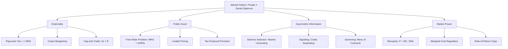

# Lesson 3: Market Failures, Externalities, Public Goods

## 1. First-Principles Intuition & Invariants

The elegance of the First Fundamental Welfare Theorem rests on a precise and demanding set of assumptions: complete markets, perfect information, price-taking behavior, and the absence of externalities. When any of these conditions fails, competitive equilibria no longer guarantee Pareto efficiency, and the invisible hand falters. Market failures represent systematic deviations from the idealized Arrow-Debreu world, producing allocations that leave potential gains from trade unrealized or impose costs on agents excluded from market transactions.

Understanding market failure begins with recognizing that prices serve as the sole communication mechanism in decentralized markets. When an agent's production or consumption decision affects the welfare of others outside the price system, that effect constitutes an externality. The steel mill that emits particulates, reducing the productivity of a downstream fishery, imposes a cost that never enters the mill's profit calculus. The beekeeper whose pollinators increase the yield of neighboring orchards generates a benefit for which no market compensation exists. In both cases, private marginal costs diverge from social marginal costs, and private optimization leads to socially inefficient outcomes.

The fundamental inefficiency operates through a wedge between private and social valuations. Consider a factory producing quantity $q$ of output, generating pollution damage $D(q)$ that rises with production. The firm maximizes profit $\pi = P \cdot q - C(q)$, setting price equal to private marginal cost: $P = C'(q)$. Social welfare, however, accounts for total surplus minus damage: $W = \int_0^q P(x) dx - C(q) - D(q)$. The social optimum requires $P = C'(q) + D'(q)$, equating price to social marginal cost. The externality drives a wedge $D'(q)$ between private incentives and social efficiency, causing overproduction whenever $D'(q) > 0$.

This divergence between private and social accounting extends beyond pollution. Traffic congestion represents a classic negative externality in urban transportation networks. Each driver deciding whether to enter a highway considers only private travel time, ignoring the incremental delay imposed on all other vehicles. The marginal social cost of an additional driver includes both the private time cost and the aggregate delay externality summed across all existing traffic. Without corrective intervention, peak-hour traffic volumes systematically exceed the socially optimal flow, generating deadweight loss measured by the triangular area between social and private marginal cost curves.

Public goods introduce a distinct failure mode rooted in non-rivalry and non-excludability. A pure public good, once provided, delivers benefits to all agents simultaneously without diminishing any individual's consumption. National defense, lighthouse signals, basic scientific research, and disease eradication programs share this property. Non-excludability prevents charging individual prices, severing the link between willingness to pay and access. The combination produces a profound collective action problem: each agent has incentive to understate true valuation, hoping others will finance provision while enjoying benefits as a free rider.

The efficient provision condition for a public good inverts the standard private good rule. For a private good, efficiency requires equalizing marginal rates of substitution across consumers: each agent faces the same price and adjusts consumption until personal marginal benefit equals that price. For a public good consumed simultaneously by all $N$ agents, efficiency demands summing marginal benefits vertically: $\sum_{i=1}^N MRS_i = MC$, where $MRS_i$ represents agent $i$'s marginal rate of substitution between the public good and numeraire. This Samuelson condition reflects that the social benefit of an additional unit equals the sum of all individual marginal valuations, while cost is incurred only once.

Voluntary contribution mechanisms systematically underprovide public goods relative to this optimum. Consider $N$ agents deciding contributions $g_i$ toward a public good with total provision $G = \sum_i g_i$ and cost $c$ per unit. Agent $i$ maximizes utility $U_i(x_i, G)$ subject to budget constraint $x_i + c \cdot g_i = w_i$, treating others' contributions as fixed. The private first-order condition $\frac{\partial U_i}{\partial G} = c$ equates personal marginal benefit to cost, ignoring that each unit contributed generates benefits for all $N$ agents. As group size grows, the individual share of social benefit shrinks, and rational agents contribute progressively less. In the limit, pure free riding emerges: each agent hopes total provision will reach adequate levels through others' contributions while personally contributing nothing.

Asymmetric information generates yet another class of market failures, most famously illustrated by George Akerlof's market for lemons. Consider a used car market where sellers know vehicle quality but buyers observe only average quality in the population. High-quality sellers demand prices reflecting true value, but buyers, unable to distinguish quality, offer only the average valuation across the quality distribution. This pooling price lies below the reservation value of high-quality sellers, who withdraw from the market. Their exit shifts the average quality downward, further reducing buyer willingness to pay and triggering additional high-quality exits. In extreme cases, adverse selection unravels the market entirely, leaving only the lowest-quality vehicles trading at correspondingly depressed prices.

The insurance market provides a parallel structure. Individuals possess private information about their risk type—accident probabilities, health status, fire hazard exposure. Insurers cannot perfectly observe these characteristics and must offer pooled contracts based on population averages. High-risk types find insurance attractively priced relative to expected claims, while low-risk types perceive contracts as overpriced and decline coverage. The insured pool becomes progressively riskier, forcing premium increases that drive out additional low-risk individuals. The equilibrium features incomplete insurance coverage and potential market collapse, despite mutual gains from trade existing between insurers and low-risk individuals at actuarially fair prices.

Market power represents the final major source of inefficiency, arising when firms face downward-sloping demand curves and possess price-setting ability. A monopolist maximizes profit by equating marginal revenue to marginal cost, where marginal revenue lies strictly below price due to the demand curve slope: $MR = P(1 - \frac{1}{\epsilon})$, with $\epsilon$ denoting demand elasticity. The resulting markup generates allocative inefficiency. Consumers value marginal units at price $P$, while the resource cost of production equals marginal cost $MC$. The wedge $P - MC > 0$ signals unexploited gains from trade: units valued above production cost remain unproduced, creating deadweight loss.

Natural monopoly arises when subadditive cost structures make single-firm production more efficient than fragmented competition. Electricity transmission, water distribution networks, and railway infrastructure exhibit high fixed costs and declining average costs over relevant output ranges. Competition proves unstable: the largest firm enjoys cost advantages that allow predatory pricing, eventually driving rivals from the market. Yet unregulated monopoly pricing extracts consumer surplus through markup power. This tension between productive efficiency and allocative distortion motivates regulatory intervention, typically through marginal-cost pricing mandates or rate-of-return regulation that constrains monopoly rent extraction while preserving scale economies.

Each market failure mode—externalities, public goods, asymmetric information, market power—shares a common root: the price system incompletely transmits information about social costs, benefits, or quality. Externalities represent unpriced effects on third parties. Public goods feature non-excludable benefits disconnected from payment. Asymmetric information prevents quality signals from reaching prices. Market power creates wedges between price and social marginal cost. Policy intervention aims to restore the informational completeness and incentive alignment that characterize efficient competitive equilibria, using taxes, subsidies, regulation, information disclosure mandates, or direct public provision to close the gap between private and social optimization.

## 2. Core Architecture & Mechanics

The mechanical structure of externalities operates through production or utility functions that depend on variables outside individual control. Represent a two-agent economy where firm 1 produces output $q_1$ generating pollution $e = \phi(q_1)$ that enters firm 2's cost function. Firm 1 maximizes profit $\pi_1 = p_1 q_1 - C_1(q_1)$, choosing output where $p_1 = C_1'(q_1)$. Firm 2 faces costs $C_2(q_2, e)$ with $\frac{\partial C_2}{\partial e} > 0$, reflecting damage from pollution. Firm 2 chooses $q_2$ to satisfy $p_2 = \frac{\partial C_2}{\partial q_2}(q_2, e)$, but cannot influence $e$ through market mechanisms.

Social welfare equals total surplus: $W = \int_0^{q_1} P_1(x) dx + \int_0^{q_2} P_2(x) dx - C_1(q_1) - C_2(q_2, e)$. The social planner maximizing $W$ chooses $q_1$ to satisfy:

$$p_1 = C_1'(q_1) + \frac{\partial C_2}{\partial e} \cdot \phi'(q_1)$$

The additional term $\frac{\partial C_2}{\partial e} \cdot \phi'(q_1)$ represents the marginal external damage from increased production. Firm 1's private optimization ignores this term, producing $q_1^*$ where $p_1 = C_1'(q_1^*)$. Since $\frac{\partial C_2}{\partial e} \cdot \phi'(q_1) > 0$, the private equilibrium satisfies $C_1'(q_1^*) < C_1'(q_1^{**}) + \frac{\partial C_2}{\partial e} \cdot \phi'(q_1^{**})$, implying overproduction: $q_1^* > q_1^{**}$, where double asterisk denotes the social optimum.

Arthur Pigou proposed correcting this distortion through a per-unit tax equal to marginal external damage evaluated at the social optimum: $t = \frac{\partial C_2}{\partial e} \cdot \phi'(q_1^{**})$. Firm 1 now maximizes $\pi_1 = p_1 q_1 - C_1(q_1) - t q_1$, yielding first-order condition $p_1 = C_1'(q_1) + t$. Setting $t$ equal to marginal damage internalizes the externality, aligning private incentives with social welfare. The tax revenue $T = t \cdot q_1^{**}$ can be rebated lump-sum without distorting the margin, preserving efficiency while redistributing surplus.

The Pigouvian tax structure extends naturally to continuous pollution flows. Let $e(t)$ denote emissions at time $t$, causing stock pollution $S(t)$ governed by accumulation dynamics $\dot{S}(t) = e(t) - \delta S(t)$, where $\delta$ represents natural decay. Damages depend on the stock: $D(S(t))$. The social cost of emissions at time $t$ includes immediate damage and the discounted present value of future damage from persistent accumulation. This shadow price evolves according to $\lambda(t) = \frac{\partial D}{\partial S} + (\delta + \rho) \lambda(t) - \dot{\lambda}(t)$, where $\rho$ denotes the discount rate. The optimal Pigouvian tax equals $\tau(t) = \lambda(t)$, rising over time if marginal damage increases with stock or decaying if natural attenuation dominates.

Ronald Coase challenged the necessity of Pigouvian intervention by demonstrating that, under specific conditions, private bargaining achieves efficiency regardless of initial property right assignment. Consider the firm-fishery externality. Assign property rights either to the firm (right to pollute) or the fishery (right to clean water). If the firm holds rights, the fishery pays the firm to reduce pollution up to the point where marginal damage equals marginal abatement cost. If the fishery holds rights, the firm pays for permission to pollute, again equalizing marginal damage and marginal abatement cost. Both allocations yield identical pollution levels, determined by efficiency conditions rather than the initial rights distribution.

The Coase theorem requires zero transaction costs, well-defined property rights, and small numbers of agents. When parties can negotiate costlessly, they exhaust all gains from trade, reaching efficient outcomes through voluntary exchange. The distribution of surplus shifts with property right assignment—the rights holder extracts payment—but the efficient allocation remains invariant. This insight transforms externality policy from automatic tax advocacy toward comparative institutional analysis: evaluate transaction costs, strategic bargaining frictions, and information asymmetries to determine whether decentralized negotiation or centralized intervention dominates.

Transaction costs shatter Coasean bargaining in practice. Identifying damaged parties, organizing collective action, verifying compliance, and enforcing agreements consume resources. When pollution affects thousands of downstream households, coordinating negotiations imposes prohibitive costs. Information asymmetries allow strategic misrepresentation: the polluter understates abatement costs, while victims exaggerate damages. Holdout problems emerge when multiple parties must agree: each demands disproportionate compensation, blocking mutually beneficial deals. These frictions restore the case for regulatory intervention when transaction costs exceed administrative compliance costs and deadweight loss from imperfect tax calibration.

Cap-and-trade mechanisms provide an alternative to Pigouvian taxation, establishing quantity constraints while allowing price discovery through permit markets. A regulator sets total allowable emissions $\bar{E}$ and allocates tradable permits. Firms face heterogeneous abatement costs $C_i(e_i)$, where $e_i$ denotes emissions. Each firm minimizes total cost $C_i(e_i) + p(e_i - a_i)$, where $p$ represents the permit price and $a_i$ denotes allocated permits. The first-order condition $C_i'(e_i) = p$ equalizes marginal abatement cost across all firms, ensuring cost-effective aggregate abatement.

The permit market clearing condition $\sum_i e_i = \bar{E}$ determines equilibrium price $p^*$. Firms with low marginal abatement costs reduce emissions below their allocation, selling excess permits. Firms with high abatement costs purchase additional permits, finding it cheaper to pay $p^*$ than undertake expensive abatement. This trading achieves the equimarginal principle: social abatement cost is minimized when marginal abatement costs equalize across all sources. The regulator controls total emissions quantity directly, while the market determines the efficient distribution of abatement effort.

Comparing taxes and permits reveals essential tradeoffs. Under certainty, both achieve identical outcomes: set the tax equal to marginal damage at the optimum, or issue permits equal to optimal emissions. Under uncertainty about abatement costs, the instruments diverge. Martin Weitzman demonstrated that relative slopes of marginal benefit and marginal cost curves determine instrument choice. If marginal damage is steep (damages rise rapidly with emissions) and marginal abatement cost is flat (abatement cost varies slowly with emissions), quantity instruments dominate: missing the emissions target imposes large welfare losses, while cost fluctuations matter less. Conversely, if marginal damage is flat and marginal abatement cost is steep, price instruments dominate: missing the cost target imposes large losses, while emissions fluctuations matter less.

Public goods provision suffers from preference revelation failures. The Lindahl equilibrium concept imagines personalized prices $p_i$ for each agent such that $\sum_i p_i = MC$ and each agent voluntarily demands the same quantity $G^*$. This replicates the Samuelson condition: agent $i$ sets $MRS_i = p_i$, and summing across agents yields $\sum_i MRS_i = \sum_i p_i = MC$. Yet Lindahl pricing requires truthful revelation of marginal valuations, creating incentive incompatibility. Each agent gains by understating valuation, reducing personal price while enjoying full benefits of provision financed by others.

Direct revelation mechanisms attempt to extract truthful preferences through carefully structured incentive schemes. The Clarke-Groves-Vickrey mechanism charges agent $i$ a tax equal to the external cost their participation imposes on others: $t_i = \sum_{j \neq i} V_j(G^{-i}) - \sum_{j \neq i} V_j(G^*)$, where $G^{-i}$ denotes provision level without agent $i$ and $V_j(\cdot)$ represents agent $j$'s valuation. This Groves tax makes truthful reporting a dominant strategy: misrepresenting preferences cannot improve net utility when taxes adjust to internalize external effects. However, the mechanism generally runs a budget deficit—tax revenues fall short of provision cost—and remains vulnerable to collusion among subsets of agents.

Free-riding incentives intensify with group size. In a large economy, each individual's contribution negligibly affects total provision, making unilateral cooperation irrational. Yet universal defection leaves all agents worse off than under cooperative provision. This prisoner's dilemma structure motivates coercive financing through taxation. Governments observe income or wealth, impose mandatory contributions, and supply public goods using tax revenues. Majority voting or representative democracy substitute for voluntary contribution, transforming preference aggregation into a political rather than market process.

The median voter theorem characterizes public good provision under majority rule when preferences satisfy single-peakedness. Arraying voters along a policy dimension (provision level), each voter possesses an ideal point representing maximum utility. Single-peakedness requires utility to decline monotonically as policy moves away from the ideal point in either direction. Under majority rule, the median voter's ideal point defeats any alternative in pairwise competition: proposals above the median lose to the median (voters below prefer less), and proposals below the median lose to the median (voters above prefer more). Political equilibrium gravitates toward the median voter's preferred provision level, which may exceed or fall short of the utilitarian optimum depending on preference distribution.

Asymmetric information failures operate through adverse selection and moral hazard channels. Adverse selection arises pre-contract when one party possesses private information about exogenous characteristics. The canonical lemons model features a continuum of sellers with quality $q \sim U[0, 1]$ and valuation $V_s(q) = q$, while buyers value quality at $V_b(q) = \frac{3}{2} q$. Buyers cannot observe quality but know the distribution. If all qualities trade, buyers pay the expected value $E[V_b(q)] = \frac{3}{4}$. Sellers with $q > \frac{3}{4}$ refuse to sell at this price, withdrawing high-quality units. The average quality among remaining sellers drops, reducing buyer willingness to pay and triggering further exits.

The market unraveling proceeds iteratively. If buyers believe maximum quality is $\bar{q}$, they pay $E[V_b(q) | q \leq \bar{q}] = \frac{3}{4} \bar{q}$. Sellers with $q > \frac{3}{4} \bar{q}$ exit. Rational buyers anticipate this exit, revising beliefs downward to $\bar{q}' = \frac{3}{4} \bar{q}$. The equilibrium satisfies $\bar{q}^* = \frac{3}{4} \bar{q}^*$, implying $\bar{q}^* = 0$: complete market collapse. Only when a sufficiently large mass of low-quality sellers exists does a partial pooling equilibrium survive, with low-quality units trading at prices reflecting average quality among participating types.

Signaling models allow informed parties to separate by undertaking costly actions correlated with private information. Michael Spence's education signaling model posits workers with productivity $\theta \sim \{L, H\}$ choosing education levels $e$. High-productivity workers face lower education costs: $C(e, H) < C(e, L)$. Employers observe education but not productivity, offering wages based on beliefs $w(e)$. A separating equilibrium features high types choosing $e_H$ and low types choosing $e_L = 0$, with beliefs $w(e_H) = H$ and $w(e_L) = L$. The incentive compatibility constraints require $H - C(e_H, H) \geq L$ (high types prefer signaling) and $L \geq H - C(e_H, L)$ (low types prefer not signaling). Education serves as a filter, costly for low types but affordable for high types, allowing employers to infer productivity from observed signals.

Moral hazard arises post-contract when one party takes unobservable actions affecting outcome distributions. Consider an agent exerting effort $e$ producing output $x = e + \varepsilon$, where $\varepsilon \sim N(0, \sigma^2)$ represents noise. The principal observes $x$ but not $e$, offering a linear contract $w(x) = \alpha + \beta x$. The agent maximizes expected utility $E[u(w(x))] - c(e)$, where $u(\cdot)$ exhibits risk aversion and $c(e)$ denotes effort cost. The first-order condition $\beta u'(w) = c'(e)$ determines effort choice. The principal maximizes profit $E[x - w(x)]$ subject to the agent's incentive and participation constraints.

The optimal contract trades off incentive provision and risk sharing. Stronger incentives ($\beta$ closer to 1) induce higher effort but expose the risk-averse agent to income volatility. First-best efficiency requires full insurance ($\beta = 0$) combined with mandated effort, but unobservability of effort makes this infeasible. The second-best contract features $\beta \in (0, 1)$, balancing marginal incentive benefits against marginal risk-bearing costs. Greater noise $\sigma^2$ weakens optimal incentives: when output poorly signals effort, steep incentives impose large risk premiums without commensurately improving effort provision.

Market power inefficiency manifests through the monopoly markup. Inverse demand $P(Q)$ determines revenue $R(Q) = P(Q) \cdot Q$, with marginal revenue $MR(Q) = P(Q) + Q P'(Q) = P(Q)(1 - \frac{1}{\epsilon})$, where $\epsilon = -\frac{P}{Q} \frac{dQ}{dP}$ denotes demand elasticity. The monopolist sets $MR(Q^m) = MC(Q^m)$, yielding price $P^m = P(Q^m) > MC(Q^m)$. The competitive output $Q^c$ satisfies $P(Q^c) = MC(Q^c)$. Deadweight loss equals the triangular area between demand and marginal cost from $Q^m$ to $Q^c$: $DWL = \int_{Q^m}^{Q^c} [P(x) - MC(x)] dx$.

The Lerner index quantifies market power as the markup ratio: $L = \frac{P - MC}{P} = \frac{1}{\epsilon}$. Industries with inelastic demand (low $\epsilon$) permit larger markups: consumers lack substitutes and absorb price increases. Conversely, elastic demand constrains pricing power. The inverse elasticity relationship reveals that market power originates from demand-side rigidities rather than solely from supply concentration. Even a monopolist facing perfectly elastic demand cannot extract surplus above marginal cost.

Natural monopoly regulation confronts the tension between scale economies and allocative efficiency. Average cost declines over the relevant range: $AC(Q) > MC(Q)$ for all $Q \leq D(P)$, where $D(\cdot)$ denotes market demand. Marginal-cost pricing $P = MC$ generates losses since price falls below average cost. Recovering fixed costs requires either two-part tariffs (fixed access fee plus marginal-cost usage charge), Ramsey pricing (markups inversely proportional to demand elasticity across customer classes to minimize deadweight loss), or direct subsidies financed through general taxation.

Rate-of-return regulation constrains monopoly profits to a normal return on invested capital: $\pi \leq s \cdot K$, where $K$ denotes capital stock and $s$ represents the allowed rate of return. This mechanism caps total revenue through pricing constraints that depend on cost structure. However, when $s$ exceeds the cost of capital, firms possess incentive to overcapitalize—the Averch-Johnson effect—substituting capital for other inputs beyond cost-minimizing levels to inflate the profit cap base. Modern price-cap regulation addresses this distortion by fixing nominal price growth below productivity-adjusted inflation, rewarding cost reduction while avoiding direct profit rate calculations.

## 3. High-Performance Optimization & Failure Modes

Policy implementation of market failure corrections encounters severe informational and institutional constraints that undermine theoretical efficiency. Pigouvian taxation demands precise knowledge of marginal external damage functions, which vary across locations, technologies, and time. Estimating social cost of carbon requires integrated assessment models projecting climate damages over century timescales, discounting future harm through contested social discount rates, and aggregating heterogeneous regional impacts into scalar valuations. Empirical estimates span orders of magnitude—from under twenty dollars per ton to several hundred—reflecting deep uncertainty about climate sensitivity, damage functions, and intergenerational equity weights.

Regulatory agencies responding to this uncertainty adopt second-best heuristics. The United States Environmental Protection Agency employs benefit-cost analysis with central damage estimates surrounded by sensitivity ranges. European Union emissions trading operates through iterative cap-setting informed by scientific advisory panels and political negotiation. These processes inject estimation error and political economy considerations that distort optimal tax levels. Underestimation of damages yields insufficient abatement, while overestimation imposes excessive costs on regulated sectors. The welfare loss from tax misspecification increases quadratically with the deviation: small errors generate negligible losses, but large errors compound rapidly.

Dynamic consistency challenges arise when optimal policies shift over time. If marginal damage from stock pollutants rises with accumulated concentration, the optimal tax trajectory is increasing. Announcing future tax increases, however, creates incentives for intertemporal substitution: firms accelerate emissions to exploit current low rates. Time-inconsistency problems emerge if the government cannot credibly commit to future tax schedules. Rational firms anticipate that announced increases will be postponed or diluted under future political pressure, discounting stated policies and undermining intended behavioral responses. Institutional mechanisms such as independent regulatory agencies with statutory mandates or international treaty obligations can enhance commitment credibility.

Distributional consequences of Pigouvian taxes generate political resistance that blocks efficient implementation. Carbon taxes increase energy costs, burdening low-income households that spend larger budget shares on electricity and transportation. Absent compensating transfers, regressive incidence creates coalitions opposing tax adoption despite positive net benefits. Revenue recycling through lump-sum rebates or earned income tax credit expansions can neutralize regressivity, but political economy frictions prevent efficient redistribution. Concentrated costs imposed on energy-intensive industries mobilize organized opposition, while diffuse benefits across the broader population fail to generate equivalent advocacy.

Cap-and-trade systems face distinct implementation challenges centered on permit allocation and market manipulation. Grandfathering permits to existing emitters based on historical baselines creates windfall gains: firms receive valuable assets at zero cost, capturing scarcity rents that could have financed public goods or reduced distortionary taxation. Auction-based allocation extracts these rents but intensifies industry opposition. The European Union Emissions Trading System initially over-allocated permits, collapsing prices and undermining abatement incentives. Phase III reforms tightened caps and introduced linear reduction factors, stabilizing prices but revealing the political difficulty of implementing stringent quantity constraints.

Banking and borrowing provisions introduce intertemporal flexibility, allowing firms to shift emissions across periods. Banking (saving current permits for future use) enables cost smoothing when abatement costs fluctuate: firms overcomply during cheap abatement periods, storing permits for expensive periods. Borrowing (using future permits today) accelerates abatement when current costs are low, but creates risks if future caps tighten unexpectedly. Unlimited borrowing can undermine environmental integrity if cumulative emissions exceed damage thresholds during early periods. Safety valves—maximum permit prices triggering additional permit issuance—cap compliance costs but relax quantity certainty, transforming the instrument into a hybrid between pure tax and pure cap.

Market power in permit trading distorts cost-effectiveness. Dominant firms with large permit endowments can manipulate prices through strategic withholding, raising permit costs for competitors while profiting from higher asset valuations. Vertical integration between permit-rich utilities and downstream manufacturers creates incentives to inflate electricity prices beyond marginal costs, extracting rents from captive consumers. Monitoring and antitrust enforcement mitigate these distortions, but thin permit markets with few participants remain vulnerable to strategic gaming.

Coasean bargaining failures multiply in multi-party externalities. Ambient air quality in urban airsheds depends on emissions from thousands of vehicles, industrial facilities, and commercial establishments. Transaction costs of organizing universal negotiation are prohibitive. Even when parties are identified, collective action problems fragment bargaining: individual polluters contribute negligibly to total damage, eliminating unilateral incentives to abate. Holdout problems allow any single party to block agreements, demanding disproportionate compensation. Free-riding on others' abatement undermines voluntary coalitions. These frictions restore the efficiency case for regulatory mandates that bypass negotiation entirely, imposing uniform standards or market-based mechanisms.

Property right ambiguity exacerbates transaction costs. Groundwater aquifers underlie multiple surface parcels, with extraction by one landowner lowering water tables for neighbors. Defining pumping rights requires adjudicating priority across overlapping claims, a legally complex and time-consuming process. Atmospheric externalities lack natural boundaries: emissions in one jurisdiction cause damage in another, creating transboundary spillovers that no single government can internalize. International climate agreements attempt to coordinate global carbon pricing, but enforcement mechanisms remain weak and free-riding temptations strong.

Public goods provision through majority voting produces inefficient outcomes when preferences diverge from median voter positions. If high-income voters demand greater public good provision than low-income voters, majority rule yields provision levels favoring median income, underserving high demanders and overserving low demanders relative to the Samuelson optimum. When preferences exhibit complementarity between public and private goods, wealthier agents benefit disproportionately from public spending (high-quality parks in affluent neighborhoods, university subsidies captured by college-bound families), generating support for provision levels exceeding utilitarian optima.

Preference intensity remains unobservable in simple majority voting, preventing efficient aggregation. Binary referenda elicit yes-or-no positions but not willingness to pay. An agent strongly opposed to a project and another weakly supportive receive equal weight, despite vastly different welfare impacts. Quadratic voting mechanisms allow agents to purchase additional votes at quadratic cost, aligning vote expenditure with preference intensity. An agent caring twice as much as another pays four times the vote cost, internalizing the externality that concentrated preferences impose on majority decisions. However, quadratic voting requires budget constraints to prevent wealthy agents from dominating outcomes, and optimal budget distribution remains contested.

Bureaucratic provision of public goods faces incentive misalignment. Government agencies lack profit motives that discipline private firms, and budget-maximizing bureaucrats may expand programs beyond efficient scales to increase personal authority and resources. Absence of competitive pressure reduces cost discipline, allowing X-inefficiency—managerial slack and organizational waste—to proliferate. Performance measurement difficulties for public outputs complicate accountability: educational outcomes depend on student backgrounds and teacher effort, confounding causal attribution. Yardstick competition, comparing agencies across jurisdictions, provides limited discipline when outputs are heterogeneous and inputs non-standardized.

Club goods—non-rival within a group but excludable—offer intermediate solutions for goods exhibiting partial publicness. Recreational facilities, gated communities, and professional associations charge membership fees, financing provision through excludability while exploiting non-rivalry among members. Optimal club size balances congestion costs (non-rivalry deteriorates as membership grows) against fixed cost spreading (larger membership reduces per-capita fees). The Buchanan club theorem identifies efficient membership where marginal cost reduction from adding a member equals marginal congestion cost imposed on existing members.

Adverse selection in insurance markets generates welfare losses through coverage gaps and risk segmentation. When high-risk types pool with low-risk types at average-cost pricing, low-risk individuals find premiums unattractive and exit, raising average risk and premiums in a feedback loop. Equilibrium features incomplete coverage: low-risk types self-insure or purchase minimal coverage, while high-risk types obtain full coverage at elevated premiums. The uninsured population forgoes risk-sharing gains, bearing unhedged losses that could have been pooled efficiently under full-information pricing.

Screening contracts attempt to separate risk types through self-selection mechanisms. Insurers offer menus pairing coverage levels with premiums, designing contracts such that each risk type prefers the option targeted at them. High-risk individuals choose high-coverage, high-premium contracts, while low-risk individuals choose low-coverage, low-premium contracts. Incentive compatibility constraints require that each type's preferred contract yields higher utility than alternatives, while participation constraints ensure both types accept contracts rather than remaining uninsured. These constraints bind, forcing low-risk contracts to offer less-than-actuarially-fair coverage to prevent high-risk types from mimicking low-risk choices.

The resulting allocations are second-best: high-risk types receive full insurance at actuarially fair rates, but low-risk types face underinsurance to satisfy incentive compatibility. The distortion from separating equilibrium generates efficiency losses relative to first-best full-information contracts. Mandatory insurance pooling—requiring all individuals to participate regardless of risk type—can Pareto-improve outcomes when cross-subsidization from low-risk to high-risk types is offset by risk-sharing gains from universal coverage. The Affordable Care Act's individual mandate attempted to implement such pooling, though political and constitutional challenges limited enforcement.

Moral hazard in insurance contracts reduces precautionary effort, amplifying risk exposure. Comprehensive fire insurance lowers homeowners' incentive to install sprinklers or maintain wiring, increasing fire probabilities. Health insurance with full reimbursement encourages overconsumption of medical services, driving up utilization and costs. The optimal insurance contract balances risk protection against behavioral distortions through coinsurance (proportional cost-sharing), deductibles (initial out-of-pocket thresholds), and coverage limits (maximum benefit caps). These provisions preserve partial incentive alignment while providing catastrophic protection.

Empirical evidence on moral hazard emerges from natural experiments varying insurance generosity. The RAND Health Insurance Experiment randomly assigned families to plans with coinsurance rates from zero to ninety-five percent, finding that higher cost-sharing reduced utilization by approximately thirty percent without significant health outcome differences for the average participant. However, vulnerable subgroups—low-income individuals with chronic conditions—experienced health deterioration under high cost-sharing, revealing tradeoffs between cost containment and access protection. Optimal coinsurance varies across populations, complicating one-size-fits-all policy design.

Signaling equilibria often involve socially wasteful expenditures: education costs resources without enhancing productivity when serving purely as a filter. Spence's model demonstrates that multiple equilibria can exist, including a pooling equilibrium where no education occurs and all workers receive the average wage. The separating equilibrium Pareto-dominates pooling for high-productivity workers (they signal and receive high wages) but harms low-productivity workers (they remain unsignaled but face competition from high types). Coordination failures can trap economies in inefficient equilibria, and policy interventions subsidizing education may simply escalate signaling costs without improving matching efficiency.

Countersignaling models identify conditions under which high types optimally avoid costly signals. When a subset of the population achieves sufficiently high status that low types cannot mimic them, these elites can refrain from signaling: their quality is common knowledge, obviating credentialing needs. Middle types must signal to separate from low types, but top types can distinguish themselves through absence of signal, exploiting the fact that only they can afford such restraint. This non-monotonicity generates u-shaped signaling intensities, with low and high types avoiding education while middle types invest heavily.

Monopoly regulation confronts rent-seeking and capture risks. Regulated firms possess superior information about costs and technologies, allowing strategic misrepresentation to inflate allowed rates. Regulatory agencies, dependent on industry expertise and facing revolving-door employment incentives, may adopt lenient policies favoring incumbents. Capture theory predicts that concentrated industry benefits from favorable regulation outweigh diffuse consumer benefits from strict oversight, leading to regulatory outcomes skewed toward producer interests.

Price-cap regulation mitigates asymmetric information by fixing nominal price trajectories independent of realized costs, rewarding efficiency improvements. A regulator sets $P_t = P_0(1 + \pi - X)^t$, where $\pi$ denotes inflation and $X$ represents expected productivity growth. Firms retaining cost savings below the price cap face high-powered incentives for innovation. However, when quality is unobservable, firms may degrade service to cut costs while maintaining nominal prices. Supplementing price caps with service quality standards, customer satisfaction surveys, or reliability penalties addresses this moral hazard.

Yardstick competition exploits comparative information across firms operating in distinct markets. A regulator sets firm $i$'s price based on the average cost of firms $j \neq i$: $P_i = \bar{C}_{-i}$. This creates high-powered incentives without exposing consumers to risk: firm $i$'s cost-reduction benefits itself but does not shift allowed revenue. Collusion remains a threat when firms recognize mutual gains from jointly inflating costs, requiring antitrust vigilance. Geographic variation in operating conditions complicates cost comparisons, demanding sophisticated adjustments to ensure fairness.

Empirical policy evaluation employs quasi-experimental methods to estimate causal effects of market failure interventions. Difference-in-differences compares outcomes in treated and control regions before and after policy implementation, identifying treatment effects under parallel trends assumptions. Regression discontinuity exploits sharp eligibility cutoffs, comparing units narrowly above and below thresholds to estimate local average treatment effects. Instrumental variables address endogeneity when policy adoption correlates with unobservables, using exogenous shifters to isolate causal variation.

Recent applications quantify cap-and-trade effectiveness by comparing emissions trajectories in regulated versus non-regulated sectors, controlling for economic conditions and technology trends. Studies of congestion pricing in London and Singapore measure traffic flow, travel time, and air quality changes using time-series methods with synthetic control groups. Randomized controlled trials of development interventions—conditional cash transfers, microfinance, chlorine dispensers—establish causal impacts of policy tools addressing public good provision and information failures in low-income settings.

Meta-analyses aggregate findings across studies, revealing external validity patterns. Carbon tax effectiveness varies with enforcement capacity, complementary regulation, and revenue recycling design. Public good provision through community-driven development succeeds when local capacity is high and elite capture is limited, but performs poorly in weak institutional environments. Asymmetric information interventions—quality certification, disclosure mandates, labeling requirements—exhibit heterogeneous effects depending on consumer literacy, trust in certifying bodies, and market competition levels. These conditional patterns guide mechanism design, tailoring interventions to institutional contexts rather than applying uniform blueprints.

The frontier of market failure policy engages mechanism design theory, constructing institutions that aggregate private information and align incentives despite strategic behavior. Auction design for spectrum licenses and procurement contracts optimizes revenue and efficiency by exploiting bidder heterogeneity. Matching algorithms for school choice and organ allocation maximize welfare subject to stability and incentive compatibility constraints. Blockchain-based smart contracts automate enforcement and reduce transaction costs, enabling Coasean bargaining in previously intractable settings. These innovations extend the policy toolkit beyond traditional taxes, subsidies, and regulation, harnessing computational and cryptographic advances to address coordination and information failures at scale.
